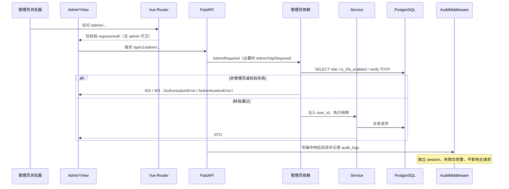

# CygnusX 管理控制台架构（Admin Console）

> **用途**：汇总"系统管理"入口的完整实现——前端导航与路由、`/api/v1/admin/*` 18 个路由模块、五套管理员依赖、TOTP 二次校验覆盖面、配置写入方式、审计落库与可观测管理面。
> **类型**：as-built（2026-10-21 代码基线）。
> **适用范围**：`frontend/src/layouts/{DefaultLayout.vue,navigationRegistry.ts}`、`frontend/src/router/index.ts` 的 `/admin/*` 段、`src/cygnusx/api/v1/admin/`、`src/cygnusx/tools/blast/api.py` 的 `/blast/admin/*`、`middleware/rbac.py`、`api/deps.py` 的管理依赖、`middleware/audit.py`。
> **不适用范围**：用户身份与 RBAC 基础模型（见 [CygnusX_identity_access_architecture.md](CygnusX_identity_access_architecture.md)）；饼干账户/定价业务（见 [CygnusX_cookie_economy_architecture.md](CygnusX_cookie_economy_architecture.md)）；Skill/MCP 业务语义（见 [CygnusX_skill_mcp_integration_architecture.md](CygnusX_skill_mcp_integration_architecture.md)、[CygnusX_mcp_architecture.md](CygnusX_mcp_architecture.md)）；记忆模型（见 [CygnusX_memory_architecture.md](CygnusX_memory_architecture.md)）；通知/公告业务（见 [CygnusX_notification_engagement_architecture.md](CygnusX_notification_engagement_architecture.md)）；工作区归档生命周期（见 [CygnusX_research_loop_architecture.md](CygnusX_research_loop_architecture.md)）。

## 这个模块如何发挥作用

管理控制台不是独立应用，而是主前端里一组"仅管理员可见"的页面 + 一组"仅管理员可调用"的 API。前端用 `authStore.user.role === 'admin'` 控制菜单显隐；后端用实时查库的管理员依赖做最终裁决。前端隐藏菜单**不是**安全边界——路由本身只声明 `requiresAuth`，普通登录用户直接输入 `/admin/users` 也能打开页面，页面数据请求由后端 403 拦截。

管理面按"业务对象"组织：用户与权限、饼干账本、AI Provider 与资源（MCP/Skill/助手/搜索/知识库/AgentTeams）、可观测（会话日志、AI 指标、数据库健康、任务统计、存储、终端）、运营（公告/节日/首页入口）、工作区归档、BLAST 数据库。所有管理写操作（POST/PUT/PATCH/DELETE）由全局 `AuditMiddleware` 落 `audit_logs`；高风险操作另叠加 TOTP。

## 1. 总体架构

```mermaid
flowchart TD
    subgraph Frontend[Vue 3 前端]
        NAV[DefaultLayout adminNavItems<br/>navigationRegistry sidebarGroup=admin] --> ROUTER[/admin/* 路由<br/>17 个 Admin*View]
        ROUTER --> VIEWS[视图 + 管理组件<br/>AdminTOTPConfirmModal / *Manager]
        VIEWS --> APICLIENT[src/api/admin/* · stores/agentHub.ts<br/>api/agent.ts · api/blast.ts]
    end

    APICLIENT -->|Bearer JWT| MW[TraceContext → RateLimit → Audit → CookieRequired → Auth → ModuleGate → CORS]
    MW --> ADMINAPI["/api/v1/admin/*<br/>18 个路由模块"]
    MW --> SIDEAPI["旁挂管理端点<br/>/site-settings · /announcements · /notifications · /blast/admin/*"]
    ADMINAPI --> DEP{管理员依赖}
    SIDEAPI --> DEP
    DEP -->|AdminRequired| ROLE[实时查库 role=admin]
    DEP -->|AdminTotpRequired| TOTP[role=admin + 已开 2FA + X-TOTP-Code]
    ROLE --> SVC[application/services]
    TOTP --> SVC
    SVC --> DB[(PostgreSQL)]
    SVC --> YAML[YAML 配置源<br/>studio.yaml / provider YAML / site content]
    SVC --> FS[日志文件 · 归档包 · 存储目录]
    SVC --> INFRA[Celery · sandbox manager · AgentTeams bridge]
    MW --> AUDIT[(audit_logs 异步写)]
```

### 实现图：一次管理员敏感写操作



## 2. 信息架构：菜单 → 路由 → 视图 → API

菜单 12 项定义在 `DefaultLayout.vue` 的 `adminNavItems`，同时 `navigationRegistry.ts` 保存一份 `sidebarGroup='admin'` 的镜像定义；两处需同步修改。

| 菜单 | 路由 | 视图/组件 | 前端 API | 后端路由 | TOTP |
|---|---|---|---|---|---|
| 用户管理 | `/admin/users` | `AdminUserManagementView.vue` + AddUser/QuotaEdit/NoteEdit/ModulePermissions 弹窗 | `apiClient` 直调 | `/admin/users/*` | 删除用户需 TOTP |
| 记忆审计 | `/admin/memory` | `AdminMemoryView.vue` | `apiClient` 直调 | `/admin/users/{id}/memories`、`/memory-overview`、`/admin/users/consolidation-runs/{key}/rollback` | 否 |
| 会话日志排查 | `/admin/session-logs` | `AdminSessionLogsView.vue` | `api/admin/sessionLogs.ts` | `/admin/session-logs/*` | 否 |
| 数据库健康 | `/admin/database-health` | `AdminDatabaseHealthView.vue` | `api/admin/database.ts` | `/admin/database/health`、`/drift` | 否（只读） |
| AI 指标仪表盘 | `/admin/ai-metrics` | `AdminAiMetricsView.vue` | `api/admin/aiMetrics.ts` | `/admin/ai-metrics/*` | 否（只读） |
| AI 配置中心 | `/admin/ai-config/providers`、`/admin/ai-config/resources` | `AdminAIConfigCenterView.vue`（两 Tab） | `api/admin/ai_provider.ts`、`agentHub.ts`、`api/agent.ts` | `/admin/ai-providers/*`、`/admin/skills/*`、`/admin/assistants/*`、`/admin/agents/*`、`/admin/search-providers/*`、`/admin/knowledge-bases/*`、`/admin/agentteams-bridge/*` | 否 |
| 首页入口管理 | `/admin/home-quick-entries` | `AdminHomeQuickEntriesView.vue` | `apiClient` 直调 | `GET /platform/config`、`PATCH /admin/platform-config` | 是（home_quick_entries 属敏感字段） |
| 饼干中心 | `/admin/biscuits/accounts`、`/admin/biscuits/pricing` | `AdminBiscuitsCenterView.vue` | `stores/adminCookie.ts` | `/admin/cookies/*` | 否 |
| 通知公告 | `/admin/announcements` | `AdminAnnouncementsView.vue`（AnnouncementManager + FestivalManager） | `apiClient` / `api/admin/festival.ts` | `/announcements/*`、`/admin/festivals/*` | 否 |
| 沙盒终端管理 | `/admin/terminals` | `AdminTerminalManagementView.vue` | `apiClient` 直调 | `/admin/terminals`、`DELETE /admin/terminals/{session_id}` | 否 |
| BLAST 数据库管理 | `/admin/blast-databases` | `AdminBlastDatabasesView.vue` | `api/blast.ts`（admin 段） | `/blast/admin/databases/*`（tools 自动发现挂载） | 否 |
| 工作区归档管理 | `/admin/workspace-archive` | `AdminWorkspaceArchiveView.vue` | `api/admin/workspaceArchive.ts` | `/admin/workspace-archive/*` | 否 |

补充说明：

- **旧路由重定向**：`/admin/cookies/accounts`、`/admin/cookies/pricing`、`/admin/ai-providers`、`/admin/ai-resources` 仅为兼容旧书签，分别重定向到饼干中心或 AI 配置中心。
- **未在菜单中的历史视图**：`AdminCookieManagementView.vue`、`AdminCookiePricingView.vue`、`AdminAIProvidersView.vue`（作为内嵌 Tab 复用）、`AdminAIResourceCenterView.vue`（内嵌 Tab）仍存在，部分仅被其他视图引用。
- **AI 配置中心的两级 Tab**：`AdminAIConfigCenterView` 顶层"模型配置 / 资源中心"；资源中心内再分"MCP 服务 / 技能 / 助手 / 联网搜索 / 知识库 / AgentTeams"六 Tab，Tab 状态不进入 URL，无法深链到具体资源 Tab。
- **BLAST 不在 `/admin` 前缀下**：管理端路由定义在 `src/cygnusx/tools/blast/api.py`（`/blast/admin/*`），由 `register_tool_routers()` 自动挂载；审计中间件按路径启发式解析资源时记为 `blast`，不会归入 admin 资源。

## 3. 访问控制模型

### 3.1 五套管理员依赖（同一语义、五个对象）

| 位置 | 实现方式 | 返回类型 | 当前消费者 |
|---|---|---|---|
| `middleware/rbac.py:43` | `SELECT role` 查库 | `None` | `admin/session_logs.py`、`admin/database.py`、`stats.py`、`storage.py`、`terminals.py`、`workspace_archive.py`、`tools/blast/api.py` 等 |
| `api/deps.py:160` | Repository 查库 | `str`（user_id） | `admin/database.py`（部分）、`llm.py` 等 |
| `admin/users.py:23` | **re-export** `middleware/rbac.AdminRequired` | `None` | `admin/skills.py`、`admin/agents.py`、`admin/assistants.py`、`admin/ai_providers.py`、`admin/knowledge_bases.py` 从 users 模块导入 |
| `api/v1/notification.py:39` | 局部 `db.get(UserModel)` | `None` | 通知管理写接口 |
| `api/v1/announcements.py:24` | 局部 `db.get(UserModel)` | `None` | 公告写接口 |
| `api/v1/site_settings.py:19` | 局部实现，**自建 session factory** | `None` | 站点设置写接口 |

后果：只有"同一个函数对象"上的 `dependency_overrides` 才生效；测试若只覆盖 `middleware.rbac.require_admin`，不会影响 notification/announcements/site_settings 三个局部实现。返回 `None` 与 `str` 混用不影响 FastAPI 注入，但调用方不能假设依赖会返回 user_id。

### 3.2 TOTP 二次校验实际覆盖面

`AdminTotpRequired` 定义于 `api/deps.py:130`：非管理员 403、未开启 2FA 403、缺失/错误验证码 401。当前只有三处使用：

1. `DELETE /admin/users/{id}`（`admin/users.py:435`）——删除用户。
2. `PUT /site-settings`（`site_settings.py:41`）——所有站点设置更新一律要求 TOTP。
3. `PATCH /admin/platform-config`（`admin/platform_config.py`）——仅当改动字段超出白名单 `_NON_SENSITIVE_PLATFORM_KEYS`（灰度开关、协作降级文案等）时要求 TOTP。

以下高影响操作目前**只有角色校验、无 TOTP**：修改用户角色、模块权限、额度、状态；饼干余额调整/冻结/停用；AI Provider 配置与密钥更新；Search Provider 更新；Skill 删除/回滚/导入；Agent/Assistant 删除；AgentTeams Worker Token 签发；工作区归档删包/配置改写；终端会话强制销毁；BLAST 数据库删除/重建。前端 `AdminTOTPConfirmModal.vue` 已具备通用交互，但目前主要被用户删除和首页入口保存使用。

### 3.3 前端守卫

- 路由守卫（`router/index.ts` 的 `beforeEach`）只处理登录态、首次部署 `/setup`、模块注册表加载与标题；**没有角色校验**。
- 菜单通过 `<template v-if="isAdmin">` 隐藏；`DefaultLayout` 的折叠/移动端两套渲染共用同一份 `adminNavItems`。
- 因此"看不到入口"与"打不开页面"是两件事：普通用户手动输入 URL 会渲染管理页骨架，随后各请求收到 403 并展示错误提示。若要形成前端边界，需在路由 `meta` 增加 `requiresAdmin` 并在守卫里按 `authStore.user.role` 拦截。

## 4. 管理面明细

### 4.1 用户与权限（`/admin/users`）

| 端点 | 作用 |
|---|---|
| `GET /admin/users` | 用户列表（状态过滤、分页、含饼干余额/模块禁用集合） |
| `POST /admin/users` | 管理员直接创建用户（bcrypt 哈希，状态置 `active`） |
| `PUT /{id}/approve` / `PUT /{id}/reject` | 注册审批；approve 允许 `pending` 与 `rejected` 重新捞回，reject 写字符串 `rejected` |
| `PUT /{id}/role` | 管理员/普通用户切换 |
| `PUT /{id}/quota` | 用户配额 |
| `PUT /{id}/note` | 管理备注 |
| `PUT /{id}/modules` | 模块禁用集合（`disabled_modules`，管理员恒为全开通） |
| `PUT /{id}/status` | `active/inactive/locked/pending` |
| `DELETE /{id}` | 删除用户（**TOTP**） |
| `GET /{id}/memories`、`GET /{id}/memory-overview` | 记忆事实与分区概览 |
| `POST /consolidation-runs/{run_key}/rollback` | 记忆整理按 run 回滚（支持 dry-run） |

前端管理员行的模块开关是"焊死"的，点击会触发前端彩蛋（`adminEggQuips` 随机文案），不发起请求。`UserStatus` 枚举只有 `active/inactive/locked/pending`，但审批拒绝写入 `"rejected"` 字符串，属于已知枚举缺口（详见身份架构文档）。

### 4.2 饼干中心（`/admin/cookies`）

19 个端点覆盖账户查询、余额调整、冻结/解冻/停用、交易流水（含过滤）、统计、定价 CRUD、折扣 CRUD、对账与异常检测、日账本。业务语义与账本不变式见饼干经济架构文档；管理端只是对 `CookieService` / `CookieMonitorService` 的编排，不直接改账。

### 4.3 AI 配置中心

**模型配置（`/admin/ai-providers`）**

- `GET /routing-decisions`、`GET /routing-decisions/summary`：动态模型路由决策审计（直查 `model_routing_decisions`）。
- `GET /templates`、`GET/POST/PUT/DELETE`：Provider 配置 CRUD、模型发现。
- `POST /sync-yaml`：从 YAML 同步配置；`POST /runtime/reload`：触发运行时重载。
- 配置与模型路由语义见 [CygnusX_model_routing_architecture.md](CygnusX_model_routing_architecture.md)。

**资源中心（`/admin/ai-config/resources`）**

| Tab | 后端 | 关键能力 |
|---|---|---|
| MCP 服务 | `/admin/mcp*`（`api/v1/mcp.py`） | Preset/外部 Server 管理、测试（见 MCP 架构文档） |
| 技能 | `/admin/skills/*` | CRUD、开关、回滚、版本、引用、调用统计、五入口导入（JSON/ZIP/Markdown/GitHub/阿里云市场）、预览确认、市场同步 |
| 助手 | `/admin/agents/*`、`/admin/assistants/*` | Agent 模板与旧版 Assistant CRUD、toggle、set-default |
| 联网搜索 | `/admin/search-providers/*` | 列表、可用性、更新、设默认、连通性测试 |
| 知识库 | `/admin/knowledge-bases/*` | 知识库 CRUD 与文档列表 |
| AgentTeams | `/admin/agentteams-bridge/*` | 桥接配置读写、健康、资源、指标、Case 对账、Worker Token 列表/签发 |

技能导入与 Agent 装配细节见 [CygnusX_skill_mcp_integration_architecture.md](CygnusX_skill_mcp_integration_architecture.md)；AgentTeams 执行面见 [CygnusX_agent_execution_framework.md](CygnusX_agent_execution_framework.md)。

### 4.4 可观测管理面

| 页面 | 端点 | 数据来源 | 要点 |
|---|---|---|---|
| 会话日志排查 | `/admin/session-logs/sessions`、`/feedbacks`、`/{session_id}/events`、`/traces/*`、`/report`、`/events/export` | `chat_sessions` + loguru JSON 日志文件 + span store | 默认只读当前活动日志；`include_archives=true` 扫描轮转/zip；SQL 事件默认脱敏为长度+哈希，`reveal_sensitive=true` 才返原文；每次访问写 `session_logs.access` 审计 |
| AI 指标 | `/admin/ai-metrics/trend`、`/models`、`/alerts/status`、`/alerts/history`、`/routing/health` | `ai_call_metrics` 等 | 调用量/错误率/token/成本/延迟（avg+p95）按日序列与汇总；见 token 计费文档 |
| 数据库健康 | `/admin/database/health`、`/drift` | `alembic_version`、`information_schema`、连接池 | 迁移版本与代码 head 对齐、表数量、池占用、只读副本；drift 与 `scripts/check_schema_drift.py` 同逻辑，忽略 `alembic_version` 与 `mem0_memories` |
| 任务统计 | `/admin/stats/status`、`/flows`、`/users`、`/recent-failed` | `tasks` 等 | 全平台任务状态分布、流程使用占比、用户活跃度、近期失败 |
| 存储监控 | `/admin/storage/usage` | 磁盘 + 用户目录 | 全局容量 + Top N 用户占用 |
| 终端管理 | `/admin/terminals`、`DELETE /{session_id}` | `TerminalService` / studio manager | 全量活跃沙盒终端、实时资源、强制销毁 |

### 4.5 运营与平台配置

- **公告**：`/announcements/*` 写接口由局部 `require_admin` 保护；管理页 `AnnouncementManager.vue`。
- **节日**：`GET /admin/festivals`、`PUT /admin/festivals/{id}`、`POST /admin/festivals/reload`；管理页 `FestivalManager.vue`（内嵌于通知公告页）。定义源仍是 `data/festival_config.yaml`。
- **首页快捷入口**：公开读 `GET /platform/config`，管理员 `PATCH /admin/platform-config` 写；`home_quick_entries` 不在免 TOTP 白名单，因此保存必须带 `X-TOTP-Code`。
- **协作观测**：`GET /admin/platform-config/collaboration-observability`、`GET /admin/agentteams/consultation-telemetry`，供 AgentTeams 桥接 Tab 展示近 7 天降级与会诊质量。
- **站点设置双写面**：同一 `SiteSettingsService` 同时暴露 `PUT /site-settings`（无 `/admin` 前缀、恒要求 TOTP）和 `PATCH /admin/platform-config`（条件 TOTP）；修改敏感字段时两者都可用，容易造成"到底该改哪条路径"的口径分裂。

### 4.6 工作区归档（`/admin/workspace-archive`）

- `GET /overview`：归档总览（会话、包、容量）。
- `POST /sessions/{session_id}/dormant`：强制休眠打包。
- `DELETE /packages/{package_id}`：删除归档包。
- `PUT /config`：限额与保留天数热更。写回 `studio.yaml` 采用"按行定向改写 + 临时文件 + `os.replace`"原子写，依赖 Studio 配置 mtime 热重载；只允许 `workspace_gb/archive_gb/active_days/dormant_days/archive_retention_days` 五个键，且仅做下限校验。归档生命周期与调度见科研闭环/存储架构文档。

### 4.7 BLAST 数据库管理

管理端点位于 `/blast/admin/*`：库列表、分片上传初始化/分片/完成、创建、构建状态、重建、激活、删除、从 YAML 同步、任务列表、存储统计、批量清理。前端 `AdminBlastDatabasesView.vue` 通过 `api/blast.ts` 的 admin 段调用。参考基因组模块背景见 [CygnusX_database_architecture.md](CygnusX_database_architecture.md) §11。

## 5. 配置写入与热生效

| 管理面 | 写入目标 | 生效方式 |
|---|---|---|
| AI Provider | DB `ai_provider_configs` + YAML 同步 | `POST /runtime/reload` 或配置热重载 |
| Agent/Assistant | DB `agent_templates` / assistant 表 | 下一次请求装配时读取；提示词需发布 |
| Skill | DB 三表 + `data/ai/skills/` 磁盘真相源 | 服务层即时读；导入确认后落盘 |
| 站点设置/首页入口 | DB 单例 | 下次读取即生效；前端缓存需刷新 |
| 节日 | `data/festival_config.yaml` | `POST /admin/festivals/reload` 或 mtime |
| 工作区归档 | `studio.yaml` | mtime 热重载（原子替换文件） |
| BLAST 库 | DB + YAML + 存储目录 | 激活/重建任务异步执行 |
| 搜索 Provider | DB + 可能 YAML | 服务层读取；测试端点即时验证 |

管理端写配置的共同约定：DB 与 YAML 双写时以"YAML 为可回放源、DB 为运行时投影"为常见模式，但各模块并不完全一致（Provider 有 `sync-yaml`，Skill 以磁盘为真相源，节日只有 YAML）。修改前先在对应领域文档确认权威源，不能假设所有管理面都同构。

## 6. 审计

- `AuditMiddleware`（`middleware/audit.py`）对所有 `POST/PUT/PATCH/DELETE` 记录：`user_id/username`（来自 AuthMiddleware 注入的 `request.state.user_id`）、method/path、启发式解析的 `resource_type/resource_id`、status_code、ip、user_agent。使用独立 session 写 `audit_logs`，DB 异常仅告警，不影响主请求；GET 与静态资源不记录。
- 会话日志排查的每次访问额外写 `session_logs.access` 审计（含是否揭示敏感原文）；导出 CSV。
- 工作区归档在删包等操作中直接写 `AuditLogModel`（与中间件记录并存）。
- 审计中间件依赖 `request.state.user_id`；由于注册顺序中 Auth 在 Audit 之后执行（见身份架构文档的中间件顺序缺陷），实际 user_id 可能为空，需以路径 + 时间 + Nginx 日志交叉定位。这是全平台审计的共性问题，不只是管理端。

## 7. 前端实现要点

- 管理视图统一位于 `frontend/src/views/Admin*View.vue`（扁平目录，无 `views/admin/` 子目录）。
- 专用 API 模块位于 `frontend/src/api/admin/`：agentTeamsBridge、aiMetrics、ai_provider、announcements、database、festival、knowledgeBase、notifications、searchProvider、sessionLogs、workspaceArchive；其余管理面通过 `apiClient` 直调或复用 `stores/adminCookie.ts`、`stores/agentHub.ts`、`api/agent.ts`、`api/blast.ts`。
- 通用组件：`AdminTOTPConfirmModal.vue`（6 位验证码、回车确认）、`components/admin/` 下的各 Tab/Manager、`components/admin-cookie/`、AddUser/QuotaEdit/NoteEdit/ModulePermissions 弹窗。
- 导航定义重复：`DefaultLayout.vue` 的 `adminNavItems` 与 `layouts/navigationRegistry.ts` 各维护一份；新增菜单需同步两处，并决定是否需要新路由与视图。
- 管理页没有统一布局容器；部分页面自带 `PageHeader`，部分以 Tab 内嵌方式复用（`embedded` prop）。

## 8. 已知偏差与风险

| # | 风险 | 证据 | 影响 |
|---|---|---|---|
| 1 | 五套管理员依赖并存 | `middleware/rbac.py`、`api/deps.py`、`notification.py`、`announcements.py`、`site_settings.py` | 测试覆盖、行为一致性、未来收紧（如统一加审计/TOTP）都要改多处 |
| 2 | 前端无 admin 路由守卫 | `router/index.ts` 全部 `/admin/*` 仅 `requiresAuth` | 普通用户可渲染管理页骨架；依赖后端 403，页面体验与信息暴露不理想 |
| 3 | TOTP 覆盖面窄 | 仅用户删除、站点设置、平台敏感字段三处 | 改角色、发 Worker Token、改 Provider 密钥、删库等高影响操作只需被盗管理员 JWT 即可执行 |
| 4 | 站点设置双写面 | `PUT /site-settings` vs `PATCH /admin/platform-config` | 敏感字段两条路径、TOTP 策略不一致（前者恒验、后者条件验） |
| 5 | 导航定义重复 | `DefaultLayout.vue` + `navigationRegistry.ts` | 漏改一处会出现菜单与路由/权限提示不一致 |
| 6 | AI 资源 Tab 不可深链 | `AdminAIResourceCenterView.vue` 使用组件内 Tab，无 query/route | 无法把"技能管理"或"MCP 服务"直接分享给同事 |
| 7 | BLAST 管理面游离在 `/admin` 前缀外 | `tools/blast/api.py` 的 `/blast/admin/*` | 管理端点清单、审计资源分类、访问日志检索容易遗漏 |
| 8 | 会话日志依赖本地文件 | `admin/session_logs.py` 扫描 `cygnusx.json.log` | 多副本部署只能看到本机日志；zip 归档扫描成本高；无跨副本聚合 |
| 9 | 敏感日志揭示无 TOTP | `reveal_sensitive=true` 仅写审计 | 拥有管理员会话即可查看含用户聊天原文的 SQL 事件 |
| 10 | 归档配置仅下限校验 | `WorkspaceArchiveConfigUpdate` 各字段 `ge` | 可写出与磁盘容量不符的上限，运行期才暴露 |
| 11 | 旧管理视图残留 | `AdminCookieManagementView.vue`、`AdminCookiePricingView.vue` 等未在菜单 | 代码维护面扩大，易与新饼干中心行为漂移 |
| 12 | 用户状态枚举缺口 | `UserStatus` 无 `rejected`，审批写字符串 | 类型检查无法覆盖，统计/过滤依赖字符串约定 |

## 9. 关键文件索引

| 层 | 路径 |
|---|---|
| 前端导航 | `frontend/src/layouts/DefaultLayout.vue`、`frontend/src/layouts/navigationRegistry.ts` |
| 前端路由 | `frontend/src/router/index.ts`（`/admin/*` 段） |
| 管理视图 | `frontend/src/views/Admin*View.vue`（17 个） |
| 管理 API | `frontend/src/api/admin/*`、`frontend/src/stores/adminCookie.ts`、`frontend/src/stores/agentHub.ts`、`frontend/src/api/agent.ts`、`frontend/src/api/blast.ts` |
| 管理组件 | `frontend/src/components/AdminTOTPConfirmModal.vue`、`frontend/src/components/admin/*`、`frontend/src/components/admin-cookie/*` |
| 后端路由 | `src/cygnusx/api/v1/admin/*.py`（18 个路由模块，包内共 19 个文件）、`src/cygnusx/api/v1/router.py:106-146` |
| 管理依赖 | `src/cygnusx/middleware/rbac.py:43`、`src/cygnusx/api/deps.py:130-177` |
| 审计 | `src/cygnusx/middleware/audit.py`、`session_logs.py` 的 `session_logs.access`、`workspace_archive.py` 的直接审计写 |
| 旁挂管理端点 | `src/cygnusx/api/v1/{site_settings,announcements,notification,platform_config}.py`、`src/cygnusx/tools/blast/api.py` |
| 配置写入 | `src/cygnusx/api/v1/admin/workspace_archive.py`（studio.yaml 原子写）、`admin/ai_providers.py`（sync-yaml/runtime reload）、`admin/festival.py`（reload） |

## 10. 修改验证清单

- 新增/调整管理菜单：同步 `DefaultLayout.vue` 与 `navigationRegistry.ts`，确认移动端折叠菜单与路由 `meta.title`；若引入新权限层，同时在路由守卫补 `requiresAdmin`。
- 新增管理 API：明确使用哪一套 `AdminRequired`；优先复用 `middleware/rbac.require_admin`，不要继续复制局部实现；涉及高风险操作时改用 `AdminTotpRequired` 并在前端接 `AdminTOTPConfirmModal`。
- 修改敏感配置写入：确认写入权威源（DB/YAML/磁盘）、热生效方式与回滚路径；站点设置类改动检查是否需要同时改两条端点。
- 管理端写操作：确认 `AuditMiddleware` 能解析出合理 `resource_type`；BLAST 等非 `/admin` 前缀端点要额外验证日志可检索性。
- 前端：`npm run type-check && npm test`；动路由/菜单再加 `npm run build`。手工验证普通用户直访 `/admin/users` 的行为符合预期（当前为 403 提示）。
- 后端：`uv run ruff check src/ tests/`、`uv run mypy src/cygnusx/`，以及 `uv run pytest tests/unit -q -m "not quarantine"`；涉及依赖覆盖的测试确认 override 的是实际使用的函数对象。
