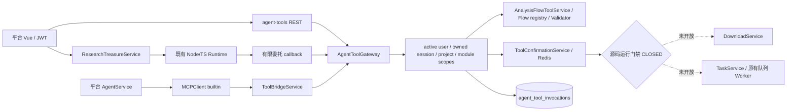
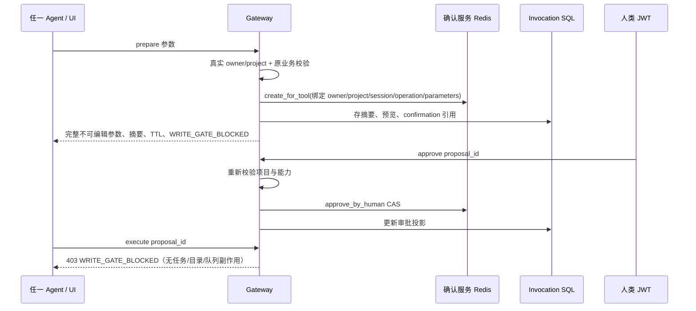

# CygnusX 共享 Agent 工具层（as-built）

本文描述 BioOps Phase 2 当前源码，而非已部署能力。当前为 **IMPLEMENTED / WRITE BLOCKED**；
`tool_gateway_read_enabled` 默认 false。Phase 0B Closure 为 BLOCKED、Phase 1 为
PARTIAL/BLOCKED，真实 Redis、HTTP/STDIO MCP、Node→平台网络、Worker 和双用户全栈
仍缺运行验收。环境变量不能解除源码中的 `WRITE_RUNTIME_ACCEPTED=False`。

## 权威与边界

- `application/schemas/agent_tools.py` 是版本化共享 capability schema 唯一源；
  `scripts/export_agent_tool_contracts.py` 生成 JSON 交付视图，Node 不维护业务 Schema 副本。
- `AgentToolGateway` 在主 FastAPI 进程执行。没有新增网关进程、检索引擎或任务执行引擎。
- 平台 AI：AgentService 权限裁剪 → cygnusx-tools builtin → MCPClient → ToolBridgeService → Gateway。
- 寻宝鼠保留 Node/TS LLM loop 和已有 GEO/SRA/文献工具；平台 BFF 签发有限委托，
  Node 用固定 `CYGNUSX_TOOL_CALLBACK_URL` 回调 Gateway。浏览器也可通过同一 BFF REST 检查预案。
- Flow discover/describe/prepare 复用 AnalysisFlowToolService；下载最终适配复用 DownloadService；
  分析最终适配复用 TaskService。执行适配器仅在隔离测试中解锁源码门禁并使用业务 doubles。
- **下载能力细节见 [平台下载模块架构](CygnusX_download_architecture.md)**——三来源传输、Worker/CLI 分发、FileRegistry 登记、源码门禁与 DL-RG 验收一律以该文为准，本文只保留 Gateway 侧的目录/审批/恢复接入点。

## 身份、项目与权限

Principal 来自既有 JWT/API-Key owner resolver；模型参数禁止 owner/project/scopes/布尔确认等
未声明字段。Gateway 从真实 active ChatSessionModel 派生 agent_kind 与 project_id，查询
ProjectModel.user_id；不从 `projects/<slug>` 路径判断授权。每次 invoke、approve、restore 和
execute 重新检查；项目删除、转移、会话换项目均拒绝旧关联访问。

权限取既有 disabled_modules（管理员沿用现行全开规则）。发现端点和 AgentService 都做
Schema 裁剪，直接调用再检查，Node 委托 scope 与最新服务端 scope 取交集。
签名委托使用独立 JWT key domain、固定 issuer/audience、exp、jti、token_version、
user/session/project；每个 callback UUID 在 Redis NX 防重放。Redis 不可用返回 503。
委托不含 execute/approve 能力，不进入模型 messages。登出撤销若未提升 token_version，
仍以短 TTL 为边界；没有新增独立即时登出撤销引擎。

## 预案与审批

AnalysisFlowToolService.prepare 新增内部 `create_confirmation=False`，仅共享适配器使用，
避免创建第二份 legacy 审批记录；原默认 prepare 返回语义保留。共享分析预案启用
`strict_input_paths`：路径必须在 owner 根下，FASTQ 目录必须真实存在且含用户内 FASTQ；
现有最终 Validator 也拒绝把矩阵文件作为 RNA/ATAC raw input。当前不保证 FASTQ 内容、
每个样本配对及参考环境已验收，不能开放 Worker。

下载预案只接受格式合法的 SRR/PRJNA 候选，运行验证集合为空。GSE/GSM 返回
NEEDS_METADATA_RESOLUTION。目标由真实项目 slug 派生并用现有目录规范及 realpath
检查；不创建目录、不 dry_run、不入队。未知规模/配额预算明确 unknown，任意 URL、
GEO processed matrix、counts-only DEG 不受支持。

## 持久关联与恢复

新增 `agent_tool_invocations`（迁移 bioopsphase2，接 reportauditphase1）。存 owner、
project、conversation、agent_kind、capability、request、参数摘要、确认引用、task 引用、
状态和有限预览。不存 Token、原始私有对话或确认 secret；完整执行参数只在既有 Redis
确认记录 TTL 内存在。关联 ID 保留 tombstone，资源删除不会降级成全局授权。

Related 查询按 owner/session/project；Task 状态仍来自原 TaskService。进度无法证明时
返回 null/unavailable。确认 TTL 到期后预览摘要仍在 SQL，执行参数及再次审批不可恢复，
必须重新 prepare。SUBMITTING 持久预留后才触及业务 Service，超时不重放；Task 已创建但
关联写回失败需要人工对账。源码路径含 DB row lock + Redis CAS，但只验证了 SQLite/
memory-confirmation/业务 doubles；不宣称 PostgreSQL 多进程或跨 DB/queue exactly-once。

旧 MCP write dispatch、旧内置下载 handler、AnalysisFlowToolService.confirm_and_submit、
API-Key /tasks /downloads /cancel 均在业务边界前检查运行门禁。普通人类任务表单保留原
提交入口；Agent 审批卡现在只能记录批准，不能创建 Task。

## 验证与回滚

S5-A只读目录增量（2026-10-16）：原`downloads.describe_capabilities`复用下载DTO/config投影十二类来源，区分代码、配置、未认证与执行阻断；按可信Agent/scope裁剪query_tools。委托验证将签名scope交集带入invoke，invoke重验后继续取交集；dataset.discover还要求read:discovery，避免downloads模块禁用后仍可解析。项目Dataset列表补最近200版本的有界ID发现，资产仍走原inspect/list_files；无项目Task fallback安全拒绝。没有新Gateway/工具输入Schema/审批或执行路径，读开关及写门禁均保持原语义。测试与接续条件见[S5-A报告](../docs/implementation/download-s5a-capability-catalog.md)。

实施和 G0–G14 证据见 `docs/implementation/cygnusx-phase2-shared-agent-tool-orchestration.md`。
先关闭读开关和 Node callback 配置，保留 SQL/Task/审计事实。未授权迁移/部署本轮均未执行。
发布前须在隔离 PostgreSQL 验证迁移、row-lock/失败恢复和 schema drift，再验证 Node/MCP
真实 Transport、双用户、Redis 和 Worker；不能仅把环境写开关改 true。

S5-C1 代码隔离闭环（2026-10-17）：平台聊天缺少 scopes 时沿原 context 派生，校验已有项目/Agent 绑定；已有受限上下文仍取 scope 交集。builtin BioOps 保留业务失败状态且拒绝后不切换执行器；目录回灌优先保留服务端执行门禁字段。双 Runtime 完整轮次与权限隔离验证通过，真实运行及执行准入不变。范围与遗留检查见 [C1 报告](../docs/implementation/download-s5c1-agent-runtime-code-closure.md)。
