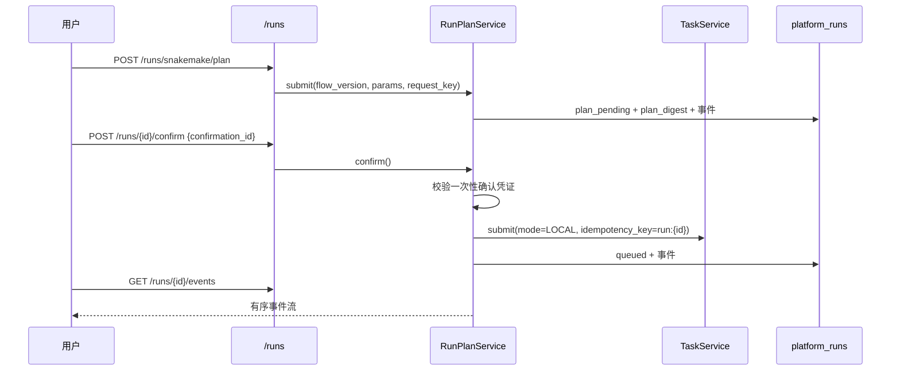

# CygnusX 分析任务运维与监控架构（Analysis Operations）

> **用途**：记录分析任务周边的运维面：定时日程（RRULE/occurrence/delivery）、工作流监控（模板/事件接入/WebSocket）、平台运行（plan → confirm → events → artifacts）、统计与 AI 指标告警、事后统计检验。
> **类型**：as-built（2026-10-21 代码基线）。
> **适用范围**：`/api/v1/schedules/*`、`/api/v1/runs/*`、`/api/v1/workflow-monitor/*`、`/api/v1/stats/*`、`/api/v1/admin/{stats,ai-metrics}/*`、`schedules`/`schedule_occurrences`/`reminder_deliveries`/`platform_runs`/`platform_run_events`/`ai_call_metrics`/`ai_metric_alerts` 表、Dashboard/WorkflowMonitor/Schedules/AdminAiMetrics 页面。
> **不适用范围**：任务提交九步链与 Flow YAML 编译（见 [CygnusX_flow_architecture.md](CygnusX_flow_architecture.md)）；Celery 队列拓扑、Worker/Beat 部署与 RocketMQ 传输（见 [CygnusX_async_task_queue_architecture.md](CygnusX_async_task_queue_architecture.md)）；工具箱业务路由（见 [CygnusX_toolbox_architecture.md](CygnusX_toolbox_architecture.md)）；token/费用口径（见 [CygnusX_token_billing_architecture.md](CygnusX_token_billing_architecture.md)）；提醒投递到通知中心的细节（见 [CygnusX_notification_engagement_architecture.md](CygnusX_notification_engagement_architecture.md)）；模型路由（见 [CygnusX_model_routing_architecture.md](CygnusX_model_routing_architecture.md)）。

## 这个模块如何发挥作用

分析执行本身由 Flow/Toolbox 文档描述；本文覆盖它周围的四类"运维能力"：

1. **定时日程**：用户用 RRULE 创建重复任务/提醒，系统预生成 occurrence 与 delivery；调度器以 Redis 租约防并发，到期投递。
2. **工作流监控**：Snakemake/执行器通过受 token 保护的 ingest 端点推送事件，平台更新任务进度、缓存快照，并通过 WebSocket 或 5 秒轮询展示。
3. **平台运行（Run）**：把一次 Snakemake 执行建模为 `plan_pending → confirmed → queued → running → …`，计划摘要与确认凭证一次性消费，事件序列不可变。
4. **统计与告警**：用户/管理员仪表板、AI 调用趋势与 P95、路由健康、成本告警、事后多重比较。

## 1. 总体架构

```mermaid
flowchart TD
    subgraph User[用户/管理员]
        S[ScheduleService<br/>RRULE]
        R[RunPlanService<br/>plan/confirm]
        D[Dashboard / WorkflowMonitor]
    end
    subgraph Scheduler[调度]
        BEAT[Celery beat]
        SCAN[scan_due_schedules<br/>Redis lease]
        RETRY[retry_failed_deliveries]
    end
    subgraph Exec[执行器]
        EX[Snakemake / Flow executor]
        PLUGIN[workflow-monitor plugin]
    end
    subgraph Monitor[监控]
        ING[/workflow-monitor/events<br/>token + HMAC/]
        WMS[WorkflowMonitorService]
        WS[WebSocket /ws]
    end
    subgraph Stats[统计]
        SS[StatsService]
        AMS[AiMetricsService]
        PLOT[/stats/posthoc]
    end
    S --> DB[(schedules/occurrences/deliveries)]
    BEAT --> SCAN --> DB
    BEAT --> RETRY --> DB
    R --> RUN[(platform_runs/run_events)]
    R --> TS[TaskService.submit]
    EX --> PLUGIN --> ING --> WMS
    WMS --> DB2[(tasks + Redis pubsub)]
    WMS --> WS --> D
    D --> SS
    D --> AMS
    SS --> DB3[(tasks/studio/ai metrics/cookies)]
    AMS --> DB3
    PLOT --> D
```

### 实现图：Run 计划确认



## 2. 定时日程

### 2.1 数据模型

- `schedules`：owner、标题/内容、`rrule`、`timezone`、起止、状态（active/paused/cancelled/completed）、`next_fire_at`、`workspace_id`、`team_id`、`metadata_json`、`version`。
- `schedule_occurrences`：日程 FK、occurrence 时间、投递状态，`(schedule, occurrence_key)` 唯一。
- `reminder_deliveries`：occurrence/schedule/user FK、渠道、状态、尝试次数、错误、`sent_at`、`notification_id` FK。

### 2.2 生命周期

- 创建/更新：校验 RRULE 与时区，物化未来 30 天的 occurrence 与 delivery；修改重复规则时抑制旧的 pending delivery 与过期 occurrence。
- 状态：active/paused/cancelled/completed；取消/完成会停止后续 occurrence。
- 用户 API：`GET/POST /schedules`、`GET/PATCH /schedules/{id}`、`POST /{id}/cancel`、`/{id}/complete`、`GET /{id}/occurrences`、`/{id}/deliveries`。
- 提醒 API：`POST /reminders/{delivery_id}/snooze`、`/complete`。

### 2.3 调度与投递

- Beat 每 30 秒 `schedule-scan-due`：Redis lease `cygnusx:schedules:scan:lease`（60 秒），`FOR UPDATE SKIP LOCKED` 取 `next_fire <= now` 的 active 日程。
- 触发 occurrence，推进 `next_fire_at`；`_enqueue_due_deliveries` 把 pending 改为 sending 并入 `schedules` 队列。
- `deliver_reminder` 创建 `type=reminder` 通知并标记 sent；失败按 60×2^n 退避，最多 5 次；每 300 秒重试失败投递。
- AI 工具 `schedule` 也可创建日程，支持中文自然时间解析；所有权校验在工具层。
- **部署缺口**：生产 worker 只消费 `analysis,blast_search,blast_db_build`，`schedules` 队列没有消费者；不改路由/worker 时提醒不会真正投递。完整队列拓扑与 Worker 部署矩阵见 [CygnusX_async_task_queue_architecture.md](CygnusX_async_task_queue_architecture.md) §4–§5。

## 3. 工作流监控

### 3.1 数据与模板

- 事件接入后更新 `tasks` 的进度/状态/日志，并写 Redis PubSub 快照；不单独建事件表（Redis 为热数据，任务行为权威）。
- 模板：`workflow_monitor_templates`（目录中的模板文件），支持列表/详情/重载；按角色与 scope 过滤；默认模板由配置指定。
- 配置：`workflow_monitor_enabled`、`template_dir`、`default_template`、`ingest_token`、`internal_url`、`plugin_token_env`、`signature_max_skew_seconds=300`、事件 TTL 86400、最近事件上限 1000、`stale_after=600`。

### 3.2 接入

- `POST /api/v1/workflow-monitor/events`：token 校验；可选 HMAC（时间戳/nonce/body hash），最大时钟偏移 300 秒。
- `POST /api/v1/workflow-monitor/loki/api/v1/push`：Loki 兼容推送，token 校验。
- 归一化器把不同来源事件映射为统一进度/状态/日志；错误事件写入任务错误信息。
- `_apply_event` 维护进度、pending/queued→running、日志追加与快照；查询时用快照缓存叠加。

### 3.3 查询与实时

- `GET /templates`、`GET /templates/{id}`、`POST /templates/reload`（Admin）。
- `GET /overview`、`GET /tasks/{id}/summary`、`GET /tasks/{id}/events`：仅管理员或任务所有者可见。
- `WS /ws`（全局）与 `WS /tasks/{task_id}/ws`：JWT query token；管理员看全局，普通用户看自己的任务。
- 前端 `WorkflowMonitorView.vue` + `stores/workflowMonitor.ts` + `useWorkflowMonitorWebSocket`；WebSocket 不可用时 5 秒轮询 `/overview`。
- 摘要：今日失败数、按 `stale_after` 判定停滞、10 分钟内 warning/error 计数。

## 4. 平台运行（Run）

### 4.1 数据

- `platform_runs`：`user_id` + `request_key` 唯一、`plan_json`、`plan_digest`、`status`、`task_id` 唯一、`confirmed_at`。
- `platform_run_events`：`(run_id, sequence)` 唯一、状态/阶段/进度/规则/payload、`occurred_at`、`published_at`。

### 4.2 流程

1. `POST /runs/snakemake/plan`：校验 Flow 版本等于 release_id；计算计划 SHA-256；`request_key` 幂等；写 `plan_pending` 与事件。
2. `POST /runs/{id}/confirm`：必须提供一次性 `confirmation_id`（`ToolConfirmationService`，工具名 `cygnusx_confirm_run_plan`）；`plan_pending → queued`；调用 `TaskService.submit(mode=LOCAL, idempotency_key="run:{id}")`；写事件。
3. `GET /runs/{id}/events`、`/artifacts`、`/{id}`：有序事件、按 `task_id` 关联文件产物。
4. Celery `tasks/analysis.py` 在预检证据校验后写 running/progress/final 事件。

只有 Snakemake 计划路径接入；确认凭证严格一次性，不能复用。

## 5. 统计与告警

### 5.1 用户统计（`/api/v1/stats`）

- `GET /overview`：任务/文件/运行计数等总览。
- `GET /trend`：按天趋势。
- `GET /studio`：Studio 用量（排除 AgentTeams），聚合 `studio_sandbox` 任务与 `sandbox_execute` 调用。
- `GET /ai-usage`：token 用量与按 CookieService 折算的费用，Decimal HALF_UP。
- `GET /progress`：当前用户目标/任务进度摘要。
- 缓存：用户 60 秒、管理员 300 秒，Redis 不可用时直查 DB。

### 5.2 管理端统计（`/api/v1/admin/stats`）

`GET /status`、`/flows`、`/users`、`/recent-failed`；用于运营大盘与失败排查。`AdminStatsPanel` 嵌入 Dashboard。

### 5.3 AI 指标（`/api/v1/admin/ai-metrics`）

- 数据：`ai_call_metrics`（provider/model/status/duration/tokens/session_id/created_at 索引）、`ai_metric_alerts`。
- 接口：`/trend`（计数/错误/Token/均值/P95）、`/models`、`/alerts/status`、`/alerts/history`、`/routing/health`。
- 告警：3 条基础规则 + 4 条路由规则；错误率 5%、窗口 5 分钟、P95 10 秒、成本比 1.5、冷却 30 分钟。
- Beat `ai-metrics-alert-check` 每 5 分钟调用 `tasks.ai_metrics.check_alerts`（告警评估入口；具体规则实现位于 `application/services/ai_metrics_service.py`）；告警会为第一个管理员创建全局通知。
- 前端 `AdminAiMetricsView.vue`。

### 5.4 事后统计检验（`/stats/posthoc`）

`POST /api/v1/stats/posthoc`：3–12 组，支持 Tukey/Dunn、`none/bonferroni/fdr_bh` 校正，返回紧凑字母标记；用于工具页面的组间比较展示。

## 6. 前端映射

| 页面 | 作用 |
| --- | --- |
| `DashboardView.vue` | 健康、Flow 统计、用户总览、最近失败任务、趋势图、Studio 用量、管理员统计、存储监控、快捷入口 |
| `WorkflowMonitorView.vue` | 运行中任务、事件流、模板渲染、WebSocket/轮询 |
| `SchedulesView.vue` + `stores/schedule.ts` | 日程列表与提醒管理 |
| `ProjectDetailView.vue` | run 计划/事件/产物（科研工作台） |
| `AdminAiMetricsView.vue` | AI 趋势、模型分解、告警、路由健康 |
| `CookieAccountView.vue` | AI 用量与费用 |

## 7. 配置、迁移与测试

- 配置：`schedule_scan_batch_size=100`、`schedule_max_delivery_attempts=5`；`workflow_monitor_*` 一组；`ai_alert_*` 一组；`enable_stats_cache`。
- 迁移：`schedules/occurrences/deliveries`、`platform_runs/run_events`、`ai_call_metrics/ai_metric_alerts`。
- 测试：`tests/unit/test_stats_service.py`、`test_ai_metrics_alerts.py`、`tests/integration/test_stats.py`、`test_plot_stats.py`。
- 缺口：`ScheduleService`、`WorkflowMonitorService`、`RunPlanService` 无独立单测；工作流监控 HMAC 可选。AI 指标告警已有 Beat 调度（`ai-metrics-alert-check`，每 5 分钟），但尚无告警评估器本身的回归单测覆盖说明。

## 8. 已知限制与风险

| 级别 | 问题 | 影响 |
| --- | --- | --- |
| 高 | `schedules` 队列在生产 compose 无消费者 | 提醒/定时任务不会真正执行 |
| 中 | 工作流监控仅管理员或任务所有者可见 | 团队成员/项目协作者看不到进度 |
| 中 | HMAC 可选 | 仅 token 时若泄露可伪造事件 |
| 中 | 告警规则的实际实现与 Beat 入口需分开核对 | Beat `ai-metrics-alert-check` 每 5 分钟触发 `check_alerts`；规则/阈值变化时仍需验证服务层实际评估路径 |
| 中 | 统计缓存仅 TTL，无主动失效 | 任务完成/失败后大盘最多滞后 60/300 秒 |
| 低 | Run 只接入 Snakemake plan 路径 | 其他流程没有统一的 plan/confirm/events |
| 低 | 工作流监控无独立事件表 | 历史事件仅 Redis 热数据，排查窗口有限 |
| 低 | 调度/监控无独立单测 | 回归依赖集成测试或人工 |

## 9. 与其他文档的边界

- **Flow**：任务九步链、YAML 编译、`TaskService.submit` 的完整契约在 Flow 文档；本文只描述 Run 包装层与监控接入。
- **Toolbox**：工具业务路由、镜像契约在工具箱文档；Celery include/route 的机制与缺口见异步队列文档。
- **Async Task Queue**：Celery 应用配置、逻辑队列、Worker/Beat/Flower 部署、`schedules` 队列消费缺口、RocketMQ 传输与可靠性语义统一回指 [CygnusX_async_task_queue_architecture.md](CygnusX_async_task_queue_architecture.md)。
- **Notification**：提醒如何落通知、用户 snooze/complete 的 UI 行为在通知文档；本文只描述调度与投递状态机。
- **Token billing**：AI 用量如何折算费用以计费文档为准；本文只描述统计查询与告警阈值。

## 10. 关键文件索引

| 层 | 文件 |
| --- | --- |
| 日程 | `application/services/{schedule_service,schedule_tool_service}.py`、`api/v1/{schedules,reminders}.py`、`celery_app/tasks/schedules.py` |
| 监控 | `application/services/workflow_monitor_service.py`、`workflow_monitor_template_service.py`、`api/v1/workflow_monitor.py` |
| Run | `application/services/{run_plan_service,run_event_service}.py`、`api/v1/runs.py`、`celery_app/tasks/analysis.py` |
| 统计 | `application/services/{stats_service,ai_metrics_service}.py`、`api/v1/{stats,plot_stats}.py`、`api/v1/admin/{stats,ai_metrics}.py` |
| 前端 | `views/{DashboardView,WorkflowMonitorView,SchedulesView,AdminAiMetricsView}.vue`、`stores/{workflowMonitor,schedule}.ts` |
| 测试 | `tests/unit/{test_stats_service,test_ai_metrics_alerts}.py`、`tests/integration/{test_stats,test_plot_stats}.py` |

## 11. 修改验证清单

- 改日程/提醒：补 `ScheduleService` 单测；本地起 beat + 消费 `schedules` 队列，端到端验证 occurrence → delivery → 通知。
- 改监控 ingest：验证 token/HMAC、时钟偏移、事件归一化、WebSocket 与轮询一致；补服务单测。
- 改 Run 计划/确认：验证 request_key 幂等、计划摘要、确认凭证一次性、事件序列唯一。
- 改统计/告警：验证缓存 TTL 与 DB 真值一致；确认 `ai-metrics-alert-check` Beat 条目仍存在且 `analysis` 队列有消费者，并验证告警冷却/去重行为。
- 改 Dashboard：确认聚合接口的权限与空数据/降级行为。
