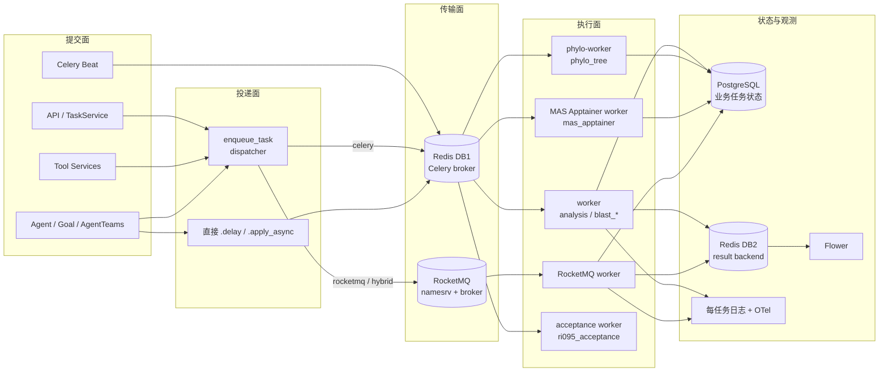
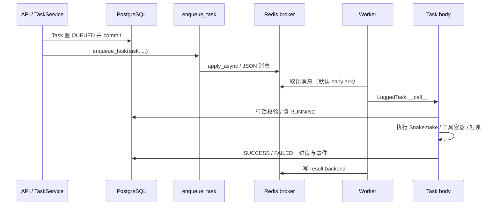

# CygnusX 异步任务队列与 Celery 调度架构

> **用途**：记录平台异步任务从提交、路由、消费到状态回写的完整链路，包括 Celery 应用配置、队列拓扑、Worker/Beat/Flower 部署矩阵、可靠性语义、RocketMQ 可选传输、日志与可观测性，以及当前部署中的真实缺口。
> **类型**：as-built（2026-10-21 代码与部署清单实勘；HEAD `59d6a4a8`）。
> **适用范围**：`src/cygnusx/infrastructure/celery_app/`、`src/cygnusx/infrastructure/task_queue/`、`deploy/docker/docker-compose*.yml` 中的 worker/beat/flower 服务、`deploy/mas/` systemd worker、`Makefile` 的 worker/beat 目标、`TASK_QUEUE_BACKEND` 与 `ROCKETMQ_*` 配置。
> **不适用范围**：Flow YAML 编译与 `TaskService.submit` 九步业务链（见 [CygnusX_flow_architecture.md](CygnusX_flow_architecture.md)）；工具箱业务域、镜像契约与工具页面（见 [CygnusX_toolbox_architecture.md](CygnusX_toolbox_architecture.md)）；日程 RRULE、工作流监控与统计（见 [CygnusX_analysis_operations_architecture.md](CygnusX_analysis_operations_architecture.md)）；日志 sink 的完整规范（见 [CygnusX_log_architecture.md](CygnusX_log_architecture.md)）；Agent 执行闭环与 Goal 状态机（见 [CygnusX_agent_execution_framework.md](CygnusX_agent_execution_framework.md)、[CygnusX_goal_architecture.md](CygnusX_goal_architecture.md)）。

## 这个模块如何发挥作用

Celery 是 CygnusX 的异步执行主干。Web 进程只负责鉴权、业务校验、落库与投递，不在请求内执行长任务；所有耗时计算、容器调用、定时对账和事件搬运都进入队列，由独立 Worker 消费。

它解决四个问题：

1. **解耦提交与执行**：API/Tool/Agent 只写业务状态并投递消息，HTTP 响应不被 Snakemake、BLAST、DEG、报告导出等长任务阻塞。
2. **按负载与运行环境分流**：普通分析、BLAST 建库、系统发育、MAS Apptainer 使用不同逻辑队列，由不同 Worker 栈消费，避免重型任务挤占通用 Worker。
3. **提供定时与对账能力**：Beat 单实例按固定周期投递 34 个维护任务，覆盖记忆、归档、沙盒回收、日程扫描、AgentTeams、AI 指标告警等。
4. **保留可选传输切换**：`enqueue_task` 可在 Celery 与 RocketMQ 之间分流；RocketMQ 消费者仍在本地调用同一批 Celery task body，不复制业务实现。

关键边界：**PostgreSQL 中的业务任务状态才是真源**。Celery result backend（Redis DB2）只保存 AsyncResult/Flower 所需的执行状态；RocketMQ 模式也把状态镜像到该 backend，但任务是否成功以业务表和任务体回写为准。

## 1. 总体架构



要点：

- 主栈 `docker-compose.yml` **不包含计算 Worker**，只保留 `beat` 与（开发环境）`flower`；Worker 在独立编排栈 `docker-compose.worker.yml`。
- Beat 与 Worker 通过 Redis DB1 通信；Beat 自身不做计算。
- `src/cygnusx/` 内共 27 处 `.delay`/`.apply_async` 调用点，除 `dispatcher.py` 自身 1 处外，其余 26 处直接派发不经过 `enqueue_task`；因此在 RocketMQ 模式下这些任务仍走 Celery，Celery Worker 不能因为启用 RocketMQ 而下线。
- `rocketmq-worker` 消费 RocketMQ 消息后调用 `task.apply()` 在本地同步执行，任务体仍是 Celery task。

## 2. 一次 Celery 任务的完整路径



以 Flow 分析任务 `run_snakemake` 为例，实际顺序是：

1. `TaskService.submit()` 完成九步校验、输入文件生成与证据冻结，将 Task 置 `QUEUED` 并 `commit()`。
2. 调用 `enqueue_task(run_snakemake, ..., task_id=f"analysis-{task.id}-attempt-0")`；固定 task ID 让重复投递可识别，但**不自动重试执行**。
3. Celery Worker 收到消息后，`run_snakemake` 对 Task 行加 `FOR UPDATE` 锁，只接受状态为 `QUEUED` 的任务；终态任务不会被重新打开。
4. 执行前完成证据与输入核验，随后启动 Snakemake；运行事件写入 `platform_run_events`，由 `run_events.publish_pending` 每 5 秒搬运到 Redis Streams/WebSocket 链路。
5. 成功或失败写回 Task 表；Celery result backend 另存 AsyncResult。Web 端查询以 Task 表为准。

`run_snakemake` 没有自定义 `time_limit`/`max_retries`，因此继承全局 6 小时硬超时、5 小时软超时；超过限制会被 Worker 终止，且不会自动重跑。

## 3. Celery 应用配置

应用定义在 `src/cygnusx/infrastructure/celery_app/celery.py`：

| 配置 | 值 | 说明 |
|---|---|---|
| 应用名 | `cygnusx` | `Celery("cygnusx", ...)` |
| `task_cls` | `LoggedTask` | 所有 `@shared_task` 自动获得每任务文件日志与 `celery.task` span |
| broker | `settings.celery_broker_url` | 默认由 `REDIS_HOST/REDIS_PORT/REDIS_PASSWORD` 派生 `redis://[:password@]host:port/1` |
| result backend | `settings.celery_result_backend` | 默认同主机 `/2`；显式 URL 缺密码时自动注入 `REDIS_PASSWORD` |
| 序列化 | JSON | `task_serializer/result_serializer=json`，`accept_content=["json"]` |
| 时区 | `Asia/Shanghai` + UTC | `enable_utc=True`，`timezone="Asia/Shanghai"` |
| 启动状态 | `task_track_started=True` | 任务开始即写 `STARTED` |
| 全局超时 | 硬 6h / 软 5h | `task_time_limit=21600`、`task_soft_time_limit=18000` |
| 预取 | `worker_prefetch_multiplier=1` | 长任务公平调度，避免单 Worker 囤积消息 |
| 子进程寿命 | `worker_max_tasks_per_child=10` | 降低长任务内存泄漏风险 |
| 默认队列 | `analysis` | 未命中 `task_routes` 的任务回落到此队列 |
| include | 27 个模块 | 见 §4.3；缺少模块会导致 Worker 侧 `unregistered task` |
| task_routes | 26 条 | 见 §4.2 |
| beat_schedule | 34 条 | 见附录 A |

`celery_app.conf.update()` 再次显式写入 `broker_url`/`result_backend`，并以 `settings` 为准，避免 `.env` 中不带密码的旧 URL 覆盖带密码版本。

全局配置只描述“默认值”。单个任务可以覆盖超时、重试、确认策略与队列，见 §6.2。

## 4. 队列拓扑与路由

### 4.1 逻辑队列

| 队列 | 生产方 | 当前消费方 | 用途与状态 |
|---|---|---|---|
| `analysis` | 显式路由 + 默认队列回落 | `worker`（worker 栈）、`make dev-worker` | 通用分析、记忆、存储、沙盒、Studio、AgentTeams、Goal、报告等；平台默认队列 |
| `blast_search` | `tools.blast.tasks.run_blast_search` | `worker` | BLAST 查询，独立避免建库任务阻塞 |
| `blast_db_build` | `tools.blast.tasks.build_blast_database` | `worker` | `makeblastdb` 建库，长任务 |
| `phylo_tree` | `tools.phylogenetic_tree.tasks.*` | `phylo-worker`（`phylo` profile）/ 独立 phylo compose | 系统发育建树；生产默认不启动，任务会排队 |
| `mas_apptainer` | `tasks.mas.rnaflow.*` | MAS systemd Worker | 需要 Apptainer 的 RNAFlow 节点 |
| `schedules` | `tasks.schedules.*`（Beat 显式指定） | **当前部署清单中无消费者** | 日程扫描与提醒投递；见 §9 风险 1 |
| `phylo_tree_highmem` | 无路由生产方 | `phylo-worker` / 独立 phylo compose | 预留高内存消费队列，当前无任务路由到它 |
| `ri095_acceptance` | 仅验收栈 | `deploy/acceptance` Worker | RI095 验收专用，业务默认不使用 |
| `celery` | Celery 内置默认队列 | 无显式使用 | 因 `task_default_queue=analysis`，正常业务不会进入 |

`task_default_queue="analysis"` 是硬约束：生产 Worker 不传 `-Q` 时会以默认队列为消费入口；若默认队列不是 `analysis`，大量已路由任务会无人消费。所有正式 Worker 命令仍显式写 `-Q`，不依赖该默认行为。

### 4.2 路由表（26 条）

| 任务模式 | 队列 |
|---|---|
| `tasks.analysis.*`、`tasks.run_events.*`、`tasks.cookie.*`、`tasks.download.*` | `analysis` |
| `tools.jbrowse.tasks.*` | `analysis` |
| `tools.enrichments.tasks.*`、`tools.gsea.tasks.*`、`tools.deg.tasks.*`、`tools.synteny.tasks.*` | `analysis` |
| `tools.phylogenetic_tree.tasks.*` | `phylo_tree` |
| `tools.blast.tasks.run_blast_search` | `blast_search` |
| `tools.blast.tasks.build_blast_database` | `blast_db_build` |
| `tasks.sandbox.*`、`tasks.storage.*`、`tasks.studio.*` | `analysis` |
| `tasks.mas.rnaflow.*` | `mas_apptainer` |
| `tasks.mas.*`（除 rnaflow） | `analysis` |
| `tasks.overdrive.*`、`tasks.memory.*`、`tasks.agentteams.*`、`tasks.goals.*` | `analysis` |
| `tasks.ai_metrics.*`、`tasks.observability.*`、`tasks.reports.*`、`tasks.datasets.*` | `analysis` |
| `tasks.schedules.*` | `schedules` |

需要注意的覆盖缺口：

- `tasks.project_reports.*`、`tasks.project_exports.*`、`tasks.mcp_builder.*` **没有显式路由**，依靠默认队列回落到 `analysis`；当前可运行，但不在路由表中，排查队列归属时容易被遗漏。
- `tools.gsea.tasks.*` 已同时登记 `task_routes` 与 `include`；新进程默认加载与路由有回归验证，已运行 Worker 仍须重启并验收，见 §9 风险 2。
- `blast.*`、`phylo.*`、`enrichments.*`、`deg.*`、`synteny.*` 同时声明了任务级 `queue=` 属性，与 `task_routes` 保持同向；改动时两处都要检查。

### 4.3 include 模块（27 个）

```text
tasks.analysis             tasks.run_events          tasks.cookie
tasks.download             tools.jbrowse.tasks       tools.phylogenetic_tree.tasks
tools.blast.tasks          tools.enrichments.tasks   tools.deg.tasks
tools.synteny.tasks        tasks.sandbox             tasks.storage
tasks.studio               tasks.mas                 tasks.overdrive
tasks.memory               tasks.mcp_builder         tasks.agentteams
tasks.goals                tasks.ai_metrics          tasks.observability
tasks.schedules            tasks.reports             tasks.project_exports
tasks.project_reports      tasks.datasets            tools.gsea.tasks
```

`include` 决定 Worker 启动时导入哪些模块。新增任务模块只写 `task_routes` 而不写 `include`，消息可以投递，但 Worker 不注册任务；这是本子系统最常见的故障模式。

2026-10-21 的历史基线为 69 个非内置任务、GSEA 为 0；当前源码已补齐 GSEA 的默认加载，`test_gsea_worker_registration.py` 在新进程检查真实注册与 `analysis` 路由，不依赖其它测试的导入顺序。生产 Worker 内存中的注册仍需单独验收。

## 5. Worker / Beat / Flower 部署矩阵

| 部署单元 | 文件与命令 | 消费/职责 | 说明 |
|---|---|---|---|
| 主栈 Beat | `deploy/docker/docker-compose.yml`：`celery ... beat --loglevel=info` | 投递全部 34 个定时任务 | 单实例；`working_dir=/tmp` 使 `celerybeat-schedule` 写容器临时目录 |
| 主栈 Flower | 同文件：`celery ... flower --port=5555 --basic_auth=...` | 监控 | 仅开发栈默认启用，绑定 `127.0.0.1:5555` |
| 主栈 Worker | **不存在** | — | 计算 Worker 已迁独立栈 |
| Worker 栈通用 Worker | `docker-compose.worker.yml`：`worker -Q analysis,blast_search,blast_db_build` | 通用分析 + BLAST 双队列 | 健康检查 `inspect ping`；挂 Docker Socket 供分析容器使用；默认并发由 Celery 决定，预取 1 |
| Worker 栈 RocketMQ Worker | `--profile rocketmq`，`python -m ...rocketmq_worker --queues analysis,blast_search,blast_db_build,phylo_tree,phylo_tree_highmem,mas_apptainer` | 六个 RocketMQ topic | `restart: on-failure:5`，避免 nameserver/客户端错误无限崩溃 |
| Worker 栈 phylo Worker | `--profile phylo`，`-Q phylo_tree,phylo_tree_highmem --concurrency=2` | 系统发育 | 默认不启动；恢复需显式 `--profile phylo` |
| 独立 phylo 栈 | `docker-compose.phylo.yml` | `phylo_tree` / `phylo_tree_highmem` 两个 Worker | 含资源上限（8C/16G、16C/32G），面向独立工具链镜像 |
| MAS systemd Worker | `deploy/mas/cygnusx-mas-apptainer-worker.service` | `-Q mas_apptainer` | 以 `cygnusx` 用户运行，`Restart=always`，只写 `/data/cygnusx` |
| 跨机 Worker 覆盖 | `docker-compose.cross-worker.yml` | 同上 Worker 栈 | 将 PG/Redis/RocketMQ 指向 `CYGNUSX_CONTROL_HOST`；Web 监控地址同步指向控制面 |
| 开发命令 | `make dev-worker` / `dev-beat` / `dev-flower` / `dev-rocketmq-worker` | 本机进程 | `dev-worker` 不传 `-Q`，以默认队列 `analysis` 为入口；RocketMQ 命令显式列六个队列 |
| 验收栈 | `deploy/acceptance/` | `ri095_acceptance` | 默认队列与全部路由强制指向验收队列，Worker 注册表只保留项目报告/导出任务 |
| Worker 镜像默认 CMD | `deploy/docker/Dockerfile.worker` | `worker -Q analysis` | 直接运行镜像（不经 compose command）时只消费默认队列 |

生产覆盖 `docker-compose.prod.yml` 强制 `beat.replicas=1`、`flower.replicas=0` 且清空 Flower 端口。也就是说：**生产默认没有 Flower 监控，也没有多 Beat 高可用**。

`scripts/worker-compose.sh` 负责把 `data/worker_config.yaml` 渲染为 `data/.worker-config.env`、探测 Docker Socket GID、加载根 `.env`，再调用 Compose；直接手写 `docker compose` 时必须自行提供 `WORKER_SHARED_DATA_DIR`、`WORKER_PIPELINE_DIR`、`DOCKER_GID`，否则 Compose 变量校验失败。

## 6. 可靠性与状态语义

### 6.1 投递与确认

- Celery 默认 **early ack**：Worker 收到消息即确认，任务执行中进程崩溃会丢失该消息。只有三个任务显式使用 late ack：
  - `generate_reproducible_report`：`acks_late=True`、`reject_on_worker_lost=True`、1950/1900 秒；
  - `generate_project_report`：同上；
  - `generate_project_export`：`acks_late=True`、`reject_on_worker_lost=True`、600/570 秒。
- 这三个任务同时使用 PostgreSQL session advisory lock（`pg_try_advisory_lock`），重复投递时后来者拿到 `busy` 而不是重复执行。
- `run_snakemake` 通过“Task 行锁 + 只接受 QUEUED + 固定 task ID”实现幂等领取，但没有 late ack、没有自动重试；Worker 在执行中崩溃时任务会停在 RUNNING，需要依赖上层对账，而不是 broker 重投。
- `enqueue_task` 的 Celery 分支直接调用 `task.apply_async`；RocketMQ 分支先 `publish_task` 再写 `PENDING`。这两条路径都不是事务性 outbox：数据库提交与消息投递之间仍存在“已入队但响应失败”或“投递成功但消息未被消费”的窗口，Flow 侧的 QUEUED 语义与对账规则见 [CygnusX_flow_architecture.md](CygnusX_flow_architecture.md)。

### 6.2 任务级超时与重试

| 任务 | 硬/软超时 | 重试 | 队列 | 备注 |
|---|---|---|---|---|
| `run_snakemake` | 6h / 5h（全局） | 无 | `analysis` | 长流程无单独放宽；RocketMQ 模式用 `task.apply` 急执行，不经过 Worker 超时控制 |
| `run_blast_search` | 3600 / 3000s | 1 次，延迟 30s | `blast_search` | `ignore_result=True` |
| `build_blast_database` | 7200 / 3600s | 1 次，延迟 30s | `blast_db_build` | `ignore_result=True` |
| `build_tree` | 7200 / 3600s | 1 次，延迟 30s | `phylo_tree` | 系统发育 |
| `index_file`（JBrowse） | 7200 / 3600s | 2 次，延迟 60s | `analysis` | 索引命令失败也走重试 |
| `run_enrichment_task` | 900 / 840s | 无 | `analysis` | R 容器 |
| `run_deg_task` | 7800 / 7500s | 无 | `analysis` | 超过全局 6h，任务级覆盖 |
| `run_synteny_task` | 1800s（无软限制） | 无 | `analysis` | 共线性 |
| `run_gsea_task` | 900s | 无 | `analysis`（任务属性与路由） | 默认加载已登记，真实 Worker 需重启验收，见风险 2 |
| `generate_reproducible_report` | 1950 / 1900s | 无（靠对账重投） | `analysis`（默认） | late ack + advisory lock |
| `generate_project_report` | 1950 / 1900s | 无（靠对账重投） | `analysis`（默认） | late ack + advisory lock |
| `generate_project_export` | 600 / 570s | 无（靠对账重投） | `analysis`（默认） | late ack + advisory lock |
| `reconcile_dataset_jobs` | 570 / 540s | 无 | `analysis` | 数据集入库对账 |
| `respond_to_room_message` / `respond_to_room_namespace_message` | 全局 | 最多 120 次，锁冲突时 2s 后重试 | `analysis` | AgentTeams 房间响应 |
| `deliver_reminder` | 全局 | `max_retries=0` | `schedules` | 失败由 DB 层 `attempt_count` + 退避重试，最多 5 次 |

### 6.3 定时日程状态机

日程链路分两段，均由 Beat 驱动：

1. `scan_due_schedules`（每 30s，`schedules` 队列）：Redis `SET NX EX 60` 租约防并发；查询 `status=active AND next_fire_at <= now` 的日程，按 `next_fire_at` 排序、`FOR UPDATE SKIP LOCKED` 取最多 `SCHEDULE_SCAN_BATCH_SIZE`（默认 100）条；把到期 occurrence 置 `fired`，必要时补生成后续 occurrence，再独立扫描 `ReminderDeliveryModel` 中 `pending` 且 `due_at <= now` 的投递，置 `sending` 后 `deliver_reminder.apply_async()`。
2. `deliver_reminder`：读取 delivery，`sent`/`suppressed` 直接忽略；日程非 active 则置 `suppressed`；否则创建 `type="reminder"` 通知、回写 `notification_id`、发布 Redis PubSub `user:{user_id}:notifications`。异常时 `attempt_count += 1`，未达 `SCHEDULE_MAX_DELIVERY_ATTEMPTS`（默认 5）则回到 `pending` 并按 `60 * 2^attempt_count` 设置 `next_retry_at`。
3. `retry_failed_deliveries`（每 300s，`schedules` 队列）：重新投递到期的 `pending` delivery。

注意：`deliver_reminder` 也属于 `tasks.schedules.*`，会被路由到 `schedules` 队列；因此 `schedules` 没有消费者时，不仅扫描不执行，提醒投递也不会执行。

### 6.4 RocketMQ 可选传输

启用方式：

```env
TASK_QUEUE_BACKEND=hybrid            # 或 rocketmq
ROCKETMQ_TASK_ROUTES=["cygnusx.tools.blast.tasks.*"]
ROCKETMQ_NAMESRV_ADDR=rocketmq-namesrv:9876
```

`enqueue_task` 的分流规则（`task_queue/dispatcher.py`）：

| 模式 | 行为 |
|---|---|
| `celery` | 全部走 `task.apply_async` |
| `rocketmq` | 全部走 RocketMQ |
| `hybrid` | `task.name` 命中 `ROCKETMQ_TASK_ROUTES` 的通配模式才走 RocketMQ，其余保持 Celery |

RocketMQ 路径的语义：

- **同步发布**：`publish_task` 调用 `send_sync`，broker 不可接受时 HTTP 提交立即失败，不会假装入队。
- **主题映射**：逻辑队列 `analysis` → `cygnusx_task_analysis`；前缀由 `ROCKETMQ_TOPIC_PREFIX` 控制，默认 `cygnusx_task`。
- **信封字段**：`task_name`、`args`、`kwargs`、`task_id`、`queue`、`attempt`；不包含 trace headers/session_id。
- **延迟**：`countdown` 映射到 14 档延迟级别（1s 到 600s），超出取最大档。
- **消费**：`rocketmq_worker` 为每个队列创建独立 `PushConsumer`（组名 `cygnusx-task-worker-{queue}`），无效信封直接 `CONSUME_SUCCESS` 丢弃，基础设施异常 `RECONSUME_LATER`。
- **执行**：从 `celery_app.tasks` 查找任务并 `task.apply(throw=False)` 本地执行；任务体、数据库回写与 Redis result backend 行为复用 Celery 定义。
- **重试**：任务返回 `RETRY` 时，`attempt + 1` 未超过任务 `max_retries` 则 30s 后重新发布；否则写 `FAILURE` 并抛错。返回 `FAILURE` 写 `FAILURE`；其余写 `SUCCESS`。
- **状态镜像**：通过 `celery_app.backend.store_result` 写 `PENDING/STARTED/SUCCESS/FAILURE/RETRY`，Flower 与 AsyncResult 可读。
- **投递语义**：至少一次；没有去重表、幂等键或 trace 传播。RocketMQ 的 `task_routes` 不生效，队列由 `enqueue_task(queue=...)` 或任务对象的 `queue` 属性决定，否则落到 `analysis`。
- **依赖**：`rocketmq-client-python==2.0.0` 在 `Dockerfile` 与 `Dockerfile.worker` 中可选安装，未纳入 `uv.lock`；本地 `uv` 环境默认没有该客户端，调用即抛 `RuntimeError`。

Broker 配置 `deploy/docker/rocketmq/broker.conf` 使用 `ASYNC_MASTER`、`ASYNC_FLUSH`、`autoCreateTopicEnable=true`，适合开发/灰度，不构成金融级持久化保证。

### 6.5 结果与状态真源

- 业务状态：PostgreSQL（`tasks`、`blast_tasks`、报告/导出 job 表、`agent_goals` 等），由任务体回写；Web API 读取它。
- Celery 结果：Redis DB2，供 `AsyncResult`、Flower 与 RocketMQ 状态镜像使用；未显式设置 `result_expires`，保留时间依赖后端默认与 Redis 驱逐策略。
- BLAST 任务设置 `ignore_result=True`，不依赖 result backend；进度通过任务表与 `publish_blast_event` 推送。
- Redis broker（DB1）与 result backend（DB2）是同一 Redis 实例的不同 DB；Redis 故障会同时影响投递与结果查询，但不会回滚已提交的业务状态。

## 7. 可观测性与日志

| 能力 | 实现 | 落点 |
|---|---|---|
| 每任务文件日志 | `LoggedTask.__call__` 动态 `logger.add` | `${CYGNUSX_CELERY_LOG_DIR:-${CYGNUSX_LOG_DIR}/celery/tasks}/{task_id}.log` |
| 日志轮转 | 环境变量 | 默认 `20 MB` / 保留 `7 days` / `zip` 压缩 |
| 失败降级 | sink 创建失败仅 warning | 不阻断任务执行 |
| 分布式追踪 | `wire_celery_tracing()` | `before_task_publish` 注入 traceparent/session_id；`task_prerun` 提取；`task_postrun` 复位 |
| 任务 span | `LoggedTask` | `celery.task`，属性 `task.name`、`task.id`、`task.status`、`task.duration_ms` |
| Flower | 主栈开发环境 | `127.0.0.1:5555`，basic auth；生产 `replicas: 0` |
| 任务日志/进度 | DB + WebSocket | 每任务文件日志只是额外备份，实时链路仍是 `publish_task_log` + DB + WebSocket |
| 运行事件 | Beat `run-events-publish` 每 5s | `platform_run_events` → Redis Streams |

Tracing 只覆盖 Celery 信号，RocketMQ 信封没有 trace 字段；启用 RocketMQ 后，web → rocketmq-worker 的链路会出现 trace 断点。

## 8. 配置清单

| 变量/字段 | 默认值 | 作用 |
|---|---|---|
| `CELERY_BROKER_URL` | 空 → 派生 `redis://.../1` | 显式 URL 优先；缺密码时自动注入 `REDIS_PASSWORD` |
| `CELERY_RESULT_BACKEND` | 空 → 派生 `redis://.../2` | 同上 |
| `REDIS_HOST` / `REDIS_PORT` / `REDIS_PASSWORD` | `localhost` / `6379` / 空 | 派生 broker/backend |
| `TASK_QUEUE_BACKEND` | `celery` | `celery` / `rocketmq` / `hybrid` |
| `ROCKETMQ_NAMESRV_ADDR` | `rocketmq-namesrv:9876` | NameServer 地址 |
| `ROCKETMQ_PRODUCER_GROUP` | `cygnusx-task-producer` | 生产者组 |
| `ROCKETMQ_CONSUMER_GROUP_PREFIX` | `cygnusx-task-worker` | 消费组前缀 |
| `ROCKETMQ_TOPIC_PREFIX` | `cygnusx_task` | 主题前缀 |
| `ROCKETMQ_TASK_ROUTES` | `[]` | `hybrid` 模式的 fnmatch 模式列表 |
| `SCHEDULE_SCAN_BATCH_SIZE` | `100` | 单次扫描日程数 |
| `SCHEDULE_MAX_DELIVERY_ATTEMPTS` | `5` | 提醒投递最大尝试次数 |
| `MEMORY_EMBEDDING_COVERAGE_INTERVAL_SECONDS` | `300` | 记忆覆盖扫描周期 |
| `REPORT_GENERATION_RECONCILE_SECONDS` | `60` | 可复现报告对账周期 |
| `AGENTTEAMS_CASE_WATCH_INTERVAL_SECONDS` | `15` | Case 监听周期 |
| `AGENTTEAMS_CASE_EVENT_STREAM_INTERVAL_SECONDS` | `5` | Case 事件/房间同步周期 |
| `GOAL_LEASE_SECONDS` | `120` | Goal 租约；恢复周期为其一半且不低于 15s |
| `CYGNUSX_LOG_DIR` | `/app/logs` | 全局日志根 |
| `CYGNUSX_CELERY_LOG_DIR` | `${CYGNUSX_LOG_DIR}/celery/tasks` | 每任务日志目录 |
| `CYGNUSX_CELERY_LOG_ROTATION` | `20 MB` | 单任务日志轮转阈值 |
| `CYGNUSX_CELERY_LOG_RETENTION` | `7 days` | 单任务日志保留期 |
| `CYGNUSX_CELERY_LOG_COMPRESSION` | `zip` | 轮转压缩格式 |
| `WORKER_SHARED_DATA_DIR` / `WORKER_PIPELINE_DIR` / `DOCKER_GID` | 无默认，Compose 强校验 | Worker 栈共享数据、流程目录与 Socket 组 |
| `PHYLO_WORKER_CONCURRENCY` / `PHYLO_WORKER_THREADS` | `2` / `4` | 系统发育 Worker 资源 |

本子系统不引入数据库迁移；队列、Beat 与路由全部是运行时配置。

## 9. 已知限制与风险

| # | 风险 | 影响 | 证据 | 建议 |
|---|---|---|---|---|
| 1 | `schedules` 队列无消费者 | 日程扫描、提醒投递与失败重试全部停在队列；用户收不到提醒 | Beat `schedule-scan-due`/`schedule-retry-failed` 显式投 `schedules`；所有部署命令的 `-Q` 均不含该队列（`deploy/` 全量检索） | 在通用 Worker 的 `-Q` 中加入 `schedules`，或起专用 Worker；上线前用 `inspect active_queues` 核对 |
| 2 | 旧 Worker 尚未加载 GSEA 注册修复 | 未重启的 Worker 仍可能报 `unregistered task` | 源码 include/routes 已补齐，新进程默认加载回归通过；不能据此推断旧 Worker 内存状态 | 重启 Worker 并实测任务注册、队列与真实任务执行 |
| 3 | RocketMQ 模式不覆盖直接派发 | `TASK_QUEUE_BACKEND=rocketmq` 无法取代 Celery Worker；Chat/AgentTeams/Goal/日程等 26 处直接 `.delay`/`.apply_async` 仍走 Redis | `dispatcher.py` 仅在调用 `enqueue_task` 时生效；`rg` 在 `src/cygnusx/` 统计 27 处、扣除 dispatcher 自身后 26 处 | 要么逐步收敛到 `enqueue_task`，要么在部署文档中明确“双栈并行” |
| 4 | RocketMQ 忽略 `task_routes` | `mas.rnaflow.*` 等任务可能进入 `analysis` topic，在缺少 Apptainer 的通用 RocketMQ Worker 上执行失败 | `publish_task` 只看显式 `queue`/`task.queue`/默认 `analysis` | 为任务补齐 `queue=` 属性或在 dispatcher 中复用 Celery 路由解析；按环境拆分 RocketMQ Worker |
| 5 | RocketMQ 状态镜像竞态 | `publish_task` 成功后才写 `PENDING`，消费者可能已先写 `STARTED`，随后被 `PENDING` 覆盖 | `dispatcher.py` 先 publish 后 `store_task_state(PENDING)` | 先写 PENDING 再发布，或只在 backend 无状态时写入；增加并发测试 |
| 6 | 默认 early ack | Worker 崩溃时执行中的任务丢失；只有三个报告/导出任务使用 late ack | `celery.py` 未设全局 `task_acks_late`；任务装饰器仅三处显式开启 | 对可安全重入的长任务显式 `acks_late` + 幂等锁；不要全局开启 |
| 7 | 全局 6h 硬超时 | 超过 6 小时的 Flow 会被终止；RocketMQ 急执行又不经过 Worker 超时，语义不一致 | `task_time_limit=21600`；`run_snakemake` 无覆盖；`task.apply` 为 eager 执行 | 按 Flow/任务显式设置 `time_limit`；RocketMQ 通道增加独立超时控制 |
| 8 | Beat 单实例且 schedule 文件在 `/tmp` | Beat 重启后可能丢失调度进度、重复触发或漏触发窗口；无 HA | `docker-compose.prod.yml` `replicas: 1`；主栈 `working_dir: /tmp` | 固定 schedule 文件到持久卷；为幂等任务保留；明确单 Beat 运维约束 |
| 9 | Redis 单实例、未启用 AOF/HA | broker 消息与 result backend 可能因重启/驱逐丢失；已提交业务状态保留但任务不再自动重投 | 主栈 `cache` 单实例，仅 `--requirepass` + 数据目录 bind mount；broker DB1/backend DB2 同实例 | 生产启用 AOF 与持久卷、增加监控；关键任务依赖 DB 对账而非 broker 重投 |
| 10 | 无队列积压/死信告警，生产关闭 Flower | 队列堆积、任务长期排队只能靠人工发现 | `flower.replicas: 0`；无队列长度告警 Beat；现有 AI 指标告警只覆盖错误率/延迟/成本 | 增加队列深度与最老消息年龄监控；灰度环境保留 Flower 或只读监控 |
| 11 | 可选 Worker 未启动时任务静默排队 | `phylo`、`rocketmq` profile 与 MAS systemd 未部署时，对应队列只进不出 | `docker-compose.worker.yml` profiles；`deploy/mas/` 需手工安装 | 部署验收清单加入 `active_queues` 与队列深度核对；对无 Worker 的队列设告警 |
| 12 | 路由覆盖不完整 | `project_reports`/`project_exports`/`mcp_builder` 依赖默认队列，排查时易误判 | `celery.py` 26 条路由未包含上述模块；GSEA 已显式登记 | 为所有在 `include` 中的任务模块补显式路由；把“include 与 route 成对”纳入 review checklist |
| 13 | 测试覆盖不足 | RocketMQ 消费、状态镜像、Beat 注册与部署拓扑没有自动化测试；只有 dispatcher 的 4 个单测 | `tests/unit/test_task_queue_dispatcher.py` | 增加注册表快照测试、RocketMQ envelope/重试单测、Compose `-Q` 静态校验 |
| 14 | `deliver_reminder` 无行锁 | 重复消费可能生成重复通知 | `_deliver_reminder` 仅检查状态，未对 delivery 加 `FOR UPDATE` | 领取时使用 `SELECT ... FOR UPDATE SKIP LOCKED` 或唯一约束兜底 |

## 10. 与相邻架构文档的边界

| 文档 | 本文不重复的内容 |
|---|---|
| [CygnusX_flow_architecture.md](CygnusX_flow_architecture.md) | FlowConfig、YAML 热重载、AI 工具编译、`TaskService.submit` 九步链、`GenericFlowBuilder`、Snakemake 执行器内部 |
| [CygnusX_toolbox_architecture.md](CygnusX_toolbox_architecture.md) | 工具子包发现、工具注册表、ToolBridge、各工具业务语义与分析容器镜像契约 |
| [CygnusX_analysis_operations_architecture.md](CygnusX_analysis_operations_architecture.md) | 日程 RRULE/occurrence 业务、工作流监控 ingest、平台 Run、统计与 AI 指标口径 |
| [CygnusX_notification_engagement_architecture.md](CygnusX_notification_engagement_architecture.md) | 通知中心、公告、提醒通知的前端展示与可见性规则 |
| [CygnusX_log_architecture.md](CygnusX_log_architecture.md) | loguru 全局 sink、Nginx/Snakemake 日志、Loki/Promtail 预留与容量治理 |
| [CygnusX_database_architecture.md](CygnusX_database_architecture.md) | asyncpg 引擎分流、连接池、ORM 契约、迁移治理 |
| [CygnusX_goal_architecture.md](CygnusX_goal_architecture.md) | Goal 生命周期、Redis/DB 租约、单步执行器与评估器 |
| [CygnusX_agent_execution_framework.md](CygnusX_agent_execution_framework.md) | 四种 Agent 执行闭环、Chat 运行时与工具通道 |
| [CygnusX_worker_images_plan.md](CygnusX_worker_images_plan.md) | Worker 轻量镜像的构建边界与演进提案（注意：该文为提案） |
| `../deploy/docker/README.md`、`../docs/config_readme.me` | 部署命令、RocketMQ 故障处置、环境变量示例与灰度步骤 |

## 11. 关键文件与修改验证

### 11.1 关键文件

| 职责 | 文件 |
|---|---|
| Celery 应用、include、routes、beat | `src/cygnusx/infrastructure/celery_app/celery.py` |
| 统一投递入口 | `src/cygnusx/infrastructure/task_queue/dispatcher.py` |
| RocketMQ 发布/消费/状态镜像 | `src/cygnusx/infrastructure/task_queue/rocketmq.py`、`rocketmq_worker.py` |
| 每任务日志与 span | `src/cygnusx/infrastructure/celery_app/logging.py` |
| trace 传播 | `src/cygnusx/infrastructure/celery_app/tracing.py` |
| Flow 执行任务 | `src/cygnusx/infrastructure/celery_app/tasks/analysis.py` |
| 日程扫描/提醒 | `src/cygnusx/infrastructure/celery_app/tasks/schedules.py` |
| 运行事件搬运 | `src/cygnusx/infrastructure/celery_app/tasks/run_events.py` |
| 报告/导出 | `tasks/reports.py`、`tasks/project_reports.py`、`tasks/project_exports.py` |
| 工具任务 | `tools/blast/tasks.py`、`tools/phylogenetic_tree/tasks.py`、`tools/jbrowse/tasks.py`、`tools/enrichments/tasks.py`、`tools/deg/tasks.py`、`tools/synteny/tasks.py`、`tools/gsea/tasks.py` |
| 主栈编排 | `deploy/docker/docker-compose.yml`、`docker-compose.prod.yml` |
| Worker 编排 | `deploy/docker/docker-compose.worker.yml`、`docker-compose.cross-worker.yml`、`docker-compose.phylo.yml`、`scripts/worker-compose.sh` |
| MAS Worker | `deploy/mas/cygnusx-mas-apptainer-worker.service` |
| RocketMQ 配置 | `deploy/docker/rocketmq/broker.conf`、`Dockerfile`、`Dockerfile.worker` |
| 单测 | `tests/unit/test_task_queue_dispatcher.py` |

### 11.2 修改检查清单

新增一个异步任务时：

1. 在 `@shared_task` 中写稳定 `name`，需要独立资源时设置 `queue=` 与 `time_limit`/`max_retries`。
2. 在 `celery.py` 的 `include` 中加入任务模块。
3. 在 `task_routes` 中加入模块级路由；两者必须成对出现。
4. 确认目标 Worker 的 `-Q` 包含该队列；新增队列还要同步部署文档与监控。
5. 用真实 Worker 验证：`celery -A cygnusx.infrastructure.celery_app.celery inspect registered | grep <task>`。
6. 若任务可安全重入，显式 `acks_late=True` + 幂等锁；否则明确接受至多一次的执行语义。

修改 Beat 时：

1. 只保留一个 Beat 实例（生产 `replicas: 1`），避免重复触发。
2. 检查任务的幂等性；对账型任务应支持重复执行。
3. 显式指定 `options.queue`，不要依赖“默认会有人消费”的假设。
4. 确认该队列在部署中有消费者；`schedules` 是当前反例。

启用 RocketMQ 时：

1. 确认 `rocketmq-client-python` 已安装（镜像内可选依赖）。
2. 用 `hybrid` + 小范围 `ROCKETMQ_TASK_ROUTES` 灰度，不要同时向两套传输投同一任务。
3. 校验任务的 `queue` 属性或 `enqueue_task(queue=...)`，因为 RocketMQ 不读 `task_routes`。
4. 保留 Celery Worker；直接 `.delay`/`.apply_async` 的任务不会迁移。
5. 确认目标 RocketMQ Worker 具备任务所需的运行环境（Docker Socket、Apptainer、共享盘等）。

### 11.3 运行核查命令

```bash
# 静态注册表与路由数量
uv run python -c "from cygnusx.infrastructure.celery_app.celery import celery_app; \
celery_app.loader.import_default_modules(); \
print(len([n for n in celery_app.tasks if not n.startswith('celery.')])); \
print(len(celery_app.conf.task_routes), len(celery_app.conf.beat_schedule))"

# Worker 侧已注册任务 / 活跃队列 / 连通性
docker compose -f deploy/docker/docker-compose.worker.yml exec worker \
  celery -A cygnusx.infrastructure.celery_app.celery inspect registered
docker compose -f deploy/docker/docker-compose.worker.yml exec worker \
  celery -A cygnusx.infrastructure.celery_app.celery inspect active_queues
docker compose -f deploy/docker/docker-compose.worker.yml exec worker \
  celery -A cygnusx.infrastructure.celery_app.celery inspect ping

# RocketMQ Worker 日志与重启状态
docker compose -f deploy/docker/docker-compose.worker.yml --profile rocketmq \
  logs --tail=200 rocketmq-worker

# Flower（开发栈）
open http://127.0.0.1:5555   # 需 FLOWER_BASIC_AUTH
```

## 附录 A：Beat 注册表（34 条）

| # | 名称 | 任务（省略 `cygnusx.infrastructure.celery_app.` 前缀） | 周期 | 队列 |
|---|---|---|---|---|
| 1 | `memory-embedding-coverage` | `tasks.memory.collect_embedding_coverage` | `MEMORY_EMBEDDING_COVERAGE_INTERVAL_SECONDS`（默认 300s） | `analysis` |
| 2 | `memory-weekly-consolidation` | `tasks.memory.consolidate_memory` | 每周日 03:00 | `analysis` |
| 3 | `memory-settle-idle-sessions` | `tasks.memory.settle_idle_sessions` | 300s | `analysis` |
| 4 | `memory-purge-recall-batches` | `tasks.memory.purge_recall_batches` | 每天 04:15 | `analysis` |
| 5 | `project-report-reconcile` | `tasks.project_reports.reconcile_project_reports` | 60s | 默认 `analysis` |
| 6 | `dataset-ingestion-reconcile` | `tasks.datasets.reconcile_dataset_jobs` | 60s | 默认 `analysis` |
| 7 | `project-export-reconcile` | `tasks.project_exports.reconcile_project_exports` | 60s | 默认 `analysis` |
| 8 | `reproducible-report-reconcile` | `tasks.reports.reconcile_report_jobs` | `REPORT_GENERATION_RECONCILE_SECONDS`（默认 60s） | `analysis` |
| 9 | `schedule-scan-due` | `tasks.schedules.scan_due_schedules` | 30s | `schedules` |
| 10 | `schedule-retry-failed` | `tasks.schedules.retry_failed_deliveries` | 300s | `schedules` |
| 11 | `agentteams-evidence-retention` | `tasks.agentteams.cleanup_evidence` | 每天 02:45 | `analysis` |
| 12 | `cleanup-expired-archives` | `tasks.storage.cleanup_expired` | 每天 02:00 | `analysis` |
| 13 | `storage-reconcile-used` | `tasks.storage.reconcile_used_storage` | 每天 03:00 | `analysis` |
| 14 | `cookie-daily-reconcile` | `tasks.cookie.daily_reconcile` | 每天 02:30 | `analysis` |
| 15 | `sandbox-recycle-expired` | `tasks.sandbox.recycle_expired` | 每分钟 | `analysis` |
| 16 | `studio-sandbox-recycle` | `tasks.studio.recycle_idle_sandboxes` | 每 5 分钟 | `analysis` |
| 17 | `studio-long-task-reconcile` | `tasks.studio.reconcile_studio_long_tasks` | 600s | `analysis` |
| 18 | `studio-workspace-retention` | `tasks.studio.cleanup_expired_workspaces` | 每天 03:30 | `analysis` |
| 19 | `studio-workspace-dormant-archive` | `tasks.studio.hibernate_dormant_workspaces` | 每天 04:30 | `analysis` |
| 20 | `studio-archive-expire-cleanup` | `tasks.studio.cleanup_expired_workspace_archives` | 每天 05:30 | `analysis` |
| 21 | `mcp-builder-expire-experimental` | `tasks.mcp_builder.expire_experimental` | 每 5 分钟 | 默认 `analysis` |
| 22 | `mas-outbox-publish` | `tasks.mas.publish_outbox` | 10s | `analysis` |
| 23 | `download-task-reconcile` | `tasks.download.reconcile_downloads` | 600s | `analysis` |
| 24 | `run-events-publish` | `tasks.run_events.publish_pending` | 5s | `analysis` |
| 25 | `mas-event-consume` | `tasks.mas.consume_events` | 5s | `analysis` |
| 26 | `agentteams-case-watch` | `tasks.agentteams.watch_cases` | `AGENTTEAMS_CASE_WATCH_INTERVAL_SECONDS`（默认 15s） | `analysis` |
| 27 | `agentteams-auto-confirm-cases` | `tasks.agentteams.auto_confirm_cases` | 同上 | `analysis` |
| 28 | `agentteams-case-event-consume` | `tasks.agentteams.consume_case_events` | `AGENTTEAMS_CASE_EVENT_STREAM_INTERVAL_SECONDS`（默认 5s） | `analysis` |
| 29 | `agentteams-room-sync` | `tasks.agentteams.sync_case_rooms` | 同上 | `analysis` |
| 30 | `agentteams-stale-task-requeue` | `tasks.agentteams.requeue_stale_tasks` | 300s | `analysis` |
| 31 | `agentteams-approval-timeout-reconcile` | `tasks.agentteams.reconcile_approval_timeouts` | 3600s | `analysis` |
| 32 | `goal-lease-recovery` | `tasks.goals.recover_expired_goal_leases` | `max(15, GOAL_LEASE_SECONDS / 2)`（默认 60s） | `analysis` |
| 33 | `ai-metrics-alert-check` | `tasks.ai_metrics.check_alerts` | 每 5 分钟 | `analysis` |
| 34 | `observability-retention` | `tasks.observability.prune_archives` | 每天 02:15 | `analysis` |

只有第 9、10 条显式指定 `schedules`；其余条目使用 `analysis` 或默认队列。第 5、7、21 条没有显式 `options.queue`，其任务模块也不在 `task_routes` 中，依靠 `task_default_queue=analysis` 回落。
