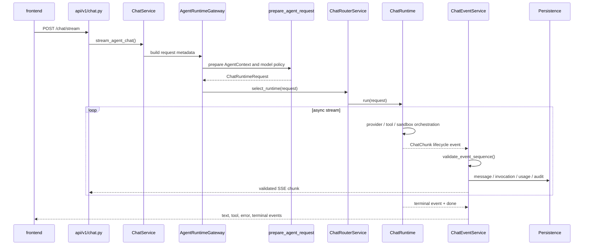

# Chat Runtime 执行分层

> **时点说明**：本文件为 2026-08-23 时点的施工快照，所述修订计划已执行或已演进，部分引用（路径、行号）已失效；请勿按本文档再次执行，当前实现以代码为准。

## 这个 Chat Runtime 模块如何发挥作用

Chat Runtime 分层把 HTTP 协议、请求预检、运行时选择、具体执行循环和 SSE 事件收尾拆成可替换的边界。浏览器请求先进入 `/api/v1/chat/stream`，`ChatService` 负责兼容入口与依赖，`AgentRuntimeGateway` 把用户参数冻结成 `ChatRuntimeRequest` 并附加 trace、日志和灰度信息；`request_preparation` 与 `AgentContextBuilder` 在此阶段完成 Agent、模型、提示词、工具和会话上下文的统一装配。

`ChatRouterService` 只选择 Runtime，不执行工具和持久化。普通 Agent、Studio、Overdrive 和直连模型分别进入对应 `ChatRuntime` 实现；Runtime 通过异步生成器输出 `ChatChunk`，把模型增量、工具调用、审批、错误和终态保持在同一条流里。具体编排可以是 LangGraph 图、兼容委托路径或直接 Provider 调用，但都必须遵守相同的请求对象和事件出口。

流式事件经过 `ChatEventService` 做唯一的生命周期状态机校验，再交给 API 序列化为 SSE。会话、消息、工具调用、usage、审计和工作区产物由公共持久化能力落库；Studio 的 `StudioLoopGuard` 只负责单条用户消息内的工具轮次和连续失败治理。这样 Runtime 可以逐步迁移和双跑比较，同时保留旧入口回退、完整终态和可追溯的事件序列。

### 运行架构图：Chat 请求如何穿过分层

```mermaid
flowchart LR
    UI[Vue Chat / Studio UI] --> API[/api/v1/chat/stream]
    API --> Service[ChatService\n兼容入口 · 依赖装配]
    Service --> Gateway[AgentRuntimeGateway\nChatRuntimeRequest · trace · gates]
    Gateway --> Prep[request_preparation\nAgentContextBuilder · model/prompt/tools]
    Prep --> Router[ChatRouterService\n只选择 Runtime]
    Router --> Runtime{ChatRuntime}
    Runtime --> LG[LangGraphChatRuntime]
    Runtime --> Legacy[Legacy / Delegating Runtime]
    Runtime --> Studio[StudioChatRuntime]
    Runtime --> Direct[DirectChatRuntime]
    LG --> Support[Runtime Support\nSession · Provider · Tool · Persistence]
    Legacy --> Support
    Studio --> Guard[StudioLoopGuard]
    Studio --> Support
    Direct --> Support
    Support --> Events[ChatEventService\n事件序列状态机]
    Events --> API
    Events --> Store[(DB · Redis · MinIO · Audit)]
```

### 实现图：入口、路由、Runtime 与 SSE 收尾



## 范围

本文定义普通 Chat、Studio、Overdrive、LangGraph 与直连模型路径的运行时边界。协作室和已弃用协调路径不在本文施工范围内。

## 2026-08-23 修订状态

本轮只推进普通 Chat、Studio、LangGraph、双跑和通用事件链路；受保护的协作室及其 AgentTeams/MAS 实现不在修改范围内。

## 分层

```text
HTTP Chat API
  -> ChatService / AgentRuntimeGateway
  -> ChatRouterService
  -> ChatRuntime
  -> Runtime-specific orchestration
  -> Session / persistence / tool / provider services
  -> ChatEventService SSE exit
```

### 1. 入口与请求预检

- `ChatService` 负责现有会话入口的兼容和依赖装配。
- `AgentRuntimeGateway` 创建不可变的 `ChatRuntimeRequest`，负责 trace、日志、时延指标和灰度开关入口。
- `request_preparation.prepare_agent_request()` 统一装配 Agent 上下文、模型覆盖、模型凭据校验及 DeepSeek 深度思考 token 策略。

### 2. 路由与 Runtime

- `ChatRouterService` 只根据请求选择 Runtime，不执行工具或持久化。
- 所有 Runtime 继承 `ChatRuntime`，事件仅从 `run()` 的异步生成器输出。
- `LangGraphChatRuntime` 拥有 LangGraph 的工具回灌循环；其余逐步迁移中的路径可通过 `DelegatingAgentRuntime` 保持与旧入口等价，直到编排逻辑完全下沉。
- `DirectChatRuntime` 处理不依赖 Agent 装配的直连模型请求。
- `AgentContextBuilder` 是 Runtime 请求预检阶段的统一上下文装配入口；Runtime 不应自行重复组装 Agent、模型覆盖和请求级上下文。
- `AgentRuntimeGateway` 在灰度开关关闭时保留旧入口回退，并记录 `agent.runtime.legacy_entry` 日志与 `agent.runtime.legacy_entry.count` 计数器。

### 3. 公共业务能力

- `SessionService` 与 `ChatSessionManagement` 提供会话、消息和搜索 CRUD。
- `ChatPersistenceSupport` 负责聊天过程中的持久化辅助。
- `skill_execution.stream_skill_execution()` 封装 Skill 生命周期事件、执行、审计落库和异常回抛。
- `overdrive_control` 承载普通 Chat 可复用的 Overdrive 控制能力。

### 4. 事件契约与 SSE 出口

- 执行型流遵守：`agent_turn_started` → 工具事件 → `agent_context_reinjected` → `agent_turn_continued` → 终态事件 → `done`。
- 运行时或交接失败时，先透传可展示的 `error`，再以 `agent_turn_failed` → `done` 收口；不得在执行生命周期中提前返回。
- LangGraph 的底层错误、未处理交接、空输出和兜底异常均采用同一失败终态；API 层通过 `ChatEventService` 看到完整的失败生命周期。
- `ChatEventService` 是 SSE 输出前的唯一状态机校验点：开发与测试环境抛错，生产可配置为告警或抛错。
- committed golden record 在读写时都调用 `validate_event_sequence()`；包含执行生命周期的非法基线不得进入双跑比较。

### 5. Studio 工具循环护栏

- `StudioLoopGuard` 只累计单个用户消息内的工具调用次数和连续失败次数。
- `handle_loop_guard_trigger()` 负责熔断后的权限降级、会话元数据持久化和事件组装；`ChatService` 只协调状态，不再持有该段具体持久化逻辑。
- `auto` 模式且配置允许时，触发熔断会将会话权限降级为 `supervised`，并发送外层类型为 `loop_guard_triggered`、元数据事件类型为 `agent_loop_guard_triggered` 的统一事件。

## 当前迁移约束

- 新路径必须保留 `chat_runtime_refactor_enabled` 的回退能力。
- 回退到旧 Agent 编排入口时记录 `agent.runtime.legacy_entry` 结构化日志与计数器，作为连续零调用后的退役依据。
- 每次 Runtime 迁移同时补充 golden record、双跑比较和状态机断言。
- 旧入口中的兼容分支只能在对应路径完成等价回归后迁出或删除。
- `DualRunComparator.collect_events()` 在比较前强制执行完整事件序列校验；候选 Runtime 缺少终态或 `done` 时直接拒绝比较。
- 当前非受保护路径已建立 Legacy、Studio、Overdrive、直连缺少模型和 LangGraph 失败场景的黄金记录/回归覆盖；外部真实 Provider 场景仍需在集成环境补跑。

## 当前边界与后续

- `ChatService` 已完成运行时请求预检、会话、持久化、Skill、Overdrive 控制和 Runtime Gateway 等通用能力的拆分，但主体仍包含历史兼容编排逻辑，尚未达到小于 1000 行的最终目标。
- LangGraph Runtime 当前仍通过兼容委托路径复用部分旧编排；只有在对应 Agent 的执行引擎配置启用 LangGraph 时才进入实际 LangGraph 图执行。
- 后续拆分必须继续以非受保护通用逻辑为优先，并为每次迁移增加事件序列、黄金基线和双跑门禁；不得以删除兼容入口替代等价验证。

## 验证入口

```bash
pytest tests/unit/chat -q
pytest tests/unit/test_agent_context_builder.py tests/unit/test_execution_events.py -q
pytest tests/unit/test_langgraph_runtime.py -k execution_event_sequence -q
pytest tests/unit/chat tests/unit/test_studio_loop_guard.py tests/unit/test_agent_context_builder.py tests/unit/test_execution_events.py tests/unit/test_agent_router.py -q
```

截至 2026-08-23，上述组合回归通过 `99` 项；已知仅有 Pydantic 配置弃用告警，不属于本轮运行时改动。
