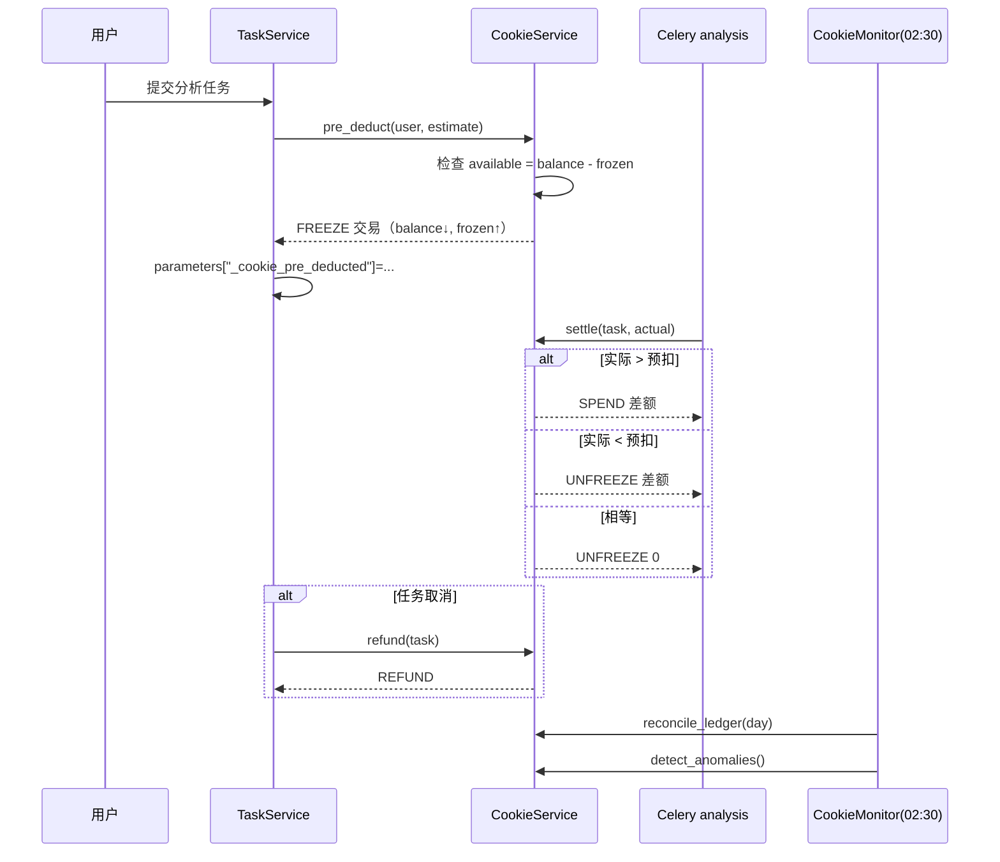

# CygnusX 饼干经济架构（Cookie Economy）

> **用途**：记录饼干账户、交易账本、定价与折扣、任务预扣/结算/退款、AI 对话扣费边界、余额推送、管理员调账、日结对账与异常监控的 as-built 实现。
> **类型**：as-built（2026-10-21 代码基线）。
> **适用范围**：`/api/v1/cookies/*`、`/api/v1/admin/cookies/*`、`cookie_accounts`/`cookie_transactions`/`cookie_pricing`/`cookie_discounts`/`cookie_ledger`、Celery 日结任务、任务提交与 AI 对话的扣费调用点。
> **不适用范围**：token 计量、Provider usage 归一化、缓存 token 计价与对账流程——以 [CygnusX_token_billing_architecture.md](CygnusX_token_billing_architecture.md) 为准；节日奖励的触发与领取见 [CygnusX_festival_architecture.md](CygnusX_festival_architecture.md)。

## 这个模块如何发挥作用

饼干是平台内部的统一计费单位。一个用户一个账户，所有余额变化都必须写一条 `cookie_transactions` 账本记录。消费有两类：

1. **分析任务**：提交时按资源估算**冻结**（FREEZE），任务成功按实际资源**结算**（SPEND + 解冻差额），取消时**退款**（REFUND）。
2. **AI 对话**：每轮按 token 折算**直接扣费**（SPEND），以 `message_id` 幂等，不能透支。

获得渠道当前有三种：注册初始余额、节日彩蛋领取、管理员调账。**平台没有每日签到、邀请返利、任务完成奖励**；任务只扣费，不返饼干。

## 1. 总体架构

```mermaid
flowchart TD
    subgraph Earn[获得]
        SIGNUP[注册初始化<br/>source=signup]
        FEST[节日领取<br/>source=festival]
        ADMIN[管理员调账<br/>source=admin]
    end
    subgraph Spend[消费]
        TASK[任务提交<br/>FREEZE → SPEND/UNFREEZE]
        AI[AI 对话<br/>SPEND source=ai_chat]
        TEAM[AgentTeams 用量<br/>SPEND]
    end
    ACC[(cookie_accounts<br/>balance / frozen / totals)]
    TX[(cookie_transactions<br/>账本)]
    PRICE[(cookie_pricing)]
    DISC[(cookie_discounts)]
    LEDGER[(cookie_ledger<br/>日快照)]
    SVC[CookieService]
    ENGINE[PricingEngine]
    MON[CookieMonitorService]
    WS[Redis Pub/Sub<br/>cygnusx:cookie_balance:{user}]
    FE[前端 cookie store<br/>WebSocket /cookies/ws]
    SIGNUP --> SVC
    FEST --> SVC
    ADMIN --> SVC
    TASK --> SVC
    AI --> SVC
    TEAM --> SVC
    SVC --> ACC
    SVC --> TX
    SVC --> WS --> FE
    ENGINE --> PRICE
    SVC --> ENGINE
    SVC --> DISC
    MON --> TX
    MON --> LEDGER
```

### 实现图：任务预扣与结算



## 2. 数据模型

### 2.1 `cookie_accounts`（`models/cookie.py`）

| 字段 | 说明 |
| --- | --- |
| `user_id` | 唯一，CASCADE |
| `balance` | `Numeric(12,2)` 当前余额（含冻结） |
| `frozen_balance` | 冻结金额 |
| `total_earned` / `total_spent` / `total_adjusted` | 累计统计 |
| `status` | `active` / `frozen` / `suspended` |
| 冻结元数据 | 冻结原因、操作者、时间等 |
| 时间戳 | created/updated |

领域聚合 `domain/cookie/entities.py`：`available = balance - frozen_balance`；`can_spend` 检查可用余额；`apply_transaction` 规定 SPEND 与 FREEZE 都减 `balance`，FREEZE 同时加 `frozen_balance`，UNFREEZE 减冻结，ADJUST 按有符号金额调整。

### 2.2 `cookie_transactions`（账本）

- `account_id`/`user_id`、`amount`、`balance_after`、`source_type`、`source_id`、`admin_id`、`reason`、`task_type`、`cores`/`memory_gb`/`execution_seconds`、`description`（NOT NULL）、IP/UA。
- 类型：`EARN` / `SPEND` / `ADJUST` / `REFUND` / `FREEZE` / `UNFREEZE`。
- 符号约束：EARN/REFUND/UNFREEZE ≥ 0；SPEND/FREEZE ≤ 0；ADJUST 可正可负。
- 复合索引覆盖用户+时间、来源、任务等查询维度。

### 2.3 定价与折扣

- `cookie_pricing`：`unit`（TASK_TYPE / RESOURCE / SANDBOX / BONUS）、`task_type`、`base_cost`、`per_sample`、`per_comparison`、生效区间、优先级。
- `PricingEngine`：`base + per_sample × n + per_comparison × n`，保留 2 位小数；默认 base=1.0、单价 0。沙盒估算当前硬编码 `0.5/小时`，`settings.cookie_sandbox_base_cost` **无消费方**。
- `cookie_discounts`：折扣倍率 0–1、生效日期、可选每日时段（支持跨午夜）、时区（默认 `Asia/Shanghai`）、优先级；`resolve_ai_token_rate()` 取最高优先级匹配，保留 4 位小数。
- AI 单价：`settings.ai_token_cookie_rate`（默认 1.0 饼干 / 1K tokens），与 token_billing 文档中的公式一致。

### 2.4 日结与消费日志

- `cookie_ledger`：按 `(snapshot_date, user_id)` 唯一，记录当日收入/支出/净额/交易数/最小最大余额。
- `cookie_consumption_logs`：模型与仓储存在，但**没有服务写入**，当前为休眠表。

## 3. 核心流程

### 3.1 开户与获得

- `get_or_create_account(user_id)`：账户不存在时创建 `balance = initial_cookie_balance`（默认 100），写 `EARN source_type="signup"`。调用点：自助注册、初始化管理员、管理员建号/审批。
- 节日领取：`CookieService._record_transaction(EARN, source_type="festival")`，详见节日文档。
- 管理员调账：`adjust_balance` 写 `ADJUST source_type="admin"`，可正可负，要求填写原因。

### 3.2 任务预扣 / 结算 / 退款

- 提交：`TaskService` 调用 `pre_deduct()`，按估算写 FREEZE，并把 `_cookie_pre_deducted` 写入任务 `parameters`。余额不足时拒绝提交。
- 成功：Celery `tasks/analysis.py` 按实际 CPU 核数、内存、执行秒数调用 `settle()`：实际高于预扣补 SPEND，低于预扣解冻差额，相等则解冻 0。
- 取消：`refund()` 写 REFUND 并解冻。
- `TaskCookieConsumer`（`application/services/task_cookie_consumer.py`）封装 `on_submit/on_complete/on_cancel`，但**未被 `TaskService` 引用**；实际逻辑内联在 TaskService/Celery 任务中。修改扣费逻辑时应以实际调用点为准，不能只看 consumer。
- 任务扣费路径没有账本级幂等键（不同于 AI 的 `message_id` 幂等），依赖任务状态机保证只结算一次。

### 3.3 AI 对话扣费

- 入口 `chat/runtime_support.py`：每轮结束后调用 `spend_ai_tokens(user, message_id, total_tokens)`。
- 公式：`amount = ROUND_HALF_UP(total_tokens / 1000 × rate, 2)`；rate 经过折扣解析。
- 幂等：若已存在 `SPEND source_type="ai_chat"` 且 `source_id == message_id` 的记录则跳过。
- 余额门槛：可用余额 ≤ 0 时跳过扣费/阻止继续调用（具体行为由 runtime 的 zero-balance gate 决定），不允许负余额。
- 扣费上限为当前可用余额（封顶），余额不足不会把账户打成负数。

### 3.4 余额推送

- 每次 `_record_transaction` 成功后发布 Redis 频道 `cygnusx:cookie_balance:{user_id}`，payload 含余额、冻结、可用、状态等；Redis 异常被吞掉，不影响交易。
- 前端 `stores/cookie.ts` 通过 WebSocket `/api/v1/cookies/ws?token=<JWT>` 接收增量；`useCookieWebSocket.ts` 实现指数退避重连；`CookieBalanceBadge.vue` 展示余额。

### 3.5 日结与异常监控

- Celery beat 每日 02:30 运行 `cookie_monitor`（`infrastructure/celery_app/celery.py` → `tasks/cookie.py`）。
- `reconcile_ledger`：跳过已存在快照的日期，按用户聚合当日交易并写 `cookie_ledger`。
- `detect_anomalies` 阈值：单笔调账 ≥50、单日交易数 ≥20、余额 <0；异常类型包括 `negative_balance`（critical）、`large_adjustment`、`high_frequency_spend`、`frozen_account_activity`。
- 日期边界按 naive 时间（容器默认 UTC），与中国时区日界存在偏差。

## 4. API

### 4.1 用户端（`/api/v1/cookies`）

| 方法 | 路径 | 说明 |
| --- | --- | --- |
| GET | `/cookies/account` | 账户余额/冻结/状态 |
| GET | `/cookies/transactions` | 分页交易流水 |
| GET | `/cookies/pricing` | 当前可用定价 |
| GET | `/cookies/ai-token-rate` | 当前 AI 折算率（含折扣） |
| GET | `/cookies/estimate` | 任务费用估算 |
| GET | `/cookies/balance-check` | 是否足够支付 |
| WS | `/cookies/ws` | 余额变更推送（JWT query） |

### 4.2 管理端（`/api/v1/admin/cookies`，AdminRequired）

账户列表、调账、冻结、解冻、停用；交易列表与筛选；统计；定价 CRUD；折扣 CRUD；手动日结；异常列表；日结账本查询。前端目前只暴露"调账 + 流水"，冻结/解冻/定价/折扣/日结/异常尚无完整 UI。

## 5. 前端

- `stores/cookie.ts`：将后端 Decimal 字符串转 number，`balance = available`；WS 消息直接更新。
- `CookieBalanceBadge.vue`：顶栏余额徽标。
- `CookieAccountView.vue`：账户卡片、AI 折算说明、交易表；存在"提交分析任务赚取饼干"的文案与实际只扣费不符。
- 管理端：`AdminBiscuitsCenterView.vue` 四个 Tab（账户管理、定价、交易、监控），对应 `AdminCookieManagementView.vue`、`AdminCookiePricingView.vue`、`AdminCookieTransactionsView.vue`；`stores/adminCookie.ts` 封装接口。
- 提交页 `FlowSubmitView.vue` 展示估算与余额不足警告。

## 6. 配置、迁移与测试

- 配置（`core/config.py`）：`enable_cookie_system=true`、`initial_cookie_balance=100.0`、`cookie_sandbox_base_cost=0.5`、`ai_token_cookie_rate=1.0`。
- 迁移：初始 schema、允许负数调账、定价样本成本列。
- 测试：`tests/unit/test_cookie_ai_billing.py`（折算率、封顶、零余额、按消息幂等、折扣、跨午夜时段、Chat 门槛）。**没有** pre_deduct/settle/refund、监控日结、admin API、中间件、WebSocket 的测试。
- 模块门禁：`cookies` 模块可锁；`/admin/cookies` 与 `cookies` 前缀不同，管理端路由不受用户模块锁影响。

## 7. 已知限制与风险

| 级别 | 问题 | 影响 |
| --- | --- | --- |
| 高 | 任务扣费无账本级幂等键 | 任务重试/重复回调可能重复结算（依赖状态机兜底） |
| 中 | 日结/监控使用 naive 日期 | 中国时区日界与快照日期偏移 8 小时 |
| 中 | `CookieRequiredMiddleware` 因中间件顺序读不到用户，实际不拦截 | 冻结/停用账户仍可提交任务，服务层才可能拒绝 |
| 中 | 管理端冻结/解冻/停用、定价、折扣、日结功能无 UI | 只能通过 API 操作 |
| 低 | `cookie_consumption_logs` 无写入方 | 休眠表占用迁移与模型维护成本 |
| 低 | `cookie_sandbox_base_cost` 无消费方 | 修改配置不生效 |
| 低 | `TaskCookieConsumer` 未接入 | 形成两套"事实逻辑"，易误改 |
| 低 | 用户页面文案与行为不一致 | 用户误以为任务会赚饼干 |

## 8. 与其他文档的边界

- **token billing**：负责 usage → token → 金额的计算与对账口径、缓存 token 定价；本文负责账户/账本/冻结/折扣/管理端与任务侧扣费。
- **festival**：负责何时发奖、发多少、领取幂等；真正的入账与流水由 CookieService 完成。
- **identity/access**：负责账户状态、用户删除与 `disabled_modules`；饼干停用状态是账户级，不等同于平台用户状态。
- **admin console**：管理端饼干页面的导航与权限矩阵见 [CygnusX_admin_console_architecture.md](CygnusX_admin_console_architecture.md)。

## 9. 关键文件索引

| 层 | 文件 |
| --- | --- |
| 领域 | `src/cygnusx/domain/cookie/{entities,value_objects,repositories}.py` |
| 服务 | `application/services/{cookie_service,cookie_monitor_service,task_cookie_consumer}.py`、`agentteams_usage_service.py` |
| API | `api/v1/cookies.py`、`api/v1/admin/admin_cookies.py` |
| 持久化 | `infrastructure/database/models/cookie.py`、迁移 `08ab25316cc1` / `h4i5j6k7l8m9` / `l9m0n1o2p3q4` |
| 推送 | `infrastructure/cache/cookie_pubsub.py`、`middleware/cookie.py` |
| 前端 | `frontend/src/stores/{cookie,adminCookie}.ts`、`composables/useCookieWebSocket.ts`、`components/CookieBalanceBadge.vue`、`views/CookieAccountView.vue`、`views/AdminCookie*.vue` |
| 测试 | `tests/unit/test_cookie_ai_billing.py` |

## 10. 修改验证清单

- 改扣费公式/折扣：跑 `test_cookie_ai_billing.py`，补任务 freeze/settle/refund 与并发幂等用例。
- 改账本字段或约束：`make check-migrations && make check-alembic-heads`，核对正负号约束与累计字段一致性。
- 改余额推送：验证 Redis 不可用时交易仍成功、WS 重连后余额收敛。
- 改监控阈值/日结：手动触发 `cookie_monitor`，核对 `cookie_ledger` 与 `cookie_transactions` 聚合一致。
