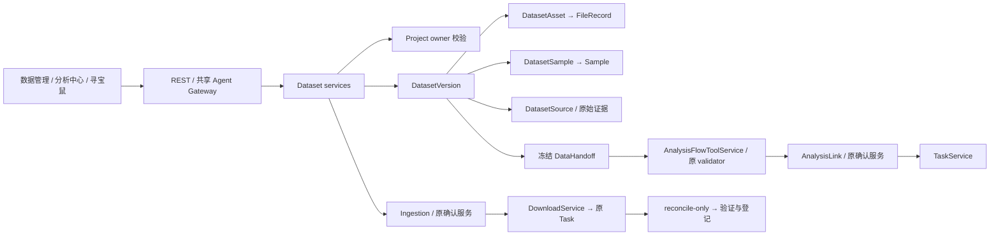

# Dataset 资产与 Flow 输入架构

类型：as-built；基线：2026-10-15。当前代码已落地，运行准入仍 BLOCKED；本文件是该域活动架构入口。验收快照见 `docs/implementation/cygnusx-phase3-dataset-ingestion-handoff-implementation.md`，公共契约见 `docs/contracts/cygnusx-dataset-handoff-v1.md`。

## 关系与边界



新增七张表由 `bioopsphase3` 迁移定义，前驱 `bioopsphase2`。旧 FileRecord、Sample、Task、Project 不重建、不回填；Dataset 只建立引用。项目采用当前代码可证明的 owner-only 权限，不能推测共享 ACL。每次挂接、审阅、manifest、提交重查 owner/project/模块/文件生命周期。历史未关联文件继续走原文件服务。

版本冻结后不能编辑。新版本复制来源和关联，重置资产校验，保留旧版本和人工审阅历史。人工用途与实验类型独立于源数据；人工选择不能把未知矩阵直接提升为 raw counts。Handoff 固定排序并对规范化 JSON 计算 SHA-256，包含来源、文件实测 SHA-256、样本映射、人工审阅与缺口。数据库不提供防管理员篡改保证，真实执行前仍须复验文件；不是数字签名。

## 一次导入

```mermaid
sequenceDiagram
 participant U as Human JWT
 participant D as DatasetImportService
 participant C as Existing confirmation store
 participant W as DownloadService / Task
 participant R as Celery reconcile
 U->>D: discover / prepare explicit source selection
 D->>C: bind owner/project/selection/budget/source hash
 D-->>U: proposal + limitations; no download Task
 U->>D: approve (records approval only)
 U->>D: execute
 D->>D: Phase2 source gate + Phase3 flag; recheck scope/quota/source
 D->>C: consume one-time bound approval
 D->>D: commit SUBMITTING reservation
 D->>W: existing submit (future gated path)
 R->>W: inspect existing Task only
 R->>D: verify FileRecords and content; COMPLETED / PARTIAL / reconcile required
```

GEO/ENA 适配器只读，受信 HTTPS 主机、禁重定向、响应/样本/Run 上限、超时和缓存；每条证据保留 URL、获取时间和响应摘要。不伪造 supplementary 链接，不把 PRJNA 直接传给原 SRR 下载入口。GSE/GSM metadata 不自动推导分组真值。原始选择仅已解析 SRR；processed 仅权威候选附件。现有下载 Worker 的硬预算、重定向及挂载尚未运行验收，不能开放写入。

校验限制总字节、行列、行长、解压数量/大小/比例。拒绝路径逃逸、硬链接/软链接、特殊文件、归档覆盖、非有限/负数/分数 counts、重复 feature/sample 和方向未知。整数外观没有源处理证据时保留 UNKNOWN。TPM/FPKM/CPM/log/Series Matrix/单细胞容器不进入 raw counts DEG。

## Flow 与开关

`DATASET_DISCOVERY_READONLY` 控制只读发现、资产目录及 JWT 人工元数据登记/审阅；不代表数据库绝对只读。`DATASET_IMPORT_WRITE`、`ANALYSIS_SUBMIT_FROM_DATASET`、`COUNTS_DEG_FLOW_ENABLED` 默认 false。所有 Task 写入还受 Phase2 `WRITE_RUNTIME_ACCEPTED=False` 保护，环境变量不能解除。定时 reconciler 关闭门禁时在创建 DB engine 前返回，不重投下载，不处理 SUBMITTING 歧义状态。

FASTQ 走现有 RNAFlow，显式参考/物种/链特异性、样本前缀和配对一致，不自动重命名。counts 走独立 `pipelines/CountsDEGFlow`；本地 R/DESeq2 与 Snakemake 合成验证通过，Worker/镜像/FlowFrame 日志监控认证未通过，默认不注册为可用能力。当前 Handoff `worker_paths_verified=false` 是固定未验收事实，绝非 READY。

数据服务由 REST、共享 Gateway、MCP preset 投影和 Vue 组件复用；没有新建第二个 Agent 执行系统。GET 不做对账写入。输出结果与报告状态独立，不从输入 manifest 推断已完成报告。

## 受保护的科研交付关联

Phase4 为 AnalysisLink 增加 prepare 时的执行绑定，最终 TaskService 与 Worker 复核输入/Flow 摘要；Task/link 在队列可见前提交。结果采集、FileRegistry、双报告与项目只读投影见 [科研交付架构](CygnusX_research_delivery_architecture.md)。该扩展没有解除 Phase3 的运行/写门禁；实际 Worker 与公开案例仍 BLOCKED，旧版本、文件和任务不补造历史。
