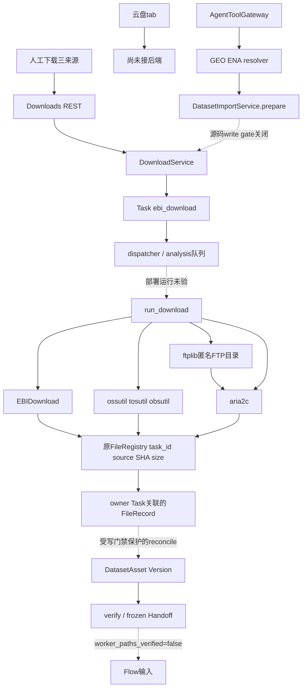
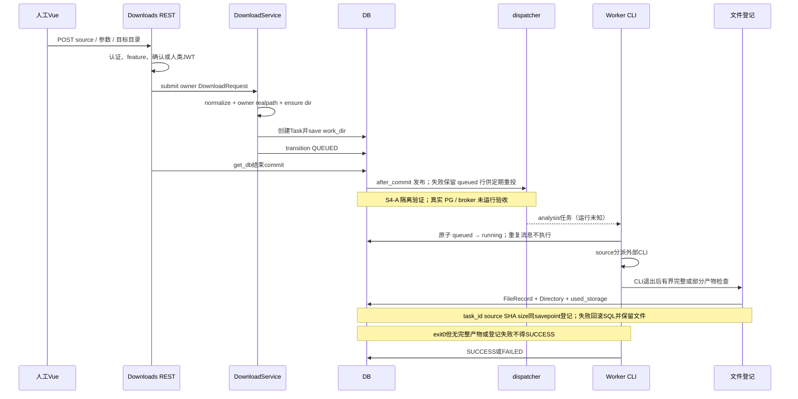
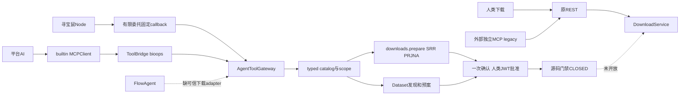
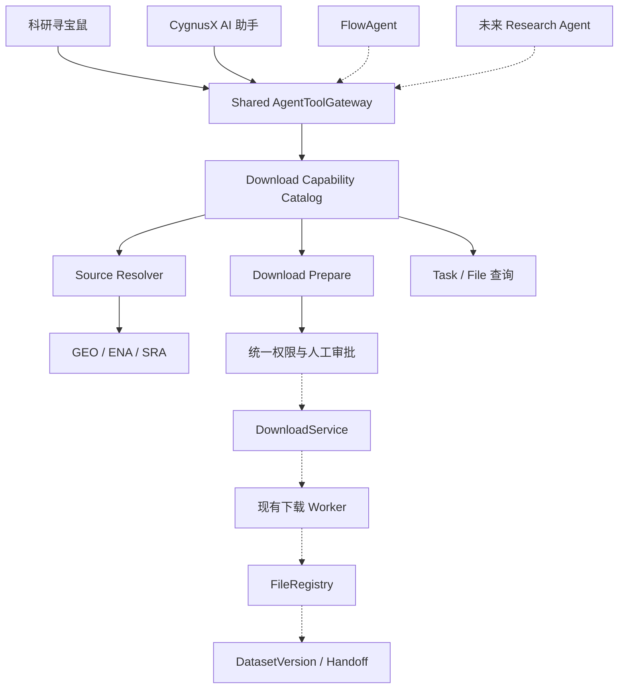

# CygnusX 下载与公共数据接入架构

类型：as-built 活动基线；核实日期：2026-10-16。描述当前工作树代码，不代表生产部署或任何协议已验收。调查快照、D01–D16、D-T01–44、DL-RG01–15 及原始证据定位见 [专项调查](../docs/audits/cygnusx-platform-download-capability-and-agent-tool-readiness-audit-2026-10-16.md) 与 [证据索引](../docs/audits/appendix-download-evidence-index.md)。

**本文是"平台下载模块"的单一权威架构文件**。下载模块的完整细节——四阶段边界、三条传输实现、Worker 与 CLI 分发、FileRegistry 登记、源码门禁与验收——一律以本文为准；其余文档只在各自域内保留接入点与回指链接：

- 共享 Agent 工具层（catalog/身份 scope/审批/恢复）：[CygnusX_agent_tool_gateway.md](CygnusX_agent_tool_gateway.md)
- 寻宝鼠端到端链路（下载 Prepare→审批→执行段）：[CygnusX_treasure_mouse_architecture.md](CygnusX_treasure_mouse_architecture.md)
- Dataset 资产与 Flow 输入接入：[CygnusX_dataset_architecture.md](CygnusX_dataset_architecture.md)
- 路径与共享盘：[CygnusX_storage_architecture.md](CygnusX_storage_architecture.md)

**S0+S1 实施更新**：真实下载 Worker 已复用现有 FileRegistry 写入 Task ID、source=download、实测 SHA-256/size，并由不手填 FileRecord 的跨层隔离测试验证到 DatasetAsset。仅登记/对账契约 PASS_ISOLATED；没有部署、真实传输或解除 Agent 写门禁。S2协议与来源清单已增量落地（见§9）；S3–S7尚未完整验收，期间另行出现的安全/能力代码不计作这些阶段已完成。历史审计仍保留其当时的断点结论；本节与当前源码为修复后的现状。阶段证据：[S0 红测试](../docs/implementation/download-s0-baseline-and-red-test.md)、[S1 契约修复](../docs/implementation/download-s1-file-registry-dataset-bridge.md)。

## 1. 模块职责与真实边界

下载有四个不同阶段：发现来源、执行传输、登记文件、审阅科研资产。前端「数据下载与聚合」的公共数据库/云存储/直链三tab共用一条Task链；云盘tab仅占位。下载文件落服务端用户空间，用户浏览器不承载远程传输。平台MinIO/S3存储、向浏览器生成presigned下载URL和拉取外部对象存储是不同功能。

| 层 | 当前职责 | 关键代码 |
|---|---|---|
| UI | 三来源POST、下载Task列表、跳转Task详情；云盘warning | frontend/src/views/DownloadsView.vue:193/217 |
| REST | 认证、按source开关、links数量、API-Key写门禁/确认消费 | api/v1/downloads.py:38/59；api/deps.py:47 |
| DTO | sra/cloud_storage/direct_link、协议与线程范围、浅层URL检查 | application/schemas/download.py:46/95 |
| Service | 用户目录/目录链、通用Task提交、队列调度 | application/services/download_service.py:48 |
| 队列 | 默认Celery analysis；settings可换RocketMQ | infrastructure/task_queue/dispatcher.py:22；celery_app/celery.py:78 |
| Worker | source三分派、CLI日志进度、按退出码判终态、文件扫描登记 | infrastructure/celery_app/tasks/download.py `_execute_download` / `_execute_cloud_storage_download` / `_execute_direct_link_download` / `_finalize_download_files` |
| 传输器 | EBI/SRA公共镜像或ENA；三家云CLI；aria2c与FTP目录ftplib | 同上；pipelines/EBIDownload/crates/ebidownload-cli/src/main.rs:347 |
| 文件注册 | Task前置文件清单、owner/task/source/SHA/size校验，原FileRegistry注册，目录链及配额同事务；冲突要求对账 | download.py `_prepare_download_registration` / `_register_downloaded_files`；storage/file_registry.py `register`；download/outputs.py |
| 科研治理 | 真实项目权限、Source/Run选择、预案、Asset/Version、SHA/科学输入审阅 | dataset_import_service.py:136/343/426；dataset_handoff_service.py:52/158 |
| Agent工具 | typed catalog、身份scope、确认、关联恢复、禁止执行 | agent_tool_gateway.py:47/77/167/761 |

## 2. 组件关系图

实线是源码关系，不代表运行认证；虚线是受门禁或断链阻断的关系。

## 3. 三条传输实现

公共数据库：DownloadRequest.source=sra，原accession交EBIDownload `download -A`。人工表单不经过GeoMetadataAdapter。CLI用ENA filereport获取read_run；FTP分支经wget -c下载FASTQ并核MD5，AWS分支获取SRA再fasterq-dump转换/压缩。GSE/GSM的科学解析在独立Dataset resolver中；不承诺CLI原样GSE能展开。S2后平台DTO/声明仅aws/ftp，与CLI实现集合取已接线子集；Aspera明确拒绝，prefetch/auto虽在CLI源码存在但未向平台开放。GEO需先解析、一次一个accession；未接线样本/Run筛选不再伪装生效。

云存储：source=cloud_storage；aliyun/volc/huawei及别名→OSS/TOS/OBS scheme→对应CLI cp。CLI配置/IAM从实际运行环境供给，不由前端传AK/SK。没有通用s3://或COS适配，也没有云盘解析器；presigned HTTPS只能按普通直链理解，未完成签名时效/日志脱敏认证。

直链：source=direct_link，http/https/ftp，URL作为argv交aria2c，无shell。recursive FTP尾斜杠先ftplib匿名遍历，后aria2批量。FTPS在DTO不接受，没有FTP_TLS或登录参数。--continue、split、max-tries等CLI参数是局部恢复机制，不证明Task跨Worker crash可靠恢复。

## 4. 一次请求的实现时序

## 5. 来源与科研资产接入

**S4-B0 加固（2026-10-17，2026-10-18 补记）**：恢复扫描在 SQL limit 前过滤可靠性版本，避免历史行饥饿；事务结束清理 Session 通知，提交后发布异常保留 queued 恢复事实。嵌套事务以 savepoint 为界快照派发通知：内层回滚只丢弃该 savepoint 新增通知，保留外层待提交任务；只有外层 commit 才发布。请求键别名默认最多 64 个，旧 Worker save 保留数据库中的别名/登记/恢复事实；无键终态复用同意图。取消行锁重读并支持重复取消。新目录的隐藏 marker 仅为 rollback 残留归属提示，不构成执行或删除授权。新增 savepoint 回归后当前 S4-A/S4-B0 隔离套件30项通过；PG/broker/Worker/OS 验证仍 RUNTIME_BLOCKED，见 [S4-B0 报告](../docs/implementation/download-s4b0-reliability-hardening.md)。

**S4-A 可靠性增量（2026-10-17）**：DownloadService 在原 User 行锁内绑定 owner/project 与规范参数摘要，复用 Task 的唯一 idempotency_key；活动意图复用 Task，显式新键可重试终态。新 Task 原子分配独立可读目录。外层提交后发布原队列，带版本的持久 queued 行可定期重投；Worker 原子领取 queued，running 不自动重跑，只记录不确定对账。下载取消记录 process_tree_stopped=false / egress_revoked=false，迟到状态写不能复活取消。仅 PASS_ISOLATED，真实 PG/broker/Worker/停止语义 RUNTIME_BLOCKED。细节与风险见 [S4-A 报告](../docs/implementation/download-s4a-task-reliability-implementation.md)。真实下载门禁保持。

GeoMetadataAdapter固定HTTPS主机、禁重定向/trust_env、限制响应/样本/Run与缓存；输出SOFT/ENA来源证据、候选文件及未知项，不下载科研文件。DatasetImportService.prepare以真实owner Project、显式选择、source snapshot与预算建立Ingestion与一次确认，不创建目录/Task。raw仅已解析SRR；processed权威附件→direct_link请求。

execute仍被源码门禁阻断。代码意图是重验来源与配额→消费批准→持久SUBMITTING→Version/source_snapshot→同一DownloadService→task_ids。reconcile不重投，从Task→FileRecord.task_id取产物。S1已修复原DataFile/FileRepository登记断点：三来源Worker统一调用 `_finalize_download_files` → `_register_downloaded_files` → FileRegistry.register，明确传task_id/source=DOWNLOAD/实际SHA与size。Dataset原有task_id查询规则不变，真实登记跨层测试已证明能建立Asset；不再依赖double给FileRecord补字段。此处是代码/隔离证明，不能当成真实Worker下载验收。

人工下载无自动Dataset创建；已有合法FileRecord可经DatasetService.attach_asset显式关联。验证计算实际SHA-256、检查FASTQ/矩阵与安全归档，审阅样本/单位后冻结manifest_hash。source MD5、实际文件SHA和manifest hash分别存语义，不等价。worker_paths_verified固定false，因此Dataset READY文本不是Worker执行准入。

归档接入已有 `GeoProcessedDataService.expand:65`：写门禁后保留原archive、核SHA、受限展开、使用FileRegistry注册子文件并保存parent archive ID/SHA；失败保留staging对账。FileRegistry.register已支持task_id/source/checksum，S1下载Worker已复用该入口；现有ORM列足够，无新增表/迁移（历史证据E46/E47，S1真实登记契约验证）。

## 6. Agent与人工入口

下载页人类JWT可直接提交；API-Key写REST先过Agent gate。Gateway read默认关闭；上下文从active user/session/project派生而非模型输入，模块与scopes交集裁剪。Node有限委托不能approve/execute；批准端点用CurrentJwtUserId。模型user_confirmed布尔不能自证。

downloads.prepare仅SRR/PRJNA候选，预算未知；dataset.prepare_import拥有权威来源与科研选择/预算，内部不再调用downloads.prepare，所以当前没有嵌套双确认。跨入口重复请求仍缺统一去重。外部MCP legacy不是所有Gateway能力的等价投影；FlowAgent当前仅submit_plan适配Snakemake计划端点，下载Gateway尚未接通。

## 7. 配置、部署与观测

- 下载配置：tool_configs/download/download_config.yaml，mtime热重载；显式下载YAML binary路径优先对应Settings/env变量，其次从storage_path派生；要求绝对文件路径。YAML三features=false；REST按YAML OR Settings。本地进程仅EBI开，其他download/read/import/Agent download关，非容器证据。
- Worker声明：deploy/docker/docker-compose.worker.yml worker image cygnusx-worker:v0.0.2dev，源码、tool_configs、共享盘与pipelines挂载；Dockerfile.worker未构建Rust downloader/安装aria2与三云CLI，依赖运行数据盘供给。
- 版本：子模块EBIDownload1.4.0；独立旁仓Polariseq1.4.3；宿主binary1.4.0/hash见调查；socket被拒，当前容器版本/digest/UID/挂载UNKNOWN。
- SRA逐Run进度：CLI本地加密Progress API→轮询解密→Redis→REST；缺失返回unavailable。Task状态与日志回写DB+PubSub。HTTP/云CLI百分比日志不代表逐文件完整性。
- Task状态只有pending/queued/running/success/failed/cancelled；Ingestion另有PREPARED/SUBMITTING/QUEUED/RUNNING/VERIFYING/PARTIAL/COMPLETED/RECONCILIATION_REQUIRED。不可混合成单一枚举。

Web与Worker共享盘分别由CYGNUSX_DATA_ROOT/WORKER_SHARED_DATA_DIR供给，同目标路径不证明同一物理内容。Worker entrypoint声明PUID/PGID默认1000降权，真实UID未知；Studio沙箱uid10001与出站proxy不是下载Worker的运行基线。证据见E49/E50。

## 8. S1 登记契约、恢复边界与后续验证

CLI前 `_prepare_download_registration` 持久化受控文件清单到原Task.parameters._download_output_baseline，核Task/user/work_dir与local backend，拒绝被其他Task引用的目录和旧未绑定文件。唯一任务目录尚属S4；因此历史重复accession/首URL造成的共享目录会先要求对账，而不是自动覆盖或抢占。

登记使用有界条目/文件/校验字节清单，目录按openat/O_NOFOLLOW遍历，文件用既有Dataset open_owned_file/checksum实算SHA，拒绝软/硬链接、特殊文件、越界、零字节与校验期间变化。排除progress.key、隐藏目录、checkpoint、*_metadata、.aria2/.part/.tmp/.log及带aria2 sidecar的未完成payload。新登记经原FileRegistry，真实子目录链与used_storage在同savepoint内写；User行锁/刷新配额，任一登记失败不留半批SQL记录、不删除真实文件。SRA进度写任务在最终登记前停止，避免迟到进度覆盖Task.parameters登记投影。

同路径只允许同owner/Task/source/SHA/size/active personal记录幂等复用；历史空hash/无Task/其他Task或owner的记录不静默更新。Task.parameters._download_registration投影记录FILES_REGISTERED/PARTIAL/RECONCILIATION_REQUIRED、file_ids/数量/字节，scientific_ready=false；不新增Task枚举或第二个ledger表。CLI非零退出可登记稳定普通部分文件，Task仍FAILED；exit0无完整产物或登记失败同样不得SUCCESS。部分文件SHA仅标识当前字节，不证明源checksum/传输完成，Dataset仍需科学审核。

登记配置在原DownloadValidationConfig：max_registration_entries默认20000、max_registration_files默认10000、max_registration_bytes默认1TiB，可由下载YAML覆盖；这是传输完成后的登记资源边界，不是网络硬预算。登记仅接本地受管存储，不声称远端S3对象已被拉取或认证。

仍未修复：通用URL/DNS/redirect/FTP出站防护、传输硬预算与并发预留、普通submit先排队后commit竞态、唯一工作目录/可靠取消/跨Worker恢复、完整逐协议Catalog及多Agent运行认证（Aspera契约漂移已在S2修正）。这些分别属于后续S3–S7；期间另行新增的语法安全、FTP限额及capabilities代码只表示当前存在，不代替完整阶段验收。现有源码写禁和worker_paths_verified=false继续有效。

S1验证：专用登记25个参数化用例；下载、Dataset、归档、Gateway、确认与MCP parity相关回归103 passed/5既有quarantine排除；修改文件Ruff、聚焦严格mypy与迁移链检查通过。全仓Ruff/mypy仍FAIL（报告记录当前问题），真实PG/Redis/队列/Worker/协议/浏览器E2E未执行。本阶段不承诺发布READY。历史审计111 passed/1 failed/5 deselected是当时快照，不能与本阶段测试集合混算。

## 9. S2 协议契约与来源清单

S2代码和局部隔离验收见 [阶段报告](../docs/implementation/download-s2-worker-protocol-provenance.md)；[来源清单v1契约](../docs/contracts/cygnusx-download-runtime-manifest-v1.md)与[ADR](../docs/adr/download-transport-and-asset-registration.md)说明部署边界。本节不是实际镜像或传输认证。

`domain/download_contract.py` 统一来源/方法/协议静态声明；DTO、DownloadService与排队Worker重验。平台仅SRA aws/ftp、direct_link http/https/匿名ftp、cloud_storage OSS/TOS/OBS。allowed_schemes只能收紧实现集合，不能通过配置增加FTPS/S3/COS。未知来源/协议/方法/provider使用稳定DOWNLOAD_*错误码，GSE/GSM/GPL要求先权威解析，未接线advanced/filter拒绝而非静默忽略。

前端去除Aspera/最快宣传、多个accession和无效筛选暗示；云盘保留tab并标尚未接入。builtin与外部MCP对应方法声明收敛；这不等于S6全Agent目录/实际tools注入与身份授权已完成。

程序路径优先级为显式下载YAML > 对应Settings/env二进制变量 > storage_path派生；功能开关维持原有YAML OR Settings。S2不更改Dockerfile/Compose/.env/YAML，不复制旁仓Polariseq、不运行Docker build/重启。源码子模块1.4.0与历史宿主1.4.0、独立旁仓1.4.3仍是不同证据，当前Worker版本UNKNOWN。

`inspect_download_runtime.py`生成运维SOURCE_ONLY JSON，记录主/子仓SHA/dirty、Cargo/uv锁、实际Worker源码/合同/配置与Dockerfile/Compose摘要及白名单声明。可显式合并严格Schema的受信运维Worker观察做漂移检测；不执行其中任何路径、不接网络/DB/容器、不导出全环境/凭据。观察一致也固定runtime_status=BLOCKED、release_ready=false。没有模型/REST自报PASS通道。

施工期间共享工作区另行新增 `domain/download_security.py`、`infrastructure/download/policy.py`、`download_capability.py`、GET /downloads/capabilities、FTP限额和动态UI。当前 `DOWNLOAD_TRANSPORT_RUNTIME_ACCEPTED=False` 在Service/Worker拦截实际传输，前端按capabilities.write_enabled=false禁用人工提交；Agent原WRITE_RUNTIME_ACCEPTED=False亦保留。这是当前代码事实，但非本轮S2计划内的独立验收成果。人工既有能力兼容策略仍需修改方协调确认；不为测试或可用性擅自解除该门禁，不将额外关闭人工执行说成已验证的最终架构。

S2专用后端44项隔离通过；当前共享联合回归155通过、前端专项3项jsdom与vue-tsc通过，聚焦Ruff/8源码文件mypy和迁移链通过。测试使用fixture/SQLite/axios/网络double，未取得真实Worker/协议/PG/Redis证据；全仓门禁与S3–S7整体仍未宣称完成。阶段报告记录测试集合变化与并行修改归属，最终架构调整还需后续阶段和运行验收。

---

## 10. S3 日志与凭据边界（局部完成，G3 未通过）

下载 URL 语法策略额外限制主机标签、链接长度及查询字段数量；签名/凭据查询字段和云 URI 查询参数在 DTO 层拒绝，尚无获准的安全凭据存储通道。此规则不能识别所有网站私有令牌格式，也不能替代出站网络策略。

下载 Worker 为既有 BinaryExecutor 配置可选 `log_filter`，在 stdout/stderr 结果缓存及日志回调前过滤 URL、认证头和常见密钥字段；进度解析仍使用原结构。Worker 日志入库与发布入口再次过滤。其他执行器调用默认不启用过滤。Task 下载响应对参数、错误、名称和日志做展示副本脱敏，不重写既存参数或确认哈希。下载 REST 校验错误只保留字段位置、错误类型和固定提示，不记录原始输入/上下文。下载工具确认在存储前校验 DownloadRequest，拒绝不安全参数；内置 MCP 下载工具的参数错误返回固定提示和 `DOWNLOAD_ARGUMENTS_INVALID`，不返回包含原始输入的 Pydantic 异常。

上述措施是凭据防泄露的增量修复，不代表 ToolTrace/对话历史/所有旧数据已经完成全链路认证。原始历史持久化内容未清理；拒绝签名 URL 不构成凭据保险库。

`DOWNLOAD_TRANSPORT_RUNTIME_ACCEPTED=False` 继续阻断 Service 与 Worker 的实际传输；当前人工页面也受此门禁影响。FTP 递归限深/限条目/超时，展开结果受 `min(max_ftp_files, max_links_per_task)` 限制；这些限制与文件登记限字节都不是传输硬字节预算。DNS 解析地址校验函数和重定向拒绝函数尚未证明约束真实 CLI socket；FTP 数据连接、未知大小传输、实时配额硬停止和中断恢复均未取得运行证据。G3 保持未通过，不向依赖阶段或生产准入递进。详细测试、协议矩阵与回滚见 `docs/implementation/download-s3-network-budget-safety.md`。

S3 Closure 增量复核：DownloadService 现从请求数据重建副本，完整执行当前 DTO 验证器，避免内部调用修改已验证对象后绕过 URL 规则；失败返回固定 DOWNLOAD_ARGUMENTS_INVALID。policy 新增只读 protocol×caller_kind 准入投影，分别说明人工 JWT、Agent 委托确认、Worker 持久 Task 的授权要求，全部 execute_allowed=false；执行门禁现按来源协议集合消费该投影的拒绝结果，单独翻转全局 release switch 仍不能认证协议；投影不承担身份认证或证书消费。联合隔离回归 194 passed，真实 egress/硬预算/全历史链仍未验，G3 为 PARTIAL_CODE / RUNTIME_BLOCKED。详见 [S3 Closure 报告](../docs/implementation/download-s3-closure-implementation.md)。

历史消息保护补充：ChatMessageDTO 对已识别下载工具信封的 metadata_json 生成脱敏副本，过滤 URL、常见密钥与内部路径，不改原历史/确认哈希。该投影不覆盖自由文本、未知别名、Node 诊断或全部模型回灌；不得据此宣称全链路凭据治理已完成。验证与范围见 S3 Closure 报告的后续增量。

S3 新写入保护：两聊天 Runtime 在新展示信封脱敏后计算 payload_hash，SSE 出口对已识别下载工具 metadata 使用副本脱敏；执行参数与审批哈希不改。SSE 以流内下载调用 ID 关联后续无工具名的输出并过滤 content/metadata，不跨流共享关联；无法关联的输出、自由文本、未知别名与Node链路仍未覆盖。修正静态模型绑定测试上下文后相关聊天/金样本回归52项通过；真实沙箱7项仍跳过，详见 Closure 报告，不宣称 Chat E2E 全绿。

S3-E1接口增量：新增 `infrastructure/download/trusted_execution.py`，仅定义HTTP候选受信执行接口、服务端引用模型和停止对账必要条件；无具体adapter实现，未接线BinaryExecutor或开放任何协议。只读依赖probe与九场景真实测试程序已提供，真实驱动缺失而明确skip。原Service/Worker/Gateway门禁保持关闭，G3仍PARTIAL_CODE / RUNTIME_BLOCKED。权限边界、依赖、验证与E2条件见[交接报告](../docs/implementation/download-s3-e1-trusted-execution-boundary.md)。

S3-E2增量（2026-10-18）：受信观察契约明确区分任务admitted RX与host observed/dropped RX，并绑定Task/scope/execution/epoch、开始/停止时间、cgroup populated、出口撤销、quota与清理事实；签名回执增加attempt/execution/epoch、policy/environment/binary SHA、artifact manifest SHA及nonce。发布谓词要求任务预算内、进程/cgroup清空、出口撤销、quota强制及清理完成。新增SQL nonce repository及唯一约束迁移，消费与调用方事务共用，SQLite验证回放与回滚。Worker direct-link HTTP登记已在FileRegistry写入前校验签名回执与实际输出manifest，并在同一调用事务消费nonce。另有Worker侧`MutualTLSExecutionAdapter`客户端实现start/observe/renew/stop，强制HTTPS+mTLS、关闭代理继承/重定向且不重试；控制请求要求identity编码并拒绝压缩响应，通过原始流式读取限制响应体64 KiB。客户端没有接入Worker生命周期，尚无匹配Supervisor服务端。当前合同/登记/预检/客户端隔离回归99项通过。迁移尚未应用真实PG，PG并发未验；OS Supervisor、网络/硬配额强制、停止/清理仍未实现，九个真实HTTP场景本次全部skip，G3保持 `PARTIAL_CODE / RUNTIME_BLOCKED`，所有执行开关关闭。只读宿主探针支持指定Supervisor工作目录，并可用`--require-visible-prerequisites`在缺少可见前置时非零退出；该门禁不认证内核行为或执行强制。详见 [G3-E2 运行报告](../docs/implementation/cygnusx-g3-e2-trusted-http-runtime.md)。

S5-A目录增量（2026-10-16）：现有DownloadCapabilities/Source DTO增加十二类细分capabilities与正交状态，原sources四项保留。REST与Gateway共用服务端配置/TransportAdmission，Gateway进一步按Agent/scope裁剪；没有Worker认证推断或执行放行。项目Dataset可发现有界版本ID并沿原资产查询；委托scope收窄在调用重验后保留。代码与隔离验证范围见[S5-A交接](../docs/implementation/download-s5a-capability-catalog.md)，G3及所有传输门禁不变。

## 附录 A：目标态参考（提案，非现状依据）

> 本节是"数据下载与多 Agent 工具化"的**目标架构**，用于规划方向与对齐长期愿景；**不得当作现状证据**。现状以实现 §1–§8 与源码为准。与现状的差距见 §8（开放缺口清单）与专项调查 DL-RG01–15。

**与现状的关键差距**（对照 §1–§8）：

| 目标态节点 | 现状 | 差距 |
|---|---|---|
| A/B → E（寻宝鼠 / 平台 AI 共用 Gateway） | 源码已接线、运行未验 | 不代表实际tools注入/MCP/Node网络已认证 |
| C → E（FlowAgent） | `CygnusX_download_architecture.md` §6：FlowAgent 仅 `submit_plan` 适配 Snakemake 计划端点，**下载 Gateway 尚未接通** | 缺可信下载 adapter |
| D → E（未来 Research Agent） | 未落地 | 待规划 |
| K → L（统一权限与人工审批 → DownloadService） | 源码门禁 `WRITE_RUNTIME_ACCEPTED=False` CLOSED | 开放 Agent 执行的前置 |
| L → M（DownloadService → Worker） | Worker 部署运行未验收 | Dockerfile.worker 未装下载器/aria2/三云 CLI |
| M → N（Worker → FileRegistry） | S1已复用原register，写task_id/source/实际SHA/size，隔离契约通过 | 真Worker/挂载/传输与故障认证仍未完成 |
| N → O（FileRegistry → DatasetVersion/Handoff） | 真实登记→reconcile→Asset隔离通过；科学审阅与Handoff仍独立 | 写/运行门禁关闭，不自动提升科研READY |

## RI01–RI04 增量（当前源码；运行准入仍关闭）

本节覆盖上文调查时点仍列为后续的契约/安全缺口：SRA页面/DTO/Worker现共用aws/ftp兼容集合，旧Aspera不静默转换；`GET /downloads/capabilities`与Gateway `downloads.describe_capabilities`共用安全能力描述，binary_version未知、Runtime BLOCKED。Vue读取服务端方法而非另写枚举，并显示运行未验收。详见`docs/contracts/cygnusx-download-capabilities-v1.md`。

云URI异常吞掉IP拒绝的逻辑已修复；IP特殊地址/非标准表示/映射IPv6/凭据/编码别名拒绝，FTP遍历有深度/条目/超时与循环边界。但Python初次检查不约束外部CLI最终连接：源码`DOWNLOAD_TRANSPORT_RUNTIME_ACCEPTED=False`在Service副作用前和Worker/CLI前阻断所有未经认证运输。真实下载（包括人类表单）本轮不开放；不以max_bytes预估或登记后预算冒充传输硬限制。

继承的S1实际登记链继续使用FileRegistry、savepoint/配额及原Task投影；本轮增加显式Ingestion项目权限复查、用户/下载模块撤权拒绝、错误Task/真实登记到reconcile与配额变化回归。没有重新开发下载器，也没有新建Task/FileRecord/关系表；真实PG并发、队列、CLI网络与挂载需RI05独立验收。

## P0-A / G3 服务端离线增量

P0-A 在原 ingestion 保存持久审批快照，原 Admission 仓储重新查证 Task/owner/project/摘要及固定环境 profile；预算改 BigInteger、未计量值为 NULL，Task/Admission/预算同事务提交并复用原 after_commit。迁移 dwnbinding02 不继承旧执行许可，旧记录保留待对账。首期仅 HTTP；现 GEO HTTPS 预案不自动降级，真实链仍阻断。可信结算与 PG 并发验收未完成。

新增 supervisor_server.py 提供 mTLS 控制服务骨架与默认拒绝编排；没有 Linux enforcement backend、持久 scope journal 或 P0-A authority 实现，未接 Worker。隔离测试仅证明编排，不证明 RX/cgroup/netns/quota/停止事实，真实九场景0/9。全部写/运输门禁保持关闭。交付与回滚详见 docs/implementation/cygnusx-p0a-trusted-admission-budget-binding.md 及 cygnusx-g3-e2-trusted-http-acceptance.md，不能继承历史运行认证。
