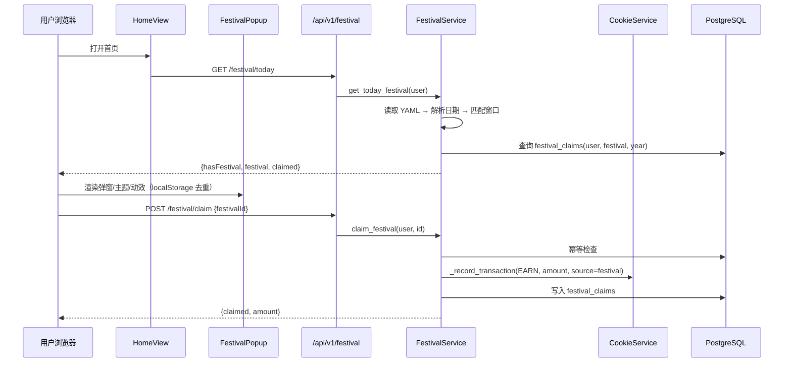

# CygnusX 节日彩蛋架构（Festival / Easter Egg）

> **用途**：记录节日彩蛋子系统的当前实现——节日定义、日期解析、激活窗口、彩蛋领取与饼干奖励、管理端配置、前端弹窗/动效/主题，以及容器环境下的已知限制。
> **类型**：as-built（2026-10-21 代码基线）。
> **适用范围**：`/api/v1/festival/*`、`/api/v1/admin/festivals`、`data/festival_config.yaml`、首页节日弹窗、`festival_claims` 表。
> **不适用范围**：饼干账户与交易账本（见 [CygnusX_cookie_economy_architecture.md](CygnusX_cookie_economy_architecture.md)）；用户模块门禁（见 [CygnusX_identity_access_architecture.md](CygnusX_identity_access_architecture.md)）。

## 这个模块如何发挥作用

节日彩蛋是"按自然日自动触发的轻量运营活动"：系统以 `data/festival_config.yaml` 为唯一定义源，根据公历/农历/节气解析当天命中的节日（最多一个），在首页展示弹窗与主题动效；用户可领取一次饼干奖励。领取记录落 `festival_claims`，奖励走饼干账本 `EARN` 交易，`source_type="festival"`、`source_id="{festival_id}:{year}"`。

系统没有数据库侧的活动表、没有定时任务、没有自动种子。是否展示完全由"配置文件 + 当前日期 + 前端拉取"决定，因此改 YAML 后无需迁移，只需重载（管理端提供 `/admin/festivals/reload`）。

## 1. 总体架构

```mermaid
flowchart TD
    YAML[data/festival_config.yaml<br/>37 个节日定义] --> LOADER[FestivalConfigLoader<br/>mtime 热重载 + ${ENV} 插值]
    LOADER --> DOMAIN[domain/festival<br/>日期解析 / 窗口 / 优先级]
    API[api/v1/festival.py] --> SVC[FestivalService]
    ADMIN[api/v1/admin/festival.py] --> SVC
    SVC --> DOMAIN
    SVC --> COOKIE[CookieService._record_transaction<br/>EARN / source=festival]
    SVC --> DB[(festival_claims)]
    HOME[HomeView.vue] -->|GET /festival/today| API
    HOME --> POPUP[FestivalPopup.vue]
    POPUP -->|POST /festival/claim| API
    POPUP --> BG[FestivalBackground.vue]
    POPUP --> EFFECT[FestivalEffect.vue canvas]
    POPUP --> DECO[FestivalDecoration.vue]
    ADMINUI[FestivalManager.vue] -->|PUT /admin/festivals/:id| ADMIN
```

### 实现图：一次节日展示与领取



## 2. 节日定义与配置

- 唯一配置源：`data/festival_config.yaml`（当前 37 个节日；路径由 `Settings.festival_config_yaml` 指定，默认 `data/festival_config.yaml`）。
- 全局配置：`global.enabled` 为总开关；`defaultActiveWindow`、`popupDefaults`、`quotaDefaults` 当前会被解析但未被消费（代码只读取 `global.enabled`，展示与领取限制由节日条目自身字段决定）。
- 节日字段（MVP 管理端可改范围）：`enabled`、`priority`、`popup.{enabled,title,content,description,animation}`、`quotaBonus.{enabled,amount,description}`。
- 配置加载：`infrastructure/yaml/festival_config_loader.py` 支持 `${ENV:-default}` 环境变量插值、mtime 缓存与热重载、缺失文件时告警并返回空配置。
- **写回**：管理端更新会将整个 festivals 列表重新序列化写回 YAML（`save_all`）；日期、id、category 等字段只能直接编辑 YAML。

节日类型与分类定义在 `domain/festival/value_objects.py`：

| 类型 | `calendar` | 日期来源 |
| --- | --- | --- |
| 公历节日 | `SOLAR` | 直接构造 `date(year, month, day)`，非法日期返回 `None` |
| 农历节日 | `LUNAR` | `lunardate` 库按农历月/日解析 |
| 节气 | `SOLAR_TERM` | 预计算节气表，按名称或索引查表 |

## 3. 日期解析与激活窗口

`domain/festival/services.py`：

1. `resolve_festival_date(festival, year)`：按 `calendar` 求当年日期；农历/节气解析失败返回 `None`。
2. 窗口：`start = 参考日 + offsetDays`，`end = start + durationDays - 1`，起止时间为当天 `00:00:00` 至 `23:59:59.999999`（naive datetime）。
3. **窗口年份固定**：`active_range.year` 只取参考日年份，不跨年展开。
4. `is_active_on` 判断当天是否落在窗口内；`select_active_festival` 在多个命中节日中按 `(priority, name)` 取最大者，保证同一时刻最多一个彩蛋生效。

节气表 `domain/festival/solar_term_calendar.py` 为预计算常量表，覆盖 **2025–2035**，共 24 个节气；超出范围的年份查表返回 `None`，对应的节气节日将静默不触发。该实现是刻意的 MVP：不引入天文库，日期按项目既有的 UTC 预计算日约定。

## 4. 领取与饼干奖励

- 数据表 `festival_claims`：`id`、`user_id`、`festival_id`、`year`、`amount`、`transaction_id`、`claimed_at`；唯一约束 `(user_id, festival_id, year)`。
- 幂等：服务层先查重，再写领取记录；数据库唯一约束兜底。**并发竞争下未捕获 `IntegrityError`**，同一用户并发请求可能返回 500 而非幂等成功。
- 年界：`year = datetime.now().year`（naive，容器默认 UTC）；跨年瞬间的归属年份可能与中国时区不一致。
- 奖励金额来自 `quotaBonus.amount`；未启用 `quotaBonus` 时仍会写领取记录，金额为 0。
- 账本联动：调用 `CookieService._record_transaction`，`source_type="festival"`、`source_id="{festival_id}:{year}"`，并发布饼干余额 WebSocket 事件（详见饼干经济文档）。
- 用户删除时，`festival_claims` **不在管理端用户删除的级联清理清单内**（当前仅清理饼干/通知/记忆等表），会留下孤儿记录。

## 5. API

| 方法 | 路径 | 权限 | 行为 |
| --- | --- | --- | --- |
| GET | `/api/v1/festival/today` | 登录用户 | 返回 `{hasFestival, festival, claimed}`；无命中时 `hasFestival=false` |
| POST | `/api/v1/festival/claim` | 登录用户 | 领取当天节日奖励；未激活/已领取/系统关闭均返回业务错误 |
| GET | `/api/v1/admin/festivals` | Admin | 列出全部节日定义 |
| PUT | `/api/v1/admin/festivals/{festival_id}` | Admin | 更新 MVP 字段并写回 YAML |
| POST | `/api/v1/admin/festivals/reload` | Admin | 强制刷新配置缓存 |

`/festival` 属于共享基础设施，在 `data/MODULE_LOCKED.yaml` 中不参与模块门禁，任何登录用户都可访问。

## 6. 前端实现

- **入口**：只有 `HomeView.vue` 拉取 `/festival/today` 并挂载 `FestivalPopup.vue`；其他页面不展示节日弹窗。
- **弹窗**：`FestivalPopup.vue` 按节日名称选择主题，使用 `localStorage` key `festival_seen_{id}` 做"每用户只展示一次"的前端去重（服务端不记录展示次数）；包含领取按钮、关闭按钮、ESC/遮罩关闭与可访问性媒体查询。
- **视觉层**：`FestivalBackground.vue`（按节日类型映射背景母题）、`FestivalEffect.vue`（canvas 粒子动效，内置 seeded RNG 与 `prefers-reduced-motion` 降级）、`FestivalDecoration.vue`。
- **主题**：`utils/festivalThemes.ts` 提供 17 套节日主题与 24 节气到四季的映射；`types/festival.ts` 定义 DTO。
- **用户开关**：`utils/interfacePreferences.ts` 的 `cygnusx-festival-effects` 控制是否播放动效，`SettingsView.vue` 提供开关。
- **管理端**：`components/admin/FestivalManager.vue` 嵌入 `AdminAnnouncementsView.vue` 的"节日"Tab；当前只暴露启用/优先级/弹窗/奖励等 MVP 字段。

## 7. 配置、迁移与测试

- 配置：`Settings.festival_config_yaml`（默认 `data/festival_config.yaml`）；无独立环境变量前缀。
- 迁移：`alembic/versions/t8u9v0w1x2y3_add_festival_claims_table.py`。
- 单测：`tests/unit/domain/test_festival.py`（公历/农历日期、offset 窗口、优先级、立春/雨水/立秋、越界年份）。**没有**领取服务、API、loader、管理端写回的测试。
- 运行依赖：`lunardate`（农历转换）。

## 8. 已知限制与风险

| 级别 | 问题 | 影响 |
| --- | --- | --- |
| 高 | `data/` 在容器内只读（compose 挂载 `:ro`） | 管理端 `PUT /admin/festivals/{id}` 与 `save_all` 在容器环境写文件失败；生产应直接改 YAML 后重载 |
| 高 | 节气表仅 2025–2035 | 超出年份的节气节日永不触发，且无告警 |
| 中 | 时区为 naive UTC | 中国时区的"当天"、跨年归属、激活窗口边界可能偏差 8 小时 |
| 中 | 领取并发未捕获唯一约束冲突 | 高并发下可能 500 |
| 中 | 用户删除不清理 `festival_claims` | 孤儿数据累积 |
| 低 | `defaultActiveWindow`/`popupDefaults`/`quotaDefaults` 已解析未消费 | 配置看起来生效、实际无效 |
| 低 | 前端"展示一次"仅 localStorage | 换设备/清缓存后可再次展示；服务端无展示计数 |
| 低 | `data/prompt/festival_prompt.md` 无引用 | 死配置 |

## 9. 关键文件索引

| 层 | 文件 |
| --- | --- |
| 配置 | `data/festival_config.yaml`、`src/cygnusx/infrastructure/yaml/festival_config_loader.py` |
| 领域 | `src/cygnusx/domain/festival/{entities,services,value_objects,repositories,solar_term_calendar}.py` |
| 服务 | `src/cygnusx/application/services/festival_service.py` |
| API | `src/cygnusx/api/v1/festival.py`、`src/cygnusx/api/v1/admin/festival.py` |
| 持久化 | `src/cygnusx/infrastructure/database/models/festival.py`、`repositories/festival_repository.py` |
| 前端 | `frontend/src/{components/Festival*,components/admin/FestivalManager.vue,utils/festivalThemes.ts,types/festival.ts,api/festival.ts,api/admin/festival.ts}` |
| 测试 | `tests/unit/domain/test_festival.py` |

## 10. 修改验证清单

- 改 YAML 字段或新增节日：跑 `tests/unit/domain/test_festival.py`；至少验证公历/农历/节气各一个用例与跨年窗口。
- 改领取逻辑：补充并发幂等测试，核对 `cookie_transactions.source_id` 与 `festival_claims` 唯一约束一致。
- 改前端主题/动效：验证 `prefers-reduced-motion`、ESC/遮罩关闭、`localStorage` 去重与移动端布局。
- 改管理端写回：在本地可写环境验证 `save_all` 后 YAML 可被重新加载；容器只读环境必须给出替代操作（直接改文件 + reload）。
