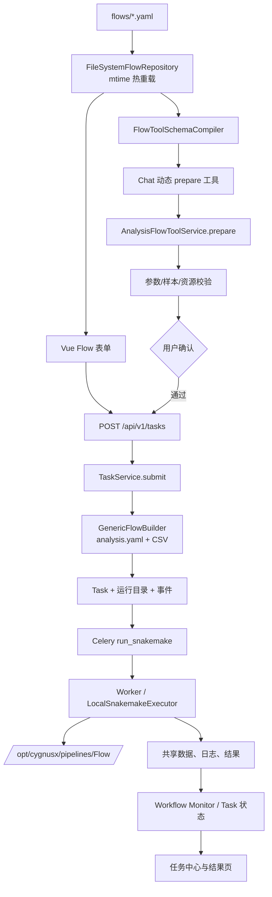
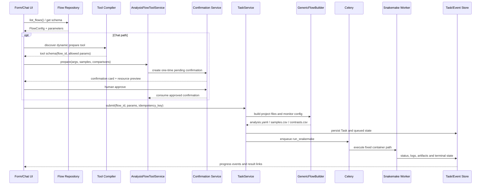

# CygnusX 分析中心 Flow 接入架构（as-built）

> **文档类型**：as-built（记录仓库当前已落地架构）。
> **基线日期**：2026-10-03，基于 `flows/rna_seq.yaml` v2.3.0 / `flows/atac_seq.yaml` 与 `src/cygnusx/domain/flow/`、`application/services/`、`tools/`、`infrastructure/` 代码实测核对。
> **前身**：`flows/flows_design.md`（v1.0 设计提案）与 `flows/flows_design_detailed.md`（v1.1 细化版）。两份提案已全部落地，本文为其现状转正；提案原文保留在 `flows/` 目录作历史参考（登记于 `ARCHITECTURE_DESIGN/README.md` "相关文档"）。
> **边界**：本文只覆盖 **L1 分析中心流程接入链路**（仓库根 `flows/*.yaml` → 表单/AI 工具 → Celery/Snakemake）。`data/ai/flows/`（FlowRegistry，AgentTeams/MAS 治理流程注册表）是**另一套体系**，见 `CygnusX_platform_architecture.md` §13.2 与 `CygnusX_agent_execution_framework.md`；流程本体（snakefile/rules/config 四件套）的内部结构规范见 `Protocol/FlowFrame/flow-framework` v2.0。

---

## 0. 这个 Flow 模块如何发挥作用

分析中心 Flow 是一个由 YAML 驱动的声明式接入层。`flows/*.yaml` 描述流程元信息、前端分组和参数、样本表约束、容器内 snakefile 路径、资源和参数映射；`FileSystemFlowRepository` 扫描并按 mtime 热重载这些定义，前端据此生成表单，AI 工具编译器据此生成准备任务的 Tool Schema。Flow YAML 只描述契约，不在 Web 进程中执行 Snakemake，也不把流程定义写入数据库。

用户可以从分析中心表单提交，也可以在 Chat 中调用动态生成的 `cygnusx_prepare_<flow>_submission` 工具。表单请求直接进入 `TaskService.submit()`；AI 请求先经过参数、样本表、资源上限和用户确认门，确认凭证消费后再进入同一个 `TaskService.submit()`。统一入口负责生成用户隔离的运行目录、`analysis.yaml`/`samples.csv`/`contrasts.csv`、Task 记录和幂等快照，然后将 `run_snakemake` 投递给 Celery Worker。

Worker 从固定的 `/opt/cygnusx/pipelines` 读取只读流程代码，在共享数据根目录执行 Snakemake，并通过状态、日志和 workflow monitor 事件回传进度；结果路径、失败原因、计费和前端任务中心都围绕同一个 Task 记录流转。新增流程的 YAML-only 承诺只适用于 L1 表单和 Chat 分析通道，REST pipelines、外部 MCP preset 和 `data/ai/flows` 这几套注册面仍有各自的代码契约。

### 0.1 运行架构图：Flow 声明到标准任务链



### 0.2 实现图：AI 确认与表单提交汇合



## 0. 一页结论

1. **流程接入是 YAML 声明**：一个新流程按 FlowFrame 规范写好 Snakemake 流程后，在仓库根 `flows/` 新增一个 YAML（六段 schema，见 §2），即可完成 L1 表单通道与 AI 聊天工具通道的接入——无需改后端代码、无需 DB 注册、无需重启 web 容器（mtime 热重载，见 §3）。
2. **Flow YAML 本身不执行任务**：它只描述"表单长什么样、参数怎么映射、snakemake 怎么起"。实际执行统一走 `TaskService.submit()` → Celery `run_snakemake` 标准任务链（§5）。
3. **AI 接入也是自动的**：`ai.enabled: true` 的流程由 `FlowToolSchemaCompiler` 在运行时编译为 `cygnusx_prepare_{tool_slug}_submission` 动态工具（§4）。
4. **已知边界（非 YAML-only 的通道）**：REST `/api/v1/pipelines/*` 通道与 mcp-server `cygnusx-pipelines` preset 仍是 per-flow 硬编码（`PipelineType` Literal + 手写适配器），前端也有 `PipelineType` union 与 flowLabel 映射。这些通道接入新流程需要改代码，见 §7。
5. **与 FlowFrame 的键一致性靠人工对齐**：`flows/*.yaml` 的参数键与流程 analysisyaml 键无任何交叉校验机制，见 §6。

---

## 1. 总体链路

```text
┌─ L1 表单通道 ────────────────────────────────────────────────────┐
│ Vue FlowsView/FlowSubmitView → GET /api/v1/flows/*（数据驱动渲染） │
│   → POST /api/v1/tasks (TaskSubmitRequest)                       │
└──────────────────────────────────────────────────────────────────┘
┌─ AI 聊天通道 ────────────────────────────────────────────────────┐
│ Chat → cygnusx-tools preset → cygnusx_prepare_{slug}_submission  │
│   → ToolBridgeService(analysis_flow 模式)                        │
│   → AnalysisFlowToolService.prepare → 确认门 → confirm_and_submit │
└──────────────────────────────────────────────────────────────────┘
                    两条通道在 TaskService.submit() 汇合
┌─ 标准任务链（两通道完全一致）──────────────────────────────────────┐
│ TaskService.submit() 九步 → Celery run_snakemake                 │
│   → LocalSnakemakeExecutor → /opt/cygnusx/pipelines/<X>Flow      │
│   → run_events/logs/workflow monitor → 任务状态机                 │
└──────────────────────────────────────────────────────────────────┘
```

关键约束（继承自 flows_design 提案并已落地）：**AI 提交的任务与网页表单提交的任务走同一个 `TaskService.submit()` 入口**——任务表记录、用户隔离、工作目录、样本表生成、监控日志、结果页、计费、失败处理和队列调度完全一致。分析中心**不**走 `ToolBridgeService` 的 ARQ `backend_async` 分支（那条路径只适合系统发育树等独立工具作业，不创建标准 Task）。

---

## 2. FlowConfig 六段 schema

权威定义：`src/cygnusx/domain/flow/entities.py`（`FlowConfig`）+ `domain/flow/value_objects.py`（各子模型，全部 `extra="forbid"` 严格模式——写错键名 YAML 直接加载失败，不会静默忽略）。现役实例：`flows/rna_seq.yaml`、`flows/atac_seq.yaml`。

```yaml
meta:            # FlowMeta — id(^[a-z][a-z0-9_]*$)、name、category、
                 #   version(语义化)、description、tags/icon/color/docs_url
ai:              # FlowAIConfig — 见 §4
groups:          # FlowGroupDefinition[] — 前端表单分区（缺省渲染 basic/modules/advanced 三组）
parameters:      # Parameter[] — 支持递归：input/select/boolean/path/
                 #   group(比较组数组)/section(高级参数折叠)，
                 #   含 condition 条件显隐、参数名全局唯一校验
sample_sheet:    # SampleSheetConfig — columns(列定义/unique/枚举)、
                 #   validation_rules、ui(import 方式/group_column 联动)
execution:       # ExecutionConfig — engine(snakemake|nextflow)、snakefile
                 #   (容器内路径)、config_file_name(生成的工作目录主配置名)、
                 #   config_file_param(默认 analysisyaml)、default_resources(cores)、
                 #   sample_sheet_format(csv)、extra_args(--use-conda 等)
pipeline_mapping: # PipelineMappingConfig — 见 §5.2
```

要点：

- `execution.snakefile` 是**Worker 容器内路径**（如 `/opt/cygnusx/pipelines/ATACFlow/snakefile`），对应 `deploy/docker/docker-compose.worker.yml` 的 `${WORKER_PIPELINE_DIR}:/opt/cygnusx/pipelines:ro` 挂载，宿主机实际位置由 `data/worker_config.yaml` 管理（见 `CygnusX_worker_images_plan.md`）。
- 参数 `condition` 引用的 field 必须真实存在（`FlowConfig.validate_condition_references`），group/section 内的参数名递归查重。
- `GET /api/v1/flows/schema` 返回 FlowConfig 顶层 JSON Schema，供前端类型生成；`GET /api/v1/flows/{flow_id}/schema` 返回单流程参数 schema。

## 3. 注册与热重载：`FileSystemFlowRepository`

- 目录来源：`Settings.flow_yaml_dir`（默认 `"flows"`，`core/config.py`）。web 容器以 `../../flows:/app/flows:ro` 只读挂载（`deploy/docker/docker-compose.yml`）。
- **无 DB 注册表**：流程发现是纯磁盘扫描，`flows` 任务表（task）只存运行实例，不存流程定义。
- **mtime 自动热重载**（`infrastructure/database/repositories/flow_repository.py`）：每次 `get_by_flow_id`/`list_flows` 前比对目录内 `*.yaml`/`*.yml` 的最大 mtime，变化即清缓存重扫；同 `meta.id` 重复定义时后加载文件覆盖前载并打 WARNING。另有手动 `POST /api/v1/flows/reload`。
- 加载失败的单个文件打 ERROR 后跳过，不阻断其他流程加载。
- **注意**：热重载只覆盖 web 进程内的 FlowConfig 缓存；改 snakefile 流程代码后按 worker 镜像约定重启 Worker（`CygnusX_worker_images_plan.md`），且 `flow_schema_compiler` 编译结果随 schema_loader 缓存一起走 mtime 判新。

## 4. AI 接入：动态工具编译与确认门

- **编译**：`tools/schema_loader.py::_load_flow_tools` 在工具清单构建时遍历 `ai.enabled=true` 的流程，逐个调用 `tools/flow_schema_compiler.py::compile_prepare_tool`，生成 `ToolSchema`：
  - 工具名 `cygnusx_prepare_{tool_slug}_submission`（`tool_slug` 缺省用 `meta.id`）；
  - key=`flow-{meta.id}`、`invocation_mode="analysis_flow"`、`requires_confirm=ai.requires_confirmation`；
  - `extra={"flow_id", "tool_role": "prepare"}` 供执行分发；
  - 另附通用 `cygnusx_get_analysis_task_status` / `cygnusx_get_analysis_task_summary` 两个查询工具。
- **执行**：`tool_bridge_service.py::_execute_analysis_flow` 按 `extra.tool_role` 分发到 `AnalysisFlowToolService`：
  1. `prepare()` → `FlowSubmissionValidator`（`domain/flow/submission_validator.py`）按 `ai.allowed_parameters` 白名单、`max_samples`/`max_comparisons` 上限、样本表列约束校验 → 创建 PENDING 确认记录（`tool_confirmation_service`）→ 返回 `confirmation_id` + 参数预览 + 资源提示；
  2. 用户在前端确认卡片点击 → 记录置 APPROVED；
  3. `confirm_and_submit(confirmation_id)` → 消费确认记录（一次性）→ 调 `TaskService.submit()`。
- **确认门契约**：模型永不能自证确认（同 `mcp-server/ARCHITECTURE.md` 核心不变式）；外部 MCP 通道的 `user_confirmed=True` 一路径见该文档。

## 5. 标准任务链：`TaskService.submit()` 九步

位置：`application/services/task_service.py`。两条通道（表单 POST `/api/v1/tasks`、AI 确认后提交）在此汇合，步骤：

1. 校验既有 counts/Dataset 写门禁、批准绑定与输入；
2. 幂等键按 owner 查重，已存在任务不重复提交；
3. 运行权威 `FlowSubmissionValidator`，取得规范化请求与 Flow 定义；
4. 预生成 task UUID，按用户隔离创建运行目录并登记目录链；
5. 锁定参数，使用 **`GenericFlowBuilder.build_project_files()`** 生成原流程输入文件；
6. 写 Dataset 身份及 monitor 配置，冻结定义、Task绑定与生成文件摘要；
7. 创建标准 Task，保存参数证据及工作目录；
8. 启用时调用原计费预扣，保存内部参数，推进 QUEUED 并提交事务；
9. 投递原 Celery `run_snakemake`（snakefile/config/cores 来自受信 Flow 配置）；未知投递需对账，不能自动重放。

之后 Snakemake 日志、任务状态、结果路径和监控围绕 Task 记录流转；长任务状态机见 `CygnusX_platform_architecture.md` §10.2。

### 5.2 `GenericFlowBuilder` 映射语义（`infrastructure/execution/generic_builder.py`）

"新增分析流程仅需补充 YAML 的 `pipeline_mapping` 节点，无需修改 Python 代码"的实现者。输入：FlowConfig + 前端参数 + 样本行 + 比较组 + work_dir；输出：工作目录下的 `analysis.yaml`（名取 `execution.config_file_name`）、`samples.csv`、`contrasts.csv`。

| 映射段 | 语义 |
|---|---|
| `config_fields` | 写入主配置的字段列表，支持点号路径（`peak_calling.use_pooled_peaks` → 嵌套字典）；取值时以**最后一段**作为输入参数名查前端参数 |
| `computed_fields` | 构建器动态注入：`__work_dir__` / `__samples_csv__` / `__contrasts_csv__` 三个占位符 |
| `list_fields` | 强制归一为字符串列表（如 `raw_data_path` 支持多 lane） |
| `defaults` | 前端未提供时的默认值（前端参数优先） |
| `sample_sheet` / `comparisons` | CSV 输出名 + 列映射（输出列名 → sample_sheet 行字段名） |

内置兜底：空字符串视为未提供（跳过写入）；`data_deliver` 为空时默认 `work_dir.parent / "data_deliver"`。

## 6. 与 FlowFrame 流程的键一致性（人工对齐，无交叉校验）

`pipeline_mapping.config_fields` 中的键名必须与流程仓库 analysisyaml 的键**逐字一致**（如 `Genome_Version`、`Library_Types`、`peak_calling.use_pooled_peaks`），样本表/比较组 CSV 的列名必须与流程 `load_samples`/`load_contrasts` 的 `required_columns` 一致——这条约束**目前没有任何 CI/校验脚本守护**，完全靠：

- YAML 头部注释人工声明对齐目标（`flows/atac_seq.yaml` 头部"参数命名与 ATACFlow config.yaml 保持一致"）；
- `prepare` 时的运行时校验只覆盖参数类型/白名单，不覆盖键名与流程 schema 的语义匹配（键名写错会一路传到 snakemake 才报 `KeyError` 或被流程默认值静默吞掉）。

**改流程侧键名（analysisyaml required 键、样本表列名）时，必须同 PR 改 `flows/*.yaml` 对应字段**，并跑一次真实 dry-run。这是本域最脆弱的接缝；后续可考虑仿 `validate-image-mapping` 增加对账脚本（提案，未实施）。

## 7. 已知边界：非 YAML-only 的通道（现状，勿误读为接入方式）

以下通道接入新流程**需要改代码**，是历史实现遗留，不属于"YAML 声明式接入"承诺的范围：

| 通道 | 硬编码点 | 说明 |
|---|---|---|
| REST `/api/v1/pipelines/*` | `application/schemas/pipeline.py` `PipelineType = Literal["rna_seq", "atac_seq"]`；`application/services/pipeline_controller.py` `self._pipelines` 字典 + `rna_seq_pipeline.py`/`atac_seq_pipeline.py` 手写适配器 | 表单与 AI 聊天通道不受影响；此通道仅服务外部 REST/MCP 调用方 |
| mcp-server `cygnusx-pipelines` preset | `mcp-server/tools/pipelines.py` 手写 `rna_seq_*`/`atac_seq_*` 四件套；`infrastructure/mcp/pipeline_preset.py` | 见 `CygnusX_mcp_architecture.md` §1.3 |
| 前端 | `frontend/src/types/pipeline.ts` `PipelineType` union、`components/task/TaskTable.vue` flowLabel 映射、`components/ai-chat/ToolCallEntry.vue:84` | 任务中心展示层 |
| AgentTeams/MAS | `data/ai/flows/`（FlowRegistry 第二注册表，ID 命名规范不同：`atacseq` vs `atac_seq`） | 见 §0 边界声明 |

**结论**：若接入目标只是"分析中心表单 + AI 助手聊天"，编辑/新增 `flows/*.yaml` 即可；上述通道按需另改。

## 8. 新流程接入清单（L1 + AI 聊天通道 · 工具固定化后）

> 2026-10-16 起，MCP 工具已固定化（见 `CygnusX_mcp_architecture.md` §11）：
> **新增 Flow 只注册流程契约，全程零新增 MCP 工具**。外部 MCP 通道走固定工具
> `cygnusx_list_flows` → `cygnusx_get_flow_detail` → `cygnusx_prepare` →
> `cygnusx_submit`；内置 Chat 的目录工具是 `platform_list_flows`（仅
> id/name/category/version），没有 detail 工具，固定链为 `cygnusx_prepare` +
> `cygnusx_submit`。旧 per-flow 自动生成工具已 `[DEPRECATED]`
> 并纳入 `LEGACY_PIPELINE_TOOLS` 下线路径。

1. 按 `Protocol/FlowFrame/flow-framework` v2.0 编写流程仓库，放入 `pipelines/`（子模块）；
2. Worker 侧确认挂载：`data/worker_config.yaml` 的 `WORKER_PIPELINE_DIR` 覆盖新流程目录，容器内路径 `/opt/cygnusx/pipelines/<X>Flow/snakefile` 可达（`test -f` 验证，见 `CygnusX_worker_images_plan.md`）；
3. 新增 `flows/<flow_id>.yaml`（六段 schema；flow_id 用下划线规范）；参数键与流程 analysisyaml 对齐（§6）；
   - **AI 接入段**（`ai:`）：`enabled: true` + `tool_slug` + `assistant_summary` +
     `allowed_parameters` 白名单 + `requires_confirmation`；
   - **可选校验插件**：`ai.validation_plugins: [<插件名>]`（注册表
     `src/cygnusx/domain/flow/validation_plugins.py`；内置 `fastq_workspace`
     供 FASTQ 类流程复用；新插件实现 `FlowValidationPlugin` 协议后在
     `_REGISTRY` 登记——插件是代码扩展点，**不增加 MCP 工具**）；
   - **可选灰度门控**：仿 `counts_deg` 模式在 `core/config.py` 加
     `<flow>_flow_enabled: bool = False` 开关 + `FlowService._enabled` 特例
     （list/detail/prepare 三口径同源判定）。
4. 验证：
   - `uv run python -c "from cygnusx.application.services.flow_service import FlowService; FlowService().reload()"` 加载无误；
   - web 容器内 `GET /api/v1/flows` 出现新流程（flows 目录 bind mount 只读，无需重启）；
   - 前端分析中心表单渲染 + 一次真实 dry-run 提交；
   - AI 通道（Chat 内置或外部 MCP 任一）走固定工具完成闭环：
     `list_flows` 目录含新流程 → `describe` 契约完整 → `prepare` 非法输入被
     全量校验拒绝、合法输入返回 confirmation_id → 用户网页确认 → `submit`
     幂等提交成功。工具发现清单数量不变（新增 Flow 不新增工具）；
5. 如需 Agent 人设/协作室通道，另走 `data/ai/` 体系（不在本清单，见 `CygnusX_agent_execution_framework.md`）。

**红线**：禁止为新 Flow 新增 MCP 工具或复活 per-flow 自动生成工具；提交必须经
固定 `prepare → 人类确认 → submit` 凭证链（`CygnusX_mcp_architecture.md` §11.3）。

## 9. 关键文件索引

### RNA 报告证据快照（Phase 0 内部能力）

`application/schemas/report_snapshot.py` 定义版本化、不可变证据协议；
`application/services/report_snapshot_builder.py` 通过 `report_snapshot_sources.py`
只读查询 owner 的 RNA Task、可选明确确认的 Run、关联文件和事件，
再由 `report_snapshot_manifest.py` 读取 ARDP 清单及当前本地文件指纹。
普通 Task 无 Run 时仍可构建；缺失历史环境、输入身份、工具调用与 QC 决策显式记录缺口。
采集时指纹和清单声明不等于执行时证明。快照冻结后含规范序列化及事实摘要。
Phase 1 已接入独立报告 Job、不可变快照持久化、八模块 HTML 和现有 ReportService/API/ReportsView。
科学 RNAFlow/BioReport 路径保留，不生成 PDF 或执行重跑。
当前实现、安全、幂等、恢复与部署验收边界见 `CygnusX_report_architecture.md`；
真实 RNA / PostgreSQL / Celery E2E 尚未验收，隔离集成不能替代现场证据。

| 组件 | 文件 |
|---|---|
| FlowConfig schema（权威） | `src/cygnusx/domain/flow/entities.py`、`domain/flow/value_objects.py` |
| 注册/热重载 | `src/cygnusx/infrastructure/database/repositories/flow_repository.py` |
| Flow 服务 | `src/cygnusx/application/services/flow_service.py` |
| AI 工具编译 | `src/cygnusx/tools/flow_schema_compiler.py`、`tools/schema_loader.py` |
| AI 执行/确认门 | `src/cygnusx/application/services/analysis_flow_tool_service.py`、`domain/flow/submission_validator.py`、`tool_confirmation_service.py` |
| 任务提交九步链 | `src/cygnusx/application/services/task_service.py` |
| 输入文件构建器 | `src/cygnusx/infrastructure/execution/generic_builder.py` |
| Celery 执行 | `src/cygnusx/infrastructure/celery_app/tasks/analysis.py`（`run_snakemake`）、`infrastructure/execution/local.py`（`LocalSnakemakeExecutor`）；队列/Worker/Beat 拓扑见 [CygnusX_async_task_queue_architecture.md](CygnusX_async_task_queue_architecture.md) |
| API | `src/cygnusx/api/v1/flows.py`、`api/v1/tasks.py` |
| 监控推送 | `src/cygnusx/application/services/workflow_monitor_service.py` + FlowFrame §13.5 logger 插件 |
| 流程 YAML 实例 | `flows/rna_seq.yaml`、`flows/atac_seq.yaml` |

### RI13 最小执行证据接线（代码/隔离层）

原 `TaskService.submit` 在权威validator之后，使用原builder生成输入文件，再将v2定义、独立Task绑定和生成文件SHA写入既有 `Task.parameters._execution_evidence`；Task/证据及启用时的原预扣参数以QUEUED在队列可见前持久化。QUEUED是投递意图，投递不明必须对账，不证明broker已ACK。投递使用固定 task ID `analysis-{task.id}-attempt-0`，Worker 侧以行锁 + 只接受 QUEUED 实现幂等领取；该任务的队列归属、ack 语义与超时规则见异步队列文档 §2、§6。

原analysis Worker持Task行锁领取QUEUED、推进RUNNING，再做前后证据核验和队列执行参数比对；已运行/终态重复投递不会启动执行器。输入字节仍复用ResearchExecutionBinding/check_inputs；没有替代FlowFrame或新增执行引擎。PG并发、实际队列和挂载尚未验收。

v1定义摘要规则不变；v2定义不含Task，Task/owner与生成文件摘要进入独立execution_binding_digest。实际release/image/tools/reference缺可信来源时NOT_OBSERVED，不能从当前环境补写历史。参见 `docs/contracts/cygnusx-execution-evidence-v1.md`。源码写执行门禁未开启，真实运行仍BLOCKED。
