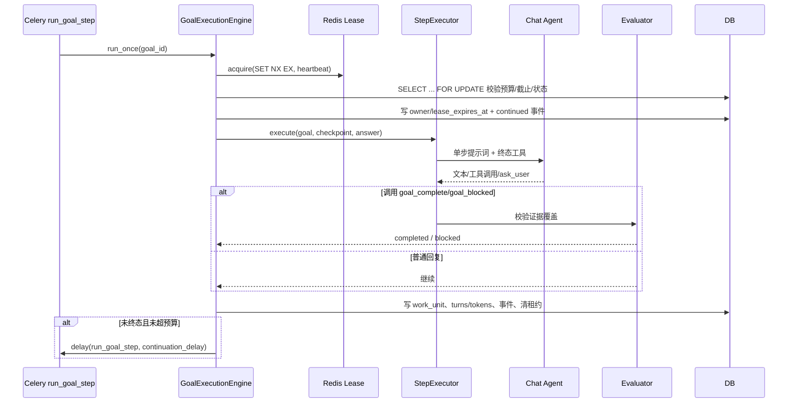

# CygnusX 目标运行时架构（Goal Runtime）

> **用途**：记录"目标（Goal）"从创建、单步推进、评估、等待用户、完成/阻塞到恢复的 as-built 实现，包括状态机、数据表、执行引擎、终态工具、Fan-out 适配器、Redis 租约/PubSub、Celery 恢复、SSE 与前端交互。
> **类型**：as-built（2026-10-21 代码基线；功能默认关闭）。
> **适用范围**：`/api/v1/goals/*`、`agent_goals`/`agent_goal_work_units`/`agent_goal_events`、`goal_execution_engine`/`goal_evaluator`/`goal_terminal_tools`/`goal_adapters`、`tasks/goals.py`、`goal_lease`/`goal_pubsub`、前端 `GoalStatusCard`/`GoalTimeline`/`goalRuntime`。
> **不适用范围**：Chat SSE 事件总规范（见 [CygnusX_agent_execution_framework.md](CygnusX_agent_execution_framework.md)）；并行子 Agent 调度（见 [CygnusX_multi_agent_fanout.md](CygnusX_multi_agent_fanout.md)）；Studio/沙箱（见 [CygnusX_sandbox_architecture.md](CygnusX_sandbox_architecture.md)）。

## 这个模块如何发挥作用

目标系统把"一次性问答"升级为"可跨轮推进的持久任务"：用户为当前 Chat 会话创建一个目标（objective + 成功标准），系统在后台用 Celery 单步推进，每步调用受限 Chat Agent；模型只能通过两个终态工具 `goal_complete` / `goal_blocked` 声明结束，评估器强制要求每个成功标准都有证据。目标状态、推进次数、token 预算、租约与事件都持久化，前端通过 SSE 时间线观察。

目标运行时是**显式 opt-in** 的：`GOAL_RUNTIME_ENABLED=false` 时创建接口直接报错，Celery 任务返回 disabled。目标只支持 `mode=chat` + `permission=safe`，不支持 Studio/写操作；引擎没有独立 planner，规划由每轮 Chat Agent 在提示词内完成。

## 1. 总体架构

```mermaid
flowchart TD
    UI[KimiChatInput / GoalStatusCard] -->|POST /goals/start| API[api/v1/goals.py]
    API --> GS[GoalService]
    GS --> DB[(agent_goals)]
    GS -->|run_goal_step.delay| CQ[Celery goals queue]
    CQ --> GE[GoalExecutionEngine]
    GE --> LEASE[GoalRedisLease<br/>goal:{id}:lease]
    GE --> EXEC[ChatServiceGoalStepExecutor]
    EXEC --> CHAT[ChatService.stream_agent_chat<br/>multi_agent=fanout?]
    CHAT --> TOOLS[goal_complete / goal_blocked]
    CHAT --> EVAL[GoalEvaluator<br/>```goal_result JSON```]
    EXEC --> FANOUT[FanoutAdapter<br/>ParallelSubAgent]
    GE --> DB
    GE --> EVT[(agent_goal_events)]
    GE --> PS[Redis Pub/Sub<br/>goal:events:{id}]
    UI -->|GET /goals/{id}/events/stream| SSE[SSE: DB 轮询 + PubSub 合并]
    DB --> SSE
    PS --> SSE
    BEAT[beat: recover_expired_goal_leases] --> DB
```

### 实现图：一次目标推进



## 2. 状态机

前端声明 9 个状态（`frontend/src/api/goals.ts`）：`draft`、`in_progress`、`waiting_user`、`waiting_external`、`paused`、`completed`、`blocked`、`cancelled`、`failed`。后端实际产生 6 个：

| 当前 | 事件/条件 | 下一状态 |
| --- | --- | --- |
| — | 创建 | `in_progress` |
| `in_progress` | 用户暂停 | `paused` |
| `paused` | 用户恢复 | `in_progress` |
| `waiting_user` | 用户回答 `answer` | `in_progress` |
| 非终态 | 用户取消 | `cancelled` |
| 任意推进 | `ask_user` | `waiting_user` |
| 任意推进 | `goal_complete` + 证据完整 / 评估器完成 | `completed` |
| 任意推进 | `goal_blocked` / 异常 / 预算耗尽 | `blocked` |

终态集合：`{completed, blocked, cancelled, failed}`；`failed` 只存在于集合，没有产生路径；`draft`、`waiting_external` 没有产生路径。状态列是自由 `String(32)`，不是数据库枚举。

## 3. 数据模型

### 3.1 `agent_goals`

| 字段 | 说明 |
| --- | --- |
| `objective` | 目标描述 |
| `criteria` | JSON 成功标准列表 |
| `status` | 状态字符串 |
| `manager_agent_id` | 唯一可调用终态工具的 Agent，默认 `agent-general` |
| `mode` / `permission` | 固定 `chat` / `safe` |
| `turns_used` / `tokens_used` | 进度计量 |
| `max_turns` | 默认 20，范围 1–1000 |
| `token_budget` | 可选，≥1 |
| `deadline_at` | 可选截止时间 |
| `plan_snapshot` | 最近响应/检查点（截断 12,000 字符） |
| `latest_user_answer` | 最近用户回答 |
| `lease_owner` / `lease_expires_at` | DB 侧租约字段 |
| `version_id_col` | 乐观锁版本 |
| `workspace_id` | 已建列但未使用 |
| `user_id` / `session_id` | 所有权与会话绑定 |

索引：`(user_id, status, updated_at)`、`(session_id, status)`。

### 3.2 `agent_goal_work_units`

`kind`（`llm_step` / `parallel_fanout` / `parallel_worker`）、`instruction`、依赖、`owner`、状态、`attempt`、引用、`(goal_id, work_unit_key)` 唯一、`idempotency_key` 唯一。用于重放安全与 Fan-out 子任务幂等。

### 3.3 `agent_goal_events`

只追加事件日志：`(goal_id, sequence)` 唯一、`(goal_id, dedupe_key)` 唯一。事件类型包括 `created`、`continued`、`step_finished`、`lease_recovered`、`worker_result`、`fanout_finished` 及控制类事件（暂停/恢复/回答/取消/完成/阻塞）。

## 4. 执行引擎

### 4.1 创建约束

`GoalService.create_goal` 要求：

1. `mode == "chat"` 且 `permission == "safe"`；
2. Chat 会话存在且属于当前用户、处于 active；
3. 管理 Agent 存在且启用（默认 `agent-general`）；
4. 运行时开关开启。

创建后立即写 `created` 事件并 `run_goal_step.delay(id, "created")`。

### 4.2 单步执行

`ChatServiceGoalStepExecutor.execute`：

- 构造单步提示词：目标、成功标准、检查点最近 6,000 字符、最近用户回答、终态工具使用说明；
- 调用 `ChatService.stream_agent_chat`，参数 `multi_agent=goal_fanout_enabled`、`overdrive=False`；
- 运行时上下文注入 `goal_id`、`work_unit_key=turn-N+1`、`idempotency_key`、`goal_safe_only=True`；
- 只有上下文含 `goal_id` 时才注入 `goal_complete`/`goal_blocked` 工具（Chat/LangGraph 两个运行时均如此）。

安全工具白名单（`chat_service.py` 的 safe-mode 过滤）：`ask_user`、`knowledge_search`、`web_search`、`use_skill`、`skill_resource`、只读且无需确认的工具；`goal_fanout_enabled` 时额外允许并行子 Agent。写操作、需要确认的工具、shell/流程 YAML/DB 写权限全部不可用。

### 4.3 租约与预算

- Redis 租约 `goal:{id}:lease`：`SET NX EX`，Lua 校验 owner 后续租/删除；心跳间隔 `ttl/3`；续租失败置 `lost`。
- `run_once` 先取 Redis 租约，再 `SELECT ... FOR UPDATE` 锁目标行，检查：
  - 状态必须 `in_progress`；
  - 未超过 `deadline_at`；
  - `turns_used < max_turns`；
  - `tokens_used < token_budget`（若配置）；
  - DB 租约未被他人持有。
- 通过后写 owner/expiry、发 `continued`，执行一步。
- 结果落 `llm_step` work unit、累加 turns/tokens、清理租约、把响应写入 `plan_snapshot`，再映射终态或继续。
- 预算耗尽映射为 `blocked`，不是静默停止。

### 4.4 评估器与终态工具

- 评估器只解析围栏代码块 ` ```goal_result ` 中的 JSON；不解析自然语言。
- `goal_complete` 必须为每个成功标准提供 `criterion` + `evidence`；任一标准缺证据则继续推进。
- `goal_blocked` 必须给出原因。
- 终态工具执行前校验：`goal_id` 存在、用户所有权、状态 `in_progress`、`context.agent_id == manager_agent_id`；返回 `{llm_payload, ui_payload}`。
- 模型无法通过普通文本"声称完成"来结束目标；只有工具/评估器路径可以。

### 4.5 Fan-out 适配器

`goal_adapters/fanout_adapter.py` 是唯一适配器：

- 写父 work unit `parallel_fanout`，子 work unit `parallel_worker`，key 为 `parent:worker:N`；
- 父单已成功时直接重放结果，不重复调用；
- 调用 `ParallelSubAgentToolService.run_parallel_subagents`；
- 写 `worker_result` / `fanout_finished` 事件，携带 worker 回答与工作区证据。

没有 chat/studio/terminal 适配器；终端交互是终态工具，不是适配器。

### 4.6 Celery 恢复

- `run_goal_step` 每步结束后按 `goal_continuation_delay_seconds` 重新入队。
- `recover_expired_goal_leases` 每 `max(15, goal_lease_seconds/2)` 秒扫描过期 DB 租约，`SKIP LOCKED` 清理并写去重的 `lease_recovered` 事件。
- **已知不一致**：Redis 租约通过心跳无限续期，而 DB `lease_expires_at` 只在认领时写一次。单步耗时超过 `goal_lease_seconds` 时，恢复任务可能清掉 DB 租约，原 worker 回写时 owner 不匹配，结果被丢弃。

## 5. API 与 SSE

| 方法 | 路径 | 说明 |
| --- | --- | --- |
| POST | `/api/v1/goals/start` | 创建（201），随后异步推进 |
| GET | `/api/v1/goals` | 当前用户目标列表 |
| GET | `/api/v1/goals/{id}` | 目标详情 |
| POST | `/api/v1/goals/{id}/pause` | `in_progress → paused` |
| POST | `/api/v1/goals/{id}/resume` | `paused → in_progress`（不接受 `waiting_user`） |
| POST | `/api/v1/goals/{id}/answer` | `waiting_user → in_progress`，保存回答 |
| POST | `/api/v1/goals/{id}/cancel` | 非终态 → `cancelled` |
| GET | `/api/v1/goals/{id}/events?after=&limit≤500` | 事件回放 |
| GET | `/api/v1/goals/{id}/events/stream` | SSE：DB 轮询 + Redis PubSub 合并，按 sequence 去重，带 heartbeat |

事件写入后发布 Redis `goal:events:{id}`；SSE 在无新事件时每批轮询 DB，`sequence > cursor` 才发送。

## 6. 前端

- `stores/goalRuntime.ts`：一个会话一个目标；事件上限 100、按 sequence 去重；重连前中止旧流；每收到事件刷新目标；`loadActiveGoal` 取 `in_progress|waiting_user|waiting_external|paused` 中的第一个；创建时强制 chat/safe。
- `GoalStatusCard.vue`：状态标签、暂停/恢复/取消；`resume` 对 `waiting_user` 也展示，但后端只接受 `paused`。
- `GoalTimeline.vue`：展示最近 5 条事件；缺少 `user_answered`、`step_failed` 与 fan-out 事件的文案。
- `KimiChatInput.vue`：斜杠命令 `/goal start|status|pause|resume|cancel`；协作室模式禁用目标。
- 流在终态后不会主动关闭，store 会继续重连——需要在终态时 `abort`。

## 7. 配置、迁移与测试

- 配置：`goal_runtime_enabled=false`、`goal_fanout_enabled=false`、`goal_lease_seconds=120`、`goal_continuation_delay_seconds=1`。
- 迁移：`alembic/versions/o9p0q1r2s3t4_add_agent_goals.py`（三表与索引）。
- 测试：`tests/unit/test_goal_runtime.py`（610 行：版本、事件去重、租约跳过、控制流转、阶段限制、提示词截断、token 计量、幂等、fan-out id/证据、ask_user、终态证据、评估器）、`test_goal_lease.py`、`test_goal_recovery_task.py`；前端 `command-state.test.ts`。
- 工具 schema：`tool_configs/tools_schema.yaml` **没有** goal-start 工具，Agent 不能自行创建目标；只能由用户 API 创建。

## 8. 已知限制与风险

| 级别 | 问题 | 影响 |
| --- | --- | --- |
| 高 | Redis 租约心跳续期 vs DB 租约固定过期不一致 | 长步骤结果可能被恢复任务清租后丢弃 |
| 中 | 前端 resume 允许 `waiting_user`，后端只接受 `paused` | 用户点击恢复可能 4xx |
| 中 | SSE 在终态后不关闭 | 终端用户仍持续重连/轮询 |
| 中 | 版本/状态为自由字符串，9 个状态中 3 个无产生路径 | 前端展示死状态，契约漂移 |
| 中 | 只有 chat+safe 模式，Studio/写操作不可用 | 目标不能驱动真正的分析交付 |
| 低 | 无独立 planner；规划完全依赖单步提示词 | 长目标易漂移，成功标准证据质量依赖模型 |
| 低 | `workspace_id` 未使用 | 目标无法绑定项目/工作区 |
| 低 | 前端事件文案不全 | 时间线可读性差 |

## 9. 与其他文档的关系

- Chat 双运行时与 SSE 事件规范：本文只描述目标特有事件；通用 `execution_path`、工具事件链见执行框架。
- Fan-out：`parallel_subagents` 的并发/隔离约束见多 Agent 文档；本文只描述目标如何持久化父/子 work unit。
- 记忆/知识：目标步可使用 `knowledge_search`，但不自动写入长期记忆。
- 沙箱：safe 模式禁止沙箱写操作；目标不能替代 Studio Loop。

## 10. 关键文件索引

| 层 | 文件 |
| --- | --- |
| 服务 | `application/services/{goal_service,goal_evaluator,goal_execution_engine,goal_terminal_tools}.py`、`goal_adapters/fanout_adapter.py` |
| API/Schema | `api/v1/goals.py`、`application/schemas/goal.py` |
| 持久化 | `infrastructure/database/models/goal.py`、迁移 `o9p0q1r2s3t4` |
| 异步 | `infrastructure/celery_app/tasks/goals.py`、`celery_app/celery.py`（恢复 beat） |
| 缓存 | `infrastructure/cache/{goal_lease,goal_pubsub}.py` |
| 前端 | `frontend/src/{components/ai-chat/GoalStatusCard.vue,GoalTimeline.vue,stores/goalRuntime.ts,api/goals.ts}` |
| 测试 | `tests/unit/test_goal_runtime.py`、`test_goal_lease.py`、`test_goal_recovery_task.py` |

## 11. 修改验证清单

- 改状态机/控制接口：更新后端与前端状态表，补 `waiting_user` resume、终态 SSE 关闭、非法流转测试。
- 改租约/恢复：补长步骤（> lease）场景，验证 DB 租约续期或结果回写保护。
- 改提示词/终态工具：验证证据覆盖、非 manager Agent 不能调用终态工具、普通文本不能结束目标。
- 改 Fan-out：验证父/子 work unit 幂等键、重放不重复调用、工作区证据落库。
- 开启功能前：先在隔离环境验证 Celery worker/beat、Redis、Chat Provider 与预算/截止行为；默认关闭状态不得视为已验收。
