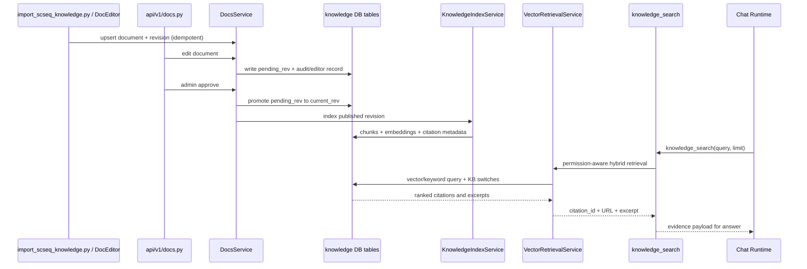

# CygnusX 知识库（Knowledge Base）实现架构

> **用途**：记录现阶段知识库模块的完整实现方式——数据模型、内容导入、页面展示、编辑审核流、AI 助手检索集成与 AI 配置中心管理入口。
>
> **最后更新**：2026-07-31
>
> **时点说明**：本文件为 2026-07-31 时点的实现快照，所述实现已演进，部分引用（路径、行号）已失效；当前实现以代码为准。特别注意：本文 §6 关于「子串匹配」检索的结论已被 pgvector 向量检索取代，不再反映现状。

> **适用范围**：实验室知识库页面、单细胞知识库、AI 助手 `knowledge_search` 工具、AI 配置中心「知识库」管理卡片。

## 这个知识库模块如何发挥作用

知识库模块把 Markdown、SOP、实验经验和专题教程变成可审核、可版本化、可检索的知识资产，并让页面用户和 AI 助手共享同一份事实来源。导入脚本或页面编辑先写入 `kb_documents` 与 `doc_revisions`，当前版本和待审核版本由双指针区分；管理员审核通过后，`KnowledgeIndexService` 对已发布正文切块、生成 embedding 并写入 pgvector 索引。

两个消费方按不同开关读取同一数据：实验室页面只展示 `show_in_lab=true` 且启用的知识库，AI `knowledge_search` 只检索 `ai_searchable=true` 且启用的库，并附带项目范围过滤。检索由 `VectorRetrievalService` 做权限感知的向量/关键词混合召回，返回带 `citation_id`、文档链接和摘录的结果；模型只得到检索证据，用户仍可打开完整文档页面。

编辑、审核、问题反馈、导入和索引更新都留下版本与审计记录。静态图片、PDF 和数据附件保留在 `/docs-static`，正文只保存可版本化的 Markdown 和引用。这样知识库既能作为人类维护的文档系统，也能作为 Agent 的证据检索层，并通过 `knowledge_bases` 的三个开关控制展示、AI 检索和整体启停。

### 运行架构图：知识资产到页面与 AI 的双消费链路

```mermaid
flowchart TB
    Source[docs/knowledge Markdown\n页面编辑 · 批量导入] --> Doc[knowledge_bases + kb_documents\n库归属 · 可见开关]
    Doc --> Rev[doc_revisions\ncurrent_rev / pending_rev]
    Rev --> Review{审核状态}
    Review -->|发布| Index[KnowledgeIndexService\n切块 · embedding · 索引]
    Index --> Vector[(pgvector knowledge chunks)]
    Review --> Audit[doc_audit_logs · editors · issues]
    Doc --> Lab[实验室知识库页面\nshow_in_lab + is_enabled]
    Vector --> Search[VectorRetrievalService\nai_searchable + project scope]
    Search --> Tool[knowledge_search function tool]
    Tool --> Agent[Chat / Studio / Worker Agent]
    Lab --> Reader[DocTree · Reader · Editor]
    Assets[图片/PDF/数据] --> Static[/docs-static 静态挂载]
    Reader --> Static
```

### 实现图：导入、审核、索引和检索调用关系



---

## 1. 概述

知识库模块承载两类内容：

- **实验室知识库**：面向用户的公共文档 / SOP / 实验经验，在「实验室知识库」页面展示，支持协同编辑与审核流；
- **单细胞知识库**等专题库：由批量脚本导入的教程笔记（209 篇 scRNA-seq 笔记），**不在实验室知识库页面展示**，仅作为 AI 助手的检索语料。

核心设计：**一份数据，两个消费方**——页面展示与 AI 检索共用同一套表，通过 `knowledge_bases` 上的开关控制各自的可见范围。

---

## 2. 总体架构

```text
内容来源
  ├─ docs/knowledge/meta.yaml          未入库文档的导航兜底（文件系统）
  ├─ scripts/import_scseq_knowledge.py 单细胞笔记批量导入（docs/knowledge/sc-seq/**.md）
  └─ 用户在「实验室知识库」页在线编辑（走审核流）
        │
        ▼
PostgreSQL
  ├─ knowledge_bases    知识库资源（lab / scseq / ...，含三个开关）
  ├─ kb_documents       文档主表（kb_id 归属知识库）
  ├─ doc_revisions      修订版本（正文存这里，current_rev / pending_rev 双指针）
  ├─ doc_editors        编辑者统计
  ├─ doc_audit_logs     审核日志
  └─ kb_issues          文档问题反馈
        │
        ├── 消费方 A：实验室知识库页面（只读 show_in_lab=true 的库）
        │     GET /docs/knowledge → KnowledgeView.vue（DocTree / DocReader / DocEditor）
        │
        ├── 消费方 B：AI 助手检索（只读 ai_searchable=true 且 is_enabled=true 的库）
        │     knowledge_search function tool → _knowledge_search()（子串匹配）
        │
        └── 管理方：AI 配置中心 · 资源中心 · 知识库 Tab
              /admin/knowledge-bases → KnowledgeResourceTab.vue（开关 / 新建 / 删除 / 文档清单）

静态附件：docs/ 目录整体挂载为 /docs-static（main.py:368-371），
图片、PDF、数据文件不入库，正文中的相对链接导入时重写为 /docs-static/ 绝对 URL。
```

---

## 3. 数据模型

### 3.1 knowledge_bases（知识库资源表，2026-07-31 新增）

`src/cygnusx/infrastructure/database/models/knowledge_base.py`

| 字段 | 类型 | 说明 |
|---|---|---|
| `id` | String(64) PK | 机器标识（code），如 `lab`、`scseq` |
| `name` | String(128) | 显示名 |
| `description` | Text | 描述 |
| `show_in_lab` | Boolean | 是否在「实验室知识库」页面展示该库文档 |
| `ai_searchable` | Boolean | 是否允许 AI（`knowledge_search`）检索该库 |
| `is_enabled` | Boolean | 整体停用（页面与检索同时失效） |

迁移 `alembic/versions/o3p4q5r6s7t8_add_knowledge_bases.py` 预置两行并回填存量文档：

- `lab`：实验室知识库，show_in_lab=✓，ai_searchable=✓（存量非 scseq 文档，5 篇）
- `scseq`：单细胞知识库，show_in_lab=✗，ai_searchable=✓（`doc_id LIKE 'scseq-%'` 的 209 篇）

### 3.2 kb_documents（文档主表）

`src/cygnusx/infrastructure/database/models/knowledge_document.py`

| 字段 | 说明 |
|---|---|
| `doc_id` | 业务唯一标识（导入文档为 `scseq-<md5前12位>`，哈希自相对路径，幂等） |
| `title` / `category` / `file_path` | 标题 / 分类（聚合成分组树）/ 源文件路径 |
| `status` | 1=已发布 2=待审核 3=已拒绝 |
| `current_rev` / `pending_rev` | 当前生效版本 / 待审核版本（FK → doc_revisions） |
| `kb_id` | **归属知识库**（FK → knowledge_bases.id，NULL 按 lab 语义向后兼容） |

### 3.3 doc_revisions（修订表）

`knowledge_revision.py`：`document_id` FK + `content`（**正文 Markdown 存这里**）+ `edit_summary` + `edited_by` + `status`。文档不直接存正文，所有内容版本化，支撑历史回溯与审核流。

### 3.4 辅助表

- `doc_editors`（`knowledge_editor.py`）：每文档编辑者及编辑次数；
- `doc_audit_logs`（`knowledge_audit_log.py`）：审核操作留痕；
- `kb_issues`（`knowledge_issue.py`）：读者对文档提交的问题反馈。

---

## 4. 内容来源与导入

### 4.1 单细胞笔记批量导入

`scripts/import_scseq_knowledge.py`，流程：

1. 遍历 `docs/knowledge/sc-seq/**/*.md`；
2. `doc_id = "scseq-" + md5(相对路径)[:12]`——稳定哈希，**幂等**，重复执行跳过已存在文档；
3. 标题取首个 H1，分类取顶层目录名（根目录文件归「单细胞总览」）；
4. **链接重写**：正文中相对图片/附件链接（`image/xxx.png` 等）正则匹配后解析为绝对路径，存在则重写为 `/docs-static/<相对docs/路径>`（逐段 URL 编码），不存在则保留原样并计数；
5. 写入 `kb_documents`（status=1 直接发布，`kb_id='scseq'`）+ `doc_revisions` + `doc_editors`；
6. `scseq` 知识库行不存在时兜底自建（防库被误删后导入失败）。

**原始 md 文件不动**，重写后的内容只写 DB；附件（PDF/R/数据文件）不入库，经 `/docs-static` 直接下载。

### 4.2 meta.yaml 兜底

`docs_service.list_knowledge` 合并两个数据源：DB 优先；`docs/knowledge/meta.yaml` 里有但 DB 没有的文档也会列出（fallback 读文件系统渲染），保证未入库文档不丢。

---

## 5. 实验室知识库页面

- 前端：`frontend/src/views/KnowledgeView.vue` + `components/knowledge/`（DocTree 分类树 / DocReader / DocEditor / DocCreateModal / AuditPendingPanel / DocIssues / DocEditors），路由 `knowledge` / `knowledge-doc`；
- 后端：`src/cygnusx/api/v1/docs.py`（`/docs/knowledge*` 路由组）+ `application/services/docs_service.py`；
- **范围过滤**（`docs_service.py:46-91`）：查询时 `OUTER JOIN knowledge_bases`，只返回 `kb_id IS NULL` 或 `show_in_lab=true AND is_enabled=true` 的文档——scseq 库因此不出现在页面中；
- 编辑走审核流：`PUT /docs/knowledge/{doc_id}` 写入 `pending_rev`，管理员在 `audit/pending` 审核通过后才切到 `current_rev`；`GET .../history|editors|issues` 提供历史、编辑者与问题反馈。

---

## 6. AI 助手集成（knowledge_search 工具）

**关键结论：不是向量嵌入 / RAG，不走 MCP——是平台内置 function tool，直接查库做子串匹配。**

### 6.1 工具挂载

`chat_service.py:1513-1518`：普通聊天中，模型支持 function calling 时把 `KNOWLEDGE_SEARCH_TOOL`（schema 定义在 `chat_service.py:249-274`）挂进本次请求的 tools；Studio 模式由 `STUDIO_TOOL_SCHEMAS` 自带同一工具。参数仅 `query`（关键词）+ `limit`（1-8，缺省 5）。

### 6.2 系统提示引导

工具挂上后自动追加 `KNOWLEDGE_SEARCH_SYSTEM_PROMPT_SUFFIX`（`chat_service.py:337-341`）：指示 LLM 遇到单细胞/生信流程、参数阈值、实验经验、平台使用问题时**先检索再作答**，查不到要如实说明。**是否调用、用什么关键词，由 LLM 自主判断**——用户看到的"思考：调用知识库"即此。

### 6.3 分发与执行

- 分发：`chat_service.py:2305`（流式循环）与 `:2642`（统一分发函数）→ `_knowledge_search_chat`（`chat_service.py:3137`）→ 委托 `studio_tools._knowledge_search`；
- 检索（`studio_tools.py:795-852`）：
  1. SQL：`kb_documents JOIN doc_revisions ON current_rev`，条件 `status=1` + 所属知识库 `ai_searchable=true AND is_enabled=true`（`kb_id IS NULL` 向后兼容），按更新时间取**前 500 篇**；
  2. Python 内存中对 `标题 + 分类 + 正文` 做**大小写不敏感子串包含匹配**；
  3. 命中后截取关键词前后约 **600 字符**摘录，返回 `{doc_id, title, category, excerpt, url: /knowledge/{doc_id}}`，最多 `limit` 条。
- 结果作为 tool message 回填，LLM 基于摘录组织回答；`/knowledge/{doc_id}` 链接可跳转全文页。

### 6.4 已知局限

| 局限 | 影响 |
|---|---|
| 子串匹配无语义理解 | 同义词/中英文不互通（"线粒体比例" ≠ "mitochondrial percentage"） |
| 500 篇扫描上限 | 文档量再大时新文档可能进不了扫描窗口 |
| 600 字符摘录 | LLM 只能看到片段，上下文不全 |
| 关键词由 LLM 生成 | query 取得差时召回为零，依赖系统提示引导改写 |

**演进方向**：向量检索（embedding + pgvector）。改造点集中——只需替换 `_knowledge_search` 的取数与匹配逻辑，工具 schema、分发链路、页面过滤均不动。

---

## 7. AI 配置中心管理入口

「AI 配置中心 → 资源中心 → 知识库」Tab，与 MCP / 技能 / 助手 / 联网搜索同级。

- 后端：`api/v1/admin/knowledge_bases.py` + `application/services/knowledge_base_service.py` + `schemas/knowledge_base.py`，路由 `/admin/knowledge-bases`（`router.py`，AdminRequired）：

  | 方法 | 路径 | 说明 |
  |---|---|---|
  | GET | `/admin/knowledge-bases` | 库列表（含 doc_count 聚合） |
  | POST | `/admin/knowledge-bases` | 新建（id 限小写字母/数字/连字符） |
  | PUT | `/admin/knowledge-bases/{kb_id}` | 更新名称/描述/三个开关 |
  | DELETE | `/admin/knowledge-bases/{kb_id}` | 删除（库内仍有文档时拒绝） |
  | GET | `/admin/knowledge-bases/{kb_id}/docs` | 库内文档清单（≤500） |

- 前端：`components/admin/KnowledgeResourceTab.vue`（左列库列表 + 右侧配置面板 + 文档抽屉），API 封装 `api/admin/knowledgeBase.ts`，注册于 `views/AdminAIResourceCenterView.vue`。

### 开关语义速查

| 开关 | 关闭效果 |
|---|---|
| show_in_lab | 该库文档从「实验室知识库」页面消失（AI 检索不受影响） |
| ai_searchable | AI 助手检索不到该库（页面展示不受影响） |
| is_enabled | 页面与检索同时失效（总开关） |

---

## 8. 关键文件清单

| 层 | 文件 |
|---|---|
| 模型 | `infrastructure/database/models/knowledge_base.py`、`knowledge_document.py`、`knowledge_revision.py`、`knowledge_editor.py`、`knowledge_audit_log.py`、`knowledge_issue.py` |
| 迁移 | `alembic/versions/o3p4q5r6s7t8_add_knowledge_bases.py` |
| 用户侧 API | `api/v1/docs.py` + `application/services/docs_service.py` |
| 管理侧 API | `api/v1/admin/knowledge_bases.py` + `application/services/knowledge_base_service.py` + `application/schemas/knowledge_base.py` |
| AI 检索 | `application/services/studio_tools.py`（`_knowledge_search`）、`application/services/chat_service.py`（工具 schema / 系统提示 / 分发 / `_knowledge_search_chat`） |
| 导入脚本 | `scripts/import_scseq_knowledge.py` |
| 前端 | `views/KnowledgeView.vue` + `components/knowledge/*`（用户侧）；`components/admin/KnowledgeResourceTab.vue` + `api/admin/knowledgeBase.ts` + `views/AdminAIResourceCenterView.vue`（管理侧） |
| 静态附件 | `main.py:368-371`（`docs/` → `/docs-static`） |
