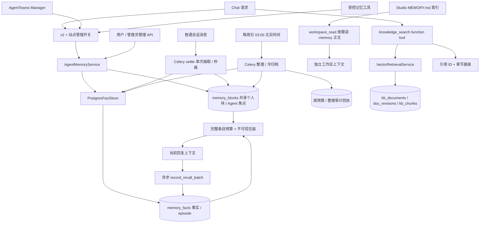
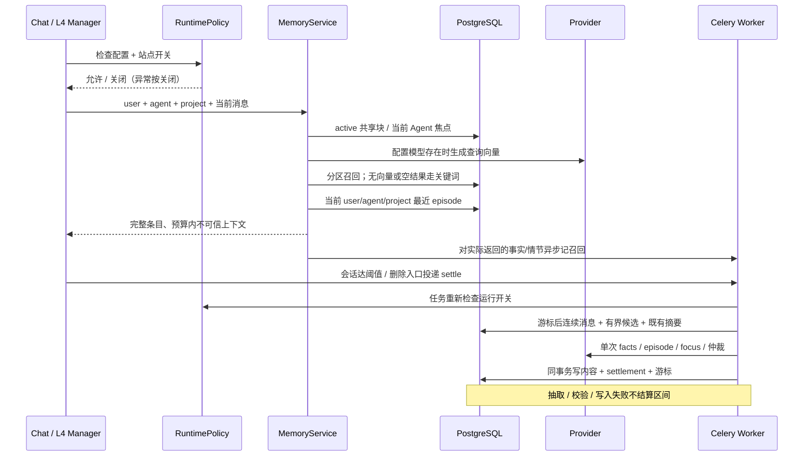

# CygnusX AI 记忆系统当前架构

> 更新日期：2026-10-22。本文是当前工作区代码的 as-built 基线，包含尚未提交的实现及本次运行验收增量。
>
> **审核口径：代码已实现 ≠ 生产已启用 ≠ 真实模型质量已验收。** v2 代码默认关闭；本次目标环境已启用 v2、执行迁移并接通真实 embedding。合成写召、settle 与历史回填已验证；生产指标导出及 25 案例体验验收仍有缺口，见 §11 增量与报告。
>
> 路线与历史问题见 [记忆优化审计](CygnusX_memory_optimization_audit.md)；本文按当前代码组织，不以提案或历史运行数据证明现状。
>
> **管理面注记（2026-10-21）**：管理端"记忆审计"页、`/admin/users/{id}/memories` 与整理回滚端点的权限与页面入口见 [CygnusX_admin_console_architecture.md](CygnusX_admin_console_architecture.md)；记忆的 user/agent/project 分区与项目隔离契约以本文为准。

审核导航：[总体与时序](#2-当前拓扑与请求时序) · [数据隔离](#4-数据分层与隔离契约) · [读取与排序](#5-记忆读取链路) · [写入与整理](#6-记忆写入与整理) · [配置与迁移](#9-配置迁移与回退) · [验证依据](#10-观测与验证依据) · [审核重点](#11-审核重点与当前能力边界)

## 1. 一页结论

记忆模块负责让平台保留用户的持久偏好、研究背景、项目事实和会话进展，在后续请求中以有限上下文辅助回答。当前采用自研 PostgreSQL + pgvector 服务层，包含四类内容：

| 内容 | 载体 | 写入与用途 |
| --- | --- | --- |
| 稳定画像、偏好 | 共享 `memory_blocks` 与共享个人事实 | 显式保存/编辑、异步抽取与周度整理；跨 Agent 使用 |
| 项目事实、摘要 | `memory_facts` 的 project/summary | 按用户、Agent、项目保存与检索 |
| 会话进展 | `memory_facts` 的 episode | settle 增量整合会话摘要；下次请求可直接取最近一条 |
| 当前焦点 | current_focus 块 | settle 或工具刷新；项目分块已接代码，独立开关默认关闭 |

此外，Studio 保留按会话隔离的文件型工作区记忆（§7），旧 `agent_memories` 保留兼容读写。当前没有统一这三种载体，也没有程序性记忆/知识卡片引擎。

### 知识库与长期记忆的边界

知识库与用户记忆都是 Chat/Agent 的上下文来源，但不是同一个数据域，也不互相沉淀：

| 对比 | 知识库 | 长期记忆 |
| --- | --- | --- |
| 权威内容 | 经维护/审核的文档、SOP、实验方法与专题资料 | 用户个人偏好、背景、项目事实和会话进展 |
| 数据对象 | `knowledge_bases`、`kb_documents`、`doc_revisions`、`kb_chunks` | `memory_blocks`、`memory_facts`、`memory_settlements` 等 |
| 权限边界 | KB 展示/AI 开关、已发布状态、文档/库项目范围 | user + agent + project 分区、站点记忆运行闸门 |
| 召回方式 | `knowledge_search` function tool；返回章节摘录和 `citation_id` | 请求上下文自动装配，并可由记忆工具显式读取/维护 |
| 写入方式 | 文档导入/编辑/审核发布后重建 chunk 索引 | 用户显式工具、会话 settle、整理或人工管理 |

知识检索以证据与引用回答“平台维护的资料怎么说”；长期记忆用于个性化和接续“当前用户此前提供的上下文”。文档检索结果不自动保存成用户事实，个人记忆也不能伪装成知识库引用。两套向量都使用 `AGENT_MEMORY_EMBEDDING_MODEL` 与 1024 维向量契约，但分别存于 `kb_chunks` 和 `memory_facts`，有不同索引重建、可见性过滤、排序和验收流程。知识库完整基线见[知识库架构](CygnusX_knowledge_architecture.md)。

2026-10-22 当前模型为 `Qwen/Qwen3-Embedding-8B`，知识库和记忆共用 LiteLLMProvider 的 embedding Provider UUID 与维度设置。正式向量均由 `cygnusx-db/omichub` 的 pgvector 列持久化，物理 bind mount 见[数据库架构 §4.4.1](CygnusX_database_architecture.md#441-当前部署的向量持久化位置)。记忆的 11 条向量回填与知识库入库是独立验收：知识库三篇正文仅在隔离库试验成功并已清理，正式知识库快照仍为 2778 个无向量 chunk。

知识库启动索引由独立的 `KNOWLEDGE_AUTO_REINDEX_ENABLED` 控制，当前 Web 环境为 false；记忆 settle、回填等 Celery 任务的存在不表示知识库会随 Worker/Beat 后台入库。知识库与记忆也没有共同的上下文预算：本节记忆的 `<user_memory>` 字节配额不覆盖知识工具 JSON，详见[知识库架构 §4.3、§6.5、§9](CygnusX_knowledge_architecture.md)。

自动化链路统一受 v2 配置和站点管理开关控制。模型通过受控工具或结构化抽取提出写入，服务端执行分区、来源、敏感凭据、候选 ID、版本和事务检查；模型没有直接写库权限。长期记忆是可过时的不可信参考，不能成为执行指令或权限来源。

### mem0 遗留现状与保护边界

mem0 引擎代码已于 2026-08-19（`46801554`）移除，当前引擎不依赖 mem0。历史实勘记录的 `mem0_memories` 表仍按迁移残留保护，`scripts/check_schema_drift.py` 豁免它；`.env.example` 的 `MEM0_*` 段无 Settings/业务消费。这些残留不表示引擎仍在运行。

禁止顺手删表或删除配置段。旧表可能承载唯一历史记录，清理须有独立导出与人工决策。历史记录行数不作为本轮实时数据库盘点结果。

## 2. 当前拓扑与请求时序

### 2.1 架构图



知识库检索不经过记忆 RuntimePolicy，也不写入 `memory_facts`。它在模型请求中作为显式检索工具调用；数据库记忆则在闸门通过后自动装配。两者共用 embedding 模型配置，不共享数据表、权限语义或回滚生命周期。

管理 API 通过用户认证/管理员授权控制，站点记忆开关关闭后仍可维护数据。Studio 文件链路有独立生命周期，不通过数据库记忆开关统一控制。

### 2.2 一次读取与后续沉淀



普通 Chat、Studio、AgentTeams 各自装配 Runtime，不存在“所有入口自动共享同一个记忆上下文”的保证。

## 3. 代码职责边界

以下路径均相对仓库根目录。

| 组件 | 代码入口 | 职责 |
| --- | --- | --- |
| 应用服务 | `src/cygnusx/application/services/agent_memory_service.py` | 校验、legacy/v2 分流、显式保存仲裁、块 CAS、召回与预算 |
| 残留提示 | `src/cygnusx/application/services/memory_residual_service.py` | 归档后有界词面扫描、摘录脱敏、本人点击统计；不自动清理 |
| 自动化闸门 | `src/cygnusx/application/services/memory_runtime_policy.py` | v2 + 站点开关；缺 DB/读取失败按关闭 |
| Agent 工具 | `src/cygnusx/application/services/agent_memory_tool_service.py` | 受控身份、会话项目派生、工具到应用服务映射 |
| FactStore | `src/cygnusx/infrastructure/memory/fact_store.py` | 向量/关键词查询、分区去重、版本替代、近期情节 |
| 向量维护 | `src/cygnusx/application/services/memory_embedding_service.py`、`scripts/backfill_memory_embeddings.py` | 同模型覆盖率、dry-run、500 行上限与条件重嵌入；显式运维入口 |
| 周度整理 | `src/cygnusx/infrastructure/memory/consolidation.py` | 有界候选整理、证据校验、预算与回执、冷归档 |
| Celery 任务 | `src/cygnusx/infrastructure/celery_app/tasks/memory.py` | settle、召回批次、旧数据迁移、向量回填、整理任务锁 |
| 调度 | `src/cygnusx/infrastructure/celery_app/celery.py` | memory 任务路由 analysis 队列；周日 03:00 Beat |
| ORM | `src/cygnusx/infrastructure/database/models/agent_memory.py` | 记忆内容、区间、召回和整理账本模型 |
| Chat / L4 | `application/services/chat/configuration.py`、`chat/runtime_feature_gates.py`、`agentteams_room_response_service.py`、`agent_consultation_service.py`（均在 `src/cygnusx/` 下） | 装配点、投递与提示词纪律 |
| 管理 REST | `src/cygnusx/api/v1/users.py`、`admin/users.py` | 用户维护、管理员查看、DTO 投影 |
| 前端 | `frontend/src/components/agent-workspace/MemoryManagementPanel.vue`、`frontend/src/views/AdminMemoryView.vue` | 块编辑、事实状态、共享标记与归档只读 |
| 工具授权 | `data/ai/tools/memory.yaml` | Agent 记忆工具包；工具可用还需运行闸门通过 |
| Studio | `src/cygnusx/application/services/studio_context_service.py`、`studio_tools.py`、`studio_checkpoints.py` | 文件记忆上下文、写入与 Git 检查点 |

代码核对入口：[应用服务](../src/cygnusx/application/services/agent_memory_service.py)、[自动化闸门](../src/cygnusx/application/services/memory_runtime_policy.py)、[FactStore](../src/cygnusx/infrastructure/memory/fact_store.py)、[异步任务](../src/cygnusx/infrastructure/celery_app/tasks/memory.py)、[周度整理](../src/cygnusx/infrastructure/memory/consolidation.py)、[数据模型](../src/cygnusx/infrastructure/database/models/agent_memory.py)、[Settings](../src/cygnusx/core/config.py)。

## 4. 数据分层与隔离契约

### 4.1 持久化对象

| 对象 | 关键字段/约束 | 当前作用 |
| --- | --- | --- |
| `agent_memories` | UUID、user/agent/project、scope、正文、向量、use_count | legacy 兼容层；v2 不向该表同步写入 |
| `memory_blocks` | project_id；NULL/非 NULL 项目两类部分唯一索引；content、char_limit、version、status、superseded_by | 小型常驻策展文本；历史块保留归档关系 |
| `memory_facts` | 唯一 `(user_id, agent_id, content_hash)`；project、scope、content、向量、来源、状态、importance、recall_count | 事实与情节；HNSW cosine 索引 |
| `memory_settlements` | 唯一 range_key、session、起止 message_id | 已成功处理的消息区间 |
| `chat_sessions.last_settled_message_id` | 最后处理消息 ID | 下批处理游标 |
| `memory_recall_batches` | batch_id 主键、user、时间 | 异步召回计数幂等回执 |
| `memory_consolidation_budgets` | week 主键、calls | 全站共享周度模型调用预算，按 UTC 周一归周 |
| `memory_consolidation_runs` | run_key 主键、kind、分区、水位、decisions | 成功整理/冷归档审计与来源记录 |

`memory_facts.content` 数据库容量为 1200 字符；普通事实写入仍执行更短业务限额，settle 普通事实最多 200 字符，episode 最多 1000 字符。不能把列容量视为所有接口允许的输入上限。

### 4.2 scope 与分区

| 内容 | agent_id | project_id | 可见范围 |
| --- | --- | --- | --- |
| profile/preference 事实 | 空字符串 | NULL | 同用户跨 Agent、跨项目共享 |
| project/summary 事实 | 当前 Agent，新增时不得为空 | 来源项目或 NULL | 同用户、同 Agent；普通检索包含无项目事实与当前项目事实 |
| episode | 来源会话 Agent | 来源项目或 NULL | 最近情节读取严格匹配 user/agent/project |
| profile/preferences 块 | 空字符串 | NULL | 同用户全局共享 |
| current_focus 块 | 当前 Agent | 项目或 NULL | 开启项目焦点时精确匹配；默认关闭时只用通用焦点，仍可能跨项目 |

普通事实检索在没有当前项目时只取 NULL 项目事实。项目候选仲裁使用当前项目精确边界，避免把其他项目或全局事实当作本项目替换目标。共享查询只允许个人 scope，阻断历史错分区的项目事实泄露。

episode 仍在 `memory_facts` 中，不是独立情节数据库；目前采用每来源会话的有效摘要。摘要更新只替代同 user/agent/project/source_session 的旧摘要。

### 4.3 块生命周期

`ensure_memory_blocks()` 用 NULL 项目部分唯一索引的 `ON CONFLICT DO NOTHING` 初始化缺失块：profile 1500 字符、preferences 2000 字符、有 Agent 时 current_focus 2000 字符。初始版本为 1、内容为空，不覆盖已有编辑。ORM 通用 char_limit 默认 2000，业务初始化 profile 明确传入 1500；历史记录以自身 char_limit 为准。

共享块编辑统一归一 agent_id；current_focus 必须有 Agent。更新校验凭据和容量，并以 active + expected_version 条件更新版本。冲突返回业务错误，需刷新重试。允许将内容清空；归档块不参与上下文，前端只读。

### 项目焦点（1-A，代码与隔离验证已接入，真实 PG 待验）

`memory_focus_project01` 在 `memory_consolidate01` 后新增 blocks.project_id（String(50)），将旧唯一约束换成两个部分唯一索引：NULL 项目按 user/agent/block_name 唯一；非 NULL 项目增加 project_id。ORM 与 Alembic 对齐，不依赖 PG15 NULLS NOT DISTINCT。旧焦点不猜测回填，全部留在 NULL。

`memory_focus_per_project_enabled=false`（默认）时，读写仍只使用通用焦点；打开后只读精确项目焦点，无项目只读 NULL，缺项目焦点不回退 NULL。项目块仅在首次焦点写入时创建，读取及普通事实保存不预建每个项目的空焦点。按需创建使用对应部分索引的 conflict-ignore，更新沿用凭据、2000 字符上限、active 状态与版本 CAS。

settle 传来源会话项目，Agent 块工具从同用户受控会话派生项目，不接模型自传项目。管理 PATCH 增加 UUID 项目 query 参数：校验开关、块名和项目拥有者后写入；关闭开关时拒绝管理面显式编辑项目块，防止误改通用槽位。共享个人块始终 NULL 项目。概览返回 project_id 与 focus_per_project_enabled，指定项目的概览过滤与焦点读取语义一致。

管理面按共享个人/通用焦点/项目焦点分组，保留关闭后的项目内容只读，管理员仍只读。编辑通过 `frontend/src/api/memory.ts` 传选中块自己的项目与版本；允许明确清空。注入标题带项目标识，`memory.focus_operations{operation=read|write,mode=general|project}` 不携带身份或项目 ID。

已有非 NULL 项目块时 downgrade 拒绝执行，避免丢内容。`tests/integration/test_memory_focus_postgres.py` 提供独立 test DB 的迁移/8 路并发创建/拒绝降级与往返演练，但当前未配置 MEMORY_TEST_DATABASE_URL，实际跳过，不能计为真实验收。门禁 1 未过，不合并发布分支、不启用该开关。

### 4.4 去重、纠正与重新记忆

正文哈希参与分区去重：项目参与哈希，episode 另含来源会话；`content_hash` 是去重/版本槽位，不是恒等于正文 SHA-256 的校验和。

- 同文 active：复用已有事实。
- 自动沉淀命中同文 inactive：不重新激活，避免自动复活已遗忘内容。
- 用户显式重新保存：将旧 inactive 行移到确定性历史哈希槽，新建 active 版本；保留旧正文、状态、来源与替代关系。
- `supersede`：只允许同 user/agent/project/scope 的 active 目标指向 active 新事实；条件 UPDATE RETURNING 检测目标失效。

## 5. 记忆读取链路

### 5.1 自动化闸门与 legacy 边界

Chat、L4 Manager、五项记忆工具、settle、召回统计共用 `is_memory_runtime_enabled()`；周度整理另检查整理开关。必须 v2=true、存在 DB 且站点开关开启；管理查询异常按关闭处理。

服务层仍保留 v2=false 时的 legacy 读写分支，供兼容调用与管理使用。**当前受统一闸门保护的 Chat/Agent 自动链路在 v2=false 时关闭记忆，不能把服务层 legacy 分支解释成自动回退注入。** legacy 直接上下文调用仍使用旧 3200 字节逻辑。

### 5.2 v2 检索、排序与注入

1. 读 active 共享 profile/preferences 和当前 Agent 的 current_focus，忽略空块；焦点项目选择由默认关闭的独立开关控制，见 §4。
2. 使用配置模型生成查询向量；分别查共享和当前 Agent 分区。
3. 默认无向量或该分区无向量结果时，用最多 8 个转义去重词项匹配 content/keywords。开启同模型过滤后，只比较当前模型向量并补取不兼容/无向量行的词面候选。另开启 `memory_hybrid_retrieval_enabled` 时，同分区同时取得有界向量与关键词候选，经过相似度下限后用 RRF 合并；未配置模型时退化为关键词召回。
4. 两分区按 ID 去重，候选同分保留共享优先。工具搜索返回上限 10，默认 5；提示词候选排序后最多选 5 条普通事实。
5. 独立读取精确 user/agent/project 最近一条 active episode，不依赖 embedding；普通事实段移除 episode 避免重复。
6. 按完整条目分配预算，包装 `<user_memory>`，对实际展示的事实/情节异步记召回。

复合打分为：

```text
max(0, relevance) × exp(-lambda × age_days)
 × (1 + importance_weight × importance/10)
 × (1 + recall_weight × min(log(1+recall_count)/log(1+boost_scale), 1))
```

默认 lambda=0.02、importance_weight=0.5、recall_weight=0.25、boost_scale=20。重要性取 1–10，默认 5。访问强化不能将零相关事实变成相关事实；仅在受限候选集内排序，参数尚无真实质量评测证明最优。

| 注入预算 | 默认 | 规则 |
| --- | ---: | --- |
| 总预算 | 6000 UTF-8 字节 | 含标题、说明和闭合包装 |
| 块预算 | 2800 字节 | 共享块优先，再 Agent 焦点 |
| 最近情节预算 | 3200 字节 | 先预留可完整容纳的情节空间 |
| 普通事实 | 剩余总预算 | 按排序选择完整条目 |

展示顺序是块→情节→事实。容纳不下时整条省略，不截断正文；无选中内容返回空串。块标题带 version/char_limit；保留 HTML、代码、比较符号原文，不把它们当指令。超长个人块可能完全不注入，管理面仍可编辑。

### Embedding 模型隔离（2-A，默认关闭，真实 PG 待验）

`memory_embedding_model_filter_enabled=false` 保持旧查询行为；打开后向量 SQL 限定 embedding 非空且 embedding_model 精确等于当前配置模型。查询向量缺失/模型为空只走词面路。过滤开关单独开启时，向量结果会补取不兼容/无向量行的词面候选；`memory_hybrid_retrieval_enabled=true` 且已配置相似度下限时，同一分区并行取向量与关键词候选并用 RRF 合并，低于下限的向量不入候选。每分区候选和最终工具/提示词条数均有上限，模型切换仍需真实质量与性能验收。

legacy 语义排序的 SQL 和 Python 回退也排除旧模型向量比较，旧行只保留词面信号。新事实的向量/模型成对保存：缺向量或缺有效模型标识时都为 NULL；旧无标签向量不会被读取过程静默打上新标签。legacy 正文编辑在语义向量关闭时清空旧向量与标签，防止旧正文向量附在新文本上。

本轮检查还发现本地 `Vector.cosine_distance` 曾沿用 Vector 结果类型；现 `<=>` 表达式显式返回 Float，查询参数仍使用 Vector 绑定。静态处理器契约与知识召回 SQL 回归已覆盖；这不代替真实 asyncpg/pgvector 运行验证。

### 5.3 入口覆盖

| 入口 | 读取行为 | 写入边界 |
| --- | --- | --- |
| 普通 Chat | 自动闸门通过后装配数据库记忆 | 工具显式保存、会话 settle |
| L4 Manager 主回路/tool_execute | 请求人共享层 + Manager 分区；异常空注入 | 工具按长期个人偏好纪律执行 |
| L4 @专家直答/会诊子 Agent | 不额外自动注入这份长期记忆上下文 | 会诊提示词禁止将 Case 临时事实写入长期记忆 |
| AgentTeams 合成会话 | 不作为 settle 来源 | 入口与任务体双重排除 |
| Studio 文件记忆 | MEMORY.md 索引自动装配，正文按需读 | 文件工具与检查点，见 §7 |

L4 的 Case 事实源仍是事件流与血缘；长期记忆不是样本、分组、路径与中间决策的权威账本。提示词规则不等于已证明模型零误写。

### 5.4 召回强化统计

工具实际返回、或提示词实际选中的事实/情节，按用户合并 ID 后投递一个 `record_recall_batch`，使用服务端随机 batch_id。任务在同事务先插回执，再按 user + active + IDs 批量递增 recall_count、刷新 last_recalled_at；重复投递不重复计数，失败全部回滚。Beat 每日按 `memory_recall_batch_ttl_days` 清理过期回执，每批不超过 `memory_recall_batch_purge_limit`，analysis 队列受记忆运行闸门控制。

请求路径不逐条更新统计；入队失败不阻塞回答。异步统计存在延迟；回执清理保留期必须在部署前核对是否覆盖所有重试/重投窗口。该计数表示“被送入上下文/返回给工具”，不证明模型使用了它或用户认可了它。

## 6. 记忆写入与整理

### 6.1 显式工具保存

工具须来自 `ToolInvocationContext`；user_id 必须与受控身份一致，项目从同用户拥有的会话读取。校验 scope、正文长度、关键词、置信度及敏感凭据后进入服务层。

| 工具 | 当前行为 |
| --- | --- |
| `cygnusx_save_memory` | v2 显式保存、同文去重、必要时仲裁与版本替代 |
| `cygnusx_update_memory` | v2 拒绝旧式整条覆盖，提示用新事实或块更新 |
| `cygnusx_update_memory_block` | 块容量/凭据检查 + expected_version；需要当前 Agent 上下文 |
| `cygnusx_search_memory` | 分区召回、关键词降级、复合排序 |
| `cygnusx_forget_memory` | 拥有者检查后归档指定事实，不物理删除 |

`memory_write_arbitration_enabled=true` 时，对同 scope 有界候选额外调用一次 extraction 模型，返回 supersede_ids；无候选或候选均同文时跳过。仅允许本次候选 ID，拒绝非法类型、重复目标、跨分区目标。模型失败显式报错，不能先写入再声称仲裁成功。

新事实及全部替代放在一个保存点内；任何目标失效使本次写入回滚。保存工具返回实际正文与“已记住”确认。Chat 纪律要求成功后复述、失败不宣称记住、引用历史时有据归因；实际遵循程度待体验验收。

### 6.2 会话增量 settle

普通会话在消息数达阈值或删除入口投递任务。AgentTeams mode、system status 或 `agentteams:` ID 前缀任一命中均排除；任务再次检查，跳过时不写 settlement、不动游标。

处理流程：

1. 先单独读取游标消息，再用 `(created_at, message_id)` 复合条件读取游标之后的消息，按相同顺序排序，最多取 `memory_settle_max_messages + 1` 条以检测积压；新增 `(session_id, created_at, message_id)` 覆盖索引。
2. 普通投递的新消息不足 4 条返回 too_short；空闲尾批显式 `force_tail` 后允许按 `memory_settle_tail_min_messages`（默认 2）处理。每批默认最多 30 条、8000 字符，保持完整消息。
3. 游标消息缺失返回 cursor_missing；首条消息超预算返回 input_budget。两者保留区间，不从头重放或跳过超长消息。
4. 用 `session:start:end` 查区间回执。读取受限候选（默认 30 条）与本会话已有摘要。
5. 单次模型返回 `{facts, episode, current_focus}`，同时对普通事实给 add/update/duplicate；兼容旧事实数组。类型/长度/凭据/候选 ID/scope/重复目标均服务端检查。
6. 一个事务写普通事实、替代关系、episode、焦点、settlement 和最后消息游标。抽取或写入失败不结算；合法空产出可以成功推进。

普通事实 importance 随抽取返回，默认 5。duplicate 不生成向量也不新写。episode 最多 1000 字符，旧摘要作为不可信输入供增量整合；未产出新摘要时保留原摘要。current_focus 有明确持续目标时才刷新，经同一块生命周期与版本路径。唯一 `range_key` 防止同一消息区间重复提交；并发投递在回执检查前仍可能重复调用抽取模型，真实 Worker 并发行为须在阶段 0 联调覆盖。

任务只从数据库读取有界游标后消息，不加载整个会话。`memory_settle_tail_enabled=false` 默认关闭；开启后 Beat 每 300 秒扫描最多 200 个空闲 30 分钟且有未结算消息的普通会话，排除 AgentTeams 并在任务体复查运行闸门。若批次达到消息上限，成功提交当前游标后再投递下一批；range_key 唯一回执保持写入幂等。尾批的额外模型调用量与真实 Worker/Beat 行为仍待预发布实测。

### 6.3 周度整理与冷归档

Beat 每周日北京时间 03:00 投递 `consolidate_memory` 到 analysis 队列。任务专用数据库连接持有 PostgreSQL session advisory lock，跨内部提交保持互斥；忙则跳过，解锁失败废弃连接。

| 控制项 | 默认实现 |
| --- | --- |
| 开关 | v2 + 站点开关 + consolidation_enabled |
| 调用预算 | 全站每 UTC 周最多 20 次；调用前原子预占并提交，失败也消耗额度 |
| 分组 | 精确 user/agent/project；单次最多 20 组 |
| 新事实 | 最近 30 天，处理水位后按 ID 从小到大选，最多 30 条 |
| 老候选 | 同分区既有水位内最近最多 30 条；合并后受总输入预算限制 |
| 输入/超时 | 约 18000 字符（含块快照并预留封装空间），60 秒超时 |
| 允许计划 | 同 scope 旧事实指向有效事实；共享 profile/preferences 块提案 |
| 回执 | 记录计划、块更新前快照、来源 ID、实际处理水位；成功同事务提交 |

模型不能引用输入外 ID、合并 episode、制造本批替代环/链。个人块来源仅限 profile/preference/episode；仅用 episode 时默认至少两个独立非 AgentTeams 会话。应用前锁定并重新检查 active 证据，核对块内容和版本；人工清空过的块不填回。事实替代、块更新、审计与水位同事务完成，失败不推进。

冷归档同周最多一批 500 条，只处理超过 90 天、recall_count=0、last_recalled_at 为空、importance≤3 的 project/summary/episode；个人事实不参与。UPDATE 再检查条件，归档 ID 记审计，保留正文。

成功的整理 group run 可由管理员 API 或显式 DSN 运维 CLI 进行 dry-run/回滚。回滚先锁定 run、事实和块并检查原替代关系及块版本；存在任何冲突则整次不写。成功时恢复仍由该 run 替代的事实、按快照恢复块正文并递增块版本，设置 `rolled_back_at`，另写包含操作者和恢复对象的审计 run。已回滚 run 拒绝重复执行；冷归档 run 不在当前回滚范围内。

整理的范围是有界局部候选，不保证全库近似重复清零。跨组情节不会联合蒸馏，画像语义正确性与人工内容保留主要仍依赖模型纪律。异步召回尚未落库时，冷归档看不到该事件。

### 6.4 遗忘的实际语义

v2 单条删除/工具遗忘将该拥有者事实设为 archived；批量清理归档匹配的 active 事实。后续普通召回排除该行，自动同文插入不复活；用户可以显式重新记住并创建新版本。

**目前没有跨载体的语义级遗忘传播。** 已补默认关闭的词面残留提示与用户确认清理路径；归档仍不会自动删掉画像块、其他事实、episode、历史会话、Studio 文件或整理审计中的复述。按 Agent 批量清理也不自动清理共享个人事实，不能解释为“平台所有痕迹永久消失”。

`memory_forget_residual_scan_enabled=false` 为默认值，打开后：

1. `forget_memory` 先按拥有者归档指定事实，再于独立保存点内读取来源正文/关键词，使用最多 8 个至少两字符的去重词项扫描。SQL 转义 `%`/`_`，不把模型输出当 SQL 或正则执行。
2. 扫描仅限同 user 的 active 数据：共享个人块/事实、当前 Agent 当前可见项目的焦点与事实，episode 使用精确项目；Agent 工具传受控会话范围，未提供 Agent 的管理调用取来源分区。不会为了查残留越过当前项目/Agent 边界，也不扫描会话原文、Studio 文件或审计快照。
3. 每类 SQL 查询 limit+1，合并最多返回 `memory_forget_residual_limit=20` 个提示；字段为 kind/id、agent/project、可选 block_name 与最多 60 字摘录。命中现有凭据规则的正文隐藏摘录，日志不输出正文/关键词/摘录。
4. `scan_status` 为 disabled/complete/partial/failed。complete 仅表示当前可见范围内的词面检查完成，不能证明同义复述不存在；超上限为 partial。普通扫描失败只回滚扫描保存点，保留归档，并明确返回 failed；数据库连接整体失效等外层提交失败仍须按实际错误处理。
5. 管理面展示“可能残留”，块可跳转到原文 CAS 编辑，事实/episode 必须再次确认归档；不自动重写人工块。清理后重新检查最初归档事实，保留未处理候选。工具返回同样的提示，Chat 纪律要求如实说明范围与不确定性，先请用户确认，不自行扩散删除。

新增 `POST /users/me/memories/{memory_id}/forget` 返回报告；兼容 `DELETE` 仍返回 204，不提供残留正文，管理面已改用新入口。`POST /users/me/memory-residual-actions` 校验源事实为本人已归档记录、目标为本人 active 对象与动作类型，仅记录客户端报告的点击，不修改记忆、不授予清理权限；真实清理继续经过原编辑/归档入口的权限与版本检查。

`memory.forget_residual_hits{kind}` 记录提示曝光数，`memory.forget_residual_actions{kind,action}` 记录本人报告的处理点击，二者可观察点击/提示曝光比，不等于真实清理完成率或唯一用户数；重复扫描/点击会重复计入。`memory.forget_residual_scans{result}` 记录检查状态。没有正文或用户 ID 指标标签。可选 archived_reason/同义重写排除仍未实现。


## 7. Studio 文件型工作区记忆

本节是会话内工作区记忆，不是跨会话长期记忆。`workspace_dir(session_id)` 按会话隔离，
`remove_workspace(session_id)` 直接移除工作区及其中记忆文件；实际清理时机由保留策略、
回收/删除调用链决定，不能把工作区文件存活误当成长期共享契约。独立结果中心产物不随之删除。

### 7.1 文件契约

```text
/workspace/
├── AGENTS.md       # 项目约定，现有逻辑保持不变
├── MEMORY.md       # 记忆索引，最多 200 条、最多注入 8000 字符
└── .memory/
    ├── 2026-08-18-rnaseq-normalization.md
    └── 2026-08-18-sample-batch-effect.md
```

`MEMORY.md` 每轮注入 Studio 系统提示词，并包裹为 `<workspace_memory>` 语义下的用户上下文。
`.memory/` 正文不自动注入；模型必须通过 `workspace_read` 按需读取。

### 7.2 写入事务

`cygnusx_workspace_remember(title, summary, content)` 执行：

1. 创建 `.memory/`；
2. 根据日期和标题生成 slug 文件名；同名文件追加序号，避免覆盖；
3. 写入 Markdown 正文；
4. 追加 `MEMORY.md` 索引行；
5. 任一步失败则恢复正文和索引原状。

索引达到 200 条后拒绝继续追加，并提示模型先合并精简。工具写入正文时保留 HTML、代码和
比较表达式，不做安全字符替换；文件路径由工具固定生成，不接受模型传入任意绝对路径。

### 7.3 Git 检查点

Studio 工作区使用 Git 作为文件型记忆的版本检查点：

- 检查点前确保 `.gitignore` 排除 `input/`、`.env`、`*.key`、`*.pem`、`secrets/`；
- 单文件超过 10 MB 时跳过并返回 warning；
- 最多保留最近 20 个 Studio checkpoint 引用；
- 恢复前先创建 `restore-before` 保护点，再执行 hard reset；
- 记忆正文和 `MEMORY.md` 作为普通工作区文件一起回滚。

当前 ChatService 已将写入/编辑/受控执行造成的变更合并到工具轮次结束后的检查点，而不是
每个工具调用后立即 `git add -A + commit`。

## 8. 安全、权限与管理面

### 8.1 服务端约束

- 自动化入口使用统一运行闸门，工具校验受控 user_id，来源项目查询同时约束会话拥有者。
- 事实读取过滤 user、active、Agent 与项目；普通用户管理面由当前认证身份限定，管理员查看走管理员授权。
- 保存/抽取/块更新/整理使用现有敏感凭据规则。该规则不是通用隐私识别器，不能保证任意隐私都可被自动发现。
- `<user_memory>`、工作区记忆与整理输入都是不可信参考；当前用户纠正优先，记忆不得扩大工具、沙盒、DB 或 shell 权限。
- 候选 ID 和 scope 校验是服务端边界；“同主体同属性”“持久偏好”等语义判断仍需模型评测。

### 8.2 API 与 UI

接口前缀均为 `/api/v1`。

| 接口 | 用途 |
| --- | --- |
| `GET /users/me/memory-overview` | 当前用户 v2 块、事实和兼容投影；支持 Agent/归档过滤 |
| `PATCH /users/me/memory-blocks/{block_name}` | expected_version 编辑；共享块可传空 Agent、正文可清空 |
| `POST /users/me/memories/{memory_id}/forget` | v2 归档并返回有界残留提示/检查状态 |
| `POST /users/me/memory-residual-actions` | 本人处理点击统计，无记忆修改副作用 |
| `DELETE /users/me/memories/{memory_id}` | 兼容 v2 归档，204 无残留报告 |
| `DELETE /users/me/memories` | 归档匹配事实；不等于清空全部载体 |
| `GET /admin/users/{user_id}/memory-overview` | 管理员查看指定用户投影 |
| `GET /users/me/memories`、`GET /admin/users/{user_id}/memories` | 保留 legacy 列表契约，不能当作完整 v2 列表 |

`MemoryManagementPanel` 和 `AdminMemoryView` 使用概览投影；共享个人块/事实有标识，归档块只读，展示事实状态与相关统计。按 Agent 查看时包含共享个人数据。来源字段保留在数据模型/相关 DTO 中，完整来源会话跳转和整理审计管理页面尚未形成统一体验。

站点管理关闭只停止受控自动注入、工具、settle、召回统计与整理，不删除数据；认证管理 API 仍允许查看和纠正。服务层本身并非所有直接调用的权限网关，后台维护任务是独立受控运维入口。

## 9. 配置、迁移与回退

### 9.1 配置默认值

Settings 是配置消费入口，`.env.example` 是示例；环境变量最终覆盖默认值。

| Settings 字段（环境变量同名大写） | 默认 | 作用 |
| --- | --- | --- |
| memory_v2_enabled | false | 自动数据库记忆能力闸门；管理/服务层选择 v2 数据投影 |
| memory_focus_per_project_enabled | false | 精确项目焦点；关闭恢复通用焦点，项目数据保留 |
| memory_forget_residual_scan_enabled / limit | false / 20 | 归档后词面提示；只提示、不自动重写 |
| memory_embedding_model_filter_enabled | false | 同模型向量比较，旧模型词面补位 |
| memory_hybrid_retrieval_enabled / vector_limit / keyword_limit / rrf_k | false / 20 / 20 / 60 | 同分区向量+关键词候选及 RRF |
| memory_hybrid_min_similarity | 空 | 开混合检索时必须用基线校准的向量相似度下限 |
| memory_embedding_coverage_enabled / interval_seconds | false / 300 | 受运行闸门控制的只读覆盖率采样 |
| agent_memory_embedding_model | 空 | 必须选实际可用的 1024 维模型 |
| agent_memory_semantic_retrieval_enabled | false | 旧服务分支的语义召回开关；v2 不依赖它 |
| memory_extraction_model | deepseek-v4-flash | settle、显式保存仲裁、整理使用的模型 |
| memory_settle_min_new_messages / max_messages / max_chars | 4 / 30 / 8000 | 连续消息批次 |
| memory_settle_tail_enabled / idle_seconds / tail_min_messages | false / 1800 / 2 | 空闲会话尾批投递；关闭时不产生额外沉淀 |
| memory_settle_candidate_limit | 30 | 显式/settle 仲裁候选上限 |
| memory_prompt_max_bytes / blocks_max_bytes / episode_max_bytes | 6000 / 2800 / 3200 | UTF-8 注入预算 |
| memory_fact_time_decay_lambda | 0.02 | 时间衰减 |
| memory_importance_weight / recall_weight / recall_boost_scale | 0.5 / 0.25 / 20 | 复合排序 |
| memory_recall_tracking_enabled | true | 异步召回计数 |
| memory_recall_batch_ttl_days / purge_limit | 14 / 5000 | 召回幂等回执按批清理 |
| memory_write_arbitration_enabled | true | 显式保存额外模型仲裁 |
| memory_consolidation_enabled / max_calls / max_groups | true / 20 / 20 | 周度整理及全站调用预算 |
| memory_consolidation_lookback_days / candidate_limit / max_chars | 30 / 30 / 18000 | 整理输入范围 |
| memory_consolidation_min_episodes / timeout_seconds | 2 / 60 | 情节证据与调用超时 |
| memory_cold_after_days / max_importance / batch_limit | 90 / 3 / 500 | 冷数据归档 |

`.env.example` 的 MEMORY_EXTRACTION_MODEL 已对齐 Settings 默认 deepseek-v4-flash；真实 `.env` 未修改。`scripts/check_env_example_drift.py` 静态解析 Settings 字面默认值与 `Field(default=...)`，检查全部 MEMORY_/AGENT_MEMORY_ 有效示例的缺失、重复、未知字段和默认值漂移，CI backend job 已接入。脚本不导入应用配置、不读取真实 `.env`，错误只列字段名与原因。无消费的旧自动摘要示例改为注释；受保护 MEM0_* 段保留，并注明已废弃。

`_embed` 在模型名为空时不调用 Provider 默认模型；维度不符、非有限数（NaN/Infinity）、空返回与 Provider 异常降级为空向量。空向量入库为 NULL，模型标识也为 NULL。Web 在 v2/语义召回开启却缺模型配置时告警。同模型过滤由默认关闭的独立开关控制；同维度不保证同空间，同名模型别名背后的端点/版本变化也不能仅靠字符串识别，仍需实际 Provider 与质量验收。

Web 启动日志输出 v2 开关、embedding 是否已配置、抽取模型名与整理开关，不输出密钥。项目焦点、遗忘词面残留提示、同模型过滤、混合检索、整理回滚和空闲会话尾批均已接入独立开关或管理员/运维入口；真实 PostgreSQL、Provider、Worker/Beat 联调和质量验收仍未完成。

### 9.2 迁移链与存量归一

以下是记忆相关节点顺序，中间可能包含其他领域 revision；完整拓扑以 Alembic 为准。

| revision | 变更与数据保护 |
| --- | --- |
| m5n6o7p8q9r0 | blocks/facts 与 HNSW |
| n6o7p8q9r0s1 | settle 区间与会话游标 |
| memory_project01 | facts.project_id；按同用户来源会话回填项目；无法确认的旧项目/摘要事实归档；只重算原始 legacy 去重键 |
| memory_episode01 | 正文扩至 1200；降级遇长正文拒绝自动截断 |
| memory_rank01 | importance、recall_count、召回批次回执 |
| memory_partition01 | 共享事实归一、错分区项目事实归档；块 status/血缘；历史个人块归档并链接共享块 |
| memory_consolidate01 | 周预算与整理审计表；有审计历史时拒绝直接降级丢弃 |
| memory_focus_project01 | 块项目列与部分唯一索引；旧块保持 NULL；非 NULL 块存在则拒绝降级 |
| memory_consolidate_rollback01 | 整理 run 回滚时间与重复回滚保护；已有回滚记录时拒绝降级 |
| memory_recall_purge01 | 召回回执 TTL 清理的 created_at 索引 |
| memory_settle_cursor01 | `(session_id, created_at, message_id)` settle 游标覆盖索引 |

共享归一会复制旧 active 个人事实到规范共享槽位并保留原行，已有 inactive 共享目标不复活。块迁移保留已有非空共享策展内容；只有从未编辑的空共享块可用旧内容初始化。缺共享块时选最近非空旧块，其他旧内容原样保存在归档行。共享版本提高到所有来源版本之上；不声称已完成所有旧块的语义合并。

`migrate_legacy_memories` 是独立复制任务，去重后迁移旧事实并初始化块，不删除旧表；无模型标识的向量不作为可用向量写入 v2，原 legacy 数据仍保留。

`backfill_embeddings(limit, mode="missing", dry_run=False)` 保留旧空向量维护模式，新增显式 mismatch 模式（空向量或标签与目标不同）。`MemoryEmbeddingService` 提供 active 总数、兼容/缺失/不匹配/并集 pending、覆盖率。dry-run 只计数，不调用模型/写数据；每批最多 500，先完成模型调用再执行条件更新，避免持有更新行锁跨后续外部调用。模型名在整批内绑定，写入前检查 ID/拥有者/Agent/项目/active/正文/旧模型/旧向量；变化则 skipped，生成失败保留原向量与标签供重试。整批提交后才发布成功/失败/跳过计数。数据库错误返回错误类型，日志不输出 SQL 参数或正文。

CLI `scripts/backfill_memory_embeddings.py` 默认 dry-run、默认 facts，要求显式 MEMORY_MAINTENANCE_DATABASE_URL，不回退到 DATABASE_URL；apply 只从同一目标库读取 active Provider，不会意外使用默认业务库。显式 --apply 才调用模型并写入，--mode mismatch 才重建旧模型行，默认无自动循环。缺配置/错误/生成失败返回非零。实际运行前置、计数解释和回退见 [换模型运行手册](CygnusX_memory_embedding_operations.md)。本轮 CLI 实际返回 blocked（缺 DSN），未真实维护数据库。

默认关闭的 collect_embedding_coverage 任务按 300 秒采样，使用 analysis 队列且复查 v2/站点闸门。只读指标含不匹配行数、覆盖率和采样时间，须检查新鲜度；空表覆盖率为 0，不能将空数据视为切换成功。Worker 导出通道、真实索引性能与 95% 等建议阈值仍待阶段 0/3-D 验证，未自动准入灰度。

### 9.3 回退边界

优先关闭自动化开关保留数据，再评估恢复。关闭 v2 会切换管理/服务层的 legacy 分支，但**v2 新增内容没有双写回旧表**，因此不是无损数据回退，也不意味着 Chat 自动继续注入 legacy。

有归档块血缘、长正文或整理审计时，部分 downgrade 明确拒绝破坏性转换；须导出、评审数据处理方案。不能用 schema downgrade 当作一键撤销语义整理。管理员 API 与 `scripts/rollback_memory_consolidation.py` 提供按 run 的 dry-run/回滚；事实和块均采用条件检查，后续人工修改会返回冲突而不被覆盖，成功回滚写入新的回滚审计记录。

运行开关通常在各操作开始检查；整理在模型调用后另复查。当前没有跨外部模型调用的全局开关事务锁，不能承诺关闭瞬间撤销所有已在途写入。

## 10. 观测与验证依据

### 10.1 已接入的主要观测

| 指标/记录 | 意义 |
| --- | --- |
| memory.runtime_gate_degraded | 站点开关读取失败，按关闭处理 |
| memory.embedding_model_mismatch_rows / embedding_model_coverage / embedding_coverage_sample_timestamp_seconds | 最近采样的不兼容数量、兼容占比、采样时间，按 storage 区分 |
| memory.embedding_backfill_rows | 提交完成批次中的 updated/failed/skipped 行数 |
| memory.embedding_outcomes | not_configured / dimension_mismatch / non_finite / empty / provider_error / success |
| memory.settle_failed | extraction / input_budget / cursor_missing 等失败阶段 |
| memory.settle_extract_failed | 抽取失败独立计数，与 settle_failed 的 extraction 阶段同时增加 |
| memory.settle_succeeded | 成功处理的消息区间，作为 settle 失败率分母 |
| memory.settle_skipped | 合成会话排除 |
| memory.settle_tail_enqueued | 空闲会话尾批投递数 |
| memory.recall_batches_purged | 超过 TTL 的召回幂等回执删除数 |
| memory.l4_inject_degraded | L4 Manager 装配失败空注入 |
| memory.inject_units_omitted | block/episode/fact 完整条目因预算省略 |
| memory.inject_latency_ms | 成功记忆检索与上下文装配耗时 |
| memory.recall_enqueue_failed | 异步召回统计投递失败 |
| memory.forget_residual_hits / actions / scans | 残留提示曝光、本人报告的点击、检查状态；非语义级清除证明 |
| memory.write_arbitration_calls / failed | 显式保存的模型仲裁成本与失败 |
| memory.consolidation_groups | 整理分组 applied / failed |
| settlement / recall / consolidation 回执 | 成功区间、幂等统计、整理来源与决策 |

这些代码埋点不等于已有完整生产监控面板。Provider 向量异常仅记录异常类型，不输出正文或凭据；审计回执本身可能包含个人内容，应按记忆数据权限保护。

### 10.2 本轮已有验证（2026-10-20）

- 周度整理接入后，14 份记忆/Chat/L4 相关测试共 214 passed，覆盖隔离 SQL 事务、HTTP 空 Agent/清空契约、分区与身份、游标、失败回滚、版本、调用预算、跨用户引用、证据撤回及冷归档。
- 随后补充 embedding 空配置/非有限数检查，四文件专项回归 84 passed，其中新增 4 项。该数字与 214 有重叠，不应相加成独立用例数。
- 相关文件 Ruff、专项 mypy、迁移链单 head 与 `git diff --check` 通过。SQLite SQL 测试不证明 PostgreSQL pgvector/行锁/advisory lock 运行兼容。
- 本轮前端验证为 Vitest 90 files / 611 tests passed，vue-tsc 通过；并非真实浏览器交互验收。
- 一次后端测试退出时 OTel 向已关闭输出流写日志报错，pytest exit=0；不能据此推断生产导出器已验证正常。

### 阶段 0 只读基线工具

`scripts/inspect_memory_baseline.py` 仅接受显式 `MEMORY_ACCEPTANCE_DATABASE_URL`，不回退到 DATABASE_URL；以 PostgreSQL REPEATABLE READ / READ ONLY 事务统计记忆表行数、status/scope/空 Agent 分布、共享个人块、无向量数量与表大小，并记录服务端/pgvector 版本和 Alembic revision。不输出正文、用户 ID 或连接凭据，不执行迁移/建表/恢复。单条查询设 10 秒超时、锁等待 2 秒。

未配置专用 DSN 或连接失败返回 status=blocked、exit=2；采集成功只证明取得只读统计，不证明迁移/回退正确性。新工具与配置漂移检查共 13 项单元测试通过，真实 PG 采集尚未执行。施工状态见 [本轮记录](../docs/info/26.10.20/CygnusX_AI_记忆系统优化施工记录.md)。

### 项目焦点隔离的本轮验证

项目焦点接入后，17 份相关后端测试最终 239 passed（exit=0）；真实 PG 用例另跑为 skipped。前端全量 Vitest 91 files / 613 tests passed，包含项目分组、选中块的项目/版本写入、显式清空及开关关闭只读的 2 个 DOM 用例；npm run build（含 vue-tsc -b）成功。

服务、工具、模型、任务、整理、DTO、Settings 七文件 strict mypy 通过；Ruff、配置漂移与迁移链单 head 检查通过。users.py 的全文件 mypy 仍报 10 项旧用户管理函数的缺返回注解/Optional 问题，本轮新增块编辑分支无类型报错。后端退出仍出现既有 OTel 向已关闭流写日志错误，不影响 pytest exit=0，但导出器问题未解决。

### 遗忘残留提示的本轮验证

新增 10 项 SQL/HTTP/工具测试，覆盖本人和当前 Agent/项目边界、归档行排除、SQL 通配符转义、数量截取与 60 字摘录、敏感摘录隐藏、扫描保存点回滚/日志不含正文、关闭开关、点击无写入副作用。扩大回归 18 份文件 249 passed（exit=0）；随后补充外部用户目标点击拒绝断言，10 项专项再次通过。

前端全量 91 files / 615 tests passed；4 个记忆面板 DOM 用例中新增 2 个覆盖提示的纯文本渲染、不自动清理、二次确认、保留原始残留源并复查，以及扫描失败文案。npm run build（含 vue-tsc -b）成功；新增服务/应用服务/工具/DTO/Settings 五文件 strict mypy、专项 Ruff 与配置漂移检查通过。仍无真实 PG、Provider/Worker 或生产体验证据，默认关闭；既有 OTel closed-stream 退出日志错误仍存在。

### 模型隔离与维护的本轮验证

记忆模型隔离、SQL 维护、CLI、采样任务与向量类型/知识召回的专项 65 项通过；扩大到 23 份记忆/Chat/L4/向量相关测试为 284 passed（exit=0）。覆盖新旧同维度模型、旧行词面补位、NULL 配对、legacy 回退、dry-run 无 Provider/写入、失败保留与重复执行、500 行上限、并发归档/正文/其他回填跳过、固定模型快照、调用期间无已更新行锁、提交失败不发布成功计数、显式 DSN 与同库 Provider。

服务/任务/FactStore/Settings/CLI/Vector 七文件 strict mypy、专项 Ruff、环境示例检查通过。真实 pgvector 集成用例独立执行为 skipped；CLI 因无显式维护 DSN 返回 blocked/exit=2。没有真实 EXPLAIN/P95、Provider、快照/质量证据，当前仍不准入灰度。本轮未改前端，沿用上一轮 615 项及构建证据，不将其计为本轮重跑。

### 10.3 尚未通过的完整门禁与真实验收

| 项目 | 当前证据/缺口 |
| --- | --- |
| 全仓 Ruff / mypy | 先前扫描分别 275 项与 995 项错误；后者含随后修复的本轮问题，不能将扫描总数全归为存量；全仓未绿 |
| 后端全量 unit/e2e | 约 63% 长期无输出后中断，exit 130，无完整汇总，未计通过 |
| Bridge 测试 | 冻结依赖下载因 DNS 不可达失败，测试未执行 |
| 真实 PostgreSQL/pgvector | 当前沙箱 Docker socket 被拒绝，未发现本地服务端二进制；本轮迁移未真实运行 |
| Worker/Beat/Redis/Provider | 任务端到端投递、数据库锁、预算并发、真实向量回填与模型调用待验 |
| 25 案例记忆质量 | [验收协议](../docs/info/26.10.20/CygnusX记忆质量验收集-2026-10-20.md)已编写；真实修前基线缺失，全部实测待做 |

本轮未提交、未部署，不应由局部测试结果推导生产已启用或“记忆感”已经达标。

## 11. 审核重点与当前能力边界

### 2026-10-22 接通验收增量

当前运行栈已用根目录 `.env` 重建 Web/Worker/Beat，独立 SiliconFlow Provider UUID
已同步并进入进程环境。实测 Qwen/Qwen3-Embedding-8B 默认返回 4096 维，显式
`dimensions=1024` 返回 1024 维；LiteLLM 的 OpenAI 兼容路由须同时通过
`allowed_openai_params=["dimensions"]` 放行第三方模型维度参数，否则请求发出前即被拒绝。
此放行仅用于显式选中的 embedding Provider，不修改聊天参数。

真实保存/跨会话/跨 Agent 共享/隔离/遗忘与 KB 成对索引已通过合成数据验证；生产原配置下的
合成 settle 成功、非 JSON 故障不结算及同区间恢复通过，数据已清理。当前聊天 Provider
会采用其自身 model，`chat(model=...)` 的 model 覆盖参数尚未被 `_build_kwargs` 消费；
因此本次实际抽取使用 DeepSeek，不能将配置字段中的 Qwen 名称当作实测模型。

当前库中历史 10 条为 9 archived + 1 superseded，另有 1 条 active；全部完成备份、
dry-run 后受控回填，模型标签与 1024 维均正确，活跃覆盖率为 1/1。
维护入口默认 active，显式 `--statuses archived superseded` 才选择停用历史；
这 10 条的状态及所有非向量字段保持，未重新激活。并发状态变化会使条件更新跳过。
50 次真实 SQL 召回来自 10 个查询和 1 条活跃事实，不能支持生产规模性能或稳健阈值结论。
验收进程 OTel SDK 已记录覆盖率和 settle 指标；Worker 真实采样任务按生产关闭开关返回
disabled，不能据本地 SDK 数据推导生产导出链路已验收。详见
[真实验收报告 v3](../docs/info/26.10.22/CygnusX记忆接通真实验收报告-v3.md)。

| 建议审核的问题 | 当前代码答案 |
| --- | --- |
| 同一人的偏好是否跨 Agent 共享？ | 是，个人事实与个人块归一共享；项目事实仍按 Agent 隔离 |
| 切换项目会不会串上下文？ | 事实有项目过滤、最近情节精确项目；项目焦点开关打开后精确隔离且不回退，默认关闭仍沿用通用焦点 |
| 能否接续上次进度？ | 有每会话 episode 与最近一条直接注入；摘要完整性、自然接续仍待模型评测 |
| 是否会持续“学习”？ | 有重要性/访问强化与周度局部整理；不更新模型权重，也未实现程序性策略蒸馏 |
| 人工修改能否被整理覆盖？ | 版本/内容并发检查及清空保护已实现；非空人工内容的语义保留依赖模型判断 |
| 遗忘是否覆盖派生内容？ | 不自动传播；词面提示与用户确认清理已接入默认关闭开关，无法保证找出语义复述，文件/审计不在扫描范围 |
| 历史重复是否整理完毕？ | 否，仅处理有界候选；历史错分区迁移已编写但未在真实库执行 |
| 关闭开关是否等于删除/撤销？ | 否，停止自动化并保留数据；无全局在途事务撤销，无自动整理撤销 |
| Studio 是否跨会话共享长期记忆？ | 文件工作区按会话隔离；不自动同步到 facts/blocks |
| 换 embedding 模型是否安全？ | 同模型过滤、旧模型词面补位、dry-run/条件重建已接代码且默认关闭；同名别名变更、真实 PG 性能/Provider/质量仍待验 |
| 运行是否可用？ | 配置、迁移、队列和真实质量仍待联调验收；默认关闭 |

## 12. 修改与复核指南

1. 先判断内容属于个人块、项目事实、情节、Agent 焦点还是 Studio 文件；明确 user/agent/project/source_session 边界。
2. 自动化入口复用 RuntimePolicy，管理面依赖认证授权；不要让模型传入身份绕过受控上下文。
3. 通过应用服务/FactStore 写入，保持版本与事务；新字段使用 Alembic，降级不能静默丢正文或血缘。
4. 注入保留完整条目和不可信包装；召回统计留在异步批次，不在请求逐条更新。
5. 新变更更新本文、[存储 ADR](../docs/adr/0001-memory-storage.md)和域测试，按仓库门禁复核。
6. 实际灰度前完成真实 PG 迁移/回退演练、Provider 1024 维校验、Worker/Beat 联调和 25 案例评测；把结果作为运行证据另行记录。
