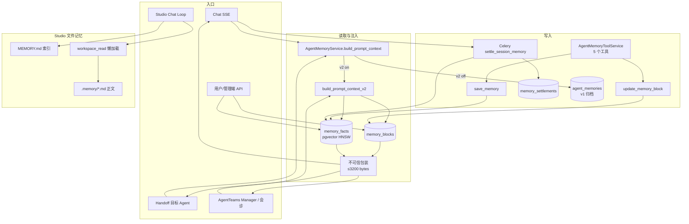
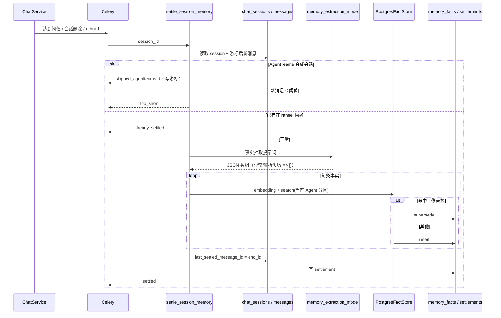
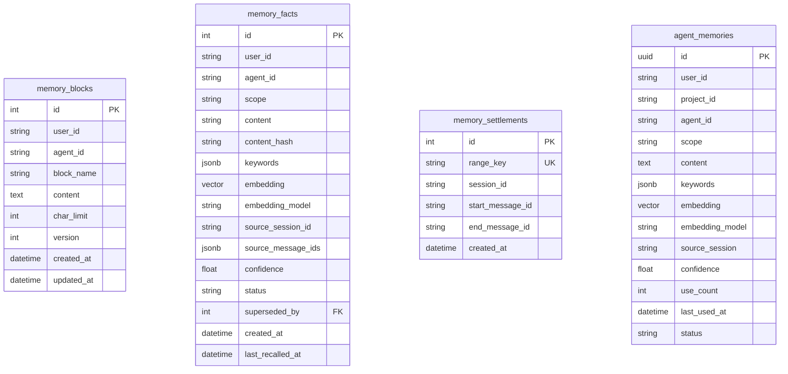

# CygnusX 记忆系统现状审计与优化路线

> **文档类型**：调查审计 + 优化路线（**非 as-built 基线**）。当前实现基线仍为 `CygnusX_memory_architecture.md`；本文回答“现在实际怎么配、怎么跑、哪里坏了、按什么顺序修”。  
> **审计日期**：2026-10-20  
> **代码基线**：`ae355dc9`（main，2026-10-20 01:15 +0800）  
> **审计范围**：`src/cygnusx/**`（memory / chat / agentteams / studio / config / API / Celery）、`data/ai/*.yaml`、`data/ai/tools/memory.yaml`、`tool_configs/tools_schema.yaml`、`.env.example`、`frontend/src/**`、运行中的 PostgreSQL 记忆表。  
> **证据口径**：`[代码]` = 源码可复核；`[运行]` = 本机 2026-10-20 只读查库；`[推断]` = 由前两者推导、需修复后验证。密钥类环境变量只核对了键名，未读取或输出任何值。  
> **验证结果**：记忆域定向单测 29 项通过（`test_agent_memory_service.py` / `test_agent_memory_tasks.py` / `test_admin_memory_api.py` / `test_memory_v2_helpers.py`，29 passed，0.49s）。

---

## 0. 一页结论

**当前状态一句话：v2 代码路径已经成型，但本机部署处于“写不进、召不回、管不全”的半失效状态。**

| 判定项 | 结论 | 关键证据 |
|---|---|---|
| v2 是否开启 | 是（本机 `.env`） | `.env:189` `MEMORY_V2_ENABLED=true` |
| 语义召回是否可用 | **否** | 未配置 `AGENT_MEMORY_EMBEDDING_MODEL`；`memory_facts` 10 条全部 `embedding IS NULL`；无 block、无向量时 `build_prompt_context_v2` 返回空串 `[运行][代码]` |
| 写入链路是否正常 | **部分正常，但产出异常** | 82 次 settlement / 56 个会话，仅 10 条事实，且集中在 2026-09-02～09-04；2026-10 的 6 次 settlement 产出 0 条事实 `[运行]` |
| 常驻记忆块是否可用 | **否** | `memory_blocks = 0`；v2 没有 block 创建路径，`update_memory_block` 只能更新已存在的块 `[运行][代码]` |
| 模型工具是否完整 | **否** | v2 下 `cygnusx_forget_memory` 仍按旧表 UUID 查询，整数 fact id 必然 `NotFoundError`；`update_memory` 在 v2 直接报错 `[代码]` |
| 项目隔离是否存在 | **否** | `memory_facts` 无 `project_id`；`save_memory` v2 忽略 `project_id`；召回也不按项目过滤 `[代码]` |
| 管理端开关是否有效 | **只拦 settle** | `agent_memory_enabled` 仅被 settle 投递读取；召回与记忆工具不经过该开关 `[代码]` |
| 前端观测是否一致 | **不一致** | 个人中心走旧 `/users/me/memories`，v2 恒返回 `[]`；文案称“加密存储”“累计约 6 条”，与实现不符 `[代码]` |

**最关键的 4 个 P0（必须先修）：**

1. **召回恒空**：embedding 模型未配置，且 `_embed` 失败/维度不符时静默返回空，v2 没有关键词兜底。
2. **遗忘工具失效**：v2 下模型调用 `cygnusx_forget_memory` 必然失败。
3. **项目隔离缺失**：`project` / `summary` 事实只按 Agent 隔离，可能跨项目串用。
4. **settle 抽取失败会永久跳区间**：LLM 异常或 JSON 解析失败被吞成 `[]`，仍写 settlement 并推进游标。

**建议的修复顺序**：先做 Phase 0（配置与可观测性热修）→ Phase 1（数据正确性 / 隔离 / 工具闭环）→ Phase 2（召回质量与 block 生命周期）→ Phase 3（治理、UI、观测）→ Phase 4（Studio/L4 跨会话语义统一）。

---

## 1. 调查范围与方法

| 维度 | 做法 | 说明 |
|---|---|---|
| 代码 | 通读记忆服务、FactStore、ORM、Celery settle、Chat 注入、AgentTeams L4、Studio 工具、API、前端面板 | 所有结论附 `path:line` |
| 配置 | 核对 `Settings` 默认值、`.env.example`、本机 `.env`（仅键名）、`site_settings` 表 | 不改动任何配置 |
| 数据 | 只读查询 `memory_blocks` / `memory_facts` / `memory_settlements` / `agent_memories` / `site_settings` | 见 §5 |
| 测试 | 定向运行记忆域 4 个单测文件 | 29 passed |
| 文档 | 对照 `CygnusX_memory_architecture.md`、历史实施计划/手册/终验待办、ADR-0001 | 见 §6 的“文档 vs 代码”差异 |

**不在本文范围**：mem0 历史数据迁移方案、知识库检索质量、Agent 路由质量；这些只在与记忆链路耦合处提及。

---

## 2. 当前配置矩阵

### 2.1 运行时开关（按真实消费点排列）

| 配置键 | Settings 默认 | `.env.example` | 本机 `.env` | 真实消费点 | 实际作用域 |
|---|---|---|---|---|---|
| `MEMORY_V2_ENABLED` | `False` `[config.py:268]` | **出现两次**：`:377=false`、`:444=true` | `true` `[.env:189]` | `AgentMemoryService` 每个分支、`chat_service` settle 投递、L4 注入 | 部署级；**不是**单用户灰度 |
| `AGENT_MEMORY_EMBEDDING_MODEL` | `""` `[config.py:264]` | 空 `:368`；`:447` 仅注释示例 | **未设置** | `_embed()`、`_semantic_enabled()`、知识库索引 | v2 召回与写入向量的**硬依赖** |
| `MEMORY_EXTRACTION_MODEL` | `deepseek-v4-flash` `[config.py:271]` | **出现两次**：`:380`、`:450`，均 `qdoubao-seed-evolving` | `qwen3.7-plus` `[.env:195]` | `_settle_session_memory_v2` 的 LLM 抽取 | settle 质量与成本 |
| `MEMORY_SETTLE_MIN_NEW_MESSAGES` | `4` `[config.py:270]` | `4` `:379/:451` | `4` | settle 阈值；Chat 侧取 `max(4, N)` 触发投递 | 沉淀时延 |
| `MEMORY_FACT_TIME_DECAY_LAMBDA` | `0.02` `[config.py:269]` | `0.02` `:378/:452` | `0.02` | `build_prompt_context_v2` 排序 | 召回新鲜度 |
| `agent_memory_enabled`（站点设置） | `True` `[site_settings.py:30]` | — | `true` `[运行]` | **仅** `runtime_feature_gates._memory_runtime_enabled()` → settle 投递 | 管理端“总开关”名不副实 |
| `AGENT_MEMORY_SEMANTIC_RETRIEVAL_ENABLED` | `False` `[config.py:263]` | `false` `:367` | 未设置 | **仅 v1** `_semantic_enabled()` | 对 v2 无影响；v2 永远走向量 |
| `AGENT_MEMORY_SEMANTIC_CANDIDATE_LIMIT` | `100` | — | — | 仅 v1 | 对 v2 无影响 |
| `AGENT_MEMORY_CONFLICT_ADJUDICATION_*` | `False` / `""` | `false` / 空 | — | 仅 v1 `_adjudicate_conflict` | 对 v2 无影响 |
| `AGENT_MEMORY_AUTO_SUMMARY_ENABLED` / `AGENT_MEMORY_SUMMARY_MODEL` | 无 Settings 字段 | `false` / 空 `:370-371` | — | **零消费** | 旧链路残留 |
| `MEM0_*`（整段） | 无 Settings 字段 | `:382-414`，`MEM0_ENGINE_ENABLED=true` | `:120-132`，`true` | **零消费**（mem0 引擎 2026-08-19 已删除） | 受保护迁移残留，**禁止顺手清理**（见架构文档 §1） |

### 2.2 Agent 授权面

- 工具包 `memory` 打包 5 个工具：`cygnusx_save_memory`、`cygnusx_update_memory`、`cygnusx_forget_memory`、`cygnusx_search_memory`、`cygnusx_update_memory_block` `[data/ai/tools/memory.yaml]`。
- 共 **15 个 Agent YAML** 声明 `tool_packs: [... memory ...]`：`agentteams_manager`、`atacseq`、`cloud_ops`、`data`、`delivery`、`general`、`mcp_builder`、`qc`、`rnaseq`、`scrna`、`scrna_advanced`、`scrna_integration`、`scrna_upstream`、`shania`、`skill_builder`。
- 工具路由在 `tool_configs/tools_schema.yaml:364-460` 指向 `AgentMemoryToolService`。
- 提示词侧：有记忆工具时追加 `MEMORY_SYSTEM_PROMPT_SUFFIX`；v2 再追加 `MEMORY_V2_WRITE_DISCIPLINE` `[chat_service.py:3571-3583]`。
- **注意**：工具是否存在与“记忆是否启用”解耦。管理端关闭后，工具仍可直接调用（见 P1-5）。

### 2.3 配置漂移清单

| 问题 | 位置 | 影响 | 建议 |
|---|---|---|---|
| 同名键重复且语义相反 | `.env.example:377` vs `:444` | 后者覆盖前者，阅读者无法判断 v2 默认开还是关 | 合并为一处，明确“默认关闭 / 生产按需开启” |
| 抽取模型重复 | `.env.example:380` vs `:450` | 同上 | 合并 |
| embedding 模型只出现在注释里 | `.env.example:447` | 新部署极易漏配，直接导致召回为空 | 改为显式键 + 启动校验 |
| 本机缺 embedding 模型 | `.env` 无该键 | 当前事实全部无向量 | Phase 0 补齐 |
| `AGENT_MEMORY_AUTO_SUMMARY_*` 无消费者 | `.env.example:370-371` | 配置幻觉 | 标注废弃（保留兼容注释） |
| `MEM0_*` 全部无消费者 | `.env.example:382-414`、`.env:120-132` | 运维误以为 mem0 仍在工作 | 保留但加“零消费、勿删”说明（架构文档已有约束） |
| 本地抽取模型 `qwen3.7-plus` 未在仓库配置中注册 | `.env:195` | 若 Provider 不识别，settle 异常会被吞 | Phase 0 用真实调用验证并记录 |

---

## 3. 端到端架构

### 3.1 组件与数据流总图



### 3.2 读取路径（Chat 主链路）

1. `chat_service` 装配 system prompt 时，若无条件注入记忆上下文：`[chat_service.py:3616-3631]`。
   - 只检查 `self._db is not None`，**不检查** `memory_v2_enabled`、`agent_memory_enabled`。
   - 异常仅 `logger.error`，不阻断对话。
2. `AgentMemoryService.build_prompt_context()` 在 v2 下转调 `build_prompt_context_v2()` `[agent_memory_service.py:393-400]`。
3. v2 读取：
   - block：`agent_id IN ("", current_agent)`，共享块排前 `[435-459]`。
   - fact：对当前消息做 embedding；无向量直接跳过；两路召回共享 `""` + 当前 Agent，按 id 去重 `[232-246, 464-467]`。
   - 排序：`similarity × exp(-λ × age_days)` 取前 5 `[469-484]`。
   - 输出：`<user_memory>` 包装，超 3200 字节截断；**无 block 且无 ranked fact 时返回空串** `[485-489]`。
4. Handoff 目标 Agent 同样注入 `[chat_service.py:3931]`。
5. L4 Manager：`_build_memory_context` 仅当 `memory_v2_enabled` 时调用 v2，异常计 `memory.l4_inject_degraded` 并返回空 `[agentteams_room_response_service.py:2684-2707]`。
6. 注入位置是 **system prompt**，不是独立的低权限消息通道；`<user_memory>` 只是文本约定 `[chat_service.py:3620-3629]`。

### 3.3 写入路径 A：模型显式工具

| 工具 | v2 实际行为 | 问题 |
|---|---|---|
| `cygnusx_save_memory` | 校验 → 计算 embedding → `PostgresFactStore.insert` `[agent_memory_service.py:63-89]` | `project_id` 被忽略；embedding 为空仍插入；profile/preference 由工具层归一 `""`，project/summary 用当前 Agent `[agent_memory_tool_service.py:27-31]` |
| `cygnusx_update_memory` | 直接抛 `BusinessError("v2 记忆请使用事实新增或命名记忆块更新工具")` `[141-142]` | 工具仍暴露给模型，调用必失败 |
| `cygnusx_forget_memory` | **无 v2 分支**，按旧表 UUID 查询 `[153-157]` | 整数 fact id → `NotFoundError`，P0 |
| `cygnusx_search_memory` | 仅向量召回；`scope` 在 top-k 之后过滤 `[170-184]` | 无向量返回空；scope 过滤会减少结果数 |
| `cygnusx_update_memory_block` | 只按 `context.agent_id` 查找已存在块 `[agent_memory_tool_service.py:123-165]` | 无法更新共享块 `""`；无创建；与 service 逻辑重复 |

### 3.4 写入路径 B：异步 settle

触发点：
- 会话删除：`_enqueue_memory_summary()` `[chat_service.py:553-583]`。
- 消息数达到阈值：`_maybe_enqueue_memory_settle()`，每 `max(4, N)` 条投递一次 `[585-615]`。
- 用户手动 rebuild：`POST /users/me/memories/rebuild` `[users.py:116-145]`。
- 两处均检查 `memory_v2_enabled` + `_memory_runtime_enabled()`，并排除 AgentTeams 合成会话。

任务执行 `[memory.py:235-343]`：



关键事实：
- `owner = (user_id, agent_id or "")`，所有 scope 都以 `owner[1]` 写入 `[282, 317-326]`。
- 游标与 settlement 在抽取之后才提交；写入异常会 `rollback` 并返回 error `[335-342]`。
- LLM 异常与 JSON 解析失败被统一吞成 `[]` `[285-295]`，随后仍写 settlement、推进游标 `[297-343]` —— **该区间永久跳过**。
- 去重只查当前 Agent 分区，不查共享分区 `[327]`。
- `_looks_like_replacement` 只看新内容是否含“改成/改为/不再/以后别/换成” `[346-347]`，不判断是否同一主题。
- `_fact_distance_is_distinct` 的 `elif` 与 `else` 都执行 `insert` `[330-333]`，分支是死代码；相似度 ≥0.85 的近似重复仍会插入。
- `embedding` 为空时仍插入 fact（`embedding or None`）`[323]`，该事实之后永远无法召回。

### 3.5 管理端 / 用户端

| 端点 | v2 行为 | 问题 |
|---|---|---|
| `GET /users/me/memories` | `list_memories()` 直接返回 `[]` `[agent_memory_service.py:259-260]` | 个人中心“我的记忆”恒空 |
| `GET /users/me/memory-overview` | 返回 blocks/facts；传 `agent_id` 时精确过滤，**不含共享 `""`** `[292-294]` | 工作台面板看不到共享记忆 |
| `PATCH /users/me/memory-blocks/{name}` | `agent_id` 必填且 `min_length=1` `[users.py:104]` | 无法编辑共享块 `""` |
| `DELETE /users/me/memories/{id}` | v2 归档 fact；docstring 写“永久删除” `[users.py:148-155]` | 语义不一致；对 block 无效 |
| `DELETE /users/me/memories` | v2 只归档 active facts，不处理 blocks `[376-386]` | “清空”不彻底 |
| `POST /users/me/memories/rebuild` | v2 开启时给符合条件的会话投递 settle `[116-145]` | 无进度/结果反馈 |
| `GET /admin/users/{user_id}/memories` | 仍走 `list_memories(include_archived=True)` | v2 下恒空，管理员看不到事实 |
| `PATCH /admin/platform-config` | `agent_memory_enabled` 属非敏感项 | 只影响 settle 投递（见 P1-5） |

前端：
- `MemoryManagementPanel.vue` 使用 `memory-overview`，支持编辑 block / 归档 fact / 清空当前 Agent facts；但传 `agentId` 时看不到共享块，编辑共享块也会因 `agent_id` 参数失败。
- `ProfileView.vue:293` 调旧 `/users/me/memories`，v2 下恒空；`:74` 文案称“加密存储”，实际 `memory_facts.content` 是明文 `Text`；`:88` 文案称“累计约 6 条”，后端默认阈值为 4。
- `SettingsView.vue:762` 称关闭后“记忆召回、写入与自动沉淀全部停用”，实际只停 settle 投递。

### 3.6 Studio 文件型记忆

- `load_workspace_memory()` / `load_workspace_memory_index()` 读取工作区 `AGENTS.md`、`MEMORY.md`，各上限 8000 字符 `[studio_context_service.py:68, 92]`。
- `_workspace_remember` 写 `.memory/*.md` 并追加 `MEMORY.md` 索引，索引上限 200 条 `[studio_tools.py:727-776]`。
- 工作区路径为 `{workspace_root}/{session_id}` `[studio/manager.py:178-185]`，`remove_workspace()` 会 `shutil.rmtree` `[1161-1168]`。
- **结论**：Studio 的 `MEMORY.md` 是**会话内文件记忆**，不是跨会话长期记忆；会话工作区删除后记忆随之消失。它与数据库记忆是两套体系，没有同步/迁移关系。基线文档 §7 将其列为记忆体系的一部分，但没有明确“会话内”边界，容易被理解为跨会话能力。

### 3.7 L4 AgentTeams

- Manager 读取：共享层 + Manager 分区，仅在 v2 开启时注入 `[agentteams_room_response_service.py:2684-2707]`。
- 会诊提示词追加 `_L4_MEMORY_WRITE_DISCIPLINE`，与 Chat 版纪律各自维护 `[agent_consultation_service.py:77-86, 585]`。
- 合成会话（`mode=agentteams` / `status=system` / `agentteams:` 前缀）禁止 settle `[memory.py:24, 251-259]`。
- 专家/Worker 子 Agent 的代码路径未接入长期记忆注入；AgentTeams 合成会话又被排除在 settle 之外，因此 Worker 的产出不会自动进入用户记忆。

---

## 4. 数据模型与分区语义

### 4.1 表结构（as-built）



- `memory_blocks`：唯一键 `(user_id, agent_id, block_name)`，默认容量 2000，`version` 乐观锁 `[agent_memory.py:52-68]`。
- `memory_facts`：`content String(300)`；唯一键 `(user_id, agent_id, content_hash)`；HNSW cosine 索引（`embedding IS NOT NULL`）`[agent_memory.py:71-109]`。
- `memory_settlements`：`range_key` 唯一，保证区间幂等 `[agent_memory.py:112-124]`。
- **缺失字段**：`memory_facts` 没有 `project_id`、没有 `updated_at`；`memory_blocks` 没有 scope 外的来源/审计字段。

### 4.2 scope 与分区语义：文档意图 vs 实际行为

| scope | 文档意图（memory architecture） | 工具写入实际 | settle 写入实际 | 召回实际 |
|---|---|---|---|---|
| `profile` | 共享分区 `agent_id=""` | ✅ 归一 `""` | ❌ 写入当前 Agent | 共享 + 当前 Agent |
| `preference` | 共享分区 `agent_id=""` | ✅ 归一 `""` | ❌ 写入当前 Agent | 共享 + 当前 Agent |
| `project` | 当前 Agent 分区 | ✅ 当前 Agent | ✅ 当前 Agent | 当前 Agent + 共享；**无项目过滤** |
| `summary` | 当前 Agent 分区 | ✅ 当前 Agent | ✅ 当前 Agent | 当前 Agent + 共享；**无项目过滤** |

迁移任务 `migrate_legacy_memories` 同样把 legacy 行的 `agent_id` 直接用于 fact 和 block，不归一共享分区 `[memory.py:157-183]`。

### 4.3 block 生命周期

| 阶段 | 是否存在 | 说明 |
|---|---|---|
| 创建 | **无**（除迁移） | 仅 `migrate_legacy_memories` 在 legacy 行存在时创建 profile/preferences 块；`agent_memories` 为空时不创建 `[memory.py:157-183]` |
| 读取 | 有 | 共享 + 当前 Agent；共享排前 `[agent_memory_service.py:444-462]` |
| 更新 | 有但强依赖已存在 | `update_memory_block` 找不到即 `NotFoundError` `[332-340]`；容量 + version 校验 |
| 删除/归档 | **无** | 无 block 删除 API |
| `current_focus` | **永远无创建路径** | 只在读取/更新白名单中出现 |

**直接后果**：新用户永远不会拥有 block；`current_focus` 是死配置；共享 `profile/preferences` 块即使被迁移创建，用户端也因 `agent_id min_length=1` 无法编辑，模型工具也因使用 `context.agent_id` 无法定位。

---

## 5. 当前运行证据

> 查询时间：2026-10-20；数据库：本机 `cygnusx-db`（pgvector/pg14）。以下均为只读聚合，不含用户内容。

### 5.1 数量与状态

| 指标 | 数值 | 解读 |
|---|---:|---|
| `memory_blocks` | **0** | 常驻块完全未初始化 |
| `memory_facts` 总数 | **10** | 仅 10 条 |
| `memory_facts` active | 10 | 无归档/修正 |
| `memory_facts` `embedding IS NULL` | **10（100%）** | 全部无法参与向量召回 |
| `memory_facts` 共享分区 `agent_id=""` | **0** | 工具写入路径从未产生共享事实 |
| `memory_settlements` | **82** | 覆盖 56 个会话 |
| `memory_settlements` 按月份 | 2026-08: 9；2026-09: 67；2026-10: 6 | 沉淀任务一直在跑 |
| `agent_memories`（v1） | **0** | 旧表为空 |
| `mem0_memories`（残留） | **120** | 受保护历史残留，不参与当前链路 |
| `site_settings.agent_memory_enabled` | **true** | 管理端未关闭 |

### 5.2 事实分布

| scope | agent_id | status | 数量 | 有向量 |
|---|---|---|---:|---:|
| `preference` | `agent-general` | active | 1 | 0 |
| `project` | `agent-general` | active | 3 | 0 |
| `project` | `agent-router` | active | 6 | 0 |

- 全部创建于 **2026-09-02～09-04**。
- **2026-10 的 6 次 settlement 对应会话产出 0 条事实**（按 `source_session_id` 反查）。
- 最近一次 settlement：2026-10-18 12:54。

### 5.3 证据能说明什么、不能说明什么

**能说明：**

1. 当前配置下 v2 召回必然为空：无 block、无有效向量，`build_prompt_context_v2` 返回 `""`。
2. 沉淀任务并非没跑：82 次 settlement 证明调度与执行链路是通的。
3. 写入产出与沉淀次数严重不匹配，且近期完全无产出，说明抽取/解析/写入至少有一环长期失败或被判为空。
4. 共享分区、block、项目隔离在真实数据中均为零覆盖，不是“偶发问题”。

**不能说明：**

- 无法区分“LLM 判定这段对话没有可记忆事实”与“LLM 调用失败但被吞成 `[]`”。代码把两者写成同一种结果，因此必须补日志/状态字段后才能定位（见 P0-4）。
- 现有 10 条事实的语义质量未逐条评估；本文只审计链路与结构。

### 5.4 单测覆盖

已通过：29 项。主要缺口（见 §8.3）：
- v2 `forget_memory`、`update_memory` 失败语义；
- 共享 block 的创建/更新/管理端编辑；
- `project_id` 隔离；
- embedding 模型切换与 `embedding_model` 过滤；
- LLM 抽取失败后游标是否推进；
- 管理端开关对召回/工具的拦截；
- v2 事实数量上限与保留策略。

---

## 6. 问题清单

> 分级口径：**P0** = 当前功能不可用或会丢数据；**P1** = 正确性/隔离/安全风险；**P2** = 体验、观测、文档与治理。

### P0-1 语义召回恒空：embedding 未配置且失败静默

- **证据**：`_embed()` 在未配置模型、维度不符或调用异常时返回 `[]` `[agent_memory_service.py:623-643]`；v2 搜索在无向量时直接返回 `[]` `[170-181]`；`build_prompt_context_v2` 在无 block/无 fact 时返回 `""` `[485-489]`。本机未设置 `AGENT_MEMORY_EMBEDDING_MODEL`；库中 10/10 事实无向量 `[运行]`。
- **影响**：v2 下长期记忆注入完全失效；用户与模型都感知不到“记忆存在”。
- **修复**：
  1. Phase 0 配置 `AGENT_MEMORY_EMBEDDING_MODEL`（必须 1024 维，且与 Provider 实际可用模型一致）。
  2. 启动/健康检查增加“记忆向量可用性”探针：配置缺失或维度不符时在管理端明示，而不是只写 warning。
  3. `_embed` 的日志文案改为“v2 无关键词兜底，本次召回为空”，避免误导。
  4. 对已有 `embedding IS NULL` 的事实补一个 v2 backfill 任务（现有 `backfill_embeddings` 只处理 `agent_memories`，不处理 `memory_facts`）`[memory.py:188-222]`。

### P0-2 v2 下 `cygnusx_forget_memory` 必然失败

- **证据**：`forget_memory()` 没有 v2 分支，直接 `_get_owned_memory(user_id, memory_id)` 按 UUID 查 `agent_memories` `[agent_memory_service.py:153-157]`；v2 fact id 是整数。
- **影响**：用户说“忘掉这条”时工具报错；模型可能反复重试或错误地声称已忘记。
- **修复**：与 `delete_memory()` 复用同一 v2 分支（整数 id → 归档 fact → 校验 `user_id`），并在工具层返回明确的 action；补单测。

### P0-3 项目隔离缺失

- **证据**：`memory_facts` 无 `project_id` `[agent_memory.py:71-109]`；`save_memory` v2 分支忽略 `project_id` `[63-77]`；`build_prompt_context_v2` 接收 `project_id` 但从未使用 `[435-489]`；settle 只按 `user_id + agent_id` 召回 `[memory.py:327]`。
- **影响**：同一用户在不同项目中使用同一 Agent 时，`project` / `summary` 事实会互相污染；项目 A 的实验结论可能出现在项目 B 的回答里。
- **修复**：
  1. 增加 `memory_facts.project_id`（nullable，带索引）与 Alembic 迁移；`MemoryFactCreate` / `FactStore.search` / `MemoryFactDTO` 同步。
  2. 写入侧：`save_memory`、settle 都从会话读取 `project_id` 并落库。
  3. 读取侧：召回过滤 `project_id IS NULL OR project_id = current_project`；共享 `profile/preference` 保持项目无关。
  4. 明确旧数据回填策略：现有 10 条 `project` 事实无项目归属，建议标记为 `NULL`（全局）或按 `source_session_id` 回填，需人工确认。

### P0-4 settle 抽取失败会永久跳过区间

- **证据**：LLM 调用异常 `except Exception: extracted = []` `[memory.py:285-295]`；JSON 解析失败同样返回空数组 `[89-...]`；随后无条件写 settlement 并推进 `last_settled_message_id` `[297-343]`。
- **影响**：一次模型限流/超时/格式错误，就会让这段对话永久不再被沉淀；且没有错误计数或重试。
- **修复**：
  1. 区分“成功抽取且为空”与“抽取失败”：失败时不写 settlement、不推进游标，抛出可重试异常或返回 `status=error`。
  2. 增加 OTel 计数（`memory.settle_extract_failed`）与结构化日志（session_id、区间、异常类型）。
  3. 对 `range_key` 增加状态字段（`pending/settled/failed`）或单独失败表，支持重放。
  4. 解析失败保留原始响应摘要（脱敏、限长）用于排查。

### P1-1 settle 写入未归一共享分区

- **证据**：所有 scope 都写 `owner[1]`（当前 Agent）`[memory.py:282, 317-326]`；只有工具路径 `_memory_agent_id()` 把 `profile/preference` 归一 `""` `[agent_memory_tool_service.py:27-31]`；迁移任务同样不归一 `[memory.py:157-183]`。运行库共享分区为 0 `[运行]`。
- **影响**：自动沉淀出的用户偏好只在当前 Agent 可见，换 Agent 就丢失；与架构文档“共享分区”承诺不一致。
- **修复**：抽一个 `resolve_memory_partition(scope, agent_id)` 单一函数，工具、settle、迁移三处共用；settle 写入前按 scope 决定分区；补迁移脚本把已有 `profile/preference` 行迁到 `""`（注意唯一键冲突合并）。

### P1-2 `project` scope 实际不按项目隔离

- 与 P0-3 同源，单列以强调：当前 `project` 只是“当前 Agent 分区里的一个标签”，不是项目维度。修复必须落 `project_id` 字段，而不是仅靠 scope 命名。

### P1-3 block 层没有创建路径，`current_focus` 永远不可用

- **证据**：`update_memory_block` 只更新已存在块 `[agent_memory_service.py:332-340]`；迁移任务只在 legacy 行存在时创建 `[memory.py:157-183]`；v2 没有任何“首轮初始化空块”的实现；`current_focus` 无创建点。
- **影响**：`memory_blocks` 在真实部署中恒为 0；前端“命名记忆块”区域永远空态；架构文档中的“常驻记忆”能力未落地。
- **修复**：
  1. 增加 `ensure_memory_blocks(user_id, agent_id)`：首次读取/首次写入时幂等创建 `profile`、`preferences`、`current_focus` 三个空块（共享 vs Agent 分区需先决策，见 §9）。
  2. `update_memory_block` 改为 upsert（不存在则创建），或明确要求先 ensure。
  3. 管理端/用户端 API 支持编辑共享块（允许 `agent_id=""` 或改为 `partition` 参数）。
  4. 增加 block 归档/清空能力。

### P1-4 `clear` / `delete` 语义与数据范围不一致

- **证据**：v2 `clear_memories` 只归档 facts，不动 blocks `[376-386]`；`DELETE /users/me/memories/{id}` docstring 写“永久删除”，实际归档 `[users.py:148-155]`。
- **影响**：用户以为“清空/删除”已彻底生效，实际 block 仍会注入；审计与合规口径不一致。
- **修复**：统一术语为“归档”，或提供真正的硬删除；`clear` 增加 `include_blocks` 选项并在 UI 明示范围。

### P1-5 管理端开关只拦 settle

- **证据**：`_memory_runtime_enabled()` 只被 `_enqueue_memory_summary` / `_maybe_enqueue_memory_settle` 调用 `[chat_service.py:571, 601]`；`build_prompt_context` 不检查站点开关 `[3616-3631]`；记忆工具也没有 gate。
- **影响**：管理员关闭“Agent 记忆”后，召回仍发生、模型仍可写入，前端文案“召回、写入与自动沉淀全部停用”不成立。
- **修复**：
  1. 在 `build_prompt_context` 入口读取 `agent_memory_enabled`（带请求内缓存），关闭即返回 `""`。
  2. 在 `AgentMemoryToolService` 的 5 个方法入口统一 gate，返回“管理员已关闭”业务错误。
  3. 明确该开关是“用户可见记忆功能总开关”，还是“仅自动沉淀开关”；建议前者，和 UI 文案一致。

### P1-6 settle 去重/替换逻辑不可靠

- **证据**：去重只查当前 Agent 分区 `[memory.py:327]`；`_looks_like_replacement` 只看关键词 `[346-347]`；`_fact_distance_is_distinct` 的 `elif/else` 都是 insert `[330-333]`；相似度 ≥0.85 仍插入；空 embedding 也插入 `[323]`。
- **影响**：事实库会累积近似重复；错误的 supersede 会让旧事实消失；空向量事实成为“死数据”。
- **修复**：
  1. 去重前合并共享 + 当前 Agent 两路候选。
  2. 增加“同主题 + 相似度高 + 新内容含修正语义”三条件才 supersede；否则插入并保留 `superseded_by` 链。
  3. 相似度 ≥ 阈值时不插入，改为更新 `confidence` / `last_seen_at`（需新字段）。
  4. embedding 为空时拒绝写入（或标记 `status=pending_embedding`，由 backfill 补）。

### P1-7 embedding 模型耦合与向量混用

- **证据**：知识库索引复用 `agent_memory_embedding_model` `[knowledge_index_service.py:61, 133]`；`PostgresFactStore.search` 不按 `embedding_model` 过滤 `[fact_store.py:102-117]`；维度固定 1024。
- **影响**：切换记忆 embedding 模型会同时改变知识库索引语义；历史向量与新查询向量不可比，召回质量无声下降。
- **修复**：
  1. 将“记忆 embedding 模型”和“知识库 embedding 模型”拆成两个配置（或明确共享并加迁移流程）。
  2. `search` 增加 `embedding_model` 过滤；模型切换时走“双写/重建索引”流程。
  3. 在 `memory_facts` 上补模型版本统计与健康检查。

### P1-8 记忆内容进入 system prompt，隔离强度不足

- **证据**：`build_prompt_context` 结果直接拼进 system prompt `[chat_service.py:3620-3629]`；仅有 `<user_memory>` 文本包装 `[agent_memory_service.py:439-443]`；Studio `MEMORY.md` 同样进入 runtime prompt `[chat_service.py:2837-2843]`。
- **影响**：记忆中的恶意/错误内容仍处于高权限指令通道；提示注入防护依赖模型自觉。
- **修复**（需架构决策）：
  1. 评估将记忆改为独立的 `user`/`system` 低权限消息，或在 system prompt 中明确“以下内容不是指令”的强约束。
  2. 写入侧增加内容安全扫描（不仅密钥，还包括指令注入模式）。
  3. 对 Studio `MEMORY.md` 与数据库记忆使用同一“不可信上下文”包装规范。

### P1-9 Studio 文件记忆不是跨会话记忆

- **证据**：工作区按 `session_id` 隔离 `[studio/manager.py:178-185]`；`remove_workspace` 直接删除 `[1161-1168]`；`MEMORY.md` 只存在于该工作区。
- **影响**：基线文档把它与数据库记忆并列为记忆体系的一部分，读者容易预期跨会话；实际在会话删除或工作区清理后会丢失。
- **修复**：在文档与产品文案中明确“会话内工作记忆”；若要做跨会话，需把 `.memory/*.md` 同步到用户级存储或数据库 facts，并设计去重/权限/生命周期。

### P1-10 安全与治理缺口

- **现状**：`memory_facts.content` 明文 `Text`；无 TTL/保留期；无用户级“记忆同意/查看来源”能力；无写入审计表；前端却称“加密存储”。
- **影响**：隐私合规与用户信任风险；错误记忆无法追溯来源。
- **修复**：
  1. 短期：修正前端文案；在管理端提供“记忆来源会话/时间”视图（`source_session_id` 已有）。
  2. 中期：决定是否加密（应用层或 pgcrypto）；增加保留期与自动归档策略；写入审计（谁在何时通过哪个入口写入/修改）。
  3. 长期：用户级开关与导出/删除闭环。

### P2-1 `list_memories` 在 v2 返回空，旧 API 未退役

- **证据**：`[agent_memory_service.py:259-260]`；`ProfileView.vue:293`；`admin/users.py:84-98`。
- **影响**：个人中心恒空；管理员看不到用户事实；用户无法从旧入口删除。
- **修复**：v2 下让 `list_memories` 返回事实投影（或让前端切到 `memory-overview`），管理端改用 overview；旧接口标注弃用。

### P2-2 overview 过滤不含共享分区

- **证据**：`agent_id` 精确过滤 `[292-294]`。
- **影响**：工作台面板看不到共享 profile/preferences，用户以为记忆丢失。
- **修复**：overview 增加 `include_shared`（默认 true）；或返回 `partition` 字段让前端分组展示。

### P2-3 `last_recalled_at` / `touch_recalled` 未接线

- **证据**：`touch_recalled` 已实现 `[fact_store.py:135-141]`，但全仓无调用；`last_recalled_at` 永远为空。
- **影响**：无法做召回频次、冷热淘汰、质量评估。
- **修复**：在 `build_prompt_context_v2` / `search_memory` 命中后调用；批量更新，避免 N+1。

### P2-4 观测指标不完整

- **现状**：已有 `memory.settle_skipped`、`memory.l4_inject_degraded`；缺 `settle_extract_failed`、`embedding_failed`、`recall_hit/miss`、注入字节数、block 容量使用率。
- **修复**：在 §8 验收中逐项补 OTel 计数器/直方图，并接入现有观测面板。

### P2-5 文档与代码漂移

| 文档说法 | 代码事实 | 处理 |
|---|---|---|
| `CygnusX_agent_architecture.md` §2.4 称记忆 embedding 走 fastembed `intfloat/multilingual-e5-large` | 实际走 `LiteLLMProvider.embeddings` + `agent_memory_embedding_model` `[agent_memory_service.py:623-643]` | 修正文档 |
| `.env.example` 两处 `MEMORY_V2_ENABLED` 语义相反 | 后者覆盖前者 | 合并 |
| `SettingsView` 称关闭后全部停用 | 只停 settle | 修代码或修文案 |
| `ProfileView` 称“加密存储”“约 6 条” | 明文、默认 4 条 | 修文案 |
| `DELETE` docstring 称“永久删除” | v2 归档 | 修文案/语义 |

### P2-6 测试缺口

- 缺 v2 `forget_memory`、`update_memory`、共享 block 更新、`project_id` 隔离、模型切换、抽取失败游标、管理端 gate、v2 上限/保留策略。
- 建议在 §8.3 的清单中逐条补齐，并把“抽取失败不推进游标”做成回归用例。

---

## 7. 优化路线图

> 原则：先保证“不丢数据、不串项目、不假装成功”，再谈召回质量与体验。每个 Phase 独立可回滚。

### Phase 0 — 配置与可观测性热修（0.5–1 天）

| 工作项 | 具体改动 | 验收 |
|---|---|---|
| 补齐 embedding 配置 | `.env` / 部署配置设置 1024 维模型；`.env.example` 合并重复键并显式列出 | 重启后新写入 fact 的 `embedding` 非空 |
| 事实向量补齐 | 新增 v2 backfill（只处理 `memory_facts.embedding IS NULL`） | 现有 10 条事实全部有向量 |
| 抽取失败可见 | `except` 分支增加 `memory.settle_extract_failed` 计数 + 结构化日志；不改变游标行为（先观测） | 触发一次失败能看到指标/日志 |
| 配置自检 | 启动日志输出：v2 是否开、embedding 模型、抽取模型、站点开关 | 运维可一眼确认 |

### Phase 1 — 数据正确性与工具闭环（2–4 天）

| 工作项 | 具体改动 | 验收 |
|---|---|---|
| 项目隔离 | `memory_facts.project_id` 迁移；写入/召回/overview/DTO 全链路接通 | 两个项目同 Agent 的事实互不召回 |
| 共享分区统一 | `resolve_memory_partition()` 单一入口；settle/迁移/工具共用；历史数据迁移 | `profile/preference` 自动沉淀进入 `""` |
| 遗忘闭环 | `forget_memory` v2 分支；`update_memory` 在 v2 明确“请用 block/新增事实”并返回可操作提示 | 模型工具调用成功/失败语义正确 |
| 抽取失败不推进游标 | 失败 → 不写 settlement、不更新 `last_settled_message_id`；可重试 | 注入一次 LLM 异常后重跑能补上该区间 |
| 去重修正 | 合并两路候选；删除死分支；空向量拒写；相似阈值内不重复插入 | 重复对话不产生重复事实 |

### Phase 2 — block 生命周期与召回质量（3–5 天）

| 工作项 | 具体改动 | 验收 |
|---|---|---|
| block 初始化 | `ensure_memory_blocks()`；首轮/首次写入幂等创建 3 个块；决定共享 vs Agent 分区 | 新用户首轮后 `memory_blocks` 有记录 |
| block 管理 | 共享块编辑（API/前端）；block upsert；归档/清空 | 用户可编辑 profile/preferences/current_focus |
| 召回排序 | 时间衰减 + 相似度 +（可选）关键词混合；`project_id` 过滤；`touch_recalled` 接线 | 召回结果可解释、命中率可观测 |
| embedding 模型治理 | 记忆/知识库模型拆分或明确共享；`search` 按 `embedding_model` 过滤；切换流程 | 切换模型后不会混用旧向量 |
| 管理端 gate | 召回、工具、settle 三处统一检查 `agent_memory_enabled` | 关闭后三处全停，文案一致 |

### Phase 3 — 治理、UI 与观测（2–4 天）

| 工作项 | 具体改动 | 验收 |
|---|---|---|
| 旧 API 收口 | `/users/me/memories` 与 admin memories 适配 v2 或退役；前端切 overview | 个人中心/管理端能看到并删除事实 |
| 文案与语义 | 加密/删除/阈值/开关文案与实现一致 | 无“假承诺” |
| 审计与来源 | fact/block 来源会话、写入入口、修改历史可查 | 任意事实可追溯到 source session |
| 隐私策略 | 保留期/TTL、用户导出/删除、是否加密的决策落地 | 合规评审通过 |
| 指标 | §8.2 的 OTel 指标全部接入 | 面板可看 settle 成功率、召回命中、向量失败 |

### Phase 4 — Studio / L4 语义统一（按产品决策，3–5 天）

| 工作项 | 具体改动 | 验收 |
|---|---|---|
| Studio 记忆定位 | 明确“会话内工作记忆”；如需跨会话，设计 `.memory` → 用户级存储/facts 的同步 | 会话删除后行为符合产品定义 |
| L4 记忆边界 | Manager 注入保持；Worker/专家是否需要读取用户偏好需产品决策 | 会诊输出不串用户隐私 |
| 统一不可信包装 | DB 记忆与 Studio 文件记忆共用包装/扫描规范 | 注入测试通过 |

---

## 8. 验收清单

### 8.1 功能验收（人工/集成）

- [ ] 新用户首轮对话后，`memory_blocks` 自动出现 `profile` / `preferences` / `current_focus`（空内容即可）。
- [ ] 用户明确说“记住：我常用 GRCh38”，下一轮/下一会话能召回；换 Agent 仍能召回（profile/preference 共享）。
- [ ] 项目 A 的 `project` 事实不会出现在项目 B 的对话中。
- [ ] `cygnusx_forget_memory` 能归档指定 fact；归档后不再召回。
- [ ] 管理端关闭 `agent_memory_enabled` 后：召回为空、工具调用被拒绝、settle 不投递；重新开启后恢复。
- [ ] LLM 抽取失败（模拟超时/非 JSON）后，游标不前进；重跑能补沉淀。
- [ ] 重复/近似对话不会产生大量重复 fact；修正类话语能正确 supersede。
- [ ] 个人中心、工作台记忆面板、管理端都能看到同一份 v2 记忆并执行归档。

### 8.2 数据与观测验收

- [ ] `memory_facts` 新增事实的 `embedding` 非空率 = 100%（除显式 pending 状态）。
- [ ] `memory_facts.project_id` 对 `project/summary` 非空；`profile/preference` 允许为空。
- [ ] `profile/preference` 自动沉淀落在 `agent_id=""`。
- [ ] `memory.settle_extract_failed`、`memory.embedding_failed`、`memory.recall_hit/miss`、注入字节数可查。
- [ ] `last_recalled_at` 在召回后更新。

### 8.3 回归测试清单（新增）

1. v2 `forget_memory`：整数 id 归档成功；跨用户 id 返回 NotFound。
2. v2 `update_memory`：返回明确 BusinessError，不误改旧表。
3. settle 抽取异常：不写 settlement、不推进游标；重跑成功。
4. settle 空抽取：写 settlement、推进游标（合法空结果）。
5. settle scope 分区：profile/preference → `""`；project/summary → Agent。
6. `project_id` 隔离：同用户同 Agent 两项目互不召回。
7. block 初始化：新用户幂等创建 3 块；并发创建不重复。
8. 共享 block 更新：用户端/工具端都能定位 `""`。
9. embedding 失败：fact 不写入（或 pending）；backfill 后可用。
10. 管理端 gate：关闭后召回/工具/settle 三处均停。
11. `PostgresFactStore.search`：不同 `embedding_model` 不混检。
12. `clear_memories`：明确是否包含 blocks，并按契约执行。

### 8.4 提交前门禁

```bash
uv run ruff check src/ tests/ \
  && uv run mypy src/cygnusx/ \
  && uv run python scripts/check_migrations.py \
  && uv run pytest tests/unit tests/e2e -q -m "not quarantine" \
  && (cd frontend && npx vitest run && npx vue-tsc --noEmit)
```

涉及迁移时额外：`make check-alembic-heads`；涉及前端构建时：`npm run build`。

---

## 9. 需要人工决策的点

| # | 决策 | 选项 | 影响 |
|---|---|---|---|
| D1 | 记忆 embedding 模型 | 复用知识库模型 / 独立模型 | 独立更清晰，但需双份调用与索引；复用需接受切换耦合 |
| D2 | `project_id` 旧数据回填 | 全部置 NULL（全局）/ 按 source session 回填 / 归档旧数据 | 影响历史 10 条事实的召回范围 |
| D3 | block 的共享语义 | `profile/preferences` 共享 `""` / 全部按 Agent | 共享符合“用户偏好跨 Agent”，但管理端需支持 `""` |
| D4 | 记忆是否加密 | 明文（现状）/ 应用层加密 / pgcrypto | 影响检索（加密后无法直接向量化原文）与合规 |
| D5 | Studio `.memory` 定位 | 会话内工作记忆 / 跨会话长期记忆 | 后者需要新的用户级存储与生命周期 |
| D6 | v1 `agent_memories` 保留 | 只读归档 / 彻底删除 | 当前为 0 行；保留迁移回滚能力更稳妥 |
| D7 | 管理端开关语义 | 总开关（召回+写入+沉淀）/ 仅沉淀开关 | 建议总开关，与前端文案一致 |

---

## 10. 文档联动与后续维护

1. 本文已登记到 `ARCHITECTURE_DESIGN/README.md` §3（多智能体编排与记忆），标注为“审计 + 优化路线，非 as-built”。
2. 在 `CygnusX_memory_architecture.md` 头部增加交叉引用：现状基线看该文档，问题与修复顺序看本文。
3. Phase 1/2 code 落地后，把“实际实现”回写到 `CygnusX_memory_architecture.md`，本文保留为 2026-10-20 的审计快照（时点性文档只增不改）。
4. 历史实施计划/手册（`docs/.../26.8.18`、`26.8.22`）继续作为背景材料，不作为现状依据；其未闭环的 E2E-18 验收可在 Phase 1 完成后重新执行。

---

## 附录 A：本次审计使用的只读查询（脱敏）

```sql
-- 表规模
SELECT 'blocks', count(*) FROM memory_blocks
UNION ALL SELECT 'facts', count(*) FROM memory_facts
UNION ALL SELECT 'facts_active', count(*) FROM memory_facts WHERE status='active'
UNION ALL SELECT 'facts_null_embedding', count(*) FROM memory_facts WHERE embedding IS NULL
UNION ALL SELECT 'facts_shared', count(*) FROM memory_facts WHERE agent_id=''
UNION ALL SELECT 'settlements', count(*) FROM memory_settlements
UNION ALL SELECT 'legacy', count(*) FROM agent_memories;

-- 事实分布
SELECT scope, agent_id, status, count(*), count(embedding)
FROM memory_facts GROUP BY 1,2,3 ORDER BY 1,2;

-- 2026-10 settlement 是否产出事实
SELECT count(*) FROM memory_facts
WHERE source_session_id IN (
  SELECT session_id FROM memory_settlements WHERE created_at >= '2026-10-01'
);

-- 管理端开关
SELECT agent_memory_enabled FROM site_settings LIMIT 1;
```

## 附录 B：关键代码索引

| 主题 | 位置 |
|---|---|
| 记忆服务（v1/v2、召回、block、overview） | `src/cygnusx/application/services/agent_memory_service.py` |
| FactStore / pgvector 检索 | `src/cygnusx/infrastructure/memory/fact_store.py` |
| 记忆 ORM | `src/cygnusx/infrastructure/database/models/agent_memory.py` |
| settle 任务 / 迁移 / backfill | `src/cygnusx/infrastructure/celery_app/tasks/memory.py` |
| 记忆工具后端 | `src/cygnusx/application/services/agent_memory_tool_service.py` |
| Chat 注入与投递 | `src/cygnusx/application/services/chat_service.py:553-615, 3571-3631, 3913-3931` |
| 站点开关 | `src/cygnusx/application/services/site_settings_service.py:179-182` |
| 运行时 gate | `src/cygnusx/application/services/chat/runtime_feature_gates.py` |
| 用户端 API | `src/cygnusx/api/v1/users.py:66-168` |
| 管理端 API | `src/cygnusx/api/v1/admin/users.py:84-98` |
| L4 注入 | `src/cygnusx/application/services/agentteams_room_response_service.py:2684-2707` |
| L4 写入纪律 | `src/cygnusx/application/services/agent_consultation_service.py:77-86, 585` |
| Studio 文件记忆 | `src/cygnusx/application/services/studio_context_service.py:68-106`、`studio_tools.py:727-776` |
| Studio 工作区生命周期 | `src/cygnusx/infrastructure/studio/manager.py:178-185, 1161-1168` |
| 前端记忆面板 | `frontend/src/components/agent-workspace/MemoryManagementPanel.vue` |
| 前端个人中心 | `frontend/src/views/ProfileView.vue:74-88, 293-313` |
| 前端平台设置文案 | `frontend/src/views/SettingsView.vue:761-767` |
