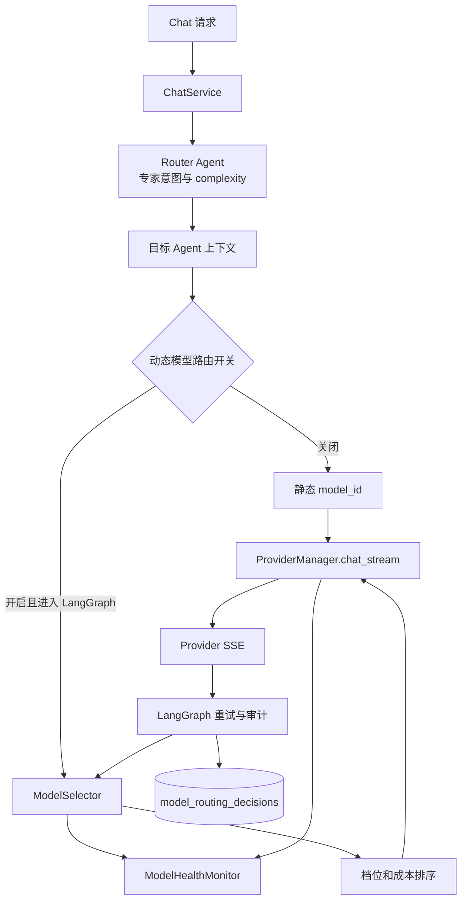

# CygnusX 动态模型路由架构

> 类型：as-built；基线：2026-10-11。
> 范围：普通 Chat 的 LangGraph 执行路径、Provider 健康监控、模型选型、重试和决策审计。

## 0. 当前结论

V1→V2 的核心框架已有代码实现，`dynamic_model_routing_enabled` 默认 `False`。打开后，普通 Chat 的 LangGraph 路径在模型调用前按任务复杂度、Agent 档位、Provider 健康状态和价格选型。默认关闭时继续使用静态绑定。Studio、Legacy、Direct、AgentTeams 等路径尚未统一接入 ModelSelector。真实供应商可用性和降本、延迟、质量收益尚无完整生产验收证据。

## 1. 请求链路



Router 的专家意图路由与 ModelSelector 的模型选型是两个阶段。前者选择目标 Agent 并给出 `complexity: low | medium | high`；后者只替换调用用的 Provider 配置，不改工具、MCP、Skill 或审批上下文。非法或缺失的 complexity 归一化为 `medium`。分类器优先使用 `deepseek-v4-flash`；配置缺失或停用时尝试默认 Provider。分类调用失败或所选分类 Provider 被健康熔断时，回退通用 Agent。

## 2. 配置与持久化

`src/cygnusx/core/config.py` 定义开关和上限：

```python
dynamic_model_routing_enabled: bool = False
dynamic_routing_max_cascades: int = 2
dynamic_routing_max_upgrades: int = 1
dynamic_routing_quality_degrade_enabled: bool = True
```

Pydantic Settings 读取仓库根目录 `.env`；Docker Compose 的 web 服务也读取该文件。设置 `DYNAMIC_MODEL_ROUTING_ENABLED=true` 并重启 web 后生效。开关关闭时 LangGraph 复用装配得到的静态 `model_config`。

`data/ai/providers.yaml` 声明 Provider 的 `tier`、`is_default`、`cost_per_1m_in/out`、`latency_budget_ms`、`vendor`、`weight`。当前声明 `deepseek-v4-flash`、`qwen3.8-flash`、`qwen3.8-omni-flash`、`qwen3.8-max`；YAML 同步至 `ai_provider_configs`。Agent YAML 同时保留旧 `model` 和新 `model_tier`，后者持久化在 `agent_templates.model_tier`。相关迁移依次为 `dynamicrouting01`、`dynamicrouting02`、`dynamicrouting03`。

## 3. 选型和健康度

LangGraph 外层每次启动图运行前创建 `SelectionInput`，传入请求标识、轮次、Agent、complexity、model_tier 和显式模型。`ModelSelector.select()` 优先选择健康的显式模型；否则 `auto + high` 选 heavy，其余 auto 选 light；档位无健康候选时放开全档，仍无健康候选时回退默认 Provider。档内以预计输出成本排序，价格缺失时用输入价或稳定名称排序。当前输入 token 长度和历史 P50 未进入排序。

`ModelHealthMonitor` 在进程内记录 Provider 成功、超时、服务端错误和限流。默认窗口 300 秒，半衰期 600 秒；错误率、限流率、连续失败和 p95 延迟预算决定健康状态。应用启动后每 60 秒对空闲 Provider 发一次 `max_tokens=1` 探测；探测不计入普通调用指标。健康状态是进程本地快照，未跨 web 实例共享。

## 4. 级联与决策审计

模型错误时，外层 LangGraph Runtime 调用 `ModelSelector.on_step_result()` 切换 cascade 候选；默认每步最多 2 次。当前错误分支没有只针对限流、5xx 和超时做触发过滤。`finish_reason=length/max_tokens` 且复杂度至少 medium 时可以升级到 heavy，默认每请求最多 1 次。heavy 超时可降级到 light，由 `dynamic_routing_quality_degrade_enabled` 控制。工具执行错误作为工具结果回灌，不作为模型故障级联。

迁移 `dynamicrouting02` 创建 `model_routing_decisions`。记录包含 request_id、step_index、agent_id、complexity、模型档位、所选 Provider、候选列表、原因和降级信息；不存用户正文。LangGraph 在请求收尾时将记录加入请求数据库会话，失败写 WARN。管理端 `GET /api/v1/admin/ai-providers/routing-decisions` 查明细，`GET /api/v1/admin/ai-providers/routing-decisions/summary` 按日、原因和 Provider 汇总。

## 5. 当前实现边界与验收

- 选型发生在 LangGraph 外层图运行前；图内部可连续发生多次 `llm_call_node` 调用，因此目前不能保证每一次模型调用都重新执行选型。
- 级联与升级复用外层运行时的消息和工具上下文；当前代码没有完整集成测试证明故障注入后重跑、审计、usage 和审批闸全链正确。
- heavy 超时降到 light 后，如果 light 再超时，当前 `on_step_result()` 仍可能再次返回同一个 light 候选；该分支没有独立次数上限，需故障注入验证与修正。
- 当前审计记录在请求会话内批量加入，尚非独立异步队列；`usage_id` 关联、全链路 100% 留痕和写库故障演练尚未验收。
- `scripts/evaluate_model_routing_ab.py` 只聚合给定 JSONL；仓库没有真实供应商 A/B 实验报告，不能宣称达到设计文档的成本、延迟和质量目标。
- Provider 配置声明不证明模型端点或 API Key 实际可用；当前配置没有 Kimi-k3。

## 6. 关键代码

| 职责 | 位置 |
| --- | --- |
| 开关 | `src/cygnusx/core/config.py` |
| Router 分类与难度 | `src/cygnusx/application/services/chat_service.py`、`unified_intent_router.py` |
| 选型和重试状态 | `src/cygnusx/application/services/model_selector.py` |
| 健康监控 | `src/cygnusx/application/services/model_health_monitor.py` |
| LangGraph 接入 | `src/cygnusx/application/services/chat/runtimes/langgraph_runtime.py` |
| Provider 健康埋点 | `src/cygnusx/infrastructure/ai_provider/openai_compatible.py` |
| 审计模型与 API | `src/cygnusx/infrastructure/database/models/model_routing.py`、`src/cygnusx/api/v1/admin/ai_providers.py` |
| 单元测试 | `tests/unit/test_model_routing.py`、`tests/unit/test_evaluate_model_routing_ab.py` |
