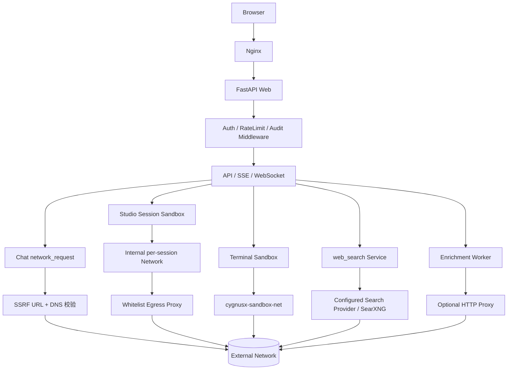
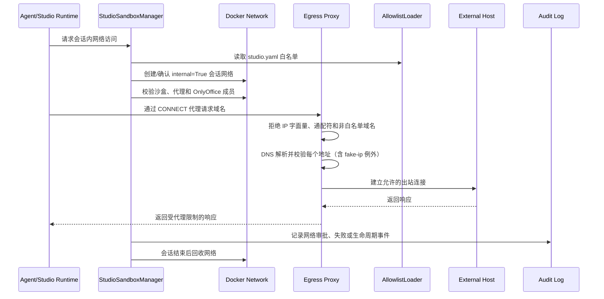

# OmicHub 平台网络配置架构

> 更新日期：2026-09-21。梳理平台所有出站/入站网络路径、白名单与 SSRF 校验标准，
> 并记录 fake-ip（198.18.0.0/15）误判问题的根因与修复。

## 0. 这个网络模块如何发挥作用

网络模块把入站请求、模型/工具出站和沙盒网络隔离拆成独立路径。浏览器流量先到 Nginx，由它完成静态资源、HTTP API、SSE、WebSocket、上传和 Range 请求的反向代理，再转发到 Web 服务；FastAPI 中间件继续负责认证、限流和审计。服务间通信依赖 Docker 网络和服务名，跨栈网络通过预先创建的 external network 连接，避免把所有容器放进同一个无边界网络。

出站请求按调用者选择不同的安全边界。Chat 的 `network_request` 在执行前进行 URL、IP 和 DNS 解析校验，只允许 GET/HEAD 并限制响应大小；Studio 沙盒加入每会话 `internal=True` 网络，只能通过 egress proxy 访问配置白名单；终端沙盒使用专用 Docker 网络，web_search 只调用已配置的搜索源，enrichment 工具则通过可选 HTTP 代理访问外部服务。白名单校验统一识别本机、内网、云 metadata 和 DNS rebinding 风险，并显式兼容宿主机代理产生的 fake-ip 段。

因此，网络策略既不是单一防火墙规则，也不是由模型决定的权限。路由、工具执行器、Studio 管理器和代理进程各自执行一层约束，容器网络再提供隔离；配置文件只提供允许的目标和代理参数，审计记录保留需要人工追踪的审批与出站结果。

### 0.1 运行架构图：入站与五条出站路径



### 0.2 实现图：Studio 出站请求如何被放行



## 1. 总览：五条独立网络路径

```
                       ┌──────────────────────────────────────────┐
                       │              宿主机                       │
                       │   翻墙客户端（Clash/Surge，fake-ip DNS）   │
                       │   域名 → 198.18.0.0/15，TUN 拦截代理出站   │
                       └───────────────┬──────────────────────────┘
                                       │ 容器经 Docker DNS(127.0.0.11)
                                       │ → 宿主机 127.0.0.53 继承解析
┌──────────────┬──────────────┬────────┴───────┬─────────────────────┐
│ chat 工具出站 │ Studio 沙盒  │ 终端沙盒        │ web_search 后端     │
│ network_     │ 每会话内网 +  │ cygnusx-       │ SearchProvider      │
│ request 工具  │ CONNECT 代理  │ sandbox-net    │ (Tavily/SearXNG…)   │
└──────────────┴──────────────┴────────────────┴─────────────────────┘
```

| 路径 | 网络命名空间 | 出站控制 | 代码入口 |
|---|---|---|---|
| chat `network_request` 工具 | web 容器（主栈） | SSRF 预检（域名+DNS 结果） | `network_request_tool.py` |
| Studio 沙盒 | 每会话 internal 网络 | 域名白名单 CONNECT 代理 | `infrastructure/studio/manager.py` |
| 终端沙盒 | `cygnusx-sandbox-net` | Docker 网络隔离（bridge 可出站） | `tools/terminal/config.py` |
| web_search 工具 | web 容器 | 无 SSRF 校验，仅允许配置的 API 源 | `search_provider_service.py` |
| enrichment 工具 | worker/工具容器 | 可选 HTTP 代理 `ENRICHMENT_PROXY_URL` | `tools/enrichments/runner.py` |

## 2. Docker 网络拓扑（deploy/docker/docker-compose.yml）

| 网络 | 类型/创建方式 | 成员 | 用途 |
|---|---|---|---|
| `cygnusx_net` | external，需手动 `docker network create` | web、db、cache、minio、worker 栈、agentteams 栈 | 跨栈服务名互通 |
| `cygnusx-sandbox-net` | external，Makefile `docker-network` 创建 | nginx（ws 代理）、终端沙盒容器 | WebSocket 代理经容器 DNS 直连 ttyd:7681 |
| `cygnusx_app_net` | external | web、SearXNG 栈 | SearXNG 经服务名访问 |
| `data_net` / `app_net` | 内置 bridge | web、db 等 | 主栈内部 |
| `studio_proxy_egress` | 内置 bridge | egress-proxy、onlyoffice | 代理与 OnlyOffice 的宿主网络；不连平台网络 |
| `cygnusx-studio-egress-<hash>` | 每会话动态创建，`internal=True` | 会话沙盒容器 + egress-proxy（alias `studio-egress-proxy`）+ 可选 onlyoffice | 沙盒仅能经代理出站 |

## 3. Studio 沙盒出站（域名白名单代理）

- 配置：`data/ai/studio.yaml` → `studio.sandbox.network`（`mode: whitelist`、
  `proxy_host: studio-egress-proxy`、`proxy_port: 3128`、`allow: [...]`）。
- 代理进程：`deploy/studio/egress_proxy.py`（独立镜像，read_only、cap_drop ALL、
  非 root、pids/mem 限制）。
- 白名单：`conda.anaconda.org, pypi.org, files.pythonhosted.org, mirrors.aliyun.com,
  mirrors.ustc.edu.cn, mirrors.nju.edu.cn, pypi.mirrors.ustc.edu.cn`。
  `mirrors.nju.edu.cn` 必配：ustc anaconda 对部分频道 302 到 nju。
- 代理校验标准（`egress_proxy.py`）：
  - 白名单只收域名，拒 IP 字面量、通配符；
  - `public_ip()`：放行 `is_global`，**例外放行 198.18.0.0/15（fake-ip 段）**；
  - DNS 解析结果固定为已校验公网 IP，防 DNS rebinding。

### 每会话网络生命周期（`infrastructure/studio/manager.py`）

1. 会话名 = `cygnusx-studio-egress-` + sha256(session_id)[:12]，不暴露会话 ID。
2. `_ensure_whitelist_network` 创建 `internal=True` 网络，校验：
   网络必须 internal；代理容器必须 running；接入容器白名单
   （代理/onlyoffice/会话沙盒）之外不得有未授权容器；代理 alias 就位。
3. 会话结束回收网络。

## 4. chat `network_request` 工具（本次修复点）

- 链路：模型调用 → 审批卡（`studio_approval_service.py`，Redis TTL 300s，
  决议落 audit_logs）→ `execute_network_request`。
- 约束：仅 GET/HEAD；不带用户凭据/自定义头；响应 ≤5MB、文本 ≤30000 字符；
  重定向 ≤3 次且每跳重新过 SSRF 校验；非文本响应只回元数据。
- SSRF 校验分两层：
  1. `_public_url`：URL 格式 + IP 字面量黑名单（本机/内网/云 metadata）；
  2. `_validate_public_host` → `_resolve_public_hostname`：真请求前 DNS 解析，
     解析结果任一 IP 命中黑名单即拒绝。
- **修复（2026-09-21）**：两层校验原先只看 `is_private` 等属性，而本机翻墙
  fake-ip DNS 把所有域名解析到 198.18.0.0/15（Python 3.11 判定 `is_private=True`），
  导致所有外部域名请求被误拒（报"域名解析到内网、环回、链路本地或保留地址"）。
  现抽取 `_is_ssrf_address()`：先放行 `_FAKE_IP_RANGE`（198.18.0.0/15）再做黑名单
  判断，与 `egress_proxy.py` 的 `public_ip()` 同一标准。

## 5. 其他出站路径

- **web_search**：`SearchProviderService.search_default` → 按配置的默认 API 源
  （tavily/bocha/zhipu/exa/searxng）出站；google/bing/baidu 本地 scrape 源显式禁用。
  SearXNG 自建源经 `cygnusx_app_net` 走服务名，不出公网。
- **MCP SSE URL 校验**（`infrastructure/mcp/client.py` `validate_sse_url`）：
  禁内网/环回/链路本地/组播/metadata；此校验只看 IP 字面量，不做 DNS 解析，
  且未含 fake-ip 例外——但 MCP SSE URL 由用户/管理员显式配置，不经过宿主机
  DNS 的 fake-ip 污染场景相同（若配置了外部 SSE 域名同样会被字段判断影响，
  注意：`is_private` 对 198.18.x.x 为 True，后续如遇同类报错需同步加例外）。
- **chat runtime_support `_is_internal_url`**：附件 URL 校验，域名直接放行，
  不做 DNS 解析。
- **enrichment runner**：`ENRICHMENT_PROXY_URL`（.env，默认空）注入 http_proxy/
  https_proxy 给工具容器。

## 6. 运维要点（坑位）

- **fake-ip 判定**：宿主机跑 Clash/Surge 时，容器内任何域名解析到 198.18.0.0/15；
  Python `ipaddress` 判定该段 `is_private=True`（3.11）但 `is_reserved=False`。
  凡新增"解析结果是否公网"类校验，必须复用 `_is_ssrf_address`/
  `egress_proxy.public_ip` 的放行逻辑，不要裸写 `is_private`。
- network_request 工具代码改后需 `docker restart cygnusx-web` 生效（无热重载）。
- egress-proxy 白名单配置挂载自 `data/ai/studio.yaml`（ro），改后仅需重启代理容器；
  AllowlistLoader 按 mtime 热读，但连接级白名单在代理进程内。
