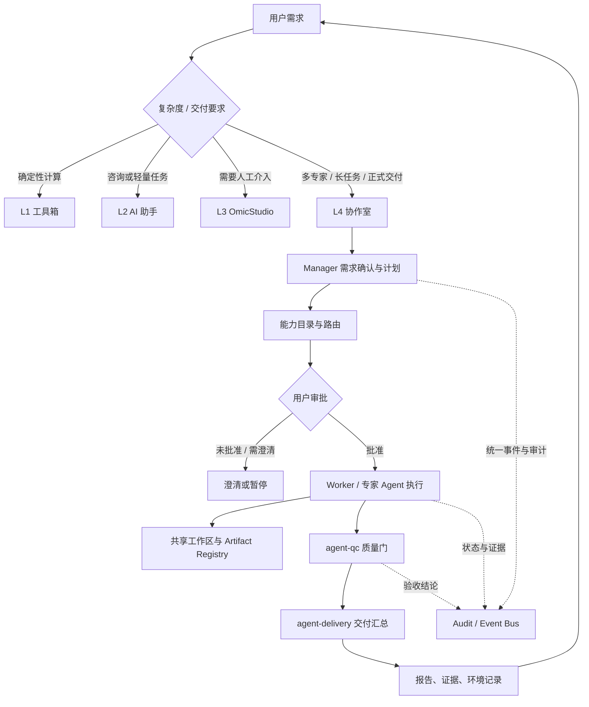
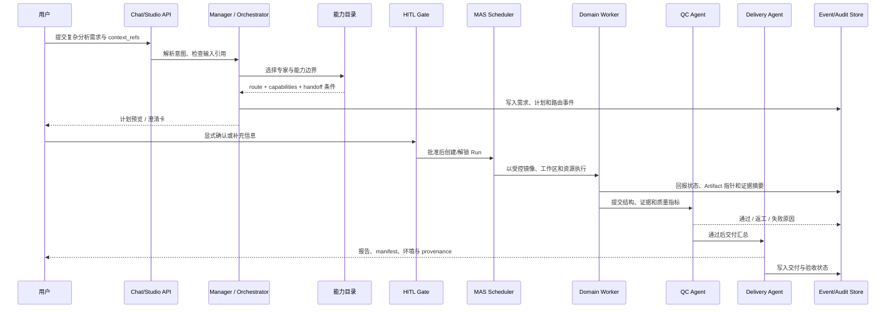

# L4 愿景定义（优化版，2026-08-19）

> **时点说明**：本文件为目标态愿景稿，描述的是设计目标而非当前实现，部分引用（路径、行号）可能已失效；请勿按本文档再次执行，当前实现以代码为准。

> 基于全程排查与四层框架讨论，对原愿景段落的重写。原版只描述了"谁和谁协作 +
> 实现链路"；优化版补上了原版缺失的五件事：在四层中的定位与升级规则、经理的
> 完整职责、甲方回路、质量与交付职能、失败显式化与证据链。此版取代 Part 3.1
> 的愿景表述（3.1 的可行性判断仍有效）。

## 0. 这个 L4 协作室模块如何发挥作用

L4 协作室是平台在复杂、长时和需要正式交付的任务上的目标态编排层。当前代码已经提供 Chat/Studio 入口、Agent 配置与能力声明、MCP/Skill 工具、共享工作区、MAS 计划预览、用户确认、Celery/Worker 执行、Artifact 登记和 SSE 进度投影；愿景文档在这些能力之上定义更完整的“部门”工作方式，而不是把所有请求都强制升级到多 Agent。普通咨询继续由 L2 Agent 处理，确定性工具走 L1，只有多步骤、跨领域或需要审计交付的请求才进入 L4。

进入协作室后，Manager 负责把用户需求整理成可确认的计划，依据单一能力目录选择专家，并把输入引用、审批、状态、产物和失败原因写入统一事件链。专家或 Worker 只在各自能力边界内执行，数据、QC 和交付角色分别承担输入契约检查、质量门和报告汇总；大文件与完整日志留在工作区或对象存储，事件和模型上下文只携带小型元数据与可追溯指针。缺少输入、路由不可用、执行失败或质量门不通过时，流程必须停在明确状态并回问用户，不能用模型臆测或静默成功替代。

本文描述的是目标态设计，因此其中的 L4 升级规则、统一能力目录和完整甲方验收回路需要与当前已落地的 MAS/AgentTeams 路径逐步对齐。实现时应沿用现有的用户确认闸、Agent capability 白名单、沙箱隔离、Celery reconcile-only、Artifact/事件审计和前端 REST/SSE 投影；任何目标态能力在未完成验证前，都不能被当作当前平台已有保证。

### 0.1 目标运行架构图：L1-L4 分层与协作室



### 0.2 实现图：一次 L4 任务的控制与执行时序



## 8.1 优化后的愿景定义

**定位**：协作室是 CygnusX 四层架构的 L4（顶层）——平台的"生物信息部门"。
它不承接所有请求：L1 工具箱承载确定性计算（零 token），L2 助手处理咨询与
轻量任务，L3 工作台支撑人工介入；只有当任务被判定为"需要多专家协作或需要
正式可审计交付"时，才升级到 L4。**升级规则本身即成本闸门**——L4 是 token
消耗最高的层，必须刻意进入，不能默认进入。

**角色**：
- **Manager（部门经理）**：五项职责——接单（需求理解 + 按 SOP 拆解）、派单
  （按能力目录选专家，展示路由 = 实际派发，可审计）、验收（完成门：产物结构 +
  证据 + 质量指标，无 proposed_submission 不得交付）、交付（汇总为甲方报告）、
  例外处理（任何环节失败显式化并回问甲方，禁止静默兜底）。
- **专家层**：按能力目录的四段契约工作——capabilities（会什么）、
  not_suitable_for（不做什么）、handoff_when（何时转交）、preferred_inputs
  （要什么输入）。chat_entry=false 的内部角色构成部门职能：agent-data 管数据
  契约预检、agent-qc 管质量审计、agent-delivery 管交付汇总。
- **甲方（用户）**：完整回路——需求确认书 → 澄清卡 → 显式审批 → 进度时间线
  → 交付验收 → 返工入口；甲方的每次答复显式标记来源，系统不得替甲方作答。

**链路（目标态）**：

```text
用户消息（落库并即时可见，写入逐跳事件）
  → Manager 判定 chat / clarify / execute
  → 路由：单一权威能力目录，display == actual；无匹配 → route_unavailable 回问甲方
  → context_refs 可读性预检：不可读 → 阻断回问，禁止目标漂移
  → plan-01：Bridge 确认创建成功才算启动；失败写 planning_failed，Case 不停 received
  → Worker 执行：租约覆盖 claim→execute 全程；任何异常写失败原因事件
  → 完成门：产物结构 + 证据 + 质量指标三件套，缺一不得显示完成
  → agent-qc 质量审计 → agent-delivery 汇总交付
     （产物 + run manifest + 环境记录；每条结论标注 provenance：
       本平台计算 / 文献证据 / 综合推断）
  → 甲方验收或返工
全程事件进统一审计总线：任意故障 5 分钟内定位到层。
```

**共享地基（与 L1-L3 共用）**：统一存储 + 统一寻址契约；分层记忆（条目带来源
标签，用户可见可改）；能力目录单一权威源（路由 Flow 从中派生，消灭双注册表）；
统一审计总线。

**设计原则**：结构化产物 > 闲聊；可审计 > 自动化；不确定就回问甲方；
失败必须显式；"计算上相关 ≠ 实验验证"（provenance 三层强制标注）。

## 8.2 "能否作为平台 L4"的判定

**结论：能，且它是 L4 的正解**——四层中只有它具备"多专家协作 + 正式可审计
交付"能力，且关键资产已就位（能力目录含负向边界、QC/交付内部角色、审批与
澄清雏形）。但它从"架构上的 L4"变成"事实上的 L4"有四个必要条件：

| # | 条件 | 状态 |
|---|---|---|
| 1 | 地基修完：失败显式化、状态可信、文件契约贯通 | 进行中（地基优化手册阶段 0-3） |
| 2 | 升级规则定义：L2→L4 的触发条件（建议：需要 ≥3 个专业步骤 / 需要正式交付 /
   用户显式要求） | 未定义，列入 Phase 3 |
| 3 | 双注册表/双路由统一：能力目录为唯一权威源（房间关键词路由与 chat_service
   的 LLM 路由两条体系需收敛） | 待双注册表核查结论 |
| 4 | 可观测性：审计总线 + 部署版本可考 | 手册阶段 1/3 部分覆盖 |

四个条件满足前，它是"L4 候选/演示态"；满足后，它才是产品定义里的 L4。
风险提示：L4 一旦成为默认入口而非升级目标，token 成本会失控——升级规则
（条件 2）是四个条件里最容易被忽视、但决定商业可持续性的一个。
