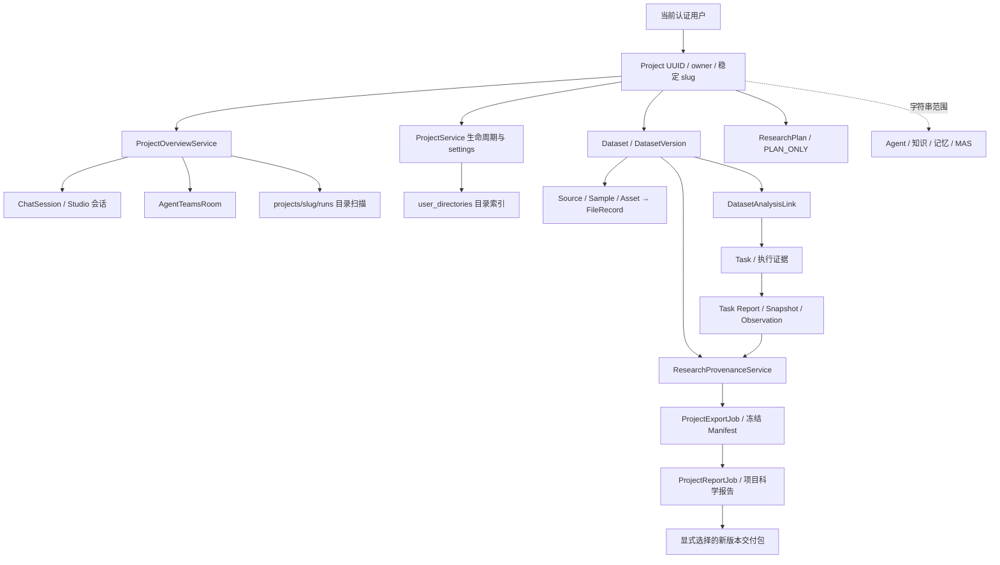
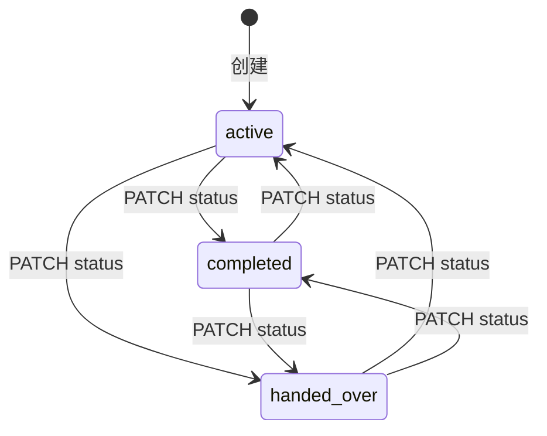

# CygnusX 项目管理全面梳理

> **类型**：代码现状审计快照；建议部分为待实施事项。
> **核对日期**：2026-10-24；工作树代码基线 `c5e962db`。
> **范围**：平台内的“项目管理”业务，包括项目、会话、运行目录、数据、任务、报告、导出、权限和生命周期。
> **证据等级**：源码/迁移静态核对 + 本地隔离测试。未检查生产数据库、线上开关和部署版本，不能据此认定生产已开放科研执行或导出。
> **活动架构入口**：[项目空间与文件管理](CygnusX_project_workspace_architecture.md)、[存储](CygnusX_storage_architecture.md)、[科研交付](CygnusX_research_delivery_architecture.md)、[受控研究计划](CygnusX_research_plan_architecture.md)。本文集中记录跨域关系和本次发现，不取代各域契约。

## 1. 当前定位与主要判断

目前项目管理的核心是**单所有者科研工作空间**：用项目组织会话和运行目录，并逐步接入版本化数据、科研计划、证据、项目报告和交付包。

基础项目接口已具备创建、读取、改名、改描述、改状态、局部合并设置、删除和显式磁盘同步。前端主要呈现创建、查找、项目总览和会话管理，生命周期操作尚未完整呈现。科研计划、交付读取、项目 ZIP 和项目科学报告均有代码，但受到独立开关和运行准入约束。

最需要先解决的是**项目身份的一致性**：数据库项目 UUID、稳定目录 slug、可变显示名、会话标题/任务名称并没有在所有入口中统一使用。此次隔离复现确认三处问题：改名后的 Case 运行写到另一个目录；默认项目绕过 tombstone 重建同一 slug；有关联 Dataset 时删除抛出数据库约束异常。具体证据和建议见 §8。

项目没有项目成员表、项目级角色、负责人分派、里程碑或排期模型。现有 `customer` 是文本字段，`handed_over` 是状态标签；团队文件 ACL、协作室成员权限分别属于其他体系。不能把它们解释为已具备项目共享或所有权移交。

## 2. 用户能力盘点

“已接代码”表示当前仓库实现；“默认关闭”来自 Settings 默认值，不代表已读取线上实际配置。

| 能力 | 后端现状 | 项目页面现状 | 判断 |
| --- | --- | --- | --- |
| 创建项目 | name/description/customer，校验后创建 DB 与目录 | 创建弹窗已接 | 基础闭环存在 |
| 项目列表/搜索 | 按当前用户一次返回全部项目 | 本地搜索名称/slug/客户/描述，本地分页 20 条 | 数据量增加后需服务端分页 |
| 项目详情 | owner 范围读取，返回状态和 settings | 展示元数据、会话、磁盘 runs | 聚合工作台已存在 |
| 改项目名/描述 | PATCH 已接；保留 slug | 无对应编辑入口 | 后端能力尚未产品化；改名跨域有断点 |
| 改客户信息 | 创建时支持，PATCH 不支持 customer | 只读展示 | 后续维护不闭环 |
| 完成/移交/恢复 active | PATCH 三种状态；完成/移交异步触发 Studio 打包 | 无状态操作和项目状态展示 | 不代表项目冻结、任务验收或所有权转移 |
| 删除项目 | 删除项目行、写 tombstone、保留文件；存在科研引用时有边界问题 | 无删除入口；projectsApi 也未封装 DELETE | 不等于数据清理，无项目回收站 |
| 历史磁盘同步 | JWT 显式 POST；跳过已删 slug/符号链接/隐藏目录 | API 封装存在，无按钮 | 普通列表读取不再隐式导入 |
| 项目设置 | JSON Merge Patch + 行锁；支持整体 null 清空 | 可设置“新会话默认科研模式” | 只在新会话初始化继承，已有会话不随之批量修改 |
| Chat/Studio 会话归集 | 按字符串 project_id 关联 | 活跃/归档/回收站，打开/改名/归档/软删/恢复 | 会话生命周期独立于项目生命周期 |
| 协作室归集 | owner + project_id 查询房间，映射状态 | 合并在会话表，只提供打开 | 房间成员不因此获得项目权限 |
| 历史运行浏览 | 扫描 runs 一级非隐藏目录，递归统计文件 | 标记文件存在性、文件数、大小 | 目录清单，无统一运行状态/任务列表 |
| 项目文件 | 目录索引/FileRecord/用户配额；文件有独立 ACL | 项目运行表无直达文件操作 | 文件管理在独立页面 |
| Dataset | 项目 FK、版本、来源、样本、资产、AnalysisLink | 通过科研链等相邻入口接入 | 不等于所有历史文件已自动建 Dataset |
| 科研计划 | 版本、审阅和有界 read/prepare 协调 | ResearchPlanWorkbench，能力面板控制挂载 | research_plan_enabled 默认 false；真实执行未准入 |
| 科研交付读取 | 显式 Dataset→Task→Report 证据链 | ResearchDeliveryChain | research_delivery_read_enabled 默认 false |
| 项目 ZIP 导出 | inventory/prepare/create/status/retry/download，独立 Job | ProjectResearchDelivery | project_export_enabled 默认 false；不可视为整目录备份 |
| 项目科学报告 | 独立 ProjectReportJob、HTML/PDF、冻结来源 | 成果卡片内 ProjectScientificSummary | 报告写入/PDF 开关默认 false |
| 项目专属 Agent/知识/记忆 | 部分模型和调用链已有 project_id 范围 | 项目详情无统一管理页 | 隔离规则分域实现，不能笼统称为项目 RBAC |
| 项目共享/成员/转让/排期 | 项目核心模型与接口未提供 | 无入口 | 当前单所有者边界；扩展需单独产品决策 |

页面依据：[ProjectsView](../frontend/src/views/ProjectsView.vue)、[ProjectDetailView](../frontend/src/views/ProjectDetailView.vue)、[projectsApi](../frontend/src/api/projects.ts)、[创建弹窗](../frontend/src/components/project/CreateProjectModal.vue)。

## 3. 架构与数据关系

### 3.1 一张项目关系图



图中两种运行视图需要分别理解：总览中的 `runs` 来自物理目录；科研交付中的 Task 归属来自 DatasetVersion/AnalysisLink 明确关系。目录相同、任务同名、时间相近都不能替代科研证据关联。MASRun、通用运行记录和目录 run 也不是同一个实体。

### 3.2 核心数据与引用强度

| 实体/表 | 与项目的关系 | 删除或归集含义 |
| --- | --- | --- |
| projects | UUID 主键；user_id；name/slug/description/customer/status/settings | `(user_id, slug)` 唯一；同用户显示名经改名后不保证唯一 |
| project_tombstones | 被删项目 UUID + user_id + slug | 保留删除身份；不依赖已删除项目行；有数据时迁移拒绝降级 |
| user_directories | 以 `projects/{slug}` 路径投影项目 | 无项目 FK；根节点和子节点需明确各自生命周期 |
| file_records / samples | 文件所有权、directory、task_id；样本关联 | 核心文件/样本模型没有直接 project_id；Dataset 提供版本化关联 |
| chat_sessions / agentteams_rooms | nullable String project_id，无项目 FK | 服务层校验 owner；删项目不会自动解除这些字符串引用 |
| agent_templates / mas_runs / mas_artifacts | nullable String project_id | 是分域作用域，非项目成员授权关系；总览未直接聚合 MAS 表 |
| knowledge_bases / kb_documents / 记忆相关表 | 可选字符串项目分区 | 由知识/记忆查询各自过滤，项目删除服务未统一治理 |
| tasks / reports | 核心模型无直接 project_id | 不能靠项目名或路径硬 join；项目科学报告有独立 Job 身份 |
| datasets / dataset_ingestions | UUID 项目 FK，ON DELETE RESTRICT | 存在关联行会阻止物理删除项目 |
| research_plans / result_observations | UUID 项目 FK，ON DELETE RESTRICT | 研究意图与证据保留，不应静默级联清理 |
| download_execution 的项目关联记录 | UUID 项目 FK，ON DELETE RESTRICT | 同样属于删除预检查范围 |
| project_export_jobs / requests | UUID 项目 FK，ON DELETE RESTRICT | 冻结 manifest；同内容可以共享 Job，request 别名保留 |
| project_report_jobs / requests | UUID 项目 FK，ON DELETE RESTRICT | 独立项目报告及请求别名；来源绑定 M0 导出 Job |

模型依据：[project](../src/cygnusx/infrastructure/database/models/project.py)、[chat](../src/cygnusx/infrastructure/database/models/chat.py)、[dataset](../src/cygnusx/infrastructure/database/models/dataset.py)、[research_plan](../src/cygnusx/infrastructure/database/models/research_plan.py)、[download_execution](../src/cygnusx/infrastructure/database/models/download_execution.py)、[project_export](../src/cygnusx/infrastructure/database/models/project_export.py)、[project_report](../src/cygnusx/infrastructure/database/models/project_report.py)。

### 3.3 四种“项目标识”的实际区别

| 标识 | 当前职责 | 修改规则 |
| --- | --- | --- |
| project.id | 授权、会话和科研对象的逻辑归属 | 不随显示名变化 |
| project.slug | 物理目录和目录树身份 | 创建后稳定；删除后保留身份 |
| project.name | 用户可读名称 | PATCH 可修改；不移动历史目录 |
| session.title / TaskSubmitRequest.name / project_name | 不同入口的标题或目录命名输入 | 部分入口仍直接用于生成 slug，形成跨域断点 |

路径工厂 `create_project_run_dir(user_id, project_name, analysis_name)` 会重新计算 `project_slug(project_name)`；它不会查询项目 UUID 或稳定 slug。工厂提供标准 input/output/work/logs 子目录，调用方登记 `ensure_directory_chain()`。

| 生产入口 | 当前目录来源 | 项目视角的后果 |
| --- | --- | --- |
| 通用 Flow | TaskSubmitRequest.name | 只创建运行目录不等于创建 Project 行；可能需显式历史同步 |
| AgentTeams Case | 调用参数 project_name 或 Project.name | 改名后可能与 Project.slug 脱节；本轮已复现 |
| Studio 报告交付 | session.title | 会话项目与报告输出目录不保证一致 |
| Overdrive 归档 | 查到 Project 后仍把 Project.name 交给工厂 | 改名后可能与按稳定 slug 校验的归档边界冲突；本轮为源码判断，未端到端执行 |

源码入口：[path_factory](../src/cygnusx/infrastructure/storage/path_factory.py)、[TaskService._make_work_dir](../src/cygnusx/application/services/task_service.py)、[AgentTeamsService._prepare_case_run](../src/cygnusx/application/services/agentteams_service.py)、[register_artifact_report](../src/cygnusx/application/services/studio_context_service.py)、[archive_overdrive_delivery](../src/cygnusx/application/services/project_archive_service.py)。

## 4. 生命周期如何运行

### 4.1 创建与默认项目

普通创建路径：校验字段 → 由 name 生成 slug → 锁定用户行 → 检查 tombstone/存量 slug → 添加 Project 和目录索引 → 建物理 projects/slug/runs → 提交并返回。数据库与文件系统不属于同一事务，提交失败可能保留已创建目录，需要运维对账。

会话未指定项目时，`ChatSessionManagement._resolve_default_project_id()` 按“默认项目”名称/slug 复用或直接添加 ProjectModel，仅 flush 交给外层事务。它没有复用上述统一创建路径：不查 tombstone、不锁 owner，也不负责目录登记与物理目录创建。这是此次确认的生命周期绕行入口。

`get_or_create_project_by_name()` 另用于聊天式 Case 建单，按 slug 复用项目；相同需求可在同一项目下创建多个 Case run。它与会话默认项目解析是两套实现。

### 4.2 状态与完成动作



当前只校验三个枚举值，未限制上述状态间的业务流转。切换到 completed/handed_over 后，状态先提交，再 `asyncio.create_task()` 扫描未删除的 Studio 会话，调用 pack_session；忙碌或异常逐个跳过并记日志。

因此，接口返回完成不表示会话全部打包成功；再次提交相同状态也不会自动补跑。项目状态不自动归档 Chat 会话，不表示计算 Task 已成功，不更换 user_id，也没有统一冻结所有写入口。项目交付读取明确允许 active/completed/handed_over。

### 4.3 三种“归档”与一次“删除”

| 动作 | 实际对象 | 保留内容与用户理解 |
| --- | --- | --- |
| 会话归档/软删除 | ChatSession.status | 活跃/归档/回收站之间切换，项目页可管理 |
| 工作区休眠打包 | workspace_archives + sandbox_meta | 保存/恢复沙箱工作空间，独立配额/保留期；不是项目交付 ZIP |
| 运行交付归档 | 项目 run 目录及项目 AGENTS.md | 确定性写 README/environment/manifest 和分析条目；不调用 LLM |
| 删除项目 | Project + tombstone + 根目录索引 | 物理文件保留；无项目恢复接口；slug 继续保留；其他引用不统一清理 |

`AGENTS.md` 通常位于项目根，运行归档写 README/environment/manifest；run 表的 `has_agents_md` 检查 run 内文件，不能把缺少 run/AGENTS.md 直接解释为归档失败。环境信息的存在也不等于已经完成科学复现。

### 4.4 显式磁盘同步

GET list/count 只查数据库。POST sync-from-disk 扫描当前用户 projects 一级目录，为真正缺失的 slug 建项目与目录记录，忽略隐藏目录、符号链接、超长目录和 tombstone。导入显示名暂等于目录名，不恢复已删除项目，不补齐科研证据关系。

## 5. 页面、API 与服务边界

### 5.1 基础项目 API

完整路径前缀为 `/api/v1`。除 sync-from-disk 使用 CurrentJwtUserId 外，基础项目路由使用 CurrentUserId（支持 JWT 或 API Key）；实际 API Key 写权限仍受认证中间件策略限制。

| 方法 | 路径 | 服务与关键约束 |
| --- | --- | --- |
| GET | /projects；/projects/count | owner 数据；不扫描磁盘、不分页查询 |
| POST | /projects | ProjectService.create_project；201；重名/保留 slug 冲突 |
| GET | /projects/{id} | owner 查询；他人/不存在返回不可用 |
| PATCH | /projects/{id} | name/description/status/settings；行锁；字段全部验证后一次提交 |
| DELETE | /projects/{id} | 保留物理文件；204 或保留冲突/当前未处理的约束异常 |
| POST | /projects/sync-from-disk | JWT；显式导入本人历史目录 |
| GET | /projects/{id}/overview | ProjectOverviewService；会话状态过滤、内存分页、磁盘扫描 |
| GET | /projects/{id}/capability-status | 三组 enabled/allowed/reason；不改变开关 |

PATCH 的 settings 使用 JSON Merge Patch：省略键不变、嵌套递归合并、数组替换、键值 null 删除键、settings 整体 null 清空。research_mode.enabled 校验 bool，其他设置并非完整强类型领域模型。

### 5.2 总览聚合和前端读取

总览先按 owner 读取 Project，再分别查当前用户 ChatSession 和 owner 为当前用户的 AgentTeamsRoom，合并排序后在内存分页。房间 active/deleted 直接映射，其余状态映射 archived，房间消息数固定投影为 0。

run 扫描放到 `asyncio.to_thread()`，枚举所有非隐藏一级目录，对每个目录递归 stat 文件。返回文件存在标志、数量、总大小和时间，不返回执行成功状态、Task ID 或科学校验结果。目录名时间戳按 UTC 解析，失败回退 mtime；最终排序仍按完整目录名倒序。

前端每次请求 `session_limit=100`，未实现 session_offset 的服务端翻页；表格的每页 10 条只是这 100 条中的本地分页。切换会话分组也调用完整 overview，重复触发 run 扫描。前端已有 generation guard，避免前一个项目/状态的迟到响应覆盖当前页面。

### 5.3 科研扩展 API

| 入口族 | 职责 | 当前限制 |
| --- | --- | --- |
| /projects/{id}/datasets/... | Dataset、版本、资产、样本、handoff、导入/分析预案 | Dataset 独立门禁与受控写链，不能由项目列表操作推断已开放 |
| /projects/{id}/research-plans/... | 准备、版本、审阅和协调 | PLAN_ONLY；审阅不等于批准下载/分析工具 |
| /projects/{id}/research-delivery | 项目科研链投影 | 按显式关联读取，有截断标志 |
| /projects/{id}/delivery-inventory | 可交付成果只读清单 | 依赖科研读取权限 |
| /projects/{id}/exports/prepare、/exports、/exports/{job}、/exports/{job}/retry、/exports/{job}/download | 冻结选择与独立 ZIP Job | 导出独立 flag；创建/重试/下载真实用户 JWT |
| /projects/{id}/exports/{job}/summary-preview | 既有导出范围的只读报告原型 | 与正式项目报告区分 |
| /projects/{id}/scientific-summary/... | 正式独立项目报告准备/创建/状态/预览/下载 | 写入/PDF 独立 flag；沿用科研读取、导出和当前权限检查 |

实现见 [research_delivery.py](../src/cygnusx/api/v1/research_delivery.py)、[research_plans.py](../src/cygnusx/api/v1/research_plans.py)、[datasets.py](../src/cygnusx/api/v1/datasets.py)。

## 6. 权限、数据和 AI 上下文

| 边界 | 当前实现 | 应如何理解 |
| --- | --- | --- |
| 项目 owner | ProjectService 与 Overview 按 user_id 查询；Dataset 服务核对 owner | 管理员并未通过这些普通项目接口自动获得别人的项目 |
| 项目独立模块权限 | MODULE_LOCKED 没有 projects 条目；路由 requiresAuth | 项目入口是登录后的共享基础入口，不具备独立按用户锁定项 |
| 项目内容与模块授权 | 科研端点服务层核对 files/reports，计划/导出再核对 tasks | capability-status 是 UI 投影，服务端仍需独立授权 |
| 会话/房间摘要 | overview 本身没有逐内容模块过滤 | 禁用 AI/Studio 等模块后的摘要可见策略需要明确，不据此直接认定越权 |
| 团队文件 | personal/team + owner/writer/reader ACL | 不会同步创建项目成员；团队 writer 删除他人文件仍受限制 |
| 项目专属 Agent | resolve_agent_project_scope 拒绝改绑其他项目；新会话可继承项目范围 | 是执行边界，不是 owner 身份校验的替代品 |
| 知识检索 | 平台级 + 当前项目知识范围过滤 | 不是用户级私有知识 ACL；知识页面/静态资源访问另有规则 |
| 长期记忆 | user/agent/project 分区；个人偏好可共享 | current_focus 项目隔离有独立开关，默认关闭时仍用通用焦点 |
| 删除后引用 | 多个域使用无 FK 的 String project_id | 项目核心删除不自动清空或迁移上下文，需要明确保留/只读/解绑策略 |

参照：[模块注册表](../data/MODULE_LOCKED.yaml)、[project_scope](../src/cygnusx/application/services/project_scope.py)、[DatasetRepository](../src/cygnusx/infrastructure/database/repositories/dataset_repository.py)、[身份权限架构](CygnusX_identity_access_architecture.md)、[记忆架构](CygnusX_memory_architecture.md)、[知识架构](CygnusX_knowledge_architecture.md)。

## 7. 科研成果与交付的成熟度

当前成果链已有可靠设计：Task 项目归属采用明确关联；Manifest 冻结来源、版本、字节大小/SHA 和缺口；独立导出 Job/请求别名支持幂等；Worker/advisory lock/outbox/reconcile 管理恢复；下载重新核对当前身份、项目和来源关系。不能为补全页面而按目录或任务名称猜测历史关联。

M0 表示已冻结的项目交付包来源；项目科学报告以 M0 和明确的 Claim selection 为输入；M1 另建交付 Job，将选中的已发布项目报告加入新包。旧 ZIP、Manifest、Task Report 和历史快照不被重写，缺失 PDF 可维持 partial。项目摘要原型、正式项目报告、单 Task 报告各有身份和职责。

导出只收集已有且核验允许的文件，不启动分析/公共数据下载，不递归打包整个项目，不复制 FASTQ/BAM 等大型原始输入。首版有文件数和容量预算；缺失、未验证、排除项显式保留，`reproduction_status=NOT_RUN` 不因 SHA 校验成功而改变。

源码 Settings 中 `research_plan_enabled`、`research_delivery_read_enabled`、`project_export_enabled`、`project_report_write_enabled`、`project_report_pdf_enabled` 均默认 false。源码/活动文档还记录真实执行准入与 corpus 等阻断条件；本轮未操作这些开关，未补做真实 PG/Worker/S3/非空科研成果端到端验收。以[科研交付架构](CygnusX_research_delivery_architecture.md)、[运行验收](CygnusX_Research_Feature_Runtime_Acceptance.md)和当前部署证据共同判断上线状态。

## 8. 已确认问题、影响与优先级

P1 表示先修数据归属和生命周期一致性；P2 表示后续补齐可靠性与操作闭环；P3 表示展示语义优化。该分级是本次工程建议，不是安全漏洞等级。以下问题本轮仅梳理，尚未修改业务代码。

### F01 / P1：改名后目录归属可能分叉

**证据**：ProjectService.update_project 保留 slug；AgentTeamsService._prepare_case_run 用可变 name 创建目录。隔离探针将 slug=owned 的项目改为 renamed-project，Case ref 仍绑定原 UUID，location 却变成 `projects/renamed-project/runs/...`。overview 只扫描 `projects/owned/runs`，因此不会在原项目看到这次目录运行。

**相邻边界**：Studio 报告按会话标题选目录；Overdrive 按项目显示名创建 run、再按稳定 slug 校验归档。后两者本轮仅完成源码核对。

**建议与验收**：绑定已有项目的生产入口统一解析 UUID→owner→稳定 slug；保留 display name 供展示。改名前后 Case/Studio/Flow/归档的新 run 均留在原项目目录，历史路径不迁移，不新建第二个项目身份；未绑定项目的旧名称入口保持显式兼容。

### F02 / P1：默认项目创建绕过删除身份保护

**证据**：普通创建/同步查 tombstone；_resolve_default_project_id 直接添加 ProjectModel。隔离探针创建并删除“默认项目”后调用该方法，得到新 UUID、同一 slug，旧 tombstone 仍在。

**影响**：同一保留目录可重新承载新项目身份，破坏“已删 slug 不重用”的不变量。该默认路径也缺少统一创建的 owner 锁/目录投影；并发创建风险尚未做真实 PG 验证。

**建议与验收**：默认项目也通过统一身份保留入口；被删默认 slug 的后续收纳行为须明确，例如创建新的安全收纳身份。测试覆盖删除默认项目→新会话、并发新会话、目录投影和跨用户隔离，旧身份不复活。

### F03 / P1：科研保留引用没有完整转换为删除冲突

**证据**：delete_project 仅在 project_export_enabled=true 时显式查询 ProjectExportJob。Dataset、计划、观察、下载执行、项目报告等还有 RESTRICT FK；隔离探针启用 SQLite 外键后给项目关联 Dataset，删除实际抛出 IntegrityError，回滚后项目仍在、tombstone 未提交。基础项目路由及统一兜底会把此类未处理异常映射为通用 500，这是源码推导，未对真实 HTTP/PG 执行。

**影响**：数据库防止了证据丢失，但客户端拿不到完整的业务保留原因。关闭功能 flag 不会让已有证据和 FK 消失。

**建议与验收**：删除前检查完整保留引用，独立于功能开关返回稳定 409 与可解释原因；并发引用写入仍须保留数据库约束和回滚兜底。分别覆盖每类引用、开关关闭、并发新建证据、事务未部分提交；不可用级联删除解决。

### F04 / P2：项目完成后的打包动作缺少持久完成状态

**证据**：_pack_project_sessions 使用 Web 进程内 create_task，逐个异常记日志，状态已先提交；没有项目级持久 Job/outbox 或整体成功回执。相同 status 不再次触发。

**建议与验收**：打包进入现有可恢复异步任务机制，记录待处理/成功/忙碌跳过/失败，允许幂等重试。重启 Web、busy 会话及部分失败均能恢复；不得以 completed 标签替代归档完成状态。

### F05 / P2：项目操作入口与后端能力不一致

**证据**：项目页没有改名/描述、状态、删除、同步入口；customer 仅可创建不可 PATCH。详情文案提示“补充描述”“团队成员”，当前却没有对应编辑和项目成员机制。

**建议与验收**：先明确个人项目的可操作生命周期，再补元数据/状态入口和服务端契约；删除操作解释“保留文件、保留 slug、无恢复接口”及引用阻断。F01–F03 修好前不宜直接暴露会触发这些断点的操作。

### F06 / P2：项目会话超过 100 条后页面不完整

**证据**：ProjectDetailView.loadOverview/loadSessions 固定请求 100，未传 offset；NDataTable 对返回子集本地分页。后端 total 可以大于用户实际能翻到的条数。

**建议与验收**：使用服务端分页或游标，保留 Chat/Room 合并排序的稳定键。101+ 会话、状态切换及迟到响应下，均可完整浏览且不串项目。

### F07 / P2：run 排序与扫描成本缺少统一约束

**证据**：_scan_runs 按完整 name 倒序；例如旧 rna-* 会排在新 atac-* 前，尽管 timestamp 已解析。每次 overview 还递归扫描全部文件，无分页、缓存或扫描预算；磁盘删除/权限异常未在逐 run 层隔离，且无显式 run 符号链接拒绝。

**建议与验收**：按解析后的时间 + 稳定键排序；给运行清单引入有界索引/缓存及失效机制，扫描作为对账补充。明确符号链接/越界和扫描失败行为；大目录、并发删文件、不可读项不应拖垮整个项目总览。本轮未验证跨用户路径读取，不将此项直接认定为越权漏洞。

### F08 / P2：删除后的目录和字符串引用保留策略不统一

**证据**：delete_project 调用 DirectoryRepository.delete，仅精确删除根 path；子目录、FileRecord、ChatSession、Room、Agent、记忆等不在该方法中清理/解绑。文件物理保留是既定要求，但“从项目页消失”后这些对象如何继续访问没有统一项目生命周期投影。

**建议与验收**：列出保留矩阵，对每类关联明确继续可读、隐藏、解绑或阻止删除。可引入只读保留项目/删除预览，但需先定契约；不要移动保留文件或顺手清空上下文。测试从会话、文件、报告、Agent 等侧进入的行为。

### F09 / P2：基础项目聚合与内容模块权限的展示策略待统一

**证据**：projects 不在模块注册表；overview 返回 owner 范围会话摘要，未逐模式检查 AI/Studio 等禁用项；科研扩展另查模块权限。页面三个能力状态是 plan/read/export，未完整表达项目报告写入/PDF 等额外开关。

**建议与验收**：明确禁用内容模块后摘要是否仍可见、是否允许跳转；把额外操作的能力投影与真实服务端准入对齐。按普通用户/管理员、模块禁用/撤销、服务关闭分别验收。保留单所有者设计，不自动引入项目成员或 RBAC 重构。

### F10 / P3：项目摘要指标容易被理解为全项目进度

**证据**：页面“个会话”用当前状态过滤后的 total；“次运行”是目录个数；“最近更新”来自 projects.updated_at，不能代表所有关联会话/任务的最近活动；交付齐备度只检查三个文件存在标志。

**建议与验收**：明确“当前分组会话数”“运行目录数”“项目信息更新时间”和“归档文件存在性”；需要科研完成度时展示 Task/证据/交付各自状态，不由目录标签计算。验证空项目、切换分组、失败运行和缺报告场景。

## 9. 建议推进顺序与验收边界

这是后续实施建议，本轮未把这些建议作为已落地功能。

| 顺序 | 工作包 | 主要产出 | 完成判据 |
| --- | --- | --- | --- |
| 1 | 项目身份统一（F01/F02） | 已绑定项目按 UUID/稳定 slug 落盘；统一默认项目身份预留 | 改名及删除默认项目后的所有生产入口不串目录/身份；真实 PG 并发验证 |
| 2 | 删除与保留（F03/F08） | 引用预检查、稳定错误、关联保留矩阵 | 各类证据保留时明确 409；关闭开关仍保护；无部分提交/物理误删 |
| 3 | 生命周期可靠性（F04） | 持久打包任务、状态、重试与可观测性 | Web 重启、busy、部分失败可恢复；状态与归档完成分开 |
| 4 | 用户操作与完整浏览（F05/F06/F10） | 元数据/状态入口、服务端分页、清楚指标 | 101+ 会话完整；编辑与错误可操作；文案吻合权限和保留策略 |
| 5 | 运行视图与权限（F07/F09） | 按时间运行清单、扫描预算/缓存、统一能力展示 | 大目录可控；模块撤销/默认关闭正确呈现；不猜历史科研关联 |
| 6 | 科研交付正式验收 | 基于真实授权隔离环境的非空 Dataset→Task→Report→M0→项目报告→M1 | PG/Worker/存储/下载与浏览器证据齐全，满足各领域原有准入门禁后再开放 |

项目共享、负责人、里程碑、排期、客户实体化和预算/成本面板可以作为独立产品扩展讨论；它们不是修复现有身份与生命周期所必须的前提。现有计划审阅也不应扩展成 Agent 自证确认或直接执行权限。

## 10. 本轮验证、证据与限制

### 10.1 已完成验证

| 验证 | 实际结果 | 覆盖与限制 |
| --- | --- | --- |
| 7 份后端专项文件 | **46 passed，3 warnings** | 生命周期、按名复用、会话绑定、Agent 范围、模型边界、项目报告选择、团队 ACL；非全后端门禁 |
| 3 份前端专项文件 | **18 passed** | 项目切换迟到响应、设置继承、能力面板、科研成果/科学摘要交互；为 mock DOM 测试 |
| 3 项新增离线审计探针 | **3 passed** | 断言并确认 F01/F02/F03 的现有问题，pass 不代表问题已修复；SQLite/临时文件，不证明 PG 并发和真实 HTTP |
| check_migrations.py | **通过** | 内部依赖、迁移拓扑、单一 head 静态检查；没有升级业务库 |
| 总览/归档扩大回归 | **未完成** | overview/归档异步线程等待处挂起；单独 overview 限时退出 124，扩大回归中断 130，不记为全绿 |
| 最小 asyncio.to_thread 示例 | **10 秒超时，exit=124** | 无项目业务的最小示例也挂起，支持存在当前执行环境限制；仍不能据此认定生产代码正确 |

后端 warnings 为一处 Pydantic class Config 弃用，以及两项会话测试把同步 add 模拟成 AsyncMock 的未 await 警告。本轮没有为审计目的改业务或测试实现。

可重跑的通过项：

```bash
UV_CACHE_DIR=/tmp/codex-project-review-uv uv run --frozen --no-sync pytest \
  tests/unit/test_project_lifecycle.py \
  tests/unit/test_project_get_or_create.py \
  tests/unit/test_session_project_binding.py \
  tests/unit/test_project_scope.py \
  tests/unit/test_project_boundary_models.py \
  tests/unit/test_project_report_selection.py \
  tests/unit/test_team_file_acl.py -q -m 'not quarantine'

cd frontend
npx --no-install vitest run \
  src/views/__tests__/ProjectDetailResearchContext.test.ts \
  src/components/__tests__/ProjectResearchDelivery.test.ts \
  src/components/__tests__/ProjectScientificSummary.test.ts
```

审计探针及输出保存在本地证据目录（按仓库约定不纳入提交）：[probes.py](../evidence/project-management-review/20261024/probes.py)、[probes.log](../evidence/project-management-review/20261024/probes.log)。从仓库根运行：

```bash
PYTHONPATH=.:src UV_CACHE_DIR=/tmp/codex-project-review-uv uv run --frozen --no-sync pytest \
  evidence/project-management-review/20261024/probes.py -c pyproject.toml -q
UV_CACHE_DIR=/tmp/codex-project-review-uv uv run --frozen --no-sync python scripts/check_migrations.py
```

### 10.2 后续实施必须补齐的证据

本轮是项目管理梳理，不包含问题修复、生产清理、开关开放、数据库迁移执行或部署。仓库已有 `.env.example` 修改和 `.env.test` 未跟踪文件均未改动。

已有 [test_project_lifecycle_http.py](../tests/integration/test_project_lifecycle_http.py) 要求专用 stage0 API；[test_project_delivery_postgres.py](../tests/integration/test_project_delivery_postgres.py) 等真实库用例有独立环境约束。本轮未调用这些写入环境，也没有把旧文档中验收描述当作本轮结果。

后续改代码时，按活动架构执行对应 lint/mypy/单测/集成/前端构建和迁移检查。重点补入 F01–F03 的跨入口回归、真实 PG 竞争与回滚、持久打包恢复、101+ 会话和目录大规模扫描；科研成果非空链继续遵守各专项文档的原准入条件。

## 11. 维护导航

| 需要修改的内容 | 先读的活动文档 | 主要源码入口 |
| --- | --- | --- |
| 项目元数据/生命周期/页面 | 项目空间与文件管理 | projects.py；project_service.py；ProjectDetailView.vue |
| 目录身份与运行落盘 | 存储架构；Protocol/file_protocol.md | path_factory.py；各 Case/Studio/Task 生产入口 |
| 项目关联与科研交付 | Dataset/科研交付架构 | dataset_repository.py；research_provenance_service.py；project_delivery_service.py |
| 科研计划 | 受控研究计划架构 | research_plans.py；research_plan_service.py |
| 项目科学报告 | 科研交付架构项目报告章节 | project_report_service/selection/publication/delivery.py |
| 会话归档与工作区打包 | 科研闭环；项目空间；异步队列架构 | chat/session_management.py；workspace_archive_service.py |
| 模块授权/团队/记忆/知识 | 各域活动架构 | MODULE_LOCKED.yaml；project_scope.py；各域服务 |

项目核心迁移包括 projects 建表、customer/status/settings、project_lifecycle01 tombstone；科研域分别由 Dataset、plan、export、report 等迁移维护。迁移链为 schema 权威，具体部署升级状态必须另查真实环境，不能根据 ORM 或静态 head 推定。
