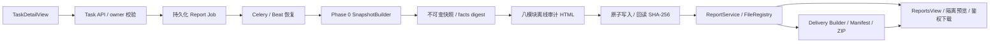
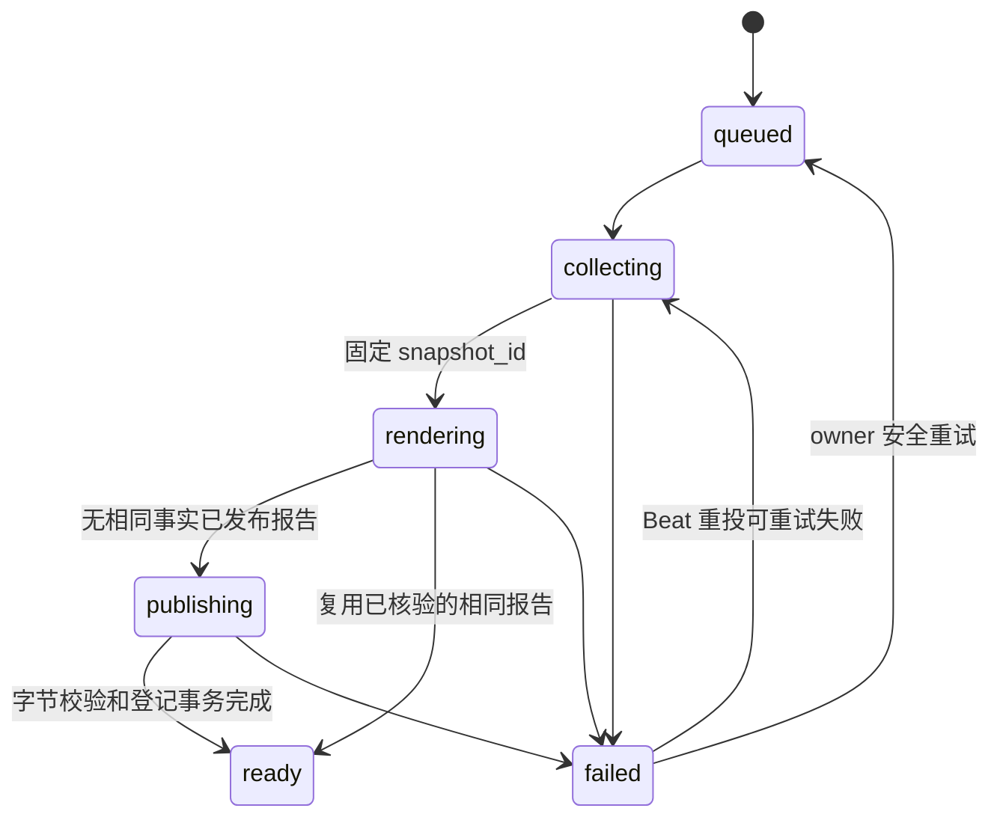

# CygnusX 报告中心与可复现执行证据报告

> 活动 as-built 基线。代码接入已实现；真实 RNA-seq / PostgreSQL / Celery / 对象存储部署验收仍未完成。验证与实施时点见 `docs/audits/reproducible-report-phase1-implementation.md`。

## 模块作用与架构

既有 RNAFlow / BioReport 科学报告保留。新增 `report_kind=reproducibility` 的独立执行证据交付物使用同一 `reports`、`report_files`、ReportsView 和下载 API，不替代科学结果渲染，也不调用分析执行器。Phase 2 增加 `report_kind=delivery`，将科学报告、执行证据报告和冻结快照整理为 owner-only 交付包。

| 边界 | 实现 |
|---|---|
| 协议、摘要、冻结 | `application/schemas/report_snapshot.py` |
| 来源、局部读文件、RNA ARDP 投影 | `report_snapshot_sources.py`、`report_snapshot_manifest.py`、`report_snapshot_builder.py` |
| 请求、去重、状态用例 | `application/services/reproducible_report_service.py` |
| 八模块 HTML、固定模板版本 | `application/services/report_audit_renderer.py` |
| 本地 FD 原子发布 / 对象存储适配 | `application/services/report_archive.py` |
| 报告登记、版本、预览、下载 | `application/services/report_service.py`、`infrastructure/database/repositories/report_repository.py` |
| ORM、迁移 | `infrastructure/database/models/report.py`、`alembic/versions/reportauditphase1_add_reproducible_report_tables.py` |
| 异步、锁、恢复扫描 | `infrastructure/celery_app/tasks/reports.py`、`celery_app/celery.py` |
| UI、轮询、鉴权下载 | `TaskDetailView.vue`、`ReportsView.vue`、`ReportPreviewModal.vue`、`useReproducibleReport.ts`、`api/report.ts` |
| BioReport 受控渲染 | `application/services/bioreport_adapter.py`；HTML 可复用，科学 PDF 使用固定 CLI 合约，AI 明确关闭 |
| 审计 PDF | `application/services/report_audit_pdf_renderer.py`；冻结审计 HTML 经 Pandoc/Typst 转换，按 SHA-256 登记为第二个 ReportFile |
| 科研交付包 | `application/schemas/report_delivery.py`、`research_delivery_service.py`、`ReportService.build_delivery_package` |

## 身份与授权

只接受 RNA-seq 已结束的 Task（success / completed / failed / cancelled），查询先限定 `Task.user_id`。身份仍以 Task 为主；Run 可以缺失，指定 Run 则要求同 owner、同 Task、同 flow、有 confirmed_at。未指定 Run 的自动关联仅通过 Run.task_id；不按目录、名称或时间猜测。

鉴权依赖的用户 ID 为字符串，用例在边界归一为 UUID。任务没有通用可信 project_id，所以项目成员资格不能绕过 owner 约束；首版不开放团队或公开报告。FileRecord 必须同 owner、personal、显式 Task 关联。快照 API 同时 join 仍存在的 Report，并校验快照 owner / Task / Run / digest。删除 Report 后快照不可从旧 Report ID 访问，归档快照本体不覆盖。

客户端只能指定 Task / 可选 Run / 可选 UUID 请求键，不能传入服务器路径。导出的文件路径为安全引用；审计 ReportFile DTO 使用 `output/index.html`，不泄露存储根。

## Job 状态、幂等和恢复

Job 与分析 Task 的状态、时间和失败完全独立，保存 evidence_partial、snapshot_id、report_id、error_code、error_message、retryable、attempt_count、finished_at、template_version、archive_path。阶段不是百分比。

1. API 在 owner-scoped Task 行上 FOR UPDATE，复用同模板仍在生成中的 Job；部分唯一索引作数据库兜底。可选 `Idempotency-Key: UUID` 在 owner / Task / Run / 模板范围内绑定同一请求。
2. 已结束后不带请求键的新请求会重新采集，避免仅用 Task.updated_at 忽略新磁盘证据。最终按 `(owner, Task, snapshot_digest)` 复用快照，再按 `(owner, snapshot_id, template_version)` 复用已发布 Report。
3. 新事实或模板可创建新报告版本，通过已有 parent_id / version 树保存；不会替换原报告文件。
4. worker 用专属、无池连接持有 `pg_try_advisory_lock(hash(Task ID))`，覆盖状态提交、取证和发布；竞争投递返回 busy。锁不会随状态 commit 丢失，也不会带锁归还池。进程结束后 PostgreSQL 释放连接锁。
5. 先提交 Job 再尽力投递。Job queued 行作为持久 outbox；Beat 每分钟扫描 queued、超时活跃、可重试失败，以修复 commit 后崩溃、broker 暂不可用、worker 丢失。重复扫描仍受同一个 Task 锁保护。
6. 默认采集/交付预算 600 秒、最多 3 次尝试、每轮扫描 100 行；Settings 控制预算与扫描间隔。旧失败如果已有新活跃 Job，恢复等待新 Job 结束，避免违反活跃唯一约束。
7. 权限、身份冲突、协议/摘要损坏为不可自动重试；存储、超时、DBAPI 暂时错误可重试。返回固定错误码/信息，不回传原异常、凭据、路径。原 Task 状态不改变。

Celery 投递成功或 Celery task SUCCESS 不能代替 Job ready。应用错误可由 worker写入 failed 后返回；消费者必须以数据库 Job 状态判断。Beat 只重投审计 Job，不重跑 RNA 分析。

## 快照与历史事实

数据库证据采集使用 REPEATABLE READ READ ONLY 事务；冻结后结束读取事务再持久化。跨数据库和文件系统没有共同原子快照：有采集窗口、水位、当前字节指纹以及改写检测，不能宣称执行时取证或可信时间戳。

快照 JSON、schema/redaction/digest 版本、来源、时钟、水位均保存。ORM 禁止更新，PostgreSQL BEFORE UPDATE trigger 禁止原地修改；重试引用原 snapshot_id，不因新证据改变已冻结报告。内容摘要 stable_facts.v1 排除采集/生成时间等瞬态元数据，保留身份、事实、来源水位和状态；不是签名。兼容旧快照没有的 optional display_name：空值不进入事实摘要。

owner_allowlist.v2 不输出原始参数文本、日志、命令、请求、Prompt 或凭据。名称只允许有界 Unicode 展示标签（支持中文）；路径、长令牌或凭据状名称被省略，并标明脱敏/未记录。历史环境缺失不回填当前配置或 Flow 版本；科学报告原有 catalog 行为不改变，新审计报告 flow_version 保持空，历史声明在正文以证据状态呈现。

六状态为 verified / not_recorded / unavailable / not_applicable / verification_failed / estimated。verified 只代表注明范围的观察，不代表 QC 通过或复现成功。证据缺口允许生成报告，并令 evidence_partial=true。

读文件授权后使用逐级目录 FD、O_NOFOLLOW、普通文件校验，拒绝链接竞争、FIFO 等特殊文件。流式哈希检查前后 fstat，受时间和总字节预算（默认 16 GiB）约束；超预算为 unavailable。数据库 FileRecord 最多 2000、RunEvent 最多 1000，清单最多 4 MiB / 2000 条；截断显式留缺口。不扫描其他用户目录。

## 发布、归档和下载

通过 StoragePathFactory.create_project_run_dir 创建独立 `projects/<安全项目>/runs/audit-report-<UTC>[-序号]/output/index.html`。它是报告归档运行目录，不是新科研计算。可信项目标识缺失时使用 RNA-seq 报告归档分类，不将其当成原执行项目事实。新路径不包含任务 UUID，不写 legacy tasks 目录。

archive_path 在写入前提交，便于中断恢复。本地发布在 pinned 目录 FD 下写临时文件、fsync、原子 replace、目录 fsync；对象存储走 StorageBackend.write_stream 完成后回读。校验长度和 SHA-256 后，ReportService 在同一个事务内登记目录链、FileRecord、Report、ReportFile，Job 最后 ready。登记失败保留 private 未登记文件与冻结快照，下一次修复发布；没有 DB / 对象存储分布式事务，也没有自动公开分享。

审计 FileRecord source=report、Task 外键留空；Task 关联由 Report.task_id 保存。这样审计报告不会反过来进入自己的分析取证文件集，避免每次生成都因上一份报告产生新摘要。ReportFile 保存 SHA-256；报告预览、下载、事实去重重用都复核字节。已发布文件丢失/改写返回不可用或完整性错误，不静默改写历史报告。删除仅删除报告记录，沿用现有规则；快照和底层文件不覆盖，孤立归档/目录的自动 GC 未引入。

审计下载通过原 reports/files API 返回校验后的字节和 attachment，不让 FileResponse 在校验后再次打开可被替换的路径。原有科学报告本地 FileResponse 路径保留。对象存储输出适配已接入；历史 RNA 证据读取仍只支持本地，远程产物标 unavailable。

Phase 2 交付构建复核科学报告和执行证据文件，生成 `Scientific_Report.*`、`Reproducibility_Record.*`、`ReportSnapshot.json`、`README.md`、`EvidenceManifest.json`、`checksums.sha256` 和 ZIP。缺失文件显式标记 `partial`，不生成空占位文件。Manifest 自身和 checksums 文件不纳入自身哈希列表，以避免自引用循环；验证器仍校验 Manifest 中所有可用文件。

## 前端和 HTML 安全

TaskDetailView 一次请求后按阶段轮询；请求结束后直接导航到指定 Report ID，打开 ReportsView 的现有预览。轮询使用递归 setTimeout，避免重叠；暂时查询失败自动重试，权限拒绝停止，离页/切换 Task 使旧回调失效，sessionStorage 保存 Job ID 便于刷新后恢复。生成失败显示固定原因，可重试失败按钮复用原 Job。后台 Job 不依赖页面存活。

ReportsView 和卡片展示执行证据类型、报告版本、模板、证据缺口；可按 Task ID 筛选。下载使用统一 axios Bearer 鉴权。预览 iframe sandbox 为空，禁止脚本和同源权限；新窗口执行 HTML 的入口移除，保留安全预览、全屏和下载。关闭/切换报告不会展示旧请求返回的 HTML。科学报告脚本交互在平台预览中被禁用，这是明确的安全收紧；下载文件的本地浏览仍由用户自行决定。

HTML M1 概要、M2 输入环境、M3 时间线、M4 工具调用、M5 QC、M6 产物、M7 来源关系、M8 限制均由冻结快照渲染，有导航、响应式布局、明确状态、转义和 CSP，没有外部资源或脚本。未记录的输入指纹、QC 测量解释/阈值/豁免、工具调用均不补造；复现验证恒为 not_run。

## 验证边界

Phase 0 回归、离线 HTML、安全、生命周期、去重、发布失败恢复、ASGI 请求到下载与前端轮询/隔离测试已建立。Phase 2 增加交付包缺口、Manifest、ZIP slip、篡改拒绝和大小/数量上限测试。隔离集成使用 SQLite 和合成 RNA 目录；不证明真实 PostgreSQL 行锁、现场 Celery 投递、S3、BioReport 生产镜像、真实 RNA 结果或浏览器手工 E2E。

`tests/integration/test_reproducible_report_postgres.py` 仅使用显式 CYGNUSX_REPORT_TEST_DATABASE_URL，数据库名必须以 report_test 开头，创建并清理随机 test schema；验证迁移触发器、并发唯一约束、跨 commit advisory lock。无授权测试 DSN 时明确跳过，不读取生产 DATABASE_URL。上线前须执行授权 PostgreSQL / broker / 存储检查、迁移及真实成功 Task 的交付验收；不得用模拟数据代替。

## Phase 2 交付边界

本地 BioReport 核验版本为 `2.0.0`，源码提交 `cb2911a`；当前未核验 CygnusX 生产 BioReport 镜像 digest。`BioReportAdapter` 接受受控 JSON/YAML 配置，固定 single layout，禁用 AI module，不注入平台凭据。HTML 可复用已登记科学报告；交付构建仅在存在 owner 配置且渲染器可用时尝试科学 PDF，失败则保留 HTML 并标记 partial。审计 PDF 使用冻结 HTML 的 Pandoc/Typst 转换，不重新采集事实。

`POST /api/v1/reports/{report_id}/delivery` 可以从科学报告或执行证据报告发起；科学报告入口会查找同一 owner/Task 的最新执行证据报告，并用其冻结快照绑定交付包。重复请求复用同一 delivery 记录。未发现 Phase 1.5 live-validation 审计记录；真实 RNA Task、PostgreSQL、Celery、对象存储、BioReport PDF、ZIP 下载和浏览器闭环仍需授权环境验收。

## 受保护的 Dataset 科研交付扩展

Phase4 增加可选 ResultObservation 关联和 Snapshot.research_delivery；无扩展字段的历史快照保持原 digest。Counts 可在受保护路径排独立科学 BioReport job 和执行证据 job，继续复用本报告中心与队列；科学模板只展示完成结果，渲染失败不重跑计算。Report 读取/发布在开关启用时复核当前项目权限。默认主路径与旧 API 保留，新增运行能力仍 BLOCKED，详见 [科研交付架构](CygnusX_research_delivery_architecture.md)。
