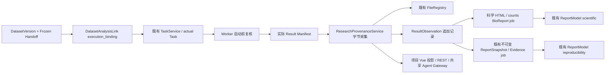
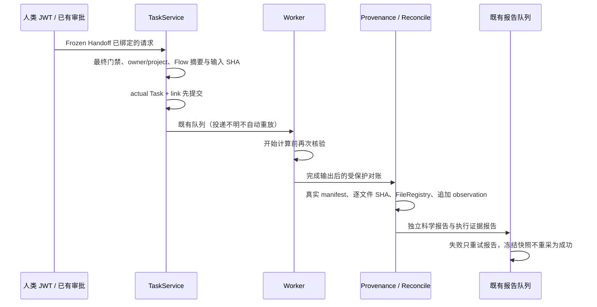

# CygnusX 科研证据与报告交付架构

类型：as-built，受功能开关保护的实现。运行准入和真实科研案例仍 BLOCKED；本文件不授予写入或部署许可。Dataset 与既有报告模块仍分别由 `CygnusX_dataset_architecture.md`、`CygnusX_report_architecture.md` 约束。

## 组件与状态

计算状态取 Task；输入/输出完整性取真实字节；证据状态取缺口；交付状态同时要求双报告、当前关联与文件有效。当前没有可信 Worker image/release 观察，始终明确缺口，不能仅用 manifest 声明解锁 READY。

## 实现路径

入口 `api/v1/research_delivery.py` → `research_provenance_service.py`；执行绑定在 `research_execution_binding.py`；独立 counts 科学渲染在 `scientific_report_job.py`，固定模板 `pipelines/CountsDEGFlow/report/counts.qmd`，只展示完成输出；队列继续使用 `tasks/reports.py` 的 Task advisory lock、重试与 durable job。Beat 对账复用 `tasks/datasets.py`，导入与报告两道门独立判断，关闭时不创建数据库 engine。

## 数据、兼容与权限

迁移 `bioopsphase4`（parent `bioopsphase3`）新增 link.execution_binding、result_manifest_observations、report.result_observation_id、report_file.file_record_id。旧记录保持 nullable/未知，不回填虚构历史。观察唯一 `(task_id,evidence_digest)`，FK RESTRICT；ORM/PG trigger 拒绝 UPDATE/DELETE。现有 Report/File/Task/Sample 核心表继续复用。

Snapshot v1 增加可选 research_delivery；空字段不参与旧 digest，旧快照继续验证，新快照固化关联。读取依旧查 owner、当前项目及模块权限；报告 generation/publish/preview/download 再复核，权限撤销不会被旧链接绕过。共享只读工具来自同一 catalog，Agent 参数拒绝 owner/project/verification 注入。

默认 `RESEARCH_DELIVERY_READ_ENABLED=false`、`RESEARCH_DELIVERY_WRITE_ENABLED=false`，源码运行门禁继续 false。`RESEARCH_REPORT_PYTHON_EXECUTABLE` 仅由受信任运维配置 Quarto Python；不借此声明 Worker 软件版本。没有改生产服务、镜像、锁文件或子模块源码。

## 验证边界

SQLite 持久化/迁移、真实临时文件、既有报告回归、前端 DOM 与本机统计 DAG 分开记录。真实 PostgreSQL/Redis/MCP transport/Worker、BioReport Jupyter 内核、真实公开科研案例仍需隔离环境证据。本机 BioReport CLI 实测因内核 socket 权限失败，不算完整交付通过。

契约见 `docs/contracts/cygnusx-research-delivery-v1.md`，实施证据见 Phase4 实施报告；恢复与关闭开关步骤见 `docs/runbooks/cygnusx-delivery-reconciliation.md`。

## RI06–RI09 项目科研交付与导出（代码/隔离层）

ProjectDetailView保留原科研链，新增ProjectResearchDelivery卡片，经原research_delivery路由获取只读inventory、按Task/Report版本选择和prepare预览。默认证据包；结果包仅加入核验过的小型已登记结果；复现材料包只保存已有证据和输入引用。Task归属只来自DatasetVersion/AnalysisLink明确关联；历史孤立Task不从目录、时间或名称补项目，truncated拒绝作为完整导出范围。

新增独立迁移`projectdelivery01`：project_export_jobs持久冻结manifest/状态/发布指纹，project_export_requests保留同一内容共享Job时的全部request_key绑定。原报告Job要求Task非空，不拿虚构Task承载项目ZIP。Project行锁及唯一键去重；Worker独占连接advisory lock跨阶段commit，queued outbox及Beat处理投递/中断恢复。报告/快照/Observation仍由原体系维护，不重新渲染、下载、计算或补历史环境。

ProjectDeliveryManifest v1分别记录实际文件、引用、缺失、未验证和排除内容；实际字节均有大小/SHA。报告ID/version/parent/snapshot/observation关联冻结并重检，旧ReportSnapshot和ResearchProvenance DTO默认值不改。已有EvidenceManifest v1/v1.1和单TaskZIP仅使用原ResearchDeliveryBuilder校验，包字节不改。项目清单不证明科学复现，reproduction_status=NOT_RUN。

默认project_export_enabled=false，且research_delivery_read_enabled保护读取。CREATE/retry/download仅真实用户JWT；Gateway只新增research.project_inventory和research.project_export_status，沿用现有只读报告溯源，不增加Agent创建入口。下载/分析运行门禁不改变。首版500payload、单文件16MiB、总64MiB、ZIP80MiB，超限明确拒绝，不递归项目目录、不复制FASTQ/BAM；当前为有界内存实现，非无限大型流式导出。

API路径与契约见`docs/contracts/cygnusx-project-delivery-v1.md`，实现、18项验收映射及回滚见`docs/implementation/cygnusx-project-delivery-ri06-ri09-implementation.md`。真实PG/Celery/S3/浏览器仍BLOCKED，未生产迁移或部署。关闭独立flag可停止新导出，保留Job/请求/文件/快照，不能用drop表清理审计事实；启用时有保留Job的项目普通删除返回明确Conflict。

## 项目交付运行复核、RI10与RI09.5原型

真实环境仍未提供专用PROJECT_EXPORT_TEST_DATABASE_URL或授权Broker/Worker/存储，实际Chromium受Snap运行目录只读限制无法启动；当前无PASS_RUNTIME/PASS_E2E。运行验收报告为`docs/audits/cygnusx-project-delivery-runtime-acceptance.md`，不能将原SQL并发用例当成真实业务CREATE API并发验收。

ProjectDeliveryService在authorize刷新User/Project状态，停用/未知项目状态拒绝读取；completed/handed_over保持可读。ready下载仍复核冻结摘要、当前Task→Version→Link和Report关联；后续关系变化不悄悄替换旧包。文件/关系/配额预算和原Job恢复逻辑保留。

ResearchClaimService新增只读provenance投影，继续调用原deg.tsv单元格读取器，仅支持已核验的6个数值列。当前FileRecord生命周期、真实SHA、Observation payload摘要及artifact绑定、所选Report/Snapshot、Task冻结定义/Version关联分开验证。旧报告未记录Observation/定义时不借用新记录，不查当前catalog补历史。

`cygnusx.claim_provenance.v1`区分VERIFIED_VALUE、有限数值陈述SUPPORTED_CLAIM、草稿AI_INTERPRETATION、NA/缺失NOT_VERIFIED；自由文本claim_text_verified恒false，缺口及NOT_RUN保留。没有新Claim表/引擎。POST现有`/projects/{id}/research-evidence/claim-provenance`为只读接口，需原plan/read功能和当前项目/模块权限。ProjectResearchDelivery卡片新增ClaimEvidencePanel，不另建报告详情。既有Gateway工具名/原cell输出不变。

RI09.5目前仅在原report_audit_renderer中提供14章静态HTML原型，共享原转义/表格/CSP/CSS；相同合成快照的旧审计HTML逐字节相同。GET原ProjectExportJob的summary-preview验证当前权限、原导出flag及冻结范围，默认只显示已有引用/文件/缺口，未知科学事实明确NOT_RECORDED。前端空sandbox iframe预览；不新建报告Job、Report、PDF或FileRecord，不更新旧ZIP/Manifest。正式项目报告设计及后续兼容迁移见`docs/design/cygnusx-project-scientific-summary-report.md`；不能把原型等同正式科学报告。

隔离实现与保留/回滚分别见`docs/implementation/cygnusx-project-delivery-stabilization.md`、`cygnusx-ri10-claim-provenance.md`。下载/分析/项目导出默认门禁未开放，旧快照、观察和历史环境不回写。

### RI095 Phase 1–4 追加现状（代码／隔离验收）

上节“仅原型”描述保留为原 summary-preview 的边界。新增 scientific-summary 的独立项目报告 Job／JWT 创建／状态／只读预览／授权下载，冻结 M0 与 DEG Claim selection，复用 ReportService／FileRegistry／BioReportAdapter／原子发布。旧 Task Report／Snapshot 身份和旧原型不变，新增 ReportFile 来源 XOR 与 projectreport01 迁移代码；业务库未升级。

新增 ExportSelectionV2／ProjectDeliveryManifestV2，显式绑定 M0 Job／digest 和已发布项目报告的 ReportFile／FileRecord／SHA／size。M1 独立新 Job、ZIP、摘要，导出不触发分析、下载或报告生成；缺 PDF 保持 partial。v1 字段／摘要定义与旧 M0 ZIP 不改。前端在原项目成果卡片中增加冻结选择、实际状态、sandbox 预览、SHA 下载和 M1 单独确认。

相关隔离测试见 evidence/ri095-project-report-phase1-4/；本轮不授予 PASS_RUNTIME／PASS_E2E，新增报告写入与 PDF 开关默认 false。逐阶段事实、局限与回滚见 docs/implementation/cygnusx-ri095-project-scientific-report-phase1-4.md。
