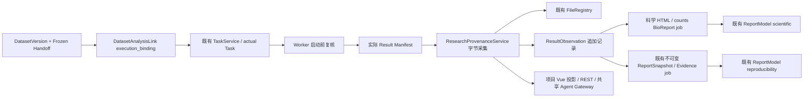
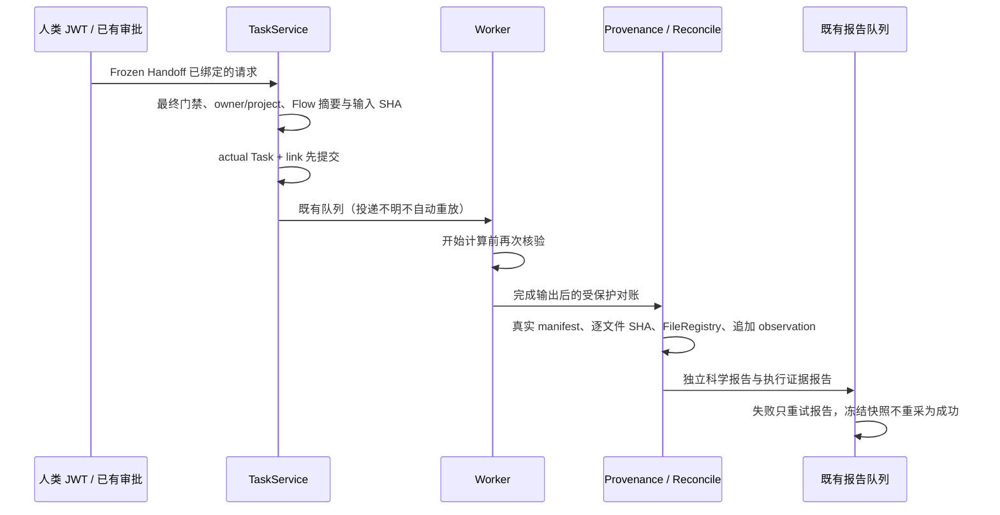

# CygnusX 科研证据与报告交付架构

类型：as-built，受功能开关保护的实现。运行准入和真实科研案例仍 BLOCKED；本文件不授予写入或部署许可。Dataset 与既有报告模块仍分别由 `CygnusX_dataset_architecture.md`、`CygnusX_report_architecture.md` 约束。

## 组件与状态

计算状态取 Task；输入/输出完整性取真实字节；证据状态取缺口；交付状态同时要求双报告、当前关联与文件有效。当前没有可信 Worker image/release 观察，始终明确缺口，不能仅用 manifest 声明解锁 READY。

## 实现路径

入口 `api/v1/research_delivery.py` → `research_provenance_service.py`；执行绑定在 `research_execution_binding.py`；独立 counts 科学渲染在 `scientific_report_job.py`，固定模板 `pipelines/CountsDEGFlow/report/counts.qmd`，只展示完成输出；队列继续使用 `tasks/reports.py` 的 Task advisory lock、重试与 durable job。Beat 对账复用 `tasks/datasets.py`，导入与报告两道门独立判断，关闭时不创建数据库 engine。

## 数据、兼容与权限

迁移 `bioopsphase4`（parent `bioopsphase3`）新增 link.execution_binding、result_manifest_observations、report.result_observation_id、report_file.file_record_id。旧记录保持 nullable/未知，不回填虚构历史。观察唯一 `(task_id,evidence_digest)`，FK RESTRICT；ORM/PG trigger 拒绝 UPDATE/DELETE。现有 Report/File/Task/Sample 核心表继续复用。

Snapshot v1 增加可选 research_delivery；空字段不参与旧 digest，旧快照继续验证，新快照固化关联。读取依旧查 owner、当前项目及模块权限；报告 generation/publish/preview/download 再复核，权限撤销不会被旧链接绕过。共享只读工具来自同一 catalog，Agent 参数拒绝 owner/project/verification 注入。

默认 `RESEARCH_DELIVERY_READ_ENABLED=false`、`RESEARCH_DELIVERY_WRITE_ENABLED=false`，源码运行门禁继续 false。`RESEARCH_REPORT_PYTHON_EXECUTABLE` 仅由受信任运维配置 Quarto Python；不借此声明 Worker 软件版本。没有改生产服务、镜像、锁文件或子模块源码。

## 验证边界

SQLite 持久化/迁移、真实临时文件、既有报告回归、前端 DOM 与本机统计 DAG 分开记录。真实 PostgreSQL/Redis/MCP transport/Worker、BioReport Jupyter 内核、真实公开科研案例仍需隔离环境证据。本机 BioReport CLI 实测因内核 socket 权限失败，不算完整交付通过。

契约见 `docs/contracts/cygnusx-research-delivery-v1.md`，实施证据见 Phase4 实施报告；恢复与关闭开关步骤见 `docs/runbooks/cygnusx-delivery-reconciliation.md`。
