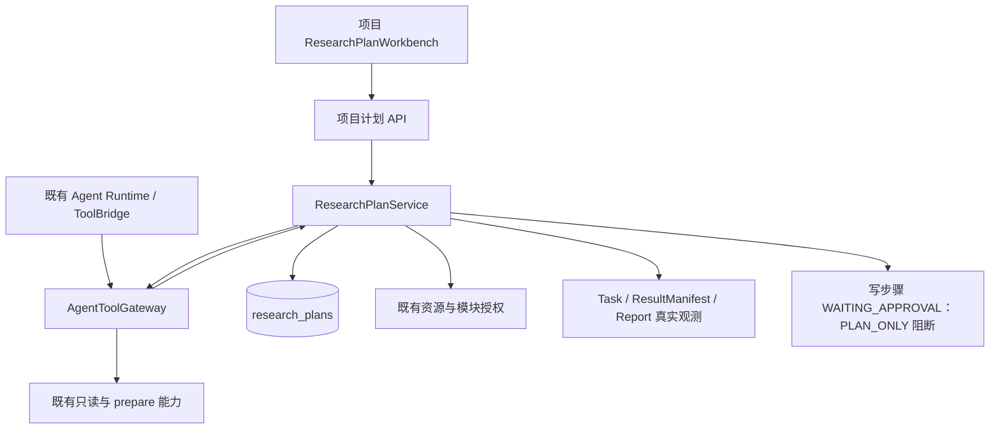
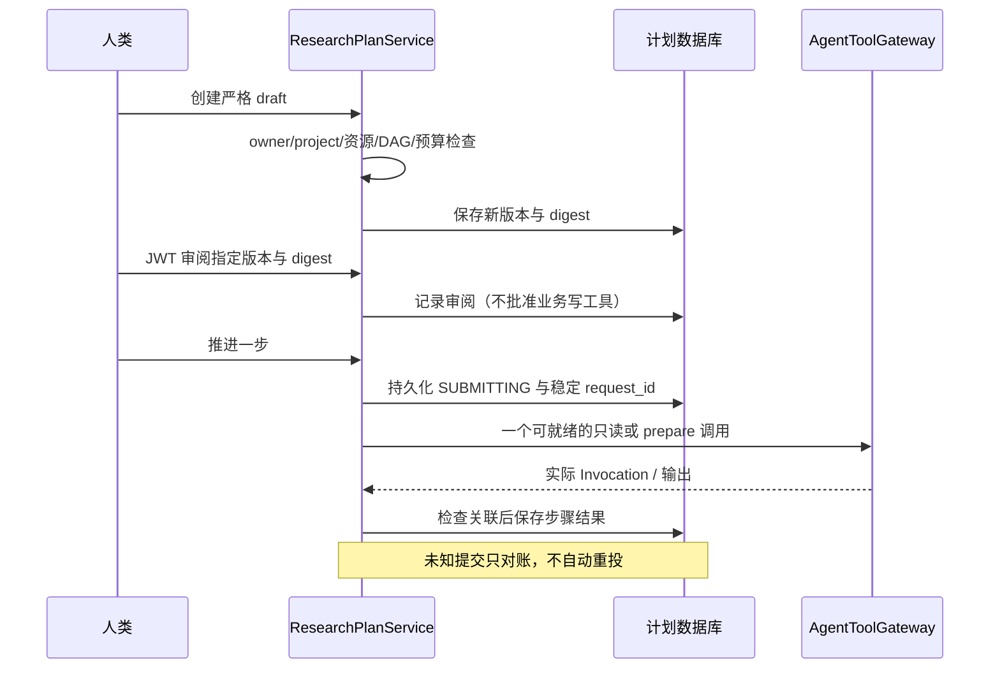

# 受控研究计划架构

本文为当前代码的 as-built 说明。研究计划功能默认关闭；启用后仍为 PLAN_ONLY。真实执行门禁、生产发布和科学 Benchmark 效果均未验收。科研交付事实继续以 [科研交付链](CygnusX_research_delivery_architecture.md) 为准。

## 模块作用与边界

ResearchPlan 是项目内版本化科研意图与步骤状态的持久协调层。它不替代 RunPlan、MASPlan、Task、Dataset 或报告，不新增 LLM 循环、下载器和统计执行器。模型提交严格 draft；服务器从身份上下文确定 owner/project，并生成 ID、版本、digest、审阅和步骤状态。新版本不继承旧审批。

项目 REST 入口位于 `api/v1/research_plans.py`；实现位于 `application/services/research_plan_service.py`；DAG 与状态约束位于 `application/schemas/research_plan.py` 和 `domain/research/plan_state.py`。持久化仅新增 `research_plans` 表，迁移为 `bioopsphase5_research_plans`。ORM 与 PostgreSQL trigger 保护意图字段；PostgreSQL trigger 尚未在真实数据库演练。

## 架构图

## 实现时序

## 不变量与限制

- 白名单 StepKind、依赖和类型化 binding 构成 DAG；禁止重复、循环、悬空引用、任意命令和模型身份字段。
- 每次访问重新验证项目和资源归属。计划审阅需要 JWT，与原工具的独立审批分离。
- 当前 advance 最多执行一个只读或 prepare 步骤；副作用步骤不提交业务 Task。不能把此模式描述为完整跨模块真实执行。
- SUBMITTING 调用先提交保留记录，再进入 Gateway。异常和无法核验的响应进入 RECONCILIATION_REQUIRED；对账不重新提交分析。
- 人工对账不抢占工具超时窗口内的 SUBMITTING 保留记录；过期或缺失保留记录要求对账，不自动重放。锁定读使用 populate_existing 刷新 ORM 缓存，避免旧状态遮蔽数据库中已保存的人工停止状态。
- 仅 success/completed 为明确计算成功；未知状态不会因报告 READY 而投影为完成。
- 已完成计算与交付状态分开。缺少实际 Manifest、报告或完整 provenance 不投影为完整交付；Task 和报告 ID 来自既有观测。
- 科研适用性校验消费服务器 Handoff，读取实际 species/metadata.organism 并保留冲突，缺少稳定样本身份/组织/处理条件要求审阅，重复样本不增加重复数；自由文本不能提供统计数值。Artifact cell API 检查注册路径、归属、SHA 与实际表格单元格。Claim 引用存在不等于科学事实已 VERIFIED。
- 前端按当前项目及指定版本隔离响应，迟到响应不覆盖新项目或版本。项目页重新加载并清除旧项目总览/会话。工作台显示服务器版本、digest、调用、Task、报告和缺口；`/projects/{project_id}?planId={plan_id}` 从服务器按真实 ID 恢复指定历史版本，不依赖最近 20 项列表。旧版本通过 superseded_by 链接新版本，历史版本不显示审阅推进入口。

## 验证与运行状态

契约由 `scripts/export_research_plan_contracts.py` 导出到 `docs/contracts`，回归测试逐一比对五份 schema 与运行模型。最新相关后端 158 项测试在隔离环境通过，当前合成 Benchmark 11/12 匹配预期，保留一项未审定 gold 的失败；真实 PostgreSQL、Redis、MCP、Worker 和两个公开数据闭环仍未验证。完整运行记录在 `evidence/phase5`，不得将 SQLite 或合成测试作为真实运行证据。

Benchmark 目前有 12 个未人工审定的合成契约候选，仅验证约束行为，不代表研究发现、真实科研交付能力或三种系统的性能比较。详细实验协议见 `benchmarks/research_agent/v1/evaluation_protocol.md`。
