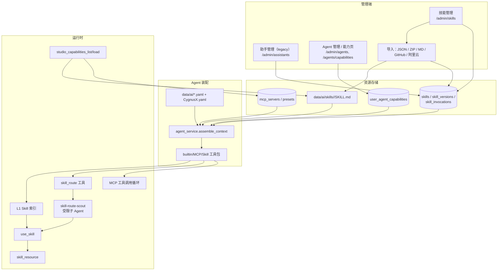
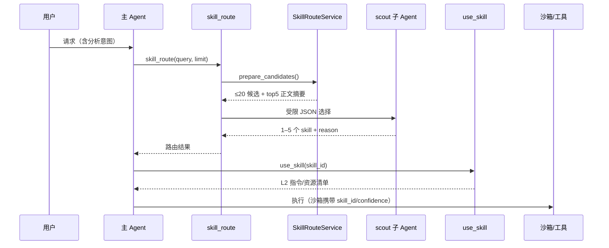

# CygnusX Skill/MCP 接入与资源路由架构（Integration & Routing）

> **用途**：补全既有 MCP、Skill 两份专项文档未覆盖的"**接入与运行时选择**"层：Skill 路由（`skill_route`）、五种导入管线、管理端技能/助手/Agent 能力面、每用户 MCP/Skill 覆盖、Agent 绑定与运行时暴露、MCP 与 Skill 的统一目录（capability catalog），并记录与旧文档不一致的事实。
> **类型**：as-built（2026-10-21 代码基线）。
> **适用范围**：`skill_route` 工具、`SkillRouteService`/`SkillRouteToolService`、`SkillImportService`、`admin/skills.py`、`admin/assistants.py`、`agents` 能力接口、`user_agent_capabilities`、`agent_service` 装配、Studio capability catalog。
> **不适用范围**：MCP 协议三层体系、Preset 清单、MCP Builder、`mcp-server/` 外部通道——以 [CygnusX_mcp_architecture.md](CygnusX_mcp_architecture.md) 与 `mcp-server/ARCHITECTURE.md` 为准；Skill 存储/版本/SKILL.md 规范/三层渐进披露基础——以 [CygnusX_skill_architecture.md](CygnusX_skill_architecture.md) 为准；Agent 执行闭环与工具循环——以 [CygnusX_agent_execution_framework.md](CygnusX_agent_execution_framework.md) 为准。

## 这个模块如何发挥作用

平台有两类可被 Agent 使用的扩展资源：**Skill**（磁盘真相源 + DB 索引，渐进披露的提示词/资源包）与 **MCP Server**（工具协议通道）。二者在 Agent 装配时并不是"全量塞给模型"，而是经过四道选择：

1. **管理员绑定**：Agent YAML / DB 模板声明 `skill_ids`、`mcp_ids`；
2. **用户覆盖**：用户可在能力页对单个 Agent 选择模型、MCP、Skill（不能打开管理员关闭的能力）；
3. **运行时发现**：Skill 走 L1 索引 → L2 `use_skill` → L3 `skill_resource`；MCP 工具按会话/请求裁剪；
4. **请求内路由**：`skill_route` 先用轻量检索缩小 Skill 候选，再由一个受限 scout 子 Agent 选 1–5 个并说明理由，最后才由主 Agent 加载。

本文记录这四道选择在代码中的真实行为，以及导入/管理端如何维护资源。

## 1. 总体架构

### 实现图：一次"用 Skill 做分析"

## 2. Skill 路由

### 2.1 入口与契约

- 工具：内置 `skill_route`，定义于 `tool_configs/tools_schema.yaml`；输入 `query`、`limit`（1–5），只读、无需确认、`tool_role: skill_route`、`user_scoped`。
- 提示词：`data/ai/prompts/shared/sandbox_protocol.md` 要求"沙箱执行前先调用 `skill_route`"；scout 提示词 `data/ai/prompts/skill_route.md`。
- 工具在 `agent_service` 装配时**无条件加入**工具包（除管理员关闭工具能力外），不依赖 Agent 是否声明 Skill。

### 2.2 候选准备（`SkillRouteService.prepare_candidates`）

1. 元数据文本：skill id/name/description/category + frontmatter 的 `task_tags|tags|entrypoints`；
2. **磁盘优先**：磁盘存在但 DB 未索引的 Skill 也进入候选；
3. 分词：`[\w\u4e00-\u9fff]+`，去停用词，做复数/`-ing` 轻量词干化；
4. 过滤"语料通用词"：出现在 >30% 且 >5 个 Skill 中的 token 不计分，避免 "analysis" 类词主导；
5. 按 token 交集打分，候选上限 20；
6. 读取前 5 个正文（磁盘或 DB prompt），每个截断 6,000 字符。

### 2.3 Scout 选择（`SkillRouteToolService.route`）

- 要求 user/session 上下文；加载 `agents.skill_route` 提示词；
- 调用 `ParallelSubAgentService.run`，仅一个任务、`agent_id="agent-general"`、`safe_only=True`、`runtime_authorized=True`；
- 解析返回的第一个 JSON 对象，压缩字段：description 80 字、reason 200 字、summary；
- 无候选时**不调用子 Agent**，直接返回空结果；
- SSE 产生 scout 事件：`Skill 路由审查`、scout id `skill-route-scout`；
- 路由只是"选择与理由"，实际加载仍走 `use_skill`。

### 2.4 已知契约点

- `limit` 是最终返回上限，不改变候选 20/正文 5 的检索预算；
- 路由结果不写入 Skill 版本或调用审计（调用审计发生在 `use_skill`）；
- 路由失败/超时由工具循环按普通工具错误处理，主 Agent 可继续执行。

## 3. 导入管线

`SkillImportService`（约 1,067 行）支持五种入口，统一走"获取 → 解析/归一化 → 预览 DTO → 确认导入"：

| 入口 | 来源 | 限制/行为 |
| --- | --- | --- |
| JSON | 单文件 | 结构化 skill 定义 |
| ZIP | 压缩包 | 总大小 4 MiB；单 Markdown 时按 Markdown 入口回退 |
| Markdown | 单文件 | 转为标准 Skill 目录 |
| GitHub | repo/tree/blob/raw | codeload tar.gz；commit 缩至 12 位；支持更新检查 |
| 阿里云技能市场 | marketplace | 16 MiB；AgentExplorer API，失败回退 GitHub；本地 manifest 缓存；`ALIYUN_SKILLS_ENABLED` 默认关闭 |

确认阶段 `confirm_import`：

1. 校验 name/description；
2. 已存在同名且未勾选覆盖则拒绝；
3. 写入 `data/ai/skills/<name>/`（磁盘是真相源）；
4. upsert `skills` 索引；
5. 生成 `skill_versions` 快照，`source="import"`。

版本自增规则在 `SkillService`：描述变更 minor，其余 patch；支持回滚。`check_update` 对 GitHub 比较 commit，对阿里云走零网络 manifest 比较。

## 4. 管理端资源面

### 4.1 技能管理（`/api/v1/admin/skills`，AdminRequired）

列表/创建；市场与阿里云状态/同步/安装；调用统计；五种导入；确认导入；详情/更新/引用/删除/启停；版本列表/详情/回滚/检查更新/调用记录。前端 `SkillResourceTab.vue`、`SkillImportSection.vue`、`SkillMarketSection.vue`。

### 4.2 助手管理（`/api/v1/admin/assistants`，legacy）

只做 `ChatAssistant` CRUD。`ChatAssistantModel`/DTO **没有** `skill_ids`、`mcp_ids`、features 字段，**不能绑定 Skill/MCP**。管理端"AI 资源中心"的"助手"Tab 实际编辑的是 Agent 模板，不是这套 legacy 助手。两者不要混淆。

### 4.3 Agent 管理与能力页

- `api/v1/admin/agents`：Agent CRUD；
- `api/v1/agents`：对外 Agent 列表、`GET /agents/capability-mcps`、`GET/PUT/DELETE /agents/{id}/capabilities`；
- `api/v1/agent_tools`：委托/会话调用、能力发现、相关工具、提案审批/执行（写门禁）；
- 前端 `AgentCapabilitiesView.vue`：按 Agent 选择模型、MCP、Skill 与功能开关；`AdminAIResourceCenterView.vue` 汇总 MCP/技能/助手三个 Tab。

### 4.4 每用户覆盖

`user_agent_capabilities`：`(user, agent)` 唯一，`model_id`、`mcp_ids`、`skill_ids`。校验只接受已启用的模型/MCP/Skill；用户不能打开管理员关闭的功能（`_effective_user_features` 取交集）。

## 5. Agent 装配与运行时暴露

`agent_service.assemble_context`：

1. 读取 Agent YAML/DB 模板（`data/CygnusX.yaml` 的 `agents.enabled` 决定加载集合）；
2. 应用用户能力覆盖；
3. 加载 Skill：构建 L1 索引 + `build_skill_tools`；
4. 注入 builtin 工具：仅当选择 `cygnusx-tools` 或 `mcp_ids` 为空时；代码会额外注入 `cygnusx-platform`、`seqout`；
5. `skill_route` 无条件加入工具包；
6. MCP 工具按 Preset/外部 Server 解析并进入同一工具循环。

Skill 三层渐进披露：

- **L1**：索引（id/name/description）写入提示词；
- **L2**：`use_skill` 返回指令与资源清单；
- **L3**：`skill_resource` 按需读取文件/资源。

会话级 Skill 锁定：首轮把 `skill_pins` 以当时 revision 写入会话；后续执行按 pin 快照 → 磁盘正文 → DB prompt 解析，避免运行中版本漂移。`skill_resource` 引用/资产单次上限 200 KiB；调用产生 invoked/completed/failed SSE。

MCP 与 Skill 的统一目录由 `studio_capabilities.py` 提供：`studio_capabilities_list`/`load` 合并 Skill 与 MCP，排除提示词与环境变量；默认加载 MCP `conda-meta`；审计保留 100 条；返回前按当前 Agent 绑定过滤。`platform_list_agent_skills` 是暴露 Agent 已绑定 Skill 的 MCP preset；MCP 工具与 Skill 工具共享同一路由循环。

## 6. 与旧文档不一致的事实（重要）

| 旧文档表述 | 当前代码事实 | 处理 |
| --- | --- | --- |
| Skill 文档称"运行时最多注入 10 个 Skill" | `MAX_ACTIVE_SKILLS=10` 只在 `SkillService.get_active_skills`（legacy `ai_service` 路径）生效；`agent_service._load_skills` **未强制**该上限 | 修改装配逻辑时以代码为准，不要假设 10 个上限 |
| Skill 文档称启动同步"非破坏性" | `ensure_builtin_agents` 会用 YAML 重建已有 Agent 的 `mcp_ids`/`skill_ids`，**覆盖管理端编辑** | 管理端改绑定前需确认启动同步行为 |
| Skill 文档称 `UserCapabilityModel` | 实际模型是 `UserAgentCapabilityModel`（`models/agent.py`） | 以实际类名为准 |
| MCP 文档未提每用户能力覆盖 | 存在 `user_agent_capabilities` 与 `/agents/{id}/capabilities` | 本文补齐 |
| MCP 文档未提 `skill_route` 与 Skill 交互 | `skill_route` 无条件注入，scout 走并行子 Agent | 本文补齐 |
| 管理端"助手"可绑定 Skill/MCP | legacy `ChatAssistant` 无绑定字段 | 管理端实际编辑 Agent 模板 |

**ORM/迁移漂移**：迁移 `p0q1r2s3t4u5_add_user_agent_capabilities.py` 创建了 `features` JSONB 且 `agent_service` 读写该列，但 `UserAgentCapabilityModel` 未映射 `features`。现有测试为 mock，`check_schema_drift.py` 只查"缺表/缺列"，不查"库中多列"，因此不会报警。修改该表前需先补映射或迁移。

## 7. API 汇总

| 域 | 路径前缀 | 说明 |
| --- | --- | --- |
| 技能管理 | `/api/v1/admin/skills` | CRUD、导入、市场、版本、回滚、统计 |
| 助手管理 | `/api/v1/admin/assistants` | legacy ChatAssistant CRUD（无 Skill/MCP 绑定） |
| Agent 管理 | `/api/v1/admin/agents` | Agent CRUD |
| Agent 能力 | `/api/v1/agents` | 列表、可用于 MCP、用户能力覆盖 |
| Agent 工具 | `/api/v1/agent-tools` | 委托调用、能力、提案审批/执行 |
| 运行时工具 | `skill_route` / `use_skill` / `skill_resource` | LLM function tools |

## 8. 配置、数据与测试

- 配置：`ALIYUN_SKILLS_ENABLED`（默认关闭）；Skill 目录 `data/ai/skills/`；`MAX_ACTIVE_SKILLS=10`（legacy 路径）；路由候选/正文预算在 `skill_route_service.py` 内硬编码。
- 表：`skills`、`skill_versions`、`skill_invocations`、`mcp_servers`、`mcp_logs`、`user_agent_capabilities`。
- 测试：`tests/unit/test_user_agent_capabilities.py`（mock）；技能导入/路由的覆盖需在改动时补；`test_mcp_dual_surface_parity.py` 守护 MCP 内外双表面一致性。
- 门禁：改 `data/ai/*.yaml` 或提示词必须走管理端发布；改镜像/Agent 运行画像跑 `make validate-image-mapping` 与 `scripts/test_studio_agent_runtime.py`。

## 9. 已知限制

- 路由候选依赖词面交集，中文同义/缩写召回有限；scout 只做一次选择，无多轮澄清。
- 路由结果不落审计；Skill 调用审计仅在 `use_skill` 侧。
- 每个用户覆盖只支持模型/MCP/Skill，不支持按会话覆盖。
- Agent 启动同步会覆盖管理端绑定，需人工确认这是预期行为。
- legacy 助手与 Agent 两套概念并存，管理端文案容易误读。
- `features` 列未映射，存在潜在 schema drift。

## 10. 关键文件索引

| 层 | 文件 |
| --- | --- |
| 路由 | `application/services/{skill_route_service,skill_route_tool_service}.py`、`tool_configs/tools_schema.yaml`、`data/ai/prompts/{shared/sandbox_protocol.md,skill_route.md}` |
| 导入/版本 | `application/services/{skill_import_service,skill_service,studio_skill_service}.py` |
| 装配 | `application/services/agent_service.py`、`domain/skill/services.py` |
| 能力覆盖 | `api/v1/agents.py`、`api/v1/admin/agents.py`、`infrastructure/database/models/agent.py` |
| 管理端 | `api/v1/admin/{skills,assistants}.py`、`api/v1/agent_tools.py` |
| 统一目录 | `application/services/studio_capabilities.py` |
| 前端 | `views/{AdminAIResourceCenterView,AgentCapabilitiesView}.vue`、`components/admin/{SkillResourceTab,SkillImportSection,SkillMarketSection,AgentResourceTab,McpResourceTab}.vue` |
| 测试 | `tests/unit/test_user_agent_capabilities.py`、`tests/unit/test_mcp_dual_surface_parity.py` |

## 11. 修改验证清单

- 改路由算法/提示词：用真实 Skill 库做召回评测（至少覆盖中英文 query、同义表达、无候选场景），验证候选上限与正文预算。
- 改导入：分别验证 JSON/ZIP/MD/GitHub/阿里云（关闭态）五条路径、同名覆盖、版本快照与磁盘/DB 一致。
- 改 Agent 装配或启动同步：验证管理员绑定不会被意外覆盖，或明确接受覆盖语义；补装配单测。
- 改每用户能力：补 `features` 映射/迁移，运行 `scripts/check_schema_drift.py` 并扩展其检查"库中多列"。
- 改 MCP/Skill 工具暴露：跑 `test_mcp_dual_surface_parity.py`，确认内外表面同名同能力。
