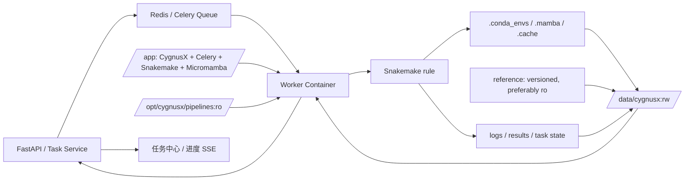
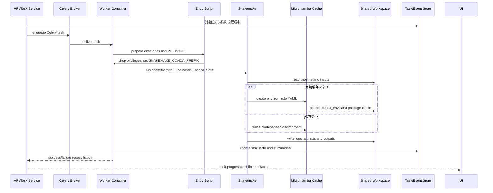

# Worker 轻量镜像与 Workspace 动态安装计划

## 0. 这个 Worker 镜像模块如何发挥作用

Worker 镜像是 Celery/Snakemake 异步执行链的基础运行时。Web/API 进程只负责创建任务、保存参数和投递队列；Worker 容器从固定的 `/app` 运行 CygnusX 任务代码，从只读的 `/opt/cygnusx/pipelines` 读取 RNAFlow/ATACFlow，从可写的 `/data/cygnusx` 读取输入、写入日志和结果。流程代码、参考基因组和 Conda 环境不打包进镜像，而是由共享 Workspace 挂载和内容哈希缓存提供，使流程迭代、Worker 重建和环境复用彼此解耦。

任务首次触发某个 Snakemake rule 时，Worker 通过 Micromamba 在 `/data/cygnusx/.conda_envs` 创建环境，并把包下载缓存放在 `.mamba`；后续任务按环境定义复用缓存。入口脚本在降权到统一的 `PUID/PGID` 后启动 Celery，执行器显式传入 `--conda-prefix`，避免不同进程或 Snakemake 版本将依赖写到宿主机个人目录。共享目录的权限、并发建环境、流程版本和日志路径属于运行契约，不能依靠镜像内 root 权限绕过。

本文是实施计划，`Dockerfile.worker`、挂载和验证步骤在全部落地前不能当作当前生产状态。实现时应保持镜像 tag 不可变且带 Git SHA，Web/Worker 使用同一发布版本，流程挂载只读，用户数据和结果使用协议规定的共享根目录；未来可将每个 Rule 的依赖迁移到独立 OCI 容器，但 Worker 仍只承担调度、队列和状态回传职责。

### 0.1 运行架构图：轻量 Worker 与共享数据平面



### 0.2 实现图：任务投递、动态建环境与结果回传



## 目标

构建轻量级 CygnusX Worker 镜像，仅包含运行 Celery 与 Snakemake 所需的基础组件：

- 基础 OS 与 Python 3.11；
- CygnusX Worker/Celery 任务代码；
- Celery、Snakemake、流程监控 logger 插件；
- Micromamba（通过 `conda` 兼容包装器供 Snakemake 调用）；
- 极少量运行时系统工具，例如 `curl`、`wget`、`git` 与证书包。

不将 RNAFlow、ATACFlow、参考基因组、索引文件或流程的 Conda 环境写入镜像。Worker 启动后从 Workspace/共享存储挂载流程代码；Snakemake 在首次运行规则时，将环境动态创建并缓存到共享盘。

该方案面向当前小规模测试：镜像构建快、体积小、流程迭代无需重建镜像，同时为未来按 Rule 独立容器化保留演进空间。

## 架构边界

| 资源 | 位置 | 生命周期 | 说明 |
| --- | --- | --- | --- |
| CygnusX Worker/Celery 代码 | Worker 镜像 `/app` | 随镜像发布 | Web 与 Worker 必须使用同一 Git 提交或发布标签。 |
| Celery、Snakemake、Micromamba | Worker 镜像 | 随镜像发布 | 只提供调度和动态建环境的基础能力。 |
| RNAFlow、ATACFlow 流程代码 | 宿主 Workspace → `/opt/cygnusx/pipelines:ro` | 运行时挂载 | 修改流程后重启 Worker 即可生效，无须重建 Worker 镜像。 |
| Snakemake Conda 环境缓存 | `/data/cygnusx/.conda_envs` | 共享、持久化、可写 | 按环境 YAML 的内容哈希复用；首次规则运行会在线创建。 |
| Micromamba 下载/包缓存 | `/data/cygnusx/.mamba` | 共享、持久化、可写 | 减少后续创建环境的重复下载。 |
| 任务输入、工作目录、日志、结果 | `/data/cygnusx` | 共享、持久化、可写 | Web 与 Worker 必须访问同一逻辑目录。 |
| 参考基因组与索引 | `/data/cygnusx/reference` | 共享、版本化、建议只读 | 不写入镜像，以免镜像过大且参考更新困难。 |

## 固定容器路径

为避免流程注册、任务参数和运行命令随宿主机变化，容器内使用以下固定路径：

```text
/app
/opt/cygnusx/pipelines
/data/cygnusx
/data/cygnusx/.conda_envs
/data/cygnusx/.mamba
/data/cygnusx/reference
```

宿主机实际位置由 `data/worker_config.yaml` 管理。例如 Worker 服务器可以将仓库内 `pipelines/` 或独立的流程仓库挂载到容器内的 `/opt/cygnusx/pipelines`。

所有 Flow 的 `execution.snakefile` 必须使用容器内绝对路径，例如：

```text
/opt/cygnusx/pipelines/RNAFlow/snakefile
/opt/cygnusx/pipelines/ATACFlow/snakefile
```

不要使用宿主机路径（例如 `/home/zj/pipeline/...`）。

## 实施步骤

### 1. 盘点 Workspace 运行依赖

1. 检查 RNAFlow、ATACFlow 中的 `envs/*.yaml`，确认每个 Rule 所需 Conda 环境。
2. 检查流程是否还硬编码宿主机路径：

   ```bash
   rg -n '/home/zj|\.local/share/mamba|miniconda3' pipelines src deploy
   ```

3. 将流程依赖分为：
   - Worker 基础依赖：Python、Celery、Snakemake、Micromamba、logger 插件；构建进镜像。
   - 生信工具依赖：由各流程的 `envs/*.yaml` 描述；由 Snakemake 运行时创建到共享缓存。
   - 数据资源：参考基因组、索引、用户数据；只在共享存储中维护。

### 2. 构建轻量 Worker 镜像

新增 `deploy/docker/Dockerfile.worker`：

1. 基于 `python:3.11-slim` 构建 CygnusX Worker Python 虚拟环境。
2. 安装仅必需的系统工具：`ca-certificates`、`curl`、`wget`、`git`、`bzip2`、`util-linux`（提供 `setpriv`，入口脚本用它降权，不再使用 `gosu`）、`btop`、`ncbi-blast+`、`unzip`、`zsh`，并从 `docker:27-cli` 复制 Docker CLI。
3. 安装 Celery、Snakemake 和 `snakemake-logger-plugin-rich-loguru`；应用代码仍构建进镜像，确保 Worker 能执行 Celery 任务。
4. 安装 Micromamba，并提供名为 `conda` 的兼容包装器，供 Snakemake 的 `--use-conda` 调用。
5. 不执行以下操作：
   - 不 `COPY pipelines/`；
   - 不复制 RNAFlow 或 ATACFlow；
   - 不执行 `snakemake --conda-create-envs-only`；
   - 不下载参考基因组与索引。
6. 使用入口脚本按 `PUID`/`PGID` 创建并校验共享盘的 `.conda_envs`、`.mamba` 和日志目录；随后降权启动 Celery，避免动态安装 Conda 环境时出现 `Permission Denied`。

### 3. 运行时挂载 Workspace 与共享存储

`docker-compose.worker.yml` 必须保留或增加：

```yaml
volumes:
  - ${WORKER_SHARED_DATA_DIR}:/data/cygnusx
  - ${WORKER_PIPELINE_DIR}:/opt/cygnusx/pipelines:ro
```

不要再挂载以下宿主机运行时目录：

```yaml
- /home/zj/miniconda3:/home/zj/miniconda3:ro
- /home/zj/.local/share/mamba:/home/zj/.local/share/mamba:ro
```

流程与环境的更新方式：

- 更新 RNAFlow/ATACFlow：更新 `WORKER_PIPELINE_DIR` 对应的 Workspace 后重启 Worker。
- 首次执行某个规则：Snakemake 在 `/data/cygnusx/.conda_envs` 创建对应环境。
- 后续执行：按环境定义内容哈希复用已创建环境。
- 强制重建某个环境：在确认没有任务运行后删除对应哈希目录，而非删除整个共享盘。

### 4. 配置动态 Conda 环境目录

Worker 必须设置：

```dotenv
SNAKEMAKE_USE_CONDA=true
SNAKEMAKE_CONDA_PREFIX=/data/cygnusx/.conda_envs
MAMBA_ROOT_PREFIX=/data/cygnusx/.mamba
XDG_CACHE_HOME=/data/cygnusx/.cache
```

CygnusX 执行器必须将 `SNAKEMAKE_CONDA_PREFIX` 显式传给 Snakemake：

```bash
snakemake --use-conda --conda-prefix /data/cygnusx/.conda_envs ...
```

只设置环境变量不够可靠；显式命令参数确保不同 Snakemake 版本和运行环境都使用共享持久化目录。

### 5. 权限与并发策略

1. `PUID`/`PGID` 在 Web、所有 Worker 和共享存储上必须保持一致。
2. Worker 入口脚本创建以下目录并交给 `PUID:PGID`：

   ```text
   /data/cygnusx/.conda_envs
   /data/cygnusx/.mamba
   /data/cygnusx/.cache
   /data/cygnusx/logs/app
   /data/cygnusx/logs/celery/tasks
   /data/cygnusx/logs/snakemake
   ```

3. NFS 使用 root-squash 时，应由存储管理员预创建并授权这些目录；入口脚本应在写入测试失败时直接报错，不应以 root 绕过权限问题。
4. 多 Worker 共享同一 Conda 缓存时，首次创建相同环境可能争用。小规模测试阶段建议：
   - 初次安装时暂时只运行一个 Worker；或
   - 按流程/环境提前执行一次小型预热任务。

### 6. 构建、启动与验证

构建镜像：

```bash
docker build \
  -f deploy/docker/Dockerfile.worker \
  -t cygnusx-worker:<release>-<git-sha> \
  .
```

`snakemake-logger-plugin-rich-loguru` 在 Dockerfile 内从 PyPI 固定安装（`>=0.3.0`），无需构建参数。

启动前：

```bash
python3 scripts/render_worker_config.py --check
make docker-up-worker
```

容器内验证：

```bash
snakemake --version
micromamba --version
conda --version
test -f /opt/cygnusx/pipelines/RNAFlow/snakefile
test -f /opt/cygnusx/pipelines/ATACFlow/snakefile
test -w /data/cygnusx/.conda_envs
test -w /data/cygnusx/.mamba
```

功能验证顺序：

1. 提交 RNAFlow `only_qc: true` 小任务，确认首次环境安装、日志与状态回传。
2. 重复提交同类任务，确认环境缓存复用且不重复下载。
3. 执行 RNAFlow 完整 DAG 预演与实际任务。
4. 执行 ATACFlow 小任务、完整 DAG 预演与实际任务。
5. 在不挂载宿主 Conda/Mamba 目录的前提下确认所有任务正常完成。

## 验收标准

- Worker 镜像不包含 RNAFlow、ATACFlow、参考基因组或流程 Conda 环境。
- Worker 运行时仅通过共享目录挂载流程 Workspace 和任务数据。
- `SNAKEMAKE_CONDA_PREFIX` 固定为 `/data/cygnusx/.conda_envs`，且 Snakemake 命令显式使用 `--conda-prefix`。
- 删除并重建 Worker 容器后，已安装的流程环境仍可从共享盘复用。
- 流程更新只需更新挂载的 Workspace 并重启 Worker，无需重建 Worker 镜像。
- Worker 使用 `PUID`/`PGID` 对共享缓存进行读写，不发生权限拒绝。

## 风险与限制

- 首次运行规则会下载并创建 Conda 环境，启动首个任务会较慢，并要求 Worker 可访问 Conda/Bioconda/流程所需的软件源。
- 共享 Conda 缓存应使用可靠的文件系统；并发首次建环境时需要避免多个 Worker 同时创建同一环境。
- 运行时流程代码必须版本化。Web 创建任务时与 Worker 实际挂载的 Pipeline 版本必须兼容，建议将流程 Git SHA 记录到任务元数据或发布清单中。
- 轻量镜像并不能保证每个 Rule 的基础 OS 完全隔离；不同流程的系统级依赖仍可能需要在 Worker 基础镜像中补充。

## 未来演进路线

当前“轻量 Worker 镜像 + Workspace 动态安装”是从宿主机依赖向可移植计算过渡的方案。最终目标是使用 Snakemake 的 `container:` 指令实现 **Rule 级独立容器化**：

1. 为每个 Rule 或可复用工具组构建小而纯净的 OCI 镜像，镜像只包含该规则所需的系统库和工具。
2. 将镜像推送到私有镜像仓库，并以不可变 tag 或 digest 固定版本。
3. 在 Snakefile 中通过 `container:` 绑定 Rule 与镜像，使规则在独立、可复现的运行环境中执行。
4. Worker 只保留 Celery、Snakemake、容器运行时与调度职责；不再负责动态安装大批 Conda 工具。
5. 后续结合 Slurm/Kubernetes 或 Snakemake executor，让每个 Rule 作为独立 Job/Pod 调度，并保留 `/data/cygnusx` 或对象存储作为统一数据平面。

该路线能将当前动态安装的迭代速度，逐步演进为生产环境所需的可复现性、隔离性、可审计性和弹性扩缩容能力。
