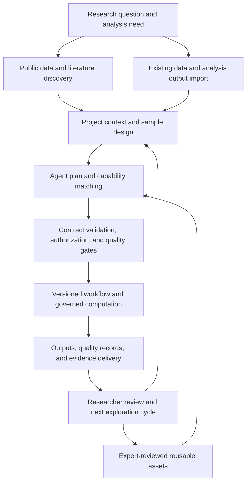
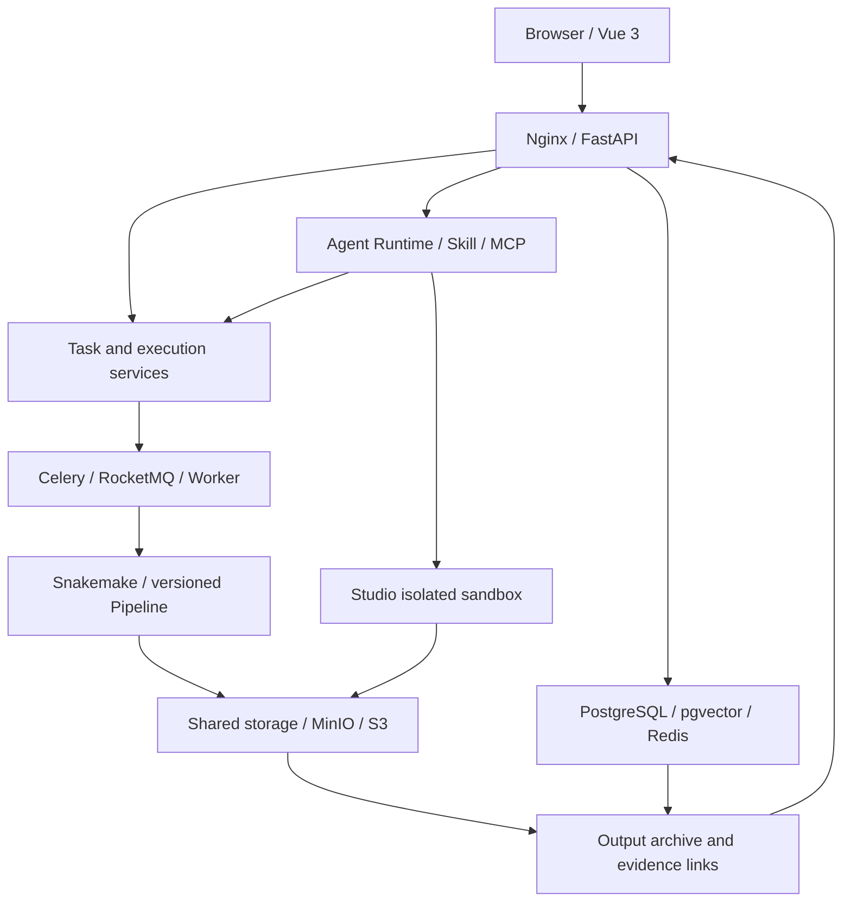

# CygnusX BioOps · Intelligent Research Platform

<p align="center">
  
</p>

<p align="center"><strong>FROM STARDUST, TO DISCOVERY</strong></p>
<p align="center"><strong>AI for Science Infrastructure for Life Sciences</strong></p>
<p align="center">Governed research Agents and trusted computational delivery infrastructure for life sciences</p>

<p align="center"><a href="docs/README.zh-CN.md">中文文档 / Chinese version</a></p>

---

**CygnusX BioOps believes that researchers should spend their time on scientific questions, not moving context between tools.**

Start with a question, find or import the right data, run governed computational analysis, verify results and literature evidence, and turn every study into reusable, traceable research assets.

Research Agents connect natural-language needs to professional tools. A versioned Flow Framework carries standard analyses. Skill contracts, permission governance, and quality gates constrain execution. Project records and evidence metadata connect data, process, and delivery.

> **From Research Questions to Reproducible Scientific Evidence.**
>
> People ask scientific questions; the system organizes computational experiments. People judge scientific evidence; the system records, delivers, and preserves the research process.

AI does not replace scientific judgment. It absorbs repetitive, tedious, and error-prone engineering work. The current focus is a trustworthy computation and delivery chain for real research settings. The long-term goal is a Research Agent built on domain knowledge, tool capabilities, and evidence constraints.

## Project origin

At **00:08:16 on June 25, 2026**, the first commit (`bb13fd2b`) marked the birth of OmicHub, the predecessor of CygnusX. Started by a PhD researcher in the life sciences, the project was initially a private multi-omics analysis platform addressing cumbersome workflows, complex computing environments, and poor reproducibility.

CygnusX has since evolved into an ecosystem covering **research data discovery, Agent orchestration, standardized scientific computing, and verifiable delivery**. Its long-term direction is a novel, verifiable, and reproducible Scientific Agent Framework at the intersection of computing and life sciences.

> Start from real research needs, build on reliable engineering, and pursue original technical innovation.

## Why CygnusX?

An omics study crosses databases, download tools, analysis scripts, clusters, visualization software, and reporting systems. The real delay is usually the handoff between steps: repetitive transfer and reconciliation that nobody wants to do but everyone must do.

| Research difficulty | Platform response |
| --- | --- |
| Research intent is hard to map to database fields; data and papers must be searched separately | Conversational exploration connects public omics data, sample metadata, and literature sources |
| Sample sheets, parameters, and environments are repeatedly configured, so errors surface late | Declarative workflows, parameter validation, and preflight checks organize standard analysis |
| Adding a contrast, enrichment analysis, or chart still requires an expert to rewrite a script | Incremental exploration reuses existing outputs within reviewed Skill boundaries |
| AI-generated code and explanations are difficult to verify | Tool permissions, statistical assumptions, quality checks, and provenance enter the execution chain |
| Scripts, environments, parameters, and decisions are scattered after handoff | Projects and run records organize inputs, outputs, environments, and rerun information |

## A cumulative intelligent research infrastructure

1. **Make research tasks executable.** Turn a research need into explicit analysis objects, parameters, and governed tasks.
2. **Make results verifiable.** Record provenance, workflow versions, runtime environments, quality metrics, and outputs.
3. **Make research experience reusable.** Preserve reviewed methods, quality rules, and delivery templates as Flows, Skills, MCP tools, and domain knowledge.

The intended cycle is: research needs drive tool building, real delivery produces engineering assets, and run records improve capabilities. A lab's most valuable asset is methodological judgment built through repeated iteration.

## From data entry to evidence delivery

Research can start from **public data discovery** or **existing experimental data and analysis outputs**. Both enter a shared project context, which organizes standard analysis or incremental exploration.



The diagram describes the intended organization; availability depends on component and deployment version. The computational delivery path connects data, tasks, execution, QC, and outputs. The research exploration path additionally connects questions, external evidence, interpretation, and follow-up research. Researchers remain responsible for hypotheses, experimental validation, and critical conclusions.

## How the ecosystem works together

**CygnusX BioOps organizes discovery, acquisition, standard analysis, and reporting through a shared project context. Ecosystem components provide specialist capabilities, while the Flow Framework supplies common workflow and integration conventions.**

<p align="center">
  
</p>

| Component | Role in the research chain |
| --- | --- |
| **[CygnusX BioOps](https://github.com/xsx123123/omichub)** | Project context, Agents, permissions, tasks, data, delivery, run records, archives, and evidence links |
| **[Treasure-Seeking Mouse](https://github.com/xsx123123/Treasure-Seeking_Mouse)** | Conversational public omics data discovery, literature search, and provenance checks |
| **[Polariseq](https://github.com/xsx123123/polariseq)** | Resumable sequencing-data transfer with integrity checks |
| **[FlowFrame](https://github.com/xsx123123/FlowFrame)** | General omics workflow architecture and standardized integration |
| **[RNAFlow](https://github.com/xsx123123/RNAFlow)** | Bulk RNA-seq QC, alignment, quantification, and differential analysis |
| **[ATACFlow](https://github.com/xsx123123/ATACFlow)** | ATAC-seq QC, alignment, peak calling, differential accessibility, and motif analysis |
| **[AnnoFlow](https://github.com/xsx123123/kegg_annotation)** | Functional annotation using eggnog-mapper and KofamScan with KO cross-validation |
| **[BioReport](https://github.com/xsx123123/bioreport)** | Python/Quarto-based interactive HTML and PDF reporting |

Typical path: discover data and papers → acquire or import data → select a versioned analysis capability → organize results and methods with BioReport → link runs, outputs, and evidence in CygnusX.

## Four technical pillars

| Pillar | Engineering meaning | Research value |
| --- | --- | --- |
| **Research Agents** | Requirement parsing, task decomposition, role routing, and governed tool dispatch | Inspectable analysis plans |
| **Reproducible Workflows** | Declarative Flows, Snakemake, versioned workflows, and environment records | Fewer failures from ad hoc scripts and environment drift |
| **Governed Execution** | Skill contracts, tool allowlists, isolated sandboxes, approvals, and quality gates | Authorized, verifiable automation |
| **Verifiable Evidence** | Links between projects, runs, Cases, Artifacts, Evidence, and Manifests | Clear provenance, checks, and rerun requirements |

## The Agent × Skill × Flow model

- **Agents organize tasks:** understand requests, fill gaps, select capabilities, propose plans, and interpret real tool results.
- **Skills constrain professional actions:** describe scope, inputs, outputs, prerequisites, versions, failure handling, assumptions, and quality requirements.
- **Flows carry standard computation:** reviewed methods become declarative, versioned workflows executed by deterministic systems.

Production delivery means AI dispatches reviewed workflows and tools. Production roles have no arbitrary shell, workflow-YAML, or formal database-write access. OmicStudio may generate exploratory code inside a capability-controlled isolated sandbox; exploratory code must pass the required checks before formal delivery.

## L1–L4 research work styles

| Entry point | Suitable work | Boundary |
| --- | --- | --- |
| **L1 Bioinformatics toolbox** | Repeatable tool operations and lightweight visualization | Managed tool registration, parameters, and state |
| **L2 Stardust AI Assistant** | Requirement clarification, retrieval, and lightweight calls | Tool allowlists; people review key judgments |
| **L3 OmicStudio** | Interactive deep analysis | Capabilities run in restricted environments |
| **L4 Multi-Agent workspace** | Planning, delegation, quality review, and delivery | Feature-gated, independently accepted preview path |

## Quality and evidence in delivery

Trusted computation must answer who can execute, where results came from, what checks were performed, how to rerun them, and what actually happened.

| Stage | Focus |
| --- | --- |
| **Before submission** | Input completeness, samples, groups, parameter ranges, workflow fit, and resources |
| **During execution** | Workflow state, resource anomalies, and analysis-specific QC |
| **Before delivery** | Output integrity, statistical design, quality results, and provenance |

Formal delivery links **Project/Run**, **Case**, **Artifact**, **Evidence**, and **Manifest** records. Target outputs include methods, parameters, workflow version, environment snapshot, software inventory, quality records, checksums, audit events, and a rerun entry point. Interpretations distinguish platform results, external evidence, and synthesis.

## System architecture



| Layer | Technologies |
| --- | --- |
| **Frontend** | Vue 3, TypeScript, Vite, Naive UI, Pinia |
| **Backend** | Python 3.11, FastAPI, SQLAlchemy, Alembic |
| **Data and knowledge** | PostgreSQL/pgvector, Redis, MinIO/S3 |
| **Agent runtime** | Declarative assembly, ReAct/LangGraph, MCP, role-based tools |
| **Workflow execution** | Flow YAML, GenericFlowBuilder, Snakemake, governed workers |
| **Isolation and observability** | Capability sandboxes, resource/network limits, logs, audit, OTel |

## Current capabilities and roadmap

Standard forms, validation, task queues, project binding, traceable archives, declarative Agents, Skill management, knowledge retrieval, Studio isolation, and core governed-execution mechanisms are implemented to varying release and deployment scopes. AgentTeams collaboration, approval tokens, standalone evidence credentials, workflow-governance Agents, and automatic data feedback remain experimental or roadmap items unless a release explicitly accepts them.

The platform has been privately deployed in the genomics laboratory of the College of Horticulture and Forestry Sciences at Huazhong Agricultural University, with RNA-seq and ATAC-seq workflows built and validated. More than **600 bioinformatics and research-analysis Skills** have been accumulated; exact inventories are version-specific and belong in release notes.

Roadmap stages are trusted computation and delivery; ecosystem connections and incremental exploration; evidence depth and asset governance; and domain Research Agents. HPC/Systems Agents, Slurm/Kubernetes extensions, a desktop client, domain-model training, and broader integrations will be released as developed and accepted.

## Deployment and data boundaries

The platform supports local/LAN deployment, configured cloud deployment, and a hybrid direction that separates local storage, cloud inference, and compute by access policy. External models, MCP servers, download sources, and logs require separate configuration. The platform is a research and development tool; industry certification, clinical diagnosis, and regulatory compliance require independent assessment.

## Quick start

Requirements: Python >= 3.11, Node.js >= 18, Docker >= 24, and [uv](https://docs.astral.sh/uv/).

```bash
uv sync --frozen
cd frontend && npm ci && cd ..
make docker-up
make migrate
make dev
```

In another terminal:

```bash
cd frontend
npm run dev
```

Open `http://localhost:5173` for the frontend and `http://localhost:8000/docs` for API documentation. See [wiki](wiki/) and the [Docker deployment guide](deploy/docker/README.md) for complete deployment instructions.

## Technical details

- Agent identity, prompts, models, tool allowlists, and runtime capabilities are declared in `data/ai/*.yaml`.
- MCP is layered across built-in Presets, external Servers, and pipeline-specific Servers; generated tools require static checks, sandbox tests, and human review.
- `flows/*.yaml` describes workflow metadata, parameters, sample sheets, execution, and pipeline mapping. `tool_configs/tools_schema.yaml` maps tools to LLM functions.
- Platform Skills (`data/ai/skills/`) and development Skills (`.agents/skills/`) are physically and logically isolated.
- Studio uses xterm.js, WebSocket, and container ttyd. The sandbox baseline includes non-root execution, read-only rootfs, `cap_drop=ALL`, resource limits, and restricted networking.

## Project structure

```text
src/cygnusx/          Backend Python package (DDD layers)
frontend/             Vue 3 frontend
flows/                Flow YAML declarations
pipelines/            RNAFlow / ATACFlow / scrna implementations
tool_configs/         Toolbox and terminal configuration
data/                 Agent, Skill, and runtime configuration
integrations/         AgentTeams Bridge / Gateway
deploy/               Docker Compose and runtime images
alembic/              Database migrations
ARCHITECTURE_DESIGN/  Project architecture and design index
tests/                unit / integration / e2e tests
```

## Documentation

- [Architecture index](ARCHITECTURE_DESIGN/README.md)
- [Platform architecture](ARCHITECTURE_DESIGN/CygnusX_platform_architecture.md)
- [Agent execution framework](ARCHITECTURE_DESIGN/CygnusX_agent_execution_framework.md)
- [Flow integration architecture](ARCHITECTURE_DESIGN/CygnusX_flow_architecture.md)
- [MCP architecture](ARCHITECTURE_DESIGN/CygnusX_mcp_architecture.md)
- [Sandbox architecture](ARCHITECTURE_DESIGN/CygnusX_sandbox_architecture.md)
- [Usage and deployment](wiki/)
- [Docker deployment guide](deploy/docker/README.md)
- [Tool-page specification](tool_configs/tools_design.md)
- [Chinese README](docs/README.zh-CN.md)

## Repository scope and license

Public, competition-archive, and internal versions may differ. Use the relevant commit, release notes, and configuration as the authority for runnable behavior, deployment requirements, and test results. Independent ecosystem components are maintained in their own repositories.

See the complete [LICENSE](LICENSE). The project currently uses Apache License 2.0 with the Commons Clause addition.

---

<p align="center"><strong>FROM STARDUST, TO DISCOVERY · From stardust toward scientific discovery</strong></p>
