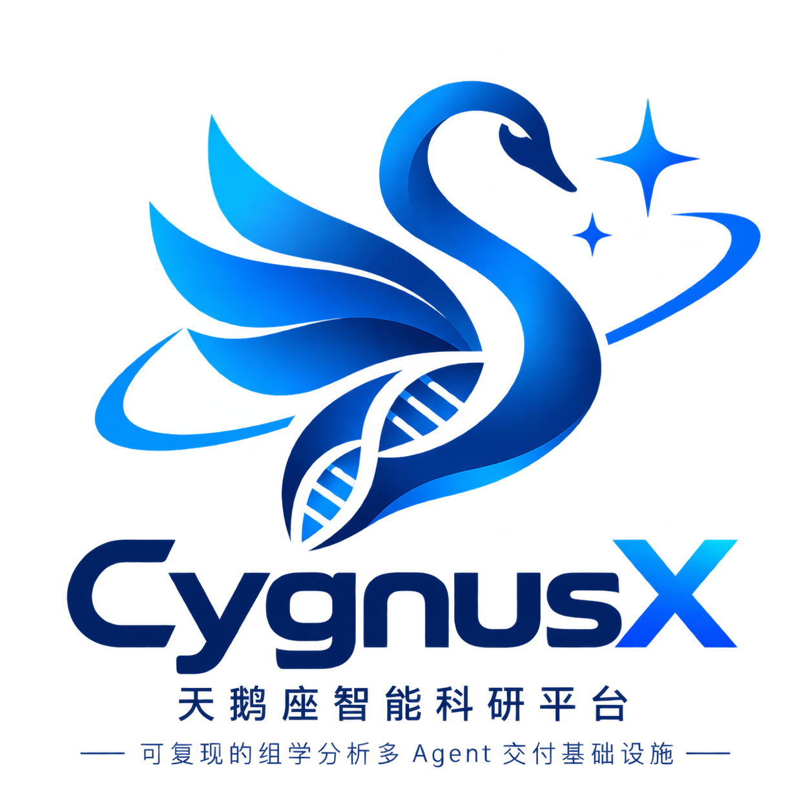
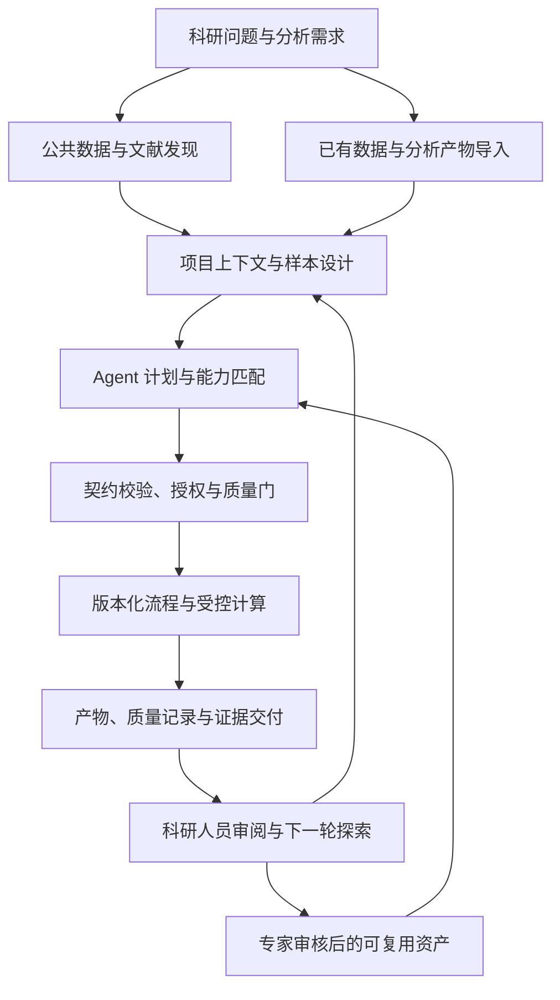
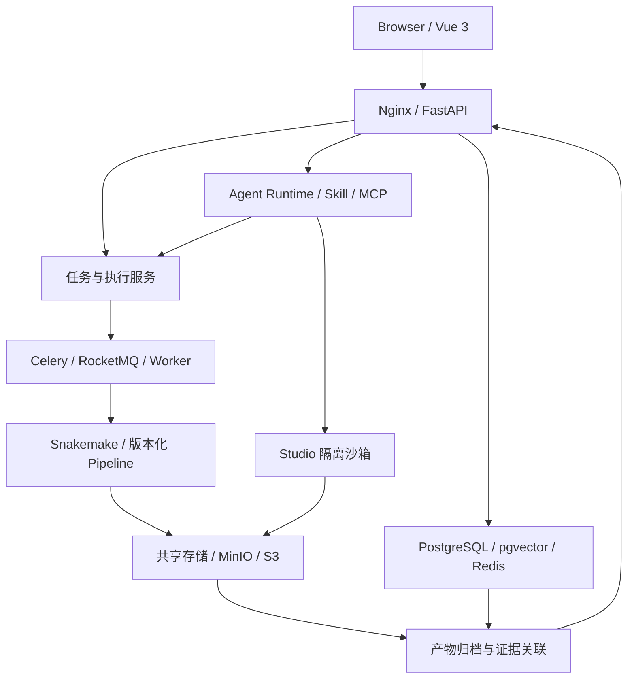

<p align="center">
  
</p>

<h1 align="center">CygnusX BioOps · 天鹅座智能科研平台</h1>

<p align="center">
  <a href="https://www.python.org/"></a>
  <a href="./LICENSE"></a>
</p>

<p align="center"><strong>FROM STARDUST, TO DISCOVERY</strong></p>
<p align="center"><strong>AI for Science Infrastructure for Life Sciences</strong></p>
<p align="center">面向生命科学的受控科研 Agent 与可信计算交付基础设施</p>

**CygnusX BioOps 希望让科研人员从一个问题出发，找到或导入合适的数据，组织受控的计算分析，核验结果与文献证据，并把每次研究积累为可复用、可追溯的科研资产。**

平台以科研 Agent 连接自然语言需求与专业工具，以版本化 Flow Framework 承载标准分析，以 Skill 契约、权限治理与质量门约束执行，以项目记录和证据元数据连接数据、过程与交付。它服务于生命科学研究中的数据发现、组学计算、增量探索、结果解读和项目传承。

> **From Research Questions to Reproducible Scientific Evidence.**
>
> 人提出科学问题，系统组织计算实验；人判断科学证据，系统记录、交付并沉淀研究过程。

当前建设重点是打磨真实科研场景中的可信计算与交付链路；长期目标是在这一底座上发展具有领域知识、工具能力和证据约束的 Research Agent。各能力的开放范围和验收状态见下文。

## 为什么建设 CygnusX？

一次组学研究通常跨越数据库、下载工具、分析脚本、计算集群、可视化软件和报告系统。真正影响研究效率的，往往是这些环节之间的衔接：

| 科研中的实际困难 | 平台的解决思路 |
| --- | --- |
| 科研意图难以映射到数据库字段，数据与关联论文需要分别查找 | 用对话式探索连接公共组学数据、样本元数据与文献来源 |
| 样本表、参数和环境依赖反复配置，错误发现较晚 | 用声明式流程、参数校验和前置预检组织标准分析 |
| 追加一个对比组、富集分析或图表，仍需等待专家重新编写脚本 | 在已有产物和已审核 Skill 范围内开展增量探索 |
| AI 生成代码与解释后，难以判断执行是否正确、结论有何依据 | 将工具权限、统计适用条件、质量检查与来源记录纳入执行链路 |
| 项目交接后，脚本、环境、参数和判断依据散落在不同位置 | 以项目和运行记录组织输入、产物、环境与重跑信息 |

平台希望减少科研人员在工具之间反复搬运上下文的成本，同时让计算过程能被检查，让经验能在团队中持续积累。

## 最终目标：可积累的智能科研基础设施

CygnusX 的发展目标包含三个相互衔接的层次：

1. **让研究任务可以执行。** 从数据发现或已有数据导入开始，将科研需求转化为明确的分析对象、参数和受控任务。
2. **让执行结果可以核验。** 记录输入来源、流程版本、运行环境、质量指标与产物信息，支持结果检查、重复运行和人员交接。
3. **让研究经验可以复用。** 将反复出现的分析方法、质量规则与交付模板，经专家审核后沉淀为 Flow、Skill、MCP 工具和领域知识。

长期希望形成“科研需求推动工具建设，真实交付沉淀工程资产，运行记录支持能力改进”的循环，让课题组积累的经验转化为可持续维护的研究能力。

其中，工程资产的提炼与复用可以由专家参与完成；执行数据自动回流、领域模型训练、实验反馈驱动的自主研究属于后续方向，需要分别验证数据授权、方法可靠性和实际效果。

## 从数据入口到证据交付

平台设计覆盖两类研究起点：**发现公共数据**，以及**导入已有实验数据或分析产物**。两者进入统一的项目上下文，再按任务需要组织标准分析或增量探索。



上图表达平台的目标组织方式，各节点的可用范围取决于对应组件和部署版本。技术白皮书记录了公共 RNA-seq 数据发现、样本设计还原、分析编排与结果归档的端到端案例；案例中的链路贯通，应与跨数据类型、跨课题的普遍可用性分别评估。

**计算交付链路**连接数据、任务、执行、质控与产物；**科研探索链路**进一步连接问题、外部证据、结果解释与后续研究。后者仍需要科研人员完成假设判断、实验验证和关键结论审核。

## 生态组件如何协作？

CygnusX 承担项目上下文、权限、任务、数据和交付的统一组织。生态组件提供各环节的专业能力，通过明确的接口和产物约定协作。

| 组件 | 在科研链路中的职责 | 与平台的关系 |
| --- | --- | --- |
| **科研寻宝鼠**（原 GEO 寻宝鼠） | 对话式公共组学数据发现、文献检索与来源核验 | 为研究提供候选数据、样本信息和关联证据；也可独立开展文献搜索 |
| **Polariseq** | 测序数据下载与传输 | 为数据获取提供工具能力，接入时沿用平台的任务状态、日志与数据管理约定 |
| **FlowFrame / Flow Framework** | 多组学流程架构规范与标准化接入 | 为流程参数、样本表、模块输入输出与执行配置提供统一组织方式 |
| **RNAFlow / ATACFlow 等流程** | 执行具体组学分析 | 作为版本化计算资产，由受控 Worker 调度 |
| **BioReport** | 将标准分析结果组织为可阅读的报告 | 承接图表、结果与方法说明，支持一致的交付体验 |
| **CygnusX BioOps** | 串联科研入口、Agent、计算与交付 | 维护项目关系、权限边界、运行记录和证据关联 |

以上是生态职责划分。平台内部版本、公开仓库和独立组件的发布进度可能不同，安装一个组件不等于获得整套链路；具体接入以对应版本的配置、文档与验收案例为准。

## 四大技术支柱

| 支柱 | 工程含义 | 对科研工作的价值 |
| --- | --- | --- |
| **Research Agents** | 需求解析、任务拆解、领域角色路由与受控工具调度 | 将自然语言需求转化为可检查的分析计划 |
| **Reproducible Workflows** | 声明式 Flow、Snakemake、版本化流程与环境记录 | 降低临时脚本和环境漂移带来的复现困难 |
| **Governed Execution** | Skill 契约、工具白名单、隔离沙箱、审批与质量门 | 将智能调度限制在已授权、可验证的能力范围内 |
| **Verifiable Evidence** | 项目、运行、Case、Artifact、Evidence 与 Manifest 的关联 | 说明结果来源、检查过程与重跑所需信息 |

## 核心机制：Agent × Skill × Flow

三个层次分工协作：

- **Agent 组织任务。** 理解需求、补齐信息、选择能力、提出计划，并基于工具返回的真实结果辅助解读。
- **Skill 约束专业动作。** 描述能力适用范围、输入输出、前置条件、版本和失败处理；科研分析还需要明确统计假设与质量要求。
- **Flow 承载标准计算。** 将审核后的分析方法固化为声明式、版本化流程，由确定性执行系统运行。

这使标准分析和个性化探索能够共享同一套数据与产物，同时保留不同的权限和验收要求。

### 标准分析与增量探索

标准分析以经过审核的 Pipeline 为基础，用户通过表单或 Agent 提交样本表与允许修改的参数。已有结果上的增量分析，在已接入 Skill 的能力范围内复用上游产物，例如调整对比、追加富集分析或重绘图表。

超出既有能力范围的需求，需要流程开发、方法评估或专家介入。新的探索方法经验证和审核后，才能成为正式可复用资产。

### 正式执行与探索沙箱

**正式交付遵循“AI 调度审核后的流程与工具”的原则。** 正式调度角色不拥有任意 shell、流程 YAML 或正式数据库写权限；提交通过受控接口完成，高风险动作需要审批，幂等键用于避免重复提交。

OmicStudio 可按 capability 在隔离沙箱内生成和执行探索性代码。探索性代码、临时结果和审核后的正式流程需要明确区分，进入正式交付前仍需完成相应检查。具体工具权限由运行路径和角色配置决定。

因此，“AI 只调度”描述的是正式生产链路的权限边界，不能理解为整个平台禁止所有探索性代码生成。

## L1–L4：适配不同科研工作方式

| 入口 | 适合的工作 | 执行与治理边界 |
| --- | --- | --- |
| **L1 生信工具箱** | 明确、重复的工具操作与轻量可视化 | 平台管理工具注册、参数和状态；部分工具可在浏览器本地运行 |
| **L2 星尘 AI 助手** | 需求澄清、知识检索与轻量工具调用 | 按工具白名单辅助探索，关键科学判断由人员审核 |
| **L3 OmicStudio** | 专业人员的交互式深度分析 | 代码、终端及其他能力按 capability 授权，在受限环境执行 |
| **L4 多 Agent 协作室** | 复杂任务的计划、分工、质量审阅与交付组织 | 高级协作链路按功能开关启用；预览能力需要单独部署验收 |

L1–L4 是不同的交互与工作形态。越接近正式交付，对权限、质量检查和审计记录的要求越严格。

## 质量与证据如何进入交付？

可信计算需要回答五个问题：谁有权执行、结果来自哪里、经过哪些检查、如何重复运行，以及实际发生了什么。

### 三个质量检查阶段

| 阶段 | 检查重点 | 异常处理原则 |
| --- | --- | --- |
| **提交前** | 输入完整性、样本与分组、参数范围、流程适用性和资源要求 | 阻止不满足前置条件的提交，要求补齐或修正 |
| **执行中** | 流程状态、资源异常与分析特定 QC 指标 | 按规则报告、暂停或终止；必要时转人工 |
| **交付前** | 产物完整性、统计设计、质量结果与来源说明 | 标注限制，完成审核后再确认交付 |

质量规则应随流程、数据类型和研究设计配置。某一示范流程的阈值不能直接作为所有物种和组学任务的通用标准；缺少可用规则时应报告检查缺口并交由人工判断。

### 从文件集合到可核验的证据包

平台以项目和运行记录组织研究过程，正式协作交付进一步通过 Case、Artifact、Evidence 与 Manifest 关联对象：

| 对象 | 记录的内容 |
| --- | --- |
| **Project / Run** | 研究上下文、输入、运行时间、过程记录与归档位置 |
| **Case** | 分析任务、交付范围、审批和审阅关系 |
| **Artifact** | 计算产物的位置、类型、生成过程与文件指纹 |
| **Evidence** | 支撑判断的计算结果、质控记录、外部来源及其关联 |
| **Manifest** | 一次交付包含的输入、参数、版本、环境、产物和重跑信息清单 |

目标交付内容包括方法与参数说明、流程版本、环境快照、软件清单、质量记录、产物校验值、审计事件和重跑入口。具体字段、导出格式和因果关系记录以部署版本为准；独立证据凭证导出仍需按路线图推进。

结果解释应区分**本平台计算结果、外部文献或数据库证据、综合推断**。文件哈希用于检查文件一致性，环境与参数记录支持复算；科研人员仍需审核分析方法的适用性与科学结论。

## 科研资产如何持续积累？

平台同时维护三类资产：

1. **数据与产物资产：** 输入数据、样本元数据、参考资源、中间结果与交付报告。
2. **方法与工具资产：** 专家审核后的流程、Skill、MCP 接口、参数模板与质量规则。
3. **知识与过程资产：** 文献来源、领域 SOP、运行记录、失败原因与专家修正意见。

一个已经完成的项目，可以成为下一次增量分析的起点；一个经过验证的定制模块，可以成为后续项目复用的工具。系统记录过程，专家负责筛选、验证和发布方法资产。

长期计划在明确授权和脱敏要求下，利用执行轨迹、质量结果与专家反馈改进检索、工具选择和领域 Agent。自动回流与模型演进需要独立评估，不能将模型自我评价直接作为科学质量依据。

## System Architecture



图中表示逻辑职责与数据关系，具体服务组合由部署配置决定。AgentTeams Bridge / Gateway 作为高级协作扩展接入，不要求基础分析链路依赖其存在。

| 层次 | 主要技术与职责 |
| --- | --- |
| 前端交互 | Vue 3、TypeScript、Vite、Naive UI、Pinia |
| 后端业务 | Python 3.11、FastAPI、SQLAlchemy、Alembic，组织用户、项目、任务与交付 |
| 数据与知识 | PostgreSQL / pgvector、Redis、MinIO / S3，承载元数据、检索、状态与文件 |
| Agent 运行时 | 声明式装配、ReAct / LangGraph、生命周期事件、MCP 与角色工具权限 |
| 流程执行 | Flow YAML、GenericFlowBuilder、Snakemake 与受控 Worker |
| 隔离与观测 | capability 沙箱、资源限制、网络限制、日志、审计与 OTel |

模型选择与推理服务通过配置接入，可按任务复杂度和角色需求选择模型。移动云 MoMA 是比赛材料中的集成实践；模型名称、供应商和云资源配置不作为通用架构的固定依赖。

## 当前能力与开发状态

项目持续迭代，内部研发版本、比赛提交版本与公开仓库可能存在差异。以下状态依据项目材料及本 README 对应的设计说明整理，应随发布版本更新。

| 能力 | 当前定位 | 使用边界 |
| --- | --- | --- |
| 标准流程表单、参数校验、任务队列与分析交付 | 当前主线能力 | 以具体流程接入和验证范围为准 |
| 项目绑定、时间戳归档、运行说明与环境记录 | 已实现的可追溯基础 | 普通聊天的统一扫尾归档仍需增强 |
| 领域 Agent 声明式装配、Skill 管理与知识检索 | 已实现并持续优化 | 能力可用性取决于工具、环境、权限与测试 |
| Studio 与终端隔离执行 | 当前工程基线 | 需要按部署配置核验镜像、资源和网络限制 |
| 数据发现到计算交付的端到端链路 | 白皮书记录了具体示范案例 | 不等同于所有数据库、数据类型和流程均完成通用接入 |
| DAG、计划确认、质量门、Artifact Registry 等受控执行扩展 | 材料记载已实现，部分默认关闭 | `MAS_ENABLED` 等开关与真实环境 E2E 验收需逐版本核实 |
| AgentTeams 高级多角色协同、审批令牌与交付 Manifest | 实验性 / 预览扩展 | 默认关闭，独立验收，基础主线不依赖其存在 |
| 独立证据凭证导出、专用流程治理 Agent、自动数据回流 | 路线图 | 不作为当前完整可用能力承诺 |

项目材料记录了在华中农业大学园艺林学学院基因组学实验室的私有化使用实践，以及 RNA-seq、ATAC-seq 等流程建设。真实案例用于说明已验证的场景，跨机构部署与其他流程仍需单独验证。

Skill 数量随版本变化，材料中存在 597 / 601 的不同统计口径。本 README 使用“数百项 Skill 资产”描述规模；已注册、可执行、通过测试和正式发布的数量，应在发布说明中分别列出。

### 如何评估工程效果？

平台关注标准分析配置时间、增量需求响应时间、流程定制成本和项目交接核验成本。材料中的示例包括约 5 分钟配置、已覆盖 Skill 范围内约 30 分钟响应、模块化定制约 1 天和约 10 分钟交接核验。

这些数字需要与具体任务、样本规模、硬件、计时起止点和人工参与程度一起报告。当前材料对“实测”与“估算”的表述存在差异，公开性能结论应以可检查的测量记录为准；方案生成、任务提交或文件核验耗时，也不能等同于完整计算运行耗时。

## 部署与数据边界

平台以私有化科研场景为重要落地方式，并逐步扩展云端与混合计算部署。

- **本地 / 局域网部署：** 在课题组或机构内部组织数据、计算环境与交付，适合已有本地计算和存储资源的场景。
- **云端部署：** 根据配置接入对象存储、推理服务与执行资源；云资源调度能力需按实际适配状态验证。
- **混合部署方向：** 根据数据访问策略划分本地存储、云端推理和计算资源，继续推进 Slurm / Kubernetes 等执行后端适配。

私有化部署可以帮助控制数据访问与传输范围；外部模型、MCP Server、下载源及日志链路仍需分别配置。数据是否出域由实际网络和内容策略决定。

平台当前定位为科研与研发工具。行业认证、临床诊断和法规合规能力需要独立评估与验收。

## Quick Start

### 环境要求

Python >= 3.11、Node.js >= 18、Docker >= 24、[uv](https://docs.astral.sh/uv/)。具体依赖以锁文件及部署文档为准。

### 本地开发

先按部署文档配置环境变量与服务连接，再执行：

```bash
# 在仓库根目录同步后端依赖
uv sync --frozen

# 安装前端依赖
cd frontend
npm ci
cd ..

# 启动基础服务、迁移数据库并启动后端
make docker-up
make migrate
make dev
```

另开终端，在仓库根目录执行：

```bash
cd frontend
npm run dev
```

前端访问 `http://localhost:5173`，API 文档访问 `http://localhost:8000/docs`。完整部署请阅读 [wiki](wiki/) 与 [Docker 部署说明](deploy/docker/README.md)，并替换示例配置中的默认密钥。

## Technical Details

### Agent、MCP 与 Skill

Agent 的身份、提示词、模型、工具白名单和运行时能力由 `data/ai/*.yaml` 声明，再由加载器装配。Chat、Studio、AgentTeams Manager 与 Worker 等路径需要遵循对应的轮次限制、审计、失败隔离和终态事件契约。

MCP 通过内置 Preset、外部 Server 和管线专属 Server 分层接入。MCP Builder 生成的工具需要经过静态检查、沙箱测试和人工审核，才能进入正式工具池。

平台业务 Skill 使用 `data/ai/skills/`、数据库索引与 Agent 绑定管理；`.agents/skills/` 面向开发助手。这是两套不同体系，开发技能的存在不能作为平台业务能力已接入的证据。

### Flow 与工具桥接

- `flows/*.yaml` 描述 `meta`、`parameters`、`sample_sheet`、`execution` 与 `pipeline_mapping`；Flow repository 支持 mtime 热重载，`GenericFlowBuilder` 生成执行输入。
- `tool_configs/tools_schema.yaml` 将工具映射为 LLM function；`ToolBridgeService` 按 `backend_shim`、同步、异步与页面调用模式分发，通过 `llm_payload` / `ui_payload` 分别返回模型和界面所需信息。
- 数据下载入口可按配置接入 EBI / NCBI 与云存储，复用任务状态和日志链路；默认关闭的入口需要先配置二进制、环境变量及权限。
- `docs/knowledge/` 与 `wiki/` 是知识内容源，管理员维护后可同步数据库并向量化检索。

### Studio、终端与运行安全

云端终端通过 xterm.js、WebSocket 和容器 ttyd 提供会话；Studio 按 `code`、`browser`、`document` capability 选择镜像。沙箱基线包括非 root、只读 rootfs、`cap_drop=ALL`、资源上限和受限网络。

运行容器按生命周期回收，需要保存的科研产物由平台存储与归档机制承接。运行时数据使用配置驱动的 `/data/cygnusx` 存储根，按用户与项目 / Case 组织隔离。应用、任务、沙箱与交付事件进入对应日志和审计链路，遥测故障不应中断业务。

## Roadmap

| 阶段 | 重点 | 验收关注点 |
| --- | --- | --- |
| **可信计算与交付** | 标准流程、参数约束、运行隔离、归档与质量检查 | 从合法输入到可检查产物的稳定链路 |
| **生态连接与增量探索** | 发现、下载、分析、报告与领域知识协作 | 项目上下文一致，接口与产物契约可验证 |
| **证据深化与资产治理** | 独立证据导出、因果关联、流程 / Skill 治理与反馈沉淀 | 来源完整、失败可诊断、方法变更可审核 |
| **领域 Research Agent** | 科研问题组织、计算实验规划和实验反馈协作 | 专家评估下的领域任务效果与科学责任边界 |

HPC / Systems Agent、Slurm / Kubernetes 扩展、桌面客户端、领域模型训练及更广泛生态接入，按实际研发与验收结果逐步发布。

长期研究链路希望连接“问题 → 数据 → 方法 → 计算 → 证据 → 新问题”，持续保留科研人员对假设、方法和结论的判断责任。

## 项目结构

```text
src/cygnusx/         后端 Python 包（DDD 分层）
frontend/            Vue 3 前端
flows/               Flow YAML 声明
pipelines/           RNAFlow / ATACFlow / scrna 等流程实现
tool_configs/        工具箱与终端配置
data/                Agent、Skill 和运行时配置
integrations/        AgentTeams Bridge / Gateway
deploy/              Docker Compose 与运行时镜像
alembic/             数据库迁移
ARCHITECTURE_DESIGN/  项目级架构与设计索引
tests/               unit / integration / e2e 测试
```

## Documentation

- [架构索引](ARCHITECTURE_DESIGN/README.md)
- [平台总览](ARCHITECTURE_DESIGN/CygnusX_platform_architecture.md)
- [Agent 执行框架](ARCHITECTURE_DESIGN/CygnusX_agent_execution_framework.md)
- [Flow 接入架构](ARCHITECTURE_DESIGN/CygnusX_flow_architecture.md)
- [MCP 架构](ARCHITECTURE_DESIGN/CygnusX_mcp_architecture.md)
- [沙箱架构](ARCHITECTURE_DESIGN/CygnusX_sandbox_architecture.md)
- [使用与部署](wiki/)
- [Docker 部署说明](deploy/docker/README.md)
- [工具页面规范](tool_configs/tools_design.md)

## Repository Scope

平台主体持续在内部研发仓库迭代。公开仓库、比赛代码归档与内部版本的功能范围可能不同，具体可运行内容、部署条件和测试结果以对应提交、发布说明和配置为准。

独立生态组件按各自仓库维护。内部案例、组件独立实现和公开版本原生接入，应在文档中分别说明。

## License

许可信息以根目录 [LICENSE](LICENSE) 完整文本为准。当前项目说明采用 Apache License 2.0 与 Commons Clause 附加条件；使用、分发及商业服务前，请阅读完整条款并核对对应版本的包元数据。

## FROM STARDUST, TO DISCOVERY

> *We are made of star-stuff.*

从恒星中诞生的元素组成了生命，也组成了追问生命的我们。CygnusX 希望用工程连接这份好奇心与严谨的研究实践：让问题找到数据，让计算留下依据，让发现能够被检验，让经验能够被传承。

**让每一次科研探索，都留下可以继续前行的证据。**
