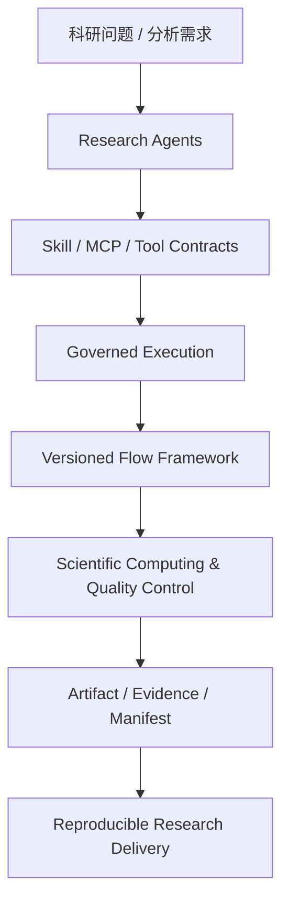

<p align="center">
  
</p>

<h1 align="center">CygnusX BioOps · 天鹅座智能科研平台</h1>

<p align="center">
  <a href="https://www.python.org/"></a>
  <a href="./LICENSE"></a>
</p>

<p align="center"><strong>AI for Science Infrastructure for Life Sciences</strong></p>
<p align="center">面向生命科学的受控科研 Agent 与可信计算交付基础设施</p>

CygnusX BioOps 面向生命科学研究，以受控科研 Agent 为智能协作层，以版本化 Flow Framework 为确定性执行层，通过标准化组学分析工作流、工具权限治理和科学证据追溯机制，探索从自然语言科研需求到可复现计算结果的可信交付路径。

> **From Research Questions to Reproducible Scientific Evidence.**
>
> 从科研问题出发，组织受控计算实验，形成可验证、可追溯、可复现的科研证据。
>
> 这是平台的技术方向与发展愿景，不代表所有科研发现闭环能力已经实现。

## 四大技术支柱

| 支柱 | 工程含义 |
| --- | --- |
| **Research Agents** | 理解科研需求，拆解任务，进行角色路由、多 Agent 协作和受控工具调度。 |
| **Reproducible Workflows** | 以声明式 Flow Framework、Snakemake、版本化流程和锁定环境执行标准分析。 |
| **Governed Execution** | 以 Skill 契约、工具权限、沙箱隔离、人工审批和质量门限制 Agent 行动范围。 |
| **Verifiable Evidence** | 以 Case / Artifact / Evidence / Manifest 关联输入、参数、环境、质量记录和审计信息。 |

## Why CygnusX BioOps?

科学计算中的 AI 不应只生成看似合理的回答。每次执行还需要回答：

### 可信计算的五个基本问题

| 问题 | 平台关注点 |
| --- | --- |
| **Who can execute?** | 身份、权限、资源范围和审批边界。 |
| **Where did the results come from?** | 输入数据、流程版本、环境、工具调用和外部来源。 |
| **Why should we trust them?** | 质量指标、验证过程和证据与推断的区分。 |
| **Can we reproduce them?** | 参数、依赖、随机性和重跑入口。 |
| **What actually happened?** | 时间线、决策、变更、异常和产物指纹。 |

因此，平台把一次计算的完成定义为：在明确权限边界内产生结果，并留下来源说明、质量证据、可复现信息和完整审计记录。

组学交付中的时间和人力数字仅用于工程估算，不是性能承诺，且不包含计算运行时间，必须以试点实测校准：

| 指标 | 传统参考方式 | 平台目标（估算） |
| --- | --- | --- |
| 标准分析提交配置 | 约 20 分钟 | 约 5 分钟 |
| 已沉淀 Skill 范围内的增量分析响应 | 约 480 分钟 | 30 分钟以内 |
| 流程定制改造 | 约 5 人天 | 约 1 天 |
| 人员交接后的项目核验 | 以周计且常失败 | 约 10 分钟照单核验 |

## 从 Agent 到科研基础设施



当前标准交付链路从明确的分析任务开始；面向科研问题的假设组织、实验设计和闭环发现仍属于逐步建设的长期方向。科研人员负责科学假设、实验验证和关键结论，系统负责在授权范围内组织计算、记录证据并报告限制。

## 核心原则：AI 只调度受控生产流程

分析管线由专家搭建并审核，固化为声明式、版本化流程资产。AI 负责需求解析、计划拆解、角色路由、工具调度和结果解释，不直接修改正式分析 Pipeline 或数据库。

Agent 不获得 shell、流程 YAML 或正式数据库写权限；高风险动作需要一次性人工审批凭证，提交使用幂等键避免重复计算。OmicStudio 可以在受限沙箱内进行探索性代码生成和执行，但探索空间与正式交付链路隔离。每次执行关联流程版本、参数、环境、软件清单、产物指纹、随机性信息和重跑命令。

## 平台概览：L1–L4

| 入口 | 定位 | 当前边界 |
| --- | --- | --- |
| **L1 生信工具箱** | 确定性、重复性生信工具和可视化。 | 工具注册、参数校验和任务状态由平台控制。 |
| **L2 星尘 AI 助手** | 轻量需求理解、知识检索和工具调用。 | 适合探索性任务，不替代正式科学审核。 |
| **L3 OmicStudio** | 面向专业人员的交互式深度分析。 | 代码和终端运行在隔离沙箱，能力由 Agent capability 授权。 |
| **L4 多 Agent 协作室** | Manager、领域专家、Quality Auditor 和 Delivery Reporter 的协作。 | 正式分析进入 Case 受控交付链；通用任务可走轻量调度。 |

越接近正式交付，权限、质量门和审计要求越严格。L1–L4 是不同的工作形态和成本边界，不是对科研结论自动化程度的承诺。

## System Architecture

```text
Browser → Nginx → Vue 3 / FastAPI
                     ├── PostgreSQL + pgvector / Redis / MinIO
                     ├── Celery / RocketMQ → Snakemake → shared storage
                     └── AgentTeams Bridge / Gateway → role-scoped workers
```

- **后端**：Python 3.11、FastAPI、SQLAlchemy、Alembic、PostgreSQL/pgvector、Redis、MinIO/S3、Celery 和 RocketMQ。
- **前端**：Vue 3、TypeScript、Vite、Naive UI 和 Pinia。
- **AI 与 Agent**：数据驱动 Agent 装配、ReAct 与 LangGraph 双执行引擎、统一生命周期事件、MCP 三层接入、pgvector 记忆和 AgentTeams 协作层。
- **流程执行**：Flow YAML 描述元数据、参数、样本表、执行资源和 pipeline 映射；`GenericFlowBuilder` 生成流程输入，Snakemake 在受控 Worker 中执行。
- **运行隔离**：Studio 与终端使用非 root、只读根文件系统、capability 路由、资源限制和网络白名单等沙箱基线。

## Scientific Evidence & Reproducibility

正式交付以 Case 组织，并把以下对象关联起来：

```text
Research Question
        ↓
Input Data → Versioned Flow → Quality Control
        ↓           ↓
External Evidence → Artifacts
              ↓
       Evidence Report → Human Review
```

交付物区分三类来源：本平台计算、外部文献或数据库证据、综合推断。`Case / Artifact / Evidence / Manifest` 用于记录输入、参数、环境、软件版本、质量结果、产物哈希、审计事件和重跑入口。系统提供可核验的计算证据，不把模型生成内容直接当作科学结论，也不宣称临床诊断或法规合规能力。

## Capabilities & Development Status

### 已实现或作为当前工程基线维护

- L1–L4 入口、受控 Agent 执行、统一事件与审计链路。
- 声明式 Flow catalog、YAML 参数表单、热重载和 Snakemake Worker 执行。
- MCP 内置 Preset、外部 Server 和管线专属接入；MCP Builder 生成内容需经过静态检查、沙箱测试和人工审核。
- 平台 Skill 的磁盘真相源、数据库索引、版本管理、Agent 绑定和渐进式发现。
- PostgreSQL + pgvector 记忆/知识检索、任务日志、产物归档和证据元数据。
- Studio capability 沙箱、终端隔离、资源配额、网络限制和结构化安全审计。

### 内部研发与独立生态组件

平台主体在内部私有研发仓库持续迭代；FlowFrame、RNAFlow、ATACFlow、Treasure-Seeking Mouse、BioReport 等组件的具体集成范围以对应仓库、版本和文档为准。没有明确接入证据的组件，不能视为公开版本的内置能力。

### 长期方向（未作为当前产品承诺）

- 面向科研目标的假设组织、计算实验规划和实验反馈闭环。
- HPC / Systems Agent、Slurm/Kubernetes 扩展和桌面客户端。
- 更广泛的科研数据发现、标准化分析、报告和领域知识生态集成。

## Quick Start

### 环境要求

Python >= 3.11、Node.js >= 18、Docker >= 24、[uv](https://docs.astral.sh/uv/)。

### 本地开发

```bash
uv sync --frozen
cd frontend && npm ci
make docker-up
make migrate
make dev
```

另开终端运行 `cd frontend && npm run dev`，然后访问 `http://localhost:5173`；API 文档位于 `http://localhost:8000/docs`。生产或完整部署请先阅读 `wiki/deployment/` 和 `deploy/docker/README.md`，并替换 `.env.example` 中的默认密钥。

## Technical Details

### Agent、MCP 和 Skill

Agent 的身份、提示词、模型、工具白名单和运行时能力由 `data/ai/*.yaml` 声明，并由加载器装配。执行路径包括 Chat、Studio、AgentTeams Manager 和 Worker；所有路径共享轮次限制、工具调用审计、失败隔离和终态事件契约。

MCP 工具通过内置 Preset、外部 Server 和管线专属 Server 分层接入。MCP Builder 的规划、编码、测试、文档和注册过程在沙箱中完成，生成代码不能绕过审核直接进入生产工具池。

平台 Skill 与 `.agents/skills/` 中供开发助手使用的技能目录是两套不同体系。业务 Skill 通过 `data/ai/skills/`、数据库索引和 Agent 声明绑定；两者不能相互推断或混用。

### Flow、工具桥接与科研数据

- `flows/*.yaml` 描述 `meta`、`parameters`、`sample_sheet`、`execution` 和 `pipeline_mapping`；Flow repository 支持 mtime 热重载，`GenericFlowBuilder` 生成分析输入。
- `tool_configs/tools_schema.yaml` 将工具编译为 LLM function，`ToolBridgeService` 通过 `backend_shim`、同步、异步和页面调用模式分发，并以 `llm_payload` / `ui_payload` 双通道返回结果。
- 数据下载入口可接入 EBI/NCBI 公共数据和云存储直拉，任务复用统一状态与日志链路；默认开关关闭，启用前需配置对应二进制和环境变量。
- `docs/knowledge/` 与 `wiki/` 是知识内容源，管理员编辑后可同步数据库并向量化供检索使用。

### 终端与 Studio 沙箱

云端终端通过 xterm.js、WebSocket 代理和容器 ttyd 提供即用即毁会话；Studio 按 `code`、`browser`、`document` capability 选择运行镜像。两者均使用非 root、只读根文件系统、资源上限和受限网络，退出或回收后不保留运行容器。

### 数据、日志与安全

- 运行时数据统一使用配置驱动的 `/data/cygnusx` 存储根，按用户和 Case 隔离。
- 日志、审计和 OTel 指标分别保留应用、任务、沙箱和交付事件；遥测故障不应中断业务。
- 沙箱默认使用 `cap_drop=ALL`、非 root、只读 rootfs、资源上限和受限网络；生产环境必须配置随机密钥并妥善轮换。

### 项目结构

```text
src/cygnusx/          后端 Python 包（DDD 分层）
frontend/             Vue 3 前端
flows/                Flow YAML 声明
pipelines/            RNAFlow / ATACFlow / scrna 等流程实现
tool_configs/         工具箱与终端配置
data/                 Agent、Skill 和运行时配置
integrations/         AgentTeams Bridge / Gateway
deploy/               Docker Compose 与运行时镜像
alembic/              数据库迁移
ARCHITECTURE_DESIN/   项目级架构与设计索引
tests/                unit / integration / e2e 测试
```

## Documentation

- **架构索引**：[`ARCHITECTURE_DESIN/README.md`](ARCHITECTURE_DESIN/README.md)
- **平台总览**：[`ARCHITECTURE_DESIN/CygnusX_platform_architecture.md`](ARCHITECTURE_DESIN/CygnusX_platform_architecture.md)
- **Agent 执行框架**：[`ARCHITECTURE_DESIN/CygnusX_agent_execution_framework.md`](ARCHITECTURE_DESIN/CygnusX_agent_execution_framework.md)
- **Flow 接入**：[`ARCHITECTURE_DESIN/CygnusX_flow_architecture.md`](ARCHITECTURE_DESIN/CygnusX_flow_architecture.md)
- **MCP**：[`ARCHITECTURE_DESIN/CygnusX_mcp_architecture.md`](ARCHITECTURE_DESIN/CygnusX_mcp_architecture.md)
- **沙箱**：[`ARCHITECTURE_DESIN/CygnusX_sandbox_architecture.md`](ARCHITECTURE_DESIN/CygnusX_sandbox_architecture.md)
- **使用与部署**：[`wiki/`](wiki/)、[`deploy/docker/README.md`](deploy/docker/README.md)
- **工具页面规范**：[`tool_configs/tools_design.md`](tool_configs/tools_design.md)

## Roadmap

路线围绕“可靠工作流 → AI 辅助工作流 → 受控 Agent 编排 → 面向科研目标的计算实验”逐步推进。每个阶段都以权限、证据、可复现性和人工责任边界为前置条件；尚未完成验收的 HPC、桌面端、自动实验设计和闭环发现能力不作为当前版本承诺。

## Repository Scope & Development Status

项目持续围绕 AI for Science、科研 Agent、可信计算、科学工作流与证据可追溯机制开展工程迭代。具体可用功能、部署方式、测试结果和开放范围，以对应发布版本及文档为准。

## License

根目录 [`LICENSE`](LICENSE) 当前包含 Apache License 2.0 与 Commons Clause 条件。Commons Clause 对将软件用于向第三方收费提供实质相同功能作出限制，使用前请阅读完整文本。`pyproject.toml` 包元数据已同步声明为 Apache-2.0（with Commons Clause），与 `LICENSE` 保持一致。
