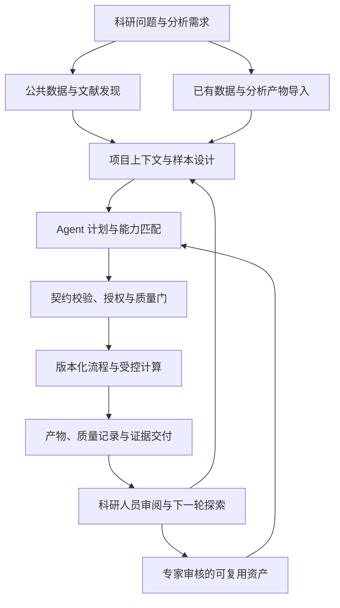
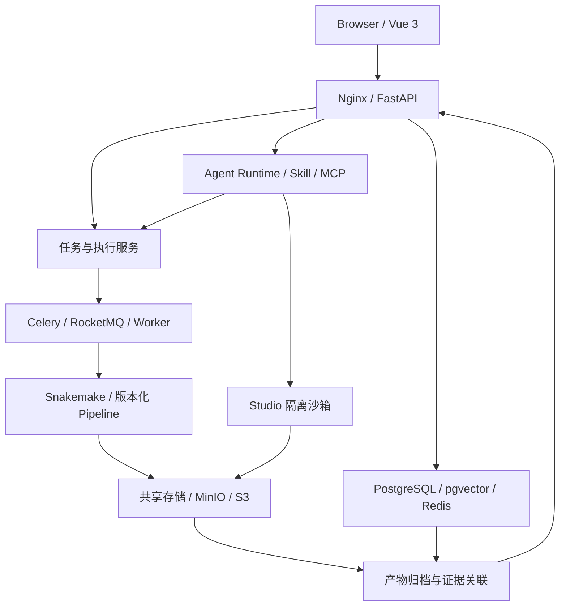
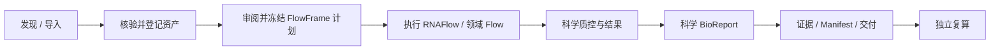
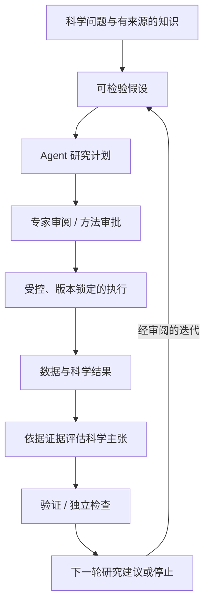

# CygnusX BioOps · 天鹅座智能科研平台

<p align="center">
  
</p>

<p align="center"><strong>FROM STARDUST, TO DISCOVERY</strong></p>
<p align="center"><strong>AI for Science Infrastructure for Life Sciences</strong></p>
<p align="center">面向可复现生命科学研究的受控科研 Agent 与可信计算交付平台。</p>
<p align="center"><a href="../README.md">English documentation / 英文文档</a></p>

---

**CygnusX BioOps 致力于构建由科研人员主导、以证据驱动的科学研究系统，让 AI 从工具调用走向科学问题的组织、可检验假设的提出、计算实验的执行与研究结论的持续验证。**

从生命科学出发，以可复现计算和可追溯证据为基础，逐步建立**“问题 → 假设 → 方法 → 计算 → 证据 → 新问题”**的迭代研究能力。当前工程重点是验证可信计算与交付链路，为这一长期目标建立基础。

科研 Agent 连接科学问题、领域知识与专业工具，版本化 Flow Framework 承载标准分析，Skill 契约、权限、审批与质量门约束正式执行，项目记录和证据元数据连接数据、决策、过程与交付物，为未来的迭代研究提供支撑。

> **From Research Questions to Reproducible Scientific Evidence.**
>
> 科研人员主导研究方向、判断科学证据；系统逐步发展对假设提出、计算实验、证据评估与经审阅的后续探索的支持能力。

**长期研究目标是在专家治理下，发展以证据为依据的科学协作伙伴。** 方法审批与科学结论仍由科研人员负责。迭代科学发现是需要独立验证的研究方向；当前已实现的能力及其验收边界见下文。

## 项目起源

**2026 年 6 月 25 日 00:08:16**，首次提交（`bb13fd2b`）标志着 CygnusX 前身 OmicHub 的诞生。项目由一名生命科学领域的在读博士发起，最初是面向私有化部署的多组学分析平台，用于解决流程繁琐、计算环境复杂和复现困难等问题。

CygnusX 已逐步发展为涵盖**科研数据发现、Agent 编排、标准化科学计算与可核验交付**的生态。长期方向是构建可核验、可复现的 Scientific Agent Framework，从生命科学出发，逐步验证哪些能力可以跨研究领域复用。

> 从真实科研需求出发，以可靠工程为基础，追求原创技术创新。

## 为什么建设 CygnusX？

组学研究横跨数据库、下载工具、分析脚本、计算集群、可视化软件和报告系统。延误常发生在步骤之间：科研人员必须反复搬运和核对信息，却很少由此增加科学价值。

| 科研困难 | 平台应对方式 |
| --- | --- |
| 研究意图难以映射到数据库字段，数据与文献需要分别检索 | 通过对话探索关联公共组学数据、样本元数据与文献来源。 |
| 样本表、参数和环境反复配置，错误发现较晚 | 以声明式流程、参数校验和执行前检查组织标准分析。 |
| 新增对比、富集分析或图表仍可能需要专家改写脚本 | 在审核后的 Skill 边界内探索复用已有产物。 |
| AI 生成的代码与解释难以核验 | 在执行设计中纳入工具权限、统计假设、质量检查与来源记录。 |
| 交付后脚本、环境、参数与决策分散 | 通过项目和运行记录组织输入、输出、环境与重跑信息。 |

## 持续积累的智能科研基础设施

1. **让科研任务可执行。** 将研究需求转化为明确的分析对象、参数与受控任务。
2. **让科研结果可核验。** 记录来源、流程版本、运行环境、质量指标与产物。
3. **让科研经验可复用。** 将审核后的方法、质量规则与交付模板沉淀为 Flow、Skill、MCP 工具和领域知识。

期望形成的循环是：科研需求驱动工具建设，真实交付产生工程资产，经核验的运行记录改进可复用能力。实验室的重要资产，是在研究与审阅中逐步积累的方法判断。

## 当前研发阶段与证据边界

**当前定位（工程快照：2026 年 10 月 18–19 日）：** CygnusX 已实现平台核心，并持续扩展生命科学工具生态。部分项目交付路径具有历史真实运行证据。**尚未证明基于当前源码，连续完成“发现 → 获取 → FlowFrame/RNAFlow 计算 → 科学 BioReport → 独立复算”的端到端链路。** 项目处于工程研发阶段，不能据此宣称已具备生产就绪或自主科学发现能力。

以下状态区分**代码实现、隔离测试、历史真实运行验证和待完成验收**。证据仅适用于记录中的 Run ID、提交、镜像摘要与环境；历史通过不能认证变更后的工作树。

| 领域 | 已有实现或演示 | 当前证据边界／下一道门禁 |
| --- | --- | --- |
| **平台基础** | 已实现 Vue 3 前端、FastAPI 服务、项目、任务、关系模型、迁移、队列与部署配置。 | 需要冻结当前源码构建，在获授权的可弃置环境中重新完成全栈集成验收。 |
| **科研 Agent、Skill 与 MCP** | 已有声明式 Agent、Skill 组织、工具集成、角色执行路径及隔离／契约测试。 | 尚未完成当前源码下真实 Agent → 审批 → 执行 → 产物生命周期的完整 E2E 验收。 |
| **数据发现与获取** | 寻宝鼠、下载服务契约、Dataset/FileRegistry 集成与 Polariseq 组件分布于相关仓库。 | 活动架构基线仍对下载和 Agent 写执行设门禁；真实 Worker 执行需要独立验收。 |
| **版本化科学流程** | 已有 FlowFrame 规范及 RNAFlow/ATACFlow 实现；README 记录了内部流程建设与验证。 | 平台准入至科学结果和独立复算的集成运行，需要冻结版本并提供证据。 |
| **受控执行** | 审批、准入（Admission）、预算、撤销／epoch 控制和受限执行机制已有代码与隔离测试。 | 活动架构基线保留源码写门禁和部署验收要求；隔离测试不能证明运行时约束已生效。 |
| **科学报告** | BioReport 是独立的 Python/Quarto 报告引擎；平台适配器也支持项目摘要交付。 | 历史 RI09.5 验收生成过真实的**项目摘要** HTML/PDF，但不能据此证明完整的 RNAFlow → 科学 BioReport 链路。 |
| **可核验项目交付** | 已实现 Project/Run、FileRegistry、Evidence/Manifest 和 ExportSelectionV2；历史 RI09.5 运行覆盖 HTML/PDF → M1 → ZIP → JWT 下载及完整性检查。 | 10 月 18 日审计中 RC04-Core 仍未完整通过：当前源码冻结、34/34 浏览器断言、定点故障注入、独立证据与安全复核尚未闭环。 |
| **Agent 科学发现** | 架构包含计划、证据、审阅与后续探索概念。 | 结构化假设评估和多轮证据驱动发现仍是**研究目标**，并非已验证的自主能力。 |

**证据入口：**

- `ri095-authorized-20261017-attempt1`：历史隔离运行，覆盖项目摘要 HTML/PDF、V2 ZIP、完整性检查和 JWT 交付，仅适用于记录中的源码与镜像版本。见 [RI09.5 授权运行结果](audits/RI095-Authorized-Runtime-Acceptance-Results.md)。
- **RC04 审计（2026-10-18）：** Core 为 **PARTIAL / NOT ACCEPTED**；历史浏览器结果 **31/34**，没有新获验收的 FI01–FI06 运行，当前源码／镜像冻结仍未证明。见 [RC04 完成门禁矩阵](audits/RI095-RC04-Completion-Gate-Matrix.md)。
- **受保护执行：** [下载基线](../ARCHITECTURE_DESIGN/CygnusX_download_architecture.md)、[Agent 工具网关](../ARCHITECTURE_DESIGN/CygnusX_agent_tool_gateway.md)和[科研交付基线](../ARCHITECTURE_DESIGN/CygnusX_research_delivery_architecture.md)记录了关闭的写门禁与待完成运行验收。

> **发布原则：** `已实现 ≠ 隔离测试通过 ≠ 真实运行验证 ≠ 端到端验证 ≠ 获准生产使用`。受保护下载、Agent 写执行与 `worker_paths_verified` 门禁，在各自满足当前源码验收要求前应保持关闭。项目摘要报告不能替代科学分析验证或独立复现实验。

## 从数据入口到证据交付

科研可以从**公共数据发现**或**已有实验数据与分析产物导入**开始，目标是将二者纳入共享项目上下文，组织标准分析与增量探索。



**这是目标工作流，不代表全部门禁已通过。** 可用范围取决于组件、版本与部署。计算链路连接数据、任务、执行、质控与产物；探索链路进一步关联外部证据、解读和后续研究。科研人员负责假设质量、实验验证与关键科学结论。

## 生态组件如何协作？

**CygnusX BioOps 的设计目标，是通过共享项目上下文组织发现、获取、标准分析与报告。** 独立生态组件提供专业能力，Flow Framework 提供共同的流程与集成规范。

<p align="center">
  
</p>

| 组件 | 在科研链路中的职责 |
| --- | --- |
| **[CygnusX BioOps](https://github.com/xsx123123/omichub)** | 项目上下文、Agent、权限、任务、数据、交付、运行记录、归档与证据关联。 |
| **[科研寻宝鼠](https://github.com/xsx123123/Treasure-Seeking_Mouse)** | 对话式公共组学数据发现、文献检索与来源核验。 |
| **[Polariseq](https://github.com/xsx123123/polariseq)** | 支持续传与完整性检查的测序数据传输。 |
| **[FlowFrame](https://github.com/xsx123123/FlowFrame)** | 通用组学流程架构与标准化集成规范。 |
| **[RNAFlow](https://github.com/xsx123123/RNAFlow)** | Bulk RNA-seq 质控、比对、定量与差异分析。 |
| **[ATACFlow](https://github.com/xsx123123/ATACFlow)** | ATAC-seq 质控、比对、Peak Calling、差异可及性与 Motif 分析。 |
| **[AnnoFlow](https://github.com/xsx123123/kegg_annotation)** | 基于 eggNOG-mapper 与 KofamScan 的功能注释及 KO 交叉验证。 |
| **[BioReport](https://github.com/xsx123123/bioreport)** | 基于 Python/Quarto 的交互式 HTML 与 PDF 报告。 |

**目标科研路径：** 发现数据与文献 → 获取或导入数据 → 选择审核后的版本化分析能力 → 计算并检查科学结果 → 生成科学报告 → 在 CygnusX 中关联运行、产物与证据。

独立仓库的发布周期和验收范围可能不同。组件通过验证，不自动代表集成链路通过验证。

## 四大技术支柱

| 支柱 | 工程含义 | 科研价值 |
| --- | --- | --- |
| **Research Agents** | 需求解析、任务拆解、角色路由与受控工具调度。 | 可检查的分析计划。 |
| **Reproducible Workflows** | 声明式 Flow、Snakemake、版本化流程与环境记录。 | 降低临时脚本与环境漂移带来的失败。 |
| **Governed Execution** | Skill 契约、工具白名单、隔离沙箱、审批与质量门。 | 经授权且可核验的自动化。 |
| **Verifiable Evidence** | 项目、运行、Case、Artifact、Evidence 与 Manifest 的关联。 | 明确的来源、检查与重跑要求。 |

## 核心机制：Agent × Skill × Flow

- **Agent 组织任务：** 理解需求、识别缺失信息、选择能力、提出计划并解读真实工具结果。
- **Skill 约束专业动作：** 描述范围、输入输出、前置条件、版本、失败处理、假设与质量要求。
- **Flow 承载标准计算：** 将审核后的方法固化为声明式、版本化流程，由受控执行系统运行。

正式交付以调度审核后的流程与工具为设计原则，Agent 不应获得任意 shell 或无限制数据库写权限。OmicStudio 可在 capability 约束的沙箱内支持探索性代码；探索结果成为正式科学交付物前，仍须满足对应检查。约束是否实际生效，需要按获验收的运行时与部署配置核实。

## L1–L4：科研工作方式

| 入口 | 适合的工作 | 边界 |
| --- | --- | --- |
| **L1 生信工具箱** | 可重复工具操作与轻量可视化。 | 管理工具注册、参数与状态。 |
| **L2 星尘 AI 助手** | 需求澄清、检索与轻量工具调用。 | 工具白名单；关键判断由科研人员审核。 |
| **L3 OmicStudio** | 交互式深度分析。 | 按 capability 在受限环境中执行。 |
| **L4 多 Agent 协作室** | 计划、分工、质量审阅与交付。 | 受功能开关保护的预览路径，需要独立验收。 |

**命名说明：** L1–L4 表示 **CygnusX 产品交互／工作方式**，与 Agentic Science 文献中的科学自主性分级不是同一概念。产品 L4 不意味着完全自主科学发现。

## 质量与证据如何进入交付？

可信计算需要回答：谁有权执行、结果来自哪里、经过哪些检查、如何重跑，以及实际发生了什么。

| 阶段 | 检查重点 |
| --- | --- |
| **提交前** | 输入完整性、样本、分组、参数范围、流程适用性与资源。 |
| **执行中** | 流程状态、资源异常与分析特定 QC。 |
| **交付前** | 产物完整性、统计设计、质量结果与来源。 |

正式交付旨在关联 **Project/Run、Case、Artifact、Evidence 与 Manifest**。目标内容包括方法、参数、流程版本、环境快照、软件清单、质量记录、校验值、审计事件与重跑入口。结果解释应区分平台计算结果、外部来源与综合推断。

## 系统架构



*图示为概念组件拓扑；启用的服务、消息队列、隔离属性与外部存储集成，取决于部署配置及验收状态。*

| 层次 | 技术 |
| --- | --- |
| **前端** | Vue 3、TypeScript、Vite、Naive UI、Pinia。 |
| **后端** | Python 3.11、FastAPI、SQLAlchemy、Alembic。 |
| **数据与知识** | PostgreSQL/pgvector、Redis、MinIO/S3。 |
| **Agent 运行时** | 声明式装配、ReAct/LangGraph、MCP、角色工具权限。 |
| **流程执行** | Flow YAML、GenericFlowBuilder、Snakemake、受控 Worker。 |
| **隔离与观测** | capability 沙箱、资源／网络限制、日志、审计、OpenTelemetry。 |

## 研发路线图与长期愿景

CygnusX 采用分阶段科研与工程路线。**M1 是近期验收目标，M2 是将于 2027 年 1 月 1 日正式启动的下一阶段科学 Agent 研究，M3 是有待验证的跨领域长期假设。** 这些里程碑不代表全部能力当前已可用。

### M1 — 可复现的多组学基础设施

**目标：** 建立可靠、可审计的生命科学计算平台，连接真实科研输入、经验证的科学分析与独立复算。

**当前进展：** 平台核心、流程、报告组件与项目交付机制已存在。历史真实运行证据覆盖部分项目摘要交付操作。**基于当前源码的集成科学流程**和部分受保护运行门禁仍待验收。

**验收路径：**



**里程碑证据：** 获授权的真实数据集与研究设计、冻结的流程和参数、输入与镜像摘要、执行记录、科学结果检查、真实 BioReport 产物、交付 Manifest，以及符合预先定义数值／统计容差的独立复算。先从小型 RNA-seq 案例开始，再评估向第二类组学流程迁移。

### M2 — 专家治理、来源可追溯的迭代科学发现

#### 下一阶段研究方向 — 科学发现核心（Scientific Discovery Core）

**正式启动日期：2027 年 1 月 1 日。** 这一阶段将推动 CygnusX BioOps 从可复现科学计算，向专家治理、证据驱动的科学发现演进。科学发现核心是 M2 研究阶段的重点，围绕三项互补能力展开：

| 能力 | 研究重点 |
| --- | --- |
| **科学推理（Scientific Reasoning）** | 将科研问题转化为可检验的假设，以及可供科学审阅的研究设计。 |
| **科学验证（Scientific Validation）** | 评估分析结果、方法有效性与科学主张的证据支持程度。 |
| **研究演进（Research Evolution）** | 保存研究知识，并提出有证据依据的后续研究建议。 |

三项能力共同构建闭环研究框架：

**假设 → 规划 → 专家审阅 → 受控执行 → 证据评估 → 验证 → 迭代**

该日期标志着本阶段研究的正式启动。相关能力将在底层科学计算与执行基础设施满足验收要求后逐步引入。长期目标是形成通用、专家治理、来源可追溯的 Agent 科学计算基础设施，并首先通过真实多组学研究验证。

**目标：** 将已验证的计算扩展为人机科研协作循环：Agent 提出**可检验假设**、建议方法、提交计划供专家审核、分析结果、依据证据评估主张，并提出有依据的后续研究建议。



**研究方向（规划中，尚未验证）：** 结构化关联 `Hypothesis`、`Scientific Claim`、`Research Decision` 与 `Validation Result`；绑定证据的科学记忆；结合方法约束的解读；专家控制的迭代；以证据为依据的 **Next Shovel** 后续探索建议。结果可以是“支持”“反驳”或“尚无定论”。必要时新执行需重新授权，Agent 不能自动将假设提升为既定结论。

**里程碑证据：** 至少一个多轮真实研究案例、明确的假设／主张来源、经科学审阅的评价标准、独立验证，以及条件允许时与自由代码 Agent 和固定流程的对比。衡量方法有效性、证据覆盖、可靠性、审阅成本与迭代反馈带来的实质改进。

### M3 — 通用 Agent 科学计算

**长期愿景：** 验证 CygnusX 的**领域无关核心**能否在不重写治理与来源基础设施的条件下，服务其他科学领域。

| 可复用核心（待验证假设） | 领域扩展 |
| --- | --- |
| 项目／研究上下文、Agent 计划、Skill 契约、授权、准入／预算、计算调度、生命周期、来源、科学记忆与交付核验。 | 先服务生物学流程与解读；未来可能扩展至农业、化学、材料、仿真等具有各自工具与科学验证规则的领域。 |

**里程碑证据：** 可运行的第二领域案例、明确的适配器边界、可比的来源与访问控制、领域科学验证，以及核心复用与必要改动的量化记录。支持另一种工具，不等于证明通用科学推理能力。

**演进方向：**

**CygnusX BioOps（可信生命科学计算）→ CygnusX Discovery（专家治理的迭代研究）→ 通用 Agent 科学计算（长期科研愿景）。**

### 近期工程优先事项

宣称完成 M1 或将受保护流程用于生产前，需要关闭当前运行与证据缺口：冻结源码和镜像基线；验证真实 PostgreSQL 迁移与事务／并发行为；核验部署环境中的执行隔离和授权；完成 RC04 浏览器及故障注入证据；展示首条真实 RNAFlow → 科学 BioReport → 独立复算链路。外部前提（旧数据库基线、历史冻结产物、获授权的 S3 测试资源）缺失时，应如实标记阻断。

## 部署与数据边界

CygnusX 支持本地／局域网部署和按配置接入的云端部署，并向依据访问策略划分本地数据、云端推理与计算资源的混合部署演进。外部模型、MCP Server、下载源与日志链路需要分别配置。平台面向科研研发；临床、法规与行业认证需要独立评估。

## 快速开始

环境要求：Python >= 3.11、Node.js >= 18、带 Compose 的 Docker，以及 uv。精确依赖版本以锁文件和部署配置为准。启动前参考 `.env.example` 配置 `.env`，替换示例密钥，核对数据库、存储与服务连接。见 [Docker 部署说明](../deploy/docker/README.md)。

```bash
uv sync --frozen
cd frontend && npm ci && cd ..
make docker-up
make migrate
make dev
```

另开终端：

```bash
cd frontend
npm run dev
```

前端访问 `http://localhost:5173`，本地 API 文档访问 `http://localhost:8000/docs`。**代理配置：** `frontend/vite.config.ts` 默认将 `/api`、`/treasure-mouse/` 和 `/docs-static` 转发到 Compose Nginx 的 `http://localhost:8888`。若要连接 `make dev` 启动的本地后端，需要在本地配置中将相应代理目标改为 `http://localhost:8000`。`make docker-up` 会启动主应用栈，分析 Worker 需要另外配置。

完整说明见 [wiki](../wiki/) 和 [Docker 部署说明](../deploy/docker/README.md)。**这些开发命令不能替代环境预检、数据库目标授权或发布验收。**

## 核心工程实现

- Agent 身份、提示词、模型、工具白名单与运行时能力由 `data/ai/*.yaml` 声明。
- MCP 分为内置 Preset、外部 Server 与管线专属 Server；生成工具需要静态检查、沙箱测试与人工审核。
- `flows/*.yaml` 描述流程元数据、参数、样本表、执行与管线映射；`tool_configs/tools_schema.yaml` 将工具映射为 LLM function。
- 平台业务 Skill（`data/ai/skills/`）与研发辅助 Skill（`.agents/skills/`）在物理与逻辑上隔离。
- 云端终端使用 xterm.js、WebSocket 和容器 ttyd；Studio 提供独立的 capability 受控执行路径。沙箱基线包括非 root、只读根文件系统、`cap_drop=ALL`、资源限制与受限网络；实际约束需按部署配置核验。

## 项目结构

```text
src/cygnusx/          后端 Python 包（DDD 分层）
frontend/             Vue 3 前端
flows/                Flow YAML 声明
pipelines/            RNAFlow / ATACFlow / scRNA 流程实现
tool_configs/         工具箱与终端配置
data/                 Agent、Skill 和运行时配置
integrations/         AgentTeams Bridge / Gateway
deploy/               Docker Compose 与运行时镜像
alembic/              数据库迁移
ARCHITECTURE_DESIGN/  项目架构与设计索引
tests/                unit / integration / E2E 测试
```

## 文档索引

- [架构索引](../ARCHITECTURE_DESIGN/README.md)
- [平台架构](../ARCHITECTURE_DESIGN/CygnusX_platform_architecture.md)
- [Agent 执行框架](../ARCHITECTURE_DESIGN/CygnusX_agent_execution_framework.md)
- [Flow 接入架构](../ARCHITECTURE_DESIGN/CygnusX_flow_architecture.md)
- [MCP 架构](../ARCHITECTURE_DESIGN/CygnusX_mcp_architecture.md)
- [沙箱架构](../ARCHITECTURE_DESIGN/CygnusX_sandbox_architecture.md)
- [使用与部署](../wiki/)
- [Docker 部署说明](../deploy/docker/README.md)
- [工具页面规范](../tool_configs/tools_design.md)
- [英文 README](../README.md)

## 仓库范围与许可

公开版本、赛事归档与内部版本可能不同。可运行行为、部署要求与测试结果，以对应提交、发布说明和配置为准。独立生态组件在各自仓库维护。

项目 README 记录了 **600+ 项生信与科研分析 Skill** 积累及实验室私有化部署。这是项目资产与部署描述，**不代表 600+ 项 Skill、全部生态集成或所有科研模式都已分别通过运行／E2E 验收**。数量与部署陈述应对照具体版本证据核验。

完整条款见 [LICENSE](../LICENSE)。许可文件包含 **Apache License 2.0 与 Commons Clause 附加条件**，其中对销售软件和提供部分商业服务作出限制。复用或分发前请阅读完整条款。

---

<p align="center"><strong>FROM STARDUST, TO DISCOVERY · 从星尘出发，向科学发现前行</strong></p>
