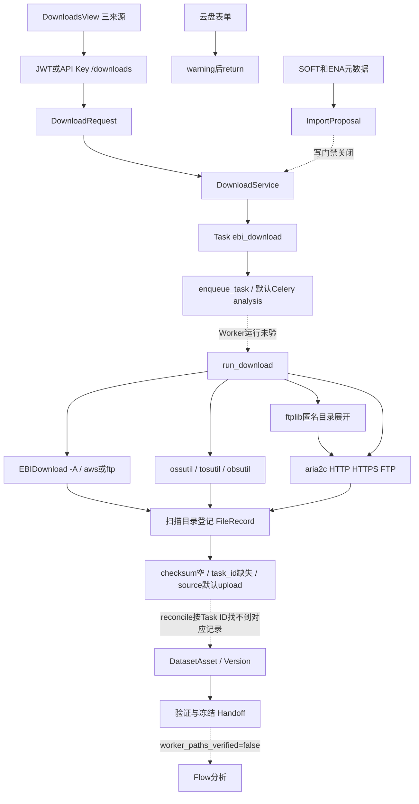
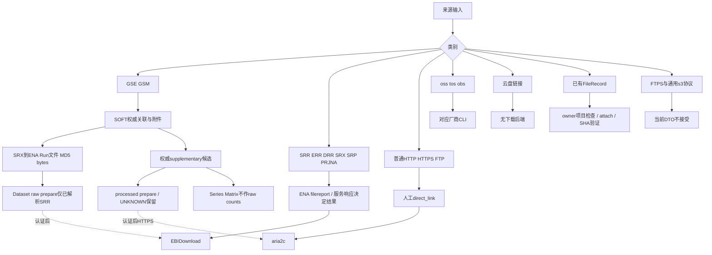
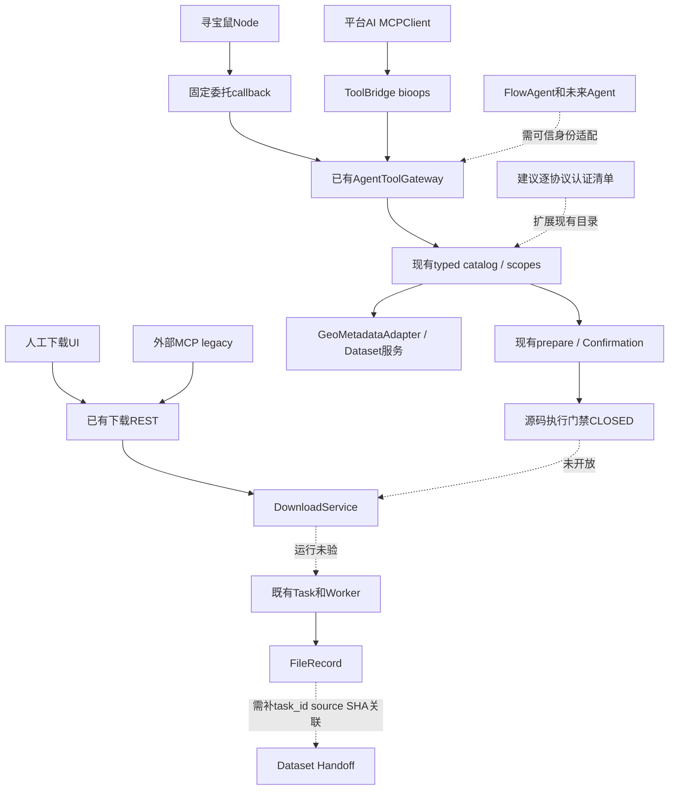
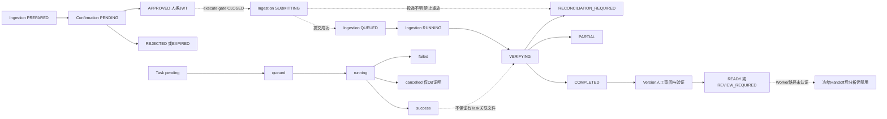
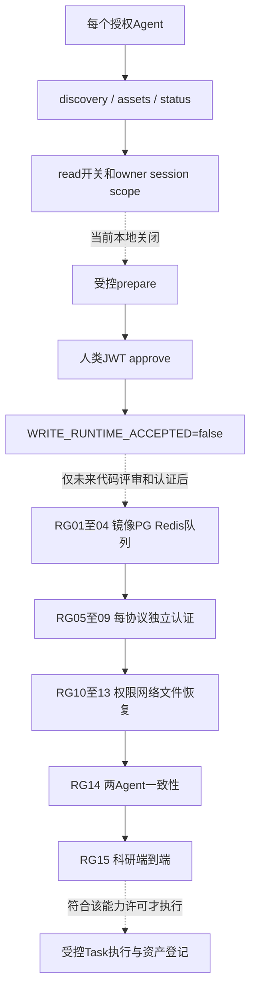

# CygnusX 全平台下载能力与多 Agent 工具化准备度调查

基线：2026-10-16。类型：当前工作树调查快照，非发布证明。范围：完整阅读任务书 §00–§14 和两份附录；只调查、运行隔离测试、编写文档，不更改业务代码/开关/数据库/镜像，不提交或部署。

证据索引：[E01–E50、H01–H05、I01–I05](appendix-download-evidence-index.md)。每个 E 编号映射实际源码路径、函数行号与文件 SHA-256；本文的函数名是可重新定位的证据。机器可读逐能力字段见 [D01–D16 YAML](appendix-download-capability-matrix.yaml)。活动架构见 [下载架构](../../ARCHITECTURE_DESIGN/CygnusX_download_architecture.md)。

## 1. 调查结论与证据边界

当前是“三种后端传输来源 + 一个云盘 UI 占位 + 独立科研资产治理层”。公共数据库走 EBIDownload；对象存储走三家厂商 CLI；HTTP(S)/FTP 走 aria2c，FTP 目录另经 ftplib 展开。云盘按钮只返回未接入提示。四个 UI 入口不能合并理解为四种已运行下载引擎（E01 handleSubmit:217；E02 DownloadSource:12；E05 _execute_download:145）。

本轮没有获得任何协议的真实 Worker 下载及登记证据，全部 `DEPLOYED=UNKNOWN / RUNTIME_TESTED=NOT_TESTED`。Docker socket 拒绝访问，未进一步访问生产 API/数据库，也未创建下载 Task。宿主 EBIDownload 1.4.0 是 H 级证据，不能替代容器版本。真实运行认证按 DL-RG01–15 保持 BLOCKED；这表示证据不足或已知代码断点，不表示所有人工下载已经运行失败。

最关键断点：真实 Worker 登记 `DataFile(checksum="")`，未传 Task ID、未设 source=download；DataFile 本身无 task_id，FileRepository 保存时也不映射 task_id。Dataset reconcile 却按 `FileRecordModel.task_id.in_(task_ids)` 找文件，因此即使下载进程成功并完成普通登记，受控导入仍无法据此形成可靠 Task→Asset 链（E05:740–840；E21 DataFile；E20 save:143；E15 reconcile:426–477）。隔离测试 double 手工写 task_id/source 掩盖了该契约差异（I04）。

最小可复用基础已存在：权威 GEO/ENA 解析、Dataset 导入预案、项目资产目录、共享 Gateway、服务端确认、owner Task 查询、文件内容验证与冻结 Handoff。需要补齐的是能力清单的真实认证字段、协议路由约束和关联登记，不是新增下载器或第二套任务系统。当前本地 Gateway/Dataset read 开关关闭，Agent execute 还被源码 `WRITE_RUNTIME_ACCEPTED=False` 拦截，不能宣布“立即上线可调用”（E11:47；E41；H04）。

## 2. 仓库、版本与部署基线

| 项 | 核实结果 | 证据层级与限制 |
|---|---|---|
| 主仓 | feat/research-agent-phase5 / 51011118535f782f5282f638b4a54649c79bf6d6；大量先存 dirty/untracked | 起点完整清单见索引；当前工作树优先于 HEAD |
| 下载子模块 | pipelines/EBIDownload @ b351e03dfc845d229102d90f9bd88d6ca731f0de，clean；CLI 1.4.0 | remote EBIDownload.git；不是 Polariseq 最新源码 |
| 独立旁仓 | /home/zj/zj_code_libarary/EBIDownload @ a46f89b4fcc44c3685cbb9d61c32461dd1211a34，clean；polariseq-cli 1.4.3 | remote X_polariseq.git；未证明参与本平台构建/挂载 |
| 宿主二进制 | /data/omichub/bin/EBIDownload → ebidownload-cli 1.4.0 | SHA-256 6628ad8fd489eee68b9ebd58299f32c021812b386435a82193911c4494e219c4；不能由版本号证明对应子模块提交 |
| CLI 帮助 | ftp / prefetch / aws / auto；有 progress-port/write-progress-key；无 aspera | H02；仅 help/version，没有 dry-run 或真实解析 |
| Worker 声明 | cygnusx-worker:v0.0.2dev；构建根 ../..，Dockerfile.worker | E28 worker:74；tag 不含下载子仓 SHA，不能据此证明新旧二进制 |
| 构建/CI | Dockerfile.worker 复制 Python/配置并 uv sync --frozen；安装 wget/curl，无 EBIDownload Rust 编译、无 aria2c/三家 CLI 安装步骤 | E29；ci.yml 有 worker 配置静态检查；未取得 CI 构建日志/产物 digest |
| 挂载 | 源码只读挂 /app/src；配置挂 /app/tool_configs；共享盘挂 STORAGE_PATH；pipelines 挂 /opt/cygnusx/pipelines:ro | E28:111；实际 profile/override/路径一致性/UID/文件可见性 UNKNOWN |
| 当前进程配置 | EBI=true，direct/cloud=false；Gateway/Dataset read/import/Agent download=false；queue=celery | H04；YAML features 三者 false，REST 使用 YAML OR Settings；非运行容器配置 |
| 容器证据 | docker ps socket operation not permitted | H03；digest/in-worker hash/二进制依赖/实际运行用户均 BLOCKED |

下载 YAML 的 binary 路径优先于 Settings，且显式写 `/data/omichub/bin/...`；因此仅修改 STORAGE_PATH 或 env 不保证下载器指向同步。配置有 mtime 热重载，解析失败保留上次有效值；allowed_schemes 虽在 YAML 中存在，DTO 协议集合仍是硬编码。换根与热加载必须独立验收（E09、E10 get_config、E05 ctx.binary、E02 validate_source_payload）。

## 3. 四入口与真实调用链

### 3.1 四入口 UI/API 对照

| 前端入口 | 请求、参数 | 后端与 Worker | 缺口 |
|---|---|---|---|
| 公共数据库 | DownloadsView.handleSubmit → apiClient POST /downloads；source=sra、accession、aws/aspera/ftp、target_directory | /api/v1/downloads → DownloadRequest → DownloadService.submit → run_download → EBIDownload | accession 只验非空；高级 include/exclude 四字段未进入 payload；Aspera 与 CLI 不一致 |
| 云盘极速提取 | 百度/123 分享链接、提取码仅表单；handleSubmit warning 后 return | 无对应 DownloadSource/API/Worker | UI 文案称能解析不等于实现；不发送提取请求 |
| 云存储直拉 | source=cloud_storage；aliyun/volc/huawei、object_uri、recursive | 同一 REST/Service/Task；Worker 分派 ossutil/tosutil/obsutil | 无通用 s3://、COS provider；凭据来自运行 CLI 环境，非页面输入 |
| 直链与 FTP | source=direct_link；links、threads、overwrite、recursive、target_directory | 同一 REST/Service/Task；FTP 目录先 ftplib；aria2c | FTPS 不受 DTO 接受；UI 去重但 DTO 不去重；递归扩展后无总量限额 |

UI 证据 E01:193–276。API prefix 来自 api/v1/router.py，axios baseURL 为 /api/v1。下载列表由 GET /downloads 返回真实 owner Task，非前端计时器；mapTask 把 direct_link 显示为 SRA、size/speed 为 '-'，onMounted 只初始化拉取，不能证明页面实时轮询。提交后跳 /tasks/{id}；progress 专用 composable 为另一路。前端在 View 内直接用统一 axios，并没有 downloads 专用 API 模块（E01 mapTask/fetchDownloads，frontend/src/composables/useDownloadProgress.ts）。

### 3.2 人工直链/FTP 完整可达链

1. `frontend/src/views/DownloadsView.vue:217 handleSubmit`：换行或逗号分割、去重、regex 允许 http/https/ftp；并发选 1/4/8/16；发 POST。
2. `api/v1/downloads.py:59 submit_download`：CurrentUserId/DbSession；require_human_or_confirmation；_ensure_enabled 用配置 OR Settings；仅 REST 层限定 links≤100。API Key 写入先过 Agent write gate；人类 JWT 无 confirmation_id 可直接提交。模块中间件消费 MODULE_LOCKED 的 /api/v1/downloads 注册，不能把它理解为项目级 ACL（E03、E24:47、data/MODULE_LOCKED.yaml:83）。
3. `schemas/download.py:95 validate_source_payload`：三协议、netloc、无 URL userinfo、拒绝显式常见内网 IP/localhost/.local；没有 DNS 解析绑定/每跳重定向复核。
4. `download_service.py:48 submit`：用户相对路径标准化→realpath containment→ensure_dir→ensure_directory_chain→TaskDomainService.submit(flow_id=ebi_download,user_id)→存 work_dir。任务无 project_id 参数；目录名不等于 Project 查询授权。
5. 同函数 `enqueue_task(run_download,str(task.id),task_id=...)` 在 QUEUED 转换和 REST get_db 最终提交前调用。dispatcher 按 settings 走 Celery 或 RocketMQ，默认 Celery 路由 analysis（E07、E08:78）。存在队列先可见、DB 尚未提交的竞态窗口；不能引用其他分析链的提前 commit 修复替代本函数证据。
6. `download.py:145 _execute_download`：读取 Task→RUNNING 并 commit→source direct_link 分派；`_execute_direct_link_download:633` 查绝对 binary 路径是否存在。
7. `_expand_ftp_directories:592` 对 recursive 且 ftp 尾 / 调 ftplib.FTP(host,timeout=30)，匿名 login/nlst/cwd 深度遍历；无 FTP_TLS、无显式用户名密码、自定义端口未传入构造器、无深度/文件数预算、无数据连接地址策略。ftplib 默认被动行为不能当作部署 FTP 被动模式验收。
8. `_build_direct_link_args:568` → aria2c --continue=true、最大重试5、等待5s、连接30s、timeout60s、默认并发4、split/max-connection=threads、check-integrity=true；overwrite/rename 由策略设置。URL 为独立 argv，BinaryExecutor.create_subprocess_exec 无 shell（E06:29）。无期望 hash 参数时 aria2 check-integrity 不等于已验证科研 SHA-256。
9. CLI exit 0→result_path/progress=1→`_register_downloaded_files:740` 递归扫描所有普通非 symlink 且位于 owner 根下的文件，按 storage_path 跳过已有记录、累加 used_storage→Task SUCCESS；exit 非0→FAILED，不登记部分文件。
10. FileRecord 尚未关联 Task/source/SHA；人工下载不创建 DatasetVersion。需显式 attach 或未来受门禁 reconcile，不能直接宣称 Dataset READY。

### 3.3 公共数据库与云存储链

SRA 与上面 1–5 共用基础链；Worker E05:245 构造 `--yaml ... --log-format json download -A accession -o work_dir -d method -p multithreads -t aws_threads --progress-port ... --write-progress-key`。无 shell 参数串；accession 仍不负责 GEO 解析。Rust `run_download:347` 将原 accession 传 ENA filereport，过滤、写 metadata/md5、选 transport（E30、E31:194）。SRR/SRX/SRP/PRJNA 等只是 query 输入，是否返回 read_run 要源端响应；GSE/GSM 不能因字符串可接受就称会展开，平台人工入口没有 SOFT→SRA resolver 接线。

Rust FTP 分支实际生成 `wget -c <ENA file URL>`，md5 校验下载 FASTQ；AWS 分支经 SraUtils 获取 SRA 元数据、ResumableDownloader 获取 .sra、fasterq-dump 转 FASTQ，再压缩。Prefetch/auto 在 CLI 有实现，平台 DTO 无法选择；Aspera 是反向漂移。ENA ProcessedRecord 只建第一条及可选第二条文件字段，不能推断多 Run/多文件均已正确归属。源 MD5 TSV 不等于平台 FileRecord SHA（E30:488、813、818；E31 process_ena_records:295；E32:70）。

SRA 进度是 CLI 本地 HTTP Progress API（加密/key file）→ProgressPoller→Redis download_progress:{id}→GET /downloads/{id}/progress；Redis 缺失返回 source=unavailable，并用 Task.progress 回退。任务最终清理进度缓存；不是可恢复运行 ledger（E03 get_download_progress；E05:335–441；infrastructure/download/progress_poller.py）。

Cloud Worker `_execute_cloud_storage_download:444` 使用 `_build_cloud_storage_args:91`：OSS cp --update --force --jobs 5；TOS cp -u -j 5 --checkpoint <work_dir>/.checkpoint；OBS cp -f -u -j 5 -parallel 5 -partSize 5；recursive 对应 --recursive/-r。path 存在不证明可执行/认证有效，运行环境配置、IAM、endpoint、region 未取证。没有平台对任意远端 S3 bucket/key 的统一 downloader；SRA 的 AWS 公共镜像和平台本身 MinIO/S3 存储是不同概念。

### 3.4 GEO processed 与科研资产链

`GeoMetadataAdapter.resolve` 只读取固定可信 HTTPS 主机 SOFT/ENA，记录 URL、时间、response_sha256/etag；FTP 附件地址规范化为 HTTPS；禁跳转/trust_env=false、单响应2MiB、samples≤24、runs≤100、缓存300s、请求间隔0.5s。发现的 supplement 未读内容时仍 UNKNOWN，不自动推导 sample group；Series Matrix 不生成猜测 URL（E16:26–145、183、269）。

`DatasetImportService.prepare:136` 查询真实 Project owner/module→按稳定 request_key 返回同预案或拒绝参数更换→重新解析权威来源→raw 仅允许已解析 SRR、每 SRR 一个 DownloadRequest(ftp)；processed 只选权威附件、一个 direct_link 批量 Request。保存 candidate/source_evidence/预算/session/project、创建一次 dataset.execute_import 确认和 Ingestion(PREPARED)，不 mkdir、不建 Task（E15、I01）。Prepare 是 SQL/Redis 写预案，不是纯只读操作。

execute:343 在 require_import_write 后重查锁、参数哈希、owner/project/proposal、refresh 来源摘要、配额/磁盘，消费一次确认→持久 SUBMITTING→创建 DatasetVersion/source_snapshot→调用同一 DownloadService.submit→记录 task_ids。源改变拒绝，投递未知不自动重试。这里直接调用 Service，不经 downloads REST 的 _ensure_enabled；后续应统一业务边界的能力验证，不能靠 API flag 保证内部调用一致。

reconcile:426 只查既有 Task，不重投；QUEUED/RUNNING 投影；终态后按 Task ID 查 FileRecord，缺失→RECONCILIATION_REQUIRED；超预算→PARTIAL；挂 DatasetAsset、来源层级、Sample→验证真实内容→COMPLETED/PARTIAL。真实 Worker 的 task_id 缺失使此处断开。COMPLETED 也不等于源方科学定义全部成立。

文件校验/归档展开已存在：`domain/dataset/archives.py:30 expand_archive` 新建私有 staging、xb 禁覆盖、限制条数/单文件/总量/比例，拒绝 ZipSlip/symlink/hardlink/特殊条目；`validation.py inspect_matrix` 限行列/值域/重复项，UNKNOWN/TPM/FPKM/CPM/log/Series Matrix 不认 raw counts。`DatasetHandoffService.verify:52` 实算 SHA-256，manifest:158 冻结排序资产/样本/来源/审阅并算 manifest_hash；`worker_paths_verified=False` 固定存在，即使 version.status 可为 READY，不能成为 Worker 分析执行许可（E17:313–328；E37/E38；I01）。

归档的应用服务接线也已核实：`GeoProcessedDataService.candidates` 按名字仅标 SERIES_MATRIX/ARCHIVE/SINGLE_CELL_CONTAINER/TABULAR_CANDIDATE，始终data_type=UNKNOWN；`expand:65` 在写门禁后核owner/project/local backend、实算原archive SHA、受限展开到新staging，使用**已有 FileRegistry.register**传source=DOWNLOAD/task_id/checksum，子资产classification记录parent_archive_file_record_id/parent_sha256，原archive保留且role=archive。DB登记失败留下staging要求对账，禁止覆盖重放（E46/E47；I05）。这表明统一注册器本来已有正确参数，当前下载Worker却绕过它走DataFile/FileRepository；最小修复应优先复用既有FileRegistry，不需要另造注册器或为了本问题先扩DataFile。

部署入口补证：Web共享盘由CYGNUSX_DATA_ROOT映射STORAGE_PATH，Worker由WORKER_SHARED_DATA_DIR映射同名目标；变量名不同，不能仅看目标路径断言两端同一inode。Worker entrypoint声明按PUID/PGID降权（默认1000），不是本轮实测运行UID，也不应套用Studio沙箱10001规则。Compose里的Studio egress proxy不能替代宿主下载Worker的出站控制（E49:83；E28:111；E50）。旧外部MCP确认的真实人类审批入口为 `api/v1/ai.py:317 approve_tool_invocation`，CurrentJwtUserId；不等同Node委托可批准（E48）。

## 4. D01–D16 六维能力矩阵

下表 UI=源码入口而非浏览器运行；V=VERIFIED 静态契约/局部实现，P=PARTIAL，N=NOT_FOUND，S=STUB。所有行部署 U=UNKNOWN、真实传输 NT=NOT_TESTED、当前 Agent B=BLOCKED。D03/D14/D15 本身不属于远程文件传输，NT 表示没有本轮相应 live 资产闭环证据，不要求它们另建下载器。

| ID | 能力/输入 | UI | API | Backend | 部署 | 真实运行 | 当前 Agent | 证据与断点 |
|---|---|---|---|---|---|---|---|---|
| D01 | NCBI SRA reads；SRR/ERR/DRR，SRX/SRP/PRJNA 需 ENA 展开 | YES | VERIFIED | PARTIAL | UNKNOWN | NOT_TESTED | BLOCKED | E01,E02,E04,E05,E30,E31；accession 未约束；Aspera 枚举漂移；Worker 未认证 |
| D02 | ENA FASTQ；study/experiment/run；权威 fastq_ftp/md5/bytes | YES | VERIFIED | PARTIAL | UNKNOWN | NOT_TESTED | BLOCKED | E16,E30,E31,E32；Dataset raw 仅 SRR；ERR/DRR 不获 import 准入；多文件/配对需审阅 |
| D03 | GEO metadata；GSE/GSM/GPL + SRA 关联 | YES | VERIFIED | VERIFIED | UNKNOWN | NOT_TESTED | BLOCKED | E16,E15,E39；本地只读开关关闭；来源 license/access_status UNKNOWN；不是下载 |
| D04 | GEO supplementary；权威 SOFT 列出的附件 URL | YES | VERIFIED | PARTIAL | UNKNOWN | NOT_TESTED | BLOCKED | E16,E15,E05,E37；无真实传输；task_id 登记断链；来源/科学审阅待做 |
| D05 | GEO Series Matrix；仅真实来源 URL/附件候选 | NO | PARTIAL | PARTIAL | UNKNOWN | NOT_TESTED | BLOCKED | E16,E15,E38；不能推造 URL；Series Matrix 不认 raw counts |
| D06 | HTTPS 直链；https:// 文件 URL | YES | VERIFIED | PARTIAL | UNKNOWN | NOT_TESTED | BLOCKED | E01,E02,E05；无每跳 DNS/重定向准入、实际字节硬预算、来源 SHA |
| D07 | HTTP 直链；http:// 文件 URL | YES | VERIFIED | PARTIAL | UNKNOWN | NOT_TESTED | BLOCKED | E01,E02,E05；不默认拒绝 HTTP；整数地址与域名解析缺口 |
| D08 | FTP / FTPS；ftp:// 文件或尾 / 目录；ftps:// 被拒绝 | YES | PARTIAL | PARTIAL | UNKNOWN | NOT_TESTED | BLOCKED | E02,E05；无登录参数；URL 账户拒绝；无 FTP_TLS；数据连接/目录预算未验 |
| D09 | 对象存储；oss://、tos://、obs://；HTTPS presigned 属 D06 | YES | PARTIAL | PARTIAL | UNKNOWN | NOT_TESTED | BLOCKED | E02,E05,E09；凭据/region/endpoint/CLI 版本未知；不能以平台 S3 存储适配器证明远程拉取 |
| D10 | 云盘极速提取；百度/123 分享链接与提取码 | YES | NOT_FOUND | STUB | UNKNOWN | NOT_TESTED | BLOCKED | E01,E02；保持人工展示，禁止 Agent 宣称可提取 |
| D11 | EBI/Ensembl/UCSC 公共文件；显式 URL；非任意 accession resolver | YES | PARTIAL | PARTIAL | UNKNOWN | NOT_TESTED | BLOCKED | E01,E02,E16；无各数据库专用资源解析与授权 catalog |
| D12 | 批量直链；links[]；UI 换行/逗号拆分去重 | YES | VERIFIED | PARTIAL | UNKNOWN | NOT_TESTED | BLOCKED | E01,E03,E05；CLI 失败不登记部分文件；无 per-file 状态/内容去重 |
| D13 | 断点续传/并发；原 work_dir/CLI checkpoint | YES | PARTIAL | PARTIAL | UNKNOWN | NOT_TESTED | BLOCKED | E05,E30,E32,E35；CLI 特性不等于 Worker crash 恢复；cancel 不见子进程终止连接 |
| D14 | 已有项目 FileRecord；owner-scoped FileRecord ID | YES | VERIFIED | VERIFIED | UNKNOWN | NOT_TESTED | BLOCKED | E18,E19,E17；旧文件允许显式关联，跨已知项目拒绝；运行开关关闭 |
| D15 | 本地上传/导入；chunk/upload/presigned/file ID | YES | VERIFIED | VERIFIED | UNKNOWN | NOT_TESTED | BLOCKED | E40,E45,E18,E17；不是远程下载；presigned 平台存储上传不等于云商直拉 |
| D16 | Agent 外部 URL 获取；DiscoveryRef/accession/受控文件引用 | NO | PARTIAL | PARTIAL | UNKNOWN | NOT_TESTED | BLOCKED | E11,E12,E13,E14,E25,E26,E27,E33；任意 URL 无 Gateway prepare；源码写门禁；FlowAgent 未接下载 Gateway |

分层就绪判定：D03 权威发现、D14 已有资产、D15 上传后挂接具备只读/验证复用的静态与 fixture 基础；D01/D02/D04 有受控 import prepare 的局部基础；D06–09/D11–13 只有人工执行代码，通用 Agent prepare 未对齐；D10 无后端；D16 任意 URL 不应开放。由于 H04 开关关闭，本轮不给任何能力运行级 READ_ONLY_READY / AGENT_PREPARE_READY / MANUAL_DOWNLOAD_READY / AGENT_EXECUTE_READY。允许称“实现/fixture 可复用、运行准入待认证”，不能简化为全平台 PASS。

## 5. 权限、网络、预算与不可信文件

| 边界 | 已核实保护 | 未闭合项/限定结论 | 证据 |
|---|---|---|---|
| 用户/Task | CurrentUserId；list_by_user；get_task_for_user 比较 user_id/flow_id | 手工下载 Service 未接受 Project ID，不做 ProjectModel 校验 | E03/E04 |
| Agent 身份 | Gateway 从 active session 派生 agent_kind/project；重查 Project owner；禁模型额外 identity 字段 | 目前只识别寻宝鼠/平台 AI，未来 Agent 必须显式授权映射 | E11 context:77；E12 ToolArgs |
| 模块与 scope | disabled_modules 裁剪；Gateway invoke 再验；Node scope 取交集 | 目录 Schema 可见不等于每个 Agent 实际取得且调用成功 | E11 catalog/invoke；E14 |
| 审批 | approve REST 用 CurrentJwtUserId；默认 TTL1800；参数 hash；Redis Lua CAS；外部 user_confirmed=true 明确拒绝 | 人工 JWT 直接下载不要求预案；模型不得拿人类 JWT 代行审批；真实 Redis 多进程未验 | E13:80；E23:249/338/462；E27:59；E24 |
| 通用 URL | 拒绝 file/s3/ftps、URL 明文账户、localhost/.local、显式私网 IP | 无域名解析和 IP 绑定、整数地址规范化、每跳 redirect/代理约束；HTTP 默认接受 | E02 validate_source_payload；I03 |
| 云 URI | provider scheme 与域名后缀约束 | _validate_cloud_host 在 try 内 raise 后被 except ValueError 捕获；IPv6/无点数字可过裸 bucket 分支。只证 DTO 接受，不证明 CLI 能向内网传输 | E02:21–43；I03 |
| Worker 网络 | argv 无 shell | 直接使用已存参数，无同一 URL 安全策略复验；BinaryExecutor 继承环境；FTP 控制/数据连接未锁定；端口策略不完整 | E05:633；E06:35 |
| 预算 | REST links≤100，threads 上限；Dataset prepare检查元数据规模/配额/本机磁盘，execute重验 | req.max_bytes 未传 Worker；无硬停止/原子配额预留；FTP 展开可突破100；并发预案可能争同一空间 | E03 _ensure_enabled；E15:212/376；E05:592 |
| 文件路径 | Service realpath owner containment；登记排 symlink/逃逸；Dataset 检查 hardlink/特殊文件 | 工作目录由首链接/acc label 派生，非唯一 Task 目录；重名任务可碰撞；登记按路径跳过可能保留过时 size/hash | E04 _make_work_dir；E05:776–840；E38 |
| 控制文件 | 注册扫描不是扩展名白名单 | progress.key、日志、metadata、.aria2/.checkpoint 等没有显式排除；成功目录内存在时可能被登记为普通资产；需分类过滤，不能让下游误当科研输入 | E05:803–835；SRA --write-progress-key:263 |
| 机密/签名 URL | direct URL userinfo 拒绝；没有输出凭据 | links/object_uri 保存 Task.parameters，云商 object_uri 写日志；CLI stderr 可带 URL 参数。未见此链统一 query 脱敏；不披露任何真实 secret | E04 parameters；E05:515/696；E27 |
| 科研许可 | source_evidence 与 access_status UNKNOWN 保留不确定性 | 公共可查询不代表授权任意重用；云盘需独立合法账户/访问认证 | E16 resolve；E15 DatasetSourceModel |

本轮仅用合成地址构造 DTO，没有发起 SSRF 利用。针对内网、DNS rebinding、FTP passive 返回地址的风险属于未落实防护/待隔离负例验证，不描述为生产利用已成功。

## 6. Task、文件与恢复的实际语义

Task 枚举只有 pending/queued/running/success/failed/cancelled，无 PARTIAL；终态不可重开（E36）。下载分支 exit 非0 时不登记现存部分文件；exit0 只按进程成功登记整个目录，不能证明每个文件来源/完整性。缺目录时注册函数直接 return，空目录也未显式失败；因此 SUCCESS 不是 COMPLETE_FILES_VERIFIED。

Service 没有请求幂等键/内容去重；同 work_dir 多次 submit 会产生多个 Task。目录/文件幂等只按 storage_path 做跳过，配额在下载完成后 add_used_storage；没有可证明的“先预留、传输中硬限、失败释放”事务。普通提交队列/DB 间无 exactly-once 证据。Gateway 与 Import 的持久 SUBMITTING 能抑制歧义重放，但不能消除原 Service 提交窗口（E04 submit；E05 register；E11 execute:761；E15 execute）。

`TaskService.cancel_task:274` 变更数据库状态，未见这条链调用 BinaryExecutor 子进程组 terminate/kill，下载 Worker 亦未轮询 Task.cancelled。不能把 UI 取消或通用 Celery 配置等同于 wget/aria2/Rust 全进程树停止。Worker 重启续传只能引用 CLI checkpoint 特性，必须补 DL-RG13 才能宣称可靠（E35、E06、E05）。

既有 MAS 是旁路：`celery_app/tasks/mas.py:820` → `infrastructure/mas/ebi.py:19 build_ebi_download_command` → subprocess→write_download_manifest 对文件实算 SHA-256。不是下载页的 DownloadService/Task/FileRecord 链，也不证明当前 Agent Gateway 已接通。保留既有 SHA manifest 实现作为复用线索，不把旧域自动纳入新 catalog（E34；Settings mas 默认关闭需按域治理）。

## 7. Prepare、确认与科研来源的分工

| 项 | downloads.prepare | dataset.prepare_import |
|---|---|---|
| 归属 | Gateway invocation/proposal | DatasetIngestion + Gateway 关联 |
| 输入 | SRR/PRJNA，GSE/GSM 返回 NEEDS_METADATA_RESOLUTION；不接 URL | accession + 显式选 Run/权威附件 + max_bytes + request_key |
| 来源证据 | 仅 accession 候选，无 authority resolve/规模证明 | SOFT/ENA candidate/source_evidence 快照、来源变更校验 |
| 项目 | 从真实会话派生 slug，目录 containment | 查询 owner Project，稳定 request_key，session可绑定 |
| 预算 | bytes_estimate=None、quota_enforced_for_preview=false | known_size 或 max_budget 的配额/本机空间预检，但无 Worker硬限 |
| 确认 | operation=downloads.submit，一次服务端记录 | operation=dataset.execute_import，一次记录，内部直接调用 DownloadService，不再调用 downloads.prepare |
| 执行 | Gate CLOSED | Gate CLOSED；raw每SRR一个Task，processed一个批量Task |

当前 dataset import 没有嵌套调用 downloads.prepare，所以没有证据证明它“每次必建两份审批/两个重复 Task”；raw 多 Task 是明确 fan-out，不是重复提交。两条入口缺少跨入口相同 source/selection 的共同幂等键，用户分别准备仍可能重复，不能把 request_key 的局部保护泛化为全局去重（E11 _download_proposal/_proposal；E15 prepare/execute；I01）。

推荐分工：ImportProposal 唯一拥有科研来源/样本/预算快照；Transport 层只接已批准的绑定请求。通用 prepare 给非 Dataset 的受控链接文件，但复用同一确认服务与 Task submit，不能强制科研 import 再走一轮 generic approval。若产生多个物理 Task，由同一 ingestion 明确记录对应 source/run/file，不丢项目上下文。

## 8. 多 Agent 与 MCP 复用准备度

| 入口 | 实际路径 | 当前目录/读/Prepare | approve / execute | 当前结论 |
|---|---|---|---|---|
| 人工下载 UI | Vue→JWT REST→DownloadService | 三来源表单；云盘占位 | 人工可直接提交，受对应 feature；不是 Agent授权 | 有代码，当前 EBI本地开；运行 UNKNOWN |
| 寻宝鼠 | React typed action→Vue/BFF；Node固定callback+签名有限委托→agent-tools/delegated/invoke→Gateway | 已有 dataset discovery/import prepare、任务/资产读取 | 委托无审批/执行权限；JWT端点记录人类决定；源码阻断 execute | 实现基础；开关关闭，非运行 READY |
| 平台 AI | AgentService裁剪→builtin MCPClient→ToolBridge bioops_*→Gateway | 同一 typed schema/服务；并非模型任意 HTTP | Gateway执行同一源码门禁；旧 platform_submit_download 也先 gate | I02 动态 preset 测试失败，真实 tools注入未验 |
| 外部独立 MCP | mcp-server cygnusx_submit_download→确认REST→downloads REST | 三来源 legacy wrapper，并非全量共享 Gateway | user_confirmed=true拒绝；JWT服务端批准；API-Key最终执行gate | 文案仍宣称GSE/GSM/Aspera/raw_data，不能信文案 |
| FlowAgent | Protocol/FlowFrame/FlowAgent createPlatformTools.submit_plan→/api/v1/runs/snakemake/plan | 这是 Snakemake计划 API-Key 适配，未见 downloads/Gateway下载工具 | dry-run ledger≠平台下载审批；用户/会话委托未接通 | 下载接入缺口，不宣称全Agent复用已实现 |
| 未来项目/报告/研究 Agent | 目标：显式 agent_kind + scope 策略→同一 Gateway | 需按职责开放只读或prepare | 不给 approve，人类决定；execute只服务端 | 目标态，未实现 |

具体证据：E42 ResearchTreasureService 的委托装配:403；E14 verify_delegation 绑定issuer/audience/owner/session/project/exp/token_version，Redis NX 保护 call_id，故障拒绝；E13 CurrentJwtUserId；E25 ToolBridge.execute:49；E26 _build_cygnusx_tools_preset；E33 createPlatformTools。Node 不需要任意外部 MCP 网络权限，复用的是 schema、授权和 Service。

已有 catalog 的 ToolCapability 含 schema_version、scope、side_effect、input/result_schema、approval/idempotency、owner_source、agents；Gateway describe_capabilities 明示 runtime_status=BLOCKED、verified_accessions=[]、unsupported direct_link/processed_matrix（E12、E11:207）。Dataset 已支持独立受控 processed prepare，故这个“unsupported”只能解释为旧 downloads 能力分支，不能当作全平台清单。现有目录不是完整 Download Capability Catalog：缺每协议传输器、部署digest/hash、当前限制、风险与逐gate状态；反过来已有 typed schema/查询能力不应重建。

本轮 I02 的失败来自现有测试 fixture 未提供 `legacy_pipeline_tools`（schema_loader.py:195），不是实证 MCP transport 失败；但同样不能报告目录到 Gateway 的该用例通过。静态 parity 六项通过只说明声明/handler 约束，未覆盖 Node真实网络、API-Key/JWT完整双用户环境。

## 9. 五张架构图

所有实线表示已核实源码关系，不表示生产运行；虚线表示运行未认证、门禁关闭、断点或明确目标关系。

### 图1：当前下载分支与资产断点

### 图2：来源标识与路由边界

### 图3：人工与多 Agent 统一复用（虚线为建议或受门禁路径）

### 图4：真实状态对象分离与异常恢复

PREPARED/PENDING_APPROVAL/APPROVED 不都是 Task 状态：预案、确认、任务、版本分别存储。图内 PENDING 为确认状态的语义展示，代码确认枚举/字符串以 E23 为准；COMPLETE_FILES_VERIFIED、DATASET_READY 属验收概念，没有硬造 Task 枚举。

### 图5：发布门禁与能力层级

## 10. D-T01–D-T44 测试矩阵

状态：STATIC=已读源码、无动态保证；PASS-I=当前隔离测试通过；GAP=发现实现缺口/负例被接受；FAIL-I=隔离测试失败；NOT_RUN=真实环境测试本轮未运行。混合状态分别列明；不是44个测试全部通过。I01 65 passed/5 deselected；I02 38 passed/1 failed，I05 8 passed；总计111 passed、1 failed、5 deselected。

| 编号 | 核实对象 | 实际结果/证据 | 状态与未覆盖边界 |
|---|---|---|---|
| D-T01 | 四入口 API | E01 handleSubmit；三来源 POST，云盘 return | STATIC；无浏览器E2E |
| D-T02 | 必填/参数 | E02；test_download_request_rejects_empty_accession | PASS-I / STATIC；仅DTO |
| D-T03 | 协议选择 | E01/E02/H02；Aspera 与CLI选项冲突、FTPS拒绝 | GAP；真实协议NOT_RUN |
| D-T04 | 批量拆分去重 | E01 dedupLinks；I03重复DTO接受 | STATIC/GAP；仅UI去重 |
| D-T05 | Request mode | E02 Literal三来源；D10无mode | STATIC |
| D-T06 | source dispatch | E04 submit；E05 _execute_download三分支 | STATIC；真实Worker NOT_RUN |
| D-T07 | 未知协议拒绝 | I01 direct_link file://拒绝；I03 ftps拒绝 | PASS-I；非全面URL防护 |
| D-T08 | 来源改变失效 | test_ambiguous_submit_not_replayed_and_source_change_invalidates | PASS-I；fixture source hash |
| D-T09 | SRR/SRX/PRJNA/GSE边界 | E16 accession/resolve；E15 raw只SRR；E30原样filereport | STATIC/PASS-I；真实源NOT_RUN |
| D-T10 | Run/FASTQ pair | test_geo_many_samples_runs_and_evidence_with_exact_source_urls；E31 ProcessedRecord | PASS-I；多文件完整性需真Run |
| D-T11 | MD5/bytes来源 | E16 _ena；E31/E32 metadata与verify_md5 | STATIC/PASS-I；未验真实文件 |
| D-T12 | 无数据缺口 | test_geo_missing_raw_and_supplementary_are_unknown | PASS-I；MockTransport |
| D-T13 | supplementary/Matrix区分 | test_integer_appearance_not_source_proof_and_series_matrix_never_counts | PASS-I |
| D-T14 | 权威URL | test_source_url_security；test_import_processed_source_controls_unknown_size_quota | PASS-I；非通用Worker policy |
| D-T15 | 归档安全 | test_zip_slip_rejected_without_partial_output；test_archive_symlink_hardlink_bomb_and_valid_expansion | PASS-I；本地合成归档，I05另验证真实FileRegistry父子关联 |
| D-T16 | TPM/UNKNOWN/raw counts | test_expression_types_from_source_and_content；test_bad_matrix_refused | PASS-I；不等于人工科学审阅 |
| D-T17 | URL scheme/host | E02/I03整数地址、云IPv6被接受 | GAP；无网络请求 |
| D-T18 | redirect/DNS | GEO redirect负例fixture拒绝；通用Worker无每跳复核 | PASS-I局部/GAP；DNS重绑定NOT_RUN |
| D-T19 | FTP/FTPS | E05 ftplib+aria2；E02 FTPS reject | STATIC；真实FTP/被动数据NOT_RUN |
| D-T20 | 并发续传失败 | E05 argv；test_build_direct_link_args_keeps_urls_as_argv_values | PASS-I argv；crash/断网NOT_RUN |
| D-T21 | presigned/endpoint/权限 | E02三云schema；E40平台presigned；无通用S3 transport | STATIC/GAP；IAM NOT_RUN |
| D-T22 | 云盘码 | E01 driveCode不进请求；无后端 | STATIC：STUB |
| D-T23 | 失效/限速 | GEO 403/404/429 fixture tests；cloud CLI token过期无实测 | PASS-I metadata局部；Cloud NOT_RUN |
| D-T24 | 凭据脱敏 | userinfo拒绝；E04存URL参数/E05写CLI日志，无统一query脱敏 | STATIC/GAP；未读取真实凭据 |
| D-T25 | 文件数/字节预算 | E03 links100；E15 prepare预算；E05 FTP展开/传输无硬限 | PASS-I prepare/GAP Worker |
| D-T26 | quota/项目owner | test_import_processed_source_controls_unknown_size_quota；E19 project/file | PASS-I；无真实PG并发预留 |
| D-T27 | 目录边界 | E04 normalize/realpath；test_owned_file_rejects_symlinks_hardlinks_special_and_checksum_budget | PASS-I局部；手工无Project校验 |
| D-T28 | 链接/路径负例 | test_source_url_security；archive/owned_file负例 | PASS-I局部；通用direct DNS缺口 |
| D-T29 | prepare无Task | test_prepare_import_no_task_file_effect_idempotent_and_gate_closed | PASS-I；预案自身有SQL/Redis写 |
| D-T30 | JWT-only审批 | test_jwt_http_bff_approval_key_spoofing_and_gate (I02) | PASS-I ASGI+fixture；非live JWT链 |
| D-T31 | hash/TTL/replay | test_bound_parameters_and_operation_tampering_fail_closed；test_approved_record_expires_before_consumption_or_approval；test_forced_race_has_one_consumer | PASS-I；fake/memory，真Redis两进程NOT_RUN |
| D-T32 | 入口间不重复确认 | E15直接submit不嵌套downloads.prepare；无跨入口共享request_key | STATIC/GAP；不宣称全局去重 |
| D-T33 | 幂等 | I01 import request_key；I02 isolated concurrent execute | PASS-I；DownloadService自身无提交幂等 |
| D-T34 | PARTIAL | test_isolated_import_task_link_file_integrity_partial_and_restore 两参数 | PASS-I double手工Task/FileRecord；真实Worker无partial登记 |
| D-T35 | 未知投递不自动重发 | test_ambiguous_submit_not_replayed_and_source_change_invalidates | PASS-I；真实DB/broker边界NOT_RUN |
| D-T36 | Task/File/source/checksum | E05 register vs E15 reconcile；I04 double主动写task_id | GAP；真实链不闭合 |
| D-T37 | catalog scope | test_dataset_capabilities_opt_in_and_same_schema_for_both_agents；I02 catalog相关用例 | PASS-I；当前read关闭 |
| D-T38 | Node委托/MCP共享 | I02委托nonce/scope用例通过；动态preset测试fixture缺legacy_pipeline_tools | PASS-I局部/FAIL-I；真实transport NOT_RUN |
| D-T39 | 跨owner/project | test_import_forgery_rejected_and_no_auto_authorization；test_task_link_status_is_owner_session_project_scoped | PASS-I；双用户live NOT_RUN |
| D-T40 | 无自批 | test_boolean_context_cannot_approve_tool；E27 user_confirmed拒绝 | PASS-I/STATIC；无模型JWT |
| D-T41 | Version/Handoff真实度 | E17 SHA/worker_paths_verified=false；I01 isolated handoff | PASS-I局部/I05 freeze与真实validator；GAP运行，非DATASET执行READY |
| D-T42 | 状态恢复 | test_task_link_status_is_owner_session_project_scoped；I01 restore | PASS-I；Worker kill/重启NOT_RUN |
| D-T43 | 缺报告显示 | E17 manifest output_state=NOT_REQUESTED；无真实Report产物 | STATIC；下载不能推断Report，UI完整回归NOT_RUN |
| D-T44 | 全UI入口独立 | E01四tab仍在；本轮未修改UI | STATIC；浏览器/路由/上传/流式手工E2E NOT_RUN |

## 11. DL-RG01–DL-RG15 发布门禁

以下均未获得运行级通过证据；本轮不执行真实验收。状态 BLOCKED 表示发布资格缺失。验收环境须是独立项目/用户/存储前缀和限额的小型隔离全栈，不能顺手用生产 GET 或下载任务取证。任何协议的通过只释放该协议/Agent/操作层级。

| Gate | 当前证据/阻断 | 通过必须保留的证据 | 后续执行环境/责任边界 | 未通过时限制 |
|---|---|---|---|---|
| DL-RG01 | BLOCKED：仅宿主1.4.0；Docker拒绝；旁仓1.4.3不能替代 | 主/子仓SHA→构建日志→镜像digest→容器binary version/hash/help、UID、依赖与挂载 | 运维隔离Worker，只读镜像溯源 | 所有未经认证Worker执行禁用 |
| DL-RG02 | BLOCKED：本轮SQLite；PG迁移/row lock未验 | 独立PG upgrade、schema drift、双连接owner/并发/回滚证据 | 后端隔离PG，禁止迁移生产 | 持久写执行禁用 |
| DL-RG03 | BLOCKED：fake/memory Redis | 两进程CAS/TTL/replay/故障恢复；只有一个合法消费 | 隔离Redis，不共享生产nonce | Agent确认消费/执行禁用 |
| DL-RG04 | BLOCKED：真实队列未投递；Service commit顺序待修 | Task提交前后可见性、真实broker路由、Worker日志/Task/文件一致；投递歧义不重放 | Celery analysis；若支持RocketMQ须独立再验 | 自动执行禁用 |
| DL-RG05 | BLOCKED：aria2 Worker未认证、真实HTTP未测 | 小文件HTTP/HTTPS逐一测size/hash、redirect拒绝、字节预算、FileRecord | 自有受控HTTP服务+隔离Worker | 不能只凭HTTPS通过放开HTTP |
| DL-RG06 | BLOCKED：匿名FTP代码；FTPS DTO拒绝 | FTP控制/数据连接、目录上限、端口/被动模式、断网校验；FTPS若无实现记UNSUPPORTED | 受控FTP服务与出站策略；FTPS独立适配后才测 | FTPS不入catalog；FTP未验不开放 |
| DL-RG07 | BLOCKED：元数据fixture与CLI help | 小SRR→实际FASTQ、单双端、多Run映射、MD5/size/SHA、转换依赖 | 公共合法小Run、隔离限额；源同意使用 | SRA/ENA Agent执行禁用 |
| DL-RG08 | BLOCKED：权威候选fixture、无真文件 | GEO权威证据→原archive→安全展开→内容单位/审阅→Asset | 隔离GEO小附件；保留源快照与归档SHA | 不提升科学Dataset就绪 |
| DL-RG09 | BLOCKED：三云CLI存在性/凭据未认证；云盘STUB | OSS/TOS/OBS分别version/hash/短期权限/过期/脱敏/预算；通用S3/COS/云盘另列 | 各厂商隔离bucket测试账户；云盘需独立合法授权 | 各模式单独关闭，不统一放行 |
| DL-RG10 | BLOCKED：仅SQLite/ASGI owner负例 | 两用户×两项目×REST/MCP/Node全组合、撤权/切项目/过期委托 | 隔离全栈身份环境 | 禁止广泛多Agent开放 |
| DL-RG11 | BLOCKED：DTO负例接受与无Worker硬预算 | DNS/rebinding/redirect/整数IPv4/IPv6/metadata/FTP数据连接、字节/磁盘/归档负例 | 隔离自控网络靶点与临时盘；不探测生产内网 | 任意URL与递归下载禁用 |
| DL-RG12 | BLOCKED：task_id/source/checksum断点 | 真Task→FileRecord.task_id/source→Source/Asset实际SHA→Version→冻结manifest hash | 隔离DB+共享存储+Worker | 禁止自动衔接Flow |
| DL-RG13 | BLOCKED：Task cancel只DB、CLI续传非运行证明 | kill Worker/断网/部分文件/登记失败/重启/取消进程树；Task与文件可对账 | 故障注入隔离Worker；保留旧任务终态 | 自动重试与“可靠恢复”禁用 |
| DL-RG14 | BLOCKED：动态MCP fixture失败、无两Agent真实链 | 寻宝鼠与平台AI同一schema/service/权限/审批/审计/状态；实际tools注入与callback | Node+BFF+builtin MCP隔离全栈；FlowAgent另验 | 禁称全Agent可用 |
| DL-RG15 | BLOCKED：无真实科研全链ID | 合法GEO/SRA→下载Task/文件SHA→Version/Handoff→Flow Task→ResultManifest/双报告ID | 小型可复现隔离科研案例，人类审阅 | 禁称科研交付闭环完成 |

## 12. 最小统一架构与分级建议（提案，不是本轮实施）

### 12.1 可复用、需适配与需运行认证

| 层次 | 立即可复用的代码资产 | 最小增量 | 不应新增的重复组件 |
|---|---|---|---|
| 来源 | GeoMetadataAdapter 的权威SOFT/ENA解析与source_evidence | 输出规范化 source/file refs、明确SRR/ERR/DRR等支持差异与license未知 | 第二个GEO抓取引擎/模型猜URL |
| 能力目录 | agent_tools.ToolCapability / Gateway.catalog / describe_capabilities | 每source/protocol/operation的静态支持、binary认证ID、gate原因、当前授权；不把部署状态写死到prompt | 独立Gateway进程/重复MCP工具schema |
| 预案 | DatasetImportService.prepare / Gateway downloads.prepare / ConfirmationService | 科研import拥有来源、通用受控URL拥有传输预案；共用绑定hash和请求幂等策略 | 第二套审批或每层重复确认 |
| 路由 | DownloadRequest / DownloadService / run_download三分派 | 明确Backend capability mapping，调用同一业务级协议/预算/目录策略 | 新下载器、第二套Celery/Task表 |
| 文件 | 现有FileRegistry.register(task_id/source/checksum)/FileRecord/目录登记/used_storage + Dataset验证 | Task/source/checksum/来源file identity完整写入，部分文件独立状态，控制文件排除 | 平行FileRegistry/Dataset表体系 |
| Handoff | DatasetAsset/Version/Source/Sample + verify/manifest | 下载后的受控reconcile和真实Worker路径认证，保持科学审核 | 用Task success替代Dataset就绪 |
| Agent | 固定Node委托、MCPClient/ToolBridge、owner状态查询 | FlowAgent可信身份与scope adapter；各Agent最小权限 | Node任意外部MCP/共享人类JWT/自批字段 |

### 12.2 优先级与预计改动边界

P0_BLOCKER 是开放执行前条件；P1_PREPARE_GAP 补受控预案复用；P2_UX_ENHANCEMENT 改表达与操作体验。范围估计为文件组，不是工期承诺，也不授权本轮改代码。

| 优先级 | 问题与建议 | 最小文件组/估计范围 | 验收 |
|---|---|---|---|
| P0-01 | 固定Worker镜像与下载器版本/hash/help，纠正Aspera契约，验证依赖/挂载/root | E02/E09/E28/E29 + 构建/验证脚本，约5–8文件；不从旁仓盲换二进制 | RG01、04、每协议Gate |
| P0-02 | 补FileRecord.task_id/source/实际SHA/源file引用，排控制文件与部分文件；修复reconcile断链 | E05/E47/E15 + 针对真实登记契约测试，约3–6文件；优先复用FileRegistry现有task_id/source/checksum参数，不必为已有列新增迁移 | RG12；测试必须调用真实登记函数，不用double代写关系 |
| P0-03 | 统一Service/Worker协议host+DNS+redirect+FTP数据连接策略、query脱敏与传输硬字节预算 | E02/E04/E05/E06、配置、一个共享校验模块，约6–9文件 | RG05/06/09/11；无生产利用测试 |
| P0-04 | 队列可见前commit/可对账提交边界，原子配额预留/释放，唯一任务目录，取消进程树/部分失败恢复 | E04/E05/E06/E35/dispatcher/确认与登记测试，约6–10文件 | RG02/03/04/13；无exactly-once空口承诺 |
| P0-05 | 保留源码写禁，修动态MCP fixture并验证两Agent/两用户；不以布尔开关代替认证 | tests/unit/test_agent_tools_phase2.py、E12/E14/E26/E43及集成测试，约4–7文件 | RG10/14；真Redis/PG不能由SQLite代替 |
| P1-01 | 将describe_capabilities扩为逐协议Download Catalog，复用现有schema投影；显式UI_ONLY/BLOCKED/未认证 | E11/E12/E26 + API/catalog检查，约3–6文件 | source状态与Agent实际工具目录一致 |
| P1-02 | 统一ImportProposal和通用URL/FTP传输预案的分工、跨入口幂等与项目上下文；默认仅可信来源 | E11/E15/E02/E12/E23，约4–7文件 | 一次科研批准→明确Task列表；不嵌套确认 |
| P1-03 | 把已有资产、resolver、inspect/status服务按Agent角色授权；FlowAgent加可信上下文adapter | E33（子仓独立变更）、E12/E14/E43、Node contract，约4–8文件组 | RG14；父仓仅未来记录子模块指针 |
| P1-04 | 来源许可/来源MD5/实际SHA/manifest hash分别保留，Run/配对/多文件与矩阵单位审核 | E15/E16/E17/E18 + DTO，约4–7文件 | RG07/08/12/15 |
| P2-01 | 云盘标明未实现，修Aspera/高级过滤空接线/direct_link误标SRA/目录假选项/大小速度占位 | DownloadsView、frontend API/types/composable，约3–5文件 | 前端type-check/vitest/构建+手工E2E |
| P2-02 | 展示逐文件partial/不可恢复原因/重新prepare，区分下载成功、资产可用和报告未请求 | 现有Task/Dataset卡片与API投影，约3–6文件 | 不造进度/文件/报告链接 |
| NOT_APPLICABLE | 云盘无下载后端、FTPS无契约、通用S3/COS无provider | 保持不可用目录项；若将来新增需独立立项认证 | 不为“统一”强行给所有Agent开放 |

按任务书十维评估，当前风险分布为：协议/Worker=P0；来源可核验=P1且已有resolver；合法获取=P1并对云盘维持BLOCKED；出站网络=P0；身份隔离=已有保护但运行P0；预算目录=P0；prepare/approval=已有结构、真Redis P0/跨入口P1；Task资产链=P0；恢复=P0；目录/MCP一致性=P1加I02失败与运行P0。没有用主观总分掩盖某一维阻断。

## 13. 未取得的事实与下一轮验收顺序

未取得：当前运行容器digest、挂载、UID、二进制hash及依赖版本；任何真实传输Task/FileRecord ID；broker/Redis/PG的真实并发与事务；FTP出站控制/数据连接、各云商认证；Worker跨重启续传与取消；真实Source/Asset/Version/Handoff关联；Node/builtin/external MCP实际工具注入与双用户端到端；FlowAgent可信下载接入；真实Flow/报告产物。没有以旧日志、旁仓README或历史审计填补。

下一轮应先由获授权的运维导出脱敏镜像/Worker只读认证材料，再在隔离环境修复并验证P0契约与网络/预算；随后按HTTP(S)、FTP、SRA/ENA、GEO附件、各云CLI分别做小文件验收；最后检验两Agent共享与科学闭环。FTPS/云盘不随其他协议放行。记录不可逆任务副作用前必须重新确定独立环境/数据额度，本轮调查授权不包含这些执行。

文档验收：16项能力、44项测试核实、15项门禁、5张Mermaid、六问、活动架构与索引已分开交付。隔离测试结果包括失败与quarantine；不要求本轮修复或执行所有运行门禁才可完成只读调查。

## 14. 六个最终问题

**Q1：四入口对应什么，哪些仅UI、哪些运行通过？** 公共数据库、云存储、直链均POST /api/v1/downloads→同一DownloadService→Task(ebi_download)→dispatcher→run_download；分别EBIDownload、三家CLI、aria2c（FTP目录先ftplib）。云盘仅表单/提示，无后端。仅有宿主version/help和隔离测试证据，没有本轮任何真实Worker传输通过证据（E01–E10/H01–05）。

**Q2：实际二进制、accession/URL边界？** 宿主EBIDownload 1.4.0，平台子模块1.4.0，旁仓Polariseq1.4.3，Worker版本UNKNOWN。SRA来源先ENA filereport，GSE/GSM必须另走SOFT关联；任意非空accession不等于源端可解析。普通HTTP(S)/FTP走aria2，匿名目录ftplib；Rust ENA ftp分支是wget。FTPS拒绝、URL登录拒绝，OSS/TOS/OBS各自CLI，通用S3/COS和云盘未接。Aspera是已证契约漂移，不能宣称运行支持（E02/E05/E30–32/H02）。

**Q3：下载完成是否可靠得到完整科研资产链？** 能在代码上得到owner Task并尝试登记owner FileRecord，但checksum空、source默认upload、task_id缺失；Dataset按task_id对账断开。人工下载不自动创建Version；现有Dataset验证可实算SHA与冻结Handoff，但路径认证false、科学审阅独立，不能由Task SUCCESS推导READY/报告成功（E05/E15/E17/E20–22）。

**Q4：两个prepare如何分工、是否重复？** downloads.prepare是旧SRR/PRJNA候选预案，来源/规模未知；dataset.prepare_import承担权威解析、Run/附件选择、预算、项目/source snapshot与稳定request_key。Import内部直接submit没有再prepare，不存在已证每次双确认；跨入口缺共同去重仍有潜在重复。复用既有下载器，科研来源审核交Import独占，Transport只消费同一批准绑定请求（E11/E15/E23）。

**Q5：哪些可复用、哪些必须验收？** 源码/fixture可复用只读resolver、owner项目资产、Task/status、Dataset受控prepare；当前本地read开关关闭，不能宣称已上线。所有真实传输、各云授权、任意URL、FTP网络、Redis/PG与多Agent调用需独立认证。复用已有Gateway中的身份/审批，不新增“独立第二Gateway”；FlowAgent目前缺下载适配。云盘/FTPS保持人工占位或unsupported（E11–19/E25–27/E33/I01–05）。

**Q6：最小统一方案与不必重做什么？** 扩展现有typed catalog为来源/协议/operation/认证状态清单；在同一Service与Worker落地Transport mapping与安全预算；修Task→FileRecord/source/SHA→Dataset Handoff关联；复用Node委托和MCP投影按scope分发。必须新增的是可审计的认证记录/缺口状态、必要的协议策略与身份适配，是否增DB字段由后续评审决定；无需新下载器、Task系统、Agent运行引擎、文件注册系统或任意外部MCP通道。到此停止，不启动重构。

## 15. 交付自检与调查停止点

| 验收要求 | 本轮交付/证据 | 判定范围 |
|---|---|---|
| 完整任务书与当前基线 | §1–2、证据索引Git清单与源码hash | 已完成只读调查；未覆盖旁人dirty文件 |
| 四UI入口及四条典型链 | §3.1–3.4、§7–8、E01–50 | 静态可达关系与技术断点已明确 |
| Polariseq/EBIDownload真实版本差异 | §2、H01–03 | 宿主已核；容器BLOCKED明确记录，未伪造运行版本 |
| D01–16所有字段 | §4 + YAML逐能力记录 | UI/API/实现/部署/运行/Agent六维分离 |
| 权限网络预算科研完整性 | §5–7、I01–05 | 明确保护/缺口/未知，未做生产利用 |
| 多Agent复用与最小适配 | §8、§12 | 平台AI/Node/外部MCP/FlowAgent分别调查 |
| 至少五张Mermaid | §9图1–5；活动架构另3图 | 源码实线/受阻或目标虚线；未以图证明运行 |
| 44项测试核实与15门禁 | §10逐D-T、§11逐DL-RG | 静态/fixture/失败/未运行分离；不把计划当PASS |
| 六问与P0/P1/P2建议 | §12–14 | 建议未实施；无第二套下载/任务引擎 |
| 独立调查与活动架构 | 本报告、两附录、ARCHITECTURE_DESIGN/CygnusX_download_architecture.md、README条目 | 文档交付；没有业务代码改动/迁移/部署/提交 |

调查完成后停止；后续修复与真实环境认证需下一轮任务。本轮报告的完成不代表DL-RG发布门禁通过。

文档结构校验已执行：D01–16、D-T01–44、DL-RG01–15编号连续且唯一；YAML各能力必需字段完整、所有引用源码路径存在、证据索引源码SHA-256复核未变、相对Markdown链接可解析、代码围栏配对；主报告5张/活动架构3张Mermaid。`git diff --check`通过。Mermaid仅静态结构核对，未安装渲染器或做浏览器渲染。纯文档交付未运行全量业务门禁；已如实保留隔离测试失败。
