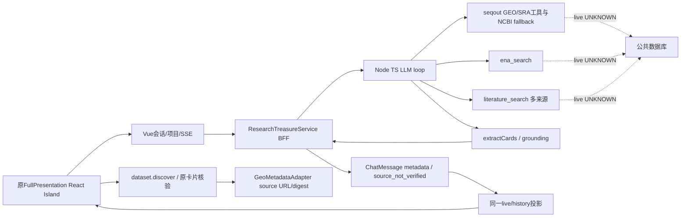
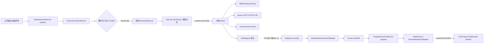
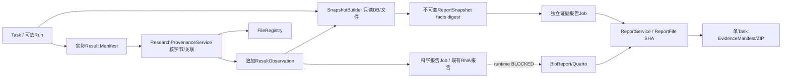
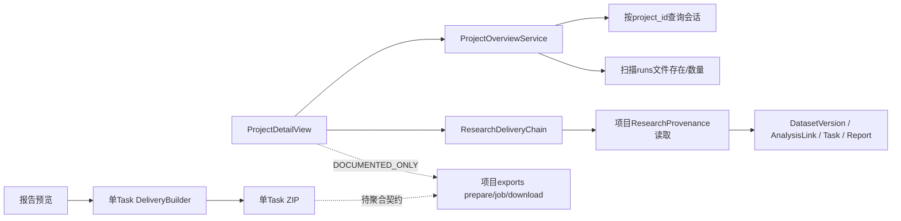
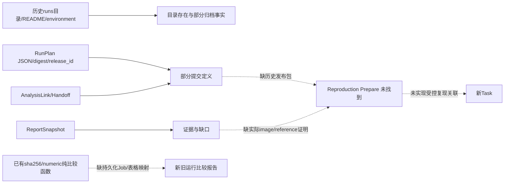
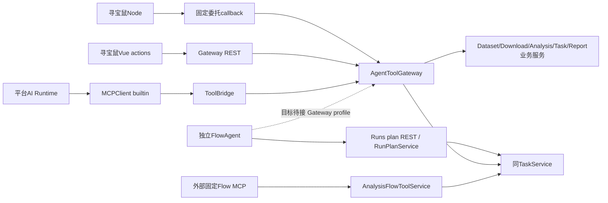

# CygnusX BioOps 科研生命周期、证据与可验证复现架构调查

日期：2026-10-16。性质：**当前工作区只读源码审计 + 隔离验证**。没有业务开发、数据库迁移、真实下载/科研计算、开关修改、提交、推送或部署。设计建议不表示现状实现，隔离测试不表示真实运行通过。

## 1. Executive Summary

**现有平台具备可复用的科研发现、数据准备、统一提交、证据快照及单任务交付底座，但尚未形成真实环境验收通过的五阶段闭环。项目级聚合导出、按历史定义受控复现和持久化结果比较仍有明确缺口。**

最先需要处理的不是重建系统，而是现有接缝：

| 发现 | 优先级 | 当前证据与影响 |
|---|---|---|
| F01 下载文件没有下载 Task 身份，而 Dataset 对账按 Task 查文件 | P0 | 下载 Worker 的 DataFile 构造及仓储保存均未写 task_id；reconcile 要求 FileRecord.task_id 命中 ingestion.task_ids。真实下载成功也可能停在 DOWNLOAD_FILES_NOT_REGISTERED，不能用目录猜测补齐 |
| F02 下载 UI/DTO 与实际下载器方法不一致 | P0 | UI/DTO 允许 aws/aspera/ftp；子模块 EBIDownload 1.4.0 的 enum 为 Ftp/Prefetch/Aws/Auto，无 Aspera；兄弟 Polariseq 1.4.3 为 Ftp/Aws。Worker 原样透传 -d，实际部署二进制身份仍 UNKNOWN |
| F03 执行时发布与环境证明缺失 | P0/P2 | execution_binding.runtime_environment=NOT_OBSERVED、workflow_release_digest=null；Provenance.image_digest/software_versions=null，Handoff.worker_paths_verified 固定未验收；当前目录/镜像不能冒充历史 |
| F04 项目导出不是已有功能 | P1 | ProjectOverview 只聚合会话和磁盘 runs；ResearchDeliveryChain 只读 Dataset 交付；EvidenceManifest/Report 均围绕单 Task；未发现项目导出 Job/API |
| F05 FlowAgent 没有全部经过共享 Gateway | P0/P1 | 独立 FlowAgent.submit_plan 直调 /runs/snakemake/plan，随后复用 TaskService；不能把“同 TaskService”描述成“所有 Agent 已统一 Gateway” |
| F06 当前测试并非全绿 | P0 | 本轮主批次302通过/1失败/5错误；下载 fixture 访问不存在的 _settings，工具契约测试的 SimpleNamespace 缺 legacy_pipeline_tools；Node 12文件级测试11通过/1失败 |
| F07 云对象 URI 的 IP 拒绝逻辑存在边界缺陷 | P0 安全复核 | _validate_cloud_host 的 ValueError 被同一 except 捕获；离线构造 oss://[::1]/x 被 Schema 接受。尚无真实CLI连接证据，不能宣称已发生SSRF，但需在开放下载前修复并验证 |
| F09 从执行证据报告发起打包可能把证据误标为科学报告 | P0 | build_delivery_package在source已有snapshot时令evidence=source，随后固定将source标为Scientific_Report；此入口没有查询真正scientific报告。静态角色探针确认同对象被标两种角色，未真实生成业务包 |
| F08 ZIP verifier 不是任意外来包的严格校验器 | P1 | 离线探针：拒绝路径穿越/登记文件篡改，但接受未列出额外文件和重名成员；当前受控builder通常不产生这些内容，不等于发现外来包导入执行入口 |

本轮发现的**可复用增量**也不能遗漏：Phase5 工作区已有 ResearchPlan PLAN_ONLY、ResearchClaimService 的真实 deg.tsv 单元格读取、Benchmark 的固定容差/SHA比较函数。这些都不是完整复现服务，但比“完全没有比较/结论溯源”更接近目标。前一份设计文档相应部分应据此细化，不能重复实现。

建议最小路线：**修复下载身份/传输契约与测试 → 授权环境验收现有单任务链 → 项目聚合导出与可信关系 → 执行期证明 → RNA 受控复现与持久化比较 → 论文案例与公平评测**。不增加平行 MCP、下载器、执行引擎或报告系统。

## 2. 仓库、版本与 Dirty Baseline

主仓 `/home/zj/zj_code_libarary/OmicHub`；分支 `feat/research-agent-phase5`；HEAD `51011118535f782f5282f638b4a54649c79bf6d6`。HEAD 提交主题为建立科研证据链与双报告交付闭环，不能代替本次 dirty 工作区或部署版本。

起始状态保存于 [dirty-baseline.txt](../../evidence/lifecycle-audit-2026-10-16/dirty-baseline.txt)，关键源码摘要见 [audited-source-hashes.json](../../evidence/lifecycle-audit-2026-10-16/audited-source-hashes.json)。已有未提交 Phase5、寻宝鼠 Island、Dataset 接线、Flow工具固定化及子仓改动均受保护。报告与证据之外不修改业务文件。

收尾发现起始状态之外新增/变更的 `api/v1/flows.py`、`mcp_builder_service.py`、`test_mcp_budget_and_pagination.py`、`test_mcp_builder_invoke_gate.py`（见status-delta.txt）。这些不是本审计实施的修改；已读取当前差异并额外运行其14项隔离测试通过。报告按这一最终观察更新，未将并行成果归为本轮开发。

| 生态组件 | 当前代码身份 | 调查结论 |
|---|---|---|
| Protocol/FlowFrame | 977ad657，dirty | 协议/流程结构/FlowAgent本地台账与平台计划提交可读；独立Agent与平台运行边界不能混同 |
| pipelines/RNAFlow | 19f5068c，dirty | ARDP result_manifest 与科学报告路径存在；不代表已验收部署 |
| pipelines/ATACFlow | 4a68b347，dirty | 声明式分析接入存在；不得继承RNA证据适配/复现等级 |
| pipelines/CountsDEGFlow | 主仓目录，非独立列出的子模块 | counts校验/DESeq2脚本/manifest/报告模板存在；运行准入关闭 |
| pipelines/EBIDownload | b351e03d；core 1.4.0 | 老名字、老CLI契约，平台默认按EBIDownload调用 |
| 兄弟目录 EBIDownload | a46f89b4；Polariseq CLI 1.4.3 | README明确 renamed；crates/polariseq-*，增加GSA通道；不是平台子模块相同版本或已部署替换品 |
| 科研寻宝鼠 | 88dae95e，dirty | 原Node检索内核、FullPresentation React Island、平台会话/BFF/typed action |
| BioReport兄弟仓 | 351e4654；pyproject 2.0.0 | 当前代码版本已变化，不能沿用旧文档cb2911a当本轮实际版本；生产镜像digest未知 |
| scrna / tools | b5066338 / 24ecb6ce，tools dirty | 在生态清单中；本次不以RNA链推导其报告/复现已认证 |

必读材料已定位并核对：项目导出与复现提案、报告Phase0/1/2设计、寻宝鼠实施与展示迁移报告、架构库README、Dataset/Gateway/Flow/Report/ResearchDelivery活动架构。旧Phase0/1文档的“后续提案”已部分被现状实现超越；Flow架构前段仍含旧动态工具描述，后段§8及当前源码已进入固定工具迁移，判断以源码为准。

## 3. 状态口径与证据索引

- VERIFIED_CODE：实现、调用或声明已核对；不含真实组件承诺。
- PASS_ISOLATED：本轮实际执行了隔离用例；SQLite/临时文件/Mock与禁用门禁替身的测试，仅证明指定范围。
- PASS_RUNTIME / PASS_E2E：分别要求真实组件或完整真实科研链，本轮没有授予任何能力这两个状态。
- PARTIAL：仅部分路径/契约/测试覆盖；BLOCKED：当前不能开放或环境不可验；DOCUMENTED_ONLY：仅提案；NOT_FOUND：限定源码范围未找到；UNKNOWN：无权威运行证据。

所有证据在 `evidence/lifecycle-audit-2026-10-16/`：backend-tests.log、additional-tests.log、frontend-tests.log、frontend-types.log、node-tests.log、node-warning-recheck.log、gateway-contract-recheck.log、migrations.log、current-worktree-mcp-tests.log、commands.md、static-probes.py/json、package-probes.py/json、runtime-probes.json、browser-probe.json、browser-system-probe.json。脚本只使用构造器、AST、/tmp临时ZIP或socket能力探针；不访问业务API。

**本轮实测**：后端主批次302 passed、1 failed、5 errors；补充批次53 passed；收尾MCP增量14 passed；前端相关12文件45 passed；vue-tsc --noEmit退出0；Node文件级11/12通过；迁移链静态检查通过。没有重跑全仓测试、生产构建或真实E2E；历史183/41/15等数字不作为本轮结果。

## 4. 已实现能力复用矩阵

源码路径缩写：S=`src/cygnusx/application/services/`；A=`src/cygnusx/api/v1/`；M=`src/cygnusx/infrastructure/database/models/`；F=`frontend/src/`。测试列为本轮读取并运行的既有用例族，具体映射见§17。

| 能力 | 所属模块/源码位置 | API/工具 | UI | 已有测试 | 当前状态/运行 | 复用与缺口 |
|---|---|---|---|---|---|---|
| GEO/SRA/ENA检索 | Treasure functions/seqout-chat/index.ts | 原seqout_*、ena_search | 原DatasetCard/四场景 | Node搜索/ENA/resolve/grounding | VERIFIED_CODE；Node部分失败，运行UNKNOWN | 全复用检索，不新建检索内核 |
| 文献/DOI/PMID | 同上、src/services/literature.ts | literature_search | 原文献卡/来源 | Node literature；前端投影 | PASS_ISOLATED；live UNKNOWN | 不等于论文全文事实验证 |
| Accession/Insights/NextShovel | 同上、原chat组件 | 原detail/resolve工具 | 原回复组件 | Node grounding/intent；投影测试 | PARTIAL | 编号grounding不是样本/科研假设验证 |
| 项目会话与持久回复 | S/research_treasure_service.py | A/research_agent.py | TreasureResearchWorkbench | research_treasure_phase1；SessionIsolation | PASS_ISOLATED | 保存raw metadata；非独立可信Dataset |
| 委托工具 | S/agent_tool_gateway.py、Treasure platform-tools.ts | agent-tools delegated callback | 原卡片→Vue | agent_tools_phase2；Node platform-tools | PARTIAL；真实callback BLOCKED | 固定URL/短TTL/防重放，无模型批准 |
| 公开元数据核验 | S/dataset_import_service.py、infrastructure/geo/adapter.py | dataset.discover | 卡片核验Dialog | dataset_gateway_phase3/geo_validation | PASS_ISOLATED；本地flag关闭 | 无project可只读，Prepare仍要项目 |
| 导入预案 | S/dataset_import_service.py | dataset.prepare_import、datasets REST | 原风格Dialog | dataset_import_handoff | PASS_ISOLATED；写BLOCKED | 稳定request_key/源摘要/预算 |
| 下载与队列 | S/download_service.py、celery_app/tasks/download.py | /downloads，DownloadRequest | DownloadsView | download_service 3通过/5fixture错误 | PARTIAL；Worker BLOCKED | 三source复用；F01/F02/F07 |
| 已有文件挂接 | S/dataset_service.py | datasets asset/sample APIs | DatasetWorkspace/已有入口 | dataset_phase3/review | PASS_ISOLATED | 不重新下载；owner/project校验 |
| 版本/来源/审阅 | M/dataset.py | datasets version/review | Dataset管理/Island读 | dataset_phase3/review | PASS_ISOLATED | 版本冻结；来源事实与人审分离 |
| Handoff/类型校验 | S/dataset_handoff_service.py、domain/dataset/validation.py | manifest/freeze/validate | 准备面板 | geo_validation/phase3/review | PASS_ISOLATED；worker_paths=false | raw counts证据/TPM阻断 |
| Flow准备 | S/dataset_analysis_service.py、analysis_flow_tool_service.py | analysis.prepare_from_dataset/固定prepare | Flow表单/Island | 输入validator/flow parity | PASS_ISOLATED；执行BLOCKED | 物种/参考/设计人审，不模型路径 |
| 统一分析提交 | S/task_service.py、domain/flow/submission_validator.py | /tasks；固定submit | 任务中心 | flow_validation_parity/fixed工具 | PASS_ISOLATED局部；Worker BLOCKED | 同TaskService，不代表各入口同Gateway |
| 确认 | S/tool_confirmation_service.py | JWT approve/reject REST | 原确认卡/预案决定 | phase0b_confirmation | PASS_ISOLATED；Redis CAS BLOCKED | TTL/Lua/CAS/一次性摘要；内存仅测试 |
| 分析执行绑定 | S/research_execution_binding.py | TaskService最终校验/Worker preflight | 证据状态 | research_delivery_phase4 | PASS_ISOLATED | 配置摘要与输入重检；非历史release仓库 |
| 结果观察/文件登记 | S/research_provenance_service.py、M/result_observation.py | /tasks/{id}/provenance/reconcile | ResearchDeliveryChain | research_delivery_phase4 | PASS_ISOLATED；写BLOCKED | 追加不可变；当前字节不自动是执行时字节 |
| ReportSnapshot | S/report_snapshot_builder.py/sources/manifest | snapshot报告API | 报告八模块 | report_snapshot/reproducible_report | PASS_ISOLATED | 只读事实/缺口/稳定digest；历史环境未知 |
| 独立报告Job | S/reproducible_report_service.py、tasks/reports.py | task reproducibility-reports | TaskDetail/轮询 | report_phase1/isolated integration | PASS_ISOLATED；真实锁/队列BLOCKED | 失败不重算；持久恢复模式可复用 |
| 科学报告 | S/report_service.py/scientific_report_job.py | reports | ReportsView | report phase4/PDF适配用例 | PARTIAL；BioReport真实渲染BLOCKED | RNA原报告保留，counts独立渲染 |
| 单任务ZIP | S/research_delivery_service.py、report_service.py | POST /reports/{id}/delivery | 预览“生成交付包” | report_delivery_phase2/PDF/ZIP探针 | PASS_ISOLATED部分；live BLOCKED | owner/快照/清单/partial；F08 |
| 项目总览 | S/project_overview_service.py | /projects/{id}/overview | ProjectDetailView | ProjectDetailResearchContext | VERIFIED_CODE/PASS_ISOLATED UI | runs文件存在扫描不证明Task关联 |
| 项目交付读取 | S/research_provenance_service.py | /projects/{id}/research-delivery | ResearchDeliveryChain | report phase4/前端 | PASS_ISOLATED；flag关闭 | 仅Dataset绑定任务，且可截断 |
| 项目导出 | 设计文档 | 新exports接口未找到 | 无统一项目导出 | 无项目导出测试 | DOCUMENTED_ONLY | 聚合清单/选择/Job/发布待补 |
| RunPlan | S/run_plan_service.py、M/run.py | /runs/snakemake/plan、confirm | 原Run工作台 | 确认及工具相关局部 | VERIFIED_CODE/PARTIAL | plan_json/digest/release_id可复用，非完整执行定义 |
| ResearchPlan | S/research_plan_service.py、M/research_plan.py | research.plan.*、REST | ResearchPlanWorkbench | research_plan_* | PASS_ISOLATED；PLAN_ONLY/flag关闭 | 研究意图，不授权后续写操作 |
| 结论/表格证据 | S/research_claim_service.py | research.plan.assess_claim/artifact_cell | 尚非全报告逐结论链 | research_claim_artifact/science | PASS_ISOLATED；运行关闭 | deg.tsv/feature/column/SHA，事实内容仍有限 |
| 比较函数/Benchmark | domain/research/benchmark.py | 无完整Comparison Job API | 无比较工作台 | research_benchmark_phase5 | PASS_ISOLATED | sha256/numeric与度量归档可复用；没有任务编排闭环 |
| 历史复现 | 未找到完整用例 | reproduction.*未注册 | 无正式入口 | 无完整复现测试 | NOT_FOUND；BLOCKED | 历史release、实际image/reference、预检/关联/比较Job缺 |

## 5. 科研发现 → 数据资产

### 5.1 当前架构图 1（代码，非运行验收）

Node不是平台LangGraph Runtime的简单别名：寻宝鼠保留独立TS工具循环，BFF统一平台身份、会话、配额及存储；平台普通AI走当前Agent Runtime/MCPClient，不应宣称两边同一LLM推理内核。

元数据保留 accession、DOI/PMID、来源URL与raw card metadata；后端终态合并和前端投影有测试。卡片和追问建议是发现线索，Dataset Insights/样本分组等模型解释不能升级成事实。Node grounding扫描正文accession，卡内已见编号视为grounded，卡外编号最多5个回源存在性核验；上游全部unknown可降级不提示。**它不验证文章结论、数据类型、样本设计或可下载性，且无警告不代表完全核验。**

DiscoveryProposal 含会话/项目上下文与source_not_verified，可作为线索引用，但没有独立不可变Discovery实体外键；稳定业务身份从后续Invocation/ImportProposal开始。核验/Prepare重新解析 accession 和来源。公开discover可无项目，但仍需用户/模块/开关；加入项目与挂接文件每次重查当前owner和项目。GSE/GSM不能直接作SRR下载；raw/processed候选分开。

GeoMetadataAdapter有受信主机、HTTP(S)/受控FTP来源策略、禁重定向、缓存、超时和响应/样本/Run上限；source_evidence含URL、retrieved_at、response_sha256。可信范围是“某时读取的来源响应”，不是公共数据库内容的科学正确性。来源特征、样本关系与AI标签/人审注释分开；分组、assay、物种/参考、输入用途必须审阅。

DTO风险：主界面有统一live/history投影并保留meta，但展示白名单可能不显示全部原字段；缺口应区分“未显示”“未保存”“未核验”。source主机白名单也可能屏蔽未登记出版社链接，不能把屏蔽视为来源不存在。大样本被有界截断，T01不能按所有GEO/ENA字段完整覆盖认定通过。

## 6. 数据下载与 Dataset 接入

### 6.1 当前架构图 2

### 6.2 传输能力逐项核对

共用 DownloadRequest（source=sra/direct_link/cloud_storage）、DownloadService.submit、通用Task(flow_id=ebi_download)、既有enqueue_task/run_download。并非Agent沙箱下载器。Human传统下载表单路径与Agent gate保护范围不同；不能把Agent封禁当作所有人类下载禁用。

| 数据源 | 输入/支持编号 | Worker适配/程序 | 审批、目录、完整性与恢复 | 运行证据 |
|---|---|---|---|---|
| SRA | human DTO accession普通字符串；Agent prepare限制SRR/PRJNA候选；Dataset raw只权威解析SRR | EBIDownload -A/-d；转换依赖实际下载器/SRA工具 | Dataset JWT确认，项目目录服务端生成；任务失败不自动重投；F01无task_id/空checksum | BLOCKED；未确认实际binary及依赖 |
| ENA | Node可查询PRJEB/ERP/ERR；Dataset raw当前不接受ERR/DRR执行 | 可经EBIDownload ENA元数据或可信direct_link | “可发现”不等于“Dataset已可下载”；MD5来自源与本地验证分开 | BLOCKED |
| GEO supplementary | GSE/GSM解析出的权威候选URL，processed选择 | direct_link→aria2c，不能自行构造附件名 | Prepare重取来源hash；processed初始role=other，后续验证类型；重复默认新版本/auto_rename | BLOCKED |
| HTTP/HTTPS | DownloadRequest.links，禁URL凭据/显式私网IP/localhost | aria2c --continue/check-integrity/重试参数 | 目录realpath校验；没有把max_bytes传入Worker的持续硬预算；DNS/重定向最终目的安全待验证 | BLOCKED |
| FTP | direct_link FTP；Dataset可信FTP候选 | aria2c + FTP目录递归展开 | FTP遍历无明确循环/深度/总数预算；匿名访问；不能开放任意递归给Agent | BLOCKED |
| 云存储 | aliyun/volc/huawei，oss/tos/obs URI | 对应CLI受控argv，无shell拼接 | provider域后缀策略；F07 IPv6验证缺陷；凭据配置不回传Agent | BLOCKED |
| 已存在文件 | file_record_id，当前owner/project/active可见 | DatasetService.attach_asset，无传输 | FileRecord→Asset后内容校验、人审、freeze；不重新下载 | PASS_ISOLATED；真实文件环境未验收 |

F01源码链：`tasks/download.py::_register_downloaded_files`不接收task_id，构造DataFile未传task身份/摘要，FileRepositoryImpl.save也无对应写入；`DatasetImportService.reconcile`明确WHERE task_id IN ingestion.task_ids，没有目录fallback。现有import隔离测试事先建立带task_id的FileRecord，故不能覆盖真实Worker登记断点。本轮静态探针确认，未运行真实下载。

max_bytes当前是Prepare/配额/事后总量检查，不能承诺传输中硬停止；aria2c重试/断点续传不等于业务幂等。DownloadService建立目录与Task后投递，再推进状态；队列/事务失败窗口需要真实环境审查，不能将Dataset的SUBMITTING保留策略描述成跨DB/queue exactly-once。

## 7. 受控分析执行

DatasetAnalysisService先要求已冻结version.handoff与实际兼容flow；RNA显式species/Genome_Version/Library_Types，校验来源物种、样本映射与配对路径；counts要求RAW_COUNTS证据、非负整数矩阵、唯一feature/sample、方向、metadata匹配、人审group/design/comparison。TPM/FPKM/CPM/log/Series Matrix/UNKNOWN不升格raw counts，不能按文件名推断。

输入路径由受管FileRecord解析，拒绝调用者覆盖raw_data_path/workflow/user/project；AnalysisFlowToolService及最终TaskService共同使用FlowSubmissionValidator。Worker preflight再次核验Dataset绑定、Flow配置摘要和文件字节。但该强Dataset检查只对 `dataset:` idempotency_key 路径适用；普通历史Task/Run不能自动继承这些证据。

审批链复用ToolConfirmationService：JWT可信人类通道批准；canonical hash包含操作和规范化内容，Redis Lua/CAS/TTL控制一次性消费，Store故障拒绝，SQL持久Invocation/Proposal用于恢复。模型user_confirmed/_confirmed不能自证授权。Run路由虽然schema有user_confirmed字段，实际要求consume_tool_confirmation，不以布尔值直接执行；RunPlanService内部True是可信调用结果，不应单独取一句认定漏洞。

AgentToolGateway从当前ChatSession/User/Project重建身份和scopes，委托scope再取交集；Node固定callbackURL、短TTL、Redis防重放，委托不带approve/execute。SOURCE GATE在Agent写副作用前检查，Dataset独立write flag再检查。审批不等于执行；研究计划review不消费业务批准；聊天取消不撤销已存在Task；SUBMITTING/RECONCILIATION_REQUIRED不自动重投。

仍需检查：真实Redis竞争/TTL故障、PG锁/唯一键、Task投递与关联提交、Worker挂载/软件/参考、所有入口的一致性。只凭现有内存确认与SQLite不能开放。

## 8. 执行期证据与 Provenance

### 8.1 字段真实性矩阵

D=declared（配置/请求声明）；O=observed（明确时点观察）；V=verified（注明范围的校验）。每个V都须写范围，不代表科学正确。

| 事实 | 现有保存位置/范围 | 类型与缺口 |
|---|---|---|
| DatasetVersion/FileRecord/输入role | dataset_assets、version.handoff | D+V身份范围；实际输入字节重查 |
| 输入SHA/size | Dataset校验/Handoff/check_inputs | O+V采集/提交时；不自动证明全程不可变 |
| sample mapping/group | DatasetSample/review/handoff | 来源声明+人审，不能称外部实验真值 |
| Handoff摘要 | DatasetVersion.handoff、AnalysisLink.handoff_hash | V规范化内容；不是签名 |
| Reference身份 | RNA参数Genome_Version/species | D；不可变参考FASTA/GTF/索引hash普遍缺失 |
| Flow name/version | FlowConfig、Task.flow_id、binding | D；当前catalog配置摘要非历史可执行发布 |
| Git commit | 子仓Git/外部版本 | 源码可查不等于每个Task均执行时保存；Task级普遍UNKNOWN |
| Workflow Release digest | binding字段 | 明确null；历史release registry未找到 |
| Image digest/工具版本 | Provenance.runtime/Snapshot缺口 | NOT_OBSERVED；当前host工具不补历史 |
| 参数/设计/比较 | Task.parameters、Run.plan_json、AnalysisLink.normalized_request | D+批准绑定，通用Task参数不必含完整原sample sheet/参考身份 |
| 随机种子/资源 | Flow默认/参数、队列配置 | 仅具体流程有记录时D；未见通用实际资源证明 |
| Task/Run/Queue ID | Task、Run.task_id、既有queue | 持久记录；Run可空，queue_job不是Run |
| Worker ID/实际镜像 | 未见统一执行时绑定观察 | UNKNOWN，不从当前容器推断 |
| 起止/错误 | Task/RunEvent/Job状态 | O平台记录；不等于每个Snakemake步骤完备 |
| QC规则版本/豁免 | Snapshot quality_gate、Run/流程局部 | PARTIAL；QC文件不自动是通过决策 |
| Result Manifest | RNA ARDP、Counts manifest、ResearchProvenance | O读取+来源绑定；manifest自声明指纹须独立核验 |
| 输出Artifact/FileRecord/SHA | ResultObservation/ReportSnapshot/FileRegistry | O+V采集字节；旧下载记录任务关联缺口F01 |
| Scientific/Evidence报告 | ReportModel/ReportFile/Snapshot/Job | 文件校验与冻结事实可追；不是复现执行 |

### 8.2 当前架构图 3

职责应保留：Handoff冻结“输入交接”；ExecutionBinding约束“准备时输入/参数/当前配置”；ResultObservation记录“结果采集观察”；ReportSnapshot冻结“某次交付可见证据”；EvidenceManifest记录“实际交付的文件”。ResearchProvenanceService提供实时授权查询/对账，不是新快照仓库。它们共享ID和digest引用，不能合并成一个不断变化的万能JSON。

摘要不宜机械去重：输入摘要、结果摘要、快照事实摘要、包文件摘要的对象与时点不同，应保留scope/algorithm/version并引用上游。重复字段的风险在于显示覆盖：来源声明版本不能填入observed_software；capture_bytes SHA不能改标execution_bytes。旧快照可保留当时缺口，新证据产生新观察/快照而不是覆盖。

### 8.3 是否需要 ExecutionDefinition 新表

现有可复用三块：RunPlan.plan_json/plan_digest/release_id（并非所有Task有Run）；ResearchPlan.draft/digest/steps（研究意图，PLAN_ONLY）；DatasetAnalysisLink.normalized_request/execution_binding（仅Dataset执行路径）。它们**不能完整恢复历史输入/镜像/参考/可执行发布**，但足以提供契约基础。

建议先定义版本化不可变ExecutionDefinition DTO与覆盖矩阵，再评估现有AnalysisLink JSON/Task显式快照引用扩展是否足够；需要跨入口统一索引、不可变约束与保留策略时才新增一张定义表。研究意图和实际执行定义不应强行合并；无需为每类Agent重复建表。

## 9. 单任务科学报告、证据报告与交付包

科学RNA报告由原流程产物登记；counts有受保护的独立科学渲染Job。执行证据报告独立Job从冻结快照生成八模块离线HTML；可用时生成PDF。原科学报告通常没有同一个snapshot_id，不能笼统说所有双报告共用快照；单任务delivery会寻找同owner/Task证据报告的冻结快照来绑定包。历史版本用parent_id/version保留，ReportFile有SHA，审计发布/读取/下载核验字节。

ReportGenerationJob具有queued/collecting/rendering/publishing/ready/failed、固定snapshot_id、尝试次数、错误码和归档路径；PG advisory lock/唯一键设计、先提交Job再投递及Beat恢复存在。隔离integration覆盖ASGI请求、快照、发布失败恢复、鉴权预览/下载及不可变记录，但broker替身、SQLite和合成RNA不证明真实PG/队列/S3。

**F09内容角色问题**：该Service允许从scientific或reproducibility入口打包，但当source本身为证据报告且有snapshot时，evidence=source，随后reports元组把source固定放到Scientific_Report角色，同一证据可能被两次命名。static-probes从当前AST提取角色表达式验证了此映射；这不是完整HTTP/存储测试。应按report_kind分别查询并校验同owner/Task的科学与证据报告，缺科学报告诚实partial，不能用证据HTML填Scientific_Report。现有delivery测试主要覆盖builder而非这两个Service入口，必须补回归。

DeliveryBuilder通过既有ReportService.build_delivery_package与POST /reports/{id}/delivery运行，报告预览已有按钮。它读取受权报告与快照，可标partial，缺PDF不生成假文件；不启动分析，条件允许时可受控渲染科学PDF。包含HTML/PDF（实际有才含）、ReportSnapshot.json、README、EvidenceManifest和checksums；sha256sum离线检查是文件一致性，不是可信签名。

F08需限定：verify_package检查列出的文件SHA/size、路径、符号链接和总展开量，尚不拒绝重名成员/未登记文件，也未作为通用外来复现包安全导入器；不应直接用于运行上传包。512MiB/2000文件上限、内存materialized字典适合小交付，不适合无限FASTQ项目包。既有报告GC/跨DB-FS原子事务也不能当已完成。

## 10. 项目级成果聚合与导出

### 当前架构图 4

ProjectOverview明确不做Report.project_id硬join；Task/Report没有普遍可信project_id。Dataset路径通过Version→Dataset.project_id和AnalysisLink.task_id能查回项目，Report再按Task及ResultObservation验证。项目交付查询限Dataset关联且有truncated，不等于覆盖所有历史Run、聊天沙箱和普通Task。

没有找到真正项目导出服务/API/Job/Manifest实现；项目导出提案中的路径不能列为现状。最小新增用例应枚举授权可信关联、冻结选择、引用现有单Task快照/清单与文件，而不是重新创建报告对象；主Report.task_id为非空，不能用虚构Task挂项目包。

优先复用ReportService读取/校验、ReportFile/FileRegistry身份、现有存储与鉴权下载、Celery及durable Job恢复模式；项目包用独立聚合manifest。预计需要一个项目导出协调用例和可持久恢复记录；能否复用已有Job表需评审其Task非空与唯一键，不强行复用。

安全要求：默认不复制FASTQ/BAM，引用和实际包含分开；多Dataset/多Task按当前项目授权；范围、配额、展开量、symlink、重名、目录漂移、外部引用、下载撤权逐项校验；幂等绑定选择摘要，失败只重打包。不得递归打包项目根目录或顺带下载/运行分析。当前单Task并发去重还需真实PG验证，不能泛化为项目Job exactly-once。

## 11. 历史归档与可验证复现

### 当前能力图 5

| 复现条件 | 当前证据/结论 |
|---|---|
| 历史输入存在与可信SHA | 部分Dataset冻结路径可核查；未查询业务库，任何具体历史Task均UNKNOWN |
| 原流程发布可取 | Run.release_id校验当前Flow版本，不是历史release仓库；binding摘要不含可恢复发布包 |
| 原镜像digest可取 | 当前执行观察明确未记录，不能由tag/当前宿主补历史 |
| 原参考/索引可取 | 名称参数部分有，逐文件hash/存储保留UNKNOWN |
| 参数/分组完整 | Dataset人审与Run计划部分具备；普通Task覆盖不全 |
| Worker可执行历史版本 | 未验证挂载/架构/依赖/历史registry，BLOCKED |
| Reproduction Prepare/独立批准 | 专门用例/工具/API未找到；现有确认服务可扩展，不能复用旧消费凭证 |
| 新Task/旧Task保护 | TaskService可创建新任务，但无专门reproduction_of关联/不可覆盖验收 |
| 新旧结果比较 | 纯函数有sha256/numeric；无完整表格语义/QC比较、持久ComparisonJob和报告闭环 |

已有Benchmark.ReproductionRule支持预设rtol/atol或SHA，拒绝空/NaN/长度不同；当前模型容差上限并不等于科研合理容差政策；ReproductionRule继承的PlanInput并未设置frozen，且没有持久政策版本，不能把测试名中的frozen理解成数据库不可变保证。没有运行关联和冻结政策身份，不能自动获得L4。ResearchClaimService已验证deg.tsv单元读取与SHA，适合复用为结果适配器，但目前仅特定表/feature/column，不能推导通用表格比较。

分级结论：代码具备L0/L1局部证据能力；没有真实Task样本可授予L1；L2专门预检未实现；L3未真实重执行；L4只有比较原语，非复现通过。按当前流程新建分析必须标Reanalyse With Current Workflow，不能标Reproduce Original Analysis。复现必须新Task/目录/批准/报告，归档上传脚本不直接执行。

## 12. 全平台 Agent / MCP 复用

### 当前复用图 7（与目标区别）

**能够共享业务底座，不等于当前全部走一个Gateway。** FlowAgent已有dry-run台账/受限工具和平台计划适配，但独立工具仍有本地流程文件/命令能力；不能把它作为无shell的平台业务Agent直接接入。集成模式需要将本地执行/写定义能力与平台研究Agent边界隔离，复用受信发布计划，不授予平台Agent Shell权限。

### 12.1 候选工具与实际catalog对照

实际唯一schema源为 `application/schemas/agent_tools.py` 的28项：

- research.plan.assess_claim / artifact_cell / prepare / validate / get_status / get_evidence。
- downloads.describe_capabilities / prepare；analysis.list_workflows / get_workflow_schema / prepare。
- tasks.get_status / list_related。
- research.task_provenance / report_provenance / dataset_provenance / project_delivery。
- dataset.discover / inspect / list_files / list_project_assets / prepare_import。
- analysis.list_compatible_workflows / prepare_from_dataset。
- dataset.execute_import / downloads.submit / analysis.submit / tasks.cancel（写目录不默认暴露，源码阻断）。

literature.search不是Gateway项，已有Node literature_search不能另注册同义工具冒充共享接通；dataset.validate/get_handoff有业务REST/Service但不是上述同名catalog；reports.list/inspect和project.inspect未以这些候选名注册，provenance.trace/evidence.inspect可映射现有research.*查询，避免同义膨胀。project.export_*、reproduction.*当前未找到实现。

当前权限主要是用户模块/Agent allowed_builtin_names/服务端scopes/特性flag裁剪，没有统一覆盖所有Agent的READ/INSPECT/PREPARE/EXPORT/REPRODUCE显式Profile体系；APPROVE留JWT人类REST。默认代码catalog七个read/prepare项，但本地Gateway读开关false，因此不能说当前线上可用七个。

### 12.2 工具膨胀与漂移

固定Flow工具 `cygnusx_list_flows/get_flow_detail/prepare/submit` 已有实现和回归；旧per-flow工具受LEGACY_PIPELINE_TOOLS过渡控制，**本地该flag仍true**，所以不能宣称已全部消除重复工具。bioops_analysis.prepare与固定cygnusx_prepare是不同入口壳，底层同服务；需明确Agent Profile只注入所需面，保留兼容期审计，而非新增一个Gateway进程。

Gateway catalog来自同一Pydantic模型；Node消费服务端schema，API validate时重查。当前FlowService和Flow REST已支持limit/offset分页，ToolBridge分析llm_payload具备约3000字节预算/降级投影；MCPBuilderService实验工具当前新增审核APPROVED、enabled、TTL检查和约16KiB输出截断（14项隔离测试通过）。这些减少模型上下文与未审核调用风险，但不是全Runtime统一按需Tool Discovery，也不解决历史复现缺口。建议沿用已有list/describe与按Agent领域裁剪，不为每Flow增加工具；Tool Discovery可减少一次性可见schema，但尚不能宣称所有Runtime已经按需加载。builtin MCP是适配层，外部MCP是独立通道；不要为了统一再叠一层远程转发。错误码/Invocation ID/parameters hash保持稳定；TTL过期重新Prepare，不从摘要恢复执行参数。

## 13. 数据模型与跨模块可信关系

表中“持久/恢复”仅代码能力；全部“真实任务验证”均为UNKNOWN/BLOCKED，本轮未读业务DB。授权缩写O/P=当前owner/项目核验，O=owner；项目推导只能沿显式关系。空关联不得按相似目录/时间补齐。

| 来源→目标 | 实际键/引用 | 创建/版本规则 | 用户/项目/授权 | 持久与恢复；历史缺口 |
|---|---|---|---|---|
| 问题→Conversation | ChatSession.session_id；Message.session | 发问落库/会话状态 | 当前user/session，project可空 | 是；私密正文不默认导出 |
| Conversation→Discovery | ChatMessage metadata cards/proposals | 流终态/中断finally保存；raw meta | 会话owner/project上下文 | JSON持久，非独立Discovery FK |
| Discovery→Source | meta.link/DOI/PMID/accession | 来源引用/grounding | 源非授权凭据 | 元数据可恢复，原网页可漂移 |
| Discovery→ImportProposal | accession/discovery_ref经重新resolve | 新Prepare，request_key唯一 | 当前O/P；不信旧project | 提案UUID/Invocation有身份，非每卡强FK |
| Dataset→Project/User | datasets.project_id/user_id FK | 创建时校验 | O/P | 强关联；旧文件不自动归属 |
| Dataset→Version | dataset_versions.dataset_id FK | 新版本，冻结后不原地改 | 继承Dataset | 是，保留版本 |
| Version→Source | dataset_sources.version_id/evidence | 导入/登记来源 | O/P | 来源URL/响应hash持久 |
| Version→FileRecord | DatasetAsset.version_id/file_record_id FK | 人工挂接/下载对账 | O/P+文件active/owner | 是；file丢失为缺口 |
| Ingestion→Download Task | task_ids JSON | SUBMITTING后逐Task写回 | O/P；view重查Task owner | 可恢复但非FK数组，投递不明人工对账 |
| Download Task→FileRecord | 应为file.task_id | 当前注册函数未写F01 | owner存在，项目不应靠目录猜 | 缺，现有隔离测试手建关联 |
| Version→Sample | DatasetSample.sample_id/映射 | attach/review，人工分组 | O/P | 是，源注释与审阅分离 |
| Version→Handoff | version.handoff JSON/hash | validate/freeze，修订新Version | O/P | 是；worker验证false保留 |
| Handoff→AnalysisLink | version_id/handoff_hash/normalized_request | Prepare冻结输入引用 | O/P | 是；不是历史执行release |
| AnalysisLink→Approval | confirmation_id/parameters_hash | 既有Redis记录、decide/consume | JWT人类、operation绑定 | SQL引用+Redis TTL，过期不可凭摘要恢复 |
| AnalysisLink→Task | task_id unique FK | 实际提交Task并绑定 | O/P+最终检查 | 是，Runtime未证明 |
| ResearchPlan→业务步骤 | draft/steps/events内引用 | plan版本/人类review；PLAN_ONLY | O/P | JSON稳定引用，非统一强FK；不授执行权 |
| RunPlan→Task | platform_runs.task_id unique、非显式FK | confirm后关联 | owner；project_slug非Project FK | 是；普通Task可无Run |
| Task→Queue | 既有Task/队列ID | enqueue/状态变化 | owner服务端 | 非跨组件exactly-once保证 |
| Task→ResultObservation | observation.task_id/analysis_link/project FK | reconcile追加、digest唯一 | O/P | 是；缺manifest不READY |
| Observation→Artifact | payload/DTO file_record_id及SHA | 采集/登记 | owner/project/FileRegistry | 引用恢复；不是所有Artifact均独立表 |
| Task/Run→Snapshot | snapshot.task_id、payload source/run | Builder固定事实，ORM/PG不可变更新约束 | owner；Run可空 | 是；无Run正常缺口 |
| Observation→Snapshot | 可选research_delivery内容 | 扩展快照新版本 | 原权限 | 旧快照空扩展仍旧digest |
| Snapshot→Report | reports.snapshot_id FK | 证据报告；科学报告可null | owner/当前research范围 | 是；旧scientific无snapshot不补造 |
| Report→File | report_files.report_id FK、sha/file_record_id | 发布核验登记，版本追加 | owner下载复核 | 是；旧fileSHA可缺 |
| Report→Delivery | delivery的task/snapshot/template关系 | build/reuse同一冻结版本 | owner+research scope | 单TaskReport持久；真实并发未验 |
| Project→Delivery读取 | Dataset→Version→AnalysisLink→Task | 实时只读查询，truncated | O/P | 查询可重建，非项目冻结包 |
| Project→Export Job | 未找到 | 仅提案 | 尚待定义 | DOCUMENTED_ONLY |
| 原Task→复现Task | 未找到专门关系 | 应新Task/新批准 | 尚待定义 | NOT_FOUND |
| 新旧Task→Comparison | benchmark函数无Task持久关联 | 仅纯比较/离线评测记录 | 当前无完整业务授权用例 | NOT_FOUND完整Job/报告 |

孤立记录处理：有目录无Task、有Task无Project、有Report无Snapshot、有Dataset无实际文件、有Handoff无Worker、有Task成功无manifest、有Agent文本无Invocation、历史配置无release都可能由模型允许的空字段/缺口表达；没有授权DB盘点，**不能编造这些记录的实际数量或声称不存在**。只读盘点脚本须限定当前用户与真实主键，输出UNKNOWN，不执行回填。

副作用核查：ProjectService.list/get路径会调用_backfill_from_disk并可能commit，所以本轮没有调用“看似只读”的项目API；ProjectOverview查询/scan与provenance GET不做reconcile写入，但依赖链仍应发布前复核。

## 14. 推荐目标架构图 6（待实施部分用虚线）

```mermaid
flowchart LR
 D[Research Discovery 原Node/平台AI] --> I[现有DatasetImport Prepare/审批]
 I --> DL[受控DownloadService]
 DL --> DS[DatasetVersion/FileRecord/冻结Handoff]
 DS --> AP[现有Analysis Prepare/审批/TaskService]
 AP --> FF[FlowFrame / 实际Worker]
 FF --> OB[输入/环境/结果实际观察]
 OB --> EV[ResultObservation / ReportSnapshot]
 EV --> RE[ReportService 科学/执行证据]
 RE --> SD[现有单Task清单与ZIP]
 SD -.增量项目Manifest/Job.-> PD[Project Delivery]
 OB -.增量历史release与实际环境证明.-> ED[版本化ExecutionDefinition]
 PD -.入口/可用性预检待建.-> PRE[Reproduction Prepare]
 ED -.可信定义绑定.-> PRE
 PRE -.新审批+新Task 复用TaskService.-> AP
 EV -.复用比较函数/单元格读取 新增Job.-> CMP[固定政策结果比较]
 CMP -.新增比较报告.-> RE
```

这是一条统一工作流，不是五个新系统。当前最大断点先在下载登记和运行准入，再在历史执行证明及项目聚合。目标图不能替代源码图或PASS_RUNTIME证据。

## 15. 三种最小改造方案

复用比例不以代码行数/模块个数伪算百分比：采用五条主链“发现、导入、分析提交、报告、项目/复现”的复用覆盖说明，实际增量成本需契约评审后测量。下列数量是候选逻辑职责上限估计，不是已新增服务或工时承诺。

| 维度 | A 最小整合 | B 生命周期契约标准化（推荐渐进） | C 完整可复现基础设施 |
|---|---|---|---|
| 复用依据 | 前四链沿用现有Service；只补登记/关联/聚合 | A+复用RunPlan/Link定义字段、Snapshot/比较原语 | B+实际环境采集/发布保留，仍复用Task/FlowFrame |
| 新增服务职责 | 约1个项目导出协调职责 | 约3个：项目导出、复现预检协调、比较作业协调 | B外约2个：release保留、运行证据采集适配；可嵌现有服务 |
| 新模型候选 | 0–1 ProjectExportJob；不能强塞Task非空ReportJob | A+执行定义可先扩展既有JSON；ReproductionLink/Comparison持久记录仅必要时加 | 在B基础上Release/EnvironmentObservation等按现有模型差距决定 |
| API范围 | 项目exports prepare/status/download + 原路径错误修复 | A+复现预检/确认/状态/比较查询 | B+发布/环境证明管理、Benchmark证据 |
| Agent工具 | 复用research.project_delivery，必要时加固定export prepare/status | 新增固定reproduction inspect/prepare/status，批准仍JWT | 用Profile/Discovery扩域，不按每Flow增加Tool |
| 前端 | 项目页导出与缺口/Job，寻宝鼠跳转同入口 | A+任务复现预检/版本差异/新旧比较 | B+可信发布/证据覆盖/评测视图 |
| 安全风险 | 文件枚举/配额/授权/大包 | A+历史代码执行信任、批准后漂移 | B+供应链/长期保留/多租户隔离 |
| 迁移风险 | 低至中，Job新表可追加 | 中，历史Task空值/索引/不可变规则需审查 | 中至高，发布保留/对象生命周期/证明兼容 |
| Runtime依赖 | 现有真实报告、PG/Celery/存储 | A+可用历史输入/镜像/参考/Worker | B+受信构建/registry/长期资源与观测 |
| 最早价值 | 可核验项目交付；不能宣称一键复现 | 首个RNA可预检、受控新执行、按政策比较 | 多领域持续可验证科研资产与论文评测 |
| 验收难度 | 中，主要聚合/安全/真实下载 | 高，需要真实重复计算和故障案例 | 很高，需要跨版本/多域/公平Benchmark |

结论：A适合先交付导出；B是完整目标的最小语义闭环；C逐域建设，不应先做全平台大重构。

## 16. Runtime Readiness Matrix

本轮socket探针在建立PG/Redis/Docker连接时均PermissionError(errno=1)，没有协议握手或业务查询。PATH查找不是Worker实际安装证明；Settings指定路径也不等于可执行。浏览器默认缓存缺可执行文件，系统Chromium另行启动亦失败；未安装/下载浏览器绕过限制。

| 项目 | 源码具备/本轮实测 | 尚未验证 | 当前开放判断 |
|---|---|---|---|
| PostgreSQL | ORM/FK/锁/触发器；SQLite隔离覆盖 | 真实连接、并发、权限、只读盘点 | BLOCKED |
| Alembic | migrations静态链/唯一head通过 | 实际DB当前revision与升级/回滚 | BLOCKED部署，不执行迁移 |
| Redis | Store/Lua/TTL/fail-closed隔离通过 | 真Redis CAS/断连/竞争 | BLOCKED |
| ToolConfirmation CAS | 内存Store并发/摘要/TTL用例 | 真实Redis Lua与多web进程 | BLOCKED |
| Celery Broker | 持久Job/尽力投递/对账源码 | 真实投递、重启、重复消费 | BLOCKED |
| Worker | Snakemake与下载适配存在 | 容器/挂载/工具/身份/恢复 | BLOCKED |
| DownloadService | 三source通用Task代码 | F01/F02/F07及真实传输/预算 | BLOCKED |
| Polariseq/EBIDownload | 两套源码身份已区分 | 配置二进制实际版本/兼容矩阵 | BLOCKED |
| HTTP/FTP | aria2c/FTP展开源码 | DNS/redirect/大小硬预算/递归界限 | BLOCKED |
| Node Runtime | npm test执行，11/12文件级通过 | 实际BFF→Node服务、模型/来源可用性 | PARTIAL/BLOCKED发布 |
| Node callback | 固定URL/委托/Mock-fetch用例 | 实际Node→平台网络/Redis防重放 | BLOCKED |
| MCP transport | builtin/bridge契约，固定工具53补充测试范围 | 真HTTP/STDIO、多用户；契约fixture失败 | BLOCKED |
| FlowFrame | 固定流程/validator/plan接入 | 受信发布真实dry-run和Worker执行 | BLOCKED |
| Workflow Release | version/配置摘要/plan_digest | 历史可执行发布digest与保留 | BLOCKED复现 |
| Container image | 声明文件/受保护规范 | 实际运行/历史digest与可取性 | UNKNOWN/BLOCKED |
| Worker Mount | resolver/preflight代码、worker_paths=false | 实际容器读文件及一致路径 | BLOCKED |
| BioReport | 2.0.0本地仓库、受控adapter/fake CLI测试 | 固定生产镜像、真实PDF/Quarto内核 | BLOCKED |
| 报告存储 | local原子发布/对象存储适配/临时文件测试 | 真实S3权限、字节、故障恢复 | BLOCKED |
| 浏览器 | jsdom45通过；Playwright启动失败 | 实际页面/视觉/下载/键盘/窄屏 | BLOCKED |
| 多用户权限 | 隔离owner/module/撤权负例 | 真实双账号JWT/APIKey/Worker全链 | BLOCKED |
| 跨项目隔离 | 服务端session project与前端generation测试 | 真实会话切换/存储/下载授权 | BLOCKED |

本地安全值：treasure_native_ui_enabled=true，其余Gateway读、Dataset发现/写、分析提交、counts、ResearchDelivery读写、ResearchPlan均false；WRITE_RUNTIME_ACCEPTED=false；legacy_pipeline_tools=true。无开关修改，不能把环境变量改true作为验收。

## 17. T01–T45 覆盖矩阵

本节编号来自本次附件，与寻宝鼠旧任务书的同名T号**不是同一套语义**；实现时保留来源前缀，避免错用证据。标记Existing Test仅说明已有相关测试；PASS_ISOLATED仅限下述覆盖；NOT_TESTED不由近似用例替代。

| ID | 需求 | 测试/证据 | 当前判定与缺口 |
|---|---|---|---|
| T01 | GEO/SRA/ENA元数据完整 | Existing Test：Node ena/resolve/ncbi，dataset_geo_validation | PARTIAL；有界截断与不同accession未全覆盖；非live |
| T02 | DOI/PMID/来源 | Existing Test：Node literature、前端researchPresentation | PASS_ISOLATED；文献内容真值未验证 |
| T03 | 无Project公开发现 | Existing Test：dataset_gateway_phase3::test_global_public_inspection_but_persistent_prepare_requires_project | PASS_ISOLATED |
| T04 | 来源变化识别 | Existing Test：import_handoff::test_ambiguous_submit_not_replayed_and_source_change_invalidates | PASS_ISOLATED，Mock来源 |
| T05 | Agent结果不直接升资产 | Existing Test：model_control_fields/forgery/UNKNOWN类型负例 | PASS_ISOLATED局部；不是全文事实核查 |
| T06 | 复用既有下载 | Existing Test：import_handoff isolated_import + Added Audit Test static-probes | PARTIAL；服务复用成立，真实登记F01断裂 |
| T07 | 传输协议匹配 | Existing Test：download_service；Added Audit Test schema/enum探针 | PARTIAL/NOT_TESTED真实传输；5fixture错误、Aspera漂移 |
| T08 | owner/project拒绝 | Existing Test：agent_tools owner_project、dataset phase3/review | PASS_ISOLATED |
| T09 | 批准绑定摘要 | Existing Test：phase0b_confirmation、import_handoff | PASS_ISOLATED，Redis runtime BLOCKED |
| T10 | 重复批准不重复执行 | Existing Test：confirmation并发/isolated_submit_dedupe | PASS_ISOLATED替身；真实PG/Redis/queue BLOCKED |
| T11 | Worker未验收拒绝 | Existing Test：dataset gate/final input checks | PASS_ISOLATED源码阻断，未运行Worker |
| T12 | Dataset→Flow输入 | Existing Test：phase3_review、domain validator/flow parity | PASS_ISOLATED |
| T13 | TPM/FPKM禁止raw-counts | Existing Test：dataset_geo_validation/phase3_review | PASS_ISOLATED |
| T14 | Task/FileRecord真实身份 | Existing Test：import isolated手建关联；Added Audit Test static-probes | PARTIAL/真实BLOCKED，F01未覆盖真实Worker |
| T15 | SHA/Handoff关联 | Existing Test：phase3/review/phase4 input check | PASS_ISOLATED |
| T16 | Task→ResultObservation | Existing Test：research_delivery_phase4::actual_manifest_and_bytes | PASS_ISOLATED，真实Worker BLOCKED |
| T17 | Snapshot不可变 | Existing Test：snapshot roundtrip/isolated integration/ORM | PASS_ISOLATED；真实PG trigger BLOCKED |
| T18 | 不伪造历史环境 | Existing Test：report_snapshot::history_is_not_replaced_by_current_environment | PASS_ISOLATED |
| T19 | verified/not_recorded区别 | Existing Test：report_snapshot current_bytes/unbound_origin | PASS_ISOLATED |
| T20 | 报告失败不重算 | Existing Test：research_delivery counts retry；isolated report recovery | PASS_ISOLATED |
| T21 | 新证据新版本 | Existing Test：snapshot::stable_digest_and_new_fact_versions、report phase1 | PASS_ISOLATED |
| T22 | 单Task交付 | Existing Test：report_delivery_phase2/PDF/isolated report；Added Audit Test角色探针 | PARTIAL；builder局部PASS_ISOLATED，F09角色错误/Service双入口回归缺失，真实ZIP链BLOCKED |
| T23 | 多Task项目聚合 | 无实现对应 | NOT_TESTED/DOCUMENTED_ONLY |
| T24 | 缺报告partial | Existing Test：delivery supports_missing_files | PASS_ISOLATED单Task，非项目导出 |
| T25 | 跨项目不泄露 | Existing Test：phase4 project_revocation、前端切换 | PASS_ISOLATED现有读取；项目ZIP NOT_TESTED |
| T26 | ZIP manifest/SHA | Existing Test：delivery tampered/manifest；Added Audit Test package-probes | PASS_ISOLATED列出文件，F08额外/重名尚宽松 |
| T27 | 文件漂移检测 | Existing Test：snapshot mismatched_artifact/current hash、phase4 input_changed | PASS_ISOLATED采集/已有报告；项目枚举到打包 NOT_TESTED |
| T28 | 导出失败恢复 | Existing Test：isolated report failure/publication recovery | PARTIAL报告Job；无项目ExportJob，NOT_TESTED项目 |
| T29 | 项目导出不启动分析 | 无项目导出实现；单Taskbuilder静态不调用TaskService | NOT_TESTED项目；不能由单Task替代 |
| T30 | 复现缺输入BLOCKED | 现有check_inputs检测输入变化不是复现Prepare | NOT_TESTED专门复现 |
| T31 | 复现缺镜像BLOCKED | 明确环境缺口，无复现Prepare | NOT_TESTED |
| T32 | 不执行未授权归档脚本 | 无复现上传执行入口；ZIP路径用例非执行测试 | NOT_TESTED，未来必须补 |
| T33 | 新Task不覆盖旧Task | 现有Task新建能力，不是复现回归 | NOT_TESTED复现 |
| T34 | 新旧运行关联 | 无ReproductionLink用例 | NOT_TESTED |
| T35 | 固定比较政策 | Existing Test：benchmark::actual_reproduction_comparison_uses_frozen_tolerances | PASS_ISOLATED纯函数；持久策略绑定 NOT_TESTED |
| T36 | 比较失败不宣称成功 | Existing Test：benchmark invalid/failed comparison与分母 | PASS_ISOLATED离线度量；业务复现状态 NOT_TESTED |
| T37 | 当前流程不冒充历史 | 无对应业务模式实现 | NOT_TESTED |
| T38 | 寻宝鼠/AI共享业务 | Existing Test：shared_flow_catalog/dataset同schema；dynamic registry失败 | PARTIAL；同Service成立，单项契约失败需修复 |
| T39 | Profile裁剪 | Existing Test：hidden_capability/feature/module/allowed names | PARTIAL；现有scope通过，统一显式Profile未全建 |
| T40 | 模型不能自批 | Existing Test：phase0b/JWT/forged args | PASS_ISOLATED |
| T41 | 任意服务器路径拒绝 | Existing Test：strict path/symlink/managed files负例 | PASS_ISOLATED现有路径；非外来复现包 |
| T42 | 项目上下文重建 | Existing Test：owner_project_revocation/global read | PASS_ISOLATED |
| T43 | Invocation审计真实对应 | Existing Test：Gateway related/SQL恢复；门禁前不建假Task | PASS_ISOLATED局部；Node/LLM实际链BLOCKED |
| T44 | SSE恢复不混项目 | Existing Test：TreasureSessionIsolation/researchWorkflow/researchPresentation | PASS_ISOLATED jsdom与服务替身 |
| T45 | 未开放只Read/Prepare | Existing Test：catalog_unique_no_write/gate_precedes_effect | PASS_ISOLATED；源码gate false实测 |

### 测试失败详情与限制

1. `test_dynamic_mcp_registry_bridge_and_gateway_share_contract`：schema_loader._load_flow_tools访问测试替身不存在的legacy_pipeline_tools。属于当前组合代码与fixture契约不一致，不凭推测删测试或放宽安全门禁。
2. 下载5项setup error：test_download_service.service访问DownloadService._settings，但当前构造器没有此属性。其余3项通过不能证明submit/dispatch路径。
3. Node validateSearchQuery文件失败；直接运行该文件细分为5通过/1失败，具体为缺少CHAT_SHARED_SECRET启动告警的stderr断言（实际为空）。子进程实际退出原因仍待隔离诊断，不据此推断线上服务无鉴权；当前不能宣布Node全绿。
4. 补充53项覆盖Benchmark/科学验证/固定Flow API与Bridge；收尾14项覆盖当前MCP输出限额/分页/实验调用审核（均为隔离），不代表统计分析实际执行；Benchmark的synthetic runner不是科研E2E。
5. 前端45项为jsdom，类型检查通过不代表浏览器可用。未运行全仓门禁，不因本轮仅文档而修复无关业务或测试文件。

## 18. 两个公开科研案例的后续验收可行性

本轮**定义筛选标准而不指定未经核验可用的GSE/SRR**，未联网下载/运行研究。体积和资源是筛选预算，不是已经测量的候选数据属性。

### Case A：GEO bulk RNA raw counts

选择公开GEO supplementary，gene×sample非负整数原始counts、明确处理证据、可核对的metadata、至少两组且每组至少3个独立生物重复；不将TPM/FPKM或整数外观矩阵当raw counts。排除明显批次完全混杂、缺生物重复、未知方向或重复ID。人工确认物种、处理/对照、batch、设计公式、比较和来源论文限制。

首轮筛选预算：压缩counts+metadata合计≤100MiB、展开≤1GiB、约≤60k基因/6–12样本；初始测试资源可从4核/8GiB、临时空间5GiB评估起，**必须依据实际矩阵/模型预检调整，不作为性能保证**。统计精度不因小样本预算而修改。

链路：discover→权威附件Prepare→DownloadService direct_link→修复F01登记→DatasetVersion→矩阵/metadata验证→人审freeze→CountsDEGFlow/DESeq2→结果manifest→独立科学/证据报告→项目包。阻断：写gate/实际Worker与R依赖认证、传输硬预算与来源、BioReport、项目聚合、历史环境/比较Job。

可比较：样本/基因数、列设计、过滤规则、归一化/离散度及DESeq2版本、固定contrast的baseMean/log2FC/pvalue/padj（按gene_id），预先确定NA/行集合/数值容差。论文可作背景参考，不能未经处理一致性核对当数值gold。两次真实固定条件运行才能评价L3/L4；当前只有L0/L1实现基础。

### Case B：GEO/SRA bulk RNA FASTQ

选择公开研究可完整确认GSE→GSM→SRX/SRR及ENA对应，优先当前Dataset支持的SRR；明确paired-end每个样本R1/R2与多lane关系、同一物种/参考版本、至少两组各3个生物重复。只有ERR可发现但当前raw adapter不支持时应换支持场景或另做明确适配，不能伪装SRR。

首轮筛选输入预算建议总FASTQ压缩≤10GiB（6个样本的可验证小体量公开材料），达不到时另选案例或经人工接受更高预算。配对下采样必须作为新的派生版本记录算法/seed/原指纹，不用于冒充原研究完整数据。人类/复杂基因组的完整分析可能远超该预算，不能承诺统一最小资源。

初始资源评估点8核/32GiB，临时空间至少输入展开/中间产物/输出估计与余量之和（可先以3倍压缩输入+参考索引作为规划下限，实际流程可能更多）；参考索引本身可能主导体积，必须先度量再批准。

核验actual binary版本、AWS/FTP方法、fasterq-dump依赖（若适用）、硬预算和MD5；FileRecord用实际Task绑定；RNA参数species/Genome_Version/Library_Types与样本/比较人审；固定参考FASTA/GTF/索引和流程/镜像。验收结果包含result_manifest、QC、计数/DEG、科学报告/证据报告、项目ZIP及新旧任务比较。不能只看到FASTQ或HTML就宣称端到端成功。

优先顺序：先做Case A契约/运行认证与小数据可控链路，再做Case B下载和完整RNA；若Counts尚未获Worker准入而RNA已有授权真实成功Task，则先完成RNA单任务交付验收，不能为遵循顺序绕过认证。

## 19. 五阶段成熟度

| 阶段 | Code Readiness | Runtime Readiness | E2E Readiness | 最大断点 |
|---|---|---|---|---|
| Research Discovery | PARTIAL，原检索/原展示/平台持久化有实现 | BLOCKED/UNKNOWN | BLOCKED | live来源、callback、Node失败、读开关关闭 |
| Controlled Computation | PARTIAL，统一服务/validator/确认存在 | BLOCKED | BLOCKED | 下载Task-File身份、方法漂移、Worker挂载和源码门禁 |
| Provenance & Evidence | PASS_ISOLATED局部，模型与快照成熟度较高 | BLOCKED | BLOCKED | 实际release/image/reference执行时证明 |
| Project Delivery | 单Task PASS_ISOLATED；项目 DOCUMENTED_ONLY | BLOCKED | BLOCKED | 多任务可信聚合/项目Job及真实ZIP验收 |
| Verifiable Reproduction | 比较原语 PASS_ISOLATED；闭环 NOT_FOUND | BLOCKED | BLOCKED | 历史执行定义与资源、Prepare/新旧关联/比较Job |

## 20. 三方案后的推荐实施路线

优先级调整：将已有P0下载断点与测试失配放在新项目导出功能前；P1可在受控只读/隔离环境开发，但不能等待项目导出完成才采集未来执行证据。P2“未来执行时证明采集”应与首个真实计算前置设计并行，避免产生新一批无法复现的历史任务。

- **P0**：修复F01/F02/F07/F09与测试契约；明确Node告警失败；核验实际运行版本；以独立PG/Redis/Worker/存储验证已有确认→单任务双报告→下载。保持所有门禁到验收完成。
- **P1**：可信关联盘点、项目导出Prepare/Job/Manifest、UI状态分层与下载；统一工具Profile和FlowAgent平台模式接缝，不新建MCP。
- **P2**：执行定义契约复用评审，受信流程发布digest/镜像/参考、输入执行期观察；声明/观察/校验分层，旧记录不补历史事实。
- **P3**：RNA复现只读预检→新批准/新Task→Worker复核→持久比较Job→独立比较报告；复用已有比较函数与ArtifactCell读取。
- **P4**：两个公开案例、多次固定条件运行、失败/撤权/漂移/断连样例；科学指标、证据覆盖、人工干预与复现率分层报告。现有synthetic benchmark不作为论文真实科研效果。

详细下一轮任务见 [Research Lifecycle Integration Implementation Roadmap](../implementation/cygnusx-research-lifecycle-integration-implementation-roadmap-2026-10-16.md)。本轮只出路线与验收，不启动实施。

## 21. 修改风险、迁移风险与回滚边界

1. 工作树与子模块已dirty，后续只按本轮授权hunk编辑；不整文件回退、不reset/stash，不提交用户既有成果。
2. F01修复应在可信Worker登记时写Task/owner，不能扫描目录猜归属；存量修复要独立只读盘点与人工审核，不自动回填任务身份。
3. Job/Manifest/执行定义扩展优先可空兼容；新增表遵循Alembic唯一源，真实PG验证触发器/锁/唯一约束，不能靠SQLite宣告迁移完成。
4. 新项目包不伪造Task适配Report约束；退出入口或关闭flag阻止新Job，保留已发包、快照、FileRecord和Task审计。取消导出不取消分析。
5. 复现回滚关闭新提交/profile，不删除在途Task，按既有任务取消/恢复；不得复用已消费确认或改成模型布尔批准。
6. 受信历史release/镜像保留与签名验证属于生产安全评审；不能执行任意归档代码。长期输入/参考存储与授权撤销需明确保留/清理政策。
7. 报告新证据生成新版本；旧digest契约保持，新增可选字段为空不改变旧事实摘要。报告失败与分析失败分离。

## 22. 最终十问与架构决策

**Q1：发现到分析准备是否完整可信？** 有隔离范围内的发现线索→权威重核→项目版本/Handoff→Prepare链，尚无真实全栈验收。发现线索不是已验证资产，Node grounding不是科学核验；不能答“已全链可信”。

**Q2：下载、资产与FlowFrame是否复用统一业务？** 是，DatasetImport调用原DownloadService，Dataset分析调用原AnalysisFlowToolService/TaskService/validator。真实Worker文件Task身份F01断裂与运行门禁仍阻止闭环，不因复用成立就判运行成功。

**Q3：寻宝鼠、平台AI和FlowAgent能否共享？** 能复用同业务底座，无需平行MCP。前两者已有Gateway接线，FlowAgent当前独立Runs REST并非都走Gateway；需平台模式/能力Profile适配。

**Q4：哪些执行证据可信？** Dataset/Handoff身份、受控参数摘要、实际Task关联、当前输入/结果字节、不可变快照和交付文件SHA可在注明范围校验。Workflow release、实际image/tool/reference执行时证明普遍缺失，目录/当前配置不能补历史。

**Q5：Snapshot/Manifest/Provenance职责重叠吗？** 有共同字段但冻结对象不同：输入交接、结果观察、交付事实快照、包文件清单、实时授权查询各自保留；统一引用ID/摘要scope和状态语义，避免新万能证据表或重复渲染系统。

**Q6：能直接复用单Task构建项目导出吗？** 可复用文件校验/报告/存储/打包模式，不可直接把一个Task清单当多Task项目。最少补聚合Manifest、范围冻结/授权协调和持久Export Job；无需重建所有Report，模型复用需检查Task非空约束。

**Q7：项目页能双向追溯吗？** Dataset路径部分可以，Report/Task缺通用Project FK，Overview只目录扫描，普通Task/Run/Studio历史可能不在Dataset交付查询；无主键证据不按目录猜关联。页面空白/报错也不能证明没有记录。

**Q8：哪些历史任务可预检，哪些只能导出？** 本轮未读业务DB，不能点名或统计。具有可访问输入/指纹、人审设计、可信历史发布/镜像/参考及明确Task关联者才具备候选预检条件；只保存结果/README、缺上述条件者最多导出部分证据，当前没有通用预检服务替其判断。

**Q9：运行阻断有哪些？** PG/Redis/Docker socket被拒，真实迁移/锁/队列/Worker/传输/挂载/镜像/多用户未验；Node测试失败、BioReport真实运行与存储下载未验；浏览器不能启动；安全flag和源码gate关闭，不能修改以造通过。

**Q10：最快论文实验闭环的最小改动与顺序？** 先修下载登记与方法/安全/测试及交付报告角色错误，验收统一服务和真实小规模Task；补未来执行证明；复用现有双报告/单TaskZIP做项目聚合；再加RNA复现预检、可信历史发布选择、新Task关联与比较Job。Case A/B按认证条件选择，保留失败与资源成本，不能拿Synthetic通过宣称论文效果。

**最终决策：采用方案A起步、向方案B渐进，方案C按实际科研案例扩展。当前不批准生产开放、不重构执行或报告引擎。调查到此停止，下一轮需明确实施工作包与运行环境授权后再开发。**
