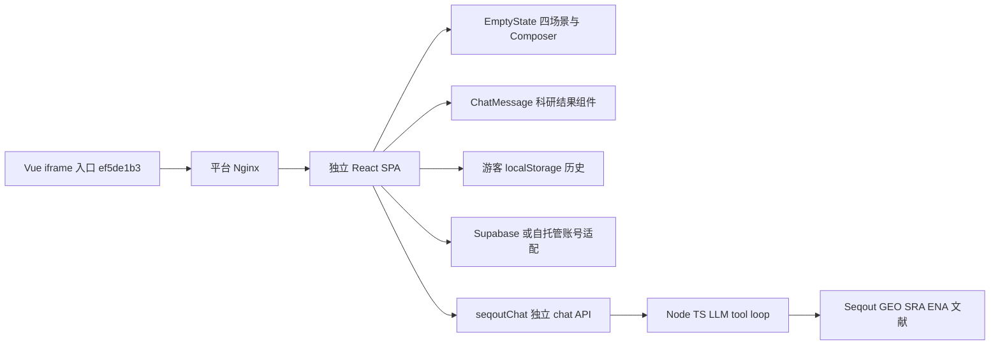
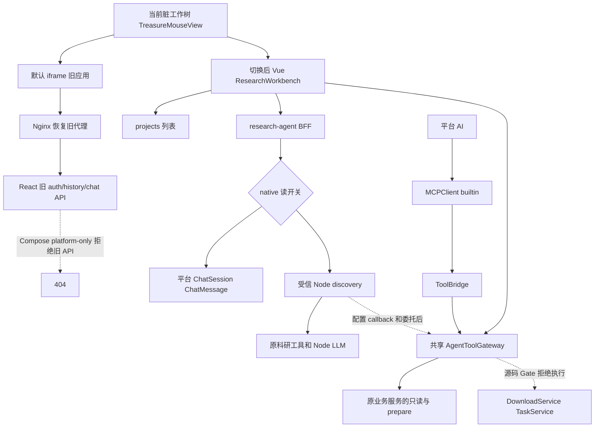
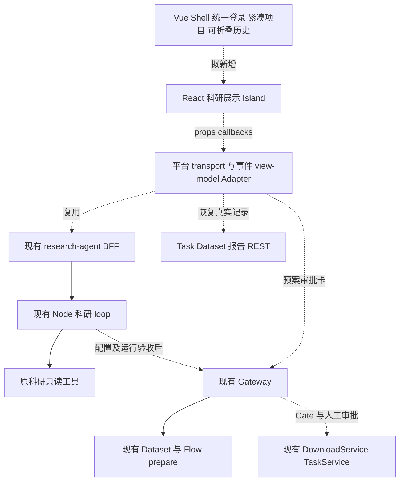

# 科研寻宝鼠 UI 回归与 MCP 集成调查

调查日期：2026-10-15；范围：本地源码、Git 历史、无业务副作用的隔离验证。**只调查，未修改业务代码、开关、数据库、镜像，未部署、提交或执行下载/分析。**

## 1. Executive Summary

1. **旧 UI 没有被删除。** 主子仓 `src/components/chat/EmptyState.tsx:8–76` 保留主视觉、鼠形象、四场景、示例和来源说明。`ChatMessage.tsx:150–183` 保留 Markdown、Dataset/Literature 卡、ToolTrace、Grounding、下载提示和 Next Shovel。主平台 Phase1 选择 Vue Native，但只实现了简化聊天表面，未移植上述产品界面。代码存在与当前平台可达是两回事。
2. **附件所述双栏页与当前工作树不同。** HEAD `51011118` 的 `TreasureMouseView.vue` 是双栏页；未提交工作树已改成默认 iframe + 可切换平台工作台，原双栏内容在未跟踪的 `TreasureResearchWorkbench.vue`。该改动不是 React Island，也未证明旧应用的认证和 API 可用。不能把重新出现 iframe 当作整合完成。
3. **403 的隔离触发条件已复现，用户现场根因仍为 Suspected / Not Reproduced。** 实际路由 `GET /api/v1/research-agent/sessions` 在 `treasure_native_ui_enabled=False` 时返回 `403 {code: FEATURE_DISABLED}`。页面初始化直接调用它，没有 capability 预检。Settings 与 Compose 默认都关闭该开关。未取得用户 Network、部署环境覆盖或服务日志，故不能声称现场 Root Cause Verified。全局查询无 project_id 合法；无项目下载/分析准备则是另一类明确的 422 校验。
4. **Node 科研内核仍在。** Vue → FastAPI BFF → Node `/cygnusx/discovery` → 原 Seqout/GEO/SRA/ENA/文献工具与 LLM loop；并未改由平台 Chat Agent 回答同一次查询。退化主要在呈现和协议适配，不是把检索内核删光。
5. **平台整合是有代码、有隔离证据、运行仍受阻。** 平台身份/owner/project/session 持久化代码真实存在；旧历史不迁移。共享 Gateway、确认服务、DownloadService、AnalysisFlowToolService、Dataset Handoff 和 TaskService 可复用；Node callback 增量仍在脏子仓，父仓指针不能包含它。所有 Agent 实际写执行受源码门禁保护，不能用前端开关解除。
6. 推荐 **Vue Shell + 抽取 React 科研展示层 + 平台 Adapter**：复用旧视觉，保留现有 BFF/Gateway/Dataset 服务。并非挂载整个旧 SPA。若团队明确拒绝双框架，再做 Vue 等价还原；以本任务“保留旧体验”为验收标准，当前证据不支持再次只做一个普通聊天框。

证据状态：**Verified**=本轮读到代码/历史或实际隔离执行；**Partial**=仅部分链路/条件成立；**Stub / Mock**=替代依赖测试；**Documented Only**=历史报告声明，本轮未复跑；**Not Found**=指定搜索范围未发现；**Unknown**=无可核实运行事实。Verified 源码不等于生产验收。

## 2. 仓库、Commit 与调查基线

| 对象 | 本轮实际基线 | 证据状态 |
|---|---|---|
| 主仓 | `/home/zj/zj_code_libarary/OmicHub`，分支 `feat/research-agent-phase5`，HEAD `51011118535f782f5282f638b4a54649c79bf6d6` | Verified |
| HEAD 旧入口 | `ef5de1b3`，2026-10-09 22:57:19 +0800，引入 iframe 入口 | Verified：`git log -- TreasureMouseView.vue` |
| Vue 替换入库 | `51011118`，2026-10-15 15:54:31 +0800，`feat(research): 建立科研证据链与双报告交付闭环` | Verified：show/diff/blame；阶段代码合并在同一大提交，不能虚构各阶段独立提交 |
| 当前平台 UI | `TreasureMouseView.vue:1–33` 为未提交 iframe 恢复；`TreasureResearchWorkbench.vue:1–217` 为未跟踪平台工作台 | Verified；无独立 commit SHA |
| 实际构建子仓 | `pipelines/Treasure-Seeking_Mouse`，HEAD `88dae95e7294dea5004330203f56e4211776fd74`，dirty | Verified；父仓 gitlink 也为此 SHA |
| 同级历史来源 | `/home/zj/zj_code_libarary/Treasure-Seeking_Mouse`，HEAD `1ea2f79cd4feb44da5bad6a916f1f3aa43ab3c28`，本轮 status 干净 | Verified；不是 Compose build context |
| 镜像默认声明 | `deploy/docker/docker-compose.yml:412–461`，tag `1ea2f79`，build context 却为上述 `88dae95e` 子仓 | Verified 配置漂移；实际容器 digest/覆盖值 Unknown |

开始时主仓已有大量 Phase5、UI、Nginx、配置及子模块未提交成果。子仓含 `server/local.mjs`、`functions/seqout-chat/index.ts` 修改和未跟踪 `platform-tools.ts`/测试。**这些全部是继承成果，本报告不冒领。** 工作树状态用 `git status --short`、子仓 status、show、diff、blame 核对；未执行 reset/clean/stash/checkout/push。活动架构入口读取了 `ARCHITECTURE_DESIGN/README.md`，并核查 Gateway、Dataset、科研交付活动文档；`docs/implementation`、ADR 和旧审计只作为施工记录，与代码交叉验证。

### 阶段真实状态

| 阶段 | 已查到的实现 | 结论及缺口 |
|---|---|---|
| 0A MCP 安全 | `tool_confirmation_service.py:301,334,441` 服务端预案/人工批准/消费；`api/deps.py:118` JWT-only；`task_service.py:56–96` 最终校验 | Verified 源码；隔离通过数量只见 `docs/audits/cygnusx-phase0a-implementation-2026-10-13.md`，Documented Only；非运行 READY |
| 0B Runtime | 确认服务 Redis 故障拒绝，内存仅测试显式注入（确认服务:139,190,253）；最终写入口门禁 | Verified 源码；宿主二进制/镜像来源、Worker 挂载、外部 transport 未闭合 |
| 0B Closure | `docs/audits/cygnusx-phase0b-closure-gates.md` G-02/04/05/06/07/08/11/12 BLOCKED | Documented Only 历史验收；本轮 Docker socket 仍不可访问，未获得可推翻阻断的新运行证据 |
| 1 深度集成 | BFF、平台会话、owner/global/project、Node 内部入口、Proposal | Verified 代码；PARTIAL/BLOCKED；UI 等价性未达到，读入口默认关闭 |
| 2 共享工具 | catalog/Gateway/委托/审批/Invocation/业务适配器 | Verified 代码；Node adapter 本轮 3 项隔离测试通过；WRITE BLOCKED，callback/Redis/真实服务未验收 |
| 3 Dataset | 七模型、GEO/ENA 适配、导入预案、校验、冻结 Handoff、Flow prepare | Verified 代码；historical SQLite/合成 R 结果 Documented Only；Worker 路径固定未验收 |
| 4 证据交付 | `research_execution_binding.py`、`research_provenance_service.py`、科研交付 API、独立科学/执行报告 | Verified 文件/架构；实施记录 CONDITIONAL / RUNTIME_BLOCKED，真实 BioReport 内核等结果本轮未复跑 |

Phase4 不是“尚无任何实现”；也不是生产闭环。Phase5 未提交代码是本轮上下文的一部分（research plan catalog 等），不纳入本次功能验收，不因其存在假定 Phase0–4 已完成。

## 3. 旧版与当前 UI 架构、历史原因

### 旧版实际代码架构



图为源码调用，不代表该旧部署当前运行成功。`src/routes/index.tsx:202–217` 分游客/云端历史；`services/chatStore.ts:21–90` 旧云端存取；`services/seqoutChat.ts:10,56,124` 独立 endpoint/auth/SSE。自托管适配和云端配置决定实际账号路径；不能将所有版本概括成“必须旧账号登录”。游客可用不代表平台用户历史隔离已实现。

### 当前实际源码架构（含工作树差异）



`frontend/src/router/index.ts:74` 仍指向 `TreasureMouseView`。HEAD 版本不存在图上默认 iframe 这条恢复分支；只有平台工作台。HEAD Nginx 明确对旧路径返回 404；工作树 Nginx:96–108 恢复代理。没有 ReactDOM mount/unmount 桥，`frontend/package.json` 无 React，Vite 只有 Vue 插件；**React Island：Not Found（主前端范围）**。

Phase1 ADR `docs/architecture/cygnusx-treasure-agent-integration-adr.md` 明确因为独立认证、Router、CSS、打包迁移成本而选 Vue Native。它证明当时的决策理由，不能证明 React 无法抽取。四卡片未从子仓删除，也不是 native 模板里的开关隐藏：Vue 空状态直接是 `NEmpty`（工作台:190），完全没有导入 `EmptyState`。旧字体、Tailwind v4 token、图标和宠物资源未进入 Vue 模板。故失去设计的直接原因是**替换渲染入口时未做产品体验等价迁移**。

## 4. React 组件与资产复用清单

下表路径相对 `pipelines/Treasure-Seeking_Mouse/`；该子仓根 `src/` 是当前 build 源，`qmuse/qmuse-app/src/` 是另一套留存代码，不能混用为同一版本。

| 文件 / 组件 | 可复用内容 | Adapter / 依赖处理 | 状态 |
|---|---|---|---|
| `src/components/chat/EmptyState.tsx:15` | 品牌、鼠形象、四场景、示例、来源 | 已以 onPick/composer/submitting 注入；保留 I18n 和 Dialog context | Verified |
| `Composer.tsx:7` | 大输入框、模型选择、提交 | 接平台模型目录与发送/取消状态 | Verified |
| `ChatMessage.tsx:79` | 完整科研回复组合 | 接平台 message/event view-model，替换额外文献请求 transport | Verified |
| `DatasetCard.tsx:91,185,228,240` | Dataset/Literature 列表与详情 | 保留完整 meta；来源 URL 须有协议/主机策略；新增受控操作回调 | Verified |
| `ToolTrace.tsx:21` | running/done/error、耗时 | 每条消息恢复，按调用标识归并事件 | Verified |
| `GroundingNotice.tsx:7` | 未证实编号警示 | 映射 unconfirmed/confirmed，不能用泛化“已保留”文案替代 | Verified |
| `SuggestionBlock.tsx:12,25` | `:::followup` 解析与可点击下一铲 | onPick 回平台会话发送；不是独立分析执行引擎 | Verified |
| `LiteratureCard.tsx:8`、`IdLink.tsx`、`Markdown.tsx` | 文献证据/编号关联/Markdown | 查询走 BFF 新的只读文献详情适配，避免旧 API | Verified 组件，平台适配 Not Found |
| `SessionSidebar.tsx:9` | 折叠/移动会话栏、重命名入口 | 替换 chatStore；平台 research API 尚缺对应重命名/归档端点 | Partial |
| `DownloadBoostCard.tsx:8–20` | Polariseq 下载指导 | 原本是外链与命令提示；不能宣称已调用平台 DownloadService | Verified |
| `src/assets/pet/*`、`BrandMark.tsx`、`src/i18n/*` | 角色、品牌、中英文 | 打包进抽取模块；避免重新设计 | Verified |
| `src/styles.css:1–100` | Fraunces/Noto/JetBrains、绿金暖米主题 | 全局 :root/.dark、Tailwind preflight 与 Vue token 有污染风险；需隔离编译/容器变量与 portal | Verified 风险源，视觉实测 Unknown |

不直接复用 `src/routes/index.tsx` 的整体账号、导航与存储副作用；该大组件含 TanStack Link、Supabase、游客 localStorage、模型加载。展示组件本身并不要求整个 SPA Router。React Island 可行性为 **Partial（静态）**，尚未做 bundle/视觉 PoC。

## 5. UI 功能回归矩阵

“当前”主要评估 Vue 工作台（HEAD 入口/当前平台 tab）；iframe 重现旧视觉不视为平台整合。旧实现只确认代码，不声称本轮实时检索可用。

| 功能 | 旧版实现 | 当前实现 | 是否回归 / 分类 | 证据 | 建议 |
|---|---|---|---|---|---|
| 主视觉 | EmptyState 品牌与鼠形象 | 普通 header + NEmpty | 是；旧代码保留、Vue 不调用 | EmptyState:15；工作台:176,190 | 原组件复用 |
| 四大探索卡片 | discover/trace/interpret/literature | 无对应组件 | 是；非条件隐藏 | EmptyState:8,43；工作台:190 | 恢复首页 |
| 示例问题 | 每卡两项可点 | 空状态一句示例 | 是；交互减少 | EmptyState:58；工作台:190 | onPick 发起平台查询 |
| 模型选择 | Composer models/model | body 仅 content，默认 Provider | 是；API 支持 model_id，UI 未接 | Composer:7；工作台:108；BFF service:173 | 受控平台目录 Adapter |
| DatasetCard | 全 meta、专门文献类型与来源 | 通用 Proposal 丢字段 | 是；迁移行为变化 | DatasetCard:91,185；BFF:45；工作台:43 | 保留完整结果类型 |
| ToolTrace | 每消息日志、实时状态与耗时 | 页面级 toolTrace，恢复未渲染旧 events.tools | 是；部分保留 | ChatMessage:150；工作台:65,119,193 | 日志归入每消息 |
| Grounding | 具体未确认编号 | 接收后只显示泛化文字，历史不展示 | 是；信息退化 | GroundingNotice:7；工作台:121,194 | 保留原 payload/组件 |
| Next Shovel | followup 解析、按钮续问 | 文本原样显示 | 是；旧代码不可达于 Vue | SuggestionBlock:12；工作台:192 | 恢复解析和 onPick |
| 流式响应 | delta/tool/cards/end | delta/tool/end，忽略即时 cards/polariseq | 部分回归；结果延迟到 end | seqoutChat:124–185；工作台:117–129 | 统一事件 reducer |
| 会话恢复 | 旧云端/游客历史 | 平台内容/proposals，旧历史不迁移 | 已迁移但行为变化 | BFF:194–240；工作台:65–73 | 保留隔离并解释历史来源 |
| 项目上下文 | 独立应用无平台 project | owner project/null 会话 | 新增、Partial 集成 | BFF:157,188,215；工作台:38 | 紧凑展示并消除列表竞态 |
| MCP 工具 | 原 Node HTTP 检索工具，非平台 MCP | callback → Gateway 与 MCP 共用服务 | 新增但开关/部署阻断 | Node platform-tools:1；Gateway:77,167 | 不重复造工具 Schema |
| 文献/来源链接 | DOI/PMID/多源详情 | DOI/meta URL 丢失；GSE 指向 BioProject 查询 | 是；类型与链接语义丢失 | extractCards:1513；BFF:_source_link:33 | 类型化安全来源映射 |
| Polariseq 提示 | 下载指导卡 | event 未消费，服务也未持久保存此类事件 | 是；仅保留上游发送 | Node:2004；工作台:117–129；BFF:303–344 | 保留展示，但动作走预案 |

## 6. HTTP 403 专项定位

### 6.1 请求顺序与错误面

| 时机 | 实际请求 / 方法 | 组件 / Client | 可能拒绝条件 / 显示 |
|---|---|---|---|
| 初始化 1 | `GET /api/v1/projects` | 工作台:164 → projectsApi:61 → axios | 先于会话；失败中止后续。列表服务会历史磁盘回填（project_service.py:55,275），因此本轮没有对真实库调用这个“GET” |
| 初始化 2 / 切项目 | `GET /api/v1/research-agent/sessions[?project_id=UUID]` | 工作台:59,165 → researchAgent.ts:48 | ensure_enabled 在项目查验前，关闭返回 FEATURE_DISABLED；非 owner 项目为 403 |
| 历史恢复 | `GET .../sessions/{id}/messages` | selectSession:65 | 同 feature gate；他人/非研究/非 active 会话为 404 |
| 新建 / 首次发送 | `POST .../sessions`，可选 project_id/model_id | createSession:75 | 关闭 gate 403；project owner 403；无活跃 Provider 503 |
| 实际聊天 | `POST .../sessions/{id}/messages:stream` | 工作台:106，fetch | 关闭 gate 为 HTTP 403；进入 SSE 后的 Node 错误通常是流内 error，不是 axios 的英文异常 |
| 工具历史 | `GET /api/v1/agent-tools/sessions/{id}/related` | AgentToolPanel:18 | gateway 读开关关闭、入口权限/项目撤销可 403；组件转换成自己的中文状态提示 |
| Dataset 初始化 | 项目 Dataset 列表/imports | DatasetWorkspace:42 | Dataset 开关/owner/modules；组件转换通用中文提示 |
| 模型 / Agent 配置 / 工具目录 | Vue 初始化**未调用**这些独立请求 | 工作台全文件、researchAgentApi | 不能把默认 Agent 配置问题当作加载 403 的已知原因 |

axios 实例 `frontend/src/api/client.ts:6,53,126` 自动附加 localStorage access_token；没有 withCredentials。SSE 是 fetch 手工 Bearer，未使用 axios 的 401 refresh/MODULE_LOCKED 逻辑；同源 Cookie 默认行为不是此处主要认证机制。页面 catch 直接显示 Error.message（工作台:162–168），恰可产生 `Request failed with status code 403`。SSE 的 HTTP 错误文案则是“科研发现请求失败（403）”。**附件英文文案更吻合初始化 axios 请求，而非 Node tool error。**

### 6.2 已运行的隔离复现

本轮用 `.venv/bin/python` + `httpx.ASGITransport` 注册**实际 research_agent.router**，实际 ResearchTreasureService.ensure_enabled 执行；在进程内提供 `treasure_native_ui_enabled=False`。认证和 DB 依赖覆盖为固定测试 principal/None，未用真实 JWT/库；未调用的 ChatService DTO 转换类以 stub 替代，避免加载整个 AI 栈。异常响应按 main.py:467–476 的 detail/code 契约构造。无 socket、无下载、无会话写入。

```text
GET  /api/v1/research-agent/sessions                  403 FEATURE_DISABLED
POST /api/v1/research-agent/sessions (body {})        403 FEATURE_DISABLED
GET  /api/v1/research-agent/sessions/example/messages 403 FEATURE_DISABLED
detail = 科研寻宝鼠原生入口尚未在当前环境启用
ResearchTreasureService(None)._owned_project(..., None) → 返回，无 DB 访问
```

**Reproduced（隔离条件）**：上述真实路由分支；`research_agent.py:39–68` → `research_treasure_service.py:151–155` → `core/exceptions.py:38`。**用户现场：Suspected / Not Reproduced；未达到 Root Cause Verified。** 不把依赖覆盖的 ASGI 测试称为真实登录/代理链复现。

触发条件是认证通过且执行到关闭的 native gate，**与 project_id 缺失无关**。源码默认 `core/config.py:69` 和 Compose:70 都 false；没读取生产凭据或容器环境，不能推断用户实际覆盖值。最小修复方向是 UI 先读取 `/research-agent/capabilities`，分别展示未启用、无权访问和服务故障；读功能要按实际运行验收放行，不能以“去掉鉴权”修复。

### 6.3 权限、代理与其他候选

- JWT 失效/用户非 active/token_version 不符：`api/deps.py:93–113` 返回 AuthenticationError 401，不能仅凭 403 归因为 JWT 过期。API Key scope 不足可能在 `middleware/auth.py:109–117` 返回 403，但 Vue 当前走 Bearer。
- `MODULE_LOCKED.yaml:56–63` 的 treasure-mouse **api_prefix=[]**。ModuleGate 无法匹配 research-agent；research API 又只依赖 CurrentUserId，未单独检查 treasure disabled_modules。Gateway.context:111–113 会查入口权限，但只在共享工具通道发生。**这是实际后端门禁覆盖缺口**：不能声称 UI 路由守卫已保护所有直接 BFF 请求。native=true / gateway=false 时尤其要补负例（不在本轮修改）。
- Project owner 有值才查（BFF:157–171）；session 按 user/marker/active 查（229–240）。global 自然语言发现允许 null；`downloads.prepare`/Dataset/analysis prepare 需要项目，分别在 Gateway:429、353、223 返回 ValidationError 422，属于正确的写预案边界。
- 无可用模型为 503，Node internal token 不匹配为 401（local.mjs:114），platform-only 旧公开路径为 404（103）。BFF 将 Node HTTP 错误转 DependencyUnavailableError，stream 内捕获为 error；不能混成加载页的 403。
- RBAC 是按路由依赖而非全局管理员门禁；research_agent 无 AdminRequired。CookieRequired 仅匹配 POST `/api/v1/tasks`（cookie.py:17），不匹配会话列表。
- HEAD Nginx 旧路径是 404；工作树恢复代理 `/treasure-mouse/` → web → `/chat-api` → Node。Compose 仍 `TREASURE_MOUSE_PLATFORM_ONLY=true`，所以**恢复 iframe 并不能恢复旧 chat/auth/history 路径**。当前 iframe 服务可用性 Unknown，源码配置存在确定不匹配。
- 当前 Nginx 的 `/api/` 转发未显式剥离 Authorization；Nginx 默认请求头转发，源码没有 deny/auth_request 等证据指向此 403。前端 dev `/api` 和新增 `/treasure-mouse/` 指到 localhost:8888；裸 8000 不等于完整代理拓扑。Node 和 BFF 声明 SSE no-buffer，外层代理 600s 与 BFF 默认 900s 存超时差异，需实际流验证。

### 6.4 现场结案所需脱敏证据

记录失败请求的 method/完整 path（项目和会话 ID 可一致替换）、status、response JSON detail/code、触发时机、Authorization **是否存在**（不提供值）、前端构建 SHA、后端 image digest/revision、native/gateway/dataset 开关布尔值、trace_id/x-request-id 与对应时间段服务日志。若响应为 HTML 则记录 Server/Content-Type 与 Nginx error/access 日志；若 JSON FEATURE_DISABLED，确认来自上述服务分支。不要提供 token、cookie 值、内部共享令牌或完整环境文件。缺这些现场材料不会阻止本次调查交付，但禁止将推断写成现场已证实。

## 7. 身份、项目、会话的实际整合程度

| 项目 | 代码结论 | 状态与不足 |
|---|---|---|
| 平台身份 | BFF CurrentUserId 接 JWT/API Key owner；Node internal token，浏览器不拿内部凭据 | Verified 源码；全栈双用户 Unknown。当前恢复 iframe 仍是旧身份机制，没有自动拿平台会话 |
| 模型权限 | `_provider` 查全局 active AIProviderConfig，可选 model UUID；Node 使用自有 LLM_BASE_URL/key，只收到 model 名 | Partial；没有证明 Provider endpoint/凭据/用户模型授权/计费同步。不是完整统一 Provider 路由 |
| Agent 配置 | 新 session 无 agent_id 赋值，以 sandbox_meta.research_agent 标记 | Verified；不依赖普通 Agent YAML 装配，不应先排查默认 Agent ID |
| 项目 ID | 浏览器项目列表选择，后端复核 Project.user_id；global 显式 null | Verified；不是信任模型 owner/project 参数 |
| 发现归档 | Proposal 含 project/conversation，存消息 metadata | Partial；**不是**已经创建 Dataset、FileRecord 或完成数据摄取 |
| 工具上下文 | Gateway 从真实 session 取项目，委托绑定 user/session/project/scopes/token_version | Verified；每次 callback 重新核验 + Redis nonce；不是模型自填身份 |
| 新历史 | 平台 ChatSession/ChatMessage，marker+owner+active+project 筛选，最多200条 | Verified 代码；实际数据/迁移运行 Unknown |
| 旧历史 | `legacy_history=not_migrated`；旧 Supabase/游客 localStorage/自托管历史保留 | Verified 明示不迁移；“历史0”既可能无新记录，也可能初始化失败，不能据数字判空 |
| 中断恢复 | 服务 finally 存累积正文/cards/tools/grounding，GET messages 可恢复保存部分 | Partial；无 Last-Event-ID/游标重放或跨进程 resumable job；落库/断连行为 live 未测 |
| 取消 | 服务实例 `_active_cancels`；每个 API 请求新建 service（research_agent.py:25） | Partial；cancel 请求拿不到另一实例的内存 event。浏览器 abort 有效性与持久化仍需测试；未证明可取消服务端运行，更不取消 Task |
| 重命名/归档 | research 路由无相应端点，Vue 无控件 | Not Found 此 surface；通用 Chat 有其他能力不等于寻宝鼠已接入 |

切项目 `stopCurrentStream()`+generation+清消息能丢弃旧消息恢复响应，既有 DOM 测试验证两会话迟到消息隔离。但 `loadSessions()` 自身没有 generation guard（工作台:59–62），快速 A→B 项目列表响应倒序可能覆盖 sessions 并选择旧项目 session；后端 owner 检查不会等价于“UI 当前项目一致”。此外 selectSession 不同步 selectedProjectId，需补项目维度竞态验证。不能用已有会话测试宣称所有项目切换已安全。

## 8. 科研 Runtime 与结果协议

真实只读代码链：工作台 `send():90` → `researchStreamUrl()` → research API `stream_message():72` → Service:255 读 owner/history/provider → Adapter:86 POST Node discovery → local.mjs:108 验内部 token → handler:1745 → LLM tool loop:1885 → executeTool:566（GEO:580、SRA:591、Accession:663、ENA:680、Literature:681）→ HTTP 公共检索 → extractCards:1513 → SSE tool/cards/delta/grounding/end → BFF 透传并 finally 写 metadata → Vue end 转 Proposal。

该链是 **Verified 源码 / Partial 运行**；未发送“肝脏病毒感染 RNA-seq”真实付费 LLM 查询。Node TOOL_DEFS 检索目录保留；子仓 diff 只有平台 schema 追加和分派，没有删除原科研工具。平台 FastAPI 不在同一请求中再次调用平台 LLM；Node 有多轮调用、补文献/grounding，本来就不等于一轮请求一次 LLM。Node 与平台 AI 保持两个 runtime/科研工具目录；共享执行服务已统一，不能称所有检索 Schema 都统一。

重要适配损失：

- Vue 不处理即时 `event=cards`，到 end 才做 cardsToProposals。浏览器 mapper:43–56 把 organism/assay/sample_count 设 null、source_links 设空；恢复则用 BFF mapper 的不同字段。两套转换导致当前轮与历史不一致。
- Node extractCards 通用 meta 取 `library_strategy`/`total` 等（1570 附近），BFF 却读 `assay`/`sample_count`（45–72）。即使源有信息，也不能保证卡上出现。
- 文献 DOI/PMID、作者/期刊/年份/多来源 URL 在 Node meta 中（1518–1544）存在，BFF 通用 Proposal 不保留它们；本轮隔离运行 DOI 卡转换的 source_links 为 `[]`。GSE 统一生成 BioProject term 链接并非 GEO 记录直达。旧链接存在不代表可引用可信度已被完整保留。
- Grounding 只做编号同源/存在性核验（Node:1580–1710），不是科学结论正确性证明；Vue 泛化提示没有展示具体 unknown/missing 编号。
- BFF 持久化 cards 依赖 `event=cards`；浏览器主要依赖 end.cards。当前 Node 两种都发，通路有基础；不能据此保证所有中断/重复事件均一致。platform_tool 事件 BFF 没归档到消息 metadata，持久恢复依赖 Invocation/Dataset 记录。
- 旧文献详情 service 仍调旧 Node action；抽取旧组件时必须补 BFF 的只读 action Adapter，单换 chatEndpoint 不足。polariseq 提示本来是链接/CLI 指导，不应变为未经批准自动下载。

## 9. MCP / ToolBridge 能力矩阵

Node 使用固定 HTTP callback 调 Gateway，**不是直接作为 MCPClient 连任意 MCP server**。平台 AI 链为 AgentService schema 裁剪（agent_service.py:1006）→ builtin preset（presets.py:2476）→ MCPClient → ToolBridge（tool_bridge_service.py:56）→ 同 Gateway。Node `platform-tools.ts:1–36` 从受信 catalog 投影工具、过滤 task 副作用、凭据不入模型，并回调 `/api/v1/agent-tools/delegated/invoke`。委托签发/验证在 `agent_tool_delegation.py:31,56`，验 issuer/audience/exp/token_version/context，并 Redis NX 防重放；Redis 故障拒绝。

外部独立 MCP 是另一表面：`mcp-server/tools/seqout.py:86,120,145,201` 有公共检索/详情；`mcp-server/tools/downloads.py:7,58,62,134` 和 `analysis.py:8,21,23,66` 通过平台 REST 客户端申请确认、携 confirmation_id 提交，明确拒绝 user_confirmed 布尔自证。不能把外部工具已存在等同于 Node 已被配置为该 MCP 的 client，也不能把这套旧工具名与新 bioops catalog 的注册状态混写。当前寻宝鼠共享业务能力的最短链是受信 callback→Gateway，无需再串一次外部 MCP。

表中“可调用”=源码条件成立后可发现/进入，不是用户当前运行验收。**默认 gateway=false，Node callback URL 默认空；实际部署未验证。** MCP 注册列指平台 `cygnusx-tools` builtin 的 catalog 投影，不把它误写成外部 mcp-server 已注册全部新 bioops 工具。

| 能力 | 后端 | builtin MCP 注册 | 寻宝鼠 | 平台 AI | Gate / 真业务适配 |
|---|---|---|---|---|---|
| 自然语言数据检索 | Node Seqout/ENA/文献 Verified | 平台另有检索工具，非本 catalog 全量等同 | 旧工具保留；依赖 Node/LLM | 非自动共享 Node loop | 只读公共源；live Unknown |
| 数据集详情 | Node detail + dataset.inspect/discover | Dataset 开关下动态投影 | callback/REST 条件支持 | 同 catalog 条件支持 | dataset.discover 为 accession 解析，需要项目 |
| 项目 Dataset | dataset.list_project_assets/list_files | 同上 | 同上 | 同上 | owner+files 模块+dataset read |
| 下载预案 | downloads.prepare；dataset.prepare_import | gateway/catalog 条件注册 | 委托仅 prepare；UI REST 可用代码 | 同服务 | 项目、合法编号/来源、Redis 确认；无 Task |
| 下载审批 | Gateway.decide；DatasetImportService.decide | 不给模型 approve | 人类卡片 JWT REST | 人类审批 REST | CurrentJwtUserId；批准不执行 |
| 下载执行 | Gateway.execute/Import.execute → DownloadService.submit | 默认 catalog 排除 task tools | 不允许 | 同样不允许 | WRITE_RUNTIME_ACCEPTED=False + 分操作 flag；后端拒绝 |
| Flow 发现 | analysis.list_workflows/get_workflow_schema | 条件投影 | callback 条件支持 | 同上 | 原 AnalysisFlowToolService，模块 scopes |
| 分析参数准备 | analysis.prepare/prepare_from_dataset | Dataset 版受额外 flag | 有代码；UI Dataset→flows | 同上 | owner/project、受控引用、校验、人工参数；counts 默认隐藏 |
| 分析执行 | TaskService.submit 最终校验 | 默认排除 | 不允许 | 不允许 | 源码 gate、确认与 Worker readiness |
| 任务状态 | tasks.get_status/list_related | gateway 条件投影 | REST / callback 条件支持 | 同上 | TaskService owner 查询，不能伪造 Task；未知进度 null |

共享 Schema 唯一源 `application/schemas/agent_tools.py:145–240`，Node 不维护下载/Flow 业务 schema 副本。Node 原检索 TOOL_DEFS 则确实独立存在。Gateway:206,797,802 分别复用 AnalysisFlowToolService、DownloadService、TaskService；确认来自原 ToolConfirmationService。Node 旧工具查询下载 URL 不等于提交下载任务；未发现新增绕过 Gateway 的平台 Task 写适配。未知的独立外部 MCP 运行授权/动态配置不在本轮证据中。

卡片“查看数据与导入预案”已接 DatasetWorkspace.discover；“检查获取方式”接 downloads.prepare。加入项目需显式选 Run/附件/预算，非直接把发现卡注册为科学真值。专门“准备分析”操作要有 DatasetVersion，而非把 accession 直接传 TaskService。审批卡展示批准/拒绝，执行按钮 disabled，同时后端源码 gate 拒绝；安全不只靠 disabled。

## 10. Dataset、下载与 FlowFrame 交接

七模型 `infrastructure/database/models/dataset.py:19–171`：Dataset、Version、Source、Asset、Sample、Ingestion、AnalysisLink。不重建 FileRecord/Sample/Task。Phase3 迁移有代码不代表已在本机/生产运行；本轮未执行。

| 核查项 | 实际路径与结论 | 状态 |
|---|---|---|
| Discovery Proposal | BFF card_to_proposal:45，仅未验证消息线索 | Verified，信息有损 |
| Proposal→Import | DiscoveryProposalCard:30 → DatasetWorkspace.discover:55 → DatasetImportService.discover:78；人工选择后 prepare:135 | Partial：是 accession 重新解析，不是原 Proposal 全量无损转换 |
| raw FASTQ 关联 | ImportService:342 执行受 gate；:414 task_ids；:425 reconcile；:494 asset.download_task_id | Verified 代码；真实 Worker 下载 Unknown |
| GEO supplementary | `infrastructure/geo/adapter.py:183,232` 读 SOFT；processed 服务处理附件/归档 | Verified 源码；真实公共源/下载端传输未测 |
| 表达类型区分 | `domain/dataset/validation.py:106,190` UNKNOWN、TPM/FPKM 等；不靠整数外观提升 counts | Verified 源码；本轮未跑统计数据 |
| Version→分析 | DatasetAnalysisService:75,217、冻结 Handoff；人工参考、链特异性、分组/design | Verified 源码，运行受阻 |
| 受控输入 | RNA prepare 用原 Flow service/validator；Counts 专门 Flow，不能用 TPM/Series Matrix 代 raw counts | Verified 源码与架构；认证/Worker 未验收 |
| Handoff readiness | dataset_handoff_service.py:313 固定 worker_paths_verified=False；analysis execute:466 再拒绝 | Verified 明确断点 |
| Task 回写 | AnalysisLink.task_id、Ingestion.task_ids、Invocation 关联；读取真实 TaskService | Partial；有代码非已有真实任务事实 |
| 跨页恢复 | DatasetWorkspace、AgentToolPanel.related、项目交付投影 | Partial；DatasetWorkspace REST prepare 未传 conversation，不能笼统说所有手动预案都已绑定当前会话 |

`dataset_analysis_service.py:448`、`dataset_import_service.py:54` 在真实任务副作用前检查 gate。counts 合成统计/SQLite 旧记录可用于设计参考，不能据历史 172 passed 等计数宣称 Worker 能执行。Phase4 已有 ResultObservation、执行绑定、双报告与项目投影，但实际 PostgreSQL/Redis/队列、软件来源、BioReport 环境均未获本轮运行确认。

### 发现→下载→分析业务链（虚线均未开放或未验收）


已有合法文件可通过既有受控登记/审阅进入 Version，不必等待未来下载功能。图中箭头表示代码路径/条件；没有真实 Task/文件就不能展示下载成功或分析完成。

## 11. 四个端到端场景的成功节点与断点

| 场景 | 静态调用链 / 入口 | 已有节点 | 失败节点与人工断点 | Gate / 最小 Adapter |
|---|---|---|---|---|
| A 肝脏病毒感染 RNA-seq | 工作台.send → BFF stream → Node GEO/SRA/文献 → cards/grounding → UI | 原检索 loop、结构化 cards、SSE、消息归档代码 | native 默认关闭先403；现场 Node/LLM/公共源未测；文献/meta/grounding 呈现退化 | capability 预检+结果 reducer；global 可运行，不应加项目必选 |
| B GSE 后准备下载 | DatasetCard action → discover → 人选 runs/files → Import.prepare → JWT approve | 原来源适配、预算、预案/审批卡 | 无项目需先选择；GSE 不能直接当 SRR；prepare 依赖 Redis/DB/真实源；执行停 gate | 保留完整 accession/source、callback/REST DTO；先做到预案，不启动下载 |
| C 已有 Dataset 分析 | DatasetWorkspace → version handoff → compatible → analysis prepare | 文件校验/用途/样本审阅、受控引用、参数预览 | 用户必须核验 assay/分组/参考；counts 隐藏；worker_paths_verified=false 阻断 execute | DatasetVersion→分析卡 Adapter，复用原 Flow service，不新建分析内核 |
| D 既有 Task 跨页追踪 | related/status → TaskService.get_task → task route → provenance/report | 真实记录 owner 查询和跳转代码 | 本轮未读取任何合法实际 Task；暂无可用运行环境证明；无 task_id 不显示假进度 | 恢复 API 驱动真实状态；必要来源绑定迁移另评估，不造 Task |

验证层级：A 仅静态追踪和 gate 隔离复现；B Node 委托投影/callback 使用 fetch double（Stub / Mock）通过，真实 prepare 未调用；C 静态追踪，没有真实分析提交；D 静态追踪，没有合法实际 Task 可验证。**四场景均不能标 live E2E PASS。** 未进行生产 GET 项目列表（有回填副作用）、付费 LLM 请求、公共大文件下载或真实队列操作。

## 12. React Island 与 Vue Native 等价还原比较

| 维度 | A Vue Shell + 抽取 React 展示层 | B Vue 严格等价还原 |
|---|---|---|
| 文件范围 | Vue entry、mount bridge、React 独立展示入口、transport/state adapter、Vite/依赖/CSS、原子组件 callback | Vue entry/workbench、新 EmptyState/Composer/Message/Trace/Grounding/Literature/NextShovel 等、结果 DTO/API；不引 React |
| 视觉成本 | 直接复用已存在 JSX/字体/资源，较低；隔离 CSS 是前置成本 | 每项重新迁移模板/样式/动效和行为，较高；现有普通聊天页不能算完成大半 |
| 回归风险 | 旧表现可保留；双 React/Vue 生命周期/portal、CSS 与 adapter 风险 | 单框架简单，但遗漏旧细节风险已发生；需逐项视觉/交互基准 |
| 长期维护 | 多一套渲染栈；通过明确 view-model API 限制耦合，不双写历史 | 技术栈统一；需维护等价实现并跟踪旧产品差异 |
| 认证 | 只经 Vue 平台 JWT transport；剥离旧登录/guest store | 现有平台 auth 直接复用 |
| 会话 | React 展示平台 DTO；不用旧 chatStore | 现有会话基础可用，仍需恢复/竞态修复 |
| 项目 | props 只携 project/session 展示上下文；后端仍自行授权 | 现有选择器改为紧凑形式 |
| MCP 卡扩展 | callback/slot/view-model；可由 Vue 展示审批卡，避免复制业务服务 | 可直接复用现有 Vue 预案/审批组件 |
| 部署 | 主 frontend 同产物，无 iframe/新服务；需合规更新包锁与 bundle 验证 | 同产物，最少构建依赖改动 |
| 工程结论 | **本产品目标下优先**；先小型 PoC 验证抽取/CSS/消息 adapter | 若明确单框架约束则选；不能只修四卡外观却漏结果组件 |

没有实测开发工时或 bundle 尺寸，成本结论是依据复用范围的工程判断（Partial），不是 benchmark。两方案**都保留现有 Node+BFF/Gateway**；都需要修当前身份门禁/状态适配问题。不能把“恢复 iframe”当方案 A，也不能为了快把旧认证恢复到平台默认路径。

## 13. 推荐融合架构与交互



虚线表示目标接入或受条件限制，不表示已完成。聊天前显示原品牌、鼠形象、大问题输入、模型、四场景、示例、来源说明；历史是折叠入口，项目只做紧凑上下文。开始对话后原 ChatMessage 承载流式、ToolTrace、Dataset/Literature/Grounding/Next Shovel。平台预案/审批/Task 卡经受控 callbacks 自然插入，避免把 Dataset JSON 表单作为首页主视觉。

发现卡提供查看详情/选择加入项目/准备下载；准备分析只对受检 DatasetVersion 提供。按钮解释缺项目、开关关闭、来源未解析、缺人工审阅、审批过期和执行受限。Task 状态从真实 Task/Invocation/Ingestion/AnalysisLink 读取，不以模型文字或前端定时器推导。没有成功证据就不展示“下载成功/分析完成”。桌面与窄屏、中英文、折叠历史、字体/图标均做视觉基准对比；协调平台蓝色上下文与原品牌视觉，不覆盖旧科研卡片的信息密度。

## 14. P0 / P1 / P2 最小变更计划

下面是建议，不是本轮实施。迁移栏“否”表示建议范围本身不要求新表；现有 Phase2–4 表仍需受控发布迁移，不能跳过。

| 优先级 / 项目 | 现状、根因与复用 | 预计文件 | 新迁移 | 安全依赖 / UI风险 | 测试与验收条件 |
|---|---|---|---|---|---|
| P0-1 403 可诊断 | 未预检默认关闭 gate；复用 capabilities | researchAgent.ts、工作台/入口错误状态 | 否 | 不改为默认放开；风险低 | 403 detail/code 分类；关闭时不请求 sessions；拿现场 Network/trace 完成结案 |
| P0-2 BFF 模块授权 | YAML 无 API prefix，直接 BFF 缺入口模块检查 | research_agent.py/service、统一权限 helper、必要时注册表 | 否 | 每次 active/owner/module 检查，需前后端门禁验证；风险中 | disabled treasure 用户直接 HTTP 被拒，管理员/获授权 global 只读仍可；不扩大所有权限 |
| P0-3 入口与来源一致 | iframe 恢复和 platform-only API 不匹配；子仓 dirty callback 未打包 | entry、Nginx/Compose（后续发布评审）、子仓 adapter | 否 | 不恢复公开旧认证绕权；风险高 | 冻结干净源码、构建 SHA/digest 回读、实际 API/双用户只读验证，先不开放写 |
| P0-4 只读会话可靠性 | 消息 generation 有、项目列表缺；取消实例不共享；SSE refresh/错误协议不统一 | 工作台、BFF service/router、transport reducer | 否（若需持久游标另评估） | 会话与项目重新授权；风险中 | A/B 项目乱序、取消跨请求、断流保存/恢复、401/403/流内错误，不混消息 |
| P1-1 原首页 | EmptyState 完整保留未接；复用 JSX/资源/i18n | React 展示入口、Vue mount bridge、Vite/依赖与 scoped style，或 Vue 等价组件 | 否 | 先完成 CSS/portal/unmount PoC；风险中 | 四场景/示例/输入/鼠形象/模型、桌面窄屏、中英文与旧基准一致；无旧登录导航 |
| P1-2 结果无损 | 两套 mapper 丢 meta、DOI、grounding、polariseq、followup | BFF schema/mapper、researchAgent.ts、事件 reducer、ChatMessage adapter | 否（metadata 向后兼容） | 来源 URL 仍白名单/协议校验；风险中 | cards 先于 end、历史与即时字段一致、文献详情/链接、逐消息 trace、Next Shovel可点、grounding具体缺口 |
| P1-3 平台历史/模型 | 无 rename/archive；Provider 只传 model 名给 Node | BFF session route/API、sidebar/model adapter | 否（复用现有模型/会话） | 明确模型授权/Node credential route，不混旧历史；风险中 | 用户各自历史、项目切换、重命名/归档、实际可用模型匹配；旧记录只提供明确独立入口 |
| P2-1 发现→Dataset | accession 重解析链已在；手动 REST 预案未完整绑 session | Discovery 操作 adapter、datasets.ts、DatasetWorkspace、受控 DTO | 通常否，先评估现有字段 | 服务端从 session 派生，不信模型 project；风险中 | GSE→真实候选→人工选择/预算→预案；project/session/Invocation 关联可恢复；无 Task 副作用 |
| P2-2 Flow prepare | Handoff/兼容发现/原 service 可复用 | Dataset 操作卡、Flow 参数预览与 route adapter | 否 | 明确 raw counts/TPM/FASTQ、人工分组与输入引用；风险中 | 兼容工作流、参数缺口与 frozen SHA 一致；未知 Worker readiness 保持拒绝 |
| P2-3 人工审批/任务恢复 | 同确认与 Task 服务已在；live 未验收 | 既有 Gateway/审批卡/状态 adapter 与隔离验证配置 | 否；既有迁移需验收 | Redis CAS、PG并发、源码门禁；风险高 | prepare/approve不执行；重复/过期/撤权拒绝；只展示真实 Task/产物；投递不明不重放 |
| P2-4 实际写链准入 | Worker/镜像/二进制/路径、队列与报告阻断 | 原 worker/下载/Flow/交付边界，按后续定位最小修改 | 未知，不预判无需迁移 | 单独受评审运行 Gate，禁止仅改 flag | 完成 Closure与PG/Redis/transport/Worker验收，再受控公开小数据预算案例；不得用 mocks放行 |

最小实施顺序：先 P0 现场定位和授权/入口一致性，再 Island 小 PoC；随后恢复首页与完整结果/历史语义；再让 Dataset/Flow prepare 卡片无损接入；最后独立进行真实运行验收与写 Gate 评审。旧 UI 恢复无需等待真实计算写开放，但必须复用平台可信 API。

## 15. 关键代码索引

所有路径基于本报告 §2 的当前工作树，行号为本轮读到的定位锚点。子仓路径已在 §4 定义；将来改动后以函数名定位。

| 领域 | 关键路径与函数 |
|---|---|
| 前端入口 | `frontend/src/router/index.ts:74`；`views/TreasureMouseView.vue:1`；`views/TreasureResearchWorkbench.vue:43,59,90,162,190` |
| 前端 API/结果卡 | `frontend/src/api/researchAgent.ts:48`；`api/client.ts:53`；`components/research/DiscoveryProposalCard.vue:25`；`AgentToolPanel.vue:18`；`DatasetWorkspace.vue:42,55,64,124` |
| BFF/DTO | `src/cygnusx/api/v1/research_agent.py:39,55,73`；`application/services/research_treasure_service.py:33,45,86,151,157,173,188,215,229,255`；`schemas/research_agent.py:17` |
| 共享工具 | `application/schemas/agent_tools.py:145,178`；`services/agent_tool_gateway.py:47,77,147,167,353,429,797`；`services/agent_tool_delegation.py:31,56`；`api/v1/agent_tools.py:18,66` |
| MCP 与 AI | `infrastructure/mcp/presets.py:2476`；`application/services/tool_bridge_service.py:56`；`agent_service.py:1006`；已有 `infrastructure/mcp/client.py` |
| 审批/最终提交 | `application/services/tool_confirmation_service.py:190,301,334,441`；`analysis_flow_tool_service.py:53,98,151`；`task_service.py:56,93,221`；`domain/flow/submission_validator.py` |
| Dataset/Flow | `infrastructure/database/models/dataset.py:19`；`application/services/dataset_import_service.py:49,54,78,135,342,425`；`dataset_analysis_service.py:75,217,440`；`dataset_handoff_service.py:158,313`；`domain/dataset/validation.py:190` |
| 公共源 | `infrastructure/geo/adapter.py:40,101,148,232,269`；`application/services/geo_processed_data_service.py` |
| 交付 | `application/services/research_execution_binding.py`、`research_provenance_service.py`、`scientific_report_job.py`；`api/v1/research_delivery.py`；`infrastructure/celery_app/tasks/datasets.py` |
| Node runtime | 子仓 `server/local.mjs:61,103,108`；`functions/seqout-chat/index.ts:203,566,1513,1745,1837,1885,1974,2079`；`platform-tools.ts:1` |
| 配置/代理 | `core/config.py:69–109`；`data/MODULE_LOCKED.yaml:56`；`deploy/docker/docker-compose.yml:70,412`；`deploy/docker/nginx/nginx.conf:82,96` 与 prod 对应块；`frontend/vite.config.ts:20`；子仓 `deploy/nginx.docker.conf:35` |

## 16. 本轮验证、环境缺口与证据限制

| 本轮实际检查 | 结果 / 范围 |
|---|---|
| Git status/log/show/diff/blame、父仓 gitlink、子仓/同级 SHA | Verified：UI替换提交、工作树恢复、子仓来源差异 |
| 实际 research router 隔离 ASGI | 3 个请求均返回 FEATURE_DISABLED 403；auth/db覆盖，未被调用的 DTO 转换类使用 stub；不验证 middleware/现场身份/代理 |
| 无项目 owner 检查 | 实际函数 project=None 返回，无 DB；不证明完整聊天运行 |
| 实际 DOI card_to_proposal | 文献 meta URL 丢失、source_links=[]，Verified 隔离转换 |
| `frontend`：`./node_modules/.bin/vitest run src/components/research/__tests__/TreasureOriginalEntry.test.ts src/components/research/__tests__/TreasureSessionIsolation.test.ts` | **2 files / 2 tests passed**；只验证默认 iframe挂载、两会话迟到消息隔离。没有加载 iframe应用、真实网络、跨项目乱序或视觉验收 |
| 子仓：`node --experimental-strip-types functions/seqout-chat/tests/platform-tools.test.ts` | **3 tests passed**；不受信调用无工具、模型不含委托凭据、固定 callback/不重试；fetch double，非真实 Node→平台链 |
| `docker ps --format '{{.Names}}'` | permission denied / Docker socket operation not permitted，BLOCKED；未尝试提权或修改服务 |
| 完整后端导入探针 | 首次被重型 ChatService 导入阻塞并中止；LiteLLM有外部价格表获取失败警告，未获结果。改用隔离 stub并设置进程内本地价格表后完成上表测试；不把首次探针当 PASS |

Node `--test` 初次命令只报告文件级 1 pass，不足证明三个断言执行；随后直接执行测试文件取得逐项3 pass，以上采用后者。纯调查文档无需全仓测试，本轮未运行全量质量门禁、迁移或前端 build。实施报告中的旧 PASS/FAIL 数量只作历史证据，不当本轮新结果。

尚缺：真实用户脱敏 Network/trace；部署 SHA/image digest；实际开关覆盖；隔离 PostgreSQL/Redis；MCP外部 transport；Node与平台双用户双项目；Worker二进制/挂载/队列；真实 GEO/ENA检索；认证后断流/取消/恢复；原版对照截图与多 viewport；BioReport真实渲染。没有虚构 Task 或模拟进度作为生产成果。

## 17. 风险、最重要的五个断点与待确认

1. **入口/权限断点**：native 默认关闭但 UI 直接访问；恢复 iframe又与platform-only冲突。BFF disabled-module覆盖不足；需真实现场证据精确结案。
2. **呈现/协议断点**：原展示层不可达于 Vue；丢 meta/文献/grounding/Next Shovel，实时与历史 mapper不一致。恢复外观必须同时恢复信息与交互。
3. **身份/状态断点**：iframe仍用旧身份；平台 native 虽已接 owner/session，模型 Provider路由、跨请求取消、项目列表竞态、重命名/归档/断流恢复仍不完整。
4. **平台工具部署断点**：Node callback需固定URL、有限委托和Redis；子仓增量未提交且默认镜像来源不一致。代码存在不等于已打进运行镜像。
5. **数据执行准入断点**：GSE→SRR/附件必须解析和人工选择；DatasetVersion→Flow必须验证来源/类型/分组与受控引用；源码写gate和worker_paths_verified=false仍阻断真实获取/分析。报告交付也尚未live验收。

待确认的只有运行事实、现场故障归因和后续方案选择；不需要用户提供密钥，不需要本轮开放写入。React Island成本结论需PoC验证；若已有未提交UI恢复由其他工作负责，应先共同确认最终入口，防止两套页面长期分裂。本报告只新增自身，不覆盖任何既有未提交成果。

## 18. 六个问题的明确回答

**Q1：旧前端是否存在、能否恢复？** 存在，子仓根src含完整首页与主要科研结果组件；可恢复。恢复平台体验还需认证/会话/transport与CSS适配，不等于简单代理整个旧SPA。

**Q2：为什么失去四场景和交互？** Phase1选择Vue Native，`51011118`将iframe入口替换为简化双栏聊天，未导入旧EmptyState/ChatMessage体系。旧组件并未删除，也不是Vue内部开关隐藏。当前未提交iframe恢复只能重现旧入口，未完成无iframe统一产品目标。

**Q3：403由哪个请求和权限条件触发？** 已隔离复现 `GET /api/v1/research-agent/sessions`（同POST与messages GET）在native开关false时由ResearchTreasureService.ensure_enabled返回403 FEATURE_DISABLED。与初始化文案吻合，是首要Suspected；未拿现场请求/日志，因此用户当时的实际请求与条件仍未证实，不能写Root Cause Verified。global缺project不是此分支原因。

**Q4：身份、项目、会话、资产是否真正打通？** native BFF有平台身份、owner/project/session/消息持久化代码；工具上下文由后端派生；旧历史不迁移。发现Proposal只是线索，不是Dataset。Dataset导入、版本、Handoff和Task关系代码存在，真实整链未验收；恢复iframe那一支仍独立身份/历史。结论为部分打通。

**Q5：能否调用平台MCP下载和Flow分析？** 源码可经Node有限委托HTTP回调进入与MCPClient/ToolBridge相同的Gateway，条件满足后做只读和prepare；不是Node直接任意MCP调用。默认开关、callback配置、子仓打包、Redis/真实transport阻断运行证明；下载/分析实际执行被源码Gate与Dataset Worker readiness拒绝，不能宣称可自动执行。

**Q6：最小代价如何保旧UI并完成科研链？** 先修可诊断入口和BFF授权，抽取React展示层到Vue Shell，以平台Adapter替换旧认证/历史/科研请求；保留Node科研loop、BFF、共享Schema/Gateway、Dataset与原下载/Flow/Task服务；完整保留card meta/证据/trace/followup。在旧视觉中增加紧凑上下文、显式项目与资产选择、预案和人工审批卡、真实Task恢复。先验收只读/prepare，再独立完成PG/Redis/Worker/镜像/报告运行Gate；未经审批与准入不执行。无需重建检索或计算引擎。
