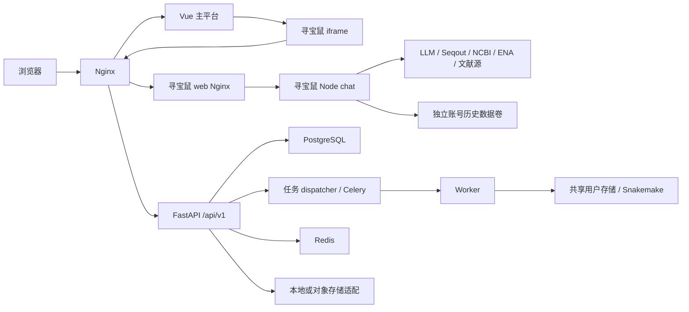
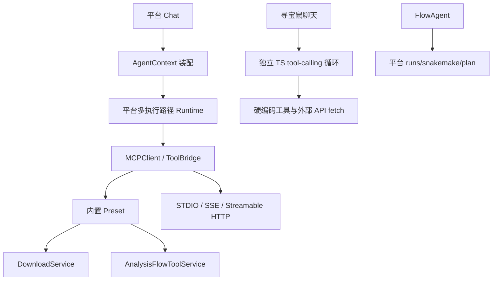
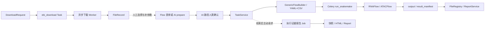

# CygnusX 统一科研 Agent 与跨模块工作流可行性审计

调查日期：2026-10-13。范围：本地实际工作树、关联仓库源码和部署声明。仅新增本报告；未安装依赖、运行下载/分析、访问生产数据库、启动服务、提交或推送。

证据状态：**Verified** 表示静态代码/配置可证明实现，不表示生产已验收；**Partial** 表示缺少完整链路；**Stub / Mock** 表示占位；**Documented Only** 表示仅描述；**Not Found** 表示在注明范围未找到；**Unknown** 表示证据不足。方案和路线图是建议，不是已实现事实。本文以 ARCHITECTURE_DESIGN/README.md 定位现状文档，再核对代码；docs/ 历史材料不作架构权威。

## 01. Executive Summary

**Partial：完整科研闭环尚未得到证明。** 平台具备身份、文件管理、异步任务、声明式 Flow、Agent 工具执行和报告登记等可复用基础。科研寻宝鼠是独立 React/Node 应用，经 Nginx 和 iframe 接入 Vue 平台；它有真实工具调用与结构化证据卡片，但没有平台 Dataset ID、Project Context 或平台下载/分析提交调用。

**Verified：平台 AI 已有实际分析提交能力。** 动态 prepare 工具进入 AnalysisFlowToolService，再经人类确认和 TaskService.submit，复用网页任务执行链；无需重新建设一套分析提交引擎。证据：src/cygnusx/application/services/analysis_flow_tool_service.py:94、:141；task_service.py:53；tools/flow_schema_compiler.py。

**Partial：下载可落盘并登记 FileRecord，但没有形成科研 Dataset。** 下载服务默认落到用户 downloads 目录，支持指定用户内子目录；完成登记缺少来源绑定、样本语义与持久校验和。证据：download_service.py:49；infrastructure/celery_app/tasks/download.py:739、:821。

**Not Found：GEO processed-data 专用获取/分类/矩阵注册闭环及平台 counts-only Flow。** RNAFlow 当前入口是 FASTQ；内部产生 counts 并做 DEG 不等于支持外部矩阵直接输入。

**Verified / 高风险：外部 MCP 与内置确认契约不等价。** 内置 platform_submit_download 消费人类确认凭证；mcp-server/tools/downloads.py 允许模型设置 user_confirmed=True 后直接 POST /downloads。独立 server 的注册入口没有发现统一确认包装。不能以架构文档的安全宣称覆盖这份代码。

推荐：以方案 B 的受控共享工具层为目标，按方案 A 的小步适配上线；暂不合并 Runtime。首先补可信身份/项目上下文、统一服务端确认与校验、Dataset/Handoff 契约，再接 counts-only 分析与报告交付。

## 02. 代码仓库与服务清单

| 本地仓库 | 分支 / HEAD | 技术与调查范围 |
|---|---|---|
| OmicHub（当前目录） | feat/reproducible-report-phase0 / c68ea9e0 | FastAPI、Python、Vue/TS；API、服务、ORM、任务、MCP、Compose |
| pipelines/Treasure-Seeking_Mouse | gitcode-sync / 88dae95e | React/TS、Node；聊天、账号、卡片、部署 |
| ../Treasure-Seeking_Mouse | main / 1ea2f79c | 同项目另一个本地版本；确认没有平台调用适配 |
| pipelines/EBIDownload | main / b351e03d | Rust CLI/Core/GUI；ENA、AWS、FTP 下载 |
| ../EBIDownload（remote 为 polariseq） | main / a29971b0 | Rust Polariseq；public_data、下载与校验源码 |
| pipelines/RNAFlow | feat/result-manifest / 19f5068c | Snakemake、R、BioReport 规则、结果清单 |
| pipelines/ATACFlow | main / 4a68b347 | Snakemake；平台 YAML 与子模块入口 |
| Protocol/FlowFrame | main / 977ad657 | Flow 协议及 FlowAgent TS 工具实现 |
| ../FlowFrame | main / d9080f61 | 另一本地版本，仅版本盘点；不能代替平台子模块 |
| pipelines/scrna | main / b5066338 | R/Seurat；Read10X 输入，没有根 flows 注册 |
| ../bioreport | main / df49a433 | Python、Jinja2、Quarto；渲染与 AI pipeline |

实际 remote：主仓 github.com/xsx123123/omichub；子模块名称对应 xsx123123 下同名仓库；Polariseq 的 remote 是 github.com/xsx123123/polariseq，目录仍名 EBIDownload；BioReport 是 github.com/xsx123123/bioreport。未拉取远端，不声明远端最新状态。

主仓、RNAFlow、ATACFlow、FlowFrame 等已有未提交改动；报告中心 Phase 1 文件部分为 untracked。以上 HEAD 不是整个工作树的内容快照。Compose 寻宝鼠默认镜像 tag 为 1ea2f79，但 build context 指向 88dae95e 子模块，运行镜像内容 **Unknown**。新旧下载仓库也不能视为同一版本。

主平台依赖由 pyproject.toml/uv.lock 和 frontend/package.json 定义：PostgreSQL/pgvector、Redis、MinIO/S3、Celery、RocketMQ；integrations/agentteams/bridge、gateway 为独立工程。mcp-server 是独立 FastMCP 外部操作通道。部署入口位于 deploy/docker/ 下 Compose 与 Nginx 配置；本次没有验证 Kubernetes 或真实容器拓扑。

## 03. 当前系统架构图

下图是已核实的**部署配置拓扑**，不是运行现场截图。

证据：deploy/docker/docker-compose.yml:402；deploy/docker/nginx/nginx.conf:95；pipelines/Treasure-Seeking_Mouse/deploy/nginx.docker.conf:30。chat 不发布宿主端口、加入 app_net，有 stats 健康检查；web 等待 chat healthy。反代没有发现此 location 的平台 auth_request。平台路由 requiresAuth 不等于子应用 HTTP 端点鉴权。开发前端 proxy、裸后端与 Compose 使用不同端口，需以实际入口验收。

寻宝鼠与平台共用业务服务的边没有画出，因为未发现。平台已有 AgentRuntimeGateway 相关分层，不等于寻宝鼠已接入该 Gateway。

## 04. 模块能力矩阵

| 能力 | 模块 / 状态 | 关键代码证据 | 缺失部分 / Agent 可调用性 |
|---|---|---|---|
| GEO 数据检索 | 寻宝鼠 Verified | functions/seqout-chat/index.ts:215、:603 | 有 accession 卡片；无平台 Dataset；寻宝鼠可调用 |
| 文献与来源核验 | 寻宝鼠 Verified | index.ts:1539、:1580 | 证据核验不证明研究设计适用；真实上游本轮未测 |
| GEO 原始下载 | 平台 Partial | download_service.py:49；download.py:244 | accession→run 解析范围与实际二进制需验收；平台内置工具可提交 |
| GEO 表达矩阵下载 | 直链 Partial，专用适配 Not Found | download.py:574 | 已知 URL 可下载，不等于发现/识别 counts；寻宝鼠未接入 |
| 下载登记 | FileRecord Verified | download.py:739 | 无 Dataset、来源/样本绑定、checksum 留空 |
| RNA/ATAC 提交 | Verified 静态实现 | analysis_flow_tool_service.py:94；task_service.py:53 | 运行环境 Unknown；AI 可 prepare/确认后提交 |
| counts-only DEG | 平台 Flow Not Found | flows/ 仅 rna_seq/atac_seq | 需新声明式流程，不能用现 RNA FASTQ 表单代替 |
| 单细胞矩阵 | 子仓 Partial | scrna/src/core/02.cells_qc.r:259 | Read10X 存在；平台 Flow 接入未找到；H5AD 不能泛化 |
| AI Tool 调用 | Verified | infrastructure/mcp/client.py:267 | 装配配置和权限裁剪决定是否可见 |
| MCP 注册 | Verified | mcp-server/tools/__init__.py:99；presets.py | 内外契约有差异；生产可达性 Unknown |
| 项目上下文 | 平台 Partial、寻宝鼠 Not Found | models/chat.py:42；models/run.py:25 | Task 无可信 project_id；两套会话未桥接 |
| 状态追踪 | Verified / 恢复 Partial | downloads.py:83；task_service.py:156 | 可 owner 查询；跨寻宝鼠会话恢复未实现 |
| 科学报告 | Partial | analysis.py:223；RNAFlow result_manifest.py:266 | 自动登记非阻塞，失败不改变 Task success |
| 执行证据报告 | Partial | tasks.py:42；reproducible_report_service.py | 本地实现有快照/独立 Job；真实 DB/broker/S3 验收 Unknown |

除特别注明，src 路径均相对 src/cygnusx；寻宝鼠路径相对 pipelines/Treasure-Seeking_Mouse。

## 05. 寻宝鼠深度集成专项调查

**Verified：页面级接入，独立 Runtime。** frontend/src/router/index.ts:74 指向 TreasureMouseView；该组件:23 iframe src=/treasure-mouse/，没有业务 postMessage/项目注入。子应用 src/routes/index.tsx:103 自持 models/model，:551 组合 SessionSidebar，Composer、ChatMessage、DatasetCard、ToolTrace 各为独立 React 组件。

**Verified：独立认证与历史。** server/local.mjs:35 初始化 createAccountApi，:37 挂 /auth、/history；account-api.mjs:145 注册、:163 登录、:174 me、:191 写历史。前端 localAuth/chatStore 及 Supabase 客户端承载自托管/云模式，不能把平台 JWT 当成该账号体系。独立数据卷 /app/data，不是平台项目目录。

**Verified：真正有工具调用，但不是 MCP Client。** functions/seqout-chat/index.ts:215 起声明工具 schema，:603 起 switch 分发外部 API；:280 明确复制 MCP 路径解析，仍是直接 fetch，不是 MCP transport。独立 OpenAI-compatible LLM 配置和循环；seqoutChat.ts:146 请求 messages/model/stream/lang，不带可信平台 project_id、dataset_id、task_id。模型目录有独立 GET，取消经 AbortSignal 和 local.mjs:73 断连 AbortController。重试/降级与 grounding 代码存在，但运行上游可用性 Unknown。

**Verified：结构化卡片 ≠ Dataset。** seqoutChat.ts:21 DatasetCard 字段 tool/accession/title/summary/meta；SSE 为 delta、tool、cards、polariseq、grounding、end，而不是平台 Chat 事件协议。index.ts:1580 grounding 检查编号证据，不能自动证明健康对照、生物学重复、文库链特异性。

**Not Found：有副作用的 CygnusX 工具。** DownloadBoostCard.tsx:8 链接 Polariseq GitHub，:17 生成本机 CLI 命令；没有 /api/v1/downloads 调用。独立会话可保存卡片/轨迹，但没有统一 Dataset/Task/Artifact 引用协议。

容器方案比较：保留容器统一 UI/身份接口成本中低、耦合低，但仍维护两套会话；独立科研 Agent 服务接受平台可信上下文成本中、便于升级隔离和多 Agent 扩展；合并主后端成本高，TS→Python/协议迁移和回归大，不能自动解决数据资产问题。推荐第二种业务服务边界配共享工具层，第一种作为过渡。

## 06. 数据下载与 GEO 表达矩阵专项调查

**Verified：REST、内置工具、外部 MCP 三种入口存在。** POST /api/v1/downloads 经 CurrentUserId、功能开关和 DownloadService；platform_submit_download 在 presets.py:1035，外部 cygnusx_submit_download 在 mcp-server/tools/downloads.py:11。后三者并不意味着寻宝鼠已能调用。

DownloadRequest 支持 sra/cloud_storage/direct_link、并发、目标目录及 SRA dry_run。DownloadService:49 创建通用 Task，flow_id=ebi_download，:133 投递 run_download，返回 Task ID。查询 owner-scoped，progress 从 Redis 读取，无缓存时明确 unavailable。线程参数与 CLI 路径由配置消费。SRA dry_run 仍创建异步 Task，不是纯同步无成本验证。

**Verified：实际执行使用配置中的二进制。** download.py:244 构造 CLI 参数，:270 选择 ebi binary；不直接 import Polariseq。旧 EBIDownload Rust core/lib.rs:194 拉 ENA filereport，ftp.rs:68 使用 wget -c，:156 校验 MD5；aws_s3.rs:35 有 pause/resume token。旁边 Polariseq 是另一 remote/提交，可复用其下载经验，但不能据名称认定平台运行它。GSE/GSM 原样提交能否解析须按部署 binary 验收；寻宝鼠 resolveStudy 与 ENA run discovery 不等于下载引擎具备同样解析。

**Partial：可靠性。** direct-link aria2 有重试参数，下载进度采样/轮询存在，底层支持部分续传；下载 Service 无 idempotency_key 查重；FileRecord 路径去重只防重复登记。关闭 Chat 不取消已入队任务；平台可重新查询 Task。统一下载取消/重试 API、孤儿恢复与超大任务部分成功语义未形成可证明闭环。

**Not Found：专用 GEO processed-data Adapter。** 检查寻宝鼠工具表、平台下载服务、旧 Rust 与新 Polariseq public_data，未发现完整 Series Matrix/supplementary 文件发现→类型鉴别→下载解压→样本 metadata 绑定→Dataset 注册。搜索到一般 processed 变量不代表处理后表达数据功能。

| 类型 | 当前证据 | 下游限制 |
|---|---|---|
| FASTQ/SRA | 原始下载与文件识别实现 | SRA 需转换；必须核对单双端/命名/物种 |
| 原始 counts | 已知直链可获取字节 | 没有 counts Dataset/独立平台 DEG Flow |
| TPM/FPKM | RNAFlow 输出可见 | 不是 DESeq2 原始整数输入 |
| Series Matrix | 专用解析 Not Found | 不能假定其数值是 counts |
| supplementary | 已知 URL 下载 Partial | 压缩格式/内容/样本关联需检查 |
| MTX/10X | scrna Read10X 实现 | 未接根 flows；需矩阵+genes+barcodes 组合 |
| H5/H5AD | 泛型文件字节可下载 | 平台结构鉴别/匹配 Unknown |

存储：StoragePathFactory.user_root 限定用户根；DownloadService:155 将目录段清洗后拼接，支持指定 projects/... 路径，但没有 Project 记录成员/存在性校验，不能把路径归类当作项目授权。登记 download.py:821 checksum 为空，记录没有设置本次 Task 来源关联。配额新增大小在登记后累加，不证明下载前容量预算或硬上限。符号链接/重定向/DNS 与跨用户文件读写需专门无副作用安全测试；本次不宣称已证实可利用漏洞。

## 07. FlowFrame 与分析任务提交专项调查

**Verified：网页链路。** FlowsView→FlowSubmitView→frontend/src/api/task.ts→POST /tasks→TaskService.submit:53→GenericFlowBuilder.build_project_files:26→run_snakemake→LocalSnakemakeExecutor→固定 snakefile→状态/logs/output→ReportService/FileRegistry。根 flows 仅 RNA 和 ATAC；页面生态卡片或其他子仓不代表已开放工作流。

Flow 定义由 FileSystemFlowRepository 发现/缓存，GET flows/schema 和单 Flow schema 提供参数契约。RNA YAML:382 固定 worker snakefile，:405 sample_sheet 为 sample/sample_name/group，sample 要与 FASTQ 前缀一致；pipeline_mapping 生成 config.yaml、samples.csv、contrasts.csv（文件名以 YAML 声明为准）。资源有静态 defaults，不是运行量预测。

**Verified：AI 路径有独立校验与确认。** AnalysisFlowToolService.discover/describe/prepare/status/summary 已覆盖候选 list/schema/prepare/status/outputs 的大部分职责，别重复造同义工具。FlowSubmissionValidator:62 检查白名单、必填、类型、样本、比较组；ManagedFileResolver:64 支持受控引用并按 owner 查文件。用户确认后同 TaskService.submit。

**Partial：校验等价性和路径转换。** REST TaskSubmitRequest:16 的 parameters/sample_sheet 是宽 dict，TaskService:70 后直接 builder，没有调用上述完整 Validator。Validator:437 只校验匹配的引用，:461 resolve 返回的 internal_path 未写回参数；普通路径字符串不进入该校验。需统一最终执行前校验、将受控 ID 转为 worker 可访问路径，不能把 resolve 成功当作执行文件可用。当前没有静态证据证明任意输入路径一定被同 owner 隔离。

**Partial：模式与调度。** 请求/模型有 execution_mode、队列字段，但当前提交 Worker 是 LocalSnakemakeExecutor；不能由枚举存在推断 Docker/SLURM 全模式可用。Task idempotency_key 有唯一约束与 owner 检查，普通下载无同款。投递与 DB commit 的故障窗口、取消对子进程的影响、恢复与重试要现场验收。

兼容性：A FASTQ→比对/定量→DEG 有 RNAFlow 实现；B 外部原始 counts→DEG 平台入口 Not Found；C TPM/FPKM 探索统计独立 Flow Not Found；D 子仓 Read10X→Seurat 有实现，但平台注册 Partial。RNA 内部 deg_method 路由处理重复数，不是外部矩阵 adapter。不得把 TPM/FPKM 当 counts，也不得把任何矩阵传 raw_data_path 期待 FASTQ 工作流自动识别。

## 08. AI 助手、MCP 与共享工具层调查

平台有 Agent 装配、Provider、Legacy/LangGraph/Studio/Worker 分路径循环和工具事件；infrastructure/mcp/client.py:234 支持 BUILTIN、STDIO、SSE、Streamable HTTP，:533 起连接池/生命周期，:515 超时，:327 可靠性策略，内置调用限制重试。presets.py 定义平台/Seqout 工具，schema_loader + FlowToolSchemaCompiler 编译分析工具；ToolBridge 分发到真实服务而非 prompt 假执行。MCPLogModel、ChatMessageEventModel 等保存审计/事件。实际 agent mcp_ids/capability 配置决定可调用清单，不能保证每个 AI 会话都默认加载全部工具。

**Verified：没有寻宝鼠共享 Runtime/MCP Client。** 两者复用公共数据源与相似工具名称，但工具 schema/分发实现独立。模型环境变量映射可能复用某凭证来源，仍不是共用平台模型路由、计费或权限。平台有项目/会话字段，不代表跨 iframe 已传递。

**Verified：内置确认更强。** presets.py:1079 创建或消费 _confirmation_id；tool_confirmation_service.py:425 验证 owner、状态、TTL、参数哈希，一次性消费；approval 来自人类 API。相比之下外部 downloads.py:81 判断布尔参数，api_client.py:151 直接 POST；tools/__init__.py:99 直接 register。pipelines 的外部 api_client.py:129 也写 user_confirmed=True，需纳入同类整改。

独立 mcp-server/main.py:55 警告 SSE 非回环且无鉴权时可使用配置 API key。这种共享静态 key 表示该 key 的用户，不提供每次调用的可信多租户上下文。只能在可信代理/隔离范围使用，不能直接当科研公共 Gateway。架构文档终态与源码有漂移，保护边界以实际行为为准。

共享方式评估：各 Agent 接公共 MCP 成本低但复制授权/审计与项目注入；受控 Gateway 复用内部服务和确认、owner context，成本中且可渐进；统一 Runtime 成本高，移植研究检索逻辑、事件与历史风险大。推荐 Gateway，不新增平行下载或 TaskService。工具输出和检索文本属于不可信数据，权限需来自身份/服务校验而不是模型说法；当前不能证明提示注入无法诱发已授权的危险参数，需要负例验收。

## 09. 跨模块数据契约与科研证据链

| 概念 | 实际模型/资产 | 关联与边界 |
|---|---|---|
| User | UserModel | 统一平台 owner；寻宝鼠另有账号 |
| Project | ProjectModel，projects | user_id+slug；models/project.py:24 |
| Workspace/Session | ChatSessionModel、SandboxSessionModel 等 | chat.py:42 project_id 可选；寻宝鼠会话独立 |
| Dataset | 平台科研 Dataset 聚合 Not Found | 卡片 accession 不构成持久 Dataset |
| File/Asset/Sample | FileRecordModel、SampleModel、DirectoryModel | models/file.py:28、:100、:118；有 task_id 可选 |
| Workflow | FlowConfig YAML；MAS FlowRegistry 为另一体系 | 不把二者混用 |
| Task | TaskModel，tasks | models/task.py:15；user_id、parameters、work_dir，无 project_id |
| Run/Execution | RunModel，platform_runs | models/run.py:14；project_slug、plan_digest、release_id、task_id 可选 |
| Evidence/Event | RunEventModel、ChatMessageEventModel、QcVerificationCheckModel | 各域记录，非统一科研来源链 |
| Artifact | FileRecord 与 CaseArtifactVersionModel | chat.py:193 Case 内版本/依赖，非所有 Task 的通用 Artifact 聚合 |
| Manifest | result_manifest、artifact_manifest、project_archive | 文件/服务协议，不能推断所有下载都有 manifest |
| Report | ReportModel、ReportFileModel | models/report.py:26、:85；Task 关联 |
| 冻结证据 | ReportSnapshotModel、ReportGenerationJobModel | report.py:105、:123；本地 Phase 1 改动 |

Project→Run 与 Task→Report 有实现；Task→Run 只对有绑定的路径，直接表单提交不能假定创建 Run。analysis.py:36 若找不到 Run 就跳过项目 evidence capsule；:73 成功注册 output 并带 Task ID。下载登记没有等价来源和 Task 绑定。Dataset→Source accession→Files→Execution 没有贯通。Agent Session→Tool events 存在，但寻宝鼠 Session→平台 Task 不存在。

建议新增/扩展 Data Handoff Manifest，而非替换已有 ARDP 结果清单：来源 accession/URL/检索证据、许可状态、文件 ID/指纹、asset_type、样本 ID/分组/配对关系、物种、文库、项目 owner、下载 Task、校验状态；从下载侧建立输入清单，与现 result_manifest 输出协议连接。真实 Dataset 持久关系如新增表需要迁移；轻量 manifest 原型不等于完成模型关系。

**Partial：报告可追踪不等于可复现。** RNAFlow rules/utils/result_manifest.py:100/266 有主 HTML、矩阵、流程报告容器信息；BioReport 本地 bioreport/renderer.py:18 渲染 Jinja2/Quarto，pipeline.py:30 处理 AI 解读，未发现它作为平台独立 REST 报告服务的调用。平台 analysis.py:223 在成功后登记科学报告，失败非阻塞。

当前工作树执行证据报告 API 在 tasks.py:42，快照、独立 Celery Job、归档/摘要及 HTML 已实现；与科学 BioReport 是不同交付物。它记录缺口，不会补造过去输入指纹和环境版本；有 Report.task_id，可选 Run。真实 PostgreSQL/队列/对象存储验收未执行，历史证据缺失也不因报告生成而恢复。

## 10. 五条端到端链路审计

| 场景 | 静态可追踪部分 | 断点 / 责任接口 | 结论 |
|---|---|---|---|
| A 发现 | 问题→TS tool loop→Seqout/NCBI/文献→cards/accession/grounding | DatasetCard 无平台 ID，需发现结果导入契约 | Partial；不是文字 mock，但无运行上游验收 |
| B 下载 | 发现→Polariseq 提示；另一路 POST downloads→Task→Worker→FileRecord | DownloadBoostCard 没有平台提交；身份/项目/来源缺桥 | Partial |
| C 寻宝鼠分析 | 平台 prepare→Validator→确认→Task→Worker 可复用 | 寻宝鼠无平台 tool adapter，Dataset 未能生成样本/路径/参考 | Partial |
| D AI 分析 | 动态 prepare→真实 Service→人类确认→TaskService | 输入参数/工具配置必须具备；路径转换与 live 运行未证实 | Verified 实现，Partial E2E |
| E 发现到报告 | RNAFlow→manifest→FileRegistry/Report；证据报告另 Job | A→B、Dataset→Flow、来源→报告未贯通 | Partial，无完整自动闭环 |

所有箭头为代码追踪，没有发起真实下载或计算。不存在的节点不被运行测试“通过”所代替。

## 11. 风险与技术债清单

P0 是开放共享 Agent 工具前的阻断项，并不表示本轮已确认生产事故或可利用攻击。

| 优先级 | 问题 / 代码证据 | 影响与发生条件 | 最小解决方向 |
|---|---|---|---|
| P0 | 外部 MCP 布尔自证；downloads.py:81、api_client.py:129/151 | 模型可调用该外部服务时绕过真正人类确认，产生下载/计算 | 服务端统一 confirmation_id、owner、参数哈希；拒布尔自证 |
| P0 | 外部 SSE 无入站鉴权；main.py:55 | 非回环暴露且网络可达时使用配置 key 的权限 | 可信 JWT/代理、每请求 owner、禁止共享静态 key 作多租户代理 |
| P0 | 最终校验/路径权限缺统一；TaskService:70、Validator:437 | REST 直接提交或普通路径输入时可跳过 AI 校验；利用性未证实 | 服务端必经统一校验，受控 file ID→worker 路径并限制 owner |
| P1 | 发现→下载没有桥；DownloadBoostCard:17 | 用户仍需复制命令/参数，来源丢失 | 结构化 import proposal + 可信项目上下文 |
| P1 | 下载不是 Dataset，checksum 空；download.py:821 | 错矩阵/错样本、缺校验来源仍可进入后续 | 类型检查、来源/Task/样本绑定与 manifest |
| P1 | counts-only 流程缺口；flows/ 目录 | GEO 只有处理后数据时无法走当前 RNA FASTQ Flow | 声明式 counts DEG Flow，拒 TPM/FPKM |
| P1 | 下载无请求幂等、登记去重替代不了执行去重；download_service:49 | 模型/网络重试导致重复任务和资源消耗 | owner+request key、参数摘要、重试/取消与恢复定义 |
| P1 | 报告/产物登记非阻塞；analysis.py:238/253 | Task success 但报告或索引失败 | 独立交付状态及 reconcile，不重跑分析 |
| P1 | 存储配额事后累加；download.py:833 | 大下载耗尽磁盘再计费/登记 | 下载前预算、动态限额、部分成功标识 |
| P1 | 模型/版本与部署漂移 | 默认镜像 1ea2f79、build context 88dae95e；binary 任意配置 | 明确部署 provenance、固定版本契约与验收 |
| P2 | 两套 schema/会话/模型与事件协议 | 维护重复、上下文不同步 | 共享工具协议，保留发现 UI 专长 |
| P2 | 历史参数/环境/输入指纹不足 | 报告能展示但不能证明历史复现 | 执行时记录版本/输入指纹，不回填当前版本 |

路径穿越、符号链接、出站重定向 SSRF、提示注入、管理员工具泄露都需要专门负例验证；已有 MCP URL/command 校验不自动覆盖下载引擎所有出站路径。本次未证明这些攻击成功，也未证明全面免疫。

## 12. 备选架构评估与推荐

| 维度 | A 轻量接口 | B 受控共享 Tool Gateway | C 统一 Runtime |
|---|---|---|---|
| 兼容性 | 高，保留现有服务 | 高，复用 Preset/ToolBridge/TaskService | 中低，跨 TS/Python/事件迁移 |
| 成本/复杂度 | 低到中 | 中 | 高 |
| 修改范围 | 寻宝鼠 adapter、身份/项目桥、下载导入 | A + 公共上下文、确认、schema/审计、结果关联 | B + 循环/会话/Provider/UI 迁移 |
| DB 迁移 | adapter 可不迁移；Dataset 持久化仍可能需要 | Dataset/调用关联可能需要；复用现确认/Task 表 | 视会话迁移方案；不可承诺无需 |
| 容器 | 可保留 | 可保留，Gateway 可在现后端 | 可能减少 chat 服务，但增加迁移部署 |
| 权限风险 | 容易重复鉴权 | 集中治理，但必须先修 P0 | 集中也不自动安全 |
| 回归风险 | 局部低 | 中，需保护各入口等价 | 高，研究检索/历史/流式受影响 |
| 扩展与渐进 | 中；多个 adapter 会膨胀 | 高，适合多专用 Agent | 长期统一但早期耦合大 |

推荐 B，先做 A 中必要桥接；Gateway 是现有工具服务的治理入口扩展，不是再造执行引擎。代码已具备真实 TaskService、确认服务、MCPClient 与结果双通道，主要缺口在契约和接入。C 无法消除 GEO 数据类型与 Dataset 缺口，暂不优先。

## 13. 分阶段集成 Roadmap

以下仅建议，未实施。

| 阶段 | 目标/复用 | 新增与文件范围 | 依赖/风险 | 最小验收 |
|---|---|---|---|---|
| 0 版本与安全契约 | 固定本地/部署版本，复用现确认服务 | mcp-server/tools、api_client、API/Validator 契约核对 | 先于有副作用 Agent；现调用兼容风险 | 模型布尔不能提交；owner/哈希/过期/重放负例全部拒绝 |
| 1 身份与发现桥 | 保留寻宝鼠检索/卡片 UI | TreasureMouseView、子应用 seqoutChat、平台授权 adapter | 可信 JWT、项目权限；不可相信 iframe 参数 | 两用户两项目隔离，卡片导入有来源，注销失效 |
| 2 共享工具层 | 复用 Preset/ToolBridge/MCPClient/AnalysisFlowToolService | 工具 schema/context 与审计 adapter，前端确认卡 | 阶段0/1；上下文伪造/重复提交 | 两个 Agent 使用同一服务且产生可查询调用/Task 关联 |
| 3a 原始数据交接 | 复用下载、FileRegistry、路径工厂 | Dataset/输入 Handoff、下载来源/指纹、metadata/sample builder | 先定义持久模型再迁移；命名与配对风险 | 小型授权 FASTQ 下载→owner 项目→指纹/样本/来源登记 |
| 3b GEO 矩阵 | 新 processed adapter，复用直链 transport | GEO 文件发现、解压、整数/维度/metadata 检查与注册 | 3a 契约；把 TPM 当 counts 风险 | counts 可识别，TPM/Series Matrix 不误入 DEG，样本列一致 |
| 4 分析匹配 | 复用根 Flow/compiler/builder/Task | 统一终态校验、counts-only YAML/子流程、参考/文库要求 | 3a 或3b；运行镜像/索引依赖 | FASTQ 与 counts 分流，先 prepare，确认后同标准 Task |
| 5 状态与交付恢复 | 复用 Task/Run/事件/manifest | 下载幂等、交付状态、reconcile、会话 Task 引用 | 真实 broker/DB；重投重复消耗 | 断连/worker 中断/登记失败可恢复，不能自动重跑已成功计算 |
| 6 报告闭环 | 复用科学 BioReport 与执行证据 Job | 输入来源投影、版本记录、报告关联/UI | 前阶段证据链；历史数据缺失 | 报告可回溯输入/来源/Flow/环境/参数，并显式标缺口 |

不建议先完成全面 Runtime 统一再做数据交接；原始 FASTQ MVP 可先于矩阵 MVP 验收，但 counts-only 缺口必须单独解决。

## 14. 最小可行闭环（MVP）定义

MVP 必须含：寻宝鼠真实发现→可信 owner/Project 接入→用户确认下载→下载 Task→结构化 Dataset/来源/样本/指纹→输入类型匹配→分析 prepare/确认→标准 Task→结果 manifest/FileRecord→科学报告与执行证据报告可追溯。只复制 accession 或只下载文件不算完成。

场景一：小型公开肝脏病毒感染 RNA-seq，健康对照与感染组具有生物学重复。先核验研究设计、样本来源与受控访问状态，转换 GSE→权威关联 run，下载 FASTQ 并确认配对/命名/校验和；物种、参考基因组和链特异性由证据或用户确认补齐。复用 RNAFlow，Task 和报告均归指定 owner/project。验收包括失败/取消、重试不重复任务和来源回溯，不选择超大数据作首验收。

场景二：GEO supplementary 提供原始整数 gene×sample counts，并有可匹配 metadata 和分组。Adapter 明确整数非负、样本唯一/一致、重复与 contrasts；提供新的 counts-only DEG Flow，禁止以 TPM/FPKM/log 值替代原始 counts，禁止进入 FASTQ raw_data_path。当前平台无该入口，**不是现有功能验收，必须作为新增流程缺口**。报告应记录矩阵获取/分类/过滤与方法版本；任何统计适用性疑问必须暴露给用户。

## 15. 待进一步确认事项

1. 真实运行镜像 digest/源码 SHA，尤其寻宝鼠 1ea2f79 与子模块 88dae95e、FlowFrame 两本地版本。
2. 部署 ebi_download_binary 指向旧 EBIDownload 还是 Polariseq、具体版本及 GSE/GSM 解析行为；无需提供凭据值。
3. 受控测试环境的 DB/broker/storage 状态、用户隔离与真实小数据 Task；本轮未读取生产数据。
4. 外部 MCP 真实 transport、网络边界、代理鉴权与 key owner；独立服务器是否对外可达。
5. 寻宝鼠本地账号、Supabase 模式实际采用哪一条；统一身份是否保留独立研究历史。
6. 项目成员与 owner 规则、Dataset 版本/许可/来源字段的产品决策；共享路径不是共享授权。
7. RNAFlow 参考索引、容器/conda/集群执行配置、单端/双端支持实际验收。
8. 真实 RNA Task 的 result_manifest/BioReport/执行证据生成与 S3/PG 锁恢复；现单元或合成集成结果不能代替。
9. 未提供独立 Seqout 服务源码与部署证据，其内部 provenance、访问与可用性 Unknown；外部公共 API 本轮没有访问。
10. 原始 counts 首验收数据及健康对照 metadata 的真实语义。关联源码已在本地，不需要重复提供所有仓库；如线上来自别的提交，需要提供精确版本或受控只读运行证据。

## 16. 关键文件索引

| 模块 | 文件 / 入口 | 用途 |
|---|---|---|
| 页面 | frontend/src/views/TreasureMouseView.vue:23；router/index.ts:74 | iframe 与入口 |
| 寻宝鼠 | pipelines/Treasure-Seeking_Mouse/server/local.mjs:35；account-api.mjs:145 | 独立账号/历史/handler |
| 发现 | 同子仓 functions/seqout-chat/index.ts:215、:603、:1580 | schema、执行、grounding |
| 卡片 | 同子仓 src/services/seqoutChat.ts:21、:146；DownloadBoostCard.tsx:17 | DTO/SSE/CLI 提示 |
| 部署 | deploy/docker/docker-compose.yml:402；nginx/nginx.conf:95 | 独立容器与反代 |
| 下载 | src/cygnusx/api/v1/downloads.py:58；application/services/download_service.py:49 | REST/Task 提交 |
| 下载登记 | infrastructure/celery_app/tasks/download.py:244、:739 | 二进制调用/FileRecord |
| 内置下载工具 | infrastructure/mcp/presets.py:1035、:1079 | owner 与确认门 |
| 外部 MCP | mcp-server/main.py:55；tools/__init__.py:99；tools/downloads.py:81；client/api_client.py:151 | transport/注册/弱确认/REST |
| 分析 | application/services/analysis_flow_tool_service.py:94、:141；domain/flow/submission_validator.py:62 | prepare/确认/校验 |
| 任务 | application/services/task_service.py:53；api/v1/tasks.py:88 | 表单与最终执行服务 |
| 文件引用 | application/services/managed_file_resolver.py:64 | owner-scoped 引用 |
| 构建与执行 | infrastructure/execution/generic_builder.py:26；local.py:90；celery_app/tasks/analysis.py:98 | YAML/CSV、Snakemake、状态 |
| 结果 | analysis.py:73、:223；pipelines/RNAFlow/rules/utils/result_manifest.py:100 | FileRegistry/Report/ARDP |
| FlowAgent | Protocol/FlowFrame/FlowAgent/src/tools/platform.ts:7 | dry-run 后提交平台 plan |
| 报告 | application/services/reproducible_report_service.py；report_snapshot_builder.py；report_archive.py；api/v1/tasks.py:42 | 证据 Job、冻结快照和交付 |
| BioReport | ../bioreport/bioreport/renderer.py:18；pipeline.py:30 | Quarto/AI 科学解读 |

索引中省略前缀的后端路径均相对 src/cygnusx。行号来自调查时工作树，后续修改会漂移。

验证记录：使用 rg/文件读取、git status/submodule status/rev-parse/remote get-url，静态逐节点追踪五条链路；没有运行 pytest 或启动服务，因为此次交付为只读审计且不能把现存测试历史当本轮结果。仅本报告为此次新增文件，其他工作区改动保持原样。
