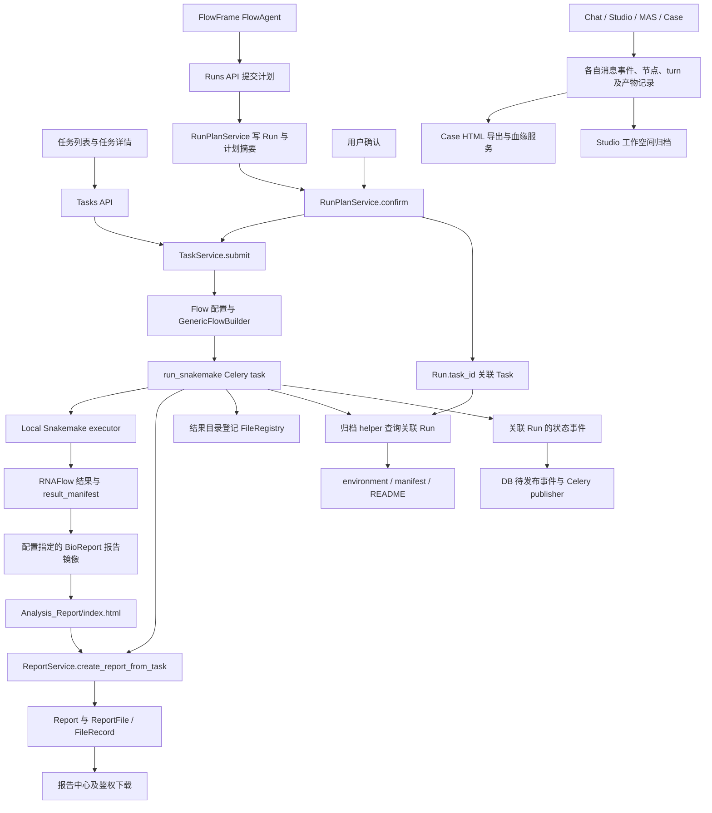
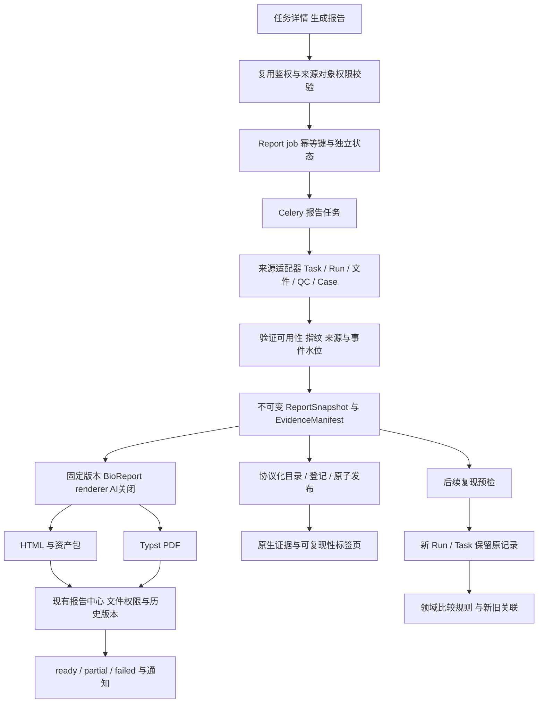

# CygnusX 可复现分析报告实施前技术调查

调查日期：2026-10-12。范围：当前工作区代码、模型、调用方、接口和测试源码，以及本地生态仓库。性质：静态只读调查；本文是唯一新增交付文件。没有安装依赖、运行分析、访问业务数据库、修改业务实现或执行提交。

## 1. Executive Summary

**可行，但应先补取证协议，再接渲染与交付。** 平台已有任务调度、报告中心、流水线 HTML、文件登记、局部 Run 事件、工作空间归档、协作室产物版本与来源关系。它们尚未组成覆盖所有执行入口的可复现报告闭环。已有函数及调用方不等于部署环境已验证，本文不将静态接入提升为端到端验证。

| 问题 | 结论 |
|---|---|
| Q1：是否已有大部分底层能力？ | 已有较多可复用基础设施，尤其调度、HTML 管理、归档和协作室血缘；但可复现性核心证据不完整，不能按“模块数量”宣称大部分可信取证已经完成。详见 §4、§7。 |
| Q2：三个最严重阻塞？ | **数据层**：Task、Run、项目、Session、Case 缺少覆盖全部入口的可靠关联；**执行层**：缺少普遍的执行时镜像 Digest、工具/参考库版本、输入指纹和步骤输入输出快照；**展示层**：没有统一不可变报告协议及任务级异步 HTML/PDF 交付闭环。已有报告中心可缓解第三项。 |
| Q3：是否新增 ReportBuilder？ | 是，新增小型证据聚合用例，建议置于 `application/services/`，由现有 ReportService 协调；不重造任务调度、权限、存储和报告 CRUD。名字可为 ReportSnapshotBuilder，核心是冻结事实及来源。 |
| Q4：BioReport 职责？ | 作为版本固定的科研结果 HTML/PDF 渲染后端；输入由平台提供的脱敏、验证过的快照/适配配置。它不负责判断权限、重建缺失历史、授予复现等级或调用平台执行流程。 |
| Q5：能否先做 RNA-seq MVP？ | 可以，需先找到真实成功任务及可访问产物，验证 result_manifest 与报告镜像；首版覆盖证据展示、缺失说明、冻结快照、HTML 下载。当前未连接业务 DB，因此没有确认一个满足条件的真实 Task ID；不能声称已通过该场景。 |
| Q6：缺哪些底层数据？ | 历史可查：Task 参数/时间、Run 计划/事件、结果目录、部分 QC/文件/协作事件。只能有条件补录：现存文件指纹及当时已保存的环境文件。未来必须自动采集：实际执行定义 SHA、镜像 Digest、工具/参考库/资源版本、输入来源与指纹、步骤 IO、完整 QC 决策及调用关联。当前服务器环境不可补作历史环境。 |
| Q7：能否直接复用运行接口一键复现？ | 可复用提交和调度底座，不能直接承诺复现。现有计划确认校验当前 Flow release，普通任务没有通用历史重运行接口；缺少冻结执行定义恢复、输入可用性、环境/配额预检、新旧关联及比较规则。必须新建执行记录。 |
| Q8：开发顺序？ | 先核实真实 RNA 样本与身份映射 → 快照和缺失语义 → 最小 HTML/任务入口 → 固定 BioReport 与 PDF → 来源追踪、复现预检和结果比较 → 多组学、审批和解释。 |

**架构决策：基于当前仓库的实际情况，建议 CygnusX 采用平台证据快照与原生审计界面、BioReport 静态交付的混合架构实现可复现分析报告，优先完成真实 RNA-seq 任务的证据冻结与 HTML 闭环，暂缓通用一键复现和严格一致性承诺，原因是执行关联和历史环境证据尚未完整。**

## 2. Repository Baseline

### 2.1 工作区与技术栈

| 项目 | 观察结果 |
|---|---|
| 根目录、远端 | `/home/zj/zj_code_libarary/OmicHub`；`git@github.com:xsx123123/omichub.git`，是目标主仓 |
| 分支、HEAD | `main`；`c68ea9e0d6ecb63cb5678444ad3dd1e2a8a00407` |
| 初始未提交状态 | `Protocol/FlowFrame`、`pipelines/ATACFlow`、`pipelines/RNAFlow`、`pipelines/tools` 有子仓工作区改动；`docs/info/26.10.12/` 未跟踪。未改动这些文件 |
| 后端 | Python 3.11、FastAPI、SQLAlchemy/asyncpg、Alembic、Pydantic；`src/cygnusx/`，依赖 `pyproject.toml` / `uv.lock` |
| 前端 | Vue 3、TypeScript、Vite、Pinia、naive-ui；`frontend/src/`，API 层 `frontend/src/api/` |
| 数据与调度 | ORM `infrastructure/database/models/`；迁移 `alembic/`；Celery `infrastructure/celery_app/`；另有 RocketMQ 消费路径 |
| Agent / Skill | 装配 `infrastructure/config/agent_loader.py`、`data/ai/`；Skill 服务和模型；`.agents/skills/` 是开发助手技能，不能当业务调用日志 |
| 文件与沙箱 | `infrastructure/storage/`、`infrastructure/studio/`、`infrastructure/sandbox/`；PostgreSQL、Redis、MinIO/本地存储适配 |
| 流程资产 | 主仓 `flows/`、`tool_configs/`；Snakemake 子仓 `pipelines/`；协议子仓 `Protocol/FlowFrame/` |

调查依据是**含未提交内容的工作区快照**，不能仅用主仓 HEAD 表示被审代码，也不能据此断言生产部署版本。实际 `.gitmodules` 中有七个子模块，与工作协议概要“六个”不同；这里只记录，不修正配置。

### 2.2 生态组件基线

| 本地组件 | Commit | 状态与边界 |
|---|---|---|
| FlowFrame | `977ad657bbe7d49f2200a5f3f550b70f25234f3d` | 子仓有改动；核查 FlowAgent 计划提交与 ledger，不代表其全部协议已被主仓消费 |
| RNAFlow | `19f5068c4f9370ea27cb6fe554a3f061a1b62a51` | `feat/result-manifest`，有改动；本地 manifest 能力未证明已部署 |
| ATACFlow | `4a68b347ba3b9497a86eed2603b6577afc3c2f27` | 有改动；不能从 RNAFlow 推定同等报告协议 |
| EBIDownload | `b351e03dfc845d229102d90f9bd88d6ca731f0de` | 本地可读；调查 ENA 元数据与 MD5，**不等同于 Polariseq** |
| 科研寻宝鼠 | `88dae95e7294dea5004330203f56e4211776fd74` | `pipelines/Treasure-Seeking_Mouse/`，本地可读；主前端 iframe 集成 |
| scrna / tools | `b5066338fba47b1ed3fbee042f1cb43859cff882` / `24ecb6ce75657c5ce188603b54ac7bf10ffb6d46` | tools 有改动；此次未完成其全链路取证审计 |
| BioReport | `6b04ea6a44955def17a996f9b487761f5341f422` | 兄弟目录 `/home/zj/zj_code_libarary/bioreport`，main、干净；不是主仓内 Python 包，也不是已经证明的部署镜像版本 |
| Polariseq | 未取得 | 未发现本地对应副本；没有拉取远端，身份、版本、接口、业务接入列为 F / 待验证 |

先阅读 `ARCHITECTURE_DESIGN/README.md`，再定位 Flow、存储、沙箱、执行框架、研究闭环等现状文档。文档用于找入口，以下结论以实现和调用方为准；原设计框架只作为目标，不作为实现证据。

## 3. Current Architecture

### 3.1 实际调用关系

普通 `TaskService.submit` 不创建 `RunModel`；计划确认路径才建立 `Run.task_id`。`analysis.py:23` 的归档 helper 找不到关联 Run 就返回。该差异直接影响同一类 RNA 任务能否取得平台归档环境和 manifest，应先做入口对照验证。

成功 worker 自动调用现有 ReportService；结果登记、报告创建、归档都有非阻断处理。**Task success 不意味着报告 ready，也不意味着取证完整**。失败 worker 有归档尝试，RNAFlow 有失败 manifest，但当前自动报告创建位于成功路径，失败报告不能仅凭 manifest 存在推定已进入报告中心。

### 3.2 有效复用与边界

- Run 事件有 DB 序列与待发布字段，`tasks/run_events.py:14` 负责发布；这是 Snakemake Run 的机制，不是所有 Chat/Case/工具的统一事件模型。
- AgentTeams 已有带角色裁剪的离线 HTML 流程报告、MinIO 存储、SHA-256、产物版本和依赖登记。Task 报告应借鉴其来源适配与角色隔离，不另造一个无权限的全量日志导出器。
- Studio 有工作空间包和环境恢复，恢复能力依赖实际归档的环境文件；不等于普通 Snakemake Task 可恢复到原计算环境。
- FlowFrame FlowAgent 提交计划前检查 dry-run ledger，调用平台计划 API；计划确认仍由平台人类入口承担。不得因本地 FlowAgent 有工程执行工具，就向平台科研 Agent 增加 shell 或 YAML/DB 写权限。

## 4. Capability Evidence Matrix

分类：A＝已实现且已验证业务接入；B＝实现及静态调用链明确，但本轮缺少端到端验证；C＝部分实现；D＝设计/占位；E＝本次检索未发现；F＝外部依赖尚未验证。为避免混淆，本轮没有使用 A：没有重新执行真实业务或核实匹配版本的完整运行证据。下表行号是当前工作区定位点；`S/` 代表 `src/cygnusx/`，`F/` 代表 `frontend/src/`，外部路径另注明。

| 能力 | 状态 | 代码位置 | 函数 / 类 | 数据来源 | 实际调用方 | 证据与缺口 |
|---|---|---|---|---|---|---|
| Task 生命周期与参数 | B | `S/application/services/task_service.py:51`；`S/domain/task/value_objects.py:35` | submit、TaskStatus | 请求、Flow、Task 表 | Tasks API → submit → worker | 状态及参数有保存；没有全部入口的项目/Run/历史执行定义快照 |
| 稳定 Run 与计划确认 | B | `S/application/services/run_plan_service.py:27`、`:80`；`S/infrastructure/database/models/run.py:14` | RunPlanService、RunModel | plan_json、digest、request_key | Runs API；FlowFrame platform.ts | 仅受控计划提交路径，不覆盖普通 Task |
| 执行时间线 | C | `S/infrastructure/database/models/run_event.py`；`S/application/services/run_plan_service.py:114`；`S/infrastructure/celery_app/tasks/analysis.py:207` | RunEvent、events | Run 事件、worker 输出 | worker emit；Runs API | Run 事件可查，日志尾部保存；events 有数量上限，非全局完整 Step 时间线 |
| Agent 记录 | C | `S/infrastructure/database/models/chat.py:378`；`S/application/services/agentteams_flow_report_service.py:148` | ChatMessageEvent、_load_turn | 消息事件、Case turn 对象 | Chat 运行时；Case 导出 | 局部中间记录存在；没有通用 Agent Execution → Task/Run 必选关联和版本快照 |
| Skill 调用 | C | `S/infrastructure/database/models/skill.py:103`；`S/application/services/skill_service.py:344`；`S/application/services/chat/runtime_support.py:1098` | SkillInvocation、record_invocation | skill_version、session/message、耗时/状态 | runtime_support 调用记录 | 记录加载/使用，不保证逐个计算活动 IO；无通用 task/run 字段 |
| 模型配置 | C | `S/infrastructure/database/models/agent.py:82`、`:102`；`S/infrastructure/database/models/chat.py` | AgentModel、ChatSession | model_id、temperature、当前配置 | Agent 装配与会话 | 当前配置可读，不能自动当历史逐次请求快照；Seed 有效性和远端模型修订未证明 |
| 环境快照 | C | `S/application/services/project_archive_service.py:83`、`:356`；`S/application/services/chat_archive_service.py:250` | collect_environment、archive_run | 当前 Settings、runtime profile；部分 sandbox probe | analysis 归档、Chat/Studio 归档 | 普通归档可能记录当前平台信息；不能标为全部历史执行环境。Digest/执行工具版本不普遍 |
| 输入指纹 | C | `S/infrastructure/database/models/file.py`；`S/infrastructure/storage/file_registry.py:87`；`pipelines/EBIDownload/crates/ebidownload-core/src/ftp.rs:156` | FileRecord、register_file、verify_md5 | 上传/下载和调用方提供值 | FileService；下载 worker | 有校验路径，但 checksum 可空且无算法字段；下载登记未传递源 MD5 |
| 产物指纹 | C | `S/infrastructure/celery_app/tasks/analysis.py:23`；`S/infrastructure/studio/archive_storage.py`；`S/infrastructure/storage/file_registry.py:135` | archive helper、build_manifest、register_directory | 文件实际字节/目录 | worker、workspace archive | 特定归档可 SHA-256；目录登记可不带指纹，登记并非冻结字节 |
| 三级质量门 | C | `S/domain/mas/quality_gate.py:37`；`S/infrastructure/celery_app/tasks/mas.py:705`；`S/application/services/agentteams_quality_gate_service.py:77` | evaluate、apply_override、delivery gate | qc_metrics、规则、交付产物 | MAS worker；case_watch 报告门 | MAS 有阻断与人工豁免规则；不覆盖所有 omics 的预检/运行/统计三层 |
| 外部 API 审计 | C | `S/middleware/audit.py:88`；寻宝鼠 `functions/seqout-chat/index.ts:196` | audit middleware、source tools | 入站变更、检索结果 | middleware；seqout-chat | 入站审计不是出站 API 响应取证；缺统一 task/run、内容版本及脱敏快照 |
| MCP 调用审计 | C | `S/application/services/mcp_service.py:793`、`:877`；`S/infrastructure/mcp/client.py:280` | invoke_tool、_add_log、call_tool | server、tool、结果状态 | MCPService invoke/pipeline 调用；client | 真实日志调用存在，日志主要是 server 级文本；不是全路径参数/响应摘要及 Run 关联 |
| Evidence / Manifest | B | `S/application/services/report_service.py:76`、`:97`；`pipelines/RNAFlow/rules/utils/result_manifest.py:202` | manifest 读取/验证、build_success_manifest | result_manifest、交付文件 | ReportService；RNAFlow 规则 | 结构化结果存在；size/md5 仅有值时校验，声明 self_contained 不等于运行验证 |
| Provenance 关系 | C | `S/infrastructure/database/models/chat.py:193`、`:240`；`S/application/services/agentteams_artifact_lineage_service.py:70`、`:108` | CaseArtifactVersion/Dependency | 版本、producer event、依赖 | consultation 服务；Case report | Case 版本血缘可复用；依赖边使用逻辑 artifact_id，须核实版本级语义，非统一 Task 图 |
| 证据声明审核 | C | `S/application/services/agentteams_qc_verification_service.py:38`、`:68`；`S/application/services/agent_consultation_service.py:728` | record_checks、enforce | claim、evidence/version 指针 | consultation enforce/record | 对伪指针降级、保存 verdict；不等于统计分析科学审核 |
| HTML 报告 | B | `S/application/services/report_service.py:312`；`pipelines/RNAFlow/rules/14.Report.smk:137`；`S/api/v1/agentteams.py:645` | create_report_from_task、Report rule、case export | 流程 HTML、Case events/turns | worker；Case API；ReportsView | 两类 HTML 实际接入；不是统一八模块快照 |
| PDF 导出 | F | 外部 `bioreport/cli.py:225`、`:253`；`bioreport/utils/render_output.py` | render_report、PDF 渲染适配 | Quarto / Typst 配置 | 本地 BioReport CLI 路径 | 本地代码存在；平台 API/镜像/字体/PDF smoke 未验证，不是平台已接入能力 |
| 报告历史与下载 | B | `S/api/v1/reports.py:31`、`:106`；`S/application/services/report_service.py:208`、`:272`；`F/views/ReportsView.vue` | list_versions、download_file | reports、report_files | API → ReportService → storage | owner 范围与文件所属检查；本地路径下载，不能假设 S3 通用可用 |
| 普通任务重运行 | D | `F/components/task/TaskTable.vue` 重运行禁用按钮；`S/api/v1/tasks.py` | UI 入口 / 路由集合 | 当前任务 | 无通用 rerun 后端链路发现 | 新 submit 是执行底座；界面占位不等于恢复原定义 |
| 工作空间恢复 | B | `S/application/services/workspace_env_restore_service.py:32`、`:111`；`S/infrastructure/studio/archive_storage.py` | restore、extract_workspace | explicit/yml、归档包 | workspace archive 服务 | 依赖归档锁文件；校验不匹配可能返回 warning，非通用计算重跑 |
| 复现结果验证 | E | 检索 reproduce/replay/rerun、manifest 与 archive 代码 | 未发现统一科学比较服务 | 目前是完整性校验 | 无新旧计算比较调用链 | 字节 hash 检查与事件 replay 都不是 Level 3 科学结果验证 |
| 下载来源传递 | C | `S/infrastructure/celery_app/tasks/download.py:232`、`:747`、`:821`；EBI `src/lib.rs:34`、`:194` | download worker、_register_download_outputs、EnaRecord | accession、ENA、FTP MD5 | worker 调用 downloader，登记文件 | 源头数据存在，FileRecord checksum 可空；未形成 source→Task 快照联结 |
| Polariseq 生态接入 | F | 无本地对应副本 | 待验证 | 外部仓库 | 未确认 | 不能用 EBIDownload 推定 Polariseq 的接口或部署状态 |

测试源码是验证意图的证据，不是本轮执行结果；详见 §16。E 状态意为此次覆盖范围未找到，不是证明整个生态绝无此功能。重运行结论限于普通分析 Task：StudioCodeCard 有沙箱执行重跑，BLAST 页面也有专项 rerun 交互，这些不能推定为通用 RNA 历史执行恢复。

## 5. Eight-Module Readiness

以下同时是现有能力与目标能力映射表。

| 模块 | 可复用来源 | 就绪度 | 首版必须补的内容 | 禁止的默认填充 |
|---|---|---|---|---|
| M1 封面与概要 | Task 名称/用户/时间、Report title/summary、Run plan | 较高但身份待对齐 | 稳定任务/运行链接；区分执行时间与报告生成时间；分析目标来源 | 不用 LLM 编造目标或声称科研结论已审核 |
| M2 输入与环境 | Task.parameters、FileRecord、RNA 配置、归档环境 | 部分 | 输入版本/指纹、环境来源与 capture_time、镜像 Digest、参考库标识 | 不以当前 Python、当前 Flow 版本替代历史 |
| M3 执行轨迹 | RunEvent、ChatMessageEvent、SkillInvocation、Case turns、MAS 节点 | 部分 | 来源适配、稳定 activity ID、事件分页/水位、步骤 IO | 不把时间相近的 Session 自动绑定 Task |
| M4 外部调用 | MCP service 日志、Chat 工具事件、寻宝鼠来源 | 部分 | 调用 ID/关联、脱敏参数摘要、状态/耗时、必要响应版本/hash | 不导出 token 或全量原始请求体 |
| M5 质量门 | MAS mapping-rate gate、Case 交付 gate、RNA QC 文件 | 部分 | 区分 QC 测量/门决策；规则版本、值、阈值、override、适用范围 | 缺记录不能显示“通过” |
| M6 产物清单 | result_manifest、FileRecord、Case versions、archive manifest | 部分 | 完整清单、类别、hash algorithm、可用性、保留策略 | UUID 文件记录不代表内容不可变 |
| M7 证据链 | Case 产物版本/依赖、producer event、QC verification | 局部可用 | Task/Run 适配和版本级输入→活动→输出关系 | 不让 LLM 根据文件名补来源边 |
| M8 复现指南 | Run plan、工作空间环境恢复、Flow 配置与 locks | 就绪度最低 | 逐项预检、缺依赖、固定执行定义、新执行/比较政策 | 不承诺一键恢复或全输出 MD5 一致 |

RNA MVP 应允许八个模块全部出现，但每一条事实都带来源与验证状态；空模块明确说明未记录，而不是要求从历史任务补出不可证明的事实。

## 6. Data Flow & Identity Mapping

### 6.1 当前身份关系

| 标识 | 实际关系与约束 | 报告聚合注意事项 |
|---|---|---|
| Project | ChatSession 的 project_id 与 Run 的 project_slug 分属不同语义；用户目录路径另有协议 | 不能把 slug 当项目 UUID；必须明确 owner 下映射是否存在，不可按显示名 join |
| Task ID | TaskModel UUID；包含 user_id、flow_id、parameters、work_dir、result_path、状态/时间 | TaskModel 没有通用 project_id/run_id/step_id 字段；优先从可信关联反查 |
| Run ID | platform_runs UUID；user_id + request_key 幂等；plan_json/digest；task_id 可空且唯一 | 计划未确认时没有 Task；task_id 无直接 FK 的完整性需核实；Run 不覆盖所有执行后端 |
| Job ID | Celery 调度标识，例如 analysis 任务 attempt 名称 | 队列 Job ID 不是业务 Run，也不代表不可变执行尝试模型 |
| Session / Message | Chat session、message、message event；SkillInvocation 可关联 session/message | 有聊天关联，不保证与后续 Task 存在持久、结构化关联 |
| Case / Work item / Turn | 协作室各自身份；turn 记录与 MinIO 对象；产物含 case/work_item/producer event | 可作为独立执行来源；不能强制塞入普通 Task ID |
| Step / Node | MAS 有 node_key、attempt_count；RunEvent 可有 rule、seq；FlowAgent 本地 ledger | 没有平台统一 Step ID；rule 名或 event seq 不足以表达每次活动的 IO |
| Artifact | FileRecord UUID 是位置记录；CaseArtifactVersion UUID+version_no；依赖使用逻辑 artifact_id | 指纹、对象版本、记录 ID 是不同概念，报告需同时保存 |
| Report | ReportModel 与 task、parent/version；Case 导出走独立 artifact/lineage | 报告不是 Run；报告修订不应修改原任务事实 |

### 6.2 十个执行模型问题的答案

1. **生命周期**：Task 为 pending、queued、running、success、failed、cancelled；终态不自动重开。计划 Run 另有 plan_pending、确认后的 queued 等状态；不可把两个状态机合并推断。
2. **稳定 Run ID**：有，但只在计划提交链明确；普通任务只有 Task ID，报告允许 run_id 为空并解释。
3. **身份关系**：受控路径是 user → Run → task_id → Task；项目为 slug。Session/Case/Agent 记录另行关联，未形成普遍强约束。
4. **多次运行**：普通 Task 表本身没有通用 attempt 子表；MAS 和队列有局部尝试记录，不足以声明同一个 Task 的所有重跑可区分。新复现应创建新 Task/Run 和 parent 关系。
5. **独立 Step ID**：局部 node/turn/rule 存在，统一稳定活动标识未发现。
6. **每步 IO**：Case 有产物来源边，Snakemake 有 DAG/文件配置，但平台未普遍保存每次执行活动的输入/输出版本。不要仅依赖最终目录反推。
7. **参数/版本/时间**：Task 参数、开始结束、Flow 名称、Skill 版本可查；sample_sheet/comparisons 被 builder 写入配置，未必全部在 Task.parameters 中。历史软件/模型/参考版本不能保证。
8. **重试/恢复/历史**：Task 历史、日志、报告版本和工作空间恢复存在；普通任务完整 rerun/reproduce 接口未发现；事件 replay、队列 retry 不等于科学复现。
9. **统一事件/审计**：有 Run outbox、Chat message events、Case events、入站 audit、MCP logs，载荷和关联不同；不存在已经证明的全域统一取证总线。
10. **后端模型统一**：不统一。Task 声明 local/remote 不证明 remote 执行器全链路；Studio、MAS、协作室需来源适配，MVP 先限定 RNA Snakemake。

计划确认还要核查 `project_slug` 和 Task 生成 work_dir 的对应性：Run 保存的 slug 不足以证明 builder 路径必然位于同一项目。`archive_run` 会做项目根路径校验，入口不一致可能导致归档降级；本轮为静态风险，未声称实际运行失败。

## 7. Reproducibility Assessment

### 7.1 当前层级

| 层级 | 本次判断 | 依据与验收差距 |
|---|---|---|
| Level 1 可追踪 | 局部、条件性具备；无法声明全平台完整达到 | 可查 Task/Run/Case/文件/事件，但谁用哪些输入版本、哪些步骤仍可能缺失；需显示覆盖率而非全局通过 |
| Level 2 可重新执行 | 部分条件可准备，未验证通用闭环 | Flow 与参数、归档锁文件可能可用；缺原执行 SHA/Digest、输入可用性、参考库版本、预检和新执行关联 |
| Level 3 结果可验证 | 未发现统一实现 | 已有归档 hash 验证的是文件完整性，不是新旧计算结果比较；需要按产物类型定义比较方法 |
| Level 4 严格可复现 | 当前不能承诺 | 缺确定性约束、固定环境和科学等价规范；没有真实重跑实验与评估结果 |

### 7.2 环境和元数据取证分类

本表 A/B/C/D 是**元数据取得时机**，与 §4 能力成熟度分类不同：A 执行时捕获；B 结束后可查询已保存历史；C 仅当前环境推断；D 本次未发现目标采集实现。分支混合必须保留来源，不将 C 提升为 A。

| 元数据 | 分类 | 实际边界 |
|---|---|---|
| Task 参数、状态、开始/结束 | A→B | worker/submit 保存；配置文件和请求 sample/comparisons 还需关联验证 |
| Run plan 与 digest | A→B | 仅计划入口；digest 是计划内容摘要，不是流水线源码摘要 |
| Git Commit | C；部分历史可 B | collect_environment 读取当前 app_git_sha，归档时取得；未发现所有 Task 执行前固定 pipeline SHA |
| 镜像 Tag | A/B 或 C，依来源 | RNA manifest/config 可含 report tag；runtime profile 是声明配置。需要区分计算镜像与报告镜像 |
| 计算镜像 Digest | D（统一路径） | 未发现普遍运行时解析并持久保存；Tag 不可代替 Digest |
| Python、工具版本 | 部分 A→B；普通归档 C | Chat sandbox 有 observed_software/python 探测；collect_environment 的平台 Python/声明 software 非历史计算实测 |
| Conda / dependency lock | 部分 B | workspace restore 识别 conda-explicit/environment.yml；锁是否来自实际执行、是否齐全需逐次检查。仓库 uv.lock 不等于分析环境锁 |
| OS / 架构 / 实际 CPU/GPU/内存 | C 或 D | profile 资源声明不等于分配与实测；未发现所有任务完整采集 |
| 参考基因组/注释 | 部分 B；版本/hash 缺失 | 配置路径可读；路径并非不可变版本，要有 accession/release/hash |
| 随机 Seed | D（通用快照） | 未发现全链路固定与有效性验证；字段存在也不能保证工具/Provider 支持 |
| 输入指纹/来源 | 部分 A→B，可新增采样 B | 已上传或下载校验；历史当前文件重新 hash 只能证明当前字节，不证明执行时字节 |
| 模型 ID / 温度 / Provider | 部分 B / C | 会话、配置和 turn 来源可局部查询；没有证明每次调用都有历史有效参数、远端模型修订 |
| 安全环境变量摘要 | D（统一报告协议） | 不应记录原值；建议白名单非敏感项和密钥存在性，避免对低熵秘密 hash 泄漏 |

归档 helper 为已有文件计算 MD5/SHA-256，适合完整性清单；但归档时间是独立 capture_time。RNA manifest 的 timing 还有基于文件 mtime 的估算（`result_manifest.py:184`），必须标注 estimated，不能当准确执行起止。

### 7.3 一致性定义和非确定性

- LLM 远端版本、采样和上下文会变；科研核心复现应冻结分析参数/流程，LLM 解释单独记录，不参与计算结果一致性判定。
- API/ENA/文献/参考数据库会更新；保留 accession、release、检索时刻、响应必要摘要与来源，不只保存 URL。
- 依赖、镜像 Tag、浮动软件和参考文件可漂移；要求计算与渲染环境分别固定，不使用当前版本冒充历史版本。
- 多线程、GPU、随机算法可能产生差异；规则应写明 Seed、线程、容差、排序和硬件约束，不能笼统承诺逐字节相等。
- HTML/PDF 的生成时间、图表元数据和压缩头会变；将科学结果比较与报告二进制 hash 分开。压缩文件可比较解压内容，矩阵可按键对齐后比较数值/容差，具体规范需领域评审。
- 原始测序数据可能被清理或受保留期约束；完整性 hash 不能替代可取得输入。报告要展示 lost/unavailable，并阻止相应复现预检通过。

建议报告包含 `reproducibility.status/level/missing_dependencies/validation_method/validation_result/limitations`，同时分别呈现证据完整性、输入可用性、重跑资格和重跑比较结果。未做重跑时 validation_result 为 not_run。

## 8. BioReport Reuse Assessment

### 8.1 平台现有报告职责

`ReportService.create_report_from_task:312` 已负责读取 result_manifest、选择 HTML、保存报告元数据并登记主文件。`ReportsView.vue`、`api/report.ts` 与 reports API 已承担浏览、预览、下载、历史。**没有必要新造报告中心和第二套基本 ReportController。**

当前 report 创建从 FlowService 读取当前 flow.version（`:326` 附近）；它可能与历史任务实际执行 release 不同，不能作为可信历史版本。主 HTML 登记也不等于 manifest 中所有产物已成为 ReportFile。先查询是否有报告的防重复方式，没有提供任务级并发唯一性保证；新增生成任务要另设业务幂等约束。

Case 的 `AgentTeamsFlowReportService.generate:51` 已将事件/turn/产物/环境组织成 HTML，上传 MinIO、登记 SHA-256 与版本/依赖。其 `_content_checksum:187` 包含生成时刻，因此不能直接当稳定内容去重键。源码有字符串 escape 和邀请成员 turn 裁剪；适合复用适配思想和安全边界。

### 8.2 本地 BioReport 实现证据

| 能力 | 本地代码证据 | 对平台的含义 |
|---|---|---|
| JSON / YAML 协议 | `bioreport/config.py`，加载、legacy normalize、Draft202012 校验；`report.schema.json` | 能作为 renderer 配置协议，但不等于八模块 ReportSnapshot |
| 模块组合 | `bioreport/registry.py` 的 Module / Registry；modules、qmd 模板 | 可扩展和选择章节；不能推定 RNA 以外所有 omics 已有可交付模板 |
| Jinja / Quarto | `bioreport/renderer.py:16`，render_templates/compose_report；`cli.py:253` | 现成渲染能力，可避免平台重复维护科研模板 |
| HTML | `_quarto-single.yml.j2:10` embed-resources；website 配置为非自包含 | single 适合离线交付；website 必须资产打包，不能只下载 index |
| PDF | `cli.py:225`、`:265`、`:266`，PDF 要求 single、Quarto `--to typst` | 代码可达，不是平台镜像已验证；需字体、Quarto/Typst、资源图形 smoke |
| 图表和表格 | `utils/render_output.py`，PDF 静态图、HTML Plotly/itables | PDF 绘图依赖需要固定；PDF 表格 head(30) 截断要显式说明并附全量数据 |
| 可选 AI | `pipeline.py` 的 run_ai_pipeline，CLI 选 AI 模块时触发 | 配置默认启用存在外部 Provider 风险；MVP 必须显式关闭，不能用于事实补齐 |
| 渲染测试 | 本地 test_render_output、test_integration_render、test_delivery_layout 等 | 本轮只读测试源码，未运行；部署环境效果仍待验证 |

RNAFlow 的实际接入是 `rules/14.Report.smk:137` 的 **Docker 报告步骤**，读取 project_summary.json 和交付数据。`config/run_parameter.yaml:162` 指向 `bioreportrna:v0.0.7`；它不带 SHA，Digest 未在此链证明。该配置与主仓镜像版本治理目标存在核查事项，但本轮不修改受保护资产，也不能假设当前生产正用此配置。

本地兄弟 BioReport 的新 PDF 实现不能自动归属于 v0.0.7 镜像。必须确认构建来源、schema 兼容性、镜像 SHA/Digest和真实 CLI 才能确定复用版本。RNAFlow 没有主仓内嵌 BioReport Python 源码调用链；不能写成主服务直接 import 已接入。

### 8.3 复用结论

复用 BioReport 渲染、模块注册、视觉和 RNA 图表；平台提供报告事实与审计附录适配器、版本固定、异步执行、权限、存储和等级判断。渲染服务不得自行检索数据库、请求原始外部数据或启动 LLM。缺失证据要原样传递，渲染模板不能改成成功。

## 9. Report Architecture Options

### 9.1 三方案比较

| 维度 | A：平台 Jinja + Playwright | B：平台 Builder + BioReport | C：原生审计界面 + BioReport 静态交付 |
|---|---|---|---|
| 现有耦合 | 新平台模板/PDF栈，需较多胶水 | 新 renderer 适配，平台契约可独立 | 在现有任务/报告页面渐进加入审计入口，renderer 独立 |
| 复用率 | 复用基础设施，科研图表模板复用低 | 高，复用 Quarto 与模块 | 高，同时复用任务交互、报告中心和科研渲染 |
| 维护成本 | 两套科研模板与浏览器运行环境 | 平台协议 + 外部模板契约 | 同 B，另有交互 UI；避免 UI/离线模板重复事实逻辑 |
| 交互 HTML | 可定制，但需开发科学图表与资产处理 | Plotly/itables 已有 | 平台承担权限/证据筛选，静态科研交互复用 BioReport |
| PDF 效果 | 浏览器打印，分页/科学公式需验证 | Typst 现有路径，复杂图/字体需验证 | 同 B；不直接打印复杂任务详情 UI |
| 统一视觉 | 可跟前端，但科研模板另建 | 需平台品牌适配 | 可复用现有组件样式，交付模板有独立品牌配置 |
| 多组学 | 全部自行实现 | 注册机制可扩展，非 RNA 模块待验证 | 按分析适配扩展，审计契约共享 |
| 大图/大文件 | 内嵌会膨胀，需外链/打包策略 | Quarto 同样受内嵌大小约束 | 预览缩略与下载原始数据；交付包按大小预算 |
| 异步支持 | 需平台新增 report job | 同样需平台 job | 同样需 job；复用 Celery，避免 Web 长渲染 |
| 私有化部署 | Chromium/字体/Playwright 维护 | Quarto/Typst/图形依赖镜像维护 | 与 B 相近，可完全离线渲染，AI 默认关闭 |
| 模板扩展 | 平台维护模板版本 | BioReport Module/Registry | 同 B；平台 schema 稳定、renderer 版本可替换 |

**推荐 C**。B 是其中静态交付的内部实现，而 C 明确区分用户持续查看审计状态和冻结科研报告的职责。A 可作为简单审计附录的轻量实现选择，不应现在另建完整 RNA 科研报告/PDF体系。所有方案都需要真实证据采集，换模板不能弥补缺失环境。

### 9.2 建议生成链路（未实现）

### 9.3 职责、数据协议与缺失语义

| 职责 | 现状 / 推荐 |
|---|---|
| Builder | 没有通用八模块 Builder；新增 application 用例，聚合服务/只读模型查询，按来源实现 adapter |
| ReportData / Snapshot | ReportResponse、SnakemakePlan、result_manifest、BioReport schema 仅覆盖各自范围；新增 Pydantic/JSON Schema 版本化统一快照 |
| EvidenceManifest | 已有 archive/result manifests；复用指纹与安全路径校验，形成报告包清单，不覆盖原 manifest |
| Renderer / Exporter | 现有 RNA Docker、Case HTML；增加 BioReport adapter 和单一格式输出编排，不让其承担鉴权 |
| Controller | 复用 reports API、任务入口；不要复制 report CRUD |

建议快照至少含：`schema_version, report_id, project_id, project_slug, task_id, run_id, source_execution_kind, generated_at, source_commit, inputs, environment, execution_steps, tool_calls, quality_gates, artifacts, provenance, reproducibility, warnings`。另加 `source_watermarks, capture_started_at, capture_finished_at, renderer_version, template_version, visibility_scope`。

每条证据包含 `source_type/source_id/source_path, captured_at, observed_at, capture_method, verification_status`；hash 用 `{algorithm, value, verified_at, scope}`。版本/时间不知道时保留 null 与原因。`source_commit` 要说明属于 pipeline、平台或 renderer，不混用。

缺失状态使用 `verified / not_recorded / unavailable / not_applicable / verification_failed / estimated`；estimated 单独展示，不能通过。不适用需给依据，不是便利性回退。任务成功、证据覆盖和报告 ready 为三个不同维度。历史补录加入新的 capture 时间和证据来源，不修改原执行记录。

读取策略：业务 Service 负责权限与对象访问；必要批量 ORM 查询避免逐文件 N+1；manifest 补充文件事实；事件供时间线及未来自动采集；审计日志作辅助，不能作为全部科研输入。未来可消费事件，首版无需重构全域事件总线。生成结束冻结快照，浏览报告不实时重建历史。

幂等策略：owner/visibility + source execution + 源事件水位/产物版本 + schema/template/renderer version + format 构成规范业务键；`generated_at` 不入稳定事实摘要。用 DB 唯一约束和任务 claim 防并发；重试同一 snapshot 渲染，新证据产生新版本。将脱敏策略版本纳入缓存键，防 owner 版缓存被成员复用。

快照与包 SHA-256 支持完整性核验；MD5 以显式算法兼容下载源记录。checksum 证明字节一致，不能证明来源真实性、科学正确性或输入可取得。

## 10. API / Frontend / Storage Integration

### 10.1 已有接口与建议接口

| 已有 | 作用 | 不能推定的能力 |
|---|---|---|
| `/api/v1/tasks` 及 detail/logs/cancel/dag/progress/ws | 提交、状态、日志、DAG | 没有通用 reproduce/report generation job API |
| `/api/v1/runs/snakemake/plan`、`/{id}/confirm`、events/artifacts | 计划、人类确认、事件和产物查询 | 不自动恢复历史 release，不覆盖全部 Task |
| `/api/v1/reports`、versions、preview、files/download、star/read/delete | 报告中心与 owner 下载 | 无统一任务级 PDF 生成队列和 snapshot 读取 |
| AgentTeams `/cases/{case_id}/reports/flow` | 经 room/case 权限生成流程 HTML | 属 Case 专用交付，不是普通 Task 八模块报告 |

建议接口均为未来提案：`POST /tasks/{id}/reproducibility-reports` 返回 202/job_id；`GET /report-jobs/{id}` 返回阶段、进度、失败码、缺证据摘要；`GET /reports/{id}/snapshot` 返回裁剪后的结构化快照；文件仍走现有鉴权下载。Phase 3 再加 reproduce-preflight、新执行和 comparison 接口，必须明确 human confirmation/配额，不沿用模型自证确认。

Report job 独立于计算 Task：建议 queued、collecting、rendering、publishing、ready、failed，允许 ready 附 evidence_partial。失败记录错误码/阶段，有限退避重试；缺输入、无权限、验证失败不能靠无限重试修复。复用 Celery；报告通知可借既有事件/前端轮询模式，但未证明已有 report-ready 专属推送，需新增业务事件。文件落盘、登记和通知采用原子发布/提交后事件，防记录指向半成品。

### 10.2 前端十项集成判断

1. 首入口放 `TaskDetailView.vue` 的结果/报告区域，传 Task ID；有可信 Run 关联再附 Run ID。报告中心是历史交付入口。
2. 任务详情的状态、日志和 DAG 可复用；不要从 Vue 直接拼审计 JSON，所有事实由 API 提供。
3. 已有轮询/WS、naive-ui 状态组件；report job 有独立状态，计算进度不能借作渲染进度。
4. 生成完成返回 Report ID 和可下载文件；失败展示阶段、可重试条件；partial 提供缺失清单。
5. 新“可复现性”标签页展示来源、验证状态、可用性、缺依赖及限制，文件缺失不能隐藏。
6. 预览可复用 modal，但需隔离可信域/沙箱策略；复杂科研资源以独立受控预览更易处理，不能默认 srcdoc 任意脚本可信。
7. PDF 复用 report/file membership 和 owner 鉴权，不能直接公开对象存储 URI。
8. 复用 ReportsView 历史/版本；加入 snapshot、renderer、template 版本和覆盖状态，不创建重复历史表格。
9. 项目详情可加报告列表，前提是 project_id/slug 有可信映射。当前 ProjectDetailView 的 Session 分组不是完整任务历史 join。
10. 复用平台组件、状态色和品牌样式；BioReport 模板独立做品牌适配，不把数据库路径、队列名等实现术语暴露为产品文案。

### 10.3 存储和归档

遵循 `Protocol/file_protocol.md`、StoragePathFactory 与 ensure_directory_chain；用户目录不出现内部 UUID。报告 ID 可内部使用，用户可见名称按协议生成；不要另拼 `/reports/{uuid}` 用户路径。文件登记同时保存 byte size、算法、hash、mime、来源与快照关联。

现有 FileRecord checksum 可空，register_file 对已有位置可返回旧记录，目录登记不保证更新内容 hash；所以不能把 FileRecord 当不可变版本存储。ReportSnapshot 固定内容放版本化对象/目录，发布后不原地改写；历史来源丢失时快照仍可阅读，但标记原件 unavailable。

ArchiveStorage 当前选择器的通用实现是 local，其他后端存在未实现分支；ReportService 下载依赖 get_local_path；Case report 使用 MinIO。新增 renderer 的对象存储输入输出必须通过已有存储适配，不假定跨三种存储天然兼容。HTML website 资产需整个目录/ZIP，单文件 HTML 也需大小预算。Retention/quota/delete 与报告保留策略一起确认，不无条件永久保存原始测序数据。

## 11. Security & Compliance Risks

本节是代码风险及产品策略调查，不作法律合规认证结论。

| 边界 | 已有证据 / 风险 | 推荐控制与验收 |
|---|---|---|
| Task / Run owner | RunPlanService get/confirm、Task 服务按 user 范围 | builder 每个关联对象复核 owner，不接受用户提供任意 path/run_id 联结 |
| Report / file | preview/download 查 report owner、文件所属；manifest 路径包含性检查 | snapshot/PDF/ZIP 与附件复用相同鉴权；跨用户 ID/path 请求拒绝且不泄漏元数据 |
| 项目 / 团队 | Case API `_get_turn_room`；Case report 对 invited 角色裁剪 turn 文本 | 不将 Task owner 模型假定成项目成员 ACL；共享报告生成独立裁剪版，缓存带 visibility |
| 管理员 / 外部分享 | 本次未验证 report 管理员代读或通用公开分享完整链路 | 默认沿现有权限；权限扩展需产品明确和专项测试，不能以管理员身份导出一切 |
| 秘密与样本隐私 | Task 参数、错误/log、Prompt、MCP 异常和外部响应可能包含秘密/内部地址 | 导出字段白名单；请求头/凭证永不进 renderer；样本标识脱敏、原始请求/turn 控制授权 |
| HTML 脚本 | `ReportPreviewModal.vue:126` 为 srcdoc 且允许 scripts/same-origin；Case 预览路由已有 CSP | 审查脚本来源和下载资源；隔离 origin/CSP、禁止任意连接/表单；测试恶意报告不能调用平台凭证接口 |
| 渲染器访问 | Quarto 可包含代码/外部资源；BioReport 可选 AI 会外发 | 只允许受控模板和数据映射；隔离 worker、只读输入、限制网络和资源，关闭 AI；禁止用户模板任意执行 |
| 完整性 | archive extract 返回 mismatch 列表不一定拒绝恢复 | 报告展示验证失败；复现预检必须 hard fail；路径穿越、符号链接、包大小和资产 URL 做测试 |
| 一键复现 | 原 Task 路径/当前 Flow 可变；原输入/对象可丢失 | 校验 owner、输入hash/可用性、固定环境、配额、确认；新 Run/Task/目录，原始记录不覆盖 |

原始审计存储与面向用户报告的脱敏投影分开授权，但报告生成只读取获准字段。不能简单把日志全文、环境变量全集、模型 Prompt 或对象存储签名链接打包。泄漏检查应有自动化 canary-secret 测试。

拉取公开 Git 仓库的网络行为与向外部服务发送样本/患者数据是不同的数据流；本轮没有拉取远端，也没有发送业务数据。是否允许 renderer/AI 出站必须按真实负载、部署策略和用户授权判断，不能仅凭 GitHub 依赖作数据出境结论。

## 12. GAP Analysis

规模 S/M/L 表示相对复杂度，不是工时承诺；优先级按首个可信 RNA 交付闭环排序。

| GAP / 优先级 / 规模 | 问题、影响模块与用户影响 | 代码证据 | 修复方向与依赖 | 验收标准 |
|---|---|---|---|---|
| G01 入口身份断裂 / P0 / L | M1/3/7/8；普通提交无 Run，归档随入口缺失，项目归属无法可靠查询 | TaskService.submit；RunPlanService.confirm；analysis archive helper | 先规定 Task-first 聚合和 Run 可空，明确 project slug/ID 映射；未来执行创建关联，不伪造历史 Run。依赖真实样本核实 | 两种提交入口均生成可追溯报告；无 Run 时明确缺失；跨 owner 拒绝 |
| G02 历史执行证据不足 / P0 / L | M2/3/8；展示可能把当前环境误当历史 | collect_environment:83；ReportService:326；TaskModel | 固定执行定义/镜像/参考/参数；每字段 capture provenance；旧任务只补可证明证据。依赖 G01/协议 | 当前 Flow/服务升级后旧快照仍显示原已知版本；未知为 not_recorded |
| G03 指纹与来源未贯通 / P0 / M | M2/6/7；文件可存在但无法证明执行时内容和下载来源 | file_registry:87/135；download.py:821；result_manifest:_file_entry | 标注 hash algorithm/时间、源 accession、版本；增量采集完整产物。依赖 G01/存储能力 | 源MD5与平台SHA分开保存；篡改、清理、旧路径复用都可检测 |
| G04 统一快照/并发交付缺失 / P0 / M | 全部模块；报告实时取数/重试导致事实漂移或重复记录 | ReportResponse/ReportModel；create_report_from_task 查询去重；Case content checksum | 新 snapshot schema、业务唯一键、独立 job、原子发布；复用 Report CRUD。依赖 G01–03 | 并发请求只产一份对应版本；重试不换事实；重复生成结果可解释 |
| G05 QC 决策覆盖局部 / P1 / M-L | M5；QC 文件不能证明阻断和人工审核 | mas.py:705/765；quality_gate；case_watch 调用 | 先统一投影现有规则/结果与 QC 原件，区分 measurement/gate；后续分析类型扩展。依赖 snapshot | 未记录不通过；MAS阻断与豁免理由可追溯；RNA QC原件可定位 |
| G06 BioReport部署/PDF契约未验证 / P1 / M | M1/6/交付；有代码却不一定生成可读PDF | RNA配置v0.0.7；兄弟cli.py:253；HTML下载本地路径 | 固定 renderer/tagSHA/digest、关闭AI、schema adapter、字体图形与资产打包测试。依赖 G04 | 同快照生成离线可读HTML/PDF；长表截断明示；非本地下载验证 |
| G07 通用步骤/外部调用关联不足 / P1 / L | M3/4/7；报告无法解释每一步IO | SkillInvocation无task/run；MCP文本log；RunEvents局部 | 来源adapter先展示可得证据；未来调用活动ID、脱敏参数/响应摘要与版本边。依赖 G01/04 | 无伪关联；参数脱敏；执行步骤可导航到证据来源，缺口单列 |
| G08 复现预检/结果比较缺失 / P2 / L | M8；按钮重提交不能保证复现或科学一致 | Tasks路由无reproduce；archive仅hash校验 | 新预检/新记录/parent join/比较规则；领域审核确定容差。依赖 G02/03/05 | 丢输入/错digest/无配额拒绝；新旧结果按显式规则比较，不覆盖原件 |
| G09 任务报告入口与安全预览待补 / P0入口、P1强化 / M | 用户无法在任务中发起审计报告；HTML脚本有权限边界风险 | TaskDetailView；ReportsView；PreviewModal:126 | 复用详情/中心，job状态、缺失视图、预览隔离；团队裁剪与脱敏。依赖 G04 | Task→job→report完整导航；越权下载拒绝；恶意HTML不获取平台权限 |

这里没有将“HTML/历史管理完全不存在”列为 GAP：它们已实现。真正缺的是统一事实协议、可信来源和任务级交付连接。

### P0 / P1 / P2 任务清单

| 优先级 | 可评审任务 | 完成条件 |
|---|---|---|
| P0 | 找真实 RNA Task/Run；确认入口、目录与权限；设计身份和缺失语义 | 来源清单与真实文件可核实，不使用演示业务数据 |
| P0 | 冻结 schema、快照 hash、幂等 job 和脱敏策略 | 并发/重试/历史版本不漂移，字段来源可查 |
| P0 | 补输入/产物采集最小集；避免当前版本冒充历史 | 文件变更与缺失明确，当前值标推断 |
| P0 | 任务详情生成入口、HTML、报告中心联动 | 完成真实端到端交付和 owner 隔离 |
| P1 | 固定 BioReport、PDF、完整资产包、非本地存储 | 真实镜像离线 smoke，长表图形/下载正确 |
| P1 | QC 投影、Case/MCP/Skill来源适配、版本血缘 | 不伪造未记录步骤；局部来源可验证 |
| P1 | 团队裁剪、预览安全、报告通知/保留管理 | 权限测试、恶意HTML与secret测试通过 |
| P2 | 复现预检、新运行、结果比较 | 领域比较规则审批并有真实重复计算验证 |
| P2 | 多组学、报告diff、审批、AI解释、模板自定义 | 逐域契约验证，AI只解释已有事实 |

## 13. Recommended Implementation Roadmap

估计单位为**人日**，基于当前已有组件与缺口；不是沿用原设计的 2.5–3 周。默认熟悉代码的工程人员、一个 RNA 用例、可取得测试环境；不含审批等待、大型数据计算、生产变更窗口和完整多组学科学验证。存在子仓/部署版本不确定性，范围须 Phase 0 后再收敛。

| 阶段 / 估计 | 前置条件 | 修改现有 / 新增模块、接口与迁移 | 安全与测试 | 阶段验收 |
|---|---|---|---|---|
| Phase 0：身份和证据协议，6–10人日 | 获得真实RNA任务只读访问；确认入口和数据保留 | 现有RunPlan/Task/归档/文件服务；新增snapshot schema、adapter边界；确定job/snapshot表及Alembic迁移方案，必要关联迁移不盲补旧记录；暂不增加公开重跑接口 | owner/path检查；历史current-vs-observed测试；两种提交入口对照，缺失语义与schema测试 | 真实来源清单、ID映射和未知项可核实；方案/迁移范围可评审 |
| Phase 1：最小HTML闭环，8–14人日 | Phase0契约稳定、输入/产物可用 | 复用ReportService/reports API/Celery/TaskDetail/ReportsView；新增Builder、report job、不可变存储、最小渲染adapter；新增生成/status/snapshot接口；实施snapshot/job迁移 | 并发幂等、失败重试、路径穿越、权限、secret canary；真实RNA E2E | Task→快照→HTML→鉴权下载；八模块缺失明示、事实来源可查 |
| Phase 2：标准化/PDF，6–12人日 | 固定BioReport构建版本、镜像与适配schema | renderer/exporter、BioReport模板/品牌；现有ReportFile/下载适配；必要格式/renderer字段迁移；保留版本和资产包 | 离线图形字体/长表/大HTML测试；对象存储下载、安全预览、AI关闭与网络测试；镜像变更按仓库规定全部门禁 | 同快照HTML/PDF交付；图表完整、截断说明、版本/清单可核验 |
| Phase 3：来源与复现验证，15–30人日 | 固定输入/参考/环境与可重跑流程；科学比较规范 | 扩展Case lineage/活动关联；新增preflight/reproduce/comparison用例和API；新旧执行关联、comparison结果迁移；复用任务提交和人类确认 | 原件不覆盖、权限/配额/缺输入阻断；至少一次真实重复RNA计算及矩阵/统计比较；执行路径相关集成 | 新Run/Task与原记录关联；有明确比较方法/结果/限制；等级依据真实证据 |
| Phase 4：高级能力，10–20人日起，按范围追加 | 基础交付稳定、产品审批/模板策略明确 | diff/审批/解释/组织策略；新增必要审批及模板版本模型；按功能单独迁移/API | 团队角色、审批完整性、模板沙箱、AI脱敏；逐个omics模板E2E | 组织交付、报告版本比较可审计；AI不改事实；新领域独立验收 |

初期 Phase0–2 约 **20–36人日**；Phase0–3 约 **35–66人日**，并行效率受协议/真实数据依赖限制。若生产镜像必须跨仓重建、缺历史输入或需要新增通用执行采集，另估，不把等待和科学验证压进渲染工期。

建议按逻辑变更逐个提交；本轮没有开发和提交。实施后遵守仓库全量门禁：ruff、mypy、迁移检查、unit/e2e、bridge和前端检查；修改API响应要集成，修改路由/布局构建要前端build，镜像要映射及运行时契约检查。报告专项测试补充这些门禁，不能替代它们。

## 14. MVP Acceptance Criteria

**候选场景：一项真实已成功的 RNA-seq 分析，优先同时具有确认的 Run、result_manifest、交付目录和 HTML。** 本轮没有查询业务数据库或读取生产数据，未确认适用 Task ID、真实目录与输入可用性。仓库有既有 E2E/技能烟测证据文件名，但它们不构成这个 RNA 报告场景的通过证据。下一阶段需由获准环境核实，而非构造一个成功 Task 冒充真实业务。

| 编号 | 验收标准 | 当前条件 / 下一步 |
|---|---|---|
| 1 | 给定Project/Task/Run任一有效标识，明确owner及真实关联；不能映射则解释并拒绝猜测 | Task/Run可查接口已有；项目映射待验证 |
| 2 | 找到真实输入记录、来源标识、大小/hash/可用性，缺失项有状态 | 文件/参数底座存在；源MD5贯通和历史输入待验证 |
| 3 | 读取实际参数与历史环境；当前推断值与执行实测分开展示 | 参数存在；统一快照需新增，环境不足不得伪填 |
| 4 | 展示可取得执行步骤、时间和状态，并指出日志截断/未采集范围 | Run/Chat/Case局部证据存在；不是每步完整IO |
| 5 | QC原文件与Artifact可访问，QC测量和门决策区分 | RNA有QC输出、MAS有门；真实产物位置待核实 |
| 6 | 生成版本化不可变ReportSnapshot，schema校验通过，事实带来源 | 尚无统一实现，Phase1新增 |
| 7 | 从同一快照生成可离线阅读HTML，必要资产齐全，Report/File登记可下载 | 原HTML链可复用；新证据附录与镜像需验证 |
| 8 | 八模块所有缺失/不可用/估算/验证失败明示，不依赖LLM补事实 | 需schema/UI与模板共同实现并测试 |
| 9 | 报告导航回真实Task/Run/证据；篡改文件、丢输入和越权被正确处理 | 现有权限/路径检查可复用，新增快照/指纹验收 |
| 10 | 全程真实业务数据；并发生成/重试不漂移，生成失败不影响原任务 | 需真实受控E2E与幂等job；本轮未执行 |

首版不以PDF、复现成功或Level4为通过条件；PDF在Phase2验收，重跑与比较在Phase3单独验收。若找不到完整旧任务，可选择下一项**真实获准分析**作为未来采集验收；不得倒填缺失历史环境，也不得本轮触发生产分析。

## 15. Open Questions

### 15.1 产品需决定

1. 第一版面向Task还是同时面向Session/Case？建议先RNA Task，Case保留已有入口。
2. 报告归属个人还是项目/团队？成员、管理员、邀请成员各可见哪些参数、样本、turn和附件？
3. 历史任务缺镜像/输入指纹时，是否接受标“证据不足”的交付？建议接受，禁标“已复现”。
4. HTML/PDF、快照、原始数据的保留期、配额和删除后状态是什么？报告保留不保证原输入永久保留。
5. 科学一致性由谁制定/审批？首个RNA比较输出、阈值、排序、归一化和压缩内容规则需明确。
6. 是否需要签名、人工审批或机构背书？SHA-256不是数字签名或科研审核。
7. BioReport是否按独立镜像发布，品牌/模板由谁维护？是否允许外部网络/AI解释？MVP建议离线、AI关闭。

### 15.2 工程与跨仓待核实

- 生产主仓、RNAFlow和FlowFrame实际SHA、dirty改动是否已部署；真实任务从哪个入口创建。
- project_slug与Project ID/工作目录映射、旧记录回填策略；是否有孤立Run/task_id。
- 报告镜像v0.0.7的源码SHA/Digest、CLI/schema/PDF支持，与本地BioReport差异。
- Polariseq本地/部署位置、版本、与EBIDownload关系和来源manifest接口；未核实前保留F。
- 下载源MD5/来源record是否保留在可持久查询对象，如何移入文件和报告证据。
- 输入、参考库、conda锁、steps、QC原件是否仍可取得；远程/GPU后端需要额外采集哪些字段。
- Run events超过当前limit后的完整分页与归档策略；各执行路径MCP日志/turn记录实际覆盖率。
- 存储后端、清理任务、团队文件ACL和预览CSP的真实部署配置；测试环境如何提供最小只读样本。

## 16. Appendix

### 16.1 关键代码、模型与调用索引

§4使用了缩写，实际根为 `/home/zj/zj_code_libarary/OmicHub/src/cygnusx/`；前端根为同仓 `frontend/src/`。

| 领域 | 重点路径及调查用途 |
|---|---|
| 权威入口 | `ARCHITECTURE_DESIGN/README.md`；`CygnusX_flow_architecture.md`、`CygnusX_storage_architecture.md`、`CygnusX_sandbox_architecture.md`、`CygnusX_agent_execution_framework.md`、`CygnusX_research_loop_architecture.md`、MCP/Skill现状文档 |
| 任务/计划 | `application/services/task_service.py`、`run_plan_service.py`；`application/schemas/run_plan.py`；`api/v1/tasks.py`、`runs.py`；`infrastructure/database/models/task.py`、`run.py`、`run_event.py` |
| 执行/取证 | `infrastructure/celery_app/tasks/analysis.py`、`run_events.py`、`mas.py`；`infrastructure/execution/local.py`；`application/services/run_event_service.py` |
| 报告 | `application/services/report_service.py`；`application/schemas/report.py`；`api/v1/reports.py`；`infrastructure/database/models/report.py` |
| Chat/Skill/MCP | `application/services/chat/runtime_support.py`、`skill_service.py`、`mcp_service.py`；`infrastructure/mcp/client.py`；`infrastructure/database/models/chat.py`、`skill.py`、`agent.py`、`mcp_log.py`；`middleware/audit.py` |
| 归档 | `application/services/project_archive_service.py`、`chat_archive_service.py`、`workspace_archive_service.py`、`workspace_env_restore_service.py`；`infrastructure/studio/archive_storage.py` |
| 文件/下载 | `infrastructure/storage/file_registry.py`；`infrastructure/database/models/file.py`；`application/services/file_service.py`；`infrastructure/celery_app/tasks/download.py` |
| Case来源/质量 | `application/services/agentteams_flow_report_service.py`、`agentteams_artifact_lineage_service.py`、`agentteams_qc_verification_service.py`、`agentteams_quality_gate_service.py`、`agent_consultation_service.py`；`api/v1/agentteams.py`；`domain/mas/quality_gate.py` |
| 前端 | `views/TaskDetailView.vue`、`ProjectDetailView.vue`、`ReportsView.vue`、`TreasureMouseView.vue`；`components/report/ReportPreviewModal.vue`、`components/task/TaskTable.vue`；`api/report.ts` |
| FlowFrame | `Protocol/FlowFrame/FlowAgent/src/tools/platform.ts:8`/`:41`、`tools/snakemake.ts:111`、`ledger.ts:4`/`:20` |
| RNAFlow | `pipelines/RNAFlow/snakefile:15`/`:107`；`rules/14.Report.smk:19`/`:137`；`rules/utils/result_manifest.py:35`/`:70`/`:184`/`:202`/`:300`；`config/run_parameter.yaml:162` |
| 下载/发现生态 | `pipelines/EBIDownload/crates/ebidownload-core/src/lib.rs:34`/`:194`/`:431`、`ftp.rs:98`/`:156`/`:183`、`progress_store.rs`；`pipelines/Treasure-Seeking_Mouse/functions/seqout-chat/index.ts:215`/`:523`/`:624` |
| BioReport（兄弟仓） | `/home/zj/zj_code_libarary/bioreport/bioreport/config.py`、`registry.py`、`renderer.py`、`cli.py`、`pipeline.py`、`utils/render_output.py`；`templates/` Quarto配置与模块 |

数据模型要点：Task 是计算请求/状态；Run 是受控计划身份；FileRecord 是文件位置与生命周期；Report/ReportFile 是交付元数据；ChatMessageEvent/SkillInvocation 是会话侧记录；CaseArtifactVersion/Dependency 是协作室局部版本图；QcVerificationCheck 是证据声明审核。现有模型没有一个能单独当八模块不可变报告快照。

### 16.2 建议优先修改的文件清单（仅列出，未修改）

| 现有路径 / 拟新增路径 | 下一阶段目的 |
|---|---|
| `src/cygnusx/application/services/report_service.py` | 保留CRUD/权限，接入snapshot/job，纠正当前Flow版本的历史归因 |
| `src/cygnusx/application/services/run_plan_service.py`、`task_service.py` | 确定ID关联与未来执行快照，防无依据历史回填 |
| `src/cygnusx/infrastructure/celery_app/tasks/analysis.py` | 执行时/结束时取证与报告事件，保持非阻断计算策略但记录证据失败 |
| `src/cygnusx/infrastructure/storage/file_registry.py`、`src/cygnusx/infrastructure/celery_app/tasks/download.py` | 指纹算法、源记录与产物可用性贯通 |
| `src/cygnusx/application/services/project_archive_service.py` | 标明current/observed来源，复用安全路径和manifest能力 |
| `src/cygnusx/application/services/report_snapshot_builder.py`（拟新增） | Task-first证据聚合和来源adapter |
| `src/cygnusx/application/schemas/report_snapshot.py`（拟新增） | 版本schema、缺失/验证语义与provenance |
| `src/cygnusx/infrastructure/database/models/report_snapshot.py`、`report_job.py`（拟新增） | 不可变快照和幂等job；实施时配Alembic迁移 |
| `src/cygnusx/infrastructure/celery_app/tasks/reports.py`、renderer adapter（拟新增） | 独立异步渲染/重试/发布，renderer具体目录按实现职责评审 |
| `src/cygnusx/api/v1/reports.py`、`tasks.py` | 生成/状态/快照入口，复用下载；修改时契约测试 |
| `frontend/src/views/TaskDetailView.vue`、`ReportsView.vue`、`api/report.ts` | 发起生成、状态、缺失证据和历史 |
| `frontend/src/components/report/ReportPreviewModal.vue` | 安全预览与HTML资产策略 |
| RNAFlow子仓 `rules/utils/result_manifest.py`、`rules/14.Report.smk` | 产物指纹/执行取证适配；必须子仓自身提交，父仓只记指针 |
| BioReport兄弟仓 schema、registry、模板 | 证据附录/品牌/PDF；跨仓版本独立管理，不将主仓提交当外仓修改 |

以上仅是变更候选，不授权本轮开发；不要顺手改受保护镜像清单、锁文件、Agent权限或遗留配置。

### 16.3 已读测试与尚未执行验证

| 测试源码 | 本次观察到的覆盖意图 / 限制 |
|---|---|
| `tests/unit/test_report_service.py` | 主HTML登记、manifest有效/缺文件/MD5不符、无效manifest退回legacy；回退不能在新证据报告中静默变成“已验证” |
| `tests/unit/test_report_versions.py`、`test_report_repository.py` | 报告版本/仓库查询；不是新snapshot/job并发保证 |
| `tests/unit/test_project_archive_service.py`、`test_workspace_archive.py` | 环境生成、归档、路径安全、hash与往返；非普通Task复现科学验证 |
| `tests/unit/test_artifact_manifest.py` | manifest工具层行为；不能替代真实产物hash采集覆盖 |
| `tests/unit/test_agentteams_flow_report_service.py`、`test_agentteams_flow_report_api.py` | Case报告生成/权限行为；不等于Task报告E2E |
| `tests/unit/test_agentteams_artifact_lineage.py`；`tests/integration/test_agentteams_artifact_lineage_api.py` | 版本/血缘服务与接口覆盖意图；版本边精确语义还需确认 |
| `tests/unit/domain/mas/test_quality_gate.py`、`tests/unit/test_agentteams_quality_gate_service.py` | 规则、阈值、豁免/交付门；不是全omics三级门完整验证 |
| `tests/unit/test_analyze_skill_invocations.py` | Skill记录分析；不是逐计算活动完整IO |
| `tests/integration/test_downloads.py` | 下载集成意图；本轮没有真实ENA下载/DB验证 |
| BioReport本地渲染相关测试 | HTML/PDF帮助函数和布局测试意图；真实部署镜像、字体、浏览器图形依赖待验证 |

**本轮测试未执行**。纯文档交付无业务变更，使用git状态、路径/引用检查和内容完整性检查验证交付文件；没有运行需要DB/Redis/Docker/网络的套件，没有导出密钥或业务记录。既有测试通过与否未据代码存在推定。

### 16.4 调查方法与限制

方法：git身份/状态与子仓基线、目录扫描、rg符号/调用检索、按API→服务→模型→worker→文件/前端反向核对、测试源码检查。没有用公开仓库替代本地实现，没有拉取Polariseq，没有跑BioReport CLI（其初始化/日志/可选AI可能有副作用）。

覆盖重点是RNA Snakemake、Task/Run、Report、归档、Case/Skill/MCP、下载来源。未逐一审完所有分析子仓、全部远程执行器、每种Agent闭环和生产权限配置。调用存在证明静态接入，不能证明生产正确运行、数据完整或科学等价。路径/行号以当前工作区为准；涉及未提交子仓内容的结论需实施前重新核对commit与部署版本。

本文将缺失、推断、待验证作为显式结果。报告可读、文件完整性和分析可复现是三个独立验收维度，下一阶段应按真实运行证据分别关闭缺口。
