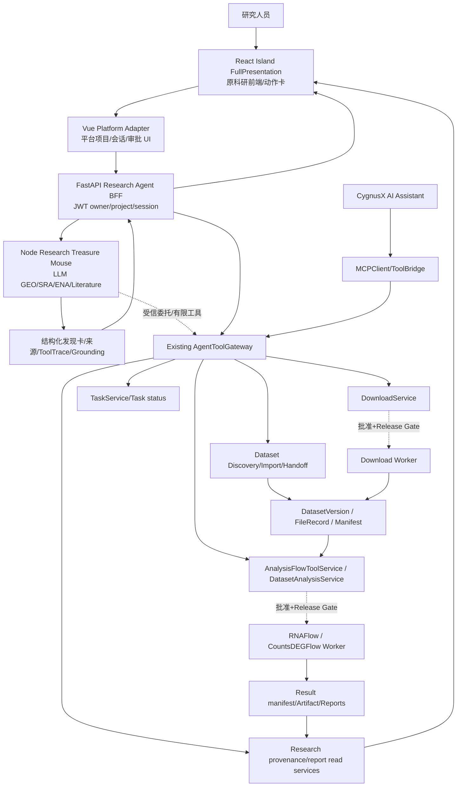
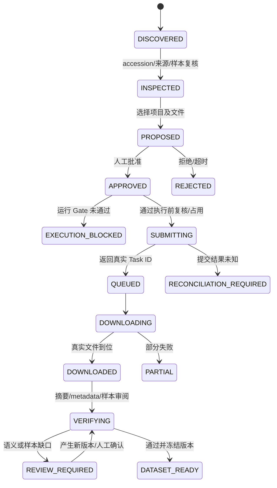
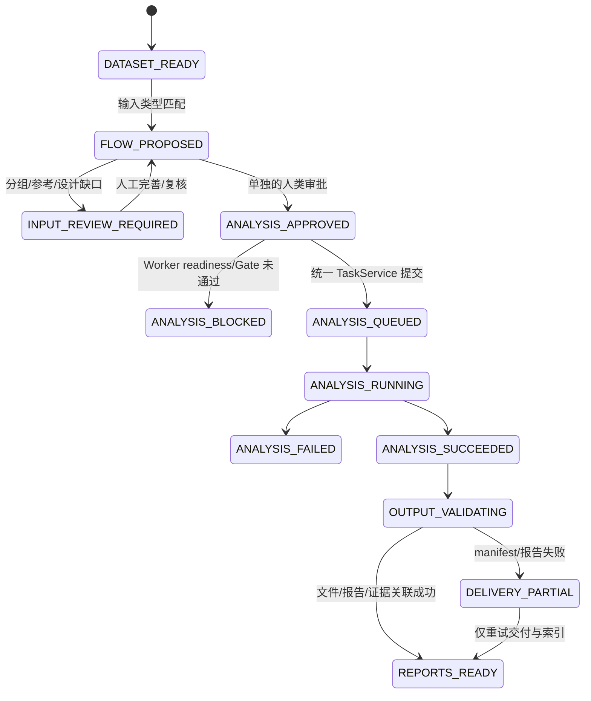
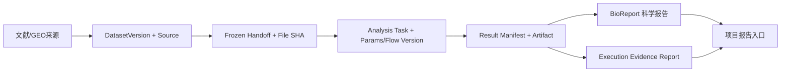

# CygnusX BioOps · 科研寻宝鼠端到端科研工作流实施任务书

> **Research Treasure Mouse → GEO / Literature → Dataset → Download → FlowFrame → Evidence / BioReport**  
> 版本：Implementation Plan v1.0 · 2026-10-16  
> 用途：交给 Codex 的**增量开发与验收依据**，不是已实现功能声明。  
> 当前约束：现有完整 React Island 展示迁移已具备编译与隔离测试证据；真实浏览器、PostgreSQL/Redis/Worker/下载及分析全栈发布验收仍未闭合。

---

## 0. 阅读顺序、事实来源与验收纪律

实施之前必须以当前工作树、服务配置和数据库实际情况复核下述资料；不可机械依赖旧 SHA、旧行号：

1. `treasure-full-presentation-migration.md`（完整 React 展示迁移最新报告）。
2. `docs/audits/cygnusx-treasure-mouse-ui-regression-and-mcp-integration-audit-2026-10-15.md`（旧 UI、403、Gateway、Dataset 与 Worker 断点）。
3. `docs/implementation/`、`docs/audits/` 中 Phase 0A/0B/Closure/1–4 的真实实施报告与活动架构文档。
4. `docs/contracts/cygnusx-dataset-handoff-v1.md` 及匹配的 JSON Schema（若当前工作树确实存在）。
5. 真实 `frontend/`、`src/cygnusx/`、`pipelines/Treasure-Seeking_Mouse/`、`flows/`、`pipelines/CountsDEGFlow/`、`pipelines/RNAFlow/` 的源码。

**事实基线（来自已有实施/调查记录，必须重新核对）：**

- 原展示层 `src/island/FullPresentation.tsx` 已通过 `TreasureOriginalDisplay.vue` 在 Vue 平台嵌入；原 `EmptyState`、`Composer`、`ChatMessage`、`DatasetCard`、`LiteratureCard`、`ToolTrace`、`GroundingNotice`、`DownloadBoostCard`、`SessionSidebar`、桌宠、字体主题等均被复用。
- Node 科研检索内核继续负责 GEO / SRA / ENA / 文献检索；Vue/FastAPI BFF 负责平台身份、项目、会话、SSE 与消息恢复。
- Node 使用可信委托 HTTP callback 访问现有 `AgentToolGateway`；平台 AI 使用 MCPClient/ToolBridge 进入同一业务 Gateway。**不需要**让 React 直接连接 MCP，亦不必强制 Node 支持任意 MCP server。
- 现有 Dataset 七表、GEO Adapter、raw/processed 导入准备、冻结 Handoff、RNAFlow 与 CountsDEGFlow 预案、可复现报告关联已有实现或隔离测试证据；生产 PostgreSQL、Redis、Worker、镜像及结果交付整链仍未全部验收。
- 已有 `WRITE_RUNTIME_ACCEPTED=False`、`worker_paths_verified=false` 等硬门禁。**绝不通过改前端按钮、简单环境变量或绕过确认来开启真实下载/分析。**
- 最新展示迁移：主/子前端构建通过，隔离展示测试及 BFF 测试通过；真实 Chromium 视觉验收未通过/受限；全前端回归仍有存量失败，不能写为全绿。

用以下统一状态描述所有实现：`VERIFIED_CODE`、`PASS_ISOLATED`、`PASS_RUNTIME`、`PASS_E2E`、`BLOCKED`、`NOT_IMPLEMENTED`、`UNKNOWN`。**任何 PASS 都必须写明测试环境和证据。**

## 1. 本轮的产品目标与非目标

### 1.1 用户故事

研究人员在科研寻宝鼠中输入：

> “帮我寻找肝脏病毒感染相关的 bulk RNA-seq 数据，优先有健康对照组；核实文献、样本与测序类型。找到合适数据后帮我准备下载到当前项目，再准备合适的差异表达分析，最终生成科研报告。”

系统的合格交互应为：

1. 检索科研数据和关联论文，显示出处及不可核实的信息。
2. 用户选择一个 GSE/GSM/SRR / 已有 Dataset，查看研究设计、可下载文件、样本关系和引用证据。
3. 对当前项目提出 raw FASTQ 或 GEO processed-data 导入预案，明确预计资源消耗和需要人工审阅的缺口。
4. 经可信的人类操作批准后，在运行门禁满足时创建真实下载任务；在未满足时停留于预案并明确原因。
5. 下载完成后先完成文件登记、哈希、metadata 与样本审阅，形成 `DatasetVersion` 和冻结 `Handoff Manifest`，**不是下载结束即 READY**。
6. 根据数据类型推荐兼容 Flow，产生参数预案；用户确认实验分组、物种、参考、对比组、资源和执行范围。
7. 经**单独的分析执行批准**和运行门禁验证，复用 `TaskService` / FlowFrame 执行，返回真实 Task ID。
8. 状态、结果、科学 BioReport 和执行证据报告从已有记录中可恢复；真实缺失写 `UNKNOWN`/`NOT_GENERATED`。
9. 用户可以从项目管理、寻宝鼠会话、任务中心、结果报告中心互相跳转，能够导出被授权的交付物。

### 1.2 必须保留的旧版体验

`FullPresentation` 的品牌、角色、四大科研探索卡、原 `Composer`、双语/主题、`ChatMessage`、GEO/文献卡、ToolTrace、Grounding、Next Shovel、桌宠、会话栏和 Dialog 不得因新增操作被普通 JSON 面板取代。

新增工具动作应像旧产品的自然延伸：**发现卡上轻量入口 → 侧边/消息内预案卡 → 人工确认 → 任务与报告卡**。页面初始状态仍以“提出科研问题”为视觉中心。

### 1.3 非目标

- 不移植 Node LLM/检索逻辑至 Python；不改写平台已有 Agent Runtime。
- 不建立第二套 DownloadService、TaskService、审批系统、Dataset 数据库体系或 BioReport 渲染引擎。
- 不承诺任意 GSE 均有 FASTQ、原始整数 counts、可用样本分组或可直接分析。
- 不自动把 TPM/FPKM/CPM/变换值交给 DESeq2。
- 不自动为用户作出科学研究设计决定或生成无来源的科研结论。
- 不在本轮强行实现所有组学类型、复杂 batch、单细胞或高维混合模型。
- 不将 CLI 下载提示误认为已执行平台下载。
- 不在运行门禁未闭合时开启真实 Agent 写操作。

## 2. 整体架构：用现有服务形成可执行的科研链路



- **实线：**责任边界及既有接口的预期复用；并非表示整条链路生产已通过。
- **虚线：**需可信审批、依赖运行环境及源码执行门禁的业务动作。
- React 仅发出 `UI Action`，不能持有内部委托密钥、任意路径或原始确认凭证。
- Node 只可发现**经服务器筛选且允许的工具集合**，不得传入自定义 MCP URL/命令或越权 user/project。
- 同一个业务操作必须落到统一 Gateway/Service，不得按“来自寻宝鼠”和“来自 AI 助手”实现两条平行执行链。

### 2.1 一次科研任务的全局关联主键

保持实际模型为权威源，可使用如下概念标识：

`user_id`、`project_id`、`research_session_id`、`message_id`、`discovery_ref`、`dataset_id`、`dataset_version_id`、`import_proposal_id`、`confirmation_record_id`、`tool_invocation_id`、`ingestion_id`、`download_task_id`、`analysis_link_id`、`analysis_task_id`、`report_id`、`artifact_id`。

**不要全建一遍新表**。先形成现有模型/字段对照矩阵；只有无法稳定关联且确有业务需要时才提出最小迁移。

## 3. 统一业务流程与数据状态机

### 3.1 从发现到科研资产的状态



这是**业务视图状态集合**，不应直接覆盖现有 DB enum。Codex 应对照当前 `dataset_ingestions`、`TaskModel`、`DatasetVersion` 的真实状态，用只读投影拼出 UI 语义，不应对多个模型无差别写同一个状态值。

### 3.2 从科研资产到分析及报告的状态



**关键不变量：**分析任务成功 ≠ 报告生成成功 ≠ 完整可复现。报告失败不能触发已成功的分析任务重跑。

### 3.3 准备、审批、执行必须分离

| 操作类别 | 是否要求 Project | 是否创建 Task | 是否模型可直接调用 | 审批 |
|---|---|---|---|---|
| 自然语言检索/文献检索 | 否 | 否 | 可（按只读权限） | 不需要执行审批 |
| 检查 GEO accession/候选文件 | 通用检索可无；持久导入需有 | 否 | 可 | 不需要执行审批 |
| `dataset.prepare_import` | 是 | 否 | 可，受权限限制 | 生成待审批记录 |
| `downloads.prepare` | 是 | 否 | 可，受权限限制 | 生成待审批记录 |
| `analysis.prepare_from_dataset` | 是 | 否 | 可，受权限限制 | 生成独立待审批记录 |
| `approve/deny` | 依据预案 | 否 | **模型不可调用** | 可信用户 JWT 操作 |
| `execute download/import` | 是 | 是 | 仅经 Gate 和受限调用面 | 服务端消费一次性确认 |
| `execute analysis` | 是 | 是 | 仅经 Gate 和受限调用面 | 与下载批准分开 |
| Task、证据、报告查询 | 有资源授权即可 | 否 | 可（只读） | 不需要新审批 |

批准权限不等于执行 readiness；不能因为用户点击“同意”就在未验收 Worker 上尝试真实执行。

---

## 4. 设计权威：数据契约而不是界面临时状态

### 4.1 DiscoveryResult（只读研究线索）

必须无损保留：

- 结果类型（`geo_series`/`geo_sample`/`sra_run`/`bioproject`/`literature` 等可扩展类型）。
- Accession、标题、简介、物种、测序/组学类型、平台、样本规模及不确定性。
- 文献 DOI/PMID、作者、期刊、年份、原始可信 URL；来源链接必须协议/主机校验。
- 样本与实验分组信息及其原始证据片段；不能强行推断健康对照。
- 检索工具/来源、采集时间、证据核验状态、未证实编号、上游缺失标记。
- 原始 `meta`/`cards` 的保留字段及未来版本扩展字段（限安全可持久内容）。

示意 DTO（**设计目标，非宣称当前代码已有同名字段**）：

```ts
interface DiscoveryResultV1 {
  kind: 'geo_series' | 'geo_sample' | 'sra_run' | 'literature' | 'other';
  accession?: string;
  title: string;
  organism?: string | null;
  assay?: string | null;
  sampleCount?: number | null;
  sourceLinks: Array<{kind: string; url: string; label?: string}>;
  publication?: {doi?: string; pmid?: string; authors?: string[]; year?: number};
  grounding?: {status: 'confirmed' | 'unconfirmed' | 'unknown'; gaps: string[]};
  metadata: Record<string, unknown>; // 安全规范化，不丢可验证字段
  evidenceRefs: string[];
}
```

注意 `confirmed` 只代表指定编号/来源层面的检索核验；**不能表示科学结论已被证明。**

### 4.2 前端唯一动作契约

在 `src/island/contract.ts` / FullPresentation 与父平台适配器之间增加稳定的 typed `ResearchAction`，尽量不破坏已有 callbacks：

```ts
type ResearchActionV1 =
  | { type: 'dataset.inspect'; discoveryRef: string }
  | { type: 'dataset.prepare_import'; discoveryRef: string }
  | { type: 'download.prepare'; datasetRef?: string; discoveryRef?: string }
  | { type: 'analysis.list_compatible'; datasetVersionId: string }
  | { type: 'analysis.prepare'; datasetVersionId: string }
  | { type: 'task.open'; taskId: string }
  | { type: 'evidence.open'; evidenceId: string }
  | { type: 'report.open'; reportId: string };
```

以上只传**前端意图或安全资源引用**。服务端每次从认证态及会话关联推导真实 owner/project。未经后端复核，不允许 React/Node 参数中出现可直接执行的绝对服务器路径、`owner_id`、服务内部 token、Redis key 等。

### 4.3 统一 ToolInvocation 视图

已有 Gateway/Invocation 模型优先复用。UI ViewModel 至少包含：

- `invocation_id`（稳定标识）；
- `capability` 和工具显示名；
- `scope`（只读、prepare、需审批 execute）；
- `status`（pending/running/completed/failed/blocked）；
- `session_id/message_id/project_id` 的经过授权关联；
- `proposal_id`、`task_id`、`dataset_version_id` 之一（若实际存在）；
- `created_at/updated_at`、简短错误码、重试建议；
- 不含凭证、完整敏感 payload 和服务内部绝对路径。

要区分 `ToolTrace`（研究工具的过程事件）与 `ToolInvocationCard`（平台业务操作记录）。两者可通过 ID 链接，但不要把 Node 研究检索事件误展示成已创建下载 Task。

### 4.4 DatasetVersion/Handoff（沿用既有规范）

绝不能重做已有七表。输入交接至少依赖：

- 可信 `DatasetVersion` + owner/project。
- 官方来源 accession / URL / 采集响应摘要与时间。
- 真实 `FileRecord`/Asset ID 与 checksum、大小、可访问性。
- 样本表、原始字段、人工分组修订与审阅人。
- 资产类型（FASTQ/raw_counts/TPM/FPKM/Series Matrix/UNKNOWN）。
- 数据质量检查、类型与组学适用性。
- 冻结 Handoff hash 与 worker 路径可用性。
- 与导入任务、分析预案及实际任务的真实引用。

一个 `GSE...` 或一张 `DatasetCard` 不能直接作为 FlowFrame `raw_data_path`。

---

## 5. 工作包 W0：代码基线、Gate 与现有接口对照

### 任务

1. 记录 `git status --short`、`git diff --stat`、`git submodule status --recursive`、主要仓 HEAD/remote、Compose build context、镜像配置及工作树已有变更。
2. 对比当前 `FullPresentation`、`TreasureOriginalDisplay`、父 Vue adapter、Research BFF、Node callback、Gateway、Dataset 以及交付服务的源码。
3. 查找实际功能开关和值：native read、gateway read/prepare、Dataset read/prepare、`WRITE_RUNTIME_ACCEPTED`、`worker_paths_verified` 等；保留已存在的默认关闭策略。
4. 盘点现有 endpoints、工具目录、Schema、DB 字段及事件类型，输出 `Existing / Extend / Not Needed / Blocked`。
5. 查看 403 能力预检、模块权限与当前是否恢复 iframe；**只保留一个生产前端入口**，并留有安全回滚策略。
6. 针对未提交 React 子仓增量/镜像漂移，明确当前拟测试源码来源，不假装生产镜像已包含最新 callback。

### 产出

- `docs/implementation/treasure-e2e-w0-baseline.md`。
- 调用矩阵：`React → Vue → BFF`、`Node → delegated Gateway`、`AI → ToolBridge → Gateway`。
- Gate 表：源码门禁、配置门禁、运行验收、管理员/用户模块权限分别列出。

### 验收 W0

每个拟修改接口均已定位到真实路径/函数，列出“已实现”与“待新增”证据；未解决的准入项明确 BLOCKED。W0 不可自动开启 execute。

## 6. 工作包 W1：发现结果 → 数据集详情（只读）

### 服务层

1. 保留 Node 原始 GEO/SRA/ENA/文献 `TOOL_DEFS` 与检索循环。
2. 使用当前 Node→BFF SSE 的统一事件归并器，确保 `cards`、`delta`、`tool`、`polariseq`、`grounding`、`end` 顺序变化和断流都能正确呈现。
3. 用**单一共享映射器**同时处理实时和持久历史，消除 Browser mapper/BFF mapper 字段不一致；原始 metadata 不允许因 `Proposal` 泛化丢失。
4. 新增/复用 Dataset Inspect：传已验证 accession 或 DiscoveryRef，服务器重新解析官方 GEO/ENA 关联信息，不信任 LLM 生成的下载 URL。
5. 处理一对多：GSE→GSM→SRX→SRR，多个 Run、多个补充文件、研究中无 FASTQ、存在受控访问限制或 429 超时时必须有明确提示。
6. 官方页面链接/DOI/PMID 使用来源类型与安全 URL 策略，不把 GSE 错误指向泛化 BioProject 搜索。
7. 纯检索可以无 Project；一旦持久导入/下载预案需先选当前已授权项目。

### 前端

- 在旧版 `DatasetCard` 中增设 **“查看数据与样本”**，保留原结果卡信息密度。
- 展示原始来源证据与 `grounding gaps`，不要使用“100%可信”等无依据文案。
- `LiteratureCard` 显示 DOI、PMID、可访问文献链接；详情走现有只读 owner BFF。
- `Next Shovel` 仍然用原发送入口追问，不直接创建工作流任务。

### W1 验收

- GEO + 文献 fixture 能正确显示编号、来源、样本、DOI/PMID、grounding。
- 旧版消息、卡片、Next Shovel 与桌宠不回归。
- 实时 cards 和恢复历史的映射结果等价；断流不可误显示成功。
- 多 Run、无 Run、错误 accession、限流和 404 有清晰缺口说明。
- 没有创建下载 Task。

## 7. 工作包 W2：发现结果 → 数据获取/下载预案

### 7.1 原始测序与 processed 两条路径

**raw FASTQ:** 从权威 GEO/ENA 元数据实际展开为 SRR/run，展示每条 Run、单双端、文件、样本归属；不能原样把 GSE/GSM 当 SRR 交给 Rust 下载器。

**processed:** 从 GEO supplementary/Series Matrix 等实际候选中选择文件；列出文件大小、格式、来源与未知字段；**文件名或整数外观不是 raw counts 的可信证明**。

### 7.2 业务调用

1. 优先复用 `DatasetImportService.discover/prepare`、`DownloadService` 和 `AgentToolGateway` 已有 prepare 能力。
2. 如果 `dataset.prepare_import` 与 `downloads.prepare` 作用域重叠，明确职责：前者应绑定科研来源/资产和 DatasetVersion；后者负责下载资源与运输参数。不要在两者间重复创建 Task 或重复审批。
3. `prepare` 创建可恢复的 Proposal/Confirmation 记录，但**不能创建下载队列任务或真正的用户文件**。
4. 预案绑定 owner/project/session/来源摘要/选定文件列表/预计磁盘及网络预算/目标项目存储位置/请求幂等键。
5. 明确区分“来源称文件大小”和“已核实文件大小”；未知大小按上限或人工复核处理。
6. 编辑文件选择、目标项目或预算后，旧审批必须失效或重新生成参数摘要。
7. 下载目标只能是受控项目存储，不允许用户或模型传任意服务器路径。
8. 如果缺项目，UI 引导选项目；不改变纯发现的无项目能力。
9. 预案只生成“供审批的建议”，不是自动执行承诺。

### 7.3 前端交互

在 DatasetCard/相关 Tool Card 中提供：

- `检查可获取文件` → 实际权威来源候选。
- `准备导入项目` → 选择项目与目标 Dataset/新版本。
- `准备下载` → 选择 raw/processed、Run/附件、预算及目录。
- `查看原始证据` → 官方来源及限制信息。

点击“准备下载”显示卡片：

```text
研究来源  GSE...（以真实结果为准）
当前项目  <项目名 / 项目ID>
数据路径  raw FASTQ 或 processed 文件
样本/文件  从权威适配器实际识别
预算      已知大小 / 上限 / 未知
来源校验  已验证 / 待审阅
操作      [保存预案] [申请人工审批]
状态      PREPARED（尚未下载）
```

### W2 验收

- 同一 GSE 多个 SRR 显示多条，不丢 mapping。
- `prepare` 不产生 Task/队列/大文件；重复点击按 request_key 复用或冲突。
- 提示未知文件大小、许可与 metadata 缺口。
- 不支持的 URI scheme/重定向/不可信主机被拒绝。
- 跨用户、跨项目和会话伪造均被拒绝。
- 所有执行操作在 Release Gate 未通过时保持后端拒绝。

## 8. 工作包 W3：审批、可信执行与项目数据资产登记

> **W3 可先实现隔离编排和展示；真实 execute 仅在 Release Gate 达标后受控开放。**

### 8.1 两段式审批

- `PREPARE`：Agent/用户生成带参数摘要和资源预算的预案。
- `DECIDE`：用户在已认证的网页 JWT 接口批准/拒绝；模型工具列表不暴露 approve。
- `EXECUTE`：已有 ToolConfirmationService 复核 approver/owner、能力、参数哈希、TTL、一次性消费、资源权限和运行 Gate。
- 仅批准但因 Worker 未验收被 BLOCKED 时，应保留明确状态，不伪造 Task；恢复后应重新审查是否需要新批准，不得无条件重放已过期确认。

### 8.2 真正执行的前置检查

- 真实用户有效、project 所有权或已实现的授权规则。
- 模块与工具 scopes；可信 delegated context/nonce 与 Redis 可用性。
- 已审批内容未变化；官方来源可用性/预算/剩余配额再查。
- 数据类型与下载器命令相匹配；当前 Worker 真实二进制/镜像 digest 已验证。
- 项目磁盘写路径与 Worker 共享挂载权限已验证。
- 任务幂等唯一键；对不确定是否投递成功的状态**不自动重新提交**。

### 8.3 下载完成后数据登记，不允许“Task success 即 Dataset READY”

真实下载完成后：

1. 下载 Task 状态与真实文件存在性分开核对。
2. FileRegistry 登记文件、大小、存储根、逻辑目录、Task 归属及实测 SHA-256。
3. 按 accession / supplementary 原始来源建立 `DatasetSource`。
4. `DatasetAsset` 绑定 `FileRecord`、下载 Task、类型与用途；发现文件不存在则缺口明确。
5. `DatasetSample` 映射 GSM/SRR/实验组与人工审阅结果；不自动假定 Control/Treatment。
6. 处理 raw/processed、压缩包展开的安全限制，防 ZipSlip、symlink/hardlink、资源炸弹。
7. 校验 metadata/矩阵结构。类型为 UNKNOWN、缺分组、多个混合物种时标记 `REVIEW_REQUIRED`。
8. 经人工核验后创建/冻结 `DatasetVersion`，写 `Handoff Manifest` 与输入文件摘要。
9. 对真实 Worker 路径未验收的版本保持 `worker_paths_verified=false`，不得用于 execute。

### W3 验收

- 审批参数更改、跨 owner、过期、重放、并发使用均拒绝；审批失败没有队列副作用。
- Redis 不可用时写执行失败关闭，不能回退生产进程内存。
- 下载失败+部分文件 → PARTIAL / RECONCILIATION_REQUIRED，不标 READY。
- 文件及 Task 归属完整，重复登记不能产生重复资产或误计费。
- 真实文件 SHA 更新前后不相同应阻止使用旧 Handoff。
- 不主动删除用户原文件或未知部分完成资产。

## 9. 工作包 W4：DatasetVersion → FlowFrame 分析准备

### 9.1 先匹配数据类型和工作流

| 输入数据 | 候选 Flow | 自动准备的前置条件 | 必须拒绝的情况 |
|---|---|---|---|
| FASTQ | 既有 RNAFlow | bulk RNA-seq、真实文件与命名映射、样本/参考/单双端、链特异性等明确 | 矩阵传给 FASTQ 输入、文件缺失或样本对应错误 |
| 原始整数 counts | CountsDEGFlow | 有 raw-counts 处理证据、样本完整、组别/重复、设计矩阵适用 | TPM/FPKM/CPM/log 转换矩阵、未经核验的整数外观 |
| TPM/FPKM/标准化值 | 仅已验证适合的下游探索 Flow（若存在） | 具备真实注册与统计适用性 | 直接 DESeq2 计数模型 |
| Series Matrix | 必须先识别实物及说明 | 明确平台/探针/归一化与适用分析法 | 根据扩展名直接当 counts |
| 单细胞 H5/MTX/H5AD | 仅已注册且认证的单细胞 Flow | 数据和 schema 满足要求 | 仅凭存在 Read10X/文件就声称平台可运行 |

### 9.2 Analysis Prepare 调用

1. 根据受权 `dataset_version_id` 获得冻结 Handoff；复核资产归属与 checksum。
2. 通过 `analysis.list_workflows` 或兼容性发现工具取得**当前真正可用的** Flow，不显示伪装已开放的 catalog 项。
3. 将文件 ID/受控 `directory://`、sample table、对照组、参考和资源预算作为候选输入传给既有 `AnalysisFlowToolService` / `DatasetAnalysisService`。
4. 运行统一 `FlowSubmissionValidator`，检查 Flow Schema、样本唯一性、对比组合法性、路径归属及必填字段。
5. 借助平台已有参数表单组件显示人工需要确认的信息；**模型可以建议，但不可默默指定生物学分组与 reference**。
6. `prepare` 只生成持久分析预案、`DatasetAnalysisLink` 和待审批记录，不创建 Task。
7. DatasetVersion 修订、文件哈希变化或样本分组变化时，旧分析预案与确认无效，需要新版本重新准备。

### 9.3 UI 卡片

```text
分析预案 / 尚未开始运行
数据集版本     DatasetVersion vN
兼容 Flow       RNAFlow / CountsDEGFlow（真实已注册）
数据类型        FASTQ / 原始 raw counts
样本与分组      已核验 / 需要人工补全
参考与方法      待确认 / 当前建议
执行资源        预估 / 默认值（标注来源）
复现输入        Frozen Handoff SHA-256
操作            [编辑分析参数] [检查配置] [请求审批]
```

### W4 验收

- FASTQ→RNAFlow 与 raw-counts→CountsDEGFlow 只在数据适用时匹配。
- TPM/FPKM/UNKNOWN 被明确阻止进入 DESeq2。
- 缺少生物学重复、设计混淆或无残余自由度的情况正确拒绝或要求人工复核。
- TaskService 最终校验与 AI prepare 使用同一个权威后端验证门，REST 不能旁路。
- 未验证 Worker 挂载、镜像或输入文件时，执行 Gate 拒绝但预案仍可查看。

## 10. 工作包 W5：分析批准 → 受控执行 → 任务追踪

### 10.1 分析审批与下载审批必须分开

下载批准只授权下载指定文件到指定项目。分析批准必须绑定：

- `dataset_version_id` / Handoff hash。
- `flow_id`、配置与参数摘要。
- 样本表、对比组、参考与输入资产引用。
- 估计资源预算、操作类别。
- 当前用户与项目。
- 确认记录、TTL 和唯一幂等键。

审批后仍在真正提交的 `TaskService` 边界二次验证。

### 10.2 复用已有执行服务

- 不直接让 React/Node 调 Celery/CLI。
- Gateway 经过已有业务 Adapter → `AnalysisFlowToolService` → `TaskService.submit`。
- 引擎选择、YAML/CSV 构建、任务队列、Worker、Result Manifest 属于现有 FlowFrame/TaskService 的职责。
- 使用后端实际返回的 `task_id` 建立 `DatasetAnalysisLink`、ToolInvocation、Chat Session 的引用。
- idempotency_key 经 TaskService 持续使用；不因为前端重试生成第二个 Task。
- 真实 `queued/running/succeeded/failed/cancelled` 必须从后台持久任务查询，不能根据 LLM 发言推断。

### 10.3 Task 卡状态

- `PREPARED`：尚无 Task ID。
- `APPROVED / WAITING_GATE`：用户批准，但真实 execute 未开放或检查未通过。
- `QUEUED / RUNNING`：存在真实 Task ID 和对应状态。
- `SUCCEEDED`：分析 Task 成功，但报告可能未交付。
- `DELIVERY_PARTIAL`：结果在、报告/索引失败，可以单独重试交付。
- `FAILED / RECONCILIATION_REQUIRED`：具体错误、人工恢复入口，不自动重算。

在消息中展示 Task Card，并复用任务中心的详情 URL；用户离开会话、刷新或切项目可从持久化引用恢复状态。

### W5 验收

- 两次快速点击、网络中断重试、审批 TTL 和 Redis CAS 并发最多创建一次业务任务。
- 同一预案参数变化必须重新批准；跨 owner/query Project 的 Task ID 查询拒绝。
- 会话取消只取消聊天，不擅自取消已排队/运行的下载分析任务。
- 任务失败/失联明确；不虚构进度百分比。
- Worker/队列没有验收时只通过模拟/隔离级测试，不宣称运行成功。

## 11. 工作包 W6：科学结果、证据报告与项目交付

### 11.1 两类报告的职责

**科学分析报告（BioReport）：** 生信 QC、表达/差异/富集结果、图表、方法说明，受实际 Flow/模块支持范围限制。

**执行证据/可复现报告：** DatasetVersion、原始来源、文件哈希、Flow/config、执行软件版本、任务与产物、缺失项、环境证据与重现性声明。

两者不是同一个报告的两种名称，应该共享 Project/Task 关联但可以单独成功、失败和重试。

### 11.2 输出绑定与报告读取

1. 分析真正成功后读取真实 result manifest 和已登记产物。
2. 通过现有 ReportService、ResearchExecutionBinding/Provenance、ReportGenerationJob（如当前存在且已核验）关联 `DatasetVersion → Task → Result → Report`。
3. 输出文件 hash、报告版本、生成时间、适用性和缺失证据状态。
4. 科学报告与证据报告生成/渲染失败时仅重试交付 Job，不重复执行 RNAFlow/CountsDEGFlow。
5. 原版寻宝鼠结果卡中显示：`查看科学报告`、`查看执行证据`、`打开项目报告中心`、`下载已授权文件`。
6. 实际下载文件经平台授权路由，不构造任意本地绝对路径；不曝光他人结果。
7. 如当前项目报告导出仍只是设计方案，不要当作已实现按钮；列为待接能力/依赖后续 Phase 6。

### 11.3 可追溯闭环



此图表示目标关联；只有通过实际数据/DB/Worker/报告验收的链路才能在运行报告中标记通过。

### W6 验收

- 报告从 `task_id` 可定位，任务从报告能反向追溯到 DatasetVersion 与官方来源。
- 文件摘要/manifest/hash 不一致时阻止宣称“证据完整”。
- BioReport 不存在或失败时明确“尚未生成/生成失败”，而不是模型编造结论。
- 科学报告与执行证据报告能独立重试，不重算已完成分析。
- 跨用户报告/下载全部拒绝，无权限时不泄露文件元数据。

---

## 12. 工作包 W7：React Island 与 Vue 的完整 UX 集成

### 12.1 保留原版展示，业务卡为增强而非替代

- `FullPresentation` 继续作为唯一科研展示树。
- Vue Shell 仅提供项目、认证、会话、模型、审批和平台路由能力；没有第二套 Markdown/科研卡渲染器。
- `DatasetCard` 中集成轻量动作；复杂文件选择、分组和表单建议使用原风格 Dialog 或经过适配的 Vue Card Slot。
- ToolTrace 继续展示原 Node 检索过程；平台写预案和真实 Task 单独展示，避免重复和错判。
- 欢迎页和 4 个场景不应被下载表单、项目工作流大卡挤占。
- 文献结果原则上先用于证据核验和追溯，不能仅凭论文提及 accession 即触发未经确认的下载。

### 12.2 最小关键界面

1. **发现页：**四个原场景和问题输入。
2. **数据集结果：**GEO/文献/metadata/grounding + `检查文件`/`准备导入`。
3. **导入预案：**项目、文件/Run、数据类型、大小/预算、授权限制、缺口。
4. **审批卡：**参数摘要、批准/拒绝（平台 JWT）、有效期；模型无 approve 工具。
5. **数据资产卡：**真实 DatasetVersion、sample review 和冻结 Handoff 状态。
6. **分析预案卡：**Flow 匹配、实验设计、人审字段、资源、校验结论。
7. **Task 卡：**Task ID/状态/日志/打开任务中心。
8. **报告卡：**科学报告、执行证据报告、文件下载与缺口。

### 12.3 不可用状态要诚实

- 无项目：允许研究发现，项目导入需先选项目。
- 写 Gate 关闭：可以查看/准备，执行明确“当前环境未通过安全运行验收”。
- Redis 故障：申请审批或提交失败关闭，显示可重试但不允许自动重放危险副作用。
- Worker 路径不可用：数据就绪与“可以真正运行分析”分开提示。
- 没有匹配 Flow：不显示“立即分析”，展示原因和后续可能的处理方法。
- 报告尚无：显示真实未生成状态，不能显示占位下载链接。

### 12.4 实时与历史一致性

统一 SSE reducer / persisted DTO 投影：

- Delta、Card、Grounding、ToolTrace、PlatformTool、Proposal、Task、Report 各有稳定标识。
- 分块 UTF-8、多行 SSE、CRLF、末帧缺失、工具事件重复、Cards 重复时行为确定。
- 不展示因旧会话/旧项目晚到造成的内容；项目快速切换有 generation/abort guard。
- 会话归档、重命名、刷新恢复、消息断流、中断后继续查看历史均与 owner/project 权限一致。
- 浏览器未通过真实视觉验收前，仍应标记 `VISUAL_REVIEW_PENDING`。

### W7 验收

- 原视觉资源、四场景、桌宠、主题、双语保留。
- React Island 浏览器截图与旧基准对照；ShadowRoot CSS 不污染其他 Vue 页。
- 通用聊天框不会替换原 ChatMessage/DatasetCard。
- 对话内提案、审批、Task、报告页面入口清晰，窄屏可用。
- P1 既有功能回归测试通过；真实浏览器若受沙箱限制不得虚报 PASS。

## 13. 工作包 W8：真实运行准入与发布检查（独立 Gate）

> 这些不是“改个 feature flag”就能放开的功能。必须在**有权限、非生产、隔离**环境拿到证据。

| Gate | 要验什么 | 通过证据 | 失败后的行为 |
|---|---|---|---|
| RG-01 | 当前源码 SHA、子仓 SHA、镜像 tag、digest 与运行容器一致 | `docker inspect`/镜像构建标签/commit 对照 | 禁用相应真实写工具 |
| RG-02 | Polariseq/EBIDownload Worker 真实二进制及参数匹配 | 容器内版本、hash、safe --help、命令契约 | 拒绝真实下载 |
| RG-03 | RNAFlow/CountsDEGFlow 真实 Worker 运行时与挂载 | Worker 内 Snakemake/R/工具、Snakefile、输入路径 | 只允许分析 prepare |
| RG-04 | PostgreSQL 真实迁移和用户/项目约束 | 隔离 PG migration/并发/rollback 验收 | 不开放新 Dataset 写 |
| RG-05 | Redis CAS、TTL、重放、双进程与故障恢复 | 真实 Redis 两独立消费者测试 | 审批写操作 fail-closed |
| RG-06 | MCP/受信 Node callback 的真实 Transport 与委托 | Client↔Server、token/owner/nonce、安全负例 | 禁用对应工具 |
| RG-07 | 双用户双项目完整鉴权链 | UI/BFF/Gateway/Task/Report end-to-end 权限测试 | 拒绝共享写能力 |
| RG-08 | 文件下载安全、预算、断链/重定向/归属 | 小型公开/本地测试文件与 Worker 结果 | 只允许准备预案 |
| RG-09 | 下载→Asset→DatasetVersion→Handoff | 真实文件 SHA/Task/DB/file owner 关联 | 不提升 DATASET_READY |
| RG-10 | 分析→真实 Task→Result Manifest | 小型 FASTQ 或有证据的 counts 用例 | 不开放自动分析执行 |
| RG-11 | 科学与执行报告真实生成和下载 | 报告服务运行、文件校验/权限/失败恢复 | 不声称报告交付闭环 |
| RG-12 | React Island 真实浏览器视觉与交互 | 桌面/移动/主题/中英截图、焦点/溢出/字体 | 前端不得标视觉最终通过 |

**准入结果：**

- `READ_ONLY_READY`：可信只读发现与 Project/Session 关联通过；仅只读。
- `PREPARE_READY`：所有 prepare 的服务/权限/存储前置满足，可以提供下载和分析建议及审批请求，但**仍不可执行**。
- `EXECUTION_READY`：RG-01–10 中对应操作的必需 Gate 全部通过，按工具、项目、环境最小范围逐项放行；不能笼统打开所有工具。
- `DELIVERY_READY`：真实结果/证据/BioReport RG-11 通过，才宣称端到端报告交付。
- `UI_RELEASE_READY`：RG-12 与前端相关门禁达标。

若环境受限，只能交付测试脚本/日志并标 `BLOCKED`；不能以模拟任务成功作为真运行证据。即便技术 Gate 全部通过，生产发布仍需独立部署审批。

---

## 14. 工具目录与后端接口的最小变更矩阵

> **下表为 Codex 调查与接入指引，不是当前 API 已经全部存在的断言。** 优先复用同名已有工具；工具和 Route 的精确名称以仓库当前 Schema 为准。

| 用户动作 | 首选已有能力 | 预期响应 | 缺口处理 |
|---|---|---|---|
| 发现 GEO/文献 | Node 既有科研工具 | Discovery cards/grounding | 保留原 ToolTrace，不替换检索内核 |
| 检查数据集 | Dataset discover/inspect、GEO Adapter | source、GSM/SRX/SRR、文件候选 | 扩展 adapter/DTO，不能让模型编造 URL |
| 选择导入项目 | DatasetImportService.prepare | proposal / readiness / confirmation | BFF/UI 补 project/session 可靠关联 |
| 下载参数准备 | Gateway downloads.prepare / DownloadService 的 dry_run | 预算、文件、目标、审批请求 | 消除 overlap，保证 prepare 无下载副作用 |
| 人类审批 | 现有 JWT-only confirm/decide | approved/denied/expired | 禁止模型 approve、校验参数 hash |
| 真实下载 | 既有 DownloadService.submit | 真 Task ID 或阻断状态 | Gate 未过继续拒绝，不新建 Worker |
| 注册 DatasetVersion | Dataset/FileRegistry/Sample/Handoff | version/asset/source/checksum/review | 下载 Task 与科学 READY 分离 |
| 兼容 Flow | AnalysisFlowToolService 或 DatasetAnalysisService | 可用 Flow/缺口 | 不将未认证 catalog 当 READY |
| 准备分析 | `analysis.prepare_from_dataset` 或当前同义能力 | validated proposal/approval | 固定 Handoff/样本/设计/路径 |
| 真实分析执行 | TaskService.submit | 真 Task ID 或阻断 | 最终统一参数/文件验证 |
| 查询任务 | tasks.get_status/list_related/owner TaskService | 真实状态和可跳转引用 | 不凭模型文字补进度 |
| 查询产物证据 | Research Provenance/ReportService | authorized artifact/report refs | 不重新渲染不存在的报告 |

### 14.1 API 设计约束（如确需补路由）

- 复用当前 `/api/v1/research-agent/`、`/api/v1/agent-tools/`、Dataset、Task、Report 路由命名，不为前端另建第二套 `/treasure/execute/...` 无鉴权接口。
- 使用后端已有 Pydantic Schema、统一错误码和 `CurrentUserId` / JWT-only approve。
- **任何写工具最终必须经过平台 Service，而非 Nginx/Node 直接把任意业务 URL 透传。**
- 查询必须 owner/project 检查；Context 从已认证 session 获取，模型不能声明用户拥有某项目。
- 对话发起的 Proposal 持久化关联 conversation；手动 DataWorkspace prepare 也应在有会话上下文时正确关联或明确标记非会话操作。
- 大任务返回 202 或现有等价语义与真实 ID；错误返回稳定 code，例如 `FEATURE_DISABLED`/`APPROVAL_REQUIRED`/`WORKER_NOT_READY`/`RECONCILIATION_REQUIRED`，名称以已有错误规范为准。
- 客户端不得自动重试有副作用的 submit；只读请求可按现有策略安全重试。

### 14.2 建议保留的事件类别

```text
research.delta
research.card
research.tool.trace
research.grounding
research.followup
platform.tool.invocation
platform.dataset.proposal
platform.download.proposal
platform.analysis.proposal
platform.approval.status
platform.task.reference
platform.task.status
platform.report.reference
research.end
research.error
```

这是**逻辑事件名示例**，实施时优先映射现有 `delta/tool/cards/grounding/polariseq/end` 与平台 Tool/Event 模型，而不是随意同时创建一整套新的 SSE 协议。必须定义事件版本、兼容投影、幂等去重、结束事件与恢复机制。

## 15. 关键错误与恢复矩阵

| 情况 | UI 应显示 | 服务端处理 | 禁止行为 |
|---|---|---|---|
| `FEATURE_DISABLED` | “科研入口当前未启用” + 管理提示 | capabilities 预检 | 直接原始 Axios 错误灌聊天 |
| 无 Project | “只读发现可继续；导入/分析请选择项目” | 无项目只读允许，写预案要求项目 | 自动创建虚假项目 |
| GEO 查无 Run | “只有 processed 或暂无可用原始文件” | 保留真实证据缺口 | 虚构 FASTQ |
| API 429/超时 | “来源暂不可用” + 安全重试 | 限流/有界重试 | 无界请求/伪造结果 |
| 非 raw counts | “不适用于 counts-only DEG” | Flow 兼容拒绝 | 送入 DESeq2 |
| 样本分组不明 | “需要人工审阅分组” | 标 REVIEW_REQUIRED | 模型猜 Control |
| 确认过期/篡改 | “请重新审阅预案” | 拒绝消费 | 使用布尔确认绕过 |
| Redis 故障 | “暂不能批准或执行” | fail-closed | 内存审批自动放行 |
| Worker 不可用 | “预案可保存，执行未就绪” | Gate 拒绝提交 | 前端启用就硬启动 |
| 下载部分成功 | “部分文件需人工对账” | PARTIAL / reconcile | 标 READY/自动重下 |
| 任务投递不确定 | “任务状态待对账” | SUBMITTING/RECONCILIATION_REQUIRED | 重放重复计算 |
| 报告渲染失败 | “分析完成，报告交付失败” | 重试 Report Job | 重跑分析 |
| 切换项目或会话 | 清理旧临时展示并重新载入 | generation/owner guard | 混入其他项目消息 |

---

## 16. 具体测试计划（T01–T45）

### A. 科研发现与展示

| ID | 测试 | 必须通过的结果 |
|---|---|---|
| T01 | GEO、文献混合卡 | 类型、编号、doi/pmid、meta 与来源完整 |
| T02 | 原版四场景/示例 | 能从原 Composer 正确发出问题 |
| T03 | Grounding 缺失编号 | 恰当显示具体缺口，不泛化成“已验证” |
| T04 | Next Shovel | 点击产生新一轮查询而非隐藏文本 |
| T05 | SSE 分块/CRLF/多行 | 字符正确且不丢 end/cards |
| T06 | SSE 缺终态/中断 | 保留部分消息，绝不展示成功 |
| T07 | 即时与历史投影 | 同卡字段与 ToolTrace 不发生有损差异 |
| T08 | DOI、GSE/GSM 链接 | 类型匹配，HTTP(S)/可信主机策略 |
| T09 | 桌宠/主题/国际化 | 原 UI 不回归，ShadowRoot 不泄漏样式 |
| T10 | 浏览器 4 视口×2 主题×2 语言 | 无溢出，Dialog 键盘/焦点正确；受限标 BLOCKED |

### B. 安全上下文与工具接入

| ID | 测试 | 必须通过的结果 |
|---|---|---|
| T11 | 全局只读检索无 project | 不应误触发 422/403 |
| T12 | 项目列表延迟乱序 | 旧项目响应不覆盖当前项目 |
| T13 | 跨用户/跨项目 Dataset | 查询/挂接/prepare 拒绝 |
| T14 | 不可信 Node 参数 owner/project | 服务器重新派生身份，伪造无效 |
| T15 | 模型接收委托 token | 不可见；未授权工具不在目录 |
| T16 | Node callback URL/命令注入 | 只能固定 endpoint 和受控 schema |
| T17 | Redis 委托 nonce 重放 | 第二次拒绝、故障时拒绝 |
| T18 | Tool Catalog 对称性 | 寻宝鼠与平台 AI 使用同一业务 Adapter |
| T19 | 403 功能开关关闭 | capability 友好提示，不发不必要受限请求 |
| T20 | 模块禁用直接 BFF 请求 | 后端真实拒绝，不靠 Vue 菜单隐藏 |

### C. 发现/下载/资产

| ID | 测试 | 必须通过的结果 |
|---|---|---|
| T21 | GSE→多 GSM/SRR | Run 和样本映射正确展开 |
| T22 | 无 FASTQ 的 GSE | 明确缺失，不伪造文件 |
| T23 | GEO processed 候选 | 从权威附件而非猜 URL |
| T24 | 原始文件/预算准备 | 无 Task、无目录/队列副作用 |
| T25 | 预案重复点击 | 幂等或明确冲突，不重复提交 |
| T26 | 修改文件/目标后旧审批 | 参数摘要不符拒绝 |
| T27 | JWT 用户批准、API Key/模型自批 | 只允许可信批准 |
| T28 | Gate 关闭仍点击 execute | 后端拒绝、无业务 Task |
| T29 | 跨 owner 文件/符号链接 | 拒绝，无文件覆盖/泄露 |
| T30 | 下载有文件但部分失败 | PARTIAL/待对账，不 DATASET_READY |
| T31 | checksum/来源/样本审阅 | 真实 FileRecord→Version/Handoff 关联 |
| T32 | 非法 ZIP/TAR/GZ | 路径穿越、炸弹、链接拒绝 |

### D. Flow、任务与报告

| ID | 测试 | 必须通过的结果 |
|---|---|---|
| T33 | FASTQ→RNAFlow Prepare | 文件、样本、参考校验，尚无 Task |
| T34 | raw counts→Counts Prepare | 有来源、重复、设计合法，尚无 Task |
| T35 | TPM/FPKM/log/UNKNOWN | 阻止 DESeq2 类 raw counts 分析 |
| T36 | 冻结 Handoff 输入变更 | 原预案失效，不运行 |
| T37 | 独立分析审批 | 下载批准无法授权分析执行 |
| T38 | TaskService 最终参数校验 | REST/Agent/MCP 同步拒非法输入 |
| T39 | 分析 execute 运行门禁 | 未验收 Worker 时不能建 Task |
| T40 | 并发 submit/idempotency | 最多创建一次合法业务 Task |
| T41 | 真实 Task ID 状态恢复 | 刷新、重连、项目切换后正确查询 |
| T42 | 报告无产物/缺证据 | 明确未生成/不完整，不造结果 |
| T43 | 报告失败后重试 | 只重试交付，不重跑 Flow |
| T44 | 跨 owner 报告/资产下载 | 完全拒绝且不泄露元数据 |
| T45 | 小型真实科研 E2E | 在合规隔离环境从真实来源走到两个报告，留下可核验证据 |

`T45` 必须标清数据来源、样本设计、版本、校验值、环境、耗时、任务 ID、报告 hash；否则不得声明端到端真实通过。

## 17. 里程碑与发布门禁（M0–M7）

| 里程碑 | 目标 | 可在受限环境完成？ | 依赖 |
|---|---|---|---|
| M0 | Baseline/Gate/接口审计 | 是 | 无 |
| M1 | 完整发现卡→只读 inspect | 是，fixture/隔离 | M0 |
| M2 | Dataset 导入与下载预案 | 是，隔离可做 | M1 |
| M3 | 前端审批卡与执行拒绝态 | 是，隔离可做 | M2 |
| M4 | DatasetVersion/Handoff→分析 prepare | 是，合成/隔离 | M2 |
| M5 | Task/Artifact/Report 只读状态与导航 | 是，已有记录/fixture | M3/M4 |
| M6 | 非生产真实 Redis/PG/Worker/Gateway/Browser 门禁 | 否，需对应环境 | M0–M5 |
| M7 | 小型公开数据真正下载→分析→报告 | 否，需所有操作对应 Gate | M6 |

M0–M5 可以和运行环境 Closure 并行开发，但不得把完成它们当作 M6/M7 通过。建议每完成一个里程碑输出最小实施记录和增量测试日志。

## 18. 预计代码触及位置（仅作为定位起点）

> 路径与函数以最新源码为准；这里列出报告中已经定位的模块，以防 Codex 重建重复代码。

### 主前端 / React 子仓

- `pipelines/Treasure-Seeking_Mouse/src/island/contract.ts`
- `pipelines/Treasure-Seeking_Mouse/src/island/FullPresentation.tsx`
- `pipelines/Treasure-Seeking_Mouse/src/components/chat/EmptyState.tsx`
- `pipelines/Treasure-Seeking_Mouse/src/components/chat/ChatMessage.tsx`
- `pipelines/Treasure-Seeking_Mouse/src/components/chat/DatasetCard.tsx`
- `pipelines/Treasure-Seeking_Mouse/src/components/chat/ToolTrace.tsx`
- `pipelines/Treasure-Seeking_Mouse/src/components/chat/GroundingNotice.tsx`
- `pipelines/Treasure-Seeking_Mouse/src/components/chat/DownloadBoostCard.tsx`
- `frontend/src/` 中 `TreasureOriginalDisplay.vue`、Project/Session adapter、DatasetWorkspace、DiscoveryProposalCard、AgentToolPanel 与现有 API Client。
- 子仓 Node `functions/seqout-chat/index.ts` 与已存在 `platform-tools.ts`，只在确认有实际 adapter 缺口时最小调整。

### 后端 / 数据 / 执行

- `src/cygnusx/api/v1/research_agent.py`
- `src/cygnusx/application/services/research_treasure_service.py`
- `src/cygnusx/application/services/agent_tool_gateway.py`
- `src/cygnusx/application/services/agent_tool_delegation.py`
- `src/cygnusx/application/schemas/agent_tools.py`
- `src/cygnusx/application/services/dataset_import_service.py`
- `src/cygnusx/application/services/dataset_analysis_service.py`
- `src/cygnusx/application/services/dataset_handoff_service.py`
- `src/cygnusx/application/services/analysis_flow_tool_service.py`
- `src/cygnusx/application/services/download_service.py`
- `src/cygnusx/application/services/tool_confirmation_service.py`
- `src/cygnusx/application/services/task_service.py`
- `src/cygnusx/domain/flow/submission_validator.py`
- `src/cygnusx/infrastructure/geo/adapter.py`
- `src/cygnusx/infrastructure/database/models/dataset.py`
- 现有 ResearchProvenance、ReportService、Report/Artifact/Result Manifest 关联实现。

### 不要随意触碰

- 原 Node GEO/文献检索算法、未涉本任务的 LLM Prompt。
- RNAFlow/CountsDEGFlow 统计内核及参考实现（除真实错误修复）。
- 旧 Supabase/auth/guest history/SPA Router（不能重新导入）。
- 与本轮无关的项目 UI、agent-teams、已有报告算法。
- 生产镜像、凭据、数据库、真实 Celery Worker；需单独部署授权。

## 19. 工程安全规范与回滚

1. 首先记录并保护脏工作树；不允许 `reset --hard`、`clean`、随意 checkout/stash 破坏现有代码。
2. 只新增必要 schema/adapter/card/test，优先复用存在的 API 与契约。
3. 如果确需数据库迁移，先给出设计评审、兼容/备份/回滚，在隔离 PG 验收前不可生产执行。
4. 严禁把外部模型/文献文本当作指令获得额外工具权限（提示注入防护）。
5. 业务错误要返回稳定 error code / trace_id，不能将原始敏感异常、Token、临时文件绝对路径暴露给浏览器。
6. 对有副作用请求使用幂等/事务占位、一次性确认、明确恢复步骤，不自动重播不确定的 POST。
7. 回滚 UI/tool adapter 时不删除用户已产生的 FileRecord、DatasetVersion、Task、Report、证据和文件。
8. 先按本轮独立修改 hunk 回退，不能因为工作树混有历史改动而整文件撤销。
9. 运行门禁回滚应选择**关闭写工具、保留只读和现有证据**，不能回滚到 `user_confirmed=True` 或进程内确认回退。

## 20. 最终交付物和验收报告模板

交付（或遵循仓库现有规范的等效文件）：

```text
docs/implementation/treasure-mouse-e2e-research-workflow-implementation.md
docs/contracts/treasure-research-actions-v1.md
docs/contracts/treasure-research-event-projection-v1.md
docs/adr/treasure-agent-shared-tools-and-delivery.md
docs/audits/treasure-e2e-release-gates.md
evidence/treasure-e2e/  # 本地测试证据，不作为产品构建输入
```

实施报告至少包含：

1. Executive Summary：按 M0–M7 状态描述，不合并隔离 PASS 与真实运行 PASS。
2. 实际版本/镜像/子仓/工作树 baseline。
3. 复用与新增能力矩阵；旧工具不重复建。
4. 完整调用链和身份授权边界图。
5. UI 变更与旧版视觉保留矩阵。
6. JSON/TS/Pydantic 契约及前后端 Schema 一致性。
7. GEO→下载→DatasetVersion→Flow→Task→Report 对应 ID/状态/证据。
8. 安全测试（越权、审批、nonce、幂等、prompt injection、路径逃逸）。
9. 功能测试（T01–T45），执行命令、数值、PASS/FAIL/BLOCKED/SKIPPED。
10. Runtime Gate RG-01–RG-12；未通过的明确阻断。
11. 修改文件/行号、未提交改动保护、回滚及恢复手册。
12. 真正可以演示的已实现功能，不能演示但有代码的功能，以及剩余 P0/P1。

**最终状态必须分别输出：**

- `DISCOVERY_READY`：是/否及证据。
- `PREPARE_READY`：是/否及证据。
- `APPROVAL_READY`：是/否及证据。
- `DOWNLOAD_EXECUTION_READY`：是/否及证据。
- `ANALYSIS_EXECUTION_READY`：是/否及证据。
- `REPORT_DELIVERY_READY`：是/否及证据。
- `VISUAL_RELEASE_READY`：是/否及证据。

不能用一个笼统 `READY` 覆盖全部能力。

---

# 附录 A：可直接交给 Codex 的总控实施提示词

> 将本 Markdown 放到 Codex 工作区，发送如下内容。**按 Gate 顺序进行增量实施，不允许受阻时转而绕过执行门禁。**

```text
# CygnusX BioOps · Treasure Mouse End-to-End Research Workflow Integration

请完整阅读附件《CygnusX BioOps · 科研寻宝鼠端到端科研工作流实施任务书》。

本轮核心目标不是改写寻宝鼠前端，也不是再建 Agent 或 MCP Server；而是在现有 FullPresentation / React Island 上增量实现：

GEO 与文献发现 → 数据集详情核验 → Dataset/Download Prepare → 人工审批 → 已授权执行 → DatasetVersion/Handoff → FlowFrame 分析 Prepare → 单独人工审批 → 已授权分析执行 → 真实 Task/Artifact/BioReport/执行证据报告。

首先执行 W0，复核当前工作树、源码 Gate、真实现有服务/Tool Catalog，并逐项对照当前实现与待补缺口。只有确认没有重复建设风险后再逐阶段修改。

W1：保留 Node GEO/SRA/ENA/文献检索、FullPresentation、原 DatasetCard/LiteratureCard/ToolTrace/Grounding/Next Shovel；接通无损发现结果和只读 Dataset Inspect。

W2：利用现有 GEO Adapter、DatasetImportService、DownloadService 和 AgentToolGateway，实现受控 Import/Download Prepare 卡、文件候选、样本证据、项目选择和资源预算。不创建真实下载 Task。

W3：复用 ToolConfirmationService 的 JWT 人工批准、参数 hash/TTL/CAS/一次性消费；完善导入状态和 DatasetVersion/FileRecord/Handoff 关联。未经真实 Release Gate，execute 必须在服务端拒绝。

W4：基于冻结的 DatasetVersion，使用已有 Flow Schema/AnalysisFlowToolService/DatasetAnalysisService 生成 RNAFlow 或 CountsDEGFlow 分析预案。严禁未经证实的 counts/TPM/FPKM 直接进入 DESeq2。

W5：复用 TaskService 与现有 Worker 接口，按独立的分析审批执行；将真实 Task ID 与 Dataset/Session/Invocation 关联，支持错误、恢复和幂等。运行 Gate 未通过时只完成隔离测试与拒绝态。

W6：复用已有 Research Provenance、ReportService 和 BioReport，建立真实 Input→Task→Result→Scientific Report/Execution Evidence 报告链接。报告失败不重跑分析，不创造虚假统计或下载地址。

W7：在原 React Island 科研卡片自然融合工具动作、预案审批、Task 与报告卡。保持四大科研场景、旧品牌、角色、双语、主题、桌宠和完整回复能力。平台 Token/内部委托不能交给 React；旧独立登录/Router 不可恢复。

W8：单独对 RG-01–RG-12 验收；真实 Redis、PostgreSQL、MCP/Node callback、Worker、镜像版本、文件存储和小型科研 E2E 没有通过时，严禁放开下载及分析写操作。

要求：
1. 复用现有 AgentToolGateway、MCPClient/ToolBridge、DatasetImportService、DownloadService、AnalysisFlowToolService、TaskService、ToolConfirmationService、DatasetVersion/Handoff、ReportService。
2. React Island 只发布安全 typed callbacks；所有身份、项目与授权从 BFF 后端可信上下文派生。
3. 同一个业务调用由寻宝鼠和平台 AI 共享同一真实服务与最终校验。
4. 每完成一个里程碑执行对应 T01–T45 测试，提供真实命令和证据；禁止将 Mock/DOM 测试写成生产 E2E。
5. 先检查现有未提交成果，禁止 git reset/clean/push，未经允许不提交、部署、迁移生产库或运行大型下载/分析。
6. 现有 WRITE_RUNTIME_ACCEPTED=False 和 worker_paths_verified=false 等安全执行门禁必须保持，除非对应 Gate 真正验收并获单独授权。
7. 交付实施报告、工具调用契约、事件与历史投影契约、UI 回归矩阵、完整 T/RG 门禁测试结果、真实剩余阻断和回滚策略。

建议的执行策略：W0→W1→W2→W4→W7（只读+Prepare UI）先形成可演示的安全 MVP，W3/W5/W6 的真实执行和交付依赖 W8 对应 Gate 批准。不要为实现“全流程”而伪造成功状态。

现在从 W0 开始，先输出当前可复用能力与缺口矩阵和简短实施计划，随后在安全允许范围内逐项实现、测试并交付。
```

# 附录 B：阶段性 Codex 指令（需要把风险降低时使用）

## B1 · 只读发现与卡片无损接入（W0+W1）

```text
在当前 FullPresentation 迁移成果上，完成 W0 基线核对和 W1 的只读 GEO/文献→Dataset Inspect。保留所有原组件和 SSE/history 无损字段映射；修复跨项目与 403 可诊断问题，但不开放 Agent 写功能。提供即时/历史协议对照与 T01–T20 中相关测试，完成后等待审阅。
```

## B2 · 数据导入与下载 Prepare（W2）

```text
在 W1 验收后接入权威 GEO/ENA 文件候选、DatasetImportService、downloads.prepare，形成项目、文件、数据类型和预算可审阅的预案卡。prepare 不建下载 Task、不排队、不写真实数据文件。检查幂等/owner/项目和来源变化失效；输出 W2 测试和前端 UI 差异。
```

## B3 · Dataset/Handoff + Flow Prepare（W3 部分 + W4）

```text
复用七表、FileRegistry、DatasetVersion、Handoff 和 AnalysisFlowToolService。在合法已有文件/隔离合成文件基础上完成受控导入登记、审阅/冻结和 Flow Prepare；未经证据的 counts 不能用于 DESeq2；所有真正执行门禁关闭。输出 T29–T36 与来源/样本审阅证据。
```

## B4 · 任务与报告只读融合（W5/W6 的只读部分 + W7）

```text
将已有真实 Task、Result、BioReport 和执行证据引用映射到原 React Island 消息卡，支持跨页导航、刷新恢复、缺失状态和错误；无真实 ID 不造记录，报告失败不重算。完成 FullPresentation 浏览器/视觉验收（环境受限则 BLOCKED）。
```

## B5 · 独立真实执行与发布 Gate（W8）

```text
在获得授权的非生产隔离环境，对 RG-01–RG-12 分项验收，包括镜像 SHA/digest、Redis CAS 双进程、PostgreSQL 并发/迁移、Node Callback/MCP Transport、下载 Worker、RNAFlow/CountsDEGFlow 路径与结果、双用户权限及 BioReport。仅验收通过对应工具后提出最小范围放行方案；不得自动发布到生产或批量开放所有 Agent 写工具。输出真实运行记录与尚未关闭的阻断。
```

---

## 结束语：验收时只问一件事

用户在原版寻宝鼠里发现一个真实科研数据集之后，是否能够**在不离开科研上下文、不丢证据、不绕过权限、不误认数据类型的前提下**，将其安全地交给已有 CygnusX 下载、分析和报告能力；所有成功、失败和未验证状态是否都可以从真实记录中重建？

达不到这个标准，就算 UI 有按钮、MCP 有工具、Agent 能说“已经完成”，也不能宣称真正实现了端到端科研闭环。
