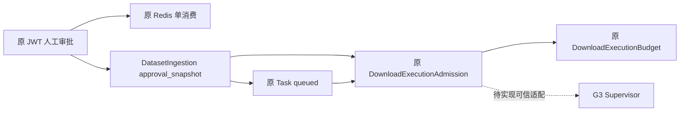

# P0-A Trusted Admission & Budget Binding

当前结论：PARTIAL_CODE / PASS_ISOLATED（限定已完成专项）/ RUNTIME_BLOCKED。S6 NO-GO，S7 NOT_YET_END_TO_END。本报告不表示可信下载已可运行。

审计基线为 CygnusX_Current_Implementation_Status_Audit_2026-10-18.md；重新核实主仓 main e78fd1efa1df3ebfcb098be973e81e193b1db224。完整主仓/递归子仓 HEAD、dirty、diff 摘要及锁文件哈希在 evidence/p0a/baseline.json。保留原有 dirty 子仓，不提交指针。实施期间出现外部 shania.md 与架构发现报告改动，不属本包。

文件所有权：P0-A 持有 dataset import/审批 API、Admission 模型仓储、Settings 与新增迁移；IAT-R3 持有 Vue adapter/test；G3 持有新增 Supervisor 服务端；S4 仅独立探针与报告。tasks/download.py、FileRegistry、原 Celery dispatch 未改。

原审批仅 Redis TTL，原签发依赖调用者预校验；原预算 Integer 且 admitted 默认零；原 import execute 多次 commit。现扩展原 ingestion.approval_snapshot，保存人类 JWT 来源哈希、actor/owner/project、版本、proposal/request/source 摘要、scope、预算、到期/撤销/nonce 状态，未建立第二套审批表。批准仍经过原 JWT 端点与 Confirmation service；Redis 成功但 SQL 快照缺失时拒绝重建。消费时要求两份事实吻合；SQL 回滚不恢复 Redis 凭证，需新预案及人工重新批准。

Task、ingestion 关系、预算与 Admission 使用同一原 AsyncSession；execute 不再中途 commit，原请求依赖提交后触发既有 after_commit Celery 通知。目录遗留 marker 仅为归属线索，不是批准。签发重查原数据库实体和固定运维 profile，不信模型批准布尔。Settings.download_admission_profiles 默认空，执行入口只接受恰好一个服务端环境配置。

现有状态映射：READY=已签发未领取；CONSUMED=已领取；REVOKED=未启动撤销；RECONCILIATION_REQUIRED=已领取撤销或不明事实。旧状态未整体替换。唯一 Task/ingestion 永久阻止重新签发，attempt/epoch 进一步 fencing；无停止证据不退款、不重新给予完整预算。

原 limit_bytes/reserved_bytes/admitted_bytes 均改 BigInteger；admitted_bytes=NULL 表示未报告。disk_block_limit_bytes 与 disk_inodes_limit 独立，不以磁盘文件大小冒充网络 RX。数据库 CHECK 限非负、预留不超额与测量不超预留；原子预留用减法判定余量，避免 BIGINT 加法溢出。FileRecord.size、DatasetAsset.size、UploadSession.total_size/chunk_size、User.storage_quota/used_storage 已为 BigInteger，本包未改。

新增 dwnbinding02，前驱 dwnadmission01；不改既有迁移。旧 Admission 撤销并进入待对账，旧预算保留预留量、计量改 NULL，缺失 OS 限额设不可执行占位值且状态禁用。状态列扩至32。约束遇不一致旧余额会拒绝迁移，必须在独立 PG 预检，不自动修正财务事实。迁移可能获取表锁，生产执行未授权。downgrade 只支持三类审计数据全空，非空拒绝并要求向前兼容修复。

首期仅单 processed HTTP，一个预案对应一个原 Task；raw、多请求、HTTPS/FTP/云未认证，明确阻断。现 GEO 适配器只产出 HTTPS，故合法现有 GEO 预案无法进入本期 HTTP Admission；不为完成演示修改受信来源或假称 HTTPS 已认证。HTTP 绑定在明确离线持久夹具验证。

验证命令、原始日志和退出码在 evidence/p0a/。迁移拓扑单 head检查通过；模型/服务/API 聚焦 Ruff 与 mypy 通过。初轮联合回归失败日志保留，后续结果另记，不把旧测试直接 approve 缺 JWT 哈希造成的失败抹去。

| ID | 当前验收边界 |
|---|---|
| PA-01/02/03 | 身份、归属、内容摘要拒绝路径隔离验证；真实PG行数证明待验 |
| PA-04 | 单次领取 CAS代码；PG双连接 barrier未授权 |
| PA-05 | 共享余额原子primitive；首期拒绝raw多Task；PG并发未验 |
| PA-06 | BigInteger、范围及NULL隔离检查；PG DDL未验 |
| PA-07 | 同事务/原after_commit；PG commit-crash时间线未验 |
| PA-08/09/10 | 撤销与未知保留语义隔离；真实OS停止未验 |
| PA-11 | 原Redis单消费+持久快照；真实Redis/PG联合未验 |
| PA-12 | 旧记录不升级，迁移保护；真实旧库迁移未验 |
| PA-13 | 固定profile及身份绑定拒绝；运行认证未验 |
| PA-14 | 所有执行门禁继续false；未启动下载 |

尚缺可信计量结算接口与实际 G3 authority 接线，不能标 CODE_COMPLETE。没有真实 Supervisor 回执就没有结算、额度复用或安全停止结论。真实 PG/Redis、生产 Broker/Worker、OS、下载与浏览器均未操作；独立环境授权问题已提出，未收到授权前仅安全离线工作。旧120项矩阵保留历史审计口径，各包新RA/PA/EG/SR矩阵不覆盖旧运行事实。

回滚：保持门禁关闭，按文件/hunk撤回本包源码；禁止 reset/clean 或回滚其他dirty。未应用迁移，无运行资源待清理。已存在审计数据时禁止破坏性 downgrade；原文件、Task、审批、未结算预算保留对账。运行状态不明不能以回滚声明停止。

最终离线复核：P0-A组合68 passed（p0a-final-rerun.log），下载/FileRegistry/Dataset联合143 passed（regression-final.log）；两集合有重叠，不相加为独立用例总数。仓储mypy 1文件与服务/API/config/model 4文件均退出0；迁移链单head检查退出0；本包定向diff检查退出0。最终源码SHA保存在 evidence/p0a/final_hashes.json。全工作树另有外部shania.md尾随空白，未修改。全仓提交门禁未运行，本轮无提交；这些隔离结果均不替代PA-04/05/07/11真实PG/Redis证据。
