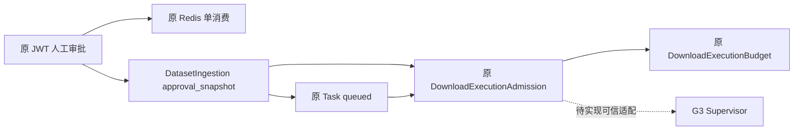

# P0-A Trusted Admission & Budget Binding

当前结论：PARTIAL_CODE / PASS_ISOLATED（限定已完成专项）/ RUNTIME_BLOCKED。S6 NO-GO，S7 NOT_YET_END_TO_END。本报告不表示可信下载已可运行。

审计基线为 CygnusX_Current_Implementation_Status_Audit_2026-10-18.md；重新核实主仓 main e78fd1efa1df3ebfcb098be973e81e193b1db224。完整主仓/递归子仓 HEAD、dirty、diff 摘要及锁文件哈希在 evidence/p0a/baseline.json。保留原有 dirty 子仓，不提交指针。实施期间出现外部 shania.md 与架构发现报告改动，不属本包。

文件所有权：P0-A 持有 dataset import/审批 API、Admission 模型仓储、Settings 与新增迁移；IAT-R3 持有 Vue adapter/test；G3 持有新增 Supervisor 服务端；S4 仅独立探针与报告。为闭合 Worker seam，`tasks/download.py` 与 FileRegistry 回执入口有受限增量；原 Celery dispatch 语义仍复用，未新增队列。

原审批仅 Redis TTL，原签发依赖调用者预校验；原预算 Integer 且 admitted 默认零；原 import execute 多次 commit。现扩展原 ingestion.approval_snapshot，保存人类 JWT 来源哈希、actor/owner/project、版本、proposal/request/source 摘要、scope、预算、到期/撤销/nonce 状态，未建立第二套审批表。批准仍经过原 JWT 端点与 Confirmation service；Redis 成功但 SQL 快照缺失时拒绝重建。消费时要求两份事实吻合；SQL 回滚不恢复 Redis 凭证，需新预案及人工重新批准。

Task、ingestion 关系、预算与 Admission 使用同一原 AsyncSession；execute 不再中途 commit，原请求依赖提交后触发既有 after_commit Celery 通知。目录遗留 marker 仅为归属线索，不是批准。签发重查原数据库实体和固定运维 profile，不信模型批准布尔。Settings.download_admission_profiles 默认空，执行入口只接受恰好一个服务端环境配置。

现有状态映射：READY=已签发未领取；CONSUMED=已领取；REVOKED=未启动撤销；RECONCILIATION_REQUIRED=已领取撤销或不明事实；SETTLED=签名终态停止回执已核验并完成预算计量结算。旧状态未整体替换。唯一 Task/ingestion 永久阻止重新签发，attempt/epoch 进一步 fencing；无停止证据不退款、不重新给予完整预算。

原 limit_bytes/reserved_bytes/admitted_bytes 均改 BigInteger；admitted_bytes=NULL 表示未报告。disk_block_limit_bytes 与 disk_inodes_limit 独立，不以磁盘文件大小冒充网络 RX。数据库 CHECK 限非负、预留不超额与测量不超预留；原子预留用减法判定余量，避免 BIGINT 加法溢出。FileRecord.size、DatasetAsset.size、UploadSession.total_size/chunk_size、User.storage_quota/used_storage 已为 BigInteger，本包未改。

新增 dwnbinding02，前驱 dwnadmission01；不改既有迁移。旧 Admission 撤销并进入待对账，旧预算保留预留量、计量改 NULL，缺失 OS 限额设不可执行占位值且状态禁用。状态列扩至32。约束遇不一致旧余额会拒绝迁移，必须在独立 PG 预检，不自动修正财务事实。迁移可能获取表锁，生产执行未授权。downgrade 只支持三类审计数据全空，非空拒绝并要求向前兼容修复。

首期仅单 processed HTTP，一个预案对应一个原 Task；raw、多请求、HTTPS/FTP/云未认证，明确阻断。现 GEO 适配器只产出 HTTPS，故合法现有 GEO 预案无法进入本期 HTTP Admission；不为完成演示修改受信来源或假称 HTTPS 已认证。HTTP 绑定在明确离线持久夹具验证。

验证命令、原始日志和退出码在 evidence/p0a/。迁移拓扑单 head检查通过；模型/服务/API 聚焦 Ruff 与 mypy 通过。初轮联合回归失败日志保留，后续结果另记，不把旧测试直接 approve 缺 JWT 哈希造成的失败抹去。

| ID | 当前验收边界 |
|---|---|
| PA-01/02/03 | 身份、归属、内容摘要拒绝路径隔离验证；真实PG行数证明待验 |
| PA-04 | 单次领取 CAS代码；PG双连接 barrier未授权 |
| PA-05 | 共享余额原子primitive；首期拒绝raw多Task；PG并发未验 |
| PA-06 | BigInteger、范围及NULL隔离检查；PG DDL未验 |
| PA-07 | 同事务/原after_commit；PG commit-crash时间线未验 |
| PA-08/09/10 | 未 claim 撤销可释放预留；claim 后撤销进入对账；新增签名停止回执结算隔离测试；真实OS停止/PG并发未验 |
| PA-11 | 原Redis单消费+持久快照；真实Redis/PG联合未验 |
| PA-12 | 旧记录不升级，迁移保护；真实旧库迁移未验 |
| PA-13 | 固定profile及身份绑定拒绝；运行认证未验 |
| PA-14 | 所有执行门禁继续false；未启动下载 |

新增 `settle_execution_budget_from_receipt_in_transaction`：从锁定 Admission/Budget 读取 task、attempt、epoch、policy、environment 与网络/磁盘/inode 限额；验证签名终态回执及一次性 nonce 后，在同一调用事务把累计 admitted RX 加入已用量、将该次 reservation 从占用额替换为实测 RX，并把 Admission 置为 SETTLED。状态未知时拒绝结算；撤销后的 `RECONCILIATION_REQUIRED` 只有收到匹配的 stopped 回执才能结算。隔离用例证明取消/失败终态也只结算真实 RX、释放未用额度可被后续预留但总量不超限、重复 settlement 被终态状态拒绝。

本次结算接口定向验证与源码 SHA 记录在 `evidence/p0a/budget-settlement-isolated.json`。

后续状态机审查发现，已结算 Admission 被再次撤销会错误地从 `SETTLED` 转回 `RECONCILIATION_REQUIRED`，而结算入口允许该状态，形成二次记账窗口。`revoke_execution_admission` 现对 `REVOKED`/`SETTLED` 终态幂等返回；新增隔离回归在首次签名结算后重试撤销并提交替代回执，确认 Admission 与预算计数不变且替代结算拒绝。P0-A/Authority/Supervisor 定向单测 47 passed，Ruff 与 admission 仓储 mypy 通过；这仍是 SQLite 隔离证据，不替代 PostgreSQL 并发验收。

Lease nonce 表随后增加数据库级 `supervisor_id` 非空白与正 `execution_epoch` CHECK 约束，避免仅依赖应用层验证写入无效租约审计记录。SQLite 回归覆盖两个拒绝分支；迁移静态拓扑仍为单 head。该约束验证不代表真实 PostgreSQL DDL 已应用。

另补充审批消费后 SQL 外层 commit 失败的重试语义：Redis 中 confirmation 已为 `CONSUMED`，而回滚恢复的 Ingestion 可能仍是 `PREPARED`、快照仍显示 `APPROVED` 且没有 Task。后续 `execute` 现在在重查到该已消费 confirmation 时返回 `RECONCILIATION_REQUIRED` 并要求生成新预案，避免把这种不可重放状态报告成普通审批摘要不匹配。原子回滚回归验证该错误码；它不持久化虚构的 Task/Admission，也不替代真实 PG/Redis 故障窗口验证。

Admission 签发后，原 Task.parameters 增加 server-owned `_download_execution_binding`（version/admission_ref/budget_ref），与 Task、Admission、预算同事务提交；下载 Task 仓储在 Worker 保存旧快照时保留该绑定，Task API 响应隐藏该内部字段。新增 `DatabaseAdmissionAuthority` 在隔离 SQL 中按该绑定重读 Task/Admission/Budget/profile，原子消费 READY Admission 并推进 epoch，且可对同一 running Task 的已消费 epoch 重验 lease；错引用、错 epoch、重放会拒绝。HTTP 直链 Worker 现从该绑定构造 `ExecutionBoundaryRequest`，通过 Supervisor client 观察受信 scope，并在 FileRegistry 同一事务调用签名回执预算结算；缺少绑定、mTLS、Supervisor 回执或结算事实仍 fail closed，不回退本地 aria2c。Supervisor 服务尚未默认接入该 authority/backend，原子 claim/renew 未经 PG 并发验证。调用方必须在同一事务处理失败并 rollback，不能仅传入自报 observation。没有真实 Supervisor 回执就没有运行期结算、跨 Task 额度复用或安全停止结论，不能标 CODE_COMPLETE。真实 PG/Redis、生产 Broker/Worker、OS、下载与浏览器均未操作；独立环境授权问题已提出，未收到授权前仅安全离线工作。旧120项矩阵保留历史审计口径，各包新RA/PA/EG/SR矩阵不覆盖旧运行事实。

后续幂等审查发现，Worker 虽已确定性派生 `execution_id`，但 Admission 仍未持久保存该身份，真实 authority 会把同一 Supervisor start 重试误判为重复 claim。新增 `dwnexec04` 将 `execution_id` 绑定到 Admission；首次 claim 写入，完全相同的 Task/attempt/epoch/execution 重试复用已消费事实，改身份重试拒绝，renew 也要求精确匹配。迁移对已有 `CONSUMED/SETTLED` 记录采取显式阻断，对未 claim 的遗留 `READY` 记录转入 `RECONCILIATION_REQUIRED`，不猜测历史执行身份。运行时另拒绝缺失或非确定性 execution identity 的 consumed admission。SQLite/authority 回归与迁移拓扑检查通过；真实 PostgreSQL 并发与跨进程后端仍未验。

后续定向回归进一步断言：同一 claim 的重放不会改变已持久化 `execution_epoch`、`execution_id` 或预算 `reserved/admitted` 数值；`test_p0a_migration_contract.py` 还覆盖 `dwnexec04` 遇历史 `CONSUMED/SETTLED` 时在 DDL 前阻断，以及无历史 claim 时将 READY 记录转为 `RECONCILIATION_REQUIRED`。这仍是隔离/静态证据，不替代真实 PostgreSQL 事务演练。

进一步复核 Worker 重启路径发现，请求构造器此前只接受 `READY` admission，导致首次 claim 后进程重试无法重建同一执行身份。现仅允许 `READY(epoch=0)` 或已绑定精确 `execution_id` 的 `CONSUMED(epoch=1)`；`SETTLED`、撤销、协议变化及执行身份变化继续拒绝。新增隔离回归覆盖 claim 后重建请求，确认结果与原请求完全相等；该修复不放宽运行门禁，也不替代真实跨进程/PG 验收。

执行身份与迁移专项验收的当前汇总见 `docs/implementation/cygnusx-p0a-g3-runtime-identity-acceptance.md`；当前工作树基线快照见 `evidence/p0a-g3-runtime-identity/current-baseline/`。该补充报告将算法版本、attempt scope 隔离和真实运行阻断单独列账，不能把本报告历史隔离结果升级为 `PASS_RUNTIME`。

回滚：保持门禁关闭，按文件/hunk撤回本包源码；禁止 reset/clean 或回滚其他dirty。未应用迁移，无运行资源待清理。已存在审计数据时禁止破坏性 downgrade；原文件、Task、审批、未结算预算保留对账。运行状态不明不能以回滚声明停止。

最终离线复核：P0-A组合68 passed（p0a-final-rerun.log），下载/FileRegistry/Dataset联合143 passed（regression-final.log）；两集合有重叠，不相加为独立用例总数。仓储mypy 1文件与服务/API/config/model 4文件均退出0；迁移链单head检查退出0；本包定向diff检查退出0。最终源码SHA保存在 evidence/p0a/final_hashes.json。全工作树另有外部shania.md尾随空白，未修改。全仓提交门禁未运行，本轮无提交；这些隔离结果均不替代PA-04/05/07/11真实PG/Redis证据。
