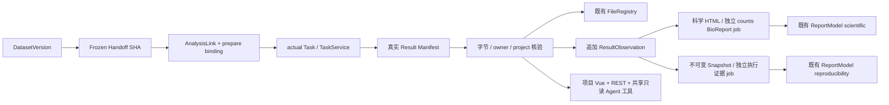

# CygnusX Phase4 科研证据链与可复现报告交付实施报告

## 1. Executive Summary

已实施可安全开展的 P4-A–F 受保护代码、隔离测试与契约。**CONDITIONAL（代码/隔离） / RUNTIME_BLOCKED / LIVE_E2E_BLOCKED；不是 Phase4 READY 或 PRODUCTION_READY。** Agent 写入源码门禁仍为 false，新读写开关默认 false。本代理没有部署、提交、推送、生产迁移、真实科研下载或平台业务计算；本机隔离 counts 测试实际执行 R/Snakemake。

链路复用 Dataset/Handoff、actual TaskService、FileRegistry、ReportService、BioReport 与不可变执行证据报告；新增最小结果观察关系，不建第二套运行或报告中心。真实 BioReport CLI 探针因 Quarto/Jupyter 内核 socket 权限失败，不能将 renderer double 的通过当成实际科学交付。

## 2. Baseline 与变更归属

基线分支 `feat/reproducible-report-phase0`，HEAD `c68ea9e0d6ecb63cb5678444ad3dd1e2a8a00407`。开始时存在大量 Phase0–3、报告系统和子模块的未提交成果；本轮未 reset、stash、commit、push 或改子模块源码。`evidence/phase4/baseline.json` 保存 status、分支、HEAD、递归 submodule、diff stat 和文件 SHA；baseline-files/ 保存共享源文件原始内容。

最终审计时 HEAD 为 `7c9b7d10a8e12d8c3139ea296795a13df35534e9`：并行工作新增 `558c4d70`、`7c9b7d10` 两条首页/site-content 提交，其相对基线的 8 个文件均排除于 Phase4 归属；没有 reset 或回退这些提交。Phase4 文件未包含在这两次提交中。

Flow 声明：RNA-seq 2.3.0、counts_deg 0.1.0；声明版本不等于实际 Worker 执行来源。宿主 R/DESeq2 测试独立记录，不能代填 Worker 值。相邻 BioReport 当前源码 HEAD 实测为 `fff758f93c8b07217a97b3f40dd2177e2f7da26b`、pyproject 声明 2.0.0，**未当作 Worker 安装来源证明**。镜像/Worker 实际值仍 null。

## 3. P4-0 Gate 核验

已结合任务书、Phase3 实施报告、Phase0B/Closure、Phase1–2 报告、活动 Dataset/Report 架构、Phase3 ADR/Handoff 契约和真实代码核对。前置报告明确不准入真实自动执行；本轮重新探测仍无反证：Docker daemon socket 被拒绝，无可用隔离 PG/Redis，socket 创建被禁止。Treasure 镜像/来源漂移及 Worker 二进制/挂载来源缺口不能由宿主工具版本消除。

证据：`evidence/phase4/runtime-probes.json`、BioReport probe/debug 日志、原 Closure；运行 provenance manifest 仅追加 phase4_research_delivery，不替换旧事实。G0/G16/G17 保持 BLOCKED。未向用户请求公开数据预算，因为前置运行条件未满足。

## 4. 已实现架构与验证范围

SQLite/真实临时文件与 renderer double 验证的是隔离链路。实际 PG/Celery/Worker/公开数据完整链路未通过；不得据图推断部署已完成。Run 可选，缺失为 null，不创建占位 Run。

## 5. DatasetVersion → Task → Result Manifest

prepare 保存 Flow 配置摘要/声明版本、标准化请求摘要、Handoff SHA。最终 TaskService 与 Worker 前置复查 owner/project、绑定和实物输入；actual Task/link 在入队前提交。SUBMITTING/投递不明不重放分析；同请求已有 queued link 可以复核后复用实际 Task，不复用变更参数。

Counts 保留原 R manifest 与统计计算，新增 delivery manifest sidecar，包含服务器写入的 platform/cygnusx 绑定与逐文件 SHA/大小。未修改 RNAFlow 子模块；旧 RNA manifest 缺少输入绑定时显式 UNKNOWN/PARTIAL。

## 6. Provenance / Evidence / Artifact 契约

`ResearchProvenance` 与发布 JSON Schema 同源校验；DTO 分离 compute/input/result/evidence/delivery 状态，包含真实关联、输入/输出指纹、白名单来源、人工分组、受控分析参数、报告与 job、缺口。旧 Task 保留未知 Dataset/环境/版本。

实际输出要求位于对应 owner 的项目根，路径无父目录、绝对引用、符号/硬链接或特殊文件；FD 固定并比较前后 stat。SHA-256 为采集时字节，不证明执行时字节或生物学结论。现有 FileRecord 的 owner/task/size/checksum 不符会拒绝或降级，绝不覆盖成“已验证”。

manifest/文件数量、字节、时间有 Settings 上限；项目投影最多 20 Dataset × 5 版本、累计 20 analysis 详情，截断明确。输入复核使用 Settings 的文件数量、累计字节和时间预算；大规模数据性能仍未验收。

## 7. 科学 BioReport 与执行证据报告

科学报告与执行证据报告使用独立 ReportModel/report_kind、既有 generation job template 和 ResultObservation 关联。已有核验科学 HTML 幂等登记；缺失修复新建归档/版本。counts 固定 QMD 模板只展示完成 DEG/QC，无 DESeq2 或下载调用。科学渲染错误有常量错误码、有限独立重试。

Snapshot v1 增加可选 research_delivery；缺失/null 不影响旧 digest。新快照在 M7 展示 Dataset/Handoff/状态缺口，M6 展示科研产物指纹；旧快照不回写。既有证据 HTML 丢失仅从同一快照恢复 SHA/大小完全相同字节；损坏文件、不可精确重建 PDF 保留人工恢复要求。

实际 BioReport CLI：首次 Python 缺 nbformat；指定现有含 nbformat 的 Python 后，Quarto 内核 PermissionError。保留两个失败探针，不安装依赖、不放宽权限、不伪造 HTML 作为实际验收。

## 8. 异步、幂等与对账

复用既有报告 worker 的 Task advisory lock、durable queued job、attempt_count、重试和失败记录。科学/证据 template 分开，request key 可去重。完成回调与既有 Dataset Beat 扫描只核验/登记实际输出、排报告 job，不调用 Task submit/retry。关闭门禁时不创建对账数据库 engine。Dataset 任务跳过旧的无 manifest 全目录输出登记和 ProjectArchive capsule 扫描，改走已核验 manifest/FileRegistry 与报告快照归档；因此不会自动生成旧 capsule。这一限制不改变普通非 Dataset Task 路径。

ResultObservation 唯一 `(task_id,evidence_digest)`，同事实复用、变化追加。读取按当前事实匹配记录，不能仅取“最新一条”掩盖输出变化。人类 JWT 显式 reconcile 可以请求报告修复；未过源码/运行/写门禁前拒绝。PG 并发、实际 broker 重复投递与恢复仍 BLOCKED。

## 9. Frontend 与共享只读 Agent

项目页面提供版本/冻结摘要、来源、Flow 声明版本、分析参数、人工分组、Task、产物校验与认证下载、双报告入口与 job 状态。项目切换取消旧请求并核查 project_id；失败清空旧项目数据。报告链接使用现有 reportId query。

寻宝鼠与 AI 助手复用同一 catalog/gateway 的 research.task_provenance、report_provenance、dataset_provenance、project_delivery。MCP preset 与内置 Agent 导出同源；每次复核会话项目/权限，不允许 owner/project/_confirmed/VERIFIED 自证参数。实际外部 MCP transport 和 live UI 尚未验收。

## 10. 安全、权限与审计

REST 复用平台 auth/middleware；新修复入口只接受人类 JWT，写门禁在业务副作用前检查。报告生成、发布、预览/下载在受保护路径复核 active owner、当前项目和模块权限，旧链接不能绕过撤销。只读 Agent 调用沿用 AgentToolInvocation 审计。

DTO 不输出服务器路径、原始 prompt、全量参数、token 或异常。来源 URL 仅保留官方 HTTPS 和检索参数；科学模板转义表格内容，执行证据报告沿用既有脱敏/HTML 转义。未知镜像/release 不从配置或宿主值补齐；当前缺口不具备自动解除路径，运行验收后仍需受评审的 attestation 接入。

## 11. Migration 与兼容

`bioopsphase4 → bioopsphase3`：AnalysisLink.execution_binding，最小 result_manifest_observations（owner/project/link/task 外键 RESTRICT、事实摘要唯一）、Report.result_observation_id、ReportFile.file_record_id。旧列/表/文件不删除，旧行 nullable，不自动回填。

ORM 与 PG trigger 拒绝 observation UPDATE/DELETE；SQLite upgrade/downgrade 保留历史 Report 行已测，静态迁移链唯一 head。真实 PG full-chain upgrade/downgrade、锁/并发/trigger 运行验证 BLOCKED。新版本应用依赖迁移，应先迁移再启用读取；关闭功能不等于可以跳过数据库迁移。

## 12. 测试执行与边界

实际机器日志与退出码位于 `evidence/phase4/`，不叠加重叠子集 PASS 数。最终精确结果由本节末尾“最终测试快照”补充；早期失败与修复日志保留，不能当作最新结论。

- 核心唯一集合：Dataset/Geo/Import/Review + report snapshot/Phase1/Phase2 delivery/PDF + Phase4 + actual counts R/Snakemake，`final-isolated-tests.log`。
- 边界：Phase0A/B、真实服务类+隔离 repo/队列、HTTP ASGI、MCP parity，`final-boundary-tests.log`；Redis skip 明确 BLOCKED。
- 新 Vue DOM、前端 types/build、全 Vitest 分开记录；build 还核对 dist 实物含新交付组件。
- 全仓 Ruff/mypy 未绿；全 backend unit/e2e 有存量失败且 180s timeout（exit124），未宣称完整通过。桥接层单独 190 passed / 2 skipped。
- 真实 BioReport CLI 失败，PG/Redis/MCP 外部 transport/Worker/真实公开案例未验证。没有任何生产服务范围。

### 最终测试快照（2026-10-15）

| 检查 | 实际结果 | 本地证据 |
|---|---|---|
| 相关后端唯一测试集合 | 172 passed，2 warnings；包含 Phase4 32 项和实际 counts R/Snakemake | final-isolated-tests.log / .exit=0 |
| 边界/确认契约回归 | 43 passed，1 skipped；Redis skip 不算运行准入 | final-boundary-tests.log / .exit=0 |
| 新 Vue DOM | 3 passed | frontend-tests-final.log |
| 前端类型 / 构建 | 两者 exit 0；dist/index.html 15:36:55 +0800，新组件已编译 | frontend-types-final.exit、frontend-build-final.exit |
| 全前端（较早快照） | 521 passed / 7 failed；运行时新增 DOM 为 2 项，后来 3 项另测 | frontend-full.log |
| bridge | 190 passed / 2 skipped | bridge-tests.log |
| 全后端 unit/e2e | 180 秒超时 exit 124，已有测试失败；未完整通过 | backend-full.log |
| 全 Ruff / mypy | 295 errors / 1044 errors（228 files）；全仓未绿 | ruff-full.log、mypy-full.log |
| 聚焦 Ruff / mypy | 新文件及共享修改的聚焦 Ruff 通过；7 文件聚焦 mypy 通过 | shared-ruff.log、focused-mypy.log |
| 迁移 / diff | 静态唯一 head；SQLite upgrade/downgrade 通过；diff --check 通过 | migrations.log、Phase4 单测 |
| 实际 BioReport / 服务链 | 内核 socket PermissionError；PG/Redis/Worker/公开案例 BLOCKED | bioreport-probe.json、runtime-probes.json |

核心命令为 `.venv/bin/pytest tests/unit/test_dataset_gateway_phase3.py tests/unit/test_dataset_geo_validation.py tests/unit/test_dataset_import_handoff.py tests/unit/test_dataset_phase3.py tests/unit/test_dataset_phase3_review.py tests/unit/test_report_snapshot.py tests/unit/test_report_delivery_phase2.py tests/unit/test_report_pdf_and_bioreport_phase2.py tests/unit/test_reproducible_report_phase1.py tests/unit/test_research_delivery_phase4.py tests/unit/test_counts_deg_phase3.py -q -m "not quarantine" --disable-warnings --maxfail=3`。完整计数仅指这一个集合，不与子集叠加。机器摘要为 `evidence/phase4/test-summary.json`。

## 13. G0–G18 与 T01–T44

PASS_ISOLATED 不等于真实 Gate READY，PARTIAL 表示只有代码/部分隔离证据。

| Gate | 状态 | 依据 / 未完成项 |
|---|---|---|
| G0 | BLOCKED | Phase0B Closure、PG/Redis/MCP/Worker 前置缺口 |
| G1 | PASS | baseline SHA、HEAD、dirty 归属、变更清单 |
| G2 | PARTIAL | 冻结关系/actual Task 关联代码与 SQLite；真实队列链未验收 |
| G3 | PASS_ISOLATED | 原始输入变化拒绝；Worker 实际挂载仍未知 |
| G4 | PARTIAL | Flow/参数 SHA + PREPARE_CAPTURE；runtime/release UNKNOWN |
| G5 | PASS_ISOLATED | 真实临时 manifest/文件、大小/SHA/身份/路径负例 |
| G6 | PASS_ISOLATED | 真实 SQLite FileRegistry/目录链；真实 PG 事务未测 |
| G7 | PASS_ISOLATED | DTO/schema、历史 Task UNKNOWN、不伪造 Run |
| G8 | PARTIAL / BLOCKED runtime | 双关联与独立 job 隔离通过，真实 BioReport kernel 拒绝 |
| G9 | PASS_ISOLATED | 冻结 Snapshot、报告回归；真实 worker/storage 未验收 |
| G10 | PASS_ISOLATED | 科学渲染失败/重试不改变完成 Task、快照 ID |
| G11 | PASS_ISOLATED | success 不等于 READY，缺口明确 |
| G12 | PARTIAL | 唯一事实/对账去重及不重跑；真实 PG/Celery 并发待测 |
| G13 | PASS_ISOLATED / PARTIAL live | owner/project/revoke 数据隔离；全栈 live 未测 |
| G14 | PASS_ISOLATED / BLOCKED transport | 共享只读工具、注入拒绝、源码写门禁关闭 |
| G15 | PASS_ISOLATED | 新 DOM、types/build；浏览器全栈未测 |
| G16 | BLOCKED | PG/Redis/MCP/Worker 实际运行证据缺失 |
| G17 | BLOCKED | 无前置准入，未申请预算、未运行公开案例 |
| G18 | PARTIAL | 契约/ADR/runbook/隔离证据齐备；全仓质量门禁未绿 |

| 测试 | 本轮状态与证据范围 |
|---|---|
| T01 | PASS 隔离：实际 SQLite link/version/task 关系与 prepare 回归；非 live 入队 |
| T02 | PASS 隔离：final execution input check 对真实源文件变化拒绝 |
| T03 | PARTIAL：提交/投递不明回归不重放，真实创建失败窗口待 PG/queue |
| T04 | PASS 隔离：queued link 重复复核同一 Task、既有 TaskService 幂等回归 |
| T05 | PASS 隔离：变更参数/来源不复用审批绑定 |
| T06 | PASS 隔离：success 无 manifest 不 READY |
| T07 | PASS 隔离：输出缺失为 MISSING |
| T08 | PASS 隔离：实物/声明 SHA 不符 FAILED |
| T09 | PASS 隔离：真实 FileRegistry/SHA/Task 登记、重复对账同 observation |
| T10 | PASS 隔离：异主 FileRecord 输出拒绝，owner/task/project 核验；真实并发登记窗口待测 |
| T11 | PASS 隔离：科学 Report 使用实际 Task/ResultObservation |
| T12 | PASS 隔离：无 Run 不虚构 |
| T13 | PASS 回归：既有真实关联条件的 Run evidence fixture；非平台 live Run |
| T14 | PASS 契约/回归：来源缺失显式缺口，不当作已观察环境 |
| T15 | PASS 隔离：旧 Task 仍可读取，lineage UNKNOWN |
| T16 | PARTIAL：幂等科学登记代码与对账回归；实际 BioReport 复用整链未通过 |
| T17 | PASS 隔离：renderer outage/独立 retry、完成 Task 不变 |
| T18 | PASS 回归/隔离：报告 job 的重试、预算、错误脱敏 |
| T19 | PASS 隔离：observation 更新拒绝、旧 Snapshot digest/版本回归 |
| T20 | PARTIAL：输出丢失追加证据；报告登记/重试与精确恢复代码，全部格式 live 待测 |
| T21 | PARTIAL：既有锁/唯一性 fixture，实际 Celery 重复投递未测 |
| T22 | PASS 隔离 / PARTIAL live：模糊提交不重放；真实 broker/DB 窗口未测 |
| T23 | PASS 隔离：两用户旧 Task/report 数据边界；全新 provenance ASGI 全栈未测 |
| T24 | PASS 隔离：共享查询与 Dataset 的跨项目拒绝 |
| T25 | PASS 隔离：项目归属撤销后已有 Report 查询拒绝；live JWT 未测 |
| T26 | PASS 隔离：工具 context 的项目由服务器绑定，跨项目拒绝 |
| T27 | PASS 契约：四工具 extra=forbid，owner/project/integrity/_confirmed 拒绝 |
| T28 | PASS 隔离：源码关闭即拒绝，engine/文件/分析前 gate |
| T29 | PASS 隔离/回归：路径/链接/重定向及 archive 负例 |
| T30 | PASS 隔离/回归：路径/异常/token 不进入公开 DTO/报告，URL 白名单 |
| T31 | PASS 相关回归 / PARTIAL 全仓：相关旧报告/Task 测试；全仓超时 |
| T32 | PASS 契约/回归：原 RNAFlow 配置/manifest adapter；未改子模块 |
| T33 | PASS 实际本机 R/契约：raw counts 类型与人工来源条件 |
| T34 | PASS 实际本机 R：TPM/log/无重复/混淆设计等负例 |
| T35 | PASS：Python schema 精确匹配发布 JSON Schema、TS strict 通过 |
| T36 | PASS 新 Vue DOM：迟到项目响应丢弃、失败清空旧数据 |
| T37 | PASS 新 Vue DOM：分析/产物/证据/交付分别展示、真实 Task/reportId 链接 |
| T38 | BLOCKED：只有 SQLite 迁移，真实隔离 PG 未提供 |
| T39 | BLOCKED：Redis runtime 用例跳过，非 PASS |
| T40 | BLOCKED：只有 registry/parity/进程内既有证据，外部 transport 未通过 |
| T41 | BLOCKED：Worker 版本/镜像/二进制/挂载未回读 |
| T42 | PARTIAL：本机实际 counts DAG + SQLite 交付 + renderer double 分离通过，非完整双报告 E2E |
| T43 | BLOCKED：没有授权/准入下的真实公开案例 |
| T44 | PASS 隔离 / PARTIAL runtime：对账不提交 compute，实际灾难恢复待测 |

## 14. Changed Files

详见 [Phase4 变更归属清单](cygnusx-phase4-changed-files.md) 与 `evidence/phase4/changed-files.json`、task.patch。基于本轮 baseline 比较，不能把 git 当前所有 dirty 文件归为 Phase4。共享文件保留 Phase0–3 内容，新文件与增量分别记录；锁文件、镜像、子模块指针不属于本轮修改。

## 15. 剩余风险与优先级

- P0 BLOCKED：G0/G16/G17、Treasure 来源、PG/Redis/MCP/Worker/实际 BioReport 内核；禁止开放 Agent 写入/发布。
- P1：真实事务/队列模糊窗口与并发、完整文件恢复、真实两用户全栈与公开科研闭环、execution-time runtime/release attestation；均需隔离运行证据及发布评审。
- P1：当前工作树全仓 Ruff/mypy/前端测试失败、backend timeout；存在历史及并行修改，未将全部失败归因于既有基线，未扩展范围清理或隐瞒。
- P2：读取时散列输入/产物的性能、截断分页与大数据预算优化；当前仅小数据受保护路径。

## 16. 回滚与人工对账

详见 [对账与回滚 Runbook](../runbooks/cygnusx-delivery-reconciliation.md)。优先关闭 flags，保留全部原始文件、任务、登记、观察和快照。只有按 baseline 的本轮 hunk 逆向撤回，不能 reset 共享 dirty 文件。数据库 downgrade 需要备份且会丢失新增关系，禁止未备份在线执行。报告修复只走独立报告队列，不触发原始分析或下载。

## 17. Phase5 准入判断

**不准入依赖自动科研执行/发布的 Phase5；Phase4 不是 READY。** 可继续进行独立只读契约/UI 开发。必须先关闭真实运行阻断，获得受控数据/预算批准，完成 G16/G17 和全量质量门禁，再重新审查写门禁与发布。此报告不替代该批准。
