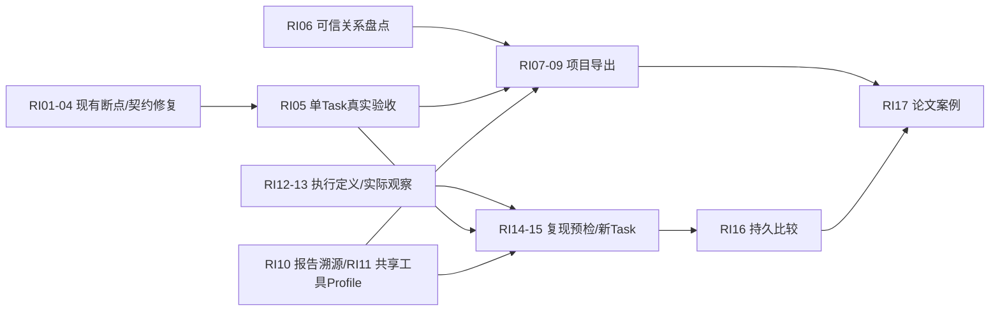

# Research Lifecycle Integration Implementation Roadmap

日期：2026-10-16。状态：调查后的实施提案，**本轮未开始实施**。依据：[科研生命周期与复现架构审计](../audits/cygnusx-research-lifecycle-and-reproducibility-architecture-audit-2026-10-16.md)。不是ARCHITECTURE_DESIGN中的as-built，不授予开关、生产迁移、下载、计算或部署许可。

## 1. 交付目标与约束

建立一条可核对真实身份的链：发现线索 → 权威核验 → 受控导入 → 数据版本/Handoff → 人工批准分析 → 实际Task → 执行与结果证据 → 双报告 → 项目交付 → 独立批准的新复现Task → 固定政策比较。

沿用AgentToolGateway、MCPClient/ToolBridge、DatasetImportService、DownloadService、AnalysisFlowToolService、TaskService、ToolConfirmationService、ReportService及既有FileRegistry/存储/队列。保留Node检索、React Island和FlowFrame；不另建平行引擎/MCP，不给平台业务Agent shell/流程YAML/DB写权限。

每项必须注明CODE/PASS_ISOLATED/PASS_RUNTIME/PASS_E2E，不用代码测试替代运行认证。附件本次T01–T45与旧寻宝鼠T01–T45命名冲突，测试映射写清来源；沿用旧RG-01–RG-12，不绕过源码gate。

## 2. 按真实缺口拆分任务

“可立即开发”指下轮获实施授权后可在隔离环境开发，不等于本轮开始修改。服务/表数量由契约评审决定。

| ID/优先级 | 实际缺口与最小改动 | 复用与依赖 | 接口/模型边界 | 测试/验收 | 准入分类 |
|---|---|---|---|---|---|
| RI01/P0 | 下载Worker登记没有task_id，Dataset对账查不到 | 原run_download/_register_downloaded_files、FileRepository、DatasetImport.reconcile | 内部显式Task/owner上下文，FileRecord既有task_id；不按目录/名称猜归属；同路径已有记录身份冲突拒绝 | audit T06/T14；临时SQLite贯穿真实登记函数到reconcile，跨owner/重复登记/部分文件 | 可立即开发；最终依赖真实Worker；存量补录另审 |
| RI02/P0 | UI/DTO的Aspera与实际CLI不匹配、Polariseq版本混用 | 原DownloadRequest/DownloadsView/Worker argv/配置 | 一份受信后端能力描述，方法按具体已认证binary；保持旧任务参数可解释 | T07；固定CLI help/argv兼容测试，实际Worker binary/version与下载证明 | 可立即开发契约；运行依赖Worker，不擅换子模块 |
| RI03/P0 | IPv6 URI检查、DNS/redirect/硬预算/FTP递归边界不足 | 原URL策略/DownloadService/执行器；不新增沙箱下载 | source policy规范化，拒绝不可信最终目标；传输中预算/递归限制/停止行为明确 | T07/T08/T11；IPv4/IPv6/别名/redirect/断点/超限，真实传输验收 | 静态修复可开发；网络与凭据需安全评审/真实Worker |
| RI04/P0 | 下载fixture/共享catalog设置替身/Node启动告警测试失败；交付Service入口角色F09 | 原测试与schema_loader真实Settings契约 | 修测试前核对业务接口，不能删安全断言或改源码gate迎合测试；按report_kind选择科学/证据文件，缺项partial | 当前1失败5错误、Node1文件失败全部给根因与独立重跑证据；增加scientific/reproducibility双入口、缺科学报告、同Task/owner/版本匹配回归 | 可立即开发测试修复；不依赖生产 |
| RI05/P0 | 真实PG/Redis/队列/挂载/双报告链未验收 | 现有opt-in PG/Redis测试、报告Job、Task和Worker | 独立测试DSN/账户、固定输入与预算；禁止生产自动探测/迁移 | T09–T22；真实CAS/唯一键/重启/投递不明/Report下载SHA | 依赖真实环境；安全授权前不执行 |
| RI06/P1 | 目录/普通Task/Run/Report/Project关联覆盖不全 | ProjectOverview、DatasetAnalysisLink、RunPlan、ReportSnapshot | 首先只读盘点；按显式ID关系分类；不得自动回填历史事实 | T08/T14/T16/T25；孤立/空Run/无Snapshot/已删Project均保留缺口 | 盘点设计可立即；真实盘点需只读账户 |
| RI07/P1 | 项目包缺选择与冻结清单 | 单TaskEvidenceManifest/ReportService/Provenance查询 | ProjectDeliveryManifest DTO引用单Task清单/快照与文件；范围/排除项/水位/摘要 | T23/T24/T26/T27/T29；多Task、多Dataset、漂移、缺报告partial | 可立即开发；无真实资源只标隔离 |
| RI08/P1 | 项目导出缺Job/发布/下载闭环 | Celery durable模式、FileRegistry、report_archive/鉴权下载 | 评审独立ProjectExportJob；Report.task_id非空，禁虚构Task；有界流式，不直接搬512MiB内存builder做无限包 | T23–T29；幂等/配额/取消/崩溃恢复/重复成员/撤权/ZIP自校验 | 可立即开发；真实PG/存储依赖RI05，发布需安全评审 |
| RI09/P1 | 项目页缺统一入口，错误混为不可用 | ProjectDetailView/ResearchDeliveryChain/原Island typed actions | 统一导出预览/Job/下载；区分flag/无权限/网络/空记录；寻宝鼠跳同入口 | T25/T44；跨项目晚到、键盘、窄屏、取消与文件下载 | 可立即开发；浏览器真实验收依赖环境 |
| RI10/P1 | 报告关键结论追溯尚未贯穿UI/发布 | ResearchClaimService.assessment/cell、Snapshot/Report | 显示已有file/SHA/feature/column；无法溯源的结论明确未验证；不复制一套ClaimService | T18–T21/T26；真实表格值→Task→输入逐级核对，旧版本不覆盖 | 可立即开发契约/UI；真实报告需RI05 |
| RI11/P1 | FlowAgent并非都过Gateway，旧工具仍开启 | 现有FlowAgent platform submit_plan、固定Flow工具、Agent allowed names | 定义平台模式Profile与capability映射；本地写文件/Shell工具不注入平台Agent；兼容旧调用而非叠MCP | T38–T45；同schema/最终服务、直接越权调用拒绝、工具集合不随Flow数增长 | 可开发适配设计；身份/权限与历史兼容需安全评审 |
| RI12/P2 | 缺覆盖全部入口的不可变执行定义 | RunPlan.plan_json/digest、AnalysisLink.binding、Task.parameters | 先ExecutionDefinition DTO；评审是否扩展现有JSON/显式引用，确有索引/不可变需要再新增表 | T15/T18/T30/T31；历史缺字段unknown、新定义摘要、旧快照兼容 | 可立即开发契约；DB迁移需独立PG验证 |
| RI13/P2 | 实际输入/发布/镜像/参考/工具观察缺失 | Task最终校验、Worker preflight、现有manifest/ResultObservation | 受信release包、image digest、reference hash、资源/seed/工具版本；声明与观察分开，不能查当前环境回填历史 | T11/T15–T19；Prepare后漂移、Worker启动复核、实际镜像/输入证据 | Worker前置必须设计；真实采集依赖Worker与供应链评审 |
| RI14/P3 | 缺历史复现预检 | 原Dataset/Flow validator/受信定义与授权 | reproduction.prepare读用例；明确历史复现或当前重分析，缺输入/release/image/reference返回BLOCKED | T30/T31/T32/T37/T41/T42；无任何网络补下载/执行副作用 | 契约可开发；READY宣称依赖RI12/13 |
| RI15/P3 | 缺新旧任务绑定与独立复现审批 | ToolConfirmationService/AnalysisFlowToolService/TaskService | 必要时ReproductionLink；新Task/新目录/新批准、参数摘要/有效期、原结果只读 | T09/T10/T33/T34/T37；旧批准不可复用，审批后变化失效，投递不明对账 | 依赖RI05/12/13；必须真实Worker认证与安全评审 |
| RI16/P3 | 只有纯比较函数，没有持久Comparison Job | benchmark.compare_reproduction/ReproductionRule、ArtifactCell、ResultObservation/ReportService | 固定版本化政策、表格gene_id语义/NA/QC适配、独立Job/比较报告；不可改容差凑通过 | T35/T36；字节/数值/NA/缺列/行集合/排序/版本差异/失败恢复 | 可开发隔离适配；真实L4需两次真实运行 |
| RI17/P4 | 无真实科研案例/公平基线发布 | 现有Benchmark模型、统计分母/合成执行归档工具 | Case A/B公开来源、人审、固定输入/流程/预算；与synthetic分层；明确论文数据许可 | 全部audit T01–T45；记录成功失败、资源成本、证据覆盖、人工干预与复现率 | 形成论文材料；依赖真实环境和前述链路，不编造效果 |

## 3. 阶段依赖与验收退出条件

- M0：版本/dirty基线和测试失败已解释；RI01真实登记函数→reconcile隔离贯通，不以手建FileRecord代替。
- M1：固定流程/镜像/真实输入/审批/实际Task/结果/双报告/单Task下载有ID、SHA及环境证据；各门禁有验收记录后才评估开放。
- M2：项目多Task/多版本选择、冻结、缺口、Job和ZIP下载通过，导出不触发下载或分析。
- M3：未来新执行有实际环境/输入/发布证明；历史缺口保持UNKNOWN，未声称历史完整。
- M4：一条RNA按可信历史定义的新Task成功，旧Task/目录/报告不变；无完整依赖时只能当前流程重分析。
- M5：比较政策事前固定，真实差异/失败保留，比较报告可追到两次Task/结果/输入；只授指定范围L4。
- M6：Case A/B及失败样例形成可公开方法学/实验数据，不将合成契约测试当真实科研成功率。

## 4. 下一轮可立即开展与需等待事项

可在实施授权后立即做：RI01登记身份修复及贯穿隔离测试；RI02版本能力契约；RI03静态URL/预算设计；RI04测试恢复；RI06盘点接口设计；RI07 Manifest；RI09交互；RI10结论映射；RI12定义覆盖评审。没有必要等待生产环境才写这些增量。

依赖真实Worker/组件：RI05、RI02/03最终认证、RI13实际观察、RI15真实复现、RI16实际比较、RI17论文案例。运行环境受限时保持BLOCKED，不用flag=true或Mock代替。

需要生产安全评审：来源/redirect/IPv6/FTP/云凭据，跨项目导出授权和下载撤权，归档代码信任、历史release与image保留，Agent Profile与外部MCP/API-Key边界，存量关系补录、对象生命周期和新增迁移。

## 5. 最小接口与模型评审清单

1. 复用现有 `/reports/{id}/delivery`，不改成项目级万能API；新增项目exports Prepare/Job/Status/Download之前先审查现有Job非空Task及去重约束。
2. ProjectDeliveryManifest只存实际选择的授权引用与文件清单，不复制全部报告事实，不包含完整Prompt/令牌/宿主路径。
3. ExecutionDefinition必须有schema/digest版本与信任发布来源；ResearchPlan是意图，不作执行事实；ResultObservation保持观察职责。
4. 复现API只能指定真实Task/定义引用及允许的资源选择，服务端重建owner/project；禁止接收任意Shell/Snakefile/本地路径。
5. 比较Job复用现有函数但新增真实Task/结果映射与固定政策身份，输出不可比较/差异/通过的具体范围。
6. 新表仅在既有模型不足时加；每张说明FK/空值/索引/不可变/删除保留/迁移兼容/故障恢复。

## 6. 验证、交付与回滚协议

每个工作包提交审阅材料：变更清单、契约diff、最小有意义测试、运行日志、通过/未通过矩阵、门禁状态和回滚步骤。执行全量门禁前先确认隔离环境，真实组件测试不得默认读取生产DSN。

回滚优先关闭新增入口和新Job投递，保留既有Task、报告、快照、文件和审计；未确认可丢弃前不做表/目录清理。RI01不猜存量FileRecord关系；新旧复现任务不覆盖。工作区dirty情况下只按授权hunk处理，不整文件回退，不擅自提交、推送或部署。

**当前行动边界：审计和路线已交付，停止在调查阶段；下一轮确认实施范围后才执行上述任务。**
