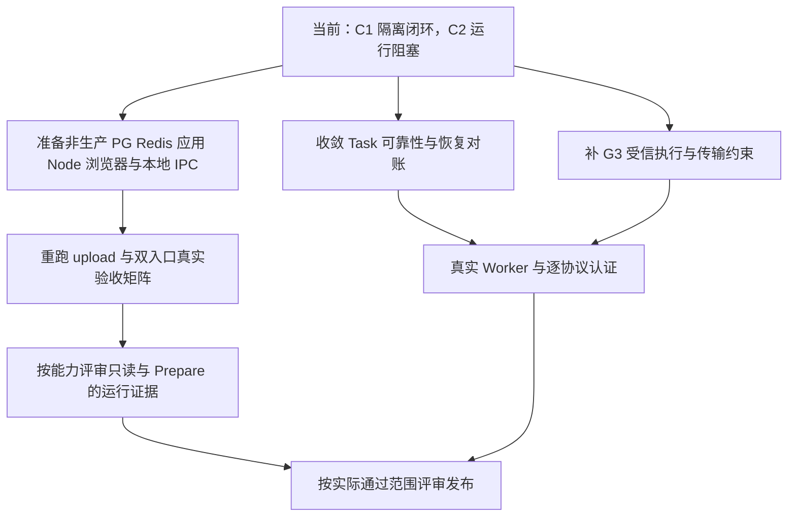

# 下载模块与共享 Agent 接入罗盘

更新日期：2026-10-18。用途：快速定位进度、文档、阻塞和下一步。本文是工作导航，架构现状以 [下载架构](../../ARCHITECTURE_DESIGN/CygnusX_download_architecture.md) 及代码为准；阶段报告是对应时点的验证记录。本轮仅更新导航与状态索引，未运行服务级业务验收，也不代表部署验收。

## 0. 2026-10-18 接续入口

本工作树另有 2026-10-18 的实施材料：[总实施方案](../info/26.10.18/01_CygnusX_实施优化方案.md)、[IAT-R3 运行与浏览器验收提示](../info/26.10.18/02_Codex_IAT-R3_实施提示词.md)、[G3-E2 受信运行时提示](../info/26.10.18/03_Codex_G3-E2_实施提示词.md)、[证据与 S6-S7 交接模板](../info/26.10.18/04_验收证据与S6-S7交接模板.md)。这些是施工范围与验收要求，不是新通过证据，也不会自动解除下文 S5-C2、G3 的 BLOCKED 状态；状态升级必须有对应的实际运行证据和更新后的阶段报告。

2026-10-18 的实施与验收导航见[Agent Runtime 验收罗盘](cygnusx-agent-runtime-acceptance-compass.md)，它汇总 R3、G3-E2、S4 余项及 S6/S7 准入状态。R3 与 G3 的实际执行边界分别见[R3 Runtime/UI 闭环记录](cygnusx-iat-r3-runtime-ui-closure.md)和[G3-E2 Trusted HTTP 运行记录](cygnusx-g3-e2-trusted-http-runtime.md)；该罗盘不能替代本文件中的 S5-C 历史调查，也不改变下载架构的权威地位。

## 1. 当前位置

**下载登记与协议契约已有隔离验证；共享 Agent 的目录与消费代码已接入，C1 已完成限定范围的隔离闭环；C2 真实运行验收仍 BLOCKED，真实下载执行尚未准入。**

此前罗盘中的“先完成 C1”已过期。现在应分两条线推进：补 C2 运行环境和真实链路证据；独立收敛下载执行安全、Task 可靠性与恢复对账。两条线的通过条件分别记录，不能互相代替。

| 阶段 | 已有成果 | 当前证据与边界 | 入口 |
|---|---|---|---|
| S0 | 基线、登记断点红测试 | 历史隔离证据 | [S0](download-s0-baseline-and-red-test.md) |
| S1 | Worker → FileRegistry → Dataset 登记契约 | 隔离验证；真实 Worker / PG 并发待验 | [S1](download-s1-file-registry-dataset-bridge.md) |
| S2 | 来源、方法、协议收敛及运行来源清单 | 局部隔离验证；不认证真实二进制与传输 | [S2](download-s2-worker-protocol-provenance.md) |
| S3 / G3 | URL、日志、输出登记安全及受信执行边界等增量 | PARTIAL_CODE / RUNTIME_BLOCKED | [闭环报告](download-s3-closure-implementation.md)、[受信边界](download-s3-e1-trusted-execution-boundary.md)、[运行验证](download-s3-e1-runtime-validation.md) |
| S4 / S4-A | Task 事务、幂等、目录隔离、取消与恢复是可靠性工作范围 | 已完成限定可靠性隔离验证；真实 PG/broker/Worker 仍待验 | [S4-A](download-s4a-task-reliability-implementation.md) |
| S5-A | 共享能力目录、Schema、权限裁剪 | PASS_ISOLATED | [S5-A](download-s5a-capability-catalog.md) |
| S5-B | 寻宝鼠与平台 AI 的工具消费接线 | PASS_ISOLATED；不覆盖真实回调网络 | [S5-B](download-s5b-agent-capability-consumption.md) |
| S5-C1 | 原 9 项失败归因、Bridge 权限与双 Runtime 轮次修复 | PASS_ISOLATED，静态检查遗留与 upload 用例限制保留 | [C1](download-s5c1-agent-runtime-code-closure.md) |
| S5-C2 | 环境核验、upload 超时归因、隔离回归 | BLOCKED；无 PASS_RUNTIME / PASS_E2E | [C2](download-s5c2-agent-runtime-acceptance.md) |
| 2026-10-18 R3 / G3-E2 接续 | 双 Runtime 隔离回归、签名回执发布门、mTLS 客户端与宿主只读预检 | R3 `PARTIAL_ISOLATED / RUNTIME_BLOCKED`；G3-E2 `PARTIAL_CODE / RUNTIME_BLOCKED` | [Agent Runtime 验收罗盘](cygnusx-agent-runtime-acceptance-compass.md) |
| 后续运行与发布 | 逐能力、逐协议、真实 Worker 与科研链路认证 | 尚未完成 | 见本文第 6 节 |

S5 的隔离成果不表示 S3/G3 已通过，也不表示 S4 或执行发布已完成。历史测试数字不能跨轮累加或直接当作当前工作树通过证明。

## 2. 文档从哪里看

| 要回答的问题 | 优先阅读 |
|---|---|
| 下载模块当前怎么实现 | [下载架构](../../ARCHITECTURE_DESIGN/CygnusX_download_architecture.md) |
| Agent 权限、委托与确认怎么流转 | [共享 Gateway 架构](../../ARCHITECTURE_DESIGN/CygnusX_agent_tool_gateway.md) |
| Legacy / LangGraph 如何执行工具轮次 | [Agent 执行框架](../../ARCHITECTURE_DESIGN/CygnusX_agent_execution_framework.md) |
| Dataset、资产、版本与导入如何关联 | [Dataset 架构](../../ARCHITECTURE_DESIGN/CygnusX_dataset_architecture.md) |
| 最初完成了哪些工作 | [2026-10-16 汇总快照](download-completed-work-summary-2026-10-16.md)；较新进度继续看各阶段报告 |
| 原始 S5-C 为什么受阻 | [原 S5-C 调查](download-s5c-agent-runtime-acceptance.md) |
| 原 9 个失败修好了吗 | [C1 报告](download-s5c1-agent-runtime-code-closure.md)，尤其第 2、8–10 节 |
| 现在还缺什么运行条件 | [C2 报告](download-s5c2-agent-runtime-acceptance.md)，尤其第 2、10–12 节 |

S5-C 原始调查文件的完整仓库相对路径是 `docs/implementation/download-s5c-agent-runtime-acceptance.md`，本工作树中存在。它保留 2026-10-17 的调查记录；S5-C 最新接续判断看 C1、C2。2026-10-18 的 R3/G3 状态看上方 Agent Runtime 验收罗盘。本文中的链接均相对于本文件所在目录。

## 3. BLOCKED 到底是什么问题

`BLOCKED` 是验收状态，不是单一异常码。当前至少包含两组不同的问题：C2 缺实际运行条件；G3 缺真实执行安全与恢复证据。

| 项目 | 已知事实 | 当前处理方向 |
|---|---|---|
| 原 9 项 LangGraph 失败 | C1 归因于过时 fixture 缺少正式 ChatService 的 `_db`；相关文件最终 23 项通过 | 已有隔离修复记录，不再把这 9 项列为当前未修复根因 |
| upload 引用超时 | C2 在项目外最小程序复现：线程完成后，asyncio self-pipe 通知的 `send` 被 EPERM 拒绝，事件循环未唤醒 | 换允许本地 IPC 的测试执行环境重跑；原用例仍未通过 |
| PG / Redis | C2 未获得明确的专用测试地址，未找到可用服务端程序；Redis 集成用例跳过 | 准备隔离实例，验证真实事务、并发、TTL 与单次确认 |
| Node → FastAPI | C2 本机 loopback listen 返回 EPERM，没有授权测试 callback 地址 | 在可监听、可连接的测试部署补真实回调链 |
| 浏览器 E2E | C2 的 Snap Chromium 受运行目录限制；缓存 Chromium 受 socket 操作限制，未获得可运行自动化链 | 配置可用 Chromium 与驱动，补真实页面、请求和截图 |
| 全量静态检查 | C1 聚焦 Ruff 通过，所查范围 mypy 仍记录 52 项遗留错误 | 按责任域处理；不能宣称全仓门禁全绿 |
| 实际下载执行 | G3、逐协议认证、真实出站约束、传输硬预算、停止与恢复对账尚未完成 | 独立推进执行安全和可靠性，保留关闭门禁 |

这些环境结论来自 C2 的时点探针；本文没有再次探测，不推断所有机器或所有目录都缺少依赖。修复 fixture、切换浏览器或补一套数据库，只能解决对应范围，不能自动解除其他阻塞。

## 4. 已完成成果如何理解

C1 记录的最终主回归为 **214 passed**，补充 MCP / Bridge 集合为 **32 passed**；C2 当轮隔离回归为 **144 passed**。集合存在重叠，不求和。详见各报告的命令、日志、替身范围与遗留项。

完整工具轮次的隔离测试经过真实装配、Runtime 分派、MCPClient、Bridge、Gateway、业务投影和结果回灌，但使用确定性模型及隔离 DB / 外围替身。它证明这些代码在该测试边界内协作正常；真实 PG、HTTP SSE、Node callback 和浏览器仍需运行验收。

状态含义：

- **PASS_ISOLATED**：指定隔离测试范围通过。
- **PASS_RUNTIME**：指定真实运行链路取得证据；当前 C2 未取得。
- **PASS_E2E**：指定完整用户工作流取得证据；当前 C2 未取得。
- **RUNTIME_BLOCKED / BLOCKED**：对应验收尚不能通过，原因需查具体记录。
- **NOT_TESTED / skipped**：未运行或跳过，不能计为通过。

## 5. 可靠性工作接续清单

本次检查发现工作树已有 `infrastructure/download/reliability.py` 和 `tests/unit/test_download_s4a_reliability.py` 等可靠性相关文件。后续已形成 [S4-A 报告](download-s4a-task-reliability-implementation.md)，其中记录实际实现、隔离验证及运行缺口。以下清单保留作为可靠性复核与 S4-B 接续范围：

1. 数据库提交成功后才发布队列消息；提交失败不发布；发布失败保留可对账事实。
2. 明确 owner、project、source、protocol、accession、规范化参数与 request_key 的幂等语义，覆盖并发与终态重试。
3. 每次新任务使用唯一、可读且不含 UUID 的用户可见工作目录；拒绝路径逃逸、链接与历史文件冒领。
4. FileRegistry 登记、配额与 Task 终态保持一致；部分产物、登记失败或 crash 不得产生虚假成功。
5. 取消请求、数据库取消状态、进程树停止与出站撤销分别记录；没有实际监督器证据不能声称已停止。
6. 补重复投递、迟到回调、Worker crash 与恢复对账测试；PG / broker / Worker 的真实结果单列。
7. 完成后形成独立可靠性报告，给出修改范围、测试、运行缺口、风险与回滚，再更新本罗盘状态。

上述代码路径相对 `src/cygnusx/`，测试路径相对仓库根目录。

## 6. 下一步按什么顺序走

C2 最小资源是：允许 self-pipe / loopback / Unix IPC 的执行器、专用 PG 与 Redis、固定 FastAPI / Node callback 测试部署、可运行的 Chromium 与驱动。测试身份、数据生命周期和清理范围必须明确。

C2 验收至少覆盖双用户与项目归属、会话/模块变化、撤权与重放、PG 事务回滚与并发、Redis TTL 与一次确认、Legacy / LangGraph 结果回灌，以及浏览器刷新和 SSE 中断恢复。真实来源发现只访问获允许且有界的元数据来源；C2 本身不执行科学文件下载。

## 7. 交接与验收边界

- 保持 `WRITE_RUNTIME_ACCEPTED=False`、`DOWNLOAD_TRANSPORT_RUNTIME_ACCEPTED=False`；当前 `DOWNLOAD_EXECUTION_READY=FALSE`。
- Prepare 生成预案，不能据此认定 Task 已执行或下载已成功；文件登记也不自动代表科研就绪。
- 身份、scope、批准和运行认证由可信服务端事实决定，模型不能自证。
- 继续复用原 Gateway、Task、FileRegistry、Dataset 与确认体系。
- 当前工作树存在大量既有修改。接续与回滚逐 hunk 审查，不整仓 reset/clean，也不删除用户文件和业务事实。

本地证据定位：`evidence/download-s0/`、`download-s2/`、`download-s3/`、`download-s5a/`、`download-s5b/verification/`、`download-s5c/`、`download-s5c1/`、`download-s5c2/`，均位于仓库 `evidence/` 下。这些资料可能不随 Git 分发，交接时核对实际存在、命令、退出码与结果，不能只引用通过数字。

每次交接留下：代码基线、阶段范围、实际修改、执行命令与日志、替身边界、未通过项、所需环境、下一步进入条件和回滚方式。更新阶段状态时同时附对应报告与证据位置。

S4-B0 接续：[可靠性加固报告](download-s4b0-reliability-hardening.md)，限定范围 PASS_ISOLATED；真实运行验证留 S4-B1，执行门禁保持关闭。

S4-B1 接续：[运行可靠性验收记录](download-s4b1-runtime-reliability-acceptance.md)。B1-0 缺少授权隔离资源且 TCP/Unix bind 受限，RUNTIME_BLOCKED；已输出最小环境需求，未执行运行矩阵。

RI-ENV-01：[集成运行环境准入记录](cygnusx-integration-runtime-enablement.md)。无明确可执行资源范围，Docker socket/TCP 返回 EPERM；未部署，S4-B1/C2 状态不变。
