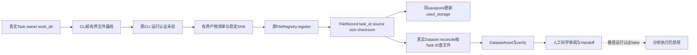

# 下载 S1：FileRegistry 与 Dataset 对账契约修复

日期：2026-10-16。范围：首次 S0+S1；后续阶段按任务书等待独立指令。代码实现和隔离测试不是部署或真实协议认证。下载活动现状已同步至 [CygnusX_download_architecture.md](../../ARCHITECTURE_DESIGN/CygnusX_download_architecture.md)。

## Stage S1 / Gate G1

G1=PASS_ISOLATED（仅本阶段登记/对账合同）；真实Worker/PostgreSQL/Redis/运行/发布仍BLOCKED，完整仓库静态门禁未绿。没有声明任一协议AGENT_EXECUTE_READY，也没有完成S2–S7。

## 实际修改与复用

| 文件/函数 | 改动 |
|---|---|
| infrastructure/celery_app/tasks/download.py `_prepare_download_registration` | CLI前记录有界文件基线到现有Task.parameters；核Task owner/work_dir/local storage；拒绝其他Task共用目录、历史未绑定/内容变化文件，避免下载器先覆盖旧文件再认领 |
| 同文件 `_register_downloaded_files` | 必传真实Task ID；流式实算SHA/size；复用现有FileRegistry.register(source=DOWNLOAD,task_id,checksum)，不再走DataFile/FileRepository；每个真实子目录登记目录链 |
| 同文件 `_finalize_download_files` 与三种CLI分支 | CLI退出后登记完整或部分产物；exit0但缺/空/未完成产物或登记失败不得SUCCESS；现有Task.parameters保存FILES_REGISTERED/PARTIAL/RECONCILIATION_REQUIRED投影，scientific_ready始终false |
| infrastructure/download/outputs.py | 只做有界文件清单、openat/O_NOFOLLOW目录遍历、拒symlink/hardlink/特殊文件、稳定文件SHA；不是新下载器或平行FileRegistry |
| tools/download/config.py DownloadValidationConfig | 增加登记边界默认max_registration_entries=20000、files=10000、bytes=1TiB；可由现有下载YAML覆盖。只限制登记，不宣称传输硬预算 |
| tests/unit/test_download_registration_contract.py | 真实生产登记→FileRegistry/SQLite→Dataset.reconcile；F01–F12及上下文/预算负例 |

既有FileRegistry、DataFile、FileRepository、DatasetImportService/科学验证、Task枚举、DB schema、REST/DownloadRequest和前端均未改。Worker相关回调/参数补类型；原FTP遍历闭包显式绑定ftp/files以通过该文件Ruff，不改变FTP协议策略。没有新增注册表、数据库迁移、后台队列或新的审批系统。

## 实际数据链与事务

基线和登记投影存在原Task.parameters，不新增持久表。每次登记在savepoint中锁真实User行并刷新配额；全部文件/Directory/used_storage同事务写入、交由Worker外层commit。没有复用会提前commit的SqlAlchemyUserRepository.add_used_storage。故障回滚SQL后保留真实文件并记录RECONCILIATION_REQUIRED。登记与实际传输时间/字节/取消的治理仍是S3/S4，不宣称exactly-once或PG并发已认证。

同一路径仅在owner/task/source/hash/size/status/lifecycle/personal均吻合时幂等复用，used_storage不重复增加；空hash/未绑定/其他Task/其他用户一律拒绝自动认领。既有FileRegistry默认返回旧记录的通用语义未全局改变；检查在受控下载调用方完成。下载前已存在无登记文件直接阻断，历史残留保留人工对账。

控制文件包括progress.key、隐藏文件/目录、checkpoint、*_metadata、.aria2、.log、.part、.tmp；有`.aria2`伴随文件的payload不作完整产物。非零退出时可登记已落盘稳定普通文件，Task仍FAILED、登记投影PARTIAL，Dataset仍需重新校验与人工审阅；其SHA只证明当前字节，不能代替源MD5或传输完成证明。登记失败或无文件不提升科研READY。

## F01–F12：FAIL_BEFORE / PASS_AFTER

| ID | 实际测试函数/场景 | 结果与限定 |
|---|---|---|
| F01 | test_f01_f10_real_worker_register_to_dataset_reconcile | FAIL_BEFORE task_id=None；PASS_AFTER真实Task/source/SHA/owner/size |
| F02 | test_f02_f03_f05_multiple_outputs_owners_and_idempotent_quota | 一个Task多个Run/paired文件全部独立登记 |
| F03 | 同上，双用户同名文件 | owner、Task、目录隔离，无跨用户复用 |
| F04 | test_f04_control_files_and_incomplete_payload_not_assets | 控制文件和未完成payload排除；真实文件保留 |
| F05 | test_f02_f03_f05_multiple_outputs_owners_and_idempotent_quota | 重复ID一致、new_bytes=0、无重复配额 |
| F06 | test_f06_f07_existing_records_never_claimed_or_silently_rehashed；test_legacy_disk_file_and_shared_task_directory_require_review | legacy_unlinked/其他Task/owner不自动回填，下载前拒绝旧文件 |
| F07 | 同上 hash_changed参数 | 同路径内容变化拒绝，旧checksum不被覆盖 |
| F08 | test_f08_links_special_and_owner_escape_rejected | 文件symlink、目录symlink、hardlink、FIFO、越界全部拒绝 |
| F09 | test_f09_registry_failure_rolls_back_files_directories_and_quota | 第一文件真实register后注入第二次故障；无残留SQL资产/配额，保留文件及对账投影 |
| F10 | test_f01_f10_real_worker_register_to_dataset_reconcile success/failed参数 | 真实Worker登记→真实Dataset reconcile→Asset，未手工创建FileRecord；COMPLETED或PARTIAL，仍需科学审核 |
| F11 | test_f11_success_without_outputs_requires_reconciliation；test_f12_real_direct_worker_nonzero_preserves_partial_or_rejects_empty_success | 缺目录/空目录/exit0空产物拒绝SUCCESS |
| F12 | test_f12_real_direct_worker_nonzero_preserves_partial_or_rejects_empty_success | 仅替代外层传输结果，真实direct Worker、TaskDomain/Repository、FileRegistry把非零部分文件保留，Task FAILED/投影PARTIAL |

另有registration_limits及context_fails_closed覆盖登记条目/文件/字节限额、伪造owner、缺baseline、存储根错误。所有PASS_AFTER均PASS_ISOLATED，没有PASS_RUNTIME。

## 验证与门禁

完整命令和日志见 `evidence/download-s0/green-and-regression.txt`、`ruff-focused.txt`、`mypy-focused.txt`、`migrations.txt`。运行Python3.11现有.venv，不安装依赖、不更新锁文件。

- 专项契约与下载/Dataset/归档/权限/确认/MCP parity隔离回归：103 passed、5既有quarantine排除，1存量Pydantic warning。测试共108 collected，专用登记25个参数化用例。
- 修改文件Ruff：PASS；Worker/outputs/config聚焦mypy(strict，follow-imports=silent)：PASS；迁移链检查：PASS（没有新迁移）。
- 全仓Ruff、全仓mypy：FAIL，详细输出保留ruff-full.txt/mypy-full.txt；mypy当前1024 errors/225 files。不能据此宣称全仓门禁通过，也不扩大改动处理所有既有域。
- 未改API响应Schema或前端，未做浏览器E2E；真PG/Redis/Worker/MCP transport、共享挂载、网络/取消与完整科研案例NOT_TESTED/BLOCKED。未运行依赖真实服务的下载集成测试。

## 人工UI、Agent与安全不变量

人工三来源API/表单、任务查询契约不变，真实下载程序继续复用；但共享目录/旧未绑定文件将明确阻断要求对账，不再静默跳过或冒领。S4唯一目录实施前，重复accession/首URL产生同目录是已知可用性限制。没有关闭既有URL验证，没有新增网络请求；登记预算不冒充S3传输硬限。

WRITE_RUNTIME_ACCEPTED=False、worker_paths_verified=false、Gateway/Dataset/Agent feature flags保持开工状态。Node/模型没有approve能力或人类JWT；prepare不建Task；下载完成不自动设Dataset READY。新增Task.parameters只是owner Task投影，不把内部绝对路径/凭据加入Agent工具目录。

## 历史文件：legacy_unlinked只读回填计划

本轮不扫描真实用户盘、不回填旧记录。后续先在获授权的owner/项目范围只读列出source非download或task_id缺失或checksum空的候选，结合实际Task.work_dir/来源/创建时间/共享目录冲突生成人工审阅表。时间/路径不能自动证明Task归属；同时记录文件真实SHA、大小与授权，无法唯一证明归属就保持legacy_unlinked。只有另获授权的逐条修复任务可回填，禁止猜Task、改owner、批量重算全用户目录或自动重下。

## 最小回滚与下一阶段

基线文件保存在evidence/download-s0/before；按本轮diff hunk还原Worker/config，并移除仅本轮新增且未被其他修改引用的outputs代码/测试即可；不要全仓reset，不覆盖其他人修改。无DB迁移；保留所有用户文件、FileRecord/Task/Dataset及已写的登记投影，不以删除数据回滚。若已运行新代码，回旧登记会重新丢失新任务关联，须先停止新下载提交并保留owner只读查询；本轮没有部署此变更。

下一阶段S2需独立启动；S3安全与S4可靠性、S5/S6目录/Agent、S7真实运行均未实施。到S0+S1阶段边界停止。
