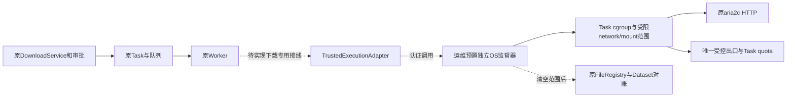

# S3-E1 Trusted Download Execution Boundary

日期：2026-10-16。依据附件S3-E1任务、[运行约束选型](download-s3-runtime-enforcement-closure.md)、[Closure](download-s3-closure-implementation.md)及[下载活动架构](../../ARCHITECTURE_DESIGN/CygnusX_download_architecture.md)。

本轮交付采用任务明确允许的环境不可用分支：**接口设计、依赖清单、测试程序**。没有实现或部署可信OS隔离原型，没有运行下载。S3-E1接口交付完成；真实执行验收NOT_TESTED，G3仍为 **PARTIAL_CODE / RUNTIME_BLOCKED**。以下目标机制均不得误读为已落地。

## 1. 实际修改与现状调查

新增文件：

| 文件 | 实际内容 |
|---|---|
| `src/cygnusx/infrastructure/download/trusted_execution.py` | HTTP专用不可变请求/观察模型、TrustedExecutionAdapter Protocol、停止对账必要条件检查；无具体执行实现 |
| `scripts/check_download_execution_boundary.py` | 只读本进程/proc/cgroup可见性检查，输出固定非认证状态；不连接socket、不执行工具 |
| `tests/unit/test_download_trusted_execution_contract.py` | 拒绝权限自报/任意启动配置/其他协议，以及不安全对账状态的纯契约测试 |
| `tests/integration/test_download_trusted_http_boundary.py` | 九场景真实驱动接口与验收程序；缺环境默认skip，不用Mock实现驱动 |
| 本文 | 边界、依赖、接线方案与交接 |

另向`ARCHITECTURE_DESIGN/CygnusX_download_architecture.md`追加接口现状与本文回指。`evidence/download-s3-e1/`保存工作区基线、HEAD、依赖观察、测试和静态检查。未修改原有生产代码、测试替身、开关、部署、锁文件或数据库；未提交、推送。工作区其他既有修改保留。

当前源码事实：

- `deploy/docker/docker-compose.worker.yml`普通Worker有`.env`、共享数据盘、Docker socket与socket补充组，和其他业务共网。它是有编排能力的共享Worker，不能作为下载进程的最小权限边界。其环境可能有DB、broker和云凭据；本轮没有读取或输出凭据值。
- `infrastructure/execution/binary.py`直接`asyncio.create_subprocess_exec`，仅传stdout/stderr管道与cwd，未显式env，因此默认继承Worker环境。没有任务namespace、quota、cgroup、启动前scope或独立监督。POSIX默认关闭非标准FD并不构成已验证的FD隔离契约；未来必须显式close_fds、不传pass_fds、重建stdin/stdout/stderr，排查CLI后代继承。
- 下载程序当前依赖Worker网络、可写共享目录、HOME/TMP与工具配置；cwd不能限制其他写路径。FTP目录枚举直接在Python Worker联网，EBI还有Rust/wget/fasterq等后代，不可仅包住父CLI。
- TaskService取消当前主要改变Task状态，BinaryExecutor等待父进程；没有整个下载进程树清空证明。Celery退出/SIGKILL不能保证后代结束。
- Service与三来源Worker仍调用原require_download_runtime；TransportAdmission全部拒绝。Gateway WRITE_RUNTIME_ACCEPTED仍False，caller标签不是认证。未改变这些行为。

## 2. 当前环境与权限边界

只读观察`dependencies.json`：当前编码进程UID/GID1000、有效capabilities为0、NoNewPrivs=1；cgroup v2可见，但根目录不可写。Docker socket路径可见，**没有连接或据此推断权限**。这些是HOST_READ_ONLY_NOT_WORKER观察，不能证明某种隔离设施绝对不存在，也不能证明当前运行Worker配置。未提供获授权的非生产Worker、HTTP目标、流量额度、配额卷或监督器入口，因此无法合法实施真实原型或运行案例。

权限分工：可信服务端核JWT/委托、原审批与持久Task归属；运维预置监督器验证这些引用并操作OS设施；CLI仅获固定非root UID、cap_drop=ALL、no_new_privs、只读工具和Task写目录。普通CLI无root、NET_ADMIN、NET_RAW、Docker/其他宿主socket、DB/broker凭据或其他用户文件访问。监督器的OS权限不下放到Worker子进程，不新增下载API、审批、Task表或队列。

## 3. 接口与执行隔离设计



接口请求仅含已有Task/owner及admission/budget引用，协议只支持HTTP。类型校验不是权限认证：引用必须由可信服务端创建，监督器重新从持久状态解析owner、审批、版本/策略和额度，拒绝伪造、过期、重放或跨Task引用。模型不能直接调用接口，不能选择命令、env、路径、镜像或声明certified。观察仅为事实模型，不可作为新放行凭证；运输来源、身份、scope关联及证据完整性仍需具体实现核验。

`start`应在原Task下幂等预留quota、建立scope/租约和策略，再启动原CLI，避免先运行后迁入。重复请求不能产生第二个scope或重置余额。`observe`返回受认证真实计数；`renew`更新有上限的租约；`stop`先断出口再停止整个进程树并等待为空，重复停止幂等。断连视为UNKNOWN，不能fallback到原无隔离BinaryExecutor。Worker退出由独立监督器按租约/deadline清理，不能依赖Worker finally。

本轮**未接线**ExecutionContext/BinaryExecutor，也未允许start调用；后续只在下载路径使用adapter，保留普通工具执行方式。监督器作为OS执行设施不重新消费业务队列、不创建另一套业务任务。

## 4. 网络、磁盘与生命周期约束

首条只认证锁定digest的aria2c、单个自有HTTP源。网络namespace必须与宿主/DB/Redis/其他Task隔离；只能访问可信出口。显式代理变量不是边界；IPv4/IPv6、原始socket、替代DNS/代理、私网/回环/元数据均覆盖。出口执行真实DNS解析结果与实际连接绑定，重新解析重新核验。HTTP每跳重定向重新认证，未批准地址/端口立即拒绝，故障不直连fallback。CLI环境白名单，HOME/TMPDIR只指Task目录，不继承no_proxy/代理或云配置；禁用户aria2配置、RPC监听、自更新/安装依赖。

实际网络预算选择**Task边界同步放行的RX字节**，包含头部、失败响应、重试及重复Range，不能用Content-Length或文件长度代替。所有连接原子共享持久额度，进入Task前扣减，不足拒绝该包/块；所选实现必须定义计量层、并发、包合并/分片与最多放行量，证明其硬上界。另记录上游收到和边界丢弃量；Task可接收硬限不等于互联网账单上限。本轮无计量实现，不宣称零超调。HTTPS密文逐跳、FTP数据通道、EBI及云后端均不纳入首条认证，继续BLOCKED。

磁盘要求每Task独占project quota或等价受控容量卷，块与inode同时硬限；输出、HOME、TMP、cache/checkpoint、解压/转换后代全部在受限写域。rootfs/工具只读，不暴露额外可写挂载，禁止硬链接/挂载逃逸。XFS只是候选，需真实FS/quota证明；NFS等不能套用假定。稀疏逻辑长度、实际块、内存tmpfs分别计量；单文件RLIMIT_FSIZE和cgroup IO限速不等于任务盘硬配额。父卷保留运维余量，EDQUOT、ENOSPC、inode耗尽均应产生失败与部分文件对账，不转SUCCESS。

超额/取消/Worker丢失：同步断出口→终止scope所有后代→确认空→原稳定文件扫描/FileRegistry savepoint登记→原Task失败/取消/待对账投影。`require_quiescent`仅检查必要状态、身份关联和计数未越界，不执行停止/登记、不能认证自报观察。仍有活进程、出口未断、计数缺失、scope不明均保留文件和额度待对账。重启监督器先默认断出口、扫描租约，不盲目重下；续传沿用同Task余额。租约最长存活时间须在E2明确并实测。

## 5. 测试程序与证据

无副作用检查：

```bash
.venv/bin/python scripts/check_download_execution_boundary.py --output /tmp/e1-dependencies.json
LITELLM_LOCAL_MODEL_COST_MAP=True MPLCONFIGDIR=/tmp/cygnusx-matplotlib \
.venv/bin/pytest tests/unit/test_download_trusted_execution_contract.py \
 tests/unit/test_download_s3_closure.py tests/unit/test_lifecycle_download_security.py \
 tests/unit/test_download_worker_protocol_gate.py tests/unit/test_download_registration_contract.py \
 tests/integration/test_download_trusted_http_boundary.py -q -m 'not quarantine'
```

输出文件必须不存在；脚本不覆盖证据。本轮结果 **146 passed、9 skipped、1存量Pydantic warning**（`tests.txt`）。新契约19项通过；9项真实HTTP测试因缺授权驱动明确跳过。其余为现有门禁与登记回归，不能证明真实网络/磁盘/取消。新模块和probe聚焦strict mypy通过；四个Python文件Ruff通过。不宣称全仓门禁通过；未提交，未运行真实DB/Redis/下载器。

真实验收程序的默认fixture只skip，不含模拟下载或Mock证据。运维后续须提供经审查pytest插件覆盖`trusted_http_driver`，实现真实Task/CLI/监督器观察和原Registry查询。插件仅是测试驱动，不是新下载器。当前驱动缺失，九项都NOT_TESTED：

| 场景 | 必须额外采集/证明 |
|---|---|
| small_file | exit0、非零真实RX/块量、文件SHA/size、真实FileRecord与Task关联 |
| unauthorized_address | 未授权地址实际连接被拒，IPv4/IPv6/私网与直连探针均失败 |
| unauthorized_redirect | 自有源跳转到受控未授权目标，出口记录拒绝，目标无请求 |
| unknown_length | 无Content-Length的小文件正常完成，按真实累计量结算 |
| network_over_budget | 在授权小额度内测试超量、重试、多连接，实际放行不超硬限 |
| disk_quota_exhausted | 小容量独占卷，块/inode硬拒绝，其他Task/父卷不受影响 |
| cancel | 原授权取消路径触发断出口，进程树为空，状态不能成功 |
| worker_sigkill | 杀隔离测试Worker后独立租约清理，记录最长残留时长 |
| partial_reconciliation | 失败后真实部分文件稳定，原登记/对账无伪造READY |

测试程序只校验通用停止/原因条件，场景动作、来源认证、实际计量和FileRecord/SHA验证由真实驱动承担；插件未实现前不具备完整运行验收能力。每例保存Task ID、scope、镜像/工具hash、策略版本、计量位置与单位、初末/峰值、quota报告、停止原因、空进程树及文件/FileRecord证据。越权用受控未授权测试端点，禁止扫描生产地址。审查插件及证据后才能认证，pytest绿色本身不发布协议。

## 6. 兼容性、回滚与S3-E2准入

保留原 `Download Task → FileRegistry → FileRecord → DatasetAsset → DatasetVersion`，登记依然计算真实SHA，不手填记录、不新增表或迁移。API、DTO、队列和审批哈希不变；未新增第二套业务流程。请求HTTP限定只是候选接口范围，人工和Agent均未获得执行权限。后续认证应绑定环境、Worker/CLI digest、出口/quota策略版本、期限及独立caller通道授权；全局switch不能独自放行，不认证协议一律BLOCKED。

回滚仅移除本轮五个新增文件与相应架构补充；证据可按现有运维留存规则保留。不要整文件恢复既有脏文件，不删除Task、FileRecord、Dataset、用户文件或历史哈希。由于未接运行路径，业务无需回滚开关或数据库。

尚未通过：具体OS监督器/adapter实现、不可绕过出口、原子RX硬限、真实FS quota、FD/env隔离、Worker死亡清理、现有取消接线、认证引用解析、预算恢复与九场景证据。**S3-E2真实执行准入不通过**；只可在明确授权后开展隔离环境实施。

E2入口须提供：非生产Worker/DB/broker与测试owner/project；自有HTTP目标/未授权受控目标；明确字节/盘/inode/时长上限和清理范围；运维预置监督器、任务quota卷、唯一出口及审计接口；固定CLI/镜像；可信admission/budget解析和审查通过的真实测试驱动。先证明禁止直连、私网/IPv6逃逸和所有写路径硬限，再运行小文件。不能直接翻生产开关验收；FTP、HTTPS、EBI与三云需各自认证，不随HTTP自动开放。本轮到此停止。
