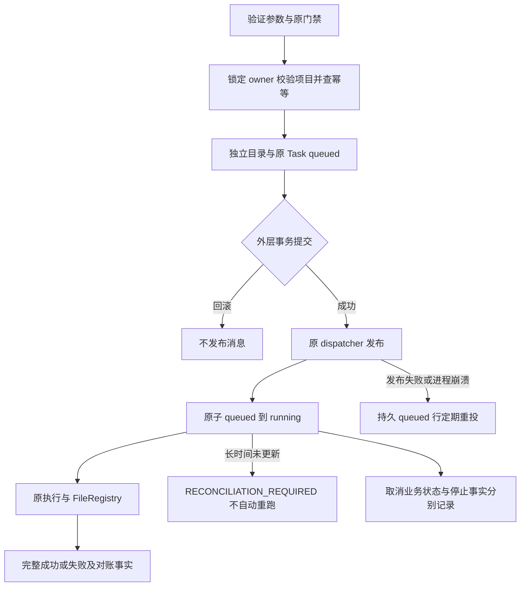

# S4-A Download Task Reliability & Reconciliation

日期：2026-10-17。结论：本报告列出的可靠性能力为 **PASS_ISOLATED**；真实 PG、broker、Celery Worker、进程停止为 **RUNTIME_BLOCKED**，无 PASS_RUNTIME。真实下载仍关闭。

## 1. 当前代码基线

HEAD：`51011118535f782f5282f638b4a54649c79bf6d6`。共享工作树已有大量修改，基线清单见 `evidence/download-s4a/status-before.txt`。已阅读完成工作汇总、S3 closure、S3 trusted boundary、S5-C2 和下载架构。本轮复用原 Task、dispatcher、Celery、FileRegistry 和 Dataset 确认体系，无新表或迁移。下列修改范围仅描述本轮增量，不把整仓 diff 归入 S4-A。

## 2. 任务生命周期

## 3. 事务与队列一致性

原 DownloadService 在调用方 get_db commit 前 enqueue，Worker 可能先读不到 Task，回滚也可能留下消息。现在 submit 只保存 Task 并登记 Session after_commit 通知；外层 commit 后才调用原 enqueue_task，savepoint commit 不发布，rollback 清除通知。

发布失败不撤销已提交 Task。原 queued 行承担持久待投递事实，复用现有 Task 状态，不新增平行业务队列。原 Celery beat 每 600 秒扫描最多 100 个超过 10 分钟未更新、带可靠性版本标记的 queued/running 行，使用 FOR UPDATE SKIP LOCKED；先提交再对 queued 重投。通知后崩溃或消息重复可能产生重复投递，Worker 的原子条件 UPDATE 仅允许 queued 首次转 running；其他状态不执行下载。

该机制提供可恢复的至少一次发布与保守执行领取，不声称分布式 exactly-once。beat/原队列不可用时恢复延迟；需要部署验收证明调度活性。没有运行 Worker 或连接业务数据库。

## 4. 实际幂等约束

规范化参数按 source 构造：SRA 含 accession、method、线程、dry_run；直链含有序 links、线程、覆盖与递归策略；云存储含规范 provider、object_uri、recursive；均含规范目标父目录，并绑定 owner 与可信 project。协议保留在 method/URL/scheme 中，不把不同 URL 参数或链接顺序擅自视为等价。

SHA-256 canonical JSON 摘要记录下载意图，复用 Task 原 idempotency_key 唯一索引。请求键独立绑定 owner/project；同键修改意图报 DOWNLOAD_REQUEST_CONFLICT。不同键但同一活动意图复用原 Task，并持久保存键别名，终态后别名仍绑定原 Task。不同用户或不同项目不复用。

幂等窗口为对应 Task 保留期，无自动 TTL。无键相同摘要和已使用显式键都会返回原终态；失败或取消后的显式重试使用新 request_key，创建新 Task/目录。已有活动任务时新键仍加入该任务，不并发新建。参数变化且新键可建立新意图；同键变参拒绝。历史无版本/摘要的任务不自动推断幂等或重投，不扫描共享目录猜归属。

提交时锁定原 User 行，串行化同 owner 的数据库事务，唯一索引作为最后约束。SQLite 协作并发调用测试通过，但不证明 PostgreSQL 多连接行锁；该项 RUNTIME_BLOCKED。键别名查询以哈希过滤候选并精确检查列表成员，不根据字符串命中直接复用。DatasetImportService 传可信 project 和 ingestion ID/请求序号派生键，沿用原确认，并把 task_ids 与对应 Task 在调用方事务提交。

## 5. 工作目录隔离

默认 downloads 或用户根内规范相对父目录下，以来源可读标签、UTC 秒时间与原子递增序号 mkdir 分配唯一子目录。用户可见目录不含 Task UUID；Task.work_dir 保存精确路径。拒绝绝对路径、上跳与反斜线；仅受管 local backend，逐层 dir_fd + O_DIRECTORY/O_NOFOLLOW 拒绝符号链接。目录占用则换序号，不覆盖旧目录。

下载控制文件、临时文件和最终产物均属于该 Task 专属目录，继续由 S1 扫描规则判断哪些可登记。数据库回滚可能遗留空目录，不自动删除，也不按该目录猜历史归属。用户根上级的恶意并发重命名仍依赖受管存储边界，真实挂载与权限需运行验收。

## 6. FileRegistry 对账

保持 Task → 原 FileRegistry → FileRecord → Dataset。沿用下载前基线、稳定输出扫描、链接/特殊文件拒绝、owner/task/source/实测 SHA-256/size 一致性、savepoint 和配额原子登记。重复登记不重复扣费，错误关联与改变内容不得冒领。

非零退出可保留完整部分文件，但 Task 不成功；exit 0 无完整输出或登记失败保留 RECONCILIATION_REQUIRED，不写虚假 SUCCESS。登记异常回滚注册和配额，不删除落盘文件。scientific_ready 保持 false。取消后 finalize 不继续自动登记，记录恢复待对账事实；FileRegistry 锁与取消行锁使晚到终态不能复活取消任务。

## 7. 取消与恢复语义

TaskService 接受取消时保留 request_accepted=true、process_tree_stopped=false、egress_revoked=false、reconciliation_required=true。CANCELLED 只证明业务取消已接受；没有证据表示已发出可信进程终止、进程树停止、出口撤销或配额文件对账完成。未调用全 Worker revoke/kill。原 BinaryExecutor 使用 create_subprocess_exec 并等待进程退出，仅取消输出 drain 协程，没有按 Task 取消的可信进程树停止或出口撤销接口；Celery revoke 也不能替代此事实。

TaskRepository 对下载取消行拒绝迟到覆盖；success/failed 不被相反状态覆盖，同状态仍可补错误详情。领域服务对已取消下载的迟到状态请求返回当前事实；Worker 正常终态响应采用保存后的 Task 状态。

running 超过扫描阈值只标记不确定，不直接认定死亡或失败，不自动重启进程。阈值也可能命中安静的健康任务，投影表示需要检查而非死亡证明。人工先核实 Task.work_dir、原 Task/FileRecord/SHA/配额及可信进程/出口状态，再按原 Dataset reconcile 处理；不得只重置 running 为 queued，因为无法证明旧进程已停。queued 重投只处理本版本行，历史任务保留原样。

## 8. 实际修改文件

代码路径相对 src/cygnusx：

- infrastructure/download/reliability.py：提交钩子、摘要、原队列投递、有限扫描与恢复投影。
- application/schemas/download.py：可选 request_key。
- application/services/download_service.py：owner/project、幂等、独立目录、提交后通知。
- application/services/dataset_import_service.py：原 ingestion 的可信项目及稳定请求键。
- application/services/task_service.py：取消事实投影。
- domain/task/services.py、infrastructure/database/repositories/task_repository.py：下载终态保护。
- infrastructure/celery_app/tasks/download.py：领取、恢复任务、取消登记保护及实际终态响应。
- infrastructure/celery_app/celery.py：复用 beat 注册恢复扫描。

测试：新增 tests/unit/test_download_s4a_reliability.py，调整原 test_download_service.py、test_dataset_import_handoff.py 的调用契约与替身。原登记测试继续复用；未手工伪造 FileRecord 关联。文档：本文、下载活动架构和罗盘接续状态。

## 9. 代码与测试证据

证据目录：evidence/download-s4a/，不要求随 Git 分发。

| 验证 | 结果 | 日志 |
|---|---|---|
| 全下载专项与 Dataset import/handoff | 240 passed / 1 warning，7.71s，exit 0 | delivery-regression.txt |
| 最终新增可靠性专项 | 16 passed / 1 warning，0.76s | final-focused.txt |
| 聚焦 Ruff 修改源码与测试 | exit 0 | ruff.txt |
| 4 个相关源文件 mypy | 5 errors / 1 file，exit 1 | mypy-final.txt |
| 迁移链检查 | 依赖、拓扑与唯一 head 通过 | migrations.txt |

两组测试有重叠，不累加；最终完整回归包含新增 3 项边界测试。测试命令前缀：LITELLM_LOCAL_MODEL_COST_MAP=True MPLCONFIGDIR=/tmp/cygnusx-matplotlib .venv/bin/pytest；全量文件为 tests/unit/test_download*.py 与 tests/unit/test_dataset_import_handoff.py，参数 -q -m "not quarantine" --tb=short；最终专项只选 test_download_s4a_reliability.py。

专项经过真实 DownloadService、TaskRepository、SQL事务、目录操作、提交事件、TaskService、恢复函数和 Worker 领取；替身只隔离 broker/执行器等外部副作用。SQLite facade 不实现真实异步 PG 连接并发；asyncio.gather 验证业务重入，不等于多事务 PG 压测。复用 S1 的周期唤醒 fixture 适配本沙箱受限 self-pipe，不修改业务 IO 或声称原 upload 问题已修复。

覆盖重复意图、并发调用、请求键冲突与别名、owner/project 隔离、终态重试、commit 失败、rollback/savepoint、broker 失败、重复 Worker 消息、取消晚到写和历史行不重投。原登记集合覆盖真实 FileRegistry 幂等配额、登记失败回滚、部分产物、链接、内容/归属变化及配额变更。

mypy 剩余 5 项位于原 TaskRepository 的 dict/Row 缺泛型参数区段；本轮新增 rowcount 错误已修正，不宣称 strict 或全仓门禁全绿。Pydantic 弃用 warning 与进程退出后的 OTel/Loguru closed-stream 日志保留，不能作为观测系统通过证据。

## 10. 未完成的 PG / Redis / Worker 验收

真实 PG 行锁、多连接竞争与故障 commit；真实 broker 断连、重复投递、ack/crash；beat/Worker 重启活性；Redis 进度/确认关联；进程树停止、网络出口撤销、真实协议传输，全部 RUNTIME_BLOCKED / NOT_TESTED。沿用 C2 报告的环境限制，本轮没有探测或试写默认业务库，也未取得 PASS_RUNTIME。

## 11. 与 S3 TrustedExecutionAdapter 衔接

本轮只保证业务事务、领取和对账事实，不实现受信 OS supervisor。原 DownloadService 和 Worker 的 require_download_runtime 保留，真实执行仍需原 TrustedExecutionAdapter 的受信边界、出站限制、传输硬预算及停止凭据。running 恢复和 cancellation 投影明确缺乏这些事实，不将 Task 状态冒充 adapter 停止回执。无新下载器、Gateway 或确认旁路。

## 12. 风险与回滚

提交后 broker 发布仍为同步原 dispatcher，可能增加 API commit 返回延迟；broker 接收后应答丢失会重复投递，由原子领取保护。恢复依赖 beat/队列可用，10 分钟阈值是保守对账策略，无存活证明。User 行锁影响同用户并发吞吐；请求键别名长期增长需后续治理。数据库回滚可遗留空目录；Task 保留期影响幂等窗口。

回滚逐 hunk 撤回本轮 schema/service、提交钩子、领取、beat 与状态保护，必须评估是否重引入提交前投递和取消复活风险。不要整文件 checkout/reset 覆盖共享改动。无迁移或生产写入需要撤销；保留用户文件、Task、审批、已登记资产和历史事实。

## 13. S4-A 验收结论

限定范围 PASS_ISOLATED：提交后投递及持久重投、请求幂等与独立目录、重复领取保护、失败登记兼容、取消事实和保守恢复契约已落代码并通过上述测试。PG/broker/Worker/OS 运行验证 RUNTIME_BLOCKED；无 PASS_RUNTIME。DOWNLOAD_TRANSPORT_RUNTIME_ACCEPTED=False、WRITE_RUNTIME_ACCEPTED=False，DOWNLOAD_EXECUTION_READY 仍 FALSE。未部署、启动未授权 Worker、迁移、提交、推送、清理工作树或执行真实下载。

## 14. S4-B 建议

在授权隔离 PG/broker/Worker 环境验证同用户多事务竞争、提交/发布故障矩阵、beat 与 Worker crash 活性、进程监督器回执及恢复流程；再评估键别名上限、扫描阈值配置和可观测性。进程存活/停止事实未闭合前，不自动重放 running。继续完成 G3 和逐协议认证，之后按能力评审执行开放；不通过翻转开关制造通过。
