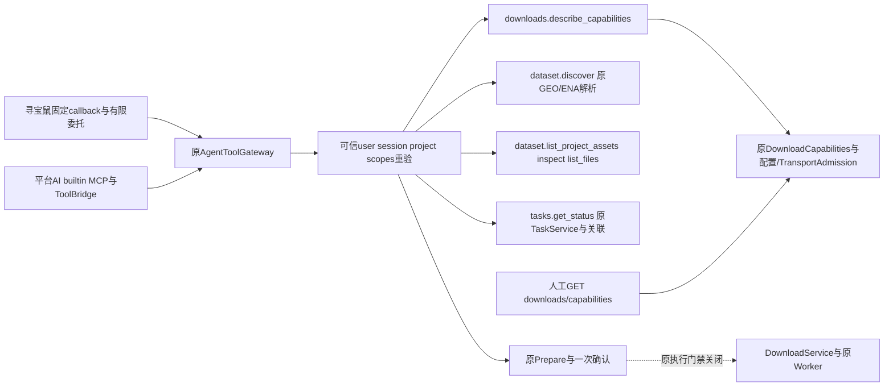

# S5-A Unified Download Capability Catalog

日期：2026-10-16。只读目录增量，代码/隔离验证完成，非部署或运行认证。G3保持 **PARTIAL_CODE / RUNTIME_BLOCKED**。依据当前[下载架构](../../ARCHITECTURE_DESIGN/CygnusX_download_architecture.md)、[共享Gateway架构](../../ARCHITECTURE_DESIGN/CygnusX_agent_tool_gateway.md)和[S3-E1运行准备报告](download-s3-e1-runtime-validation.md)。

## 1. 基线与代码复用

| 既有组件 | 本轮复用/修改 |
|---|---|
| AgentToolGateway / ToolCapability / CAPABILITY_MODELS | 保留注册表、工具名及输入Schema；扩展原downloads.describe_capabilities结果及现有过滤，不新增Gateway/MCP Server |
| DownloadCapabilities / DownloadSourceCapability | 原v1 DTO增加字段与12类细分capabilities；原sources四项、方法参数和人工接口保留 |
| describe_download_capabilities | REST/Gateway继续消费同一服务端配置/协议策略投影，无CLI探测，无Worker认证推断 |
| GeoMetadataAdapter / DatasetImportService.discover | 保留固定来源、accession校验、有界元数据解析，不暴露任意URL抓取工具 |
| DatasetService / 原Repository / Handoff | 项目Dataset列表补有界版本ID，沿原inspect/list_files获取真实资产；授权仍由原owner/project查询及FileRecord复查执行 |
| TaskService / FileRegistry | Task状态仍由原Service读取且要求session/project关联；文件登记不改、不因查询造Task/FileRecord |
| 两类Prepare / 原确认服务 | 参数和审批消费不改；无嵌套Prepare或重复确认；执行仍阻断 |

基线在`evidence/download-s5a/status-before.txt`。共享工作区有大量先前改动及未跟踪文件；以下文件清单仅说明本轮hunk，不能整文件回滚。没有提交、推送、部署、迁移或真实下载。

## 2. 目录与接口



复用工具：`downloads.describe_capabilities({})`返回原v1信息、新`capabilities`、当前`available_tools`。每项包含配置、代码、认证事实、状态集合、阻断limitations、required_scope、requires_project、经裁剪query_tools；Gateway另投影project_context_available。没有新增执行工具或模型可设置的认证参数。Gateway按当前能力注册表裁剪query_tools，不承诺展示的来源一定有获授权解析工具。

`dataset.discover({accession})`复用GEO/SRA/ENA来源解析器；元数据只说明来源证据与待审核项，不证明传输、科研完整性或READY。`dataset.list_project_assets({})`仍返回Dataset列表，新增每个Dataset的versions（ID/number/status）；全局最多查询200个最近版本，每项提供version_query_limit=200，空列表不证明Dataset无历史版本。用既有`dataset.inspect/list_files({dataset_id,version_id})`进一步读取资产。

`tasks.get_status({task_id})`要求原owner及当前session/project关联，不提供任意用户全部Task枚举。修复开启Dataset读且无项目时fallback构造UUID(None)的问题，返回原NOT_FOUND而不是内部错误。

这些查询不创建业务Task、目录、确认或执行下载；Gateway仍按既有审计契约写AgentToolInvocation与flush，因此“只读”指业务操作，不表示零审计写入。

## 3. 修改文件

- `application/schemas/download_capability.py`：扩展原DTO，states由服务端模型验证器重新派生；认证字段固定UNKNOWN、execution_allowed固定False，不接受请求自报认证。
- `tools/download/config.py`：构造12类能力，复用原配置启用语义和TransportAdmission原因码；增加未启用原因，保留四项legacy sources和limits。
- `application/services/agent_tool_gateway.py`：按ToolCapability.agents及scope裁剪；dataset.discover同时要求read:discovery；调用重验后与原可信scope取交集；上下文目录投影、版本ID及无项目Task fallback修复。
- `application/services/agent_tool_delegation.py`：验证签名、token_version、project、防重放后，将token scope与最新服务端scope的交集带入Gateway，避免目录查询扩回完整权限。
- `tests/unit/test_download_s5a_catalog.py`：本轮23项隔离测试；不改旧替身或生产开关。
- 两份活动架构追加现状回指；本文与`evidence/download-s5a/`记录验收。

## 4. 十二类能力与状态语义

states是正交标签，不能当单一生命周期：CODE_AVAILABLE表示实现存在；CONFIGURED表示相关服务端feature/scheme启用；UNKNOWN表示没有可信运行认证；EXECUTION_BLOCKED表示该科学文件传输不可执行；NOT_IMPLEMENTED表示没有对应实现。RUNTIME_VERIFIED保留给未来可信认证消费，本轮没有任何条目可产生该状态。代码/配置不探测二进制存在，也不自动认证。

以下为本机SOURCE_ONLY安全投影快照，**不是Worker或生产配置**，见`catalog-source-only.json`。所有条目的runtime_verification均UNKNOWN，execution_allowed均False。

| 能力 | 代码 | 本机CONFIGURED | 只读入口/限制 |
|---|---|---|---|
| GEO Metadata | CODE_AVAILABLE | 否 | dataset.discover，Dataset读开关与双scope；仅有界元数据 |
| NCBI SRA | CODE_AVAILABLE | 是 | 原EBI aws候选、原resolver；无运行认证，BLOCKED |
| ENA FASTQ | CODE_AVAILABLE | 是 | 原EBI ftp候选、ENA filereport；原raw导入仍只选解析SRR，BLOCKED |
| GEO Supplementary | CODE_AVAILABLE | 否 | 权威附件选择/原processed导入；需metadata与direct配置，BLOCKED |
| HTTP Direct Link | CODE_AVAILABLE | 否 | 无任意URL Agent fetch，BLOCKED |
| HTTPS Direct Link | CODE_AVAILABLE | 否 | 无任意URL Agent fetch，BLOCKED |
| FTP | CODE_AVAILABLE | 否 | 控制/数据通道未认证，BLOCKED |
| OSS | CODE_AVAILABLE | 否 | 原云CLI，BLOCKED |
| TOS | CODE_AVAILABLE | 否 | 原云CLI，BLOCKED |
| OBS | CODE_AVAILABLE | 否 | 原云CLI，BLOCKED |
| Cloud Drive | NOT_IMPLEMENTED | 否 | UI占位，PROTOCOL_UNSUPPORTED，BLOCKED |
| Existing Dataset Assets | CODE_AVAILABLE | 否 | 原项目Dataset/版本/资产查询，无新外部传输；需Dataset读开关及项目 |

元数据和已有资产的transport_required=False指不执行科学文件下载；不表示元数据解析无需网络。其读功能是否可调用由query_tools、项目/scope和原feature检查共同决定；runtime_readiness旧BLOCKED字段保留兼容，不用于判断元数据读功能已验收。查询运行证据为空时不捏造Worker版本。

## 5. Agent与权限矩阵

| 条件 | 寻宝鼠 | 平台AI |
|---|---|---|
| Schema | 同一CAPABILITY_MODELS | 同一CAPABILITY_MODELS |
| 身份 | 原签名委托→active owner/session/project→防重放与scope交集 | 原平台上下文→同一Gateway重验 |
| Catalog | tool_gateway_read_enabled且read:discovery | 相同；ai-assistant模块独立控制 |
| 来源解析 | Dataset读开关且read:datasets与read:discovery | 相同 |
| 项目资产 | 当前获授权项目及read:datasets | 相同 |
| Task | read:tasks、owner/session/project关联 | 相同；不继承另一会话Task关联 |
| Prepare | prepare:download、当前项目、原参数校验与一次确认 | 相同 |
| execute | 原写门禁BLOCKED，委托不含执行/批准 | 原写门禁BLOCKED，人类批准也不自动执行 |

downloads禁用会裁去发现/Prepare，files禁用裁去Dataset/Prepare，tasks禁用裁去Task；Agent入口禁用或会话/项目撤权会在调用重验拒绝。无项目仍可查询公共来源目录/元数据，但项目资产和Prepare明确拒绝；目录标识requires_project和project_context_available，不能绕过业务检查。未知agent_kind不出现在目录中。模型参数不得提供owner/project/session/scopes/caller_kind/runtime_verified等额外字段。

FlowAgent尚无可信下载Gateway委托接线，本轮不为它添加ToolCapability.agents或发放scope，不将现有Flow计划提交适配当作下载授权。

## 6. Prepare职责与无执行保证

`downloads.prepare`仍接受accession及aws/ftp方法，只对SRR/PRJNA候选构建项目目录参数和原一次确认；GSE/GSM返回NEEDS_METADATA_RESOLUTION，不创建下载Task、目录或伪造预算。

`dataset.prepare_import`仍接受原ImportPrepare：accession、mode(raw/processed)、selected_ids、name、request_key、max_bytes及可选dataset_id。它基于权威来源、科研选择/预算，持久化原Ingestion预案及确认；不嵌套调用downloads.prepare。受原Dataset开关、项目owner、downloads模块及prepare scope约束。预案创建不是人类批准；批准/消费仍走原人类JWT确认流程，模型不能自批。所有实际execute依然被原源码门禁拒绝。

## 7. 测试与证据

本轮新增23项覆盖：12类协议/未实现与未认证；配置变化不认证；模块禁用；无项目；跨用户/项目；scope缩减；Agent入口/类型不匹配；读开关/运行门禁关闭；两个Agent共用Schema；真实SQLite Dataset版本与原FileRecord资产查询；固定来源解析；Prepare仅单确认；查询不执行；人工REST原v1响应验证。

源码状态与最终联合测试命令：

```bash
LITELLM_LOCAL_MODEL_COST_MAP=True MPLCONFIGDIR=/tmp/cygnusx-matplotlib \
.venv/bin/pytest tests/unit/test_download_s5a_catalog.py \
 tests/unit/test_agent_tools_phase2.py tests/unit/test_dataset_gateway_phase3.py \
 tests/unit/test_download_transport_contract.py tests/unit/test_dataset_import_handoff.py \
 tests/unit/test_dataset_phase3_review.py tests/unit/test_download_s3_closure.py \
 tests/unit/test_lifecycle_download_security.py tests/unit/test_download_worker_protocol_gate.py \
 tests/unit/test_download_registration_contract.py -q -m 'not quarantine'
```

最终结果 **237 passed、2 warnings，6.18s**，见`final-regression.txt`；不得累计各轮数字。两warning来自存量Pydantic及原测试短JWT key。隔离范围为SQLite、内存确认、httpx MockTransport/ASGITransport及业务submit哨兵，无真实网络/Redis/PG/Worker。初次新增用例因测试断言误取未初始化确认store、版本fixture缺initiated_by出现2失败，随后仅修正本轮fixture/断言；原失败日志`s5a-tests.txt`保留。新增人工ASGI测试曾因同步依赖在沙箱中等待而中断，日志`asgi-interrupted.txt`保留；只改本轮测试为异步身份依赖后最终集合通过，不改旧fixture，不解除执行开关。

四个源文件聚焦strict mypy通过（`mypy-final.txt`），五个Python文件聚焦Ruff通过（`focused-ruff.txt`）。全仓Ruff **288项错误**、mypy **1022项错误/223文件**，报告未命中本轮五个文件；不将其声称全绿或擅自扩大本轮修复范围。没有跑全仓pytest、真实集成或浏览器E2E；未提交所以不宣称达到提交/发布门禁。

## 8. 运行门禁与人工入口

DOWNLOAD_TRANSPORT_RUNTIME_ACCEPTED=False和WRITE_RUNTIME_ACCEPTED=False均未变。没有可信网络出口、任务RX/磁盘硬预算、独立进程监督或可信协议认证消费；Catalog也不提供自报认证接口。所有科学文件传输继续拒绝；只读目录完成不提升G3或S3-E2准入。

人工`GET /downloads/capabilities`保留原v1四项sources和limits，仅增加安全说明字段与12项capabilities，FastAPI响应模型实测通过。POST入口、人工权限/确认、DTO、DownloadService、Worker及前端按钮逻辑均未改；不恢复人工下载。查询读取安全配置，不返回凭据或绝对binary路径。

## 9. S5-B / S6接续及回滚

S5-A只读代码/隔离测试完成。S5-B若继续做目录消费/展示，应复用这些Schema，补授权环境中的双用户/双项目Node callback与builtin MCP实际接线、Redis/PG审计及权限撤销测试；当前读开关不因本轮自动启用。S6执行准入仍依赖G3可信运行闭合及逐协议/版本认证、原审批、恢复/硬预算对账；不得借目录绿色开放执行。FlowAgent须先补可信委托和权限裁剪，再评审接入，不自动继承寻宝鼠权限。

回滚仅撤回本轮DTO/config/Gateway/委托scope相关hunk及新测试和文档增量；不能整文件恢复覆盖其他工作，不删Task/FileRecord/Dataset/审批或历史数据。scope交集与模块拒绝属于权限修正，若回滚必须重新审查原缺口。无schema迁移或部署回滚。本轮按S5-A边界停止。
