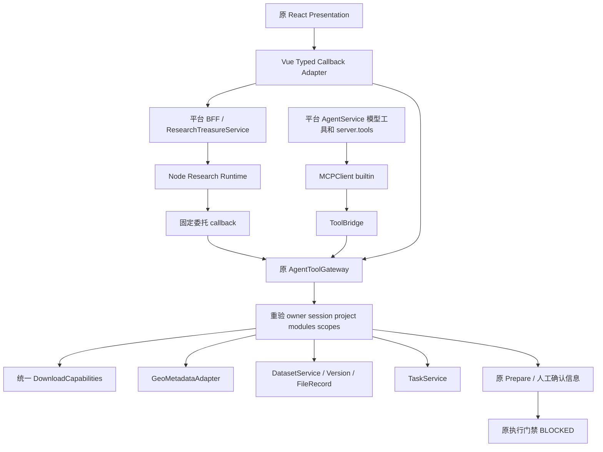

# S5-B Shared Download Capability Consumption

核实日期：2026-10-16。验收范围为当前工作树代码与隔离测试，结论 **PASS_ISOLATED**。G3 仍为 **PARTIAL_CODE / RUNTIME_BLOCKED**，不代表全平台 Agent Runtime 或部署认证。未执行真实下载、分析、迁移、发布或 S6。

## 1. 实际工作树基线

主仓 HEAD：`51011118535f782f5282f638b4a54649c79bf6d6`。工作树已有大量修改、删除及未跟踪文件，包含 S5-A 和 S5-B 实现；本次未覆盖、恢复或提交这些文件。完整当前清单见 `evidence/download-s5b/verification/status.txt`，早期实施快照见上一级 `status-before.txt`。子模块 SHA 见 `verification/submodules.txt`；FlowFrame 与 Treasure-Seeking_Mouse 含内部未提交内容，父仓指针不能交付这些内部改动。

源码默认 `tool_gateway_read_enabled=False`、`dataset_discovery_readonly=False`、`dataset_import_write=False`、`agent_download_write_enabled=False`。`WRITE_RUNTIME_ACCEPTED=False` 和 `DOWNLOAD_TRANSPORT_RUNTIME_ACCEPTED=False` 保留。未开启真实环境开关。以架构权威库 README、下载架构、Gateway 架构及当前源码为依据，S5-A 报告仅作阶段证据。

## 2. 组件复用与真实调用链

| 组件 | 消费方式 |
|---|---|
| ToolCapability / CAPABILITY_MODELS | 同一 capability ID、输入模型和目录，不复制业务 Schema |
| DownloadCapabilities / describe_download_capabilities | 同一服务端状态、限制与来源 DTO |
| ResearchTreasureService / Node adapter | 服务端生成有限委托与目录，固定 callback |
| AgentService / MCPClient / ToolBridge | 共享工具进入模型函数集合及 server.tools，实际 builtin 分派到 Gateway |
| GeoMetadataAdapter / DatasetImportService | 权威 GEO/ENA 元数据及既有导入预案 |
| DatasetService / DatasetVersion / FileRegistry | 当前项目版本与资产归属查询，不新建资产系统 |
| TaskService | owner/session/project 关联后的真实状态 |
| ToolConfirmationService / DownloadService | 原人工批准及执行路径；本轮仅 Prepare，执行门禁关闭 |

Node `platformToolAdapter` 只消费可信 envelope 中 read/confirmation 工具；URL 由运维配置，模型参数不能选择 callback、owner 或 scope。委托不进入模型 Schema，错误不自动重试。平台 AI 的 research tool pack 声明共享工具；AgentService 同时登记 MCP server.tools，避免只有 function Schema 而运行时找不到 server。Legacy/LangGraph 沿现有工具查找执行，Gateway 最终重新授权。无第二套 Gateway、下载器、MCP Server 或任务表。

## 3. Schema、目录及科研查询

两个 Agent 复用 `capability_catalog` 输入 Schema，ToolBridge 与 callback 返回同一 Gateway 结果；Result 中 runtime、provenance 和错误由同一业务服务派生。身份可以有不同的可见集合。catalog 先裁剪，invoke 再重验，不能由历史目录授予永久权限。

`downloads.describe_capabilities` 展示十二类能力、query_tools、当前项目上下文、阻断原因。CODE_AVAILABLE 不代表 RUNTIME_VERIFIED；React 投影 executionAllowed 固定 false，不相信异常结果的 true。默认读功能关闭时展示不可用，不自动开开关。

`dataset.discover` 复用 GEO Series/Sample、SRA、ENA 和 supplementary 元数据解析；固定来源、真实 accession、有界响应和来源证据保留。缺失 size/checksum、未解析 Run、未知数据类型保留缺口；不猜 URL，不把 GSE/GSM 交给 SRR 下载器。真实外部 GEO 网络此次未验证，解析器和 callback 使用隔离响应。

`dataset.list_project_assets` 返回最近最多 200 个版本的有界查询结果；空结果不证明没有历史版本。`dataset.inspect` / `dataset.list_files` 复用版本、FileRecord owner/project 复查，资产角色、可用性、checksum 状态保留，UNKNOWN 不提升 READY。Vue 当前用 inspect manifest 展示资产；list_files 仍供共享模型工具直接查询。

`tasks.get_status` 从原 TaskService 查状态，先检查 owner 与当前 session/project 关联。恢复只使用持久引用，不造 Task ID，不把预案成功、聊天文字或历史 proposal state 当 Task 成功。

`downloads.prepare` 是通用受控 SRR/PRJNA 预案；科研文件选择走 `dataset.prepare_import`，持久化原 Ingestion 和单次确认，不嵌套第二份 downloads.prepare。预案不创建下载 Task、不传输文件；批准仍须原人类 JWT 端点，执行仍阻断。既有 request_key 幂等语义保留，通用跨入口全局去重不作新增保证。

## 4. React / Vue 与权限恢复

保留 Composer、DatasetCard、LiteratureCard、ToolTrace、GroundingNotice、Next Shovel、SessionSidebar、主题及双语。Typed Action 和 ResearchWorkflowPanel 增量展示来源、候选、已有资产、版本、能力限制、预案及真实 Task；DatasetCard 的 inspect 与资产按钮依赖服务端 allowedTools，Prepare 还要求项目。Vue 网络结果只投影展示白名单，不向 React 传凭据、内部目录或 Worker 路径。

每次 action 刷新服务端目录；session/project/action generation 检查丢弃迟到结果。项目切换清空预案绑定、权限及旧视图。历史恢复不恢复执行授权；读取真实 Task 状态。异常清空权限和历史审批展示，Prepare 失败不重放。SSE 路径保留 interrupted/error 终态，收到平台工具事件后仅重新读记录。jsdom 验证会话/项目迟到响应、权限变化、历史恢复和中断后的读恢复；不宣称真实浏览器刷新/SSE 网络 E2E 已验收。

Gateway 每次读取 active user/session/project，验证 Agent 类型和模块权限，与原 scopes 取交集，拒绝旧 context 静默采用另一项目。委托验证签名、TTL、token_version、project、scope、call_id 防重放；撤销通过当前用户/会话/项目状态及 token_version 生效，不存在新增按 jti 单独撤销 API。API Key 不可替代委托身份，也不能由参数覆盖 owner。

## 5. FlowAgent 最小接入契约与缺口

实际适配器：`Protocol/FlowFrame/FlowAgent/src/tools/platform.ts`。当前用 `FLOWAGENT_PLATFORM_API_KEY` 及配置或参数 project_slug 调用 `/api/v1/runs/snakemake/plan`，工具由本地 registry 静态发现；没有 Gateway session、download scope、可信 callback 委托。Plan API Key 不是下载授权。

后续接入最小契约：由平台认证用户选择项目和 active session，服务端派生 agent_kind、scope 交集与短期 audience-bound 委托；服务端输出同一 catalog，固定 callback，每次调用重验撤权、TTL、token_version、nonce 和项目。应先定义可见只读集合、错误和审计关联，再评审 ToolCapability.agents；本轮不加入 FlowAgent、不自动下载、不改 FlowFrame。

## 6. 实际文件与本次核验增量

既有 S5-B 工作树接线涉及：`data/ai/tools/research.yaml`、`application/services/agent_service.py`、`agent_tool_gateway.py`、前端 `useResearchWorkflow.ts`、`TreasureResearchWorkbench.vue`、`types/treasureIsland.d.ts`、`researchWorkflow.test.ts`、后端 `test_download_s5b_consumption.py`；Treasure 子仓的 `platform-tools.ts`、`platform-catalog.test.ts`、`platform-tools.test.ts`、island contract/panel、DatasetCard 和双语资源。完整 dirty 清单不能等同本阶段独占修改清单，禁止整文件回滚。

本次续作新增一个 adapter 中断恢复用例，重新导出当前 Python 目录、执行现有回归、保存 verification 证据并补齐本文。没有重做 S5-A。子仓已有修改保持未提交，若后续提交，必须先在子仓审查并提交，再记录父仓指针。

## 7. 自动化测试与证据

当前重跑原始结果位于 `evidence/download-s5b/verification/`：

| 检查 | 结果与边界 |
|---|---|
| backend.txt | 250 passed / 2 warnings，SQLite、内存确认、防重放与元数据替身、ASGITransport；不是真实 PG/Redis |
| frontend-final.txt | 9 files / 48 passed，jsdom，包括新增中断恢复用例 |
| types.txt | npm run type-check 通过 |
| node-direct.txt | 3 个具名适配器用例通过 |
| node-catalog-direct.txt | 当前 Python 导出目录的 1 个跨语言用例通过，fetch 替身 |
| ruff.txt / migrations.txt | Gateway 与新增后端测试 Ruff、迁移拓扑通过 |

后端命令为 `.venv/bin/pytest` 加 `LITELLM_LOCAL_MODEL_COST_MAP=True MPLCONFIGDIR=/tmp/cygnusx-matplotlib`，测试集合见 backend.txt：S5-B、S5-A、agent_tools_phase2、dataset_gateway_phase3、dataset_import_handoff、dataset_phase3_review、download_s3_closure、lifecycle_download_security、download_worker_protocol_gate、download_registration_contract、download_transport_contract、research_treasure_phase1，参数 `-q -m 'not quarantine'`。Vue 执行 `npx vitest run src/components/research src/views/__tests__/ResearchAgentWorkbench.test.ts`。

Node 使用 `node functions/seqout-chat/tests/platform-tools.test.ts` 及 `CYGNUSX_TEST_CATALOG_PATH=<verification/shared-catalog.json绝对路径> node functions/seqout-chat/tests/platform-catalog.test.ts`。后者必须显式传目录，否则内部测试跳过；不能用默认 runner 的文件汇总冒充具名覆盖。目录从当前 `capability_catalog(include_dataset=True)` 导出。

覆盖双 Agent Schema/实际 builtin 和 ASGI 分派、目录禁用、模型身份/运行状态伪造拒绝、双用户项目归属、无项目公共查询与 Prepare 拒绝、版本/FileRecord、单确认、scope 缩减、过期、token_version 撤销、重放、模块/项目/会话失效及无下载副作用。已有测试复用范围见对应文件；这些都是隔离断言，不能提升为真实网络集成。

早期 S5-B build、image/runtime 验证日志保留在上一级；本次不将其作为当前全量发布门禁。既有 mypy-final.txt 记录 AgentService 7 个类型错误，不能称严格类型全绿。未执行提交、全量提交门禁或生产部署。

## 8. 真实运行阻断、回滚与验收

真实 Node→FastAPI 网络、PG 行锁/事务、Redis 防重放/确认、外部元数据及浏览器 E2E：**BLOCKED / 未获得证据**。四个 Node 测试虽真实运行 Node，但 callback 为 fetch 替身。默认读开关关闭，隔离 fixture 开启不代表生产可用。Worker 出站、协议、预算、恢复和传输认证没有因 Catalog 通过而改变。

回滚先关闭现有读/callback 配置，仅撤销本阶段相关 hunk；保留 Task/FileRecord/Dataset/审批事实与 S5-A 安全修正。无新增表、迁移或独立系统可清理。禁止整文件 checkout 覆盖共享工作区改动。

S5-B 代码隔离验收 **PASS_ISOLATED**：两 Agent 消费同一目录与业务 Schema，权限按身份裁剪，科研查询可分派，Prepare 不执行，项目/会话隔离、能力禁用和原 Presentation 保留，执行门禁保持。真实全栈验收仍 BLOCKED；不升级 G3，不宣称全平台 Runtime 已认证。

S6 进入条件：先在授权隔离部署补真实 Node/MCP/PG/Redis、双用户双项目、权限撤销和浏览器恢复证据；完成 G3 可信执行边界、逐协议/版本认证、预算及恢复对账，再评审原人工审批后的执行准入。不得仅改 feature flag 或接受模型自报 runtime_verified。本轮止于 S5-B。
