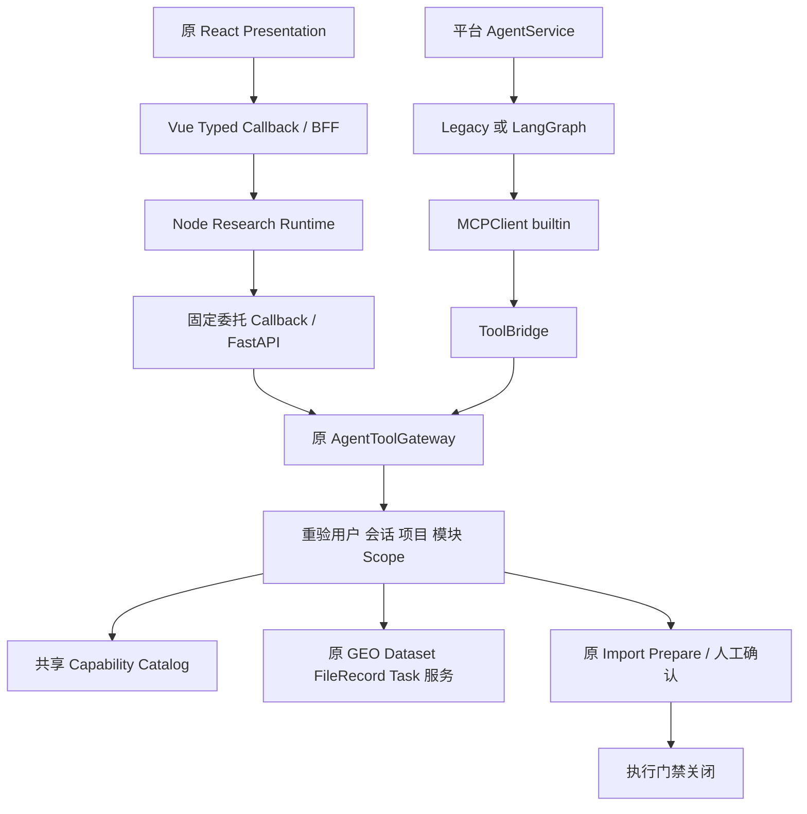

# S5-C 共享 Agent 运行验收与交接罗盘

原始调查日期：2026-10-17。本文保留当日调查事实；2026-10-18 接续状态见下方“当前状态入口”。本文不替代 `ARCHITECTURE_DESIGN/` 中的架构权威文档，文档存在不意味着运行验收通过。

## 当前状态入口（2026-10-18）

本文件路径为 `docs/implementation/download-s5c-agent-runtime-acceptance.md`。它记录 S5-C 原始调查，不是当前 R3/G3 的完整验收记录。接续工作仍未获得真实运行或浏览器验收通过：R3 为 `PARTIAL_ISOLATED / RUNTIME_BLOCKED`，G3-E2 为 `PARTIAL_CODE / RUNTIME_BLOCKED`；S6 为 `NOT_READY`，S7 尚未开始。隔离测试通过只证明对应子断言，不提升父项状态。

| 需要了解 | 当前入口 |
|---|---|
| 下载与 S0-S5 总导航 | [下载模块罗盘](download-compass.md) |
| R3/G3 当前决策、S6/S7 条件与下一步 | [Agent Runtime 验收罗盘](cygnusx-agent-runtime-acceptance-compass.md) |
| IAT-R3 Runtime/UI 已实现范围及运行缺口 | [IAT-R3 闭环记录](cygnusx-iat-r3-runtime-ui-closure.md) |
| G3-E2 可信 HTTP 客户端、回执门与宿主限制 | [G3-E2 运行记录](cygnusx-g3-e2-trusted-http-runtime.md) |
| 本轮逐项状态 | [2026-10-18 验收矩阵](../info/26.10.18/CygnusX_Integration_Test_Matrix_2026-10-18.csv) |
| 原始测试、环境记录、摘要和哈希 | [IAT-R3/G3-E2 证据目录](../../evidence/iat-r3-20261018/) |
| S6/S7 交接结论 | [交接记录](../../evidence/iat-r3-20261018/handoff.md) |

本轮组合隔离回归为 165 项通过，mTLS evidence 客户端专项为 18 项通过；两者均不是部署运行验收。真实 PostgreSQL、Redis/Broker/Worker、Node/API、浏览器产品链和 Supervisor/宿主强制执行环境仍无本轮可用证据。执行和写入门禁保持关闭。要重跑 BLOCKED 项，先提供有授权的专用非生产运行栈和身份；不得使用默认业务服务代替。

## 1. 目标与当前位置

目标是验证科研寻宝鼠和平台 AI 能在真实运行链路中安全消费统一 Download Capability Catalog，完成来源发现、Dataset/FileRecord 查询、Task 状态读取与 Import Prepare。本阶段不执行真实文件下载，不实施 S6。

当前定位：S5-A/B 已有隔离验证；S5-C **真实运行验收尚未通过**；G3 仍为 **PARTIAL_CODE / RUNTIME_BLOCKED**。本轮只整理文档，不继续排障、部署或开放功能。

## 2. 基线与证据入口

S5-C 调查时主仓 HEAD 为 `51011118535f782f5282f638b4a54649c79bf6d6`。工作树有大量既有未提交修改，不能将整份 dirty 清单视为本阶段独占改动。调查清单及子模块状态见 `evidence/download-s5c/status-before.txt`、`submodules.txt`。

- 架构依据：[下载架构](../../ARCHITECTURE_DESIGN/CygnusX_download_architecture.md)、[Gateway 架构](../../ARCHITECTURE_DESIGN/CygnusX_agent_tool_gateway.md)、[执行框架](../../ARCHITECTURE_DESIGN/CygnusX_agent_execution_framework.md)。
- 阶段证据：[S5-B 报告](download-s5b-agent-capability-consumption.md)、`evidence/download-s5b/verification/`。
- S5-C 证据：`evidence/download-s5c/`。环境探针是调查时快照，不能据此断言当前服务仍不可用。

## 3. 调用拓扑与复用原则

继续复用同一 Capability ID、输入 Schema、业务结果、错误语义和来源字段；权限按 Agent 身份裁剪，不强制两类 Agent 权限相同。不新增 Gateway、MCP Server、下载器、任务表或审批系统。

## 4. Node Callback 与平台 AI 证据

Node 现有适配器消费平台签发的目录及有限委托，向固定 callback 发送 capability ID、arguments、call_id。模型不能提供可信 owner/project/scopes，不能选择 callback URL。S5-B 有 3 个适配器用例及 1 个跨语言目录用例通过；它们使用 fetch 替身，不能作为真实网络成功证据。真实 Node→FastAPI 的目录、GEO/SRA、Dataset、FileRecord、Task、Prepare、错误和超时行为仍需验收。

平台 AI 的 Schema 进入 AgentService 模型函数集合及 MCP server.tools。Legacy 和 LangGraph 均有 MCPClient 分派路径，但两条完整 Runtime 链尚未取得运行通过证据。不能仅据 Schema 注册或直接调用 MCPClient 宣称完整 Runtime 已认证。

调查发现通用聊天上下文与 Gateway 上下文的差异。当前 `tool_bridge_service.py` 已含派生逻辑：上下文缺少 scopes 时，从可信 user/session 获取 `platform_ai` Gateway 上下文；已有 scoped context 不扩权。这段修改已在 2026-10-17 读回源码确认，但其最终回归未完成，不列为已验收修复。后续应先核验此处，而非再建适配层。

## 5. PostgreSQL 与 Redis

`environment.json` 记录调查时未提供专用测试 DSN、未找到 postgres/redis-server 可执行文件，且 TCP/Unix socket 绑定被拒绝。没有使用默认业务数据库来试写。`redis-integration.txt` 记录现有真实 Redis 测试因缺少 redis-server 而跳过。

PG 待验证：User/Project/Session、DatasetVersion、FileRecord、Task 归属，原导入预案持久化、并发和事务回滚。Redis 待验证：委托 NX 防重放、确认 TTL、多进程单次消费、故障拒绝；token_version 撤销还需结合 PG 当前用户状态验证。SQLite 和 MemoryStore 均不替代这些证据。

## 6. 双用户双项目权限矩阵

在授权非生产环境准备 User A、User B，以及至少两个项目和对应 active session。若验证同用户切换，应明确将两个项目授予 A，并另建 B 的资产用于跨用户拒绝。

| 场景 | 必须观察到的结果 | 当前证据级别 |
|---|---|---|
| A 查询 A 当前项目 | 仅返回获授权版本、文件和关联 Task | 隔离证据，真实 PG 待验 |
| A 查询 B Dataset/Task | 拒绝且不泄露内容 | 隔离证据，运行待验 |
| A 从项目一切换项目二 | 旧 context、旧预案与迟到响应不能投影到新项目 | 隔离证据，E2E 待验 |
| owner/project/scope 参数伪造 | Schema 或授权层拒绝 | 隔离证据，运行待验 |
| token_version 更新、过期或重放 | 重新调用被拒绝 | 隔离证据，真实 Redis 待验 |
| 模块关闭、项目撤权、会话归档 | 调用时重新拒绝，UI 刷新按钮状态 | 隔离证据，E2E 待验 |
| 无项目 | 可按授权查公开元数据，拒绝项目资产及 Prepare | 隔离证据，运行待验 |

## 7. React / Vue 浏览器验收

保留原 Composer、DatasetCard、LiteratureCard、ToolTrace、GroundingNotice、Next Shovel、SessionSidebar、主题与中英文。Vue adapter 负责网络及权限投影，不向 React 暴露凭据、内部目录或 Worker 路径。

真实 Chromium 清单：GEO 卡片、来源证据、文件候选、资产与版本、Capability 状态、Import Prepare、执行不可用提示、项目切换、会话切换、浏览器刷新、SSE 中断、历史恢复、撤权后按钮。每项需记录截图或可重复步骤及服务端关联，不得用 jsdom 替代。

`browser-probe.json` 记录调查时 Chromium 因只读运行目录失败，自动化依赖也未找到。当前没有本阶段真实浏览器通过证据。禁止展示虚假进度、伪造 Task ID、将 Prepare 显示为执行成功或使 BLOCKED 协议可执行。

## 8. Capability 发布状态

| 操作维度 | 已有证据 | 运行发布结论 |
|---|---|---|
| DISCOVERY_READY | PASS_ISOLATED | BLOCKED：真实元数据与 Agent 网络链待验 |
| CATALOG_READY | PASS_ISOLATED | BLOCKED：真实双入口链待验 |
| DATASET_READ_READY | PASS_ISOLATED | BLOCKED：PG 及项目权限运行待验 |
| TASK_READ_READY | PASS_ISOLATED | BLOCKED：真实 Task 关联待验 |
| PREPARE_READY | PASS_ISOLATED | BLOCKED：PG/Redis 原预案链待验 |
| AGENT_RUNTIME_READ_READY | 局部隔离证据 | BLOCKED：完整 Legacy/LangGraph/Node 待验 |
| DOWNLOAD_EXECUTION_READY | 无运行认证 | BLOCKED：源码门禁继续关闭 |

没有任何项目在本报告中获得 PASS_RUNTIME 或 PASS_E2E。CODE_AVAILABLE 不等于 RUNTIME_VERIFIED，模型不得自报认证。

## 9. 自动化结果与类型归属

S5-B 原验收为后端 250 passed、Vue 48 passed、Node 3+1 具名用例通过，范围与命令见 S5-B 报告，不把这些历史数字当本次重跑。

S5-C `isolated-regression.txt`：**96 passed、9 failed、2 warnings**。9 个 LangGraph 用例均报告测试对象缺少 `_db`；未完成根因归属，不据此断言真实 Runtime 故障，也不能称全绿。已有测试可复用，勿创建更多等价 Mock 框架。

`mypy-current.txt`：AgentService 7 项错误。`mypy-head-shadow.txt` 保持模块路径检查 HEAD，报告 24 项，包含当前 7 项对应的历史错误及旧 capability 变量重名问题；当前 S5-B 已减少这类错误，未发现新增类型错误。`mypy-head.txt` 的直接临时文件检查丢失包上下文，不用于结论。历史 7 项不扩展成本轮全仓重构。

## 10. 下一步执行顺序

1. 重新检查进程、文件和明确授权的非生产服务；环境恢复不等于默认获得生产操作权限。
2. 核验 Bridge 派生逻辑：通用聊天上下文可按当前权限调用，有限 scope 不扩张，错用户/错会话/撤权仍拒绝；复用已有测试 fixture。
3. 复核 9 项 LangGraph 失败的 `_db` 依赖和 fixture，分别记录 Legacy 与 LangGraph 的完整工具轮次证据。
4. 在授权环境运行真实 PG/Redis、Node callback；记录并发、回滚、TTL、重放、故障与超时，禁止自动重放 Prepare。
5. 运行 Chromium 双用户双项目工作流，逐项保存证据，再更新上表；只有相应范围证据完整时升级状态。
6. 仍不执行下载。S6 需单独满足 G3 可信执行、逐协议认证、预算与恢复对账及原人工批准准入。

## 11. 修改、回滚和停止条件

本次用户要求只落盘文档，新增本文；未继续修改程序、运行迁移、提交、推送或部署。此前 S5-C 的 Bridge 增量仍需验证，其他共享工作树改动不得整文件回滚。

回滚文档可移除本文；程序回滚需按阶段 hunk 审查，保持 scope 与 owner/project 安全检查，不删除 Dataset、FileRecord、Task 或确认事实。读/callback 配置可按既有运维流程关闭，但本文不授权变更真实配置。

此前执行通道曾连续无输出，导致报告未落盘；2026-10-17 文档操作已恢复，旧进程及测试结果仍需重新核验。本阶段验收结论继续为 **BLOCKED**，S6 **不准入**。本文完成后停止，不将文档交付等同 S5-C 运行验收完成。
