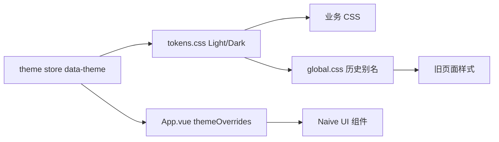

# CygnusX Design System v1

> 2026-10-11 实施记录。现行权威规范为 `ARCHITECTURE_DESIN/CygnusX_frontend.md`；本文只归纳本轮已经落地的约束，不替代该文档。

## 来源与主题

| 层 | 当前来源 | 消费方式 |
|---|---|
| 品牌、背景、文本、状态基础色 | `frontend/src/styles/tokens.css` 的 `:root` 与 `[data-theme="dark"]` | 业务 CSS 使用 `var(--...)` |
| 历史状态别名 | `frontend/src/styles/global.css` | `--arco-success/warning/danger` 及 `-light` 指向 `--status-*/--status-*-soft`；保留既有页面兼容 |
| Naive UI 主题 | `frontend/src/App.vue` | `themeOverrides` 使用与令牌对应的明暗颜色字面量，供 seemly 颜色解析器消费 |
| 聊天局部表面 | `frontend/src/styles/chat-theme.css`、`global.css` | 加载顺序为 tokens → global → chat-theme；深色 `.kimi-layout` 局部规则有更高作用域优先级 |

主题由 `theme` store 设置 `data-theme`，继续遵循既有用户偏好。新增状态色须同时给出浅、深两套基础值和浅底色，并检查 Naive UI 对应的可解析值。不得引入第二组件库。

## 字体、间距和布局

- 字体族由 `App.vue` 的 Naive UI `fontFamily` 及活动规范的排版规则控制；页面不另设全站字体。
- 常规页由 `DefaultLayout` 提供外层 24px padding，`standard-page` 消除仪表板、任务、报告、项目、下载、流程监控页的重复内层 padding。`PageHeader` 在窄屏允许标题换行和操作区折行。
- `meta.fullscreen` 令内容区外层 padding 为零；Header 和 Sidebar 仍由 `DefaultLayout` 提供。AI、Studio、文件工作区按各自内部容器管理滚动，不由本轮抽象出新工作区壳层。
- 圆角、卡片阴影、品牌和状态色优先使用现有令牌。桌面与移动端的实际间距和字级尚待截图验收。

## 组件与交互契约

| 组件/区域 | 已落地契约 |
|---|---|
| 导航 | `navigationRegistry.ts` 一次定义菜单入口与目标；顶部、主侧栏、系统侧栏和管理侧栏从中投影。路由可达性仍以 `router/index.ts` 为准。 |
| 常规页头 | `PageHeader.vue` 支持长标题、窄屏操作换行；不改变页面业务动作。 |
| 任务进度 | `normalizeProgress()` 接受 0–1 或 0–100 输入，输出 0–100 整数并钳制异常值；Dashboard、TaskTable、Downloads 共用。 |
| 数据状态 | 空、加载、失败分开表达；Projects、ProjectDetail、Knowledge 提供失败重试，Files 区分搜索无结果、团队空与个人空。 |
| 媒体预览 | FilePreviewModal 使用已有鉴权下载 Blob 加载图片/PDF，支持打印和对象 URL 回收；真实浏览器 PDF 行为待验。 |
| 键盘操作 | Token 诊断和待处理审批摘要改为按钮，可聚焦并触发既有动作。全站焦点顺序仍待人工检查。 |

## 子品牌边界

关于页与首页允许星尘宇宙装饰，工具页保留生信工具的任务密度，Studio 和 AI 保留自己的工作区信息层级；这些视觉变化仍使用全局主题与路由壳层。About 的英文标语为 `FROM STARDUST, TO DISCOVERY`。装饰 Canvas 标为 `aria-hidden`；动效偏好和对比度仍需在浏览器检查。

## 尚未验收的设计条件

六宽度（1920/1440/1280/1024/768/390）、Light/Dark、Sidebar 展开/折叠、空/正常/加载/错误/权限状态，以及键盘、reduced motion/transparency、forced colors 均尚无浏览器截图证据。请按 `CygnusX_UI_Regression_Checklist.md` 验收后再将设计系统标为完整通过。
