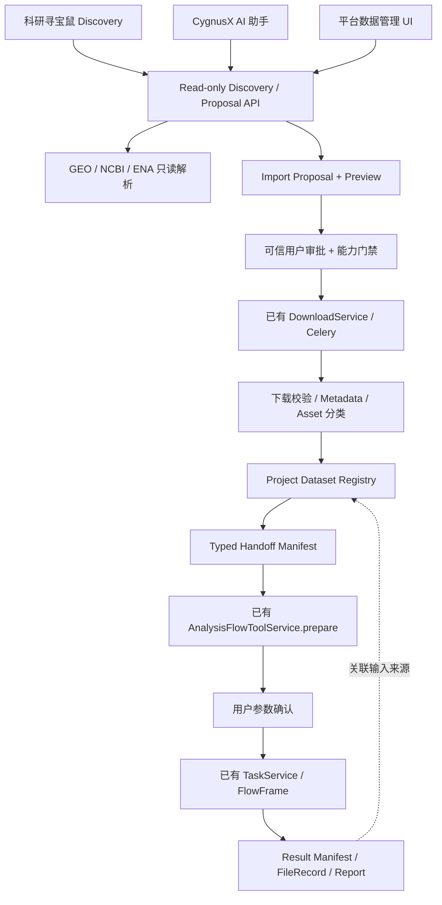

# CygnusX BioOps · Phase 3 实施任务书

## 科研数据资产化、GEO 数据获取与 FlowFrame 输入交接

**English:** Research Dataset Ingestion, GEO Processed-Data Acquisition & Provenance-Aware Analysis Handoff  
**Phase:** 3  
**Priority:** P0/P1（数据契约、数据隔离、安全执行和科研输入适用性为 P0）  
**Mode:** Code Implementation + Database Migration (when justified) + Contract Tests + Isolated Integration Tests + Documentation  
**基线日期：**2026-10-15  
**执行对象：**Codex，工作目录以 CygnusX BioOps（OmicHub）主仓库为主，必要时只读检查关联仓库。

---

# 00. 任务定位与前置约束（必须先读）

你是一名资深 AI for Science 系统架构师、生物信息学工作流工程师、FastAPI/Python 后端工程师、数据库建模工程师、MCP/Agent 集成工程师、数据工程和科研可复现性专家。

本轮需要在当前真实代码基础上实施 **Phase 3：数据发现结果 → 可信数据获取 → 用户项目 Dataset/Asset → FlowFrame 受控分析输入** 的工程能力。

**本轮是实施，不是单纯调查或生成规划。** 但实施前必须对关键依赖进行精确核对，不能把历史审计报告当作当前源码的绝对事实。

优先阅读仓库实际存在的：

- `docs/audits/cygnusx-unified-research-agent-feasibility-audit-2026-10-13.md`
- `docs/audits/cygnusx-phase0a-implementation-2026-10-13.md`（或当前实际文件）
- `docs/implementation/cygnusx-phase0b-runtime-integration-implementation.md`（或当前实际文件）
- Phase 0B Closure 的实施/验收记录（若已存在）
- Phase 1 寻宝鼠深度集成实施记录（若已存在）
- Phase 2 共享 Agent 工具层实施记录（若已存在）
- `docs/audits/cygnusx-runtime-provenance-manifest.json`（若存在）
- 主仓 `ARCHITECTURE_DESIGN/README.md`、下载/Flow/MCP/报告权威设计文档及相关迁移。

若文件不存在，记录 `NOT FOUND`，从当前代码审计，不得凭空补写完成情况。

## 00.1 前置门禁

据此前报告，Phase 0B 的最终结论是 **BLOCKED**：真实 Redis 双进程、STDIO/HTTP MCP、寻宝鼠镜像源码来源及 Worker 实际版本/挂载没有完成全部验收。Phase 1/2 在此前对话中提供过实施提示词，但**没有可在本轮直接认定其已完成的实施证据**。

因此本阶段采用**分层推进**：

1. **允许**：本地数据模型、迁移文件、只读 GEO Adapter、类型识别、Handoff 契约、无副作用 Dry Run、模拟集成测试和隔离 CI。
2. **需确认前置条件后才允许在隔离环境试验**：真实小文件下载、数据导入、分析任务提交，以及新 Flow 的运行测试。
3. **禁止**：在 Phase 0B/Phase 2 所需 P0 门禁未通过时，向寻宝鼠或 AI 助手开放真实下载、分析提交、取消、删除等有副作用的工具；禁止生产部署和访问生产数据。
4. **绝不允许**：通过前端按钮禁用而后端仍可调用的方式“模拟禁用”；必须有服务端能力门禁。
5. 如果 Phase 1/2 尚不存在，Phase 3 的服务端能力应可独立落地，前端和 Agent 接入采用契约/Feature Flag 留待对应前置阶段完成。

**前置阻断不应阻止安全的独立开发，但阻断必须真实保持。**

---

# 01. 目标与不做的事

## 01.1 用户真实场景

### 场景 A：原始 RNA-seq 数据

科研人员向寻宝鼠提出：

> 查找存在健康对照的病毒感染肝脏 RNA-seq 数据，筛选一个合适的公开数据集，展示样本证据，确认后将原始测序数据下载到当前科研项目，并为 RNAFlow 准备分析任务。

系统理想路径：

`自然语言 → GEO 发现卡片 → Accession 解析 → 样本/文件证据检查 → Import Proposal → 用户批准 → 下载 Task → 文件校验 → Dataset + Assets + Samples 注册 → Handoff → RNAFlow prepare → 用户确认 → TaskService → 结果/来源关联`

实际执行边界由 Phase 0B、Phase 2 验收决定。未通过时止于只读预案/受控预览，不执行写操作。

### 场景 B：GEO 原始 counts matrix

科研人员输入：

> 帮我找到公开 RNA-seq 数据的原始基因计数矩阵，下载到项目，并准备差异表达分析。

系统应先判断数据集是否实际提供原始整数 counts 和可匹配的样本 metadata。找到的 `TPM/FPKM/CPM/log2` 不得伪装为原始 counts；未知处理方法必须标记 `UNKNOWN` 或 `REVIEW_REQUIRED`。

通过验证后，为 **counts-only** 分析流程准备输入；如相应 Flow 不存在或未通过验收，则只允许导入与人工审查，不能误调用 FASTQ RNAFlow。

### 场景 C：已有项目数据

用户项目中已有受管理的 FASTQ、counts 或其他科研资产。AI 助手及寻宝鼠应通过相同的数据资产查询与输入匹配服务选择文件，避免复制服务器绝对路径或在不同模块重复上传。

## 01.2 本阶段必须交付

1. 可持久化、可授权、可查询的科研 Dataset 及其来源/版本/文件/样本关联（复用已有模型能力）。
2. 可从 GEO 及权威关联源读取 Accession、样本、关联 Run 和可下载附件的**只读解析层**。
3. 可信 `Import Proposal` + 预检查，支持明确区分 raw 与 processed data。
4. 复用现有 `DownloadService/TaskService/FileRecord` 的真实导入接口和任务状态（启用受前置 Gate 约束）。
5. 资产校验、样本 metadata 与文件匹配、格式/数据类型识别；生成可追溯的 Ingestion/Handoff Manifest。
6. 在现有 Flow 基础上提供受控分析输入匹配；如适合且能测试，新增**独立的 counts-only DEG Flow**，不修改现有 FASTQ 分析算法。
7. 统一数据资产的后端 API 与 Agent 只读工具契约；经过批准的副作用工具复用 Phase 2 机制，不新建授权系统。
8. 自动化测试、迁移与回滚、实施记录、端到端场景证据，以及 Phase 4 准入结论。

## 01.3 明确排除

- 不迁移/合并科研寻宝鼠 Agent Runtime。
- 不重新实现现有 AI 助手、MCPClient、ToolBridge、ToolConfirmationService。
- 不重写 Polariseq/EBIDownload 下载引擎。
- 不重写 RNAFlow FASTQ 比对/定量算法。
- 不将 GEO Series Matrix 一概视为 RNA-seq counts。
- 不引入全量单细胞 H5AD/Seurat/Scanpy 工具链或完整多组学适配平台。
- 不在本轮打造全新的报告系统；只提供现有 BioReport/可复现报告可以消费的输入与来源契约。
- 不因新 Dataset 表就批量迁移或修改已有历史文件的来源字段。
- 不在未授权条件下部署生产系统或运行大型科研下载/计算。

---

# 02. 当前已知基础（全部需再次对照当前源码）

既有审计指出：

| 领域 | 已有基础 | 已知缺口 / 不确定性 |
|---|---|---|
| 寻宝鼠 | 独立 TS Agent 检索、Accession/文献卡片 | 平台身份/Project/Dataset/Task 需依 Phase 1 实际结果核实 |
| 平台文件 | `FileRecordModel`, `SampleModel`, `DirectoryModel`, 用户存储根 | 缺持久科研 Dataset 聚合、来源/样本/校验记录的统一链接 |
| 下载 | REST、内置 Tool、独立 MCP、Celery Worker、DownloadService | 某些 GEO accession 不能原样解析；processed-data 专用适配未发现 |
| 下载程序 | 宿主机曾识别 `EBIDownload 1.4.0`；新 Polariseq 源码另有 1.4.3 | 真实 Worker 二进制版本及 GSE/GSM 能力须单独核验 |
| 分析 | `AnalysisFlowToolService`, `FlowSubmissionValidator`, `TaskService`, 根 flows RNA/ATAC | 平台 counts-only DEG Flow 未发现；真实 Worker 挂载待验收 |
| 报告 | RNAFlow result_manifest、FileRegistry、Report、可复现报告 Job | 输入来源链不完整，不能声称完整 provenance |
| MCP | Phase 0A/0B 已做确认、输入校验和部分运行测试 | 真实外部 transport/Redis 双进程/Owner 全栈可能仍 BLOCKED |

请定位和复用实际代码，例如（相对主仓、路径可能演化）：

- `src/cygnusx/application/services/download_service.py`
- `src/cygnusx/infrastructure/celery_app/tasks/download.py`
- `src/cygnusx/application/services/task_service.py`
- `src/cygnusx/application/services/analysis_flow_tool_service.py`
- `src/cygnusx/domain/flow/submission_validator.py`
- `src/cygnusx/application/services/managed_file_resolver.py`
- `src/cygnusx/models/file.py`, `models/project.py`, `models/task.py`, `models/run.py`, `models/report.py`
- `src/cygnusx/infrastructure/mcp/presets.py`, `mcp-server/tools/`
- `pipelines/RNAFlow/`, `Protocol/FlowFrame/`
- `frontend/src/` 与 `pipelines/Treasure-Seeking_Mouse/`（仅在前置就绪时接入）

不要仅凭同名文件推断其语义；以真实类型、事务、权限与调用关系为准。

---

# 03. 总体架构原则

## 03.1 一份权威资产目录，多入口调用



**图为目标架构，不是当前已实现关系。**

- 工具层不保存独立 Dataset 真相，依赖平台业务层。
- Agent 不能直接写数据库、任意目录或绕过业务校验。
- 下载 Task 与 Dataset 生命周期分开建模。
- 科研事实来源与 Agent 推断必须分离记录。
- 不许用物理文件夹名称替代可信项目授权。

## 03.2 业务能力 vs MCP 包装

先开发和测试后端领域服务，再通过 REST / 现有 MCP Adapter 暴露。

同一操作共享一套 `DatasetService / ImportService / ValidationService`，不因寻宝鼠和 AI 助手的调用来源产生两套实现。

## 03.3 新旧兼容

现有项目目录、FileRecord、Download Task、TaskModel、Run、Result Manifest、Report 不能因新增 Dataset 而失效。历史文件可保持 `unassociated`，用户或授权服务后续显式关联，不猜测来源。

---

# 04. P3-0：前置 Gate 与最小影响面调查

## 04.1 基线固定

执行安全只读命令：

```bash
git status --short
git branch --show-current
git rev-parse HEAD
git submodule status --recursive
git diff --stat
```

记录已有未提交修改，禁止 reset/clean、擅自提交、推送、升级生产依赖或覆盖其他 Phase 的实现。

## 04.2 必须核对

- Phase 0B Closure 是否实际 READY / CONDITIONAL / BLOCKED。
- Phase 1 是否已提供平台可信用户和 project context。
- Phase 2 是否已提供统一工具调用、审批和 Task 关联。
- 若尚未完成：是否可安全实现后端只读功能和隔离导入服务；所有真实 Agent 写操作必须继续 Gate 关闭。
- 现有 ProjectModel 是否有团队成员/共享项目权限；若只有 user_id，不能假设多人共享策略。
- 当前 ORM、Alembic、Repository、Pydantic、API 路由与文件存储抽象。
- 已有命名/版本约定、错误码、功能开关和审计字段。

## 04.3 交付

先生成内部简短实施计划，说明：复用位置、拟新增模型、迁移影响、API 边界、各模块启用条件。不要将此计划当作最终交付。

---

# 05. P3-A：Dataset / Asset / Sample / Source 持久化模型

## 05.1 先查已有模型再建模

查清：

- `ProjectModel` 与用户权限。
- `FileRecordModel` 与 Directory/StoragePathFactory。
- `SampleModel` 是否已有样本与文件关联。
- `TaskModel` / `RunModel` / `ReportModel` 中的 ID 与关联。
- `CaseArtifactVersionModel`、`artifact_manifest`、`result_manifest` 等现有协议。

若现有概念可以拓展，优先扩展；只有明确缺口才增加新表。不要把临时 Manifest 文件误认为完整的可持久化 Dataset。

## 05.2 最小数据实体（候选，必须适配实际架构）

### Dataset

建议包含：

- `id`：内部不可猜测标识。
- `project_id`：经授权校验的项目 ID。
- `owner_id` 或可映射到真实资源 ACL 的所有者。
- `name`、`description`。
- `assay_type`：如 bulk_rnaseq、microarray、scrna；不确定为 unknown。
- `organism`（权威元数据原值及标准化值可分别保存）。
- `status`：READY / REVIEW_REQUIRED 等独立状态。
- `created_at`、`updated_at`、`schema_version`。
- `current_version_id`（如需要版本化）。

### DatasetSource

- 来源仓库与 accession（GSE、GSM、SRR、SRX、PRJNA 等）。
- 多层级 accession 关系，而非只保存单个 GSE 字符串。
- 原始 URL / 下载页面 / 来源文件路径。
- 元数据抓取时间、来源 API 与版本、可验证证据。
- 公开/受控访问状态与未知状态；不要代替用户判断许可。

### DatasetAsset

- 关联 `FileRecord.id`（或现有权威文件表主键）。
- `asset_role`：raw_reads、raw_counts、normalized_expression、metadata、annotation、manifest、other。
- 文件格式、大小、校验和、校验状态、compression。
- 所属 DatasetVersion、关联下载任务。
- 导入状态与文件可用性。
- 原始附件文件名与归一化安全存储名分别记录。

### DatasetSample / SampleAssociation

- stable sample_id 与 source GSM/run accession。
- 样本展示名、分组、组织/物种、测序平台等。
- 多个 Run 对一个样本、一份矩阵涵盖多个样本的关系。
- `metadata_evidence` / 用户手工修正记录。
- 对未经核实的分组保留 unknown，不能自动当作 Ground Truth。

### DatasetVersion / IngestionRecord

- 版本号、状态、来源快照、资产集合指纹。
- Import Proposal 与实际任务关联。
- 操作者/发起者与审批证据关联（仅存可信引用，不存原始令牌）。
- 错误、人工修正与重试历史。

若业务需要可以合并实体，但应说明为何仍满足唯一性、权限、历史和溯源要求。

## 05.3 数据库约束与迁移

- 明确主键/外键、删除策略与索引。
- 同一用户项目下的重复 Accession 不自动视为同一数据版本。
- 支持多个来源 accession 关联一个 Dataset、一个 Dataset 多个文件。
- 对候选唯一键应区分 `source_identity` 和 `import_attempt_id`。
- 不允许跨用户绑定其他人的 FileRecord。
- 数据库迁移采用增量、可回滚策略；不得破坏已有记录。
- 对旧记录不得批量赋予未经验证的来源或项目身份。
- 在旧版本共存时说明 API 与 ORM 兼容策略。

## 05.4 Repository 与权限

所有查询和关联写入都必须走后端可信 Principal 和 Project 权限服务；`project_id`、`owner_id` 不可因模型参数填写而成为授权依据。

- owner 查询按作用域过滤。
- 共享项目按真实 ACL 决策，缺少 ACL 时保守拒绝。
- 跨项目 Dataset 迁移需单独鉴权。
- FileRecord 挂接 Dataset 之前重新验证归属与状态。
- 不能允许用户直接通过 dataset_id 猜测访问其他人的资源。

## 05.5 验收

同项目多文件/多样本、多 GSE/GSM/SRR 关系、跨用户/跨项目、历史未关联文件、版本升级与回滚均有隔离测试。

---

# 06. P3-B：GEO Discovery Metadata / Accession Adapter

## 06.1 独立只读领域服务

围绕以下能力设计候选接口（名称不作硬要求）：

- `geo.resolve_accession(accession)`
- `geo.get_series_metadata(gse)`
- `geo.list_samples(gse)`
- `geo.list_supplementary_files(gse_or_gsm)`
- `geo.resolve_related_runs(gse_or_gsm)`
- `geo.get_data_availability(accession)`

首先检查寻宝鼠已有 NCBI/ENA/Seqout 代码是否可复用或通过服务接口获取结构化结果。不要直接复制整个 Agent 工具循环到平台后端。

## 06.2 解析原则

必须正确区分：

- GEO Series：GSE。
- GEO Sample：GSM。
- GEO Platform：GPL。
- SRA Study/Experiment/Run：SRP、SRX、SRR，及其他命名空间。
- BioProject：PRJNA 等。
- ENA 与 SRA 的多层映射。

**GSE 不一定直接对应某个 FASTQ，GSM 也不保证只有一个 SRR。** 应构建可溯源关联图，不依赖字符串拼接或假定 1:1。

对 GEO supplementary 与 Series Matrix 仅报告文件候选、格式线索和元数据，不自动认定矩阵统计类型。

## 06.3 外部源健壮性

- 只允许受信任的 GEO/NCBI/ENA 主机或经过明确审核的附件源。
- 限制 SSRF、任意 URL、重定向到内网、本地文件协议。
- 设置超时、速率限制、重试上限、并发限制。
- 符合来源服务的使用条款和 API 速率要求。
- 尽可能利用缓存及条件请求，保留抓取时间/原始响应摘要。
- 网络不通时返回结构化 `UNKNOWN/UNAVAILABLE`，不能捏造数据和下载链接。
- DOI、论文链接、样本特征应能链接到来源证据；LLM 总结单独标为 inference。

## 06.4 只读 Discovery Candidate 契约（示例）

```json
{
  "schema_version": "1.0",
  "candidate_id": "candidate_demo",
  "repository": "GEO",
  "primary_accession": "GSEXXXXXX",
  "assay_type": "bulk_rnaseq",
  "organism": {"value": "Homo sapiens", "evidence": "source_metadata"},
  "samples": [],
  "related_accessions": [],
  "files": [],
  "source_evidence": [],
  "confidence_flags": ["sample_group_needs_review"],
  "status": "NEEDS_REVIEW"
}
```

这是逻辑契约示例，实际字段与平台 DTO 命名对齐；不应将示例 accession 作为真实记录插入数据库。

## 06.5 验收

GSE/GSM/GPL/SRR 映射、缺失关联、多 Run、多样本、没有 supplementary 的数据集、外部失败/超时、含糊分组、未知许可状态均需覆盖。

---

# 07. P3-C：Import Proposal、原始数据导入与项目资产登记

## 07.1 两段式导入

`prepare_import` 必须只生成预案，至少包含：

- 来源和权威 Accession。
- 候选文件/Run 与下载方式。
- 项目与目标资产集合（由后端可信上下文解析）。
- 可用元数据、文件类型猜测和来源证明。
- 已知文件大小与未知大小提示。
- 预计总量（仅在可验证时显示，否则 unknown）。
- 重复资产与正在执行的导入识别。
- 存储配额预检查与容量边界。
- 需要用户确认的科学信息和操作。
- 是否存在受控访问或使用限制。
- 来源 URL/host 安全检查结果。
- 后端规范化参数摘要。

`execute_import` 为有副作用的操作，必须复用 Phase 2/0A 的可信确认、业务校验、幂等键和服务端能力门禁。

## 07.2 禁止跨层绕过

- Agent 不得直接调用 `POST /downloads` 绕过确认。
- Agent 不得自行指定任意绝对路径。
- 如果 Phase 2 工具层未 READY，`execute_import` 只能在隔离测试被验证、生产能力关闭。
- 已经在用户网页主动点击执行的行为，采用可信 Web 授权，避免重复审批但必须同样验证。
- 任何审批参数变化必须令旧确认失效。

## 07.3 原始 FASTQ 导入

- 首先权威解析 GSE/GSM/SRX/SRR；不允许盲目把 GSE 原样传给旧 EBIDownload。
- 复用现有下载 Worker；明确其可接受的 Accession 种类和 `method` 参数。
- 同步记录 source_run、read layout、library information（有证据才标注）。
- SRR/SRA 到 FASTQ 的转换是否存在，必须读取当前真实代码，不可假设。
- 文件双端配对、文件命名、sample_sheet 映射需经过验证。
- 上传/下载完成后由 FileRecord 与 DatasetAsset 形成可信关联。
- 失败或部分成功必须显式保留错误状态、已验证资产与可重试范围。

## 07.4 下载任务与资产生命周期不要混淆

推荐分开管理：

**ImportJob / Ingestion 状态：** `PREPARED → APPROVED → QUEUED → RUNNING → VERIFYING → COMPLETED`，带 `FAILED/PARTIAL/CANCELLED/NEEDS_REVIEW` 分支；按当前任务状态机适配。

**Dataset 状态：** `DRAFT / IMPORTING / VERIFYING / REVIEW_REQUIRED / READY / INVALID / ARCHIVED`（名称只是建议）。

一次 Task 完成，不代表 Dataset 即刻 READY；文件通过校验和样本审查后才能供下游使用。

## 07.5 幂等与补偿

- 在调用已有 DownloadService 之前检查相同规范化参数的幂等键。
- 不重复消费相同审批记录。
- 网络超时后先查询是否已有 Task，不盲目重发。
- 对 `SUBMITTING` 或部分完成状态提供对账/恢复规则。
- Redis、DB、队列之间不宣称拥有严格 exactly-once。
- 不默认覆盖同名文件；冲突进入新版本/显式确认。

## 07.6 安全与资源预算

- 阻止目录穿越、符号链接逃逸、硬链接/特殊文件滥用（按实际平台支持范围）。
- 限制下载源重定向到内网/云元数据地址。
- 下载前进行可用空间/配额预检查与保守预算；未知大小时明确上限策略。
- 超大数据超限后安全中止或标记 PARTIAL。
- 用户文件管理路径与 Worker 真正挂载必须一致，不能仅通过字符串检查证明。

---

# 08. P3-D：GEO Processed-Data Adapter（重点）

## 08.1 与原始 FASTQ 通路分开

构建专用 GEO processed-data Adapter，负责：

1. 查找 GEO Series / Sample 的 supplementary files。
2. 标明 Series Matrix、TXT/TSV/CSV、GZ/TAR、MTX/10X、H5/H5AD 等文件候选。
3. 结合 GEO 官方元数据和文件内容做安全的格式识别。
4. 展示文件大小、来源、压缩格式、候选用途与不确定性。
5. 经用户批准调用已有 direct-link/对象存储下载能力；不要复写完整下载传输器。
6. 安全解压与预览结构。
7. 生成处理后数据资产和样本 metadata 的对应关系。
8. 登记数据类型、来源、处理方法线索、证据及限制。

## 08.2 安全文件探测与解压

- 优先流式读取必要头部/小样本，禁止无上限整体读入内存。
- TAR/ZIP/GZ 解压有最大文件数、总展开大小、单文件大小和展开比例限制。
- 防 Zip Slip、symlink、hardlink、绝对路径条目、特殊设备文件。
- 文本识别限制行数/列数/编码与文件大小。
- 拒绝不受信任的远程执行脚本或任意二进制反序列化。
- 对 H5/H5AD 不要随意反序列化为任意对象；仅作为资产管理或经已验证的解析器处理。
- 文件内容的文本说明属于不可信数据，不能作为 Agent 系统指令。

## 08.3 科研数据类型分类（必须严格）

候选类型：

- `RAW_FASTQ`。
- `RAW_INTEGER_COUNTS`。
- `NORMALIZED_EXPRESSION_TPM`。
- `NORMALIZED_EXPRESSION_FPKM`。
- `NORMALIZED_EXPRESSION_CPM`。
- `TRANSFORMED_EXPRESSION`（log、z-score 等）。
- `MICROARRAY_EXPRESSION`。
- `SINGLE_CELL_COUNT_MATRIX`。
- `SAMPLE_METADATA`。
- `UNKNOWN`。

**仅从矩阵元素是非负整数，不能充分证明其为可信原始 counts。** 还需要来源描述、生成方法、行列语义、样本对应和其他证据；无法确认时 `REVIEW_REQUIRED`。

**GEO Series Matrix 常见为芯片或处理后数据表达值，绝不能默认等价于 RNA-seq raw counts。**

记录 `classification_source`、`evidence`、`inference`、`reviewer_override` 与审查时间。

## 08.4 矩阵验证

对于候选 raw counts：

- 矩阵行列方向必须明确（gene×sample 或 sample×gene）。
- 行为有效基因/feature ID，列为唯一 sample ID。
- 样本列与 metadata 通过可解释规则匹配。
- 检查重复列、重复 feature、缺失值、负值、小数、异常字符。
- 对极大矩阵进行流式校验或分块分析，避免 OOM。
- 对 feature ID 的 Ensembl version、Gene Symbol、Entrez 等体系保留原始值。
- 不自动将不同物种或不同技术平台的矩阵拼接为同一分析输入。
- 将 `strandness`、annotation reference、batch 等未知项标明，不凭空补值。

对于 TPM/FPKM 等：可以作为资产保存并进入适配的探索性分析候选；必须拒绝进入要求 raw integer counts 的 DESeq2 Flow。

## 08.5 样本设计和人工审查

检索中的“健康组”“感染组”不能只靠 LLM 的文字判断。必须展示：

- 原始 sample title。
- characteristics / treatment / disease / tissue / organism。
- 来源链接。
- 用户选择的分组映射。
- 每组样本数。
- 是否存在重复、混杂、批次或无法匹配的风险。

不自动声称“满足差异表达研究设计”；对分组错误、没有重复、不平衡等情况给出提示并要求用户确认。

---

# 09. P3-E：数据质量 Gate 与可信 Data Handoff Manifest

## 09.1 Data Readiness Gate

建立独立于“下载成功”的可分析性判断，候选状态：

- `AVAILABLE`：文件在受控项目存储中可见。
- `INTEGRITY_VERIFIED`：校验与完整性验证通过。
- `METADATA_MAPPED`：样本/附件关系已核实。
- `ANALYSIS_COMPATIBLE`：与某个 Flow 输入规范匹配。
- `REVIEW_REQUIRED`：统计类型/样本设计/来源不确定。
- `BLOCKED`：权限、格式、来源或缺失项不满足要求。

可用多个独立 checks/flags 实现，不一定必须用单一状态机。

## 09.2 Handoff Manifest 字段（候选）

建议记录：

```yaml
handoff_schema_version: "1.0"
project_id: "project_example"
dataset_id: "dataset_example"
dataset_version_id: "dataset_version_example"
source:
  repository: GEO
  accession: GSEXXXXXX
  related_accessions: []
  retrieved_at: null
  evidence_refs: []
ingestion:
  job_id: "ingestion_example"
  download_task_ids: []
assets:
  - file_record_id: "file_example"
    asset_role: raw_counts
    sha256: null
    checksum_status: pending
    format: tsv
samples:
  metadata_asset_id: "file_metadata_example"
  mapping_status: needs_review
validation:
  dataset_ready: false
  compatible_flow_ids: []
  blocking_reasons:
    - sample_groups_not_confirmed
provenance:
  initiated_by: "user_reference"
  tool_invocation_ids: []
  agent_session_id: null
```

**这只是示例结构。** 不要将包含内部文件路径、JWT、Token、隐私信息的字段暴露给前端/LLM。实际 schema 应遵守平台 ID 类型、事件规范和安全序列化规则。

## 09.3 不可篡改性的合理边界

- 来源快照、checksum、导入参数和重要人工更正应有版本记录。
- 用户编辑样本注释时不覆盖原始来源记录，生成修订事件或新版本。
- 保存 SHA-256 等实际计算得到的文件摘要；不应从缺失的来源校验字段生成“已验证”状态。
- 明确区分文件内容校验和“科研结论可信”的区别。
- 避免宣称严格链上不可篡改或绝对可复现；当前只要求可追溯、版本化与可审计。

## 09.4 与已有报告协议的关系

本阶段创建**输入侧 Manifest**；RNAFlow 已有 result_manifest 为**输出侧**。两者通过 Task/Run/DatasetVersion/Artifact ID 串联。

不要替换 RNAFlow 的既有 result_manifest，也不要求 BioReport 在本轮重写模板。只需确保现有 Report/Execution Evidence 可以读取合理的来源引用与缺失状态。

---

# 10. P3-F：FlowFrame 输入匹配与 counts-only DEG Flow

## 10.1 先做好输入匹配服务

候选能力：

- `analysis.list_compatible_workflows(dataset_id)`。
- `analysis.prepare_from_dataset(dataset_id, flow_id, options)`。
- `analysis.validate_dataset_handoff(handoff_id, flow_id)`。

这些是逻辑能力名称。先检查 Phase 2 是否已存在等价接口，避免重复定义 MCP 或后端 Service。

检查应包括：

- assay 与 Flow input mode。
- 文件格式、可达性、checksum 状态。
- 样本表与分组映射。
- PE/SE、运行编号与 FASTQ 命名。
- 物种、参考基因组、reference bundle 是否一致。
- 执行所需的输入路径是否经 ManagedFileResolver 转换且 Worker 可见。
- 不将路径字符串视作授权。

## 10.2 FASTQ → 既有 RNAFlow

- 复用已有 RNAFlow 声明式 Flow、GenericFlowBuilder、FlowSubmissionValidator 和 TaskService。
- 数据集引导 sample_sheet/contrasts.csv 的预填充，但不越过用户确认。
- 分组、链特异性、参考基因组等证据不足时明确提示缺失，不由 LLM 擅自填补。
- 只在输入 Gate PASS 并且 Phase 0B/2 写操作门禁 READY 后开放 submit。

## 10.3 新增独立 counts-only DEG Flow

此前审计未发现平台支持外部 raw counts 矩阵直接进入 DEG 的根 Flow。若当前仍无此 Flow，并且已有运行环境与统计依赖允许可控实现，则**新增独立的声明式 counts-only 分析入口**。

实现要求：

1. 明确 `input_type=raw_integer_counts`，拒绝 FASTQ/TPM/FPKM/log/未知类型。
2. 接受 `count_matrix` 与 `sample_metadata`，只处理明确 gene×sample 对应关系。
3. 使用平台已有 R/DESeq2 或统计环境中的可靠实现，不复制无必要算法。
4. 明确设计公式、reference level、contrast、样本/协变量选择。
5. 检查组别与设计矩阵是否可估计；必要时拒绝不可估计对比。
6. 考虑无重复样本、全零行、非整数矩阵等错误场景。
7. 输出具有确定 schema 的差异表达表、QC、参数、版本、日志和 manifest。
8. 尽量复用 FlowFrame 声明式 YAML、TaskService 和统一执行器。
9. 保持原 RNAFlow 未修改或仅做不改变其行为的非侵入适配。
10. 在隔离小数据集上与明确的 R/DESeq2 参考结果做回归对比（允许浮点容差，记录工具版本）。

**审查关口：** 如果新增 Flow 需要重大统计方法设计、尚无受控 R 依赖或无法运行其基本测试，则不要伪装为“已实现”。将此子任务标记为 BLOCKED，交付独立的最小实现补丁/测试计划，其他 Phase 3 工作继续推进。

## 10.4 TPM/FPKM 等输入

本轮不把 TPM/FPKM 自动转换为 raw counts，也不自动创建 DESeq2 任务。可登记为数据资产并标记仅适用于当前已验证的探索性/可视化工作流；不存在相应 Flow 时输出 `NO_COMPATIBLE_FLOW`。

## 10.5 用户确认和幂等

任何实际分析提交继续走：

`prepare → validation → trusted approval → TaskService.submit`。

- 参数变化后旧确认不可复用。
- task_id 与 dataset_version_id 持久关联。
- 显示分析会消耗的资源和可能不完整的参数（若当前无真实估算，不能虚构用量）。
- 超时查旧 Task，不能重复提交生成两次昂贵计算。

---

# 11. P3-G：REST / MCP / 前端交接

## 11.1 REST API 候选

仅当现有 API 无等价能力时添加，命名按现有路由规范：

- `GET /projects/{project_id}/datasets`
- `GET /datasets/{dataset_id}`
- `GET /datasets/{dataset_id}/assets`
- `GET /datasets/{dataset_id}/samples`
- `GET /datasets/{dataset_id}/provenance`
- `POST /datasets/import-proposals`
- `GET /import-proposals/{proposal_id}`
- `POST /import-proposals/{proposal_id}/execute`（受 Gate 和人工确认约束）
- `GET /ingestions/{ingestion_id}`
- `POST /datasets/{dataset_id}/analysis-prepare`（只做参数预案）

以上为候选资源模型，实际要遵循当前项目 URL 与 service design，避免 `/api/v1` 混乱或重复路由。

## 11.2 Agent 工具契约

优先复用 Phase 2 共享 Tool Gateway / MCP Registry。建议按 capability 暴露：

**只读能力：**

- `dataset.discover`（或复用寻宝鼠 Discovery）。
- `dataset.inspect`。
- `dataset.list_files`。
- `dataset.prepare_import`。
- `dataset.list_project_assets`。
- `analysis.list_compatible_workflows`。
- `analysis.prepare_from_dataset`。
- `task.get_status`。

**有副作用能力：**

- `dataset.execute_import`。
- `analysis.submit`（只能委托现有平台提交机制）。

所有工具返回结构化 `dataset_id/file_record_id/task_id/ingestion_id/error_code`，避免只返回自然语言。

只读工具同样需 owner/project ACL；不能以“只读”逃避权限检查。

## 11.3 UI 最小改造

在数据发现结果卡片增加：

- 文件类型及来源证据。
- 查看样本和分组。
- 原始数据 / 处理后数据候选项。
- `生成导入预案`。
- 已存在项目资产提示。
- 导入任务状态和错误。
- 已入库后的 `在分析中心准备任务`。

在数据管理页增加 Dataset 层级、来源、样本、资产与校验状态，而不是只展示文件列表。

在分析中心支持 Dataset 预填充输入，同时始终显示最终参数摘要与确认。

如果 Phase 1 UI 尚未实施，不要强行改写寻宝鼠子应用；先交付原生平台 API + DTO + 最小测试面板或待集成方案。

## 11.4 启用门禁

- `dataset_discovery_readonly` 可以在适当授权环境上线。
- `dataset_import_write` 和 `analysis_submit_from_dataset` 在 Phase 0B/2 P0 Gate 未满足时必须默认关闭。
- 未通过 Gate 的请求应返回明确的不可用状态和错误码，不创建任务。
- Feature Flag 只在服务端安全决策处生效；前端可根据能力显示灰态，但不是权限依据。

---

# 12. 数据流与状态一致性、事务和失败恢复

## 12.1 跨系统 ID

最少建立以下引用关系：

`Project ↔ Dataset ↔ DatasetVersion ↔ DatasetAsset(FileRecord) ↔ Ingestion(Task) ↔ AnalysisTask/Run ↔ Report/ResultManifest`

并且可从 Tool Invocation / Agent Session 追踪到 Import Proposal/Task（如 Phase 2 已实现）。

避免一个外部 `GSE` 同时承担 Dataset ID、Task ID、Sample ID 的职责。

## 12.2 失败与补偿

必须覆盖：

- GEO metadata 查不到、返回不一致或中途超时。
- 预案生成后来源文件被移除或大小变化。
- 用户审批后项目被撤销权限。
- 下载部分成功、进程中断、文件损坏。
- 下载文件存在但 FileRecord 登记失败。
- FileRecord 登记成功但 Dataset 事务失败。
- 一次导入包含多个附件，其中部分成功。
- 样本 metadata 与矩阵列无法匹配。
- Agent 断连、用户离开页面、异步任务继续运行。
- Task 成功但 Result Manifest 或 Report 注册失败。
- DB/Redis/queue 之间部分写入、重复请求或超时。

要有结构化状态与人工对账入口；不要无条件自动重试可能已经产生副作用的操作。

## 12.3 资源与清理

- 临时文件命名避免冲突。
- 下载中的暂存区与 Dataset READY 的正式资产分离。
- checksum 验证前不得标记完整。
- 文件删除策略参考现有 storage governance，不因删除一个 Dataset 就删除被其他记录引用的 FileRecord。
- 清理、覆盖、撤销必须单独审核权限和依赖关系，本轮可不开放自动化删除。

---

# 13. 测试任务（不能省略）

所有测试需注明 `Unit / Contract / Integration / Runtime Smoke / E2E`，未运行必须标记 `BLOCKED / NOT TESTED`，禁止用 Mock 当真实下载 E2E。

## 13.1 数据模型与权限

| ID | 用例 | 预期 |
|---|---|---|
| T01 | 同项目 Dataset 多附件与多样本 | 关系一致 |
| T02 | 同一 GSE 多次不同版本导入 | 不覆盖旧版本 |
| T03 | 用户 A 读/挂接用户 B 文件 | 拒绝 |
| T04 | 跨项目 Dataset ID 猜测访问 | 拒绝 |
| T05 | 历史 FileRecord 无 Dataset | 仍正常可访问 |
| T06 | 数据迁移升级/回滚 | 无数据丢失 |
| T07 | 项目权限在执行前撤销 | 拒绝写操作 |

## 13.2 GEO Metadata

| ID | 用例 | 预期 |
|---|---|---|
| T08 | GSE → GSM → SRX → SRR（多 Run） | 映射正确，证据保留 |
| T09 | GEO 没有 FASTQ 关联 | 返回可解释不可用 |
| T10 | 只有 Series Matrix | 不被标成 raw counts |
| T11 | supplementary 不存在/404 | 清晰错误，不伪造 URL |
| T12 | 外部服务限流/超时 | 有界重试及 UNKNOWN |
| T13 | 不可信 URL 重定向 | 拒绝 SSRF |

## 13.3 下载/导入

| ID | 用例 | 预期 |
|---|---|---|
| T14 | prepare_import 只读 | 无 Task/文件副作用 |
| T15 | 未审批 execute_import | 拒绝 |
| T16 | 参数变更后的旧确认 | 拒绝 |
| T17 | Phase Gate 关闭的写请求 | 后端拒绝且不入队 |
| T18 | 相同幂等键重复调用 | 不重复任务 |
| T19 | 小型 Mock FASTQ 下载与注册 | 来源、owner、checksum 可追溯 |
| T20 | 部分成功的多文件导入 | PARTIAL，不标记 Dataset READY |
| T21 | 配额不足/路径逃逸 | 下载前拒绝，无副作用 |
| T22 | 解压炸弹/Zip Slip/symlink | 被限制或拒绝 |

## 13.4 表达矩阵类型与统计适用性

| ID | 用例 | 预期 |
|---|---|---|
| T23 | 可信 raw integer counts + metadata | 可进入审查/匹配 |
| T24 | 整数外观但来源 unknown | REVIEW_REQUIRED，不自动宣称 raw counts |
| T25 | TPM/FPKM/log 数据 | 拒绝 counts-only DESeq2 |
| T26 | 缺失/重复样本列 | 拒绝或人工修订 |
| T27 | 列方向未知、基因 ID 重复 | 给出明确校验异常 |
| T28 | 超大矩阵 | 分块/受限读取，无非预期 OOM |
| T29 | 无生物学重复的对比 | 按流程统计约束拒绝或警示，不静默运行 |

## 13.5 FlowFrame 与追溯

| ID | 用例 | 预期 |
|---|---|---|
| T30 | 已验证 FASTQ → RNAFlow prepare | 生成受控参数和样本表 |
| T31 | counts-only Flow（若实现） | 真实隔离样本分析与参考结果一致 |
| T32 | 输入路径与 Worker 挂载不一致 | 拒绝，不假装验证通过 |
| T33 | dataset_version → Task → Result Manifest | 输入来源可回溯 |
| T34 | Report 失败 / Task 已成功 | 独立交付状态，不重复计算 |
| T35 | 只读工具跨 Agent schema 一致 | 共用业务服务与权限 |
| T36 | Agent 断线后任务状态恢复 | task_id 可回查，不盲目重建 |

## 13.6 测试样本与环境

- 编写小规模**合成数据**（公开、无敏感信息）覆盖 raw counts、TPM、Series Matrix、样本 metadata。
- 增加 fixture 对模拟 GEO Metadata/附件链接、重定向、压缩包攻击和长尾格式。
- 允许 Mock HTTP Server 和临时目录验证下载/导入服务，但不能宣称验证真实 GEO/NCBI 可用性。
- 真实外部 GEO 小文件下载需独立授权隔离环境，不访问受控人类数据源。
- counts-only Flow 若实现，需在隔离 R 环境跑通实际小型参考分析。
- 任何数据库迁移必须在隔离数据库运行 upgrade/downgrade 验证。
- 记录实际测试命令、总数、PASS/FAIL/BLOCKED/SKIPPED，不累加重叠测试次数误导。

---

# 14. 分阶段实施与交付检查点

按以下顺序执行，不要一次性重写所有模块：

### Checkpoint 0：前置检查与实现计划

输出当前 Phase 0B/1/2 Gate、现有数据模型、受影响文件清单、迁移风险。没有运行证据则状态 UNKNOWN/BLOCKED。

### Checkpoint 1：Dataset 模型与权限

完成 ORM、Repository、DTO、迁移和测试；已有文件管理完全兼容。

### Checkpoint 2：GEO 只读发现与导入预案

完成 Accession/Metadata Adapter、Discovery Candidate、Import Proposal；没有副作用。

### Checkpoint 3：数据导入与校验

复用 DownloadService，完成资产注册、checksum、状态机、异常对账，在隔离 Mock 测试通过；写操作继续受 Gate。

### Checkpoint 4：Processed-Data / Matrix

完成 GEO processed Adapter、类型识别、安全解压、样本对应与 `REVIEW_REQUIRED` 流程。

### Checkpoint 5：Flow Handoff

完成 Typed Manifest、Flow 输入匹配与 prepare；视依赖实现 counts-only Flow，并通过真实隔离分析验证。

### Checkpoint 6：Agent / UI 接入与综合验收

前置通过时接入 Phase 2 共享工具；否则只交付只读契约和关闭的写工具。产出验收矩阵、运行证据和 Phase 4 准入判断。

各 Checkpoint 发现问题应修复本阶段范围内缺陷；严重依赖缺失则标注阻断并继续独立工作包，不要偷偷扩大系统重构。

---

# 15. G0–G15 正式验收门禁

| Gate | 验收内容 | 必须达到 |
|---|---|---|
| G0 | Phase 0B/1/2 当前真实状态 | 有证据、有写操作门禁 |
| G1 | Dataset/Asset/Sample/Source 数据契约 | 可持久化、可查询、可关联 |
| G2 | 项目权限与文件归属 | 跨用户/跨项目负例拒绝 |
| G3 | 增量迁移 | upgrade/downgrade/兼容测试通过 |
| G4 | GEO Accession 解析 | GSE/GSM/run 关系来源透明 |
| G5 | Import Proposal | 只读无副作用、可审查 |
| G6 | 写操作审批与 Gate | 无审批/未准入不可执行 |
| G7 | FASTQ 导入 | 隔离场景中任务、文件、来源关联正确 |
| G8 | Processed Data | 可识别候选并安全下载/解压/注册 |
| G9 | 数据类型与样本校验 | TPM 不被当 counts，未知不伪装确定 |
| G10 | Data Handoff Manifest | 输入与来源版本、checksum/缺口可追踪 |
| G11 | RNAFlow prepare | dataset→参数/schema/受控路径正确 |
| G12 | counts-only Flow | 若列为已交付，必须经真实隔离测试通过 |
| G13 | 任务状态与故障恢复 | 重试/部分成功/幂等不重复副作用 |
| G14 | 既有下载/分析/报告回归 | 不破坏旧功能 |
| G15 | Agent 写操作准入 | Phase 0B+2 gate READY + 全栈验收才开放 |

**注意：G15 不通过不意味着所有 Phase 3 安全开发无效，但绝不允许声明“寻宝鼠已可安全自动下载并分析”。**

最终阶段结论建议分成两个维度：

- **Phase 3 Engineering Status：** COMPLETE / PARTIAL / BLOCKED。
- **Agent Write Capability Status：** READY / CONDITIONAL / BLOCKED。

避免将代码交付和生产运行准入混为一谈。

---

# 16. 目录、代码与文档交付要求

优先遵循现有项目命名约定。建议交付：

1. 后端 Dataset/Source/Asset/Sample 的业务与存储实现。
2. 经核实必要的 Alembic 增量迁移。
3. GEO Discovery/Processed-Data Adapter 与校验工具。
4. 可信 Import Proposal、DownloadService Adapter、Ingestion 状态与审计。
5. Handoff Manifest 的版本化 Schema、序列化和恢复。
6. FlowFrame 输入匹配；如果具备条件，实现 counts-only 声明式 Flow。
7. REST 和 Phase 2 MCP 的最小适配（受 Gate 控制）。
8. 必要前端数据卡片、预案、文件校验和状态交互（若 Phase 1 已就绪）。
9. 完整自动化测试和隔离运行记录。
10. 实施报告与架构决策记录。

建议实施报告路径：

`docs/implementation/cygnusx-phase3-dataset-ingestion-handoff-implementation.md`

建议数据契约文档路径：

`docs/contracts/cygnusx-dataset-handoff-v1.md`

建议 ADR 路径：

`docs/adr/phase3-dataset-provenance-and-handoff.md`

以实际仓库既有结构为准，不要为了文档重复生成多个相互冲突的架构真相。

---

# 17. 实施报告必须包含的内容

1. **Executive Summary**：完成范围、是否满足 Phase 3 目标、是否开放 Agent 写操作。
2. **Baseline & Gates**：仓库 HEAD、dirty 状态、Phase 0B/1/2 真实验收结论。
3. **Architecture Decision**：为何选择当前 Dataset 设计、与旧 FileRecord 的关系。
4. **Database Schema & Migration**：字段、约束、关系、升级和回滚。
5. **GEO Adapter**：来源、Accession 映射、API 与不确定性处理。
6. **Raw FASTQ Ingestion**：数据下载、转换、配对、文件注册状态。
7. **GEO Processed Data**：可识别/不可识别的文件类型与边界。
8. **Expression Matrix Validation**：分类规则、证据、人工审查和风险。
9. **Data Handoff Contract**：Schema、checksum、DatasetVersion、Task/Run 链接。
10. **Flow Integration**：RNAFlow prepare 与 counts-only Flow 的实际实现结果。
11. **Tool & UI Integration**：哪些只读/写工具可用，哪些后端强制禁用。
12. **Security & Multi-tenancy**：Principal、Project ACL、文件隔离、SSRF/解压安全。
13. **Reliability**：幂等、异步状态、部分成功、失败恢复和对账。
14. **Tests & Evidence**：真实命令、已执行结果、环境、未验收项。
15. **Changed Files**：变更列表，区分本轮与原有未提交改动。
16. **Remaining Risks / Blockers**：明确分 P0/P1/P2。
17. **Rollback Strategy**：迁移回滚、服务开关、资产保全，禁止自动删除用户文件。
18. **G0–G15 Acceptance Matrix**：逐条 PASS/FAIL/BLOCKED/NOT TESTED。
19. **Phase 4 Readiness**：下一阶段报告/证据闭环与真实科研案例所需前置项。

---

# 18. 质量、安全与工作区保护

- 实施前后都检查 `git status`、`git diff --check`。
- 禁止 `git reset --hard`、`git clean -fd`、`git checkout -- .` 等破坏性命令。
- 不覆盖本地未提交的其他 Phase 成果。
- 不擅自提交、推送、部署或修改生产数据库。
- 不下载真实大型数据、不要使用带隐私/受控访问的数据作自动测试。
- 不记录真实用户密钥/Token/确认凭证原文。
- 不因前端工具返回“成功”就断言 Worker 已成功。
- 不因矩阵看起来像整数就声称适合 DESeq2。
- 不允许无来源的自动分组判断直接成为科研 Ground Truth。
- 不用宽泛的 `except Exception: pass` 掩盖资产登记或报告失败。
- 禁止业务 API 与 Agent 工具各自实现不同的授权/校验逻辑。
- 所有报告中必须区分实现、隔离测试、真实运行与生产验收。

---

# 19. 最终交付格式与停止条件

完成实施后，在最终答复中简要报告：

1. Phase 3 Engineering Status。
2. Agent Write Capability Status。
3. Dataset / GEO Adapter / processed-data / counts-only Flow 各自完成度。
4. 实际新增或复用的数据模型和 API。
5. 迁移是否完成且验证。
6. 两条关键演示链（FASTQ 和 raw counts）的实际验证级别。
7. 已通过、失败、阻断、跳过的测试数量与关键命令。
8. 是否保留 Phase 0B 的门禁，哪些服务仍不能对真实用户开放。
9. 实施报告、契约、ADR 文件路径。
10. 下一阶段可执行事项和仍需人工决策问题。

如果环境不允许完成真实下载/分析，不得通过创造 Mock 结果将状态写成 READY。

**本轮执行完后停止，不提前实施 Phase 4。**

---

# 最终要求（请严格执行）

**Phase 3 的本质不是“增加一个 GEO 下载按钮”，而是让来源明确、数据类型正确、具有项目权限、经过校验的科研 Dataset 成为 CygnusX 的可追溯计算输入。**

实现路径应符合：

`GEO/NCBI/ENA Evidence → Import Proposal → Trusted Approval → Download Task → Verified FileRecord → DatasetVersion + Samples → Typed Handoff → FlowFrame Prepare → Trusted Submit → Result Manifest`

先复用、再适配、最后补齐缺口。对缺少证据或前置 Gate 的能力明确拒绝上线。真正的完成标志，是数据、权限、任务与来源契约的连续性，而不只是某个按钮可以点击。

**现在开始 Phase 3：先核对基线与门禁，然后按 P3-0、P3-A～P3-G 分阶段实际实施、测试并交付记录。**
