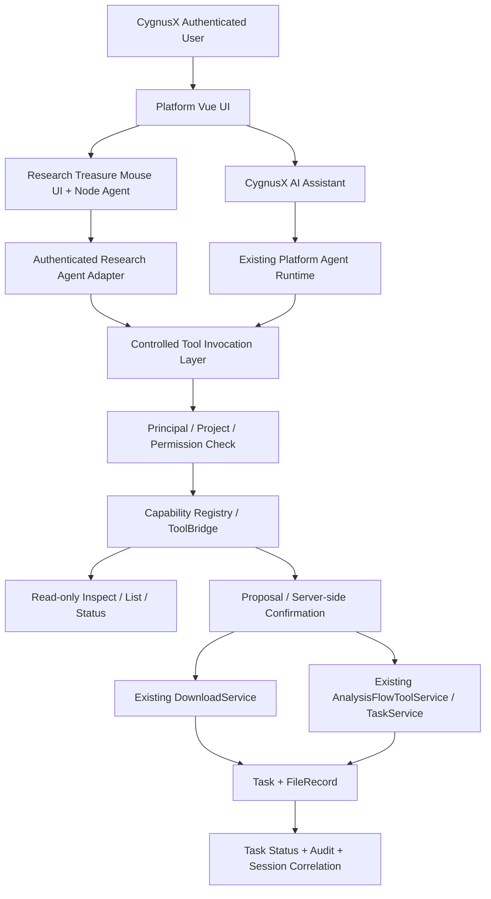

# CygnusX BioOps · Phase 2 实施任务书

## 共享 Agent 工具层、受控 MCP 调用与跨模块科研任务编排

**英文标题：** Unified Agent Tool Gateway & Research Workflow Orchestration  
**实施模式：** Existing-code-first · Incremental Integration · Implementation + Tests + Evidence  
**优先级：** P0（身份、授权和写操作）；P1（工具体验、任务关联与可观测性）  
**阶段边界：** 集成已有能力，不重写科研检索算法、下载引擎、分析执行引擎或 Agent Runtime  
**关键原则：** One Authoritative Business Service · Trusted Identity · Human-Approved Side Effects · Async Tasks · Provenance-Ready

---

# 0. Codex 角色、前提及执行红线

你是一名资深 AI for Science 平台架构师、FastAPI / TypeScript 全栈工程师、MCP 集成工程师、异步任务系统与多租户安全工程师。

请基于当前真实代码，**实际实施 CygnusX BioOps Phase 2**，为「科研寻宝鼠」与「AI 助手」建设**共享受控工具调用入口**，连接现有下载、分析准备/提交、任务查询与审计服务。不得只输出新的设计调查报告。

## 0.1 必读材料

先搜索/读取最新可用版本；以下是历史文件定位线索，实际路径可能不同：

1. `docs/audits/cygnusx-unified-research-agent-feasibility-audit-2026-10-13.md`
2. `docs/audits/cygnusx-phase0a-implementation-2026-10-13.md`（或实际 Phase 0A 实施记录）
3. `docs/implementation/cygnusx-phase0b-runtime-integration-implementation.md`（或实际路径）
4. `docs/implementation/cygnusx-phase0b-closure-implementation.md`、Gate Matrix（如果存在）
5. `docs/audits/cygnusx-runtime-provenance-manifest.json`
6. `docs/implementation/cygnusx-phase1-treasure-mouse-integration.md`、Phase 1 ADR、Discovery Proposal 契约（如果存在）
7. `ARCHITECTURE_DESIGN/README.md`、当前平台 MCP/Agent、安全、前端与 API 规范。

**必须明确：目前已知的 Phase 0B 报告将「Phase 1 受控写工具接入」判定为 `BLOCKED`；且本轮请求没有提供 Phase 0B Closure、Phase 1 的完成报告。不得推断其已经完成。**

## 0.2 按 Gate 决定实施边界

开始前输出 `PHASE2_PRECONDITION_MATRIX`，对以下条件分别判断 `PASS / FAIL / BLOCKED / UNKNOWN` 并提供证据：

- Phase 0B：真实 Redis 双进程 CAS / TTL / 恢复验证；
- Phase 0B：MCP STDIO/HTTP（实际使用的 Transport）真实初始化、认证与调用验证；
- Phase 0B：寻宝鼠构建 SHA / 镜像 tag / digest / 运行来源一致；
- Phase 0B：下载 Worker 二进制、RNAFlow/ATACFlow 来源与挂载路径真实核实；
- Phase 0B：非生产双用户、审批、文件归属与任务/审计端到端验收；
- Phase 1：可信平台身份 → Research Agent 服务调用已实现并通过负例测试；
- Phase 1：项目上下文与会话 owner 绑定已实现；
- Phase 1：结构化发现结果（Discovery Proposal 或等价 DTO）及 SSE 映射已实现；
- Phase 1：新界面只读功能和写操作后端禁止机制已验收。

执行策略：

**READY（所需 Gate 全 PASS）：** 可在**经授权的非生产隔离环境**实施、运行受控写工具集成测试；生产开放仍须单独发布审批和部署验收。

**CONDITIONAL（仅非写操作基础就绪）：** 可实现共享 Schema、工具发现、只读 API、提案预览、鉴权 Adapter、隔离 Mock、前端未启用的写操作组件与自动化测试；**所有实际下载、分析提交、任务取消等 Agent 写操作默认后端拒绝**。不得面向真实用户开放未经 Gate 验收的写功能。

**BLOCKED（可信身份/项目或必要运行边界缺失）：** 不应把模拟的身份/会话桥当作真实接口。仅实现不依赖这些前置项的安全内部代码、测试或明确的接口草案；输出阻断项和解锁条件。不要强行连通不可信调用链。

任何状态均禁止：绕过 Phase 0A 确认、恢复 `user_confirmed=True`、把共享静态 API Key 当用户身份、把 prompt 当业务授权、隐式执行海量下载或实际昂贵分析。

## 0.3 工作区保护

执行前记录 `git status --short`、branch、HEAD、submodules、dirty paths。保护已有 Phase 0A/0B/Phase 1/报告系统的未提交代码；不得 `git reset --hard`、`git clean -fd`、强制 checkout、push、生产部署、删除数据库/卷、使用生产 Token 或覆盖真实用户历史。

如需要改 Git submodule，记录其独立版本、测试和主仓指针变更，不擅自推送。严格区分实施新增变更与工作区已有变更。

---

# 1. 已知工程基线与待核实事实

前期代码审计已发现以下能力，实施前须重新定位并确认其仍存在：

| 能力 | 已知代码线索 | Phase 2 处理原则 |
|---|---|---|
| 平台 AI 工具执行 | `src/cygnusx/infrastructure/mcp/client.py`、`presets.py`、ToolBridge | 复用工具生命周期、审计与可靠性策略 |
| 分析 Agent 工具 | `application/services/analysis_flow_tool_service.py` | 复用 discover/describe/prepare/status/summary 和确认机制 |
| 统一任务提交 | `application/services/task_service.py`、`domain/flow/submission_validator.py` | 不建平行 submit engine；最终服务端校验 |
| 受控文件解析 | `application/services/managed_file_resolver.py` | 真实 owner、文件访问和最终 Worker 路径一致 |
| 下载后端 | `application/services/download_service.py`、Celery download task | 复用现有 Task/下载目录/FileRecord；不臆造数据类型 |
| 确认服务 | `application/services/tool_confirmation_service.py` 或实际路径 | JWT 人类审批、参数哈希、CAS、TTL、一次性消费 |
| 外部 MCP | `mcp-server/main.py`、`mcp-server/tools/`、`mcp-server/client/api_client.py` | 保持受控通信与调用鉴权；不可开启不可信监听 |
| 寻宝鼠 | `pipelines/Treasure-Seeking_Mouse/` | 保留 Node/TS Research Agent tool loop |
| 前端 | `frontend/` | 复用 CygnusX 设计体系与 Phase 1 原生交互组件 |

特别注意：

1. 平台内置 MCP Tool、独立外部 MCP Server、ToolBridge 和业务 REST API 是**不同的调用面**，不可仅因为工具名称相似就认为已经共享权限或行为。
2. Phase 0B 在隔离运行中验证了 RNA/ATAC TaskService 的关键链路，但真实 Worker/DB/队列及外部 Transport 仍曾被阻断；必须读取最新 Closure 证据。
3. 下载实际调用配置指定的 EBIDownload/Polariseq 二进制；历史宿主机结果为 EBIDownload CLI 1.4.0，新仓源码 1.4.3 未得到生产运行证明。
4. 目前尚未证明下载可直接用 GSE/GSM 自动展开；GEO processed-data 专用获取与 counts-only DEG 仍属于后续 Phase 3/4 缺口。
5. `FileRecord` 不等于科研 `Dataset`；不能因为下载任务成功就虚构已经创建 Dataset、Artifact 或已完成科研证据链。
6. 原有 Task 模型未证明直接关联 project_id；**不能把 `projects/<slug>` 路径当作项目授权和真实 Project→Task 关系**。

---

# 2. Phase 2 用户目标与明确边界

## 2.1 目标用户故事

**场景 A｜寻宝鼠发现后预览获取方案**

用户："帮我找有健康对照组的人类肝组织 RNA-seq 数据，并准备下载合适的数据。"

寻宝鼠先执行现有只读发现。结果卡提供源数据库、accession、来源链接和证据状态。用户显式选择结果并点击“检查获取方式”，平台**只读检查**真实可支持的数据标识、获取方式、预期路径及限制，生成下载预案。**不得因为搜索成功自动下载。**

若数据类型与现有引擎不兼容（如 GSE 尚未展开到可下载的 SRR、GEO processed matrix 缺 Adapter），明确反馈 `NOT_SUPPORTED` 或 `NEEDS_METADATA_RESOLUTION`，不能向 Worker 随意传入 GSE 后显示假进度。

**场景 B｜经过审批的下载任务**

在相应运行 Gate READY 后，用户查看下载预案并通过可信平台页面确认。平台以其真实 owner、合法目标存储和规范化参数调用**现有 DownloadService**，返回 Task ID，并在寻宝鼠或 AI 助手中展示实际状态。

**场景 C｜已有项目 FASTQ 进行分析**

用户："对我当前项目里已有的 12 个 FASTQ 文件准备 RNA-seq 分析。"

Agent 调用已有 Flow discover/schema/prepare；平台检查真实输入、样本表、对照组、物种、参考资源与 owner 路径。Agent 展示待确认配置；经可信 UI 审批，再调用原 `TaskService.submit` 异步提交。

**场景 D｜AI 助手复用同一工具能力**

平台 AI 助手应通过同一受控业务服务完成可用 Flow 发现、准备、审批、提交和状态查询。用户无需因入口不同而学会两套不同的操作或审批方式。

**场景 E｜页面退出和会话恢复**

异步任务与对话解耦。用户关闭页面或切换 Agent 后，能够在 owner 权限内用稳定 Task ID 找回真实状态与对应发起记录；不自动重放已经批准但返回超时的操作。

## 2.2 Phase 2 必须交付

1. 共享工具能力契约与后端受控调用路径。
2. 寻宝鼠、AI 助手都能通过统一业务边界访问**只读能力**，且可用工具经过权限裁剪。
3. 下载与分析的 prepare / approval / execute 职责分离。
4. 任务状态 / 错误 / owner / 发起会话关联机制。
5. 跨入口的工具执行事件及可回溯审计关联。
6. 严格的运行 Gate、服务端功能开关、回归测试和回滚方案。
7. 若前置 Gate 不满足，交付可验证的隔离实现并明确标注尚未允许启用的写操作。

## 2.3 明确非目标

- 不强制统一 Node Research Agent 与平台 Python Runtime。
- 不重新实现 GEO/NCBI/ENA/文献源查询。
- 不重写 Polariseq Rust 下载器或升级生产二进制。
- 不在本阶段实现 GEO supplementary/Series Matrix 智能识别与矩阵导入。
- 不在本阶段新增完整 Dataset 聚合、Handoff Manifest、样本关系模型（Phase 3）。
- 不新增 counts-only DEG Flow（后续阶段）。
- 不重写 RNAFlow/ATACFlow 算法和 BioReport。
- 不承诺长任务 exactly-once；本轮必须建立安全重试、去重和对账边界。
- 不做整个平台导航/主题样式大改。

---

# 3. 建议的逻辑架构与 ADR

请先核对现有模块，产出简短 ADR，然后实施最小改造。候选逻辑架构如下，**不代表必须新建物理 Gateway 服务**：



**选型约束：**

- 优先使用现有后端业务 Service + ToolBridge / 内置工具；外部 Node 如需 MCP，经过可信平台 BFF/Gateway 委托而非直接携带平台管理员长期 API Key。
- 如果现有 ToolBridge 已足够，不创建独立 MCP Server 或新网关微服务。
- MCP 主要承担工具发现和调用协议，**不是权限系统、状态机或任务编排器**。
- AI 助手与寻宝鼠不必共享 LLM loop、消息格式或前端组件，但同一业务操作必须最终落到同一权威 Service、最终校验和审批记录。
- 业务服务不可让 Agent 动态任意选择代码执行命令、文件系统绝对路径或未注册内部 API。

请在 ADR 中明确：工具 catalog 的 authoritative source、Node 到平台的受信任访问方式、Project/Task 关联方式、审批与取消语义、实际修改面和回滚边界。

---

# 4. WP2-0：现状核对、Gate 与最小设计决策

## 4.1 现场核对

1. 获取当前分支、工作树改动、已部署版本证据和 submodule 指针。
2. 读取 Phase 0B Closure/Phase 1 最新报告；没有证据就记 Unknown。
3. 查找真实工具注册位置、内置/外部 MCP 调用表、`analysis` 与 `download` 接口调用者。
4. 检查确认机制、API Key/JWT 约束、Task 幂等、下载去重、Project RBAC。
5. 确认 Phase 1 交付的 Discovery Proposal、可信 BFF 和会话事件 DTO 是什么；没有就不要假定存在。
6. 列出需要变更的 API 契约和影响的前端调用方。

## 4.2 输出当前能力矩阵

至少包括：

| 能力 | 寻宝鼠 | AI 助手 | 统一 Service | 阶段状态 |
|---|---|---|---|---|
| 发现结果只读 | 待核实 | 待核实 | 是否需要只读 adapter | 待核实 |
| 下载文件检查 | 待核实 | 待核实 | download inspect/preview | 待核实 |
| 下载创建 | 待核实 | 待核实 | DownloadService | 待核实 |
| 工作流 discover/schema | 待核实 | 待核实 | AnalysisFlowToolService | 待核实 |
| 分析 prepare | 待核实 | 待核实 | FlowSubmissionValidator | 待核实 |
| 人工确认 | 待核实 | 待核实 | ToolConfirmationService | 待核实 |
| 分析 submit | 待核实 | 待核实 | TaskService | 待核实 |
| 下载/分析状态 | 待核实 | 待核实 | owner-scoped Task queries | 待核实 |
| 会话-任务关联 | 待核实 | 待核实 | audit/event/correlation | 待核实 |

---

# 5. WP2-1：共享 Capability / Tool Contract

## 5.1 先复用，后适配

通过实际代码对照 `presets.py`、`AnalysisFlowToolService`、MCP Server Tool、平台 Agent Tool Registry、Node 的 tool schema，找出：

- 已有同义工具及其真实 Service；
- 同名但参数语义不同的工具；
- 仅 prompt 展示、没有真实 Service 的工具；
- 安全确认逻辑差异；
- 返回体字段/错误码/状态定义差异。

**禁止仅为命名美观重复添加 `analysis.submit`、`platform_submit_analysis` 等会调用同一业务的第二套引擎。** 可以建立规范化 alias/adapter，但必须映射到已有唯一权威实现。

## 5.2 建议能力目录（概念，不是硬编码接口）

| 能力 ID（候选） | Side effect | 后端权威实现 | 原则 |
|---|---|---|---|
| `research.discovery.inspect` | 无 | 寻宝鼠或已有数据查询能力 | 只读结构化结果；可信来源链接 |
| `downloads.describe_capabilities` | 无 | 下载后端配置/Adapter | 返回真实支持 ID/方式；不推测 GSE |
| `downloads.prepare` | 无业务副作用 | DownloadService 辅助检查 | 参数、存储归属、上限/风险预览；若现有 dry_run 入队，不得误用 |
| `downloads.submit` | 有 | DownloadService | 可信确认 + owner + 幂等/去重 |
| `analysis.list_workflows` | 无 | Flow registry/现有 discover | 仅已启用且有权限的 Flow |
| `analysis.get_workflow_schema` | 无 | 现有 describe/schema | 版本一致的参数 Schema |
| `analysis.prepare` | 无任务创建；可产生审批记录 | AnalysisFlowToolService | 校验并生成预案，允许审批状态记录 |
| `analysis.submit` | 有 | TaskService | 已批准且重校验最终参数 |
| `tasks.get_status` | 无 | 现有 TaskService/download task | owner-scoped，真实进度不可用要显式标注 |
| `tasks.list_related` | 无 | Task/audit/session 关联 | 受控项目/会话关联，不靠任意 task_id 猜测 |
| `tasks.cancel` | 有 | 现有受控取消服务 | 非 Phase 2 MVP 必选；未验收则保持禁用 |

工具命名和 Schema 应优先采用仓库现行约定。每个工具定义：version、scope、side-effect class、owner source、参数 Schema、返回 Schema、错误类型、审批级别、幂等策略、审计字段及适用 Agent。

工具发现必须做权限裁剪；未授权用户不能看到或成功调用高权限工具。**工具列表隐藏不是授权边界，最终 Service 必须再次校验。**

## 5.3 版本及兼容

- 已有内置分析 prepare/submit 业务语义不得静默改变。
- 新 Schema 使用显式版本策略（如 v1），避免 Node 与 Python 的字段互相漂移。
- 需要兼容旧 SSE ToolTrace/卡片的适配层，而不是强制迁移全部旧历史。
- 废弃危险工具参数时明确拒绝，不能保留可绕过审批的兼容分支。
- 保留机读 Schema 与 TypeScript / Python 类型校验测试；优先从已有 schema 自动生成或验证一致性，不维护三份手写权威 Schema。

---

# 6. WP2-2：可信 Agent Invocation Context 与后端 Gateway

## 6.1 Context 来自后端身份与权限

建议建立统一的只读上下文对象（命名按现有项目），由可信后端生成：

```yaml
principal_id: "verified-on-server"
project_id: "verified-or-null"
conversation_id: "owner-scoped-session"
invocation_id: "server-generated"
request_id: "server-generated"
agent_kind: "research_treasure_mouse | platform_ai"
capability_id: "registered-tool-id"
permission_scopes: []
```

**注意：这仅是说明性 DTO。** 不得让 Agent、浏览器或外部数据文本自行断言 owner、project、permission_scopes；后端根据已认证 principal 查询授权与 project 关系。Node 发送的可见 `project_id` 不构成权限证明。

## 6.2 Node / BFF / MCP 信任链

- 浏览器使用平台已有 JWT/Session，进入可信 CygnusX BFF。
- BFF 校验用户/项目后，通过项目已有可信服务间协议向 Node Discovery Runtime 提供**最小必要上下文**。
- Node 不能直接使用全局管理员静态 Key 自行冒充任意用户提交分析或下载。
- Node 工具调用回传平台时，必须带经服务端验证的有限委托身份或仅通过由后端创建的受控代理会话；委托具有 issuer、audience、scope、user、project、TTL、防重放措施，且不得写入模型消息。
- Node 运行网络必须限制不可信直连入口；如果 Phase 1 尚未做到，Phase 2 不得开放 write。
- API Key 服务身份与最终用户身份分开，真实调用必须检查委托用户是否仍拥有资源权限。
- 若采用外部 HTTP MCP，必须实际验证入站认证；回环/容器内网络不能单独替代调用方授权。

## 6.3 作用域和工具级策略

至少区分：

- `read:discovery`
- `read:workspace_assets`
- `read:workflows`
- `read:tasks`
- `prepare:download`
- `prepare:analysis`
- `execute:download`（受 Gate + 用户审批约束）
- `execute:analysis`（受 Gate + 用户审批约束）
- `execute:cancel`（建议默认关闭）

这些是逻辑 capability scope，按仓库已有 RBAC 能力落地，不要求引入新的独立 IAM 系统。

## 6.4 项目关联的真实边界

审计已指出通用 `Task` 没有可证明的可信 `project_id`。Phase 2 必须先决定：

- 若当前已有适用的授权关联表/事件，可复用，以真实 Project ID 记录发起上下文；
- 若没有，选择**最小、可迁移、可审计**的 AgentInvocation→Task→Project 关系或等价映射，并针对 Project 删除/改权限后的访问行为设计测试；
- 如果不能在本阶段安全持久化 Project 与 Task 的关系，必须把“项目级任务追踪”标为部分能力，不得通过目录字符串模拟已实现的关联。

任何最小数据库迁移都要有迁移脚本、兼容策略、回滚说明和测试；不得借此提前实现完整 Dataset 模型。

---

# 7. WP2-3：统一 prepare → approve → execute 状态机

## 7.1 核心职责分离

```mermaid
sequenceDiagram
  participant U as User
  participant A as Treasure Mouse / AI Assistant
  participant G as Controlled Gateway
  participant C as ToolConfirmationService
  participant S as Business Service
  U->>A: Request data download or analysis
  A->>G: prepare(args)
  G->>G: Authenticate / authorize / normalize / validate
  G-->>A: Immutable proposal + risk and estimated resources
  A-->>U: Display approval card
  U->>C: Approve via trusted JWT UI
  C-->>G: Approved confirmation record
  A->>G: execute(proposal_id, confirmation_reference)
  G->>G: Reverify principal, project, payload hash, TTL, state
  G->>S: Authoritative submit with idempotency protection
  S-->>G: task_id + accepted status
  G-->>A: Task reference; not job completion
```

**重要：** 一次工具 `prepare` 不代表可以执行；`APPROVED` 不代表已创建 Task；`Task queued` 不代表下载完成或科研结果已验证。

## 7.2 Proposal 合约

推荐提案字段（与实际 Phase 1 DTO 对齐）：

```yaml
schema_version: "1"
proposal_id: "platform-generated"
operation: "download.submit | analysis.submit"
owner: "server-derived"
project_id: "authorized-project-or-null"
source:
  discovery_proposal_id: null
  source_accession: null
normalized_parameters: {}
validation:
  status: "valid | incomplete | unsupported"
  limitations: []
resource_preview:
  bytes_estimate: null
  compute_profile: null
  note: "unknown estimates must remain unknown"
confirmation:
  required: true
  state: "PENDING"
  expires_at: null
```

原则：

1. 所有关键执行参数规范化后参与哈希（如 accession、目标位置、worker flow、样本、reference、资源配置、owner/project、operation）。
2. 不允许用户批准 A、系统实际执行 B；参数变化需要重新 prepare/approve。
3. `proposal_id` 和 `confirmation_id` 只是标识，不是独立权限；真实审批只由可信 JWT 人类 API 执行。
4. 同一确认绑定 owner、scope、tool/operation、参数摘要、TTL 与一次性消费状态。
5. 取消、覆盖、删除等操作若开放，要定义独立风险等级和审批语义。
6. 无法评估真实大小/费用时标 `unknown`，不编造准确资源估计。
7. 现有 Phase 0A/0B 确认服务是唯一权威状态机；不重建另一份 React/Node 审批状态库。

## 7.3 任务去重和失败恢复

分析提交已存在 `idempotency_key` 的线索，下载此前未证明同等能力。本阶段开启 Agent 写操作前必须：

- 明确客户端重试的 `idempotency_key` 或 request/proposal fingerprint 如何生成、作用域如何绑定 owner/project/operation；
- 防止 LLM 重复 tool call 或 SSE 断连重试触发多个下载/计算任务；
- 对下载如不存在服务端幂等：实现**最小持久去重/调用登记**，或把下载写操作保持禁止，不能仅以 FileRecord 登记去重充当执行去重；
- 对重复请求返回既有 task_id 或明确冲突状态，不盲目重新入队；
- 确认记录已消费但任务状态未知时进入 `reconciliation_required`，不自动重放提交；
- 不宣称跨 Redis、PostgreSQL、消息队列的严格 exactly-once，需保留可追溯人工对账操作说明。

如本轮不具备实现可靠幂等的事务条件，应交付 `PREPARE_ONLY`，不标记写操作完成。

---

# 8. WP2-4：下载工具接入（复用现有 DownloadService）

## 8.1 必须区分发现、检查、下载与数据资产

允许路径：

`Discovery Proposal (accession)` → `inspect supported accession / available files` → `download proposal` → `human approval` → `DownloadService Task` → `FileRecord`。

**此处 `FileRecord` 不是 Dataset。** Phase 2 的“导入项目”只能表述为**下载并登记到经授权的用户/项目文件空间**；真正的 Dataset/metadata/Handoff 注册在 Phase 3 实施。

## 8.2 接入范围

优先选择**现有 Worker 已真正支持**的最小输入：合法 SRR/PRJNA（实际运行验证的范围）、已验证安全直链等。不要假设所有 GSE/GSM 直接由 Rust 下载器支持。

按实际支持情况：

- 不支持 GSE→SRR 映射时，保留检索结果并提示需要确认关联 Run；不得自动下发 GSE 给下载 Worker 并认为已成功解析。
- 不支持 processed matrix 的类型识别时，不提供“直接导入 counts/TPM”的已实现按钮。
- SRA dry-run 如会入队，应视为有业务副作用；不能拿它当纯同步 preview。
- 对 direct-link 需审核 URL 协议、允许域、DNS/重定向、私网地址、内容长度和服务端 SSRF 风险；无充分验证则禁用 Agent 任意 URL 下载。
- 对目标目录采用平台 owner/project 的受控文件空间；拒绝绝对外部路径、`..`、符号链接逃逸及跨用户文件归属。
- 如果下载规模未知，必须展示未知、存储配额检查与潜在消耗；预算无法保证则拒绝/只允许受控小型任务。

## 8.3 最小工具行为

- `downloads.describe_capabilities`：返回运行态已验证的支持标识和可用输入；不会假定镜像里新版本已启用。
- `downloads.prepare`：不创建异步业务 Task，返回可下载性、目标目录、来源、风险和缺失信息。
- `downloads.submit`：只有合法审批、幂等与运行 Gate 满足时提交，返回 `task_id`/状态查询引用。
- `tasks.get_status`：必须 owner-scoped；Redis progress unavailable 时如实显示，而不是伪造百分比。

下载完成 FileRecord 至少可关联下载 Task/发起会话/来源线索（若现有模型/服务允许）；Phase 3 再进一步固化 checksum、sample metadata 和 Dataset。

---

# 9. WP2-5：FlowFrame 分析工具接入（复用现有 AnalysisFlowToolService）

## 9.1 优先复用已有工具

根据实际代码寻找并复用：

- discover / list workflows；
- describe / get workflow schema；
- prepare / validate input；
- status / summary / outputs；
- 已有确认与 `TaskService.submit` 执行路径。

Node Research Agent 与平台 AI 使用不同 tool transport 没关系，但**最终业务校验和执行必须是同一个 TaskService**。

## 9.2 输入安全

分析准备至少校验：

- 当前用户/项目对文件的权限；
- 真正存在的 Flow 和启用状态；
- Schema、参数类型、必填项；
- 样本名、FASTQ 配对/命名（若已有检查）、样本表与比较组；
- 文件路径和 worker 可访问路径映射；
- 参考基因组、物种及工作流必需参数；
- RNA/ATAC 的执行输入类型；
- 资源上限/执行许可。

**不允许**把 GEO TPM/FPKM / Series Matrix 填入 `raw_data_path` 冒充 FASTQ。当前没有 counts-only 平台 Flow 的证据，不能声称可以对外部矩阵直接提交 DEG。

如果研究设计/链特异性/对照分组无法从已验证 metadata 获取，Agent 可以提出候选，但必须让用户确认，不能自动发明生物学参数。

## 9.3 任务准备和提交

1. 用户表达分析目标，Agent 确定候选 Flow。
2. 工具返回 Flow Schema 和所需字段；已有受控文件引用由平台解析。
3. 调用已有 prepare/validate，生成明确的参数预览与缺失项。
4. 用户通过可信审批确认最终参数。
5. 原有 TaskService 在提交前再次完成最终校验。
6. 任务创建后返回 Task ID，状态通过已有 owner-scoped 接口查询。
7. 任务失败/部分交付时展示真实状态，不伪造完成的报告或 Artifact。

**如 Phase 0B 运行 Gate 未通过，仅允许走到准备或隔离 Mock；不触发真实 Snakemake Worker。**

---

# 10. WP2-6：异步任务编排、状态恢复与跨 Agent 关联

## 10.1 最小编排状态

建议前端/会话跟踪以下业务阶段（最终映射到现有状态机）：

`DISCOVERED` → `PREPARED` → `AWAITING_APPROVAL` → `APPROVED` → `SUBMITTING` → `QUEUED` → `RUNNING` → `SUCCEEDED / FAILED / CANCELLED / RECONCILIATION_REQUIRED`。

不要新增与现有 Celery Task 状态冲突的第二套真实执行状态机。将其视作**用户编排视图**，底层任务状态仍来自 TaskService/Worker。

## 10.2 长任务与断连

- 创建成功后，工具调用应尽快返回 task_id，不同步等待大量数据下载或分析结束。
- 用户离开对话，Task 由后台继续；不得由浏览器 SSE 生命周期控制 Celery 执行。
- 重新打开会话，按可信 `conversation_id → invocation_id → task_id` 查真实状态；Task ID 的存在不等于访问权限。
- 任务状态轮询/事件复用现有 API/WebSocket/SSE；不为了 Phase 2 自建复杂事件总线。
- 状态更新要支持 out-of-order、重复、断连恢复和终态幂等；未知状态显示 `unavailable`。
- 用户切换项目后，旧 Task 仍归属原项目/发起上下文，不静默挪到新项目。
- 如 `SUBMITTING` 状态不明，优先查询 Task/队列/审计进行对账，禁止 Agent 自动重复调用 submit。

## 10.3 最小持久关联

优先复用既有 ChatMessageEvent、MCPLog、Task、Run、FileRecord、Project/Session 关联。

若没有可靠记录，允许添加轻量 `AgentToolInvocation` 或同等关联模型（必须先检查复用可能）：

- `invocation_id`、`owner_id`、授权 `project_id`（若适用）、`conversation_id`；
- `agent_kind`、`capability_id`、提案/确认引用（仅安全标识或摘要）；
- `task_id`、`status`、`created_at`、`updated_at`；
- `parameters_hash`、业务结果引用、错误码/对账状态。

不要持久化 Token 原文、确认密钥、私人研究文本全量副本或未经脱敏的执行参数。

如需要迁移，仅针对上述最小关联，写 migration、index、约束、owner-scoped 查询、兼容测试与回滚方案；**不得利用本阶段顺带新增完整 Dataset/Artifact 体系**。

## 10.4 审计关系

目标：一次寻宝鼠或 AI 助手发起的工具计划，可以回答：

- 谁发起？属于哪个获授权项目？
- 使用哪个 Agent 与哪个已注册工具？
- 哪次人类审批批准了哪份参数摘要？
- 最终创建了哪个 Task？
- 目前真实 Task 状态是什么？
- 如果执行失败、重复请求或审批丢失，如何人工对账？

不强求本阶段完整科研 provenance manifest；后续将这些引用交给 Phase 3/报告系统。

---

# 11. WP2-7：寻宝鼠与 AI 助手前端交互

## 11.1 统一交互类型

两个入口尽量复用平台设计规范和既有组件，呈现同一种操作语义：

1. **只读结果卡**：accession、原始来源、证据/不确定性说明；
2. **能力检查卡**：当前平台支持的操作、缺失条件、风险；
3. **执行预案卡**：下载目标/文件规模或 Flow/样本/参数预览；
4. **人工确认卡**：由可信平台认证页面触发 approval，显示不可改变的关键参数；
5. **任务状态卡**：Task ID、真实状态、失败原因、进入任务中心链接；
6. **完成结果卡**：仅展示确实登记的 FileRecord/分析产物和真实可访问链接。

Phase 1 的数据发现卡片与 ToolTrace 不要整体替换；以增量组件方式接入。

## 11.2 禁止虚假行动

- 未通过 Gate：下载、分析提交、取消等**真实后端**禁用；前端仅允许只读预案与明确“尚未开放”状态。
- 不允许只在前端 `disabled`，而后端直接请求仍可执行。
- 不生成假的下载进度、Task ID、Dataset ID、Report URL 或已经调用 MCP 的动画。
- 不能把“下载到用户电脑”与“写入 CygnusX 项目存储”混为一谈；本阶段主要指平台受控项目文件空间。
- 审批卡失败时需保留用户可理解的状态，不暗中重复提交。

## 11.3 科研体验优化

用户在寻宝鼠里发现了数据，可以明确选择“查看可获取文件/准备下载”；用户在 AI 助手里选择已有项目文件，可以明确选择“配置 RNAFlow”。

不要让用户每次在不同页面反复复制 accession、手写文件路径或重复创建会话；但信息必须由后端真实关联，不能仅在前端缓存中假装跨模块联通。

---

# 12. WP2-8：安全、资源与运维治理

必须针对跨 Agent tool calling 增加以下防护：

1. **可信来源分离：** 公共 GEO metadata、文献摘要和 Agent 输出均为不可信内容；它们不得指示模型越权调用写工具。
2. **最小工具权限：** Research Agent 默认只读；不同用户/项目/Agent 能力集合按服务端裁剪。
3. **审批边界：** 服务端 approval 仅接受真实人类登录渠道，API Key / Agent 不可批准自身计划。
4. **参数不可变：** 强制绑定 owner/project/operation/normalize payload digest；修改后必须重新确认。
5. **下载约束：** 配额、单次任务大小、并发、允许访问的数据源、目标存储位置、安全 URL 策略；当前后端不支持的配额执行不可凭 UI 文案假装已经实现。
6. **执行约束：** 分析 Flow 白名单、资源上限、Worker 路径隔离、运行版本绑定；未知执行环境必须 fail closed。
7. **错误与超时：** MCP/HTTP timeout 不自动等同失败；先查询既有 task_id/关联，再决定人工恢复。
8. **幂等与并发：** 重复 LLM tool call、相同 proposal 并发、双窗口点击审批均最多创建一个业务操作。
9. **审计脱敏：** 保留调用状态与参数摘要，不保存 Token/Key/确认凭证原值；不在调试日志完整输出私有研究对话。
10. **版本可追溯：** 工具 schema、后端源码、下载二进制与 Flow 版本有可核对记录；缺少生产运行证明则标 Unknown。
11. **取消写操作默认关：** 不因 Task status read 可用就自动开启 `tasks.cancel`。
12. **外部直连限制：** 独立 Node Chat 和 HTTP MCP 不得绕过 CygnusX 身份/审批入口直接运行平台写工具。

功能开关至少区分：`tool_gateway_read_enabled`、`agent_download_write_enabled`、`agent_analysis_write_enabled`、`agent_task_cancel_enabled`（名称遵循现有配置）。所有写开关默认 `false`；生效条件必须同时满足 Phase 0B/Phase 1 准入和 Phase 2 对应专项验收，不能只靠环境变量设 true 即越过 Gate。

---

# 13. 必须补齐的测试矩阵

采用项目现有 pytest / Node test / Playwright 或相应测试框架；单测、契约、集成、Runtime Smoke、E2E 分别标注。隔离环境使用测试用户、测试项目、Mock 下载服务/Worker 与有限公共只读元数据；严禁真实大规模数据下载、消耗生产计算或读取生产凭据。

## 13.1 工具目录及契约（TOOL）

| ID | 预期 |
|---|---|
| TOOL-01 | 两个 Agent 使用同一个业务 Service 的 schema/adapter，返回语义一致 |
| TOOL-02 | 未获许可的工具不展示且直接调用也被后端拒绝 |
| TOOL-03 | 旧版 ToolTrace / SSE cards 可正确兼容 |
| TOOL-04 | Tool schema 校验失败不创建业务 Task |
| TOOL-05 | 只读 inspect 不触发 Celery/dry_run Task |
| TOOL-06 | 动态 Registry/ToolBridge 不重复注册冲突工具 |

## 13.2 身份/项目隔离（AUTH）

| ID | 预期 |
|---|---|
| AUTH-01 | 未登录调用 BFF/MCP 工具被拒绝 |
| AUTH-02 | 用户 A 的委托不能访问用户 B 的文件/Task |
| AUTH-03 | 用户 A 伪造 B 的 project_id 被拒绝 |
| AUTH-04 | 修改 X-User-Id 或模型 Tool Args 不能获得权限 |
| AUTH-05 | 用户登出/令牌过期后不能执行新的写操作 |
| AUTH-06 | Node/HTTP MCP 直连不能绕过平台审批 |
| AUTH-07 | 项目访问被撤销后旧 proposal 不能继续提交 |

## 13.3 审批、幂等及竞态（APPR）

| ID | 预期 |
|---|---|
| APPR-01 | `user_confirmed=True` 不能执行下载或分析 |
| APPR-02 | PENDING、伪造、过期、已消费确认全部拒绝 |
| APPR-03 | 与批准时不一致的参数/operation/owner/project 拒绝 |
| APPR-04 | Agent 无法通过 service key 自行 approve |
| APPR-05 | 两次并发 execute 最多创建一个 Task |
| APPR-06 | 网络超时后相同幂等键不再提交新 Task |
| APPR-07 | Redis 故障写操作失败关闭，无内存静默回退 |
| APPR-08 | `SUBMITTING` 不明时不自动重放，给出对账状态 |
| APPR-09 | Phase 0B Gate 未通过时所有写操作后端拒绝且无队列/目录/数据库副作用 |

## 13.4 下载及文件（DL）

| ID | 预期 |
|---|---|
| DL-01 | 已验证支持的 SRR/PRJNA 产生正确受控预案 |
| DL-02 | 未证明可识别的 GSE/GSM 给出不支持/需展开，不下发假任务 |
| DL-03 | 任意 GEO supplementary URL 不会无校验进入 direct-link |
| DL-04 | 跨用户目标目录、绝对外部路径、`..`、符号链接逃逸拒绝 |
| DL-05 | 合法审批后真实 DownloadService 隔离创建任务，返回既有 Task ID |
| DL-06 | 只读状态按 owner 查询；未知进度不显示虚假百分比 |
| DL-07 | 下载重试/相同请求幂等，不创建重复昂贵任务 |
| DL-08 | FileRecord 归属正确，但不能被错误声明为 Dataset |

## 13.5 分析任务（AN）

| ID | 预期 |
|---|---|
| AN-01 | 真实可用 Flow discover/schema 经两个入口一致返回 |
| AN-02 | RNAFlow/ATACFlow 合法文件与样本参数 prepare 通过 |
| AN-03 | 输入缺失、跨用户文件、非法 Flow、路径逃逸全部拒绝 |
| AN-04 | TPM/FPKM/count matrix 不会误入 FASTQ Flow |
| AN-05 | 有效可信审批后调用原 TaskService，返回一个真实隔离 Task ID |
| AN-06 | 最终 Worker 参数与通过校验的文件引用一致 |
| AN-07 | API/Tool 经 TaskService 共用最终校验，而非只靠 AI prepare |

## 13.6 对话、任务状态、恢复与 UI（UX）

| ID | 预期 |
|---|---|
| UX-01 | 寻宝鼠检索卡可生成可审计的只读下载预案 |
| UX-02 | AI 助手能为已有项目数据 prepare 分析配置 |
| UX-03 | 审批卡参数显示与服务端确认哈希一致 |
| UX-04 | 任务创建后关闭页面、再次进入可查真实状态 |
| UX-05 | owner/project 切换不会串历史和 Task 引用 |
| UX-06 | 出错、断连、确认超时、状态未知显示真实结果 |
| UX-07 | Task 链接可进入任务中心，但不会泄漏他人任务 |
| UX-08 | Agent 未获写权限时 UI 与后端均处于禁止执行状态 |

## 13.7 测试报告约束

每项测试记录 `PASS/FAIL/BLOCKED/SKIPPED/NOT TESTED`、命令、环境、是否真实 Transport、是否真实 Redis/DB/queue/Worker、是否 Mock、副作用断言与日志/断言证据。

**不得**把 in-process Client 验证写成 HTTP MCP E2E，不得把 stub TaskService 调用写成真实队列提交，也不得把静态 Schema 验证当成生产功能发布证明。

---

# 14. 分批实施顺序（强烈建议分 PR / 逻辑变更包）

## P2-A：Gate / ADR / Capability Contract

- 核对 Phase 0B Closure、Phase 1 实际状态；
- 确定共享服务边界及工具 registry 权威来源；
- 完成 Tool Contract / Invocation Context ADR；
- 先提供只读 tool list/describe、契约测试；
- 如 Gate 不满足，文档明确 BLOCKED，不进行危险写调用。

**验收：** 所有工具能力、权限、错误/结果语义有可执行契约；原有 AI 工具无回归。

## P2-B：Trusted Adapter / Read-only Gateway

- 复用 Phase 1 平台 BFF/可信项目上下文；
- 接通寻宝鼠 → 受控只读工具发现、Flow schema、任务查询（仅 owner）；
- AI 助手通过同一业务层只读查询；
- 验证两个用户、两个项目、Node 直连/headers 伪造负例。

**验收：** 同一资源的两个入口返回一致且安全的只读结果；真实写操作后端仍禁止。

## P2-C：Proposal / Confirmation / UX

- 接入下载/分析 prepare；
- 复用 ToolConfirmationService，渲染不可篡改的参数确认卡；
- 完成真实人类批准 API 和 Tool args 篡改测试；
- 只读模式下展示待启用但不实际 submit；
- 固化客户端取消、过期、审批失败与重试交互。

**验收：** 未批准、变更参数、跨 owner 等用例不能到达真实业务副作用边界。

## P2-D：受控写工具（以 Gate 为前提）

- 下载与分析写操作分别设置独立开关和独立验收；
- 先实现/验证下载幂等和来源/路径约束；
- 复用真实 DownloadService 和 AnalysisFlowToolService/TaskService；
- 返回 Task ID/正确错误码并建立调用-任务关联；
- 在经授权的非生产环境小型任务验证，未就绪的写工具保持关。

**验收：** 已批准且输入合法的各类型 Task 最多创建一次；真实 owner、真实 Worker 参数和队列路径有证据。

## P2-E：Task Link / Restore / Audit

- 将会话事件、调用记录与 Task/Project 持久关联；
- 完成状态恢复/去重/人工对账以及跨页面 Task 入口；
- 针对断连、并发、服务故障和项目撤权做负例；
- 形成最小可回溯调用证据，不要求完整科研 Dataset。

**验收：** 持久存储可复查一次调用对应真实审批、Task 和 owner 范围内状态。

## P2-F：Regression / Release Gate / Rollback

- 执行已有 MCP、Agent、下载、Flow、Task、前端回归；
- 若有受控 staging 环境，做双用户/真实 Redis/MCP/DB/queue 的联调；
- 输出工具契约、测试矩阵、部署开关、数据迁移和回滚步骤；
- 使用 `READY / CONDITIONAL / BLOCKED` 给出真实可开放能力范围。

**验收：** 可安全保留原有只读 Agent 功能；关闭写开关时无任何 Agent 写任务副作用。

---

# 15. 重点代码落点（实施前按最新仓库核对）

```text
# CygnusX 主后端
src/cygnusx/infrastructure/mcp/client.py
src/cygnusx/infrastructure/mcp/presets.py
src/cygnusx/application/services/analysis_flow_tool_service.py
src/cygnusx/application/services/task_service.py
src/cygnusx/application/services/download_service.py
src/cygnusx/application/services/tool_confirmation_service.py
src/cygnusx/application/services/managed_file_resolver.py
src/cygnusx/domain/flow/submission_validator.py
src/cygnusx/api/v1/tasks.py
src/cygnusx/api/v1/downloads.py
src/cygnusx/domain/models/chat.py
src/cygnusx/domain/models/project.py
src/cygnusx/domain/models/task.py

# 外部 MCP
mcp-server/main.py
mcp-server/tools/
mcp-server/client/api_client.py

# 寻宝鼠（实际版本/集成架构以 Phase 1 为准）
pipelines/Treasure-Seeking_Mouse/functions/seqout-chat/index.ts
pipelines/Treasure-Seeking_Mouse/src/services/seqoutChat.ts
pipelines/Treasure-Seeking_Mouse/server/local.mjs
pipelines/Treasure-Seeking_Mouse/src/components/

# 前端
frontend/src/views/TreasureMouseView.vue
frontend/src/router/index.ts
frontend/src/api/
frontend/src/components/

# 运行/配置
deploy/docker/docker-compose.yml
deploy/docker/nginx/nginx.conf
scripts/audit_runtime_provenance.py
```

以上是**历史定位线索**，不要求全部修改。禁止仅为了统一目录结构进行无关重构。

---

# 16. 交付成果与文档

建议在既有文档体系保存：

1. `docs/implementation/cygnusx-phase2-shared-agent-tool-orchestration.md`：最终实施报告；
2. `docs/architecture/cygnusx-phase2-shared-tool-gateway-adr.md`：权威服务、双 Runtime、可信身份、Gateway/ToolBridge 选型；
3. `docs/contracts/cygnusx-agent-capabilities-v1.md`：工具能力、入参/结果/错误、确认与任务状态契约；
4. `docs/contracts/cygnusx-agent-task-link-v1.md`：invocation、session、project、task 关联及恢复/对账；
5. 相关 pytest/Node/前端测试文件，必要的最小数据库迁移；
6. 如有新部署配置：feature flag 与只读回退说明；
7. 更新 Runtime Provenance Manifest 中可真实观察的条目（不要编造运行证据）。

如果现有目录/文件已有等价规范，优先更新既有权威文档，不再创建重复文档。

## 16.1 最终报告必须包含

- Executive Summary 与实际完成状态；
- Baseline、Git Status、运行版本和 Phase 0B/Phase 1 Gate；
- 当前共享工具调用架构图与真实服务调用图；
- Tool Capability Matrix 与双入口契约一致性；
- 认证/项目/委托上下文和服务间认证；
- prepare/approve/execute 安全链路、确认状态机；
- 下载工具范围及 GSE/GSM/processed-data 明确限制；
- 分析 discover/prepare/submit 的真实复用；
- 幂等、异步任务关联、状态恢复与对账；
- 修改文件、API/Schema 变化、数据库迁移；
- 测试执行命令与 PASS/FAIL/BLOCKED/SKIPPED/NOT TESTED 统计；
- 已知 P0/P1 风险、Gate 结果、正式发布限制；
- 回滚策略和 Phase 3 准入建议。

---

# 17. Phase 2 验收 Gate（G0–G14）

| Gate | 必须通过的条件 |
|---|---|
| **G0 前置环境** | Phase 0B 所需 P0 运行验收与 Phase 1 身份/会话边界均有真实证据；否则写操作永不 READY |
| **G1 工具复用** | 寻宝鼠与 AI 助手经共享受控业务层调用，无平行下载/分析引擎 |
| **G2 用户身份** | 全程真实 principal；服务 Key/Node 不能任意冒充用户 |
| **G3 项目权限** | Project/Session/Task owner 关联可信；跨用户/项目访问拒绝 |
| **G4 能力契约** | Schema、错误、结果、版本与工具权限一致；只读/写操作明确区分 |
| **G5 只读检查** | inspect/list/prepare 不意外创建下载/分析 Task |
| **G6 人工审批** | 用户可信批准、参数摘要绑定、TTL/CAS/重放拒绝通过 |
| **G7 幂等** | 重试/并发不会因 Agent 重复 tool call 创建重复昂贵业务 Task |
| **G8 下载提交** | 仅真实支持的 accession、合法目录、已批准请求能调用 DownloadService |
| **G9 分析提交** | RNA/ATAC 从 schema/prepare 到 TaskService 最终校验/提交闭环 |
| **G10 异步与恢复** | 真正 Task ID、状态查询、会话关联、断连恢复和不确定状态对账 |
| **G11 UI 体验** | 两个 Agent 都能明确展示预案、批准、实际 Task 状态；不显示虚假结果 |
| **G12 安全负例** | 身份伪造、prompt injection、非法 URL/路径、跨 owner、未经审批被拒绝且无业务副作用 |
| **G13 回归质量** | 原有平台 AI、寻宝鼠只读检索、下载/Flow UI、报告系统无相关回归；阻断如实记录 |
| **G14 发布与回滚** | 写工具默认关、可独立关闭、可回滚到安全只读态，审计/Task 事实保留 |

## 17.1 阶段状态定义

**READY（非生产功能验收）：** G0–G14 中适用项有相应真实证据；每种写工具都需单独验收，不能因分析通过就自动开放下载。生产启用另需部署、监控和发布批准。

**IMPLEMENTED / WRITE BLOCKED：** 已完成共享只读工具、提案、审批 UI、隔离测试，但 Phase 0B/1 或真实服务 Gate 不足；必须保持写开关为 false，并明确哪些能力仅为模拟。

**PARTIAL / BLOCKED：** 可信身份、后端权限、工具契约、最终验证等基础事项尚未通过，或代码/测试存在关键失败；不能宣称集成完成。

**不允许**把 Phase 2 “完成了部分代码”宣传为“智能 Agent 已可从 GEO 一键下载矩阵并自动分析”；这些能力还依赖 Phase 3 的数据交接与后续 counts-only Flow。

---

# 18. Codex 最终回复要求

实施结束后请报告：

1. Phase 0B Closure / Phase 1 的实际 Gate 状态与核验材料；
2. Phase 2 完成度（READY / IMPLEMENTED-WRITE-BLOCKED / PARTIAL-BLOCKED）；
3. 采用哪个共享 Tool Gateway/ToolBridge 方案、是否新增进程或数据库表；
4. 寻宝鼠与 AI 助手分别调用了哪些真实工具、最终落到哪个业务 Service；
5. 可信身份 / Project / Session 上下文怎样生成、校验与撤销；
6. 下载与分析 proposal → confirmation → submit 的实际调用链；
7. `user_confirmed=True`、跨用户、并发重放、Redis 故障等负例测试结果；
8. 下载支持的真实 accession 范围，哪些 GEO 类型仍不支持；
9. 任务如何持久关联会话、项目与用户，失败后如何恢复/对账；
10. 两个前端入口的真实截图或复核说明、响应式及状态处理；
11. 测试命令、PASS/FAIL/BLOCKED/SKIPPED/NOT TESTED 数量、测试环境类型；
12. 修改文件数量和索引、数据库/Schema 迁移、兼容与回滚策略；
13. 实施报告/ADR/契约文件所在路径；
14. Phase 3「科研 Dataset / GEO 数据交接」的准入建议。

不得将 mock、内存调用、静态配置核对包装成真实运行验收。完成后停止，等待下一阶段指令。

---

# 最终工程原则

**One safe tool contract across specialized agents — no duplicated executors, no self-approval, no invisible data movement.**

让寻宝鼠与 CygnusX AI 助手共享受控下载和分析能力，但保留各自专业 Agent Runtime；每次业务写操作都由平台真实身份、服务端参数校验、用户明确批准、任务幂等和审计追溯共同约束。Phase 2 负责把工具与任务联通；Phase 3 再把发现的科研数据真正沉淀为可靠 Dataset 与 Handoff，逐步实现可复现科研闭环。
