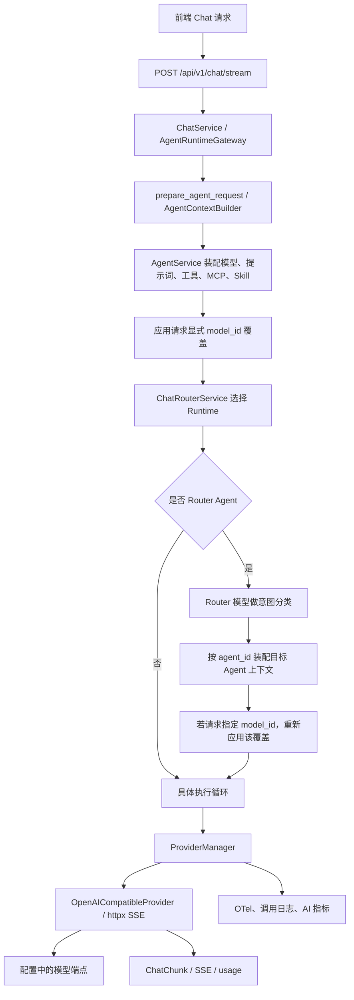
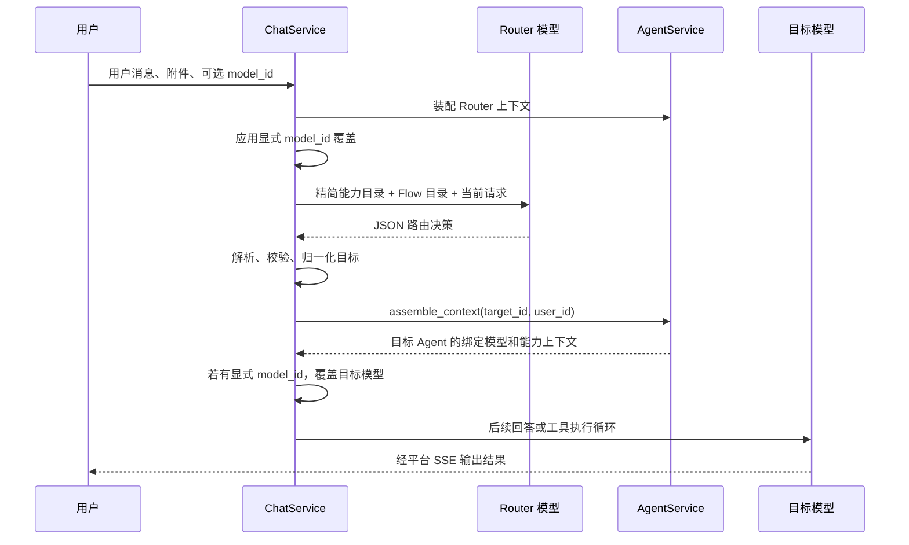

# CygnusX 智能路由与多模型调度现状调查

> 调查日期：2026-10-09。
> 类型：当前工作树调查快照，供动态模型调度方案评估使用。
> 依据：仓库代码、YAML 配置和离线路由测试；未完成部署数据库、真实 Provider 和生产指标核验。
> 本文位于用户指定的评估目录，不替代 `ARCHITECTURE_DESIGN/` 的架构权威基线。后续实施仍须先查该目录索引与对应 as-built 文档。

## 1. 调查结论

待核查的能力描述是：

> 依托智能路由按需动态调度 Kimi-k3 与 DeepSeek-V4-Flash 等高推理及轻量模型，大幅降低推理成本与延迟。

当前实现只能支持这句话中的一部分：平台已有 LLM 意图路由，能根据用户请求选择专家 Agent，再使用该 Agent 绑定的模型。模型绑定本身是静态配置，并可以被用户选择覆盖。

| 能力 | 当前证据与结论 |
| --- | --- |
| 理解请求并选择专家 | 已实现，Router LLM 输出 Agent 路由决策 |
| 不同 Agent 使用不同模型 | 已有配置和装配机制，但当前模型配置存在漂移 |
| 同一 Agent 按请求难度切换轻量/推理模型 | 未发现对应模型选择策略 |
| 根据模型价格、延迟、健康度动态调度 | 未发现对应决策链路 |
| Kimi-k3 接入和调度 | 当前检索范围内未发现注册或绑定 |
| DeepSeek-V4-Flash 接入 | 当前 Provider YAML 已登记，若干 Agent YAML 声明使用它；真实调用可用性未核验 |
| 大幅降低推理成本和延迟 | 缺少基准、对照实验及生产数据，不能据现有代码证实 |

当前更准确的能力表述：**已实现智能意图路由和 Agent 级模型配置，具备多模型分工基础；按任务动态选型及其降本、降延迟效果尚未验证或落实。**

## 2. 三种路由的职责区别

| 名称 | 实现入口 | 决策对象 | 是否动态选模型 |
| --- | --- | --- | --- |
| 意图/专家路由 | `ChatService._route_to_agent()` | 目标 Agent、意图、会诊或 fan-out 等信息 | 不直接选择模型；模型来自目标上下文 |
| Chat Runtime 路由 | `ChatRouterService.select_runtime()` | Direct、Overdrive、Studio、普通聊天 Runtime | 否 |
| Provider 调用分派 | `ProviderManager.chat_stream()` | 根据已给定配置取得 Provider 实例并调用 | 否；消费调用方已选好的模型配置 |

不能因为这些组件都包含路由或分派行为，就认定已经存在按成本和任务复杂度选择模型的 Model Router。

## 3. 当前运行架构



图中是职责链路。普通 Chat、Studio、Overdrive 的具体编排存在不同入口和分支；Runtime 的包装名称也不能直接代表最终执行引擎。

普通聊天默认在 `ChatService._stream_agent_chat_inner` 内进入 LangGraph 执行，显式 `engine: legacy` 或全局逃生舱配置可回退。Studio 仍有独立工具循环。`ChatRouterService` 的普通聊天回落类为 `LegacyChatRuntime`，但该类的委托入口还会继续进行上述普通聊天分流。

## 4. Router 一次请求如何工作



### 4.1 路由输入与输出

`_route_to_agent()` 从 `AgentTeamsCapabilityRegistry` 快照取得候选专家和 Flow 目录。该注册表从 Agent YAML 等资产派生，Chat 使用其摘要字段形成运行时分类提示词。

路由输入包含当前用户文本；附件以名称、类型和 MIME 的有限清单补充，作为领域判断依据。

模型调用参数明确为：

- `config=router_ctx.model_config`。
- `temperature=0`。
- `max_tokens=ROUTER_MAX_TOKENS`，当前常量为 **10000**。
- `tools=None`。
- `deep_thinking=False`。

框架收集非 reasoning 文本、容错提取 JSON，再调用 `normalize_decision()` 校验和归一化决策。返回信息涉及 `agent_id`、`reason`、`intent`、`confidence`、`consult_agent_ids`、`fanout_tasks`、`overdrive_intent` 等。

这里没有候选模型目录，也没有轻量/推理模型档位、价格、延迟预算或模型健康度的选型结果。

### 4.2 回退与模型切换

目标 Agent 不属于有效候选时，会回退至通用候选；目标上下文或模型不可用时，也尝试装配通用候选。最外层异常被捕获，返回无路由结果，由调用链按原上下文继续。

因此，路由失败处理并不构成“某个模型失败后自动切换另一厂商模型”的模型故障转移策略。

### 4.3 显式选择对 Router 的影响

请求准备阶段先覆盖 Router 上下文的 `model_config`；分类调用使用这个上下文。因此，用户显式选择模型时，Router 分类也可能使用该模型，不能保证分类始终走 YAML 声明的低成本模型。

路由成功后，代码再次把请求的显式 `model_id` 应用到目标上下文，保留用户选择。这意味着用户选择可使多个专家都使用同一模型，原有静态分档不一定参与最终执行。

## 5. 模型绑定与配置生命周期

### 5.1 数据对象

| 资产 | 当前职责 |
| --- | --- |
| `data/ai/providers.yaml` | Provider 实例配置，含名称、真实模型 ID、端点、凭据引用、启用与默认标志 |
| `data/ai/provider_templates.yaml` | 管理端创建配置时的模板；模板存在不等于模型已经启用 |
| `data/ai/*.yaml` 的 `model` | 按 Provider 的 `name` 声明 Agent 模型绑定 |
| `ai_provider_configs` | 运行时模型配置表，含可选输入/输出/缓存单价 |
| `agent_templates.model_id` | Agent 到运行时 Provider 配置的关联 |
| `agent_templates.model_name/model_engine` | 展示标签，随实际关联配置修复 |
| 用户能力配置中的 `model_id` | 用户针对 Agent 的模型覆盖 |

Provider 的 `name` 是绑定查找名称；`model` 是发送给远程接口的真实模型标识。两者是不同字段，不能仅根据展示名称推断实际调用模型。

### 5.2 装配优先级

一般 Agent 上下文装配的模型优先级为：

```text
显式 model_id > 用户能力配置 model_id > Agent 模板 model_id
```

`prepare_agent_request()` 对请求显式覆盖进行存在性、启用状态和 API Key 检查。`deep_thinking` 对 DeepSeek 的输出 token 策略有专门处理，但该处理没有改变模型 ID，不属于模型自动选型。

Router 二次装配目标上下文时先按目标 Agent 和用户配置解析，然后由 Chat 入口重新应用显式模型覆盖。

### 5.3 YAML 与数据库同步

`AIProviderYamlLoader.load_and_sync()` 在启动阶段按名称同步 Provider，使用 PostgreSQL 事务咨询锁串行化多 worker 同步。YAML 未声明的 Provider 会被停用，保留历史数据库行以维护引用。

YAML 指定默认值时按其声明设置；没有声明且数据库没有默认项时，加载器选择一个 active Provider 兜底。当前文件全部为 `is_default: false`，最终默认值必须结合数据库和同步行为判断。

`ensure_builtin_agents()` 对新 Agent 按 YAML 模型名称建立绑定。已有内置 Agent 的有效绑定会保留；只有失效绑定才尝试 YAML 指定模型或兜底模型。修改 YAML 的 `model` 不应被理解为必然立即重绑所有已有 Agent。

`_reconcile_model_bindings()` 在运行装配等链路修复失效关联，候选 Provider 按默认优先、更新时间倒序排列。它不是按任务难度选择模型，也不验证远程模型的实际健康状态。

## 6. 当前配置快照与漂移

### 6.1 Provider YAML

| Provider 名称 / 模型 | 端点 | active | YAML 默认标志 |
| --- | --- | --- | --- |
| `deepseek-v4-flash` | `https://api.deepseek.com` | true | false |
| `qwen3.8-flash` | DashScope OpenAI 兼容端点 | true | false |
| `qwen3.8-omni-flash` | DashScope OpenAI 兼容端点 | true | false |
| `qwen3.8-max` | DashScope OpenAI 兼容端点 | true | false |

上述是文件声明，不是供应商模型存在、账号授权、API Key 可用或线上调用成功的证明。本文未对模型名称和供应商能力做外部核验。

### 6.2 Agent YAML 分档

| YAML 绑定 | Agent 配置 |
| --- | --- |
| `deepseek-v4-flash` | router、data、delivery、shania、explorer、skill_builder |
| `qdoubao-seed-evolving` | general、agentteams_manager、rnaseq、atacseq、scrna 系列、code、viz、qc、cloud_ops、mcp_builder、orchestrator 等 |

这张表描述磁盘声明，未断言所有文件都被当前 `agents.enabled` 加载，也未断言数据库最终绑定与文件一致。

**漂移风险：** 当前 Provider YAML 没有 `qdoubao-seed-evolving`。按现有加载器规则，未声明的旧 Provider 在同步时会被停用；对应 Agent 的失效关联可被修复到可用默认/兜底 Provider。实际结果可能是原本推理档的专家共同回落至另一个模型，使静态分档失效。具体回落模型需要读取部署数据库确认。

**Kimi 状态：** 模板中有 Moonshot/Kimi 及旧模型示例，Settings 也保留 Kimi 相关配置入口；这些不构成 Kimi-k3 已登记或在当前 Chat 调度链中使用的证据。当前源码、主要配置、前端、脚本与测试检索未发现 `kimi-k3`。

**文档漂移：** 部分架构文档、Router YAML 注释及历史分档说明仍写分类 `max_tokens=200`、旧默认模型。当前代码分类上限为 10000，Provider 列表也已变化；评估以当前代码和配置为准。10000 是输出上限，不代表每次实际使用 10000 token。

## 7. Provider 执行和失败处理

普通 Chat 主调用使用自研 `OpenAICompatibleProvider`，通过 httpx 直接消费 Chat Completions SSE。仓库还保留其他 AI Provider 适配代码，不能据其存在认定 Chat 主链路由 LiteLLM Router 动态选择模型。

`ProviderManager` 按配置 ID 缓存实例，并在缓存命中时刷新模型、端点、Key 等可变配置。`chat_stream()` 使用调用方给定的配置执行请求。

Provider 内部已有瞬时错误、限流等重试策略，也有空响应后的 thinking/tools 降级处理。这些处理仍围绕当前 Provider 配置，不是根据成本、质量或负载换另一模型的级联策略。

模型调度与 Agent 权限是不同边界。现有工具、MCP、Skill、Studio capability、确认闸和数据权限由 Agent 与运行上下文控制；后续切换模型也必须保留这些约束。

## 8. 成本、延迟与观测现状

### 8.1 已有能力

- Provider 记录 `ai.provider`、`ai.model`、status、整体调用 `duration_ms` 和 usage，并输出 OTel 与结构化日志。
- `core.ai_metrics` 可将调用记录缓冲并后台写入 `ai_call_metrics`，是否启用由 Settings 控制；缓冲满或写库失败可丢弃指标。
- `AiMetricsService` 提供按日趋势、模型分布、错误率、平均耗时、P95 耗时和告警。
- Provider usage 归一化并支持工具循环累计；消息、会话和平台额度扣费具有对应持久化路径。
- Provider 表支持模型输入、输出和缓存单价；前端可据此估算元金额。

### 8.2 现有口径的限制

| 指标 | 当前含义 | 不能据此直接证明的内容 |
| --- | --- | --- |
| Provider `duration_ms` | 单次模型流式调用整体时长 | 用户请求全链路耗时、首 token 延迟 |
| 管理端 `cost_cookie` | token 按平台统一费率折算的饼干成本 | 不同模型的实际供应商人民币费用 |
| 前端元估算 | 模型单价或全局兜底单价与 usage 的计算 | 供应商账单结算结果 |
| 路由准确率评测 | 请求是否分派到预期 Agent | 模型选型质量或动态调度降本效果 |

Router 分类本身新增一次模型请求。虽然分类调用也经过 Provider 指标入口，`_route_to_agent()` 只收集分类文本，没有把其 done usage 在该函数中合并进目标回答的 usage。因此，评估成本必须明确是否包含分类、重试、工具循环和子 Agent 等全部调用，不能只取最终回答的展示费用。

当前 Provider YAML 未显式配置模型价格。后续成本评估需要确认数据库价格来源、单位、更新时间和缓存计价口径。

### 8.3 尚缺的效果证据

目前没有获取统一任务集上“固定模型”与“动态调度”的质量、总成本和延迟对照，也没有生产调用数据证明收益。

未来评估应明确任务成功率/质量底线、分类开销、实际模型决策、人民币总费用、端到端 P50/P95、首 token 延迟、回退和重试率。此处是验收证据需求，尚不是已经实现的指标或调度方案。

## 9. 本次验证及未确认项

本轮调查执行了：

```bash
uv run pytest tests/unit/test_agent_router.py tests/unit/test_agent_router_dispatch.py -q -m 'not quarantine'
```

结果：**73 passed，1 failed**。

失败为 `test_site_yaml_enabled_agents_have_config_files`：测试内的固定启用列表未包含当前新增的 `explorer`。失败发生在列表一致性断言，不能据此推断模型调用故障；同时也不能报告整个路由测试套件全绿。

其他验证边界：

- 单元测试使用模拟 Provider，不能证明真实模型可用性或实际路由准确率。
- `scripts/evaluate_router_20.py` 是真实 Router 分类评测入口，复用路由提示词和上限常量，依赖 `DP_API_KEY`；本次未运行。它验证目标 Agent 分类，不是多模型选型或成本基准。
- `docker ps` 因 Docker socket 权限限制失败，未取得部署容器状态。
- 直接数据库只读连接未完成，已终止该探测进程，未取得运行时 Provider/Agent 绑定或指标数据。
- 调查没有修改应用实现、业务配置或数据库。

## 10. 评估动态模型调度时需要明确的边界

以下问题直接影响方案接入点，留给后续设计评估：

1. 调度对象是请求、Agent 整轮任务，还是每一次工具循环中的模型调用？
2. Router 分类模型是否固定在轻量档，如何处理用户显式模型选择？
3. 用户显式选择是否始终具有最高优先级，自动模式如何在 API 和会话中表达？
4. 轻量/推理档如何声明真实 Provider，是否与专家 Agent 的静态默认绑定共存？
5. 质量不足、限流、超时、不可用分别如何升级或回退，允许增加多少成本和耗时？
6. Chat、Studio、Overdrive、会诊、子 Agent 和 Worker 是否共用选型策略，各路径如何验证？
7. 如何记录请求策略、选型原因、实际模型和调用成本，并保留工具/审批权限边界？
8. 什么任务集和生产数据足以证明“降低成本与延迟”，可接受的质量损失是多少？

## 11. 源码与架构阅读索引

以下路径相对仓库根目录，关键函数名用于定位，避免只依赖易变化的行号。

| 路径 | 重点位置或职责 |
| --- | --- |
| `src/cygnusx/api/v1/chat.py` | `/chat/stream`，Agent 请求与直连模型请求入口 |
| `src/cygnusx/application/services/chat_service.py` | `ROUTER_MAX_TOKENS`、`_route_to_agent()`、`_stream_agent_chat_inner()`、路由后显式模型覆盖 |
| `src/cygnusx/application/services/chat/request_preparation.py` | `prepare_agent_request()`，显式模型覆盖与可用性预检 |
| `src/cygnusx/application/services/agent_context_builder.py` | 请求级执行上下文装配 |
| `src/cygnusx/application/services/agent_service.py` | `ensure_builtin_agents()`、`assemble_context()`、`_resolve_model()`、`_reconcile_model_bindings()` |
| `src/cygnusx/application/services/agentteams_capability_registry.py` | Router 能力目录来源 |
| `src/cygnusx/application/services/unified_intent_router.py` | 路由决策归一化与合法目标约束 |
| `src/cygnusx/application/services/chat/chat_router_service.py` | Runtime 选择 |
| `src/cygnusx/application/services/ai_provider_yaml_loader.py` | Provider YAML 同步、默认配置和未声明项停用 |
| `src/cygnusx/application/services/ai_provider_yaml_writer.py` | 管理配置回写 YAML |
| `src/cygnusx/infrastructure/ai_provider/openai_compatible.py` | Provider 调用、重试、usage、ProviderManager 和观测 |
| `src/cygnusx/infrastructure/database/models/ai_provider.py` | Provider 配置与价格字段 |
| `src/cygnusx/infrastructure/database/models/agent.py` | Agent 模型关联和展示标签 |
| `src/cygnusx/core/ai_metrics.py` | 指标缓冲和落库 |
| `src/cygnusx/application/services/ai_metrics_service.py` | 指标聚合、平台费用口径和告警 |
| `data/ai/providers.yaml`、`data/ai/provider_templates.yaml` | 实例声明与创建模板 |
| `data/ai/router.yaml`、其他 Agent YAML、`data/CygnusX.yaml` | 静态模型声明与启用清单 |
| `tests/unit/test_agent_router.py`、`tests/unit/test_agent_router_dispatch.py` | 路由解析、分派及配置一致性测试 |
| `tests/unit/chat/test_request_preparation.py` | 请求显式模型覆盖测试 |
| `scripts/evaluate_router_20.py` | 真实模型的专家分类评测入口 |

架构基线入口：

- `ARCHITECTURE_DESIGN/README.md`。
- `ARCHITECTURE_DESIGN/CygnusX_agent_execution_framework.md`：不同执行路径与保护边界。
- `ARCHITECTURE_DESIGN/CygnusX_agent_architecture.md`：Agent 组成、上下文与调用契约。
- `ARCHITECTURE_DESIGN/CygnusX_agent_framework_baseline.md`：Router 和专家执行边界。
- `ARCHITECTURE_DESIGN/CygnusX_token_billing_architecture.md`：usage、费用展示与平台扣费。
- `ARCHITECTURE_DESIGN/CygnusX_mcp_architecture.md`：Provider 与多模型路由描述；模型表和 token 上限需结合本文漂移说明核对。

`CygnusX_chat_execution_layers.md` 自身标注为施工快照，只用作历史定位辅助；历史提案和 `data/ai/update/README.md` 中的分档记录也不能覆盖当前代码与配置。
