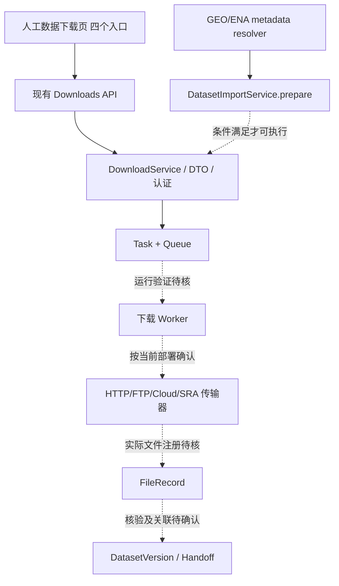
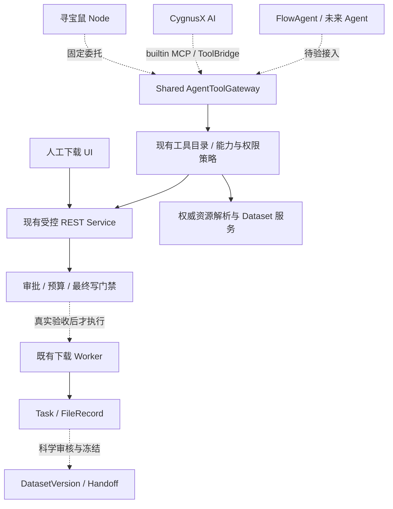

# CygnusX BioOps · 全平台下载能力、数据接入链路与多 Agent 工具化准备度专项调查

**Download Capability Inventory · Transport Routing · Dataset Ingestion · Shared Agent Tools Readiness**  
**版本：** 2026-10-16 · V1.0  
**用途：** 直接提交给 Codex 的**只读调查任务书**，不是实施完成报告。  
**调查原则：** 以当前实际仓库、子仓、配置、锁文件及安全允许的运行证据为准；历史报告和界面截图仅作线索。

> **本次最重要的问题：** CygnusX 现在到底有哪些可用的数据下载方式？这些方式分别由哪个服务、哪个 Worker、哪个真实运行程序执行？哪些仅有 UI 或代码、哪些已经通过环境验收？如何在不重复建下载引擎、不降低权限的条件下，将已验收能力统一提供给**科研寻宝鼠、平台 AI 助手、FlowAgent 以及未来其他 Agent**？

---

## 00 · 任务定位、强约束与验收定义

### 00.1 本轮只读，不动下载生产链

1. **只调查、分类、核验与写文档**。不修改下载 API、Agent tools、业务模型、前端功能、部署镜像、数据库或 Feature Flag；不提交、推送或部署。
2. 可以读取源码、Git 历史、配置、现有日志与测试；可运行无副作用的类型/静态检查及隔离 mock/fixture 测试；**不能因为调查需要就创建下载 Task、调度 Worker 或真实大文件下载**。
3. 当前工作树和子仓可能存在未提交修改。首先记录 dirty baseline，禁止 `git reset`、`git clean`、`stash`、强制 checkout 或覆盖既有产物。新增文档时检查目标路径是否已存在，禁止覆盖。
4. 对生产环境仅允许读取用户明确授权的脱敏运行证据。`GET` 也须确认没有隐藏的回填/同步副作用；历史上平台的项目列表曾带磁盘回填逻辑，不能因为是 GET 就认定安全。
5. **保留源码级写门禁**，包括既有 `WRITE_RUNTIME_ACCEPTED=False`、`worker_paths_verified=false` 等；不开启任何下载、分析或代理委托写权限。
6. **不复刻敏感凭据**：不得输出用户 Token、S3 密钥、FTP 密码、Cookie、Node 内部委托 Token、全量环境变量、真实个人路径中的私密信息。仅记录是否存在、使用位置及脱敏版本。
7. 不得以官网文档、README、前端宣传文字或历史报告替代当前可执行环境证据。所有声称“真实支持”必须限定测试层级。
8. 不默认用户现有所有下载来源都可安全开放给模型。**Agent Readiness 与用户手工 UI 可用性是两套不同门禁**。

### 00.2 六个必须分别给出状态的层级

每一种下载能力都按独立维度检查，**不得简单合并成“已支持”**：

| 维度 | 问题 | 建议状态 |
|---|---|---|
| 入口 `UI_ENTRY` | 用户能否在页面选择？ | YES / NO / UNKNOWN |
| 契约 `API_CONTRACT` | 对应 API 与参数 Schema 是否真实存在？ | VERIFIED / PARTIAL / NOT_FOUND |
| 执行代码 `BACKEND_IMPL` | Service / Queue / Worker 是否有完整可达路径？ | VERIFIED / PARTIAL / STUB / NOT_FOUND |
| 部署 `DEPLOYED` | 当前已部署镜像、二进制、配置及挂载是否包含该代码？ | ATTESTED / CONFLICT / UNKNOWN |
| 实际传输 `RUNTIME_TESTED` | 是否在受控环境用真实协议传输并登记过文件？ | PASS / FAIL / BLOCKED / NOT_TESTED |
| Agent 使用 `AGENT_READY` | 是否通过工具目录、授权、审批、来源策略和状态关联全部门禁？ | READ / PREPARE / EXECUTE / BLOCKED / UNKNOWN |

注意：某种方式可以 `UI_ENTRY=YES`、`BACKEND_IMPL=PARTIAL`、`RUNTIME_TESTED=NOT_TESTED`、`AGENT_READY=BLOCKED`，不是矛盾。

---

## 01 · 已知背景与待证事实（不是本轮调查结论）

### 01.1 用户实际看到的下载入口

现有 CygnusX「数据下载与聚合」页面有四个分区：

- **公共数据库**。
- **云盘极速提取**。
- **云存储直拉**。
- **直链与 FTP**。

“直链与 FTP”界面声明支持 HTTP / HTTPS / FTP、批量链接、断点续传、并发和下载后自动入库，并提供目标目录、高级下载参数及任务表。这只能证明**界面存在与产品设计目标**，不能证明每个协议经真实 Worker 验收。

### 01.2 历史审计已提供的线索

以下是历史材料指出的定位线索，必须按**当前 HEAD + dirty 工作树 + 真实部署**重新核实：

- `src/cygnusx/api/v1/downloads.py`：下载 REST 入口。
- `src/cygnusx/application/services/download_service.py`：下载提交与 Task 创建。
- `src/cygnusx/infrastructure/celery_app/tasks/download.py`：Worker 调用下载 CLI、进度、FileRecord 登记。
- `src/cygnusx/infrastructure/mcp/presets.py`：内置平台下载工具及确认逻辑。
- `mcp-server/tools/downloads.py`：外部 MCP 下载接口；曾存在不安全布尔自证问题，后续阶段据称修复，**必须重新验证**。
- `pipelines/EBIDownload` 与同名/相关 Polariseq 仓库：Rust 下载能力及版本来源；**目录名、Git remote、版本和运行二进制不能混为一谈**。
- `application/services/agent_tool_gateway.py`、`dataset_import_service.py`、`dataset_analysis_service.py`、`agent_tool_delegation.py`：共享能力、GEO 导入、分析交接、Node 委托。
- `infrastructure/geo/adapter.py`：GEO/ENA accession 与来源候选；候选解析不等于数据传输。

历史 Phase3 / 近期 E2E 增量报告称：`DatasetImportService.prepare` 能经 Gateway 创建来源/文件/预算/确认预案，但**不建真实下载 Task**；下载实际执行仍受源码门禁约束。旧审计指出 DownloadRequest 一度支持 `sra / cloud_storage / direct_link`，Worker 可能调用 Rust 二进制与 `aria2`；不能据此断言现有 FTP、S3、云盘均已真实支持。

### 01.3 本轮应特别核实的历史漂移

历史材料出现过：

- 下载子仓名为 EBIDownload，但有另一套 Polariseq 源码及不同提交。
- 宿主机二进制版本和较新源码版本不一致，**Worker 实际镜像内版本未知**。
- 默认 Compose 镜像 tag 与构建子仓 SHA 可能不匹配。
- SRA Run `SRR...` 与 BioProject / GEO `PRJNA...`、`GSE...` 能否被当前运行二进制接受未经证明。
- 旧下载逻辑文件登记与 Dataset / Source / Sample / SHA 链接不全；Phase3 后需重新确认新的对账与资产关联。

以上仅为**优先调查项**，不得提前写成当前漏洞或当前已修复事实。

---

## 02 · 仓库、发布来源与功能边界勘探

### 02.1 记录基线

只读记录：主仓 branch/HEAD、未提交增量、各子仓 HEAD 与 dirty 状态、锁文件、Compose profile、CI 构建上下文、镜像 tag / digest **（若可读且已获授权）**、Worker 可执行程序版本/sha256、运行用户、挂载配置以及活跃配置来源。

建议使用无副作用的命令组合（按仓库实际情况调整）：

```bash
pwd
git status --short
git rev-parse HEAD
git submodule status --recursive
rg -n 'DownloadService|DownloadRequest|direct_link|cloud_storage|sra|ftp|aria2|EBIDownload|Polariseq|run_download|FileRecord' src frontend mcp-server pipelines deploy 2>/dev/null
rg -n 'downloads\.prepare|dataset\.prepare_import|download|tool.*catalog|agent_tool_gateway' src frontend pipelines 2>/dev/null
```

查不到文件时报告 `NOT_FOUND_IN_SEARCH_SCOPE`，不要自行假设路径已迁移。无需为调查直接安装第三方依赖或改变环境。

### 02.2 划定下载相关项目与服务

至少调查：

1. 主仓 CygnusX FastAPI / Vue；API、Pydantic DTO、权限依赖。
2. 下载核心 Service、Task 模型、Celery、Broker/Redis、FileRegistry 与用户存储层。
3. EBIDownload / Polariseq Rust CLI，及部署容器内**真实执行**的二进制。
4. GEO / ENA / SRA metadata resolver；公用 HTTP client 与来源可信策略。
5. 云盘、对象存储与 FTP/aria2/wget/curl 等潜在执行适配器。
6. 数据管理 / DatasetImportService、DatasetAsset、DatasetVersion 与冻住的 Handoff。
7. 内置 MCP、外部 MCP、AgentToolGateway、ToolBridge、Node 委托、FlowAgent/未来 Agent。
8. 数据下载前端四个分区、Task Center 和下载状态展示。
9. Nginx/Ingress、Docker/Compose、Worker mount、Secrets 注入与网络出口策略。

---

## 03 · 统一下载能力清单：逐项排查，不凭名称判定

建立一个**行级可追溯的能力矩阵**，至少包含以下候选；允许增加但不得凭推测写为已实现。

| ID | 来源/方式 | 源数据标识或输入 | 可能的传输后端（待证） | 必须调查的特殊问题 |
|---|---|---|---|---|
| D01 | NCBI SRA 原始 reads | SRR / ER(R) / DRR；可能经 PRJNA/SRP 解析 | Polariseq / EBIDownload / SRA 工具 | accession 接受范围、Run 映射、FASTQ 转换、pair、校验 |
| D02 | ENA FASTQ | study / experiment / run / 权威 file_report URL | Rust ENA adapter / HTTPS / FTP | ftp_1/ftp_2、md5、file size、协议回退与重定向 |
| D03 | GEO series / sample metadata | GSE/GSM | GEO Adapter | SOFT/metadata 发现本身不算下载文件 |
| D04 | GEO supplementary | GSE/GSM 附件 URL | 现有 direct_link 下载 | 安全主机、重定向、归档、来源与样本映射 |
| D05 | GEO Series Matrix | GSE matrix URL | 已有 direct_link / GEO processed path | 不自动宣称 raw counts、表达量单位识别 |
| D06 | 普通 HTTPS 文件直链 | 可信 HTTPS URL | direct_link / aria2 / 其他 | TLS、DNS/重定向、对象大小、checksum |
| D07 | 普通 HTTP 文件直链 | HTTP URL | direct_link | 是否默认拒绝不安全公网源、来源策略 |
| D08 | FTP / FTPS 文件 | ftp:// / ftps:// URL | aria2 / Rust FTP / wget / 其他 | **确认实际协议支持**、被动模式、防 SSRF、TLS 与认证 |
| D09 | 对象存储 S3/OSS/COS | Bucket/key / presigned URL | cloud_storage | 区分云存储直拉与普通 URL，endpoint/IAM 安全 |
| D10 | 云盘链接极速提取 | 分享链接与提取码 | 第三方 CloudDrive adapter（如存在） | 许可、提取码、账号、时效、文件列表、速率限制 |
| D11 | 公共 EBI/Ensembl/UCSC 文件 | accession 或公开 URL | public_data / direct_link | 来源识别与 URL 授权，不以名称自动支持 |
| D12 | 批量直链下载 | 多个受控 URL | direct_link batch | 每条来源校验、总预算、部分成功和重复 |
| D13 | 断点续传与并发 | HTTP(S)/FTP 下载任务 | aria2/Rust/Worker | 是否真实 checkpoint，重试是否保留 checksum |
| D14 | 用户已有项目文件关联 | FileRecord ID | 不应再次下载 | 复用授权文件，核验 owner/project/path/checksum |
| D15 | 本地上传 / 数据管理导入 | 文件流 / FileRecord | upload/import（非远程下载） | 与远程下载区别，如何共享 Dataset Handoff |
| D16 | Agent 发起外部 URL 获取 | DiscoveryRef / URL / 资产引用 | 必须经可信 resolver / Gateway | 能否安全授予该 Agent，不能开放任意公网抓取 |

**重要分类**：`数据发现/元数据解析`、`真实网络文件传输`、`已有文件导入`、`科研资产登记` 是四个不同阶段。S3 存储后端与 S3 远程拉取也可能是不同能力。

### 03.1 每个候选能力的调查字段（必须完整填写）

```yaml
capability_id: D01
ui_label: ''
source_family: ''
input_identifiers: []
resolver: {file: '', function: '', evidence: ''}
transport_protocols_declared: []
transport_protocols_verified: []
api: {method: '', path: '', auth: '', schema: ''}
service: {file: '', method: '', validation: ''}
worker: {task: '', queue: '', image: '', binary: '', mounts: ''}
execution_binary: {name: '', version: '', sha256: '', verified_in_worker: false}
output: {task: '', file_record: '', dataset_asset: '', checksum: ''}
access_control: {owner: '', project: '', modules: '', scopes: ''}
prepare_execution_boundary: ''
confirmation: {mechanism: '', ttl: '', parameter_hash: '', one_time: ''}
url_network_policy: ''
quota_size_limits: ''
retry_resume_cancel: ''
partial_failure_recovery: ''
agent_registration: {gateway: '', builtin_mcp: '', external_mcp: '', node: '', flow_agent: ''}
evidence: [{path: '', lines: '', test: '', layer: ''}]
ui_entry: UNKNOWN
api_contract: UNKNOWN
backend_impl: UNKNOWN
deployed: UNKNOWN
runtime_tested: NOT_TESTED
agent_ready: BLOCKED
blockers: []
```

必要时建立机器可读 JSON/YAML 附录，但不要在调查中创建或修改真实业务模型。

---

## 04 · 四条典型端到端下载调用链专项追踪

针对每条链，必须标出**前端事件 → API → 认证 → DTO → 来源解析 → 预算 → 确认 → Task → Queue → Worker → 传输程序 → 文件系统 → FileRecord → Dataset**。对每一跳给出文件、函数、行号和调用条件。

### 04-A：已有「直链与 FTP」UI 下载链

检查当前分区对应的 Vue 页面、表单验证、资源链接列表去重、目标目录选择、并发/重试/断点参数、POST 请求、Task 列表与权限路由。

逐项回答：

1. HTTP、HTTPS、FTP、FTPS 是否都被 Schema 接受？哪些只在文案里出现？
2. `direct_link` 是如何区分协议、校验 URL 和调用底层下载器的？
3. `ftp://` 究竟经 `aria2`、`wget`、Rust CLI 还是 Worker 的另一路处理？
4. 是否真的支持 **FTP 登录、FTPS/TLS、passive**？对于没有实现的情况写清楚，不虚构支持。
5. 下载任务是否能跨刷新恢复？多链接批量是一个 Task 还是多个 Task？部分失败如何表示？
6. 下载到项目子目录是否有 Project 级授权？还是只检查用户根目录字符串？
7. 文件登记是否从 Worker 实际完成后发生？如何处理已写入文件但登记失败？
8. 断点续传是否在 Worker 重启、任务重投和用户刷新后仍可靠，还是仅 CLI 进程内有效？

### 04-B：公共数据库与 Polariseq/EBIDownload 链

检查 accession resolver 的规则和 CLI 参数契约。必须分别验证以下不同输入，不得笼统写“支持 NCBI”：

- `SRRxxxxxx`：Run 级别；
- `SRXxxxxxx`：Experiment；
- `SRPxxxxxx`、`PRJNAxxxxxx`：Study/BioProject；
- `GSMxxxxxx`、`GSExxxxxx`：GEO Sample/Series；
- ENA 原始 FASTQ URL；
- 仅有 processed supplementary 的 GSE。

记录：各类型由**谁负责**展开为实际可下载文件；源方是否提供 checksum/bytes；FASTQ 转换与下载文件是同一个过程吗；双端和多 Run 的文件归属是否保留；下载器实际接受哪些参数；有没有把 GSE 原样错误传给仅支持 SRR 的 CLI。

### 04-C：GEO processed data / supplementary 链

检查：权威 GEO SOFT/ENA 响应 → 附件候选 → MIME/大小和来源策略 → 下载预案 → 现有 direct_link Service → FileRegistry → 安全归档展开 → 内容/矩阵类型审阅 → DatasetVersion。

核查：

- Series Matrix、supplementary、counts TSV/CSV、h5/h5ad/mtx 与 compressed archive 是否**仅被列为候选**，还是有证据证明内容类型。
- 是否保留原始 archive、展开后的单文件及相应 SHA-256/来源关系。
- 未知/TPM/FPKM/CPM/transformed/整数外观但来源不明是否明确拒绝进入 DESeq2。
- 解压炸弹、ZipSlip、软/硬链接、覆盖已有文件、样本列重复及未知方向等是否经过校验。
- Dataset READY 是否严格晚于文件完整性、样本关联与人工审阅。

### 04-D：Agent 下载预案到 Worker 的共享链

对比人工下载入口与下面两条 Agent 调用面：

```
科研寻宝鼠 Node → 固定受信 callback → AgentToolGateway → DatasetImportService / DownloadService
平台 AI / FlowAgent → MCPClient/ToolBridge 或已授权 adapter → 同一 Gateway / Service
```

必须验证：真正共享的是**同一个业务提交/审批/权限服务**，还是仅共享了工具名称。

核查 `dataset.prepare_import` 与 `downloads.prepare` 是否重复审批、重复写 Proposal、重复预算或生成两个下载 Task；若职责重叠，提出统一治理建议，但本轮不改代码。对 Agent 分别检查目录发现、prepare、审批、execute、get_status、文件登记及失败恢复的真实权限和调用路径。

---

## 05 · Worker、二进制、网络与部署真实性

### 05.1 运行来源对账

建立四列对照：`主仓/子仓声明 SHA → CI 实际构建上下文 → 运行镜像 digest → 容器内二进制版本/hash`。若环境无 Docker socket、无容器实例或无权限读取，写 `BLOCKED`，不得用宿主机 `--version` 代替 Worker 版本。

至少检查：

- Celery worker 镜像、启动命令、下载 task routing/queue、ack/retry 策略。
- Rust 下载器、`aria2c`、`wget`、`curl`、`prefetch/fasterq-dump` 等到底哪个真实存在于容器内。
- `DownloadRequest` 字段如何映射 CLI 参数，是否有 shell 拼接/任意参数注入风险。
- `EBIDownload` 与 `Polariseq` 的版本差异及功能覆盖。
- S3 加速与公网/区域切换是否依赖运行时凭据和网络。
- HTTP/FTP 出口连通性及超时；目标端 403/404/429、限速及断点恢复。
- 用户存储根、项目目录、临时目录、缓存与 Worker/主 API 的挂载一致性。
- Worker 写出后 Web API 是否能看到相同真实文件（inode、挂载、权限、校验）。
- Task 状态是否来自真实 broker/DB/worker，而不是前端计时器或仅 Redis 缓存。

### 05.2 能力与环境组合不能一刀切

区分 `开发 fixture 通过`、`本机单进程可用`、`隔离 Worker 可用`、`真实平台多用户可用`、`生产已开放`。根据真实状态可以出现：HTTP 真实可用，FTP 未测；SRA 可用但 BioProject 不支持；下载可用但 Dataset Handoff 未通过。

**每项操作单独 Gate**，不得因为一种传输成功就自动开放全部数据来源或所有 Agent。

---

## 06 · 安全、权限、合规与成本治理专项调查

### 06.1 权限与项目约束

核查 user active、JWT/API Key、module enabled、Project owner/scopes、FileRecord owner、受管存储路径、Agent delegated scopes、ToolCatalog 暴露策略及确认有效期。

必须回答：

- 用户在下载 UI 手工使用某协议，与 Agent 使用该协议是否具有独立控制？
- 非项目全局只读 GEO 发现能否保持无 project？产生持久下载/导入预案时是否必须选择有权限项目？
- 请求自带 user_id/project_id/path 能否改变服务端已绑定上下文？
- 文件夹选择是否经过真实 Project / user_root 验证，避免仅用目录名推断授权？
- 拒权、确认过期、改变文件列表/预算、项目切换、Token 撤销时会否拒绝执行？
- 外部 MCP 是否禁止任何模型提供 `user_confirmed=true` 类自证；是否统一使用 JWT-only 人工确认？

### 06.2 下载 URL 与出站网络

特别针对公共 URL、FTP 及云存储 endpoint 检查：

- 来源白名单/可信 host policy 与业务支持范围，而不是将“HTTP(S)”理解为任意 URL 安全。
- URL 规范化、IDNA/编码、userinfo/凭据、IPv4/IPv6/整数形式地址、DNS rebinding、内部/链路本地/元数据 IP 与端口。
- 下载实际 Worker 的 URL 检查是否与 Prepare 一致；重定向每跳复核、DNS 解析绑定和代理环境变量风险。
- FTP 的主动/被动数据连接及返回连接地址是否可能超出准入策略；FTPS 若不支持必须明确限制。
- 签名 URL 时效、敏感参数日志脱敏、云盘分享码及短期凭据保管。
- 文件名/Content-Disposition 注入、路径穿越、超长文件名、软/硬链接、冲突覆盖和伪装 MIME。
- 单文件/批量体积预算、配额预留、实际传输硬限制、限时/并发/频率、压缩炸弹及磁盘耗尽。

这里是**调查测试清单**，不是对当前系统存在 SSRF 漏洞的断言。出现真实高风险缺陷时只记录脱敏证据与修复建议，禁止在生产发起利用性请求。

### 06.3 科研输入完整性与许可

核查来源协议、文件使用限制、公共与受控数据区别、需要账户授权的数据、科研资源类型、校验和算法、可复现下载地址与来源快照。Agent 应避免提供绕过访问控制的下载建议。

区分三种哈希：下载源声明 MD5/SHA、实际文件 SHA-256、Handoff Manifest snapshot/hash；不能互相代替，更不能当作防管理员篡改签名。

---

## 07 · Task / FileRecord / Dataset / Handoff 的实际数据契约

追踪数据从“被发现”变成“可分析项目资产”的全过程。

| 业务对象 | 必须追查的字段和来源 | 失败时的正确表现 |
|---|---|---|
| DiscoveryRef | GEO/SRA accession、source URL、检索证据、检索时间 | 仍是线索，不能当科研资产 |
| ImportProposal | owner/project/session、候选 Run/附件、预算、request_key、来源快照 | 预案缺失/变更拒绝执行 |
| DownloadRequest | 真实 source、transport mode、目标受控目录、资源上限 | 不应接受模型写任意本地路径 |
| Confirmation | 发起身份、批准身份、TTL、参数哈希、一次性消费 | 不批准、不重放、不混用分析确认 |
| Task | 真 ID、owner、queue、状态、投递与重试语义 | 投递未知不自动重复提交 |
| FileRecord | 真路径、owner、project 关联、size、checksum、download Task | Task 成功不等于文件可用 |
| DatasetAsset | FileRecord、Source、用途、类型、校验与 Task | 缺文件或来源显示 NEEDS_RECONCILIATION |
| DatasetVersion | Source/Sample/Review/Asset 与版本快照 | 未验证表达矩阵不得设 READY |
| HandoffManifest | 输入 SHA、样本/实验设计、Workflow compatibility | `worker_paths_verified=false` 时拒绝执行 |
| AnalysisLink | Frozen Version、Flow Prepare、真实分析 Task | 仅准备状态不得显示 Task success |
| Report/Evidence | Result Manifest、Artifact、科学报告、执行证据 | 未生成不得假造链接 |

重点追查：下载 Task 失败但已有部分文件、用户重新点击 Prepare、SSE 断开、Worker crash、文件登记异常、重试请求内容变化、Report 失败等情形。**数据传输成功 ≠ 数据集经过科学核验 ≠ 分析成功 ≠ 报告可交付**。

---

## 08 · 面向所有 Agent 的统一下载工具化设计调查

### 08.1 目标不是新下载器，而是 Download Capability Catalog

研究能否在现有 `AgentToolGateway`/共享 Schema 上新增或整理一个**只读的能力发现层**；它应按平台实际支持和授权给出不同来源适配器的状态，不能暴露当前用户无权使用的能力。

建议调查/设计的**概念性工具**如下。名称仅用于对照；如仓库已有等价工具，应直接复用，不能因名字不同重建一套。

| 概念能力 | 参数来源与建议输出 | 适用范围 | 副作用 |
|---|---|---|---|
| `download.list_capabilities` | 当前授权用户的已验证协议/来源、限制和可用状态 | 所有 Agent | 只读 |
| `download.resolve_source` | 可信 accession / DiscoveryRef → 权威 Run、附件、大小、校验、来源 | 数据发现 Agent / 项目 Agent | 只读 |
| `download.inspect_files` | 解析后的文件候选、文件类型、是否可下载及缺口 | 所有授权 Agent | 只读 |
| `dataset.list_project_assets` | 当前有权项目已有资产/版本 | 所有授权 Agent | 只读 |
| `dataset.prepare_import` | 指定项目、选定 Run/附件、来源快照、预算 → 可恢复 ImportProposal | 有项目上下文的 Agent | 写入预案/审批记录；不下载 |
| `downloads.prepare` | 普通受控直链/云存储资源的传输预算与审批预案 | 通用文件 Agent；必要时 | 写入预案；不下载 |
| `download.get_status` / `tasks.get_status` | owner-scope Task 状态、文件及错误 | 所有授权 Agent | 只读 |
| `dataset.inspect` | 版本、文件校验、样本/用途、Handoff 缺口 | 分析 Agent | 只读 |
| `download.execute`（仅服务端受控路径） | 一次性真实批准 + 运行准入 + Task | **不可给模型直接自批** | 高风险写入；默认禁用 |

**强约束：** `dataset.prepare_import` 与普通 `downloads.prepare` 不能为同一下载创建两次确认/两个 Task。优先明确谁拥有科研来源审阅与预案、谁只负责传输执行。

### 08.2 接入不同 Agent 的对照

逐个梳理现有 Agent 的真实路由，不要假定所有 Agent 都用同一协议：

- **科研寻宝鼠**：Node 研究工具 → 固定可信 Callback/委托 → AgentToolGateway → 共享业务能力；浏览器 React Island 只发 typed action，经 Vue/BFF 访问可信 API。
- **CygnusX AI 助手**：实际 MCPClient / ToolBridge / builtin preset → Gateway → 同一 Service；查清真实 MCP 注册与过滤策略。
- **FlowAgent**：调查其位于 FlowFrame 或平台的运行时、工具目录、用户/项目身份绑定与允许能力；若当前无可信 Gateway 集成，标为缺口。
- **未来研究 Agent / 项目 Agent / 报告 Agent**：仅作为目标权限模型，不宣称已实现；探索采用同一 typed catalog + scopes + provenance，但下载权限按 Agent 类型最小化分配。

不要要求 Node Agent 能直接连接任意外部 MCP Server；共享的是**授权、Schema、业务 Service 与 Evidence**，不是强制一致的网络协议。

### 08.3 Tool Schema 与结果语义

调查现有目录是否包含下列必备结构（或等价）：

```
Capability: READ | PREPARE | EXECUTE
AuthScope: user + session + project + module + delegated scopes
Source: accession / authoritative-file-reference / verified-URL
Proposal: persisted proposal_id + source_snapshot_hash + budget + expires_at
Approval: separate human JWT-only action; never model self-approval
Execution: real task_id; no fabricated progress
Outcome: FileRecord / DatasetAsset / checksum / actionable gaps
Status: UNKNOWN | READY | BLOCKED | PARTIAL | FAILED with reason
Trace: tool_invocation_id + source evidence + owner-scoped related objects
```

要求区别**工具确实注册**和**Agent 确实得到 tools schema 并能安全调用**；如运行默认关闭，Agent-facing catalog 应明确说明不可用，而不是在模型里宣称工具已 ready。

### 08.4 Agent 选择下载方式的推荐原则（只作提案）

由权威 resolver + 服务端规则选择：

1. 输入为 GSE/GSM/SRX/SRR 等 → 先解析权威层级和真实文件，不能靠大模型猜 URL。
2. 输入是已签名文件 URL → 确认协议/主机/过期时间、源权威性和项目适用性；不把 URL 直接作为信任来源。
3. 如果具备权威的 FASTQ、MD5、大小、镜像 URL → 执行可用适配器的能力匹配，不能强行选择宣称最快但未验收的传输器。
4. 若同时有 ENA HTTPS/FTP、Rust S3 加速等后端，可比较成本/可靠性/region，但**只能使用已验证且当前授权的选项**。
5. 若资源只能通过第三方云盘取得，须检查实际合法访问、第三方登录授权、凭据保管；默认不自动执行。
6. 若已有合法 FileRecord 且内容有效 → 优先复用项目资产，避免重复下载。
7. 不存在可靠来源/配对/实验信息时返回 `REVIEW_REQUIRED`，而不是从模型文本填补。

---

## 09 · 应产出的真实架构图（至少五张）

调查报告必须提供 Mermaid，标注**已核实实线 / 仅推测或受门禁阻断虚线**，不能把目标设计画成当前已运行事实。

### 图 1：平台现状的下载分支（必须按源码填充）



> 上图仅是调查起始假设，不是现状结论。正式报告须替换为**源码验证后**的拓扑，并附路径。

### 图 2：公共来源标识 → 传输方式选择决策树

必须明确 GSE/GSM、SRX/SRR、ENA URL、GEO supplementary、普通 HTTPS、FTP、云盘及已有 FileRecord 的不同路径和未支持分支。

### 图 3：人工下载、寻宝鼠、平台 AI、FlowAgent 的工具统一关系



### 图 4：下载任务状态机、幂等与异常对账

包含 PREPARED、PENDING_APPROVAL、APPROVED、SUBMITTING、QUEUED/RUNNING、PARTIAL、FAILED、RECONCILIATION_REQUIRED、COMPLETE_FILES_VERIFIED、DATASET_READY（若现有实际命名不同，以真实枚举为准）。

### 图 5：Release Gate 与各 Agent 能力层级图

区分 `只读 discovery`、`prepare`、`人类 approve`、`受控 execute`、`status`、`dataset registration`，并表示当前配置与运行条件不满足时被阻断。

---

## 10 · 测试矩阵与真实环境准入

### 10.1 本轮只读/隔离可做的测试（建议 44 项）

| 范围 | 测试编号 | 必须核实的内容 |
|---|---|---|
| UI / 契约 | D-T01–04 | 四入口确切 API、必填参数、协议选择、批量输入 |
| API / Service | D-T05–08 | Request mode 枚举、各来源 dispatch、未知协议拒绝、来源变更失效 |
| SRA / ENA | D-T09–12 | SRR/SRX/PRJNA/GSE 解析界限、Run/FASTQ pair、md5/bytes、无数据缺口 |
| GEO processed | D-T13–16 | supplementary/Series Matrix 区分、权威 URL、归档安全、TPM/UNKNOWN 不作 raw counts |
| HTTP / FTP | D-T17–20 | URL scheme/主机策略、重定向/DNS、FTP/FTPS 支持事实、并发/续传失败语义 |
| Cloud / S3 | D-T21–24 | presigned URL/endpoint/权限、云盘码、失效与限速、凭据脱敏 |
| 预算与目录 | D-T25–28 | 文件量/总字节/存储配额、用户目录与 Project 权限、路径与链接负例 |
| Prepare / Confirm | D-T29–32 | prepare 不建 Task、JWT-only 审批、hash/TTL/replay、入口间不重复确认 |
| Task / Recovery | D-T33–36 | 幂等、PARTIAL、投递未知不自动重发、FileRecord/source/checksum 关联 |
| Agent / Tool | D-T37–40 | catalog scope、Node 委托/MCP 共享、跨 owner/project 拒绝、无自批 |
| Report / Delivery | D-T41–44 | DatasetVersion/ Handoff 真实性、状态恢复、缺报告显示、全 UI 入口保持独立 |

本轮若运行的隔离测试中使用 stub、fixture、SQLite、fetch double，请原样记录，不能列为真实下载测试。

### 10.2 后续在隔离真实环境中执行的验收（**本轮不得擅自运行**）

| Gate | 条件 | 通过所需证据 | 未通过的 Agent 能力 |
|---|---|---|---|
| DL-RG01 | 当前部署镜像与下载二进制溯源 | build SHA / digest / in-worker version+hash | 禁止依赖未认证 Worker 的执行 |
| DL-RG02 | PostgreSQL 迁移、事务与并发 | 隔离 PG upgrade/owner/并发实测 | 禁止持久写执行 |
| DL-RG03 | Redis CAS/TTL 与故障拒绝 | 两进程/故障恢复/nonce/审批准入 | 禁止 Agent 审批消费和执行 |
| DL-RG04 | Broker / Celery Task 真实投递 | 真实 Task/Worker/文件状态与重试 | 禁止自动执行 |
| DL-RG05 | HTTP(S) 直链真实小文件 | 文件校验、重定向、预算、持久登记 | 仅该协议可考虑最小放行 |
| DL-RG06 | FTP/FTPS 真实受控小文件 | 对应协议/被动模式/网络/校验 | 未测协议继续禁用 |
| DL-RG07 | SRA/ENA 小 Run 真实获取 | SRR→FASTQ→size/checksum/paired | 禁止公开 SRA Agent 执行 |
| DL-RG08 | GEO supplementary 真实导入 | 权威来源→文件→归档→审阅 | 禁止提升 Dataset READY |
| DL-RG09 | Cloud/S3/网盘各模式 | 每种传输独立证据、授权、脱敏 | 分别限制对应来源 |
| DL-RG10 | 双用户/双项目授权 | REST+MCP+Node callback 非越权 | 禁止广泛 Agent 暴露 |
| DL-RG11 | 网络安全/硬预算/不可信文件 | 出站/重定向/配额/解压负例 | 禁止任意 URL 获取 |
| DL-RG12 | 资产登记与科学 Handoff | Task→FileRecord→Asset→Version SHA | 禁止自动衔接分析 |
| DL-RG13 | 下载进度/取消/恢复 | Worker kill、断网、幂等、PARTIAL 对账 | 禁止自动重试策略 |
| DL-RG14 | 至少两个 Agent 的目录和调用一致性 | 同一 Service/权限/审计/状态 | 禁止宣称“全 Agent 可用” |
| DL-RG15 | 小型真实科研端到端案例 | GEO/SRA→下载→Dataset→Flow→Report 实际 ID | 禁止宣称科研闭环完成 |

可按能力分别给出 `READ_ONLY_READY`、`PREPARE_READY`、`MANUAL_DOWNLOAD_READY`、`AGENT_PREPARE_READY`、`AGENT_EXECUTE_READY`、`BLOCKED`，不要只给平台一个全局 PASS。

---

## 11 · Agent 集成就绪度评分与缺口优先级

建立基于事实的矩阵而非主观总分。至少以这些维度评估每个能力：

1. 协议与真实 Worker 支持程度。
2. 来源可核验性与可复现标识。
3. 文件合法可获取性和访问权限。
4. 出站网络安全与 URL 策略。
5. 用户/项目隔离与身份委托。
6. 前置预算、真实硬限制及存储目录。
7. prepare/approve/execute 分离程度。
8. Task/FileRecord/Dataset/Handoff 关联完整性。
9. 断网、重试、部分文件与故障恢复。
10. Agent 目录、MCP/Callback 一致性与状态查询。

按 `P0_BLOCKER / P1_PREPARE_GAP / P2_UX_ENHANCEMENT / NOT_APPLICABLE` 分类。**对人工 UI 足够可用、但不适合开放给 Agent 的协议，允许明确推荐“保持人工入口，暂不工具化”。**

### 11.1 决策建议必须回答的三个层次

- **立即可复用（若源码/隔离证据支持）**：只读权威来源解析、已有 FileRecord 查询、受控 import/download prepare、Task owner 状态查询。
- **需最小适配**：协议 → Backend capability mapping、ImportProposal 与通用直链/FTP Transport 对接、Source/Asset/Handoff 关联、统一 Tool Capability Catalog。
- **需独立运行认证**：真实 Worker 下载、云盘登录/第三方授权、FTP 出站、真实 Redis/PG、MCP transport、文件校验和安全发布。

不应默认所有 D01–D16 都适合给模型使用。

---

## 12 · 预期调查报告与交付结构

主报告路径（文件名可遵循仓库约定，但不应覆盖已有文件）：

`docs/audits/cygnusx-platform-download-capability-and-agent-tool-readiness-audit-2026-10-16.md`

报告至少包含：

1. Executive Summary：真实可用能力、仅有入口的能力、阻断清单。
2. Baseline：主仓/子仓 SHA、dirty、镜像与 Worker 证据。
3. 四个下载 UI 入口逐项映射。
4. D01–D16 完整能力矩阵与证据强度。
5. 真实前端→API→Service→Task→Worker→文件的可达调用链。
6. Polariseq/EBIDownload/aria2/FTP/S3/云盘真实实现与版本对账。
7. 公共来源 accession 解析与真实网络传输的边界。
8. DownloadService、DatasetImportService 与 GEO Adapter 交互关系。
9. 用户、Project、文件、模块、Agent scopes 和 JWT 审批链。
10. URL 安全、SSRF 风险、FTP 数据连接和资源硬预算检查。
11. Task、FileRecord、DatasetAsset、DatasetVersion、Handoff 与对账机制。
12. 手工下载、Node 寻宝鼠、平台 AI、FlowAgent/未来 Agent 能力矩阵。
13. 现有共享 Gateway 与内置/外部 MCP 工具一致性调查。
14. Mermaid 现状图、来源路由图、Agent 工具化目标图、状态机和门禁图。
15. D-T01–D-T44 测试实际执行/阻断矩阵。
16. DL-RG01–DL-RG15 真实发布门禁和应由哪个环境执行。
17. P0/P1/P2 缺口清单，按增量修改文件估计范围。
18. 推荐最小适配架构、无需新增的重复组件、禁止自动开放的功能。
19. 未获得的运行事实清单与下一轮可执行验收计划。
20. **六个最终问题的明确答案**（见 §13）。

另推荐但不强制：

- `docs/audits/appendix-download-capability-matrix.yaml`：可审查的机器可读能力表，非应用配置。
- `docs/audits/appendix-download-evidence-index.md`：文件路径、行号、测试命令、日志和证据等级。

调查报告中的每项主要结论必须有 `路径:行号/函数/测试证据`，不允许引用本任务书作为代码证据。

---

## 13 · 最终必须逐条回答的六个问题

**Q1：当前平台“公共数据库、云盘极速提取、云存储直拉、直链与 FTP”四种入口分别对应哪些真实的 API、Service 和 Worker？哪些只是 UI，哪些具备当前运行证据？**

**Q2：SRA/ENA/GEO、HTTP/HTTPS、FTP/FTPS、S3/云存储、云盘链接、批量与续传，实际由哪一个部署二进制或下载适配器执行？输入 accession、URL 与参数的边界是什么？**

**Q3：真实下载完成后，是否可靠得到 owner-scoped Task、FileRecord、来源证据、文件 SHA-256、DatasetVersion 和 Handoff？在哪个节点断开？**

**Q4：已有的 `DatasetImportService.prepare` 与 `downloads.prepare` 如何分工？是否存在重复审批、重复 Task、重复下载器或来源和项目上下文丢失的问题？**

**Q5：若希望供科研寻宝鼠、平台 AI、FlowAgent 和未来任何授权 Agent 使用，哪些下载能力可以立即以只读/Prepare 方式复用，哪些必须经过独立 Tool Gateway、身份授权、网络安全和 Worker 验收才能开放？**

**Q6：最小变更的统一 Download Capability Catalog / Transport Routing / Dataset Handoff / AgentToolGateway 方案是什么？必须新增什么，明确不需要重复开发什么？**

---

## 14 · 可直接交给 Codex 的执行总指令

> 请对当前 CygnusX 主仓、下载页面、下载后端、Celery Worker、EBIDownload/Polariseq 子仓、GEO/ENA/SRA 解析器、DatasetImportService、共享 AgentToolGateway、内置/外部 MCP 以及已接入的 Node/平台 AI/FlowAgent 开展**只读、证据驱动**的下载能力与 Agent Readiness 专项调查。
>
> 
> 按照本任务书 §00–§13 逐项完成。重点核查“公共数据库、云盘极速提取、云存储直拉、直链与 FTP”四个当前前端入口，以及 SRA/ENA/GEO/HTTP/HTTPS/FTP/对象存储和已有文件导入的**真实 backend→Worker→二进制链**。严格区分 `UI_ENTRY / API_CONTRACT / BACKEND_IMPL / DEPLOYED / RUNTIME_TESTED / AGENT_READY`，不要将页面支持、代码存在、历史测试通过与生产可用混为一谈。
>
> 对 D01–D16 逐项建立能力矩阵，输出真实源码文件/行号/部署镜像/Worker 工具与版本及脱敏证据，核查入库 FileRecord、DatasetVersion 和冻结 Handoff 的数据链。比较人工 UI、科研寻宝鼠 Node 委托、平台 AI MCP/ToolBridge、FlowAgent 及未来 Agent 的工具和权限接入条件，找出统一 AgentToolGateway 与已有 DownloadService 之间的最小适配缺口。
>
> 不要添加第二套下载器、第二套任务系统或任意外部 MCP 执行通道。把准备预案、可信人工批准和实际执行分开；不开放源码写门禁；不执行真实下载、云盘提取、数据库迁移、生产调用或工作区破坏性操作。
>
> 完成 Mermaid 架构图、D-T01–D-T44 测试矩阵、DL-RG01–DL-RG15 运行门禁，并输出 `docs/audits/cygnusx-platform-download-capability-and-agent-tool-readiness-audit-2026-10-16.md`。最后回答六个关键问题并给出 P0/P1/P2 的分阶段实施建议。**调查结束后停止，不直接开始工具化重构。**

---

## 附录 A · 调查应优先排除的六种错误结论

1. **“直链与 FTP 页面存在，所以 Agent 可以安全下载任意 FTP URL。”** —— 错；界面、协议实现、网络策略、授权及运行验收彼此独立。
2. **“Polariseq 源码支持某 accession，所以当前 Worker 的二进制也支持。”** —— 错；必须校验容器内真实二进制、版本和参数。
3. **“Import Prepare 测试通过，说明已经自动下载。”** —— 错；Prepare 不应创建真实下载 Task。
4. **“用户的某下载任务完成，就说明 Dataset READY。”** —— 错；还需真实文件、checksum、来源、样本和科学输入审核。
5. **“把现有 REST 包装成 MCP 就完成 Agent 工具化。”** —— 错；还需可信身份委托、能力过滤、人工审批、幂等与状态关联。
6. **“给所有 Agent 同一份 tools 就是复用。”** —— 错；各 Agent 的 scope、项目、风险与用户授权必须独立限制，底层 Service 共享才是关键。

## 附录 B · 完成调查后建议的下一步（仅用于规划）

下一轮应优先解决实际阻断，而不是直接增加 UI 按钮：

**阶段 A**：封闭 downloader image/binary/protocol 清单和权限缺口；确立只读 Download Capability Catalog。  
**阶段 B**：复用现有 `dataset.prepare_import` / `downloads.prepare` 与安全 Transport Routing，并接入多 Agent 工具目录。  
**阶段 C**：根据每种协议和 Agent 分别验收下载 Worker、存储、审批、预算和真实 FileRecord。  
**阶段 D**：小型 GEO raw counts / SRA FASTQ 真实项目验证 DatasetVersion → FlowFrame → BioReport 的闭环。

**调查阶段的最终交付不是“某个 Agent 已能下载”，而是明确、可靠、可供所有 Agent 共同使用的一张下载能力与安全准入地图。**
